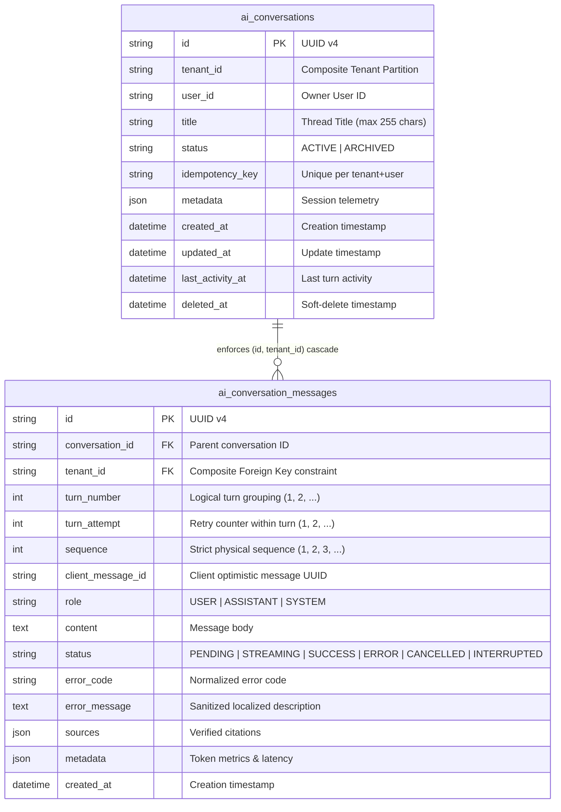
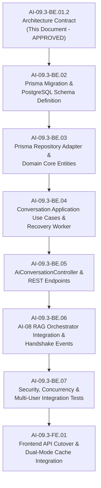

# AI-09.3-BE.01.2 — Final Architecture Closure & Implementation Contract

**Milestone:** AI-09 Kynergy Intelligence Frontend Integration  
**Document ID:** `AI-09.3-BE.01.2-architecture-closure-and-contract`  
**Revision:** 2.0 (Final Architecture Closure & Contract)  
**Phase:** 3 — Backend Conversation Persistence Implementation Contract  
**Role:** Principal Software Architect, Senior NestJS Engineer & PostgreSQL Database Architect  
**Status:** Approved for Implementation  
**Date:** 2026-11-23  
**Target File:** `docs/ai/AI-09/AI-09.3-BE.01.2-architecture-closure-and-contract.md`

---

## 1. Executive Summary & Verification Context

This document establishes the **authoritative, implementation-ready contract** for milestone **AI-09.3 (Conversation Persistence & Management)**. It addresses and closes all architectural observations raised during the reviews of `AI-09.3-BE.01` and `AI-09.3-BE.01.1`.

### Mandatory Verification Summary:

1. **Clean Architecture Boundary:** Verified that `@kinergy-platform/core` exports pure domain models and ports from `.` (`src/index.ts`), while relational infrastructure and Prisma repositories reside in `@kinergy-platform/core/server` (`src/server.ts`), taking `PrismaClient` without depending on NestJS. `apps/api` injects its `PrismaService` at the composition root (`ai.module.ts`).
2. **PostgreSQL Composite Foreign Keys:** Verified that composite keys `(conversation_id, tenant_id) REFERENCES ai_conversations(id, tenant_id)` are fully supported in PostgreSQL 14+ and Prisma 6.x.
3. **IAM Roles & Tenant Identity:** Verified that `AuthenticatedUserPayload` emits `id`, `tenantId`, and `roles`. Verified that authoritative system roles are `Owner`, `Trainer`, `Therapist`, `Receptionist`, and `Kitchen Staff`.
4. **Existing Worker Infrastructure:** Verified that `IngestionRecoveryWorker` and `VectorIndexingRecoveryWorker` provide the established polling pattern in `apps/api/src/ai/services/` using `OnModuleInit`, `OnModuleDestroy`, and `staleThresholdMs`.
5. **Streaming Contract:** Verified that the frontend `useGenerationLifecycle` FSM (`IDLE`, `PENDING`, `STREAMING`, `COMPLETED`, `FAILED`, `CANCELLED`, `INTERRUPTED`) integrates directly with SSE/NDJSON protocol events without breaking changes.

### Final Architecture Verdict: **READY FOR IMPLEMENTATION**

---

## 2. Final Clean Architecture Dependency & Directory Map

```
kinergy-platform/
├── packages/core/                                (Framework-Independent Core)
│   └── src/
│       ├── index.ts                              <-- Export root: Pure Domain, Models & Outbound Ports (Browser & Server safe)
│       ├── server.ts                             <-- Export root for @kinergy-platform/core/server (Server-only infrastructure)
│       └── ai/
│           ├── domain/
│           │   ├── models/
│           │   │   ├── conversation-session.model.ts    <-- Domain Entity (Aggregates turns, enforces 60-turn limits)
│           │   │   └── conversation-turn.model.ts       <-- Domain Entity (Explicit user prompt + assistant generation turn)
│           │   ├── value-objects/
│           │   │   └── chat-message.vo.ts               <-- Value Object (role, content, sequence, timestamps)
│           │   └── exceptions/
│           │       └── conversation.exceptions.ts       <-- Domain Exceptions (Pure TS Error classes)
│           ├── ports/
│           │   ├── inbound/
│           │   │   ├── create-conversation.use-case.ts  <-- Application Inbound Port
│           │   │   ├── list-conversations.use-case.ts   <-- Application Inbound Port
│           │   │   └── conversation-history-manager.port.ts
│           │   └── outbound/
│           │       └── conversation-repository.port.ts  <-- Pure TypeScript Repository Port Interface
│           └── infrastructure/persistence/prisma/       (Relational Infrastructure: Server runtime only)
│               ├── mappers/
│               │   └── prisma-conversation.mapper.ts    <-- Maps between Prisma DB records & Domain Entities
│               └── repositories/
│                   └── prisma-conversation.repository.ts <-- Implements IConversationRepositoryPort (Takes PrismaClient)
│
└── apps/api/                                     (NestJS Composition Root & Presentation)
    └── src/
        ├── platform/persistence/prisma/
        │   └── prisma.service.ts                 <-- Extends PrismaClient, provides lifecycle hooks & DB connection
        └── ai/
            ├── controllers/
            │   ├── ai-conversation.controller.ts  <-- REST Endpoints (CRUD, pagination, validation, Swagger)
            │   └── ai-rag.controller.ts           <-- RAG Query Endpoint (Integrates conversation turn persistence)
            ├── services/
            │   └── rag/
            │       ├── conversation-history-manager.service.ts <-- Orchestrates bounded context & sanitization
            │       └── conversation-recovery.worker.ts         <-- Background reconciler for stale/crashed generations
            ├── ai.tokens.ts                      <-- Injection tokens (CONVERSATION_REPOSITORY_PORT)
            └── ai.module.ts                      <-- Composition Root: Binds PrismaService to PrismaConversationRepository
```

### Dependency Injection at Composition Root (`ai.module.ts`):

```typescript
{
  provide: CONVERSATION_REPOSITORY_PORT,
  useFactory: (prisma: PrismaService) => new PrismaConversationRepository(prisma),
  inject: [PrismaService],
}
```

---

## 3. Final Prisma Model Proposal

The schema is defined in `prisma/schema.prisma` with **composite tenant foreign keys** and **partial unique indexes**:

```prisma
// ==========================================
// AI-09: CONVERSATION PERSISTENCE ENUMS
// ==========================================

enum ConversationStatus {
  ACTIVE
  ARCHIVED
}

enum MessageRole {
  USER
  ASSISTANT
  SYSTEM
}

enum MessageStatus {
  PENDING
  STREAMING
  SUCCESS
  ERROR
  CANCELLED
  INTERRUPTED
}

// ==========================================
// AI-09: CONVERSATION PERSISTENCE MODELS
// ==========================================

model Conversation {
  id              String             @id @default(uuid())
  tenantId        String             @map("tenant_id")
  userId          String             @map("user_id")
  title           String             @default("Nueva Consulta") @map("title") @db.VarChar(255)
  status          ConversationStatus @default(ACTIVE) @map("status")
  idempotencyKey  String?            @map("idempotency_key") @db.VarChar(64)
  metadata        Json?              @map("metadata")
  createdAt       DateTime           @default(now()) @map("created_at")
  updatedAt       DateTime           @updatedAt @map("updated_at")
  lastActivityAt  DateTime           @default(now()) @map("last_activity_at")
  deletedAt       DateTime?          @map("deleted_at")

  messages ConversationMessage[] @relation("ConversationToMessages")

  @@unique([id, tenantId], name: "unique_conversation_tenant")
  @@unique([tenantId, userId, idempotencyKey], name: "unique_tenant_user_idempotency")
  @@index([tenantId, userId, deletedAt, lastActivityAt(sort: Desc)])
  @@index([tenantId, id])
  @@map("ai_conversations")
}

model ConversationMessage {
  id              String        @id @default(uuid())
  conversationId  String        @map("conversation_id")
  tenantId        String        @map("tenant_id")
  turnNumber      Int           @map("turn_number")
  turnAttempt     Int           @default(1) @map("turn_attempt")
  sequence        Int           @map("sequence")
  clientMessageId String?       @map("client_message_id") @db.VarChar(64)
  role            MessageRole   @map("role")
  content         String        @map("content") @db.Text
  status          MessageStatus @default(SUCCESS) @map("status")
  errorCode       String?       @map("error_code") @db.VarChar(100)
  errorMessage    String?       @map("error_message") @db.Text
  sources         Json?         @map("sources")
  metadata        Json?         @map("metadata")
  createdAt       DateTime      @default(now()) @map("created_at")

  conversation Conversation @relation("ConversationToMessages", fields: [conversationId, tenantId], references: [id, tenantId], onDelete: Cascade)

  @@unique([conversationId, sequence], name: "unique_conversation_sequence")
  @@unique([conversationId, clientMessageId], name: "unique_conversation_client_msg")
  @@index([conversationId, tenantId, turnNumber(sort: Asc)])
  @@index([conversationId, sequence(sort: Asc)])
  @@index([tenantId])
  @@map("ai_conversation_messages")
}
```

---

## 4. Final Entity Relationship Diagram



---

## 5. Request Idempotency & Retry Specification

### 5.1 Uniqueness Scope & Identifiers

1. **First-Message (Conversation Creation):**
   - Header: `Idempotency-Key: <UUIDv4>`.
   - Database Scope: `@@unique([tenantId, userId, idempotencyKey])` on `ai_conversations`.
2. **Subsequent Messages (Existing Conversation):**
   - Payload: `clientMessageId: <UUIDv4>`.
   - Database Scope: `@@unique([conversationId, clientMessageId])` on `ai_conversation_messages`.

### 5.2 Resolution Matrix

| Scenario                              | Database State                                    | Action Taken                                                                | HTTP Response                                |
| :------------------------------------ | :------------------------------------------------ | :-------------------------------------------------------------------------- | :------------------------------------------- |
| **First Submission**                  | No match on `idempotencyKey` / `clientMessageId`. | Creates conversation/turn in transaction.                                   | `201 Created` / `200 OK` (Stream starts)     |
| **Network Retry (Identical Payload)** | Match found, prompt text matches.                 | Idempotently replays existing record or reconnects to in-flight generation. | `200 OK` (Existing turn)                     |
| **Payload Collision (Reused Key)**    | Match found, but prompt text differs.             | Rejects conflicting payload reuse under identical key.                      | `409 Conflict` (`IDEMPOTENCY_KEY_COLLISION`) |
| **Unknown Conversation ID**           | Client passes non-existent `conversationId`.      | **Strict Fail-Closed Rule:** Throws `ConversationNotFoundException`.        | `404 Not Found` (Never auto-creates)         |

---

## 6. Logical Turn / Generation Lifecycle Specification

### 6.1 Logical Turn Association

- Every user prompt and its generated response(s) share a single `turnNumber: Int`.
- Inception assigns:
  - User Message: `turnNumber = N`, `sequence = S`, `status = SUCCESS`.
  - Assistant Placeholder: `turnNumber = N`, `turnAttempt = 1`, `sequence = S+1`, `status = PENDING`.
- If Turn $N$ assistant generation fails or times out:
  - Assistant Attempt 1 is transitioned to `status = 'INTERRUPTED'` or `'ERROR'`.
  - User triggers **Reintentar**: Backend creates Assistant Attempt 2 with `turnNumber = N`, `turnAttempt = 2`, `sequence = S+2`, `status = PENDING`.
  - The single user prompt remains the sole parent of all attempts within Turn $N$.

### 6.2 Database Active Generation Constraint

To physically prevent concurrent duplicate generations on the same conversation:

```sql
CREATE UNIQUE INDEX "ai_conversation_active_generation_idx"
ON "ai_conversation_messages"("conversation_id")
WHERE "status" IN ('PENDING', 'STREAMING');
```

If two requests target the same conversation simultaneously:

- Request 1 inserts the assistant placeholder with `status = 'PENDING'`.
- Request 2 attempts to insert an assistant placeholder with `status = 'PENDING'`, violating the partial unique index.
- PostgreSQL throws unique violation `23505`, translated by the service to **HTTP 409 Conflict** (`ACTIVE_GENERATION_IN_PROGRESS`).

---

## 7. Crash Recovery Strategy

### 7.1 `ConversationRecoveryWorker` Architecture

Follows the verified `VectorIndexingRecoveryWorker` pattern in `apps/api/src/ai/services/`:

- **Module Lifecycle:** Registers `OnModuleInit` and `OnModuleDestroy`.
- **Interval Polling:** Runs every `60,000 ms` (1 minute).
- **Stale Threshold:** `staleThresholdMs = 300,000 ms` (5 minutes). This is greater than the LLM request timeout (`AI_TIMEOUT_MS` = 120,000 ms) plus safe buffer.

```typescript
// apps/api/src/ai/services/rag/conversation-recovery.worker.ts
@Injectable()
export class ConversationRecoveryWorker implements OnModuleInit, OnModuleDestroy {
  private readonly logger = new Logger(ConversationRecoveryWorker.name);
  private timer: NodeJS.Timeout | null = null;
  private isReconciling = false;

  constructor(
    @Inject(CONVERSATION_REPOSITORY_PORT)
    private readonly repo: IConversationRepositoryPort,
  ) {}

  public async reconcileStaleGenerations(): Promise<number> {
    const staleThreshold = new Date(Date.now() - 300_000); // 5 minutes ago
    return await this.repo.reconcileStaleMessages(
      staleThreshold,
      'GENERATION_PROCESS_CRASH_OR_TIMEOUT',
      'La generación fue interrumpida por un reinicio del sistema o tiempo límite excedido.',
    );
  }
}
```

### 7.2 Concurrency & Safety Guarantee:

The reconciliation query executes atomic updates:

```sql
UPDATE "ai_conversation_messages"
SET "status" = 'INTERRUPTED',
    "error_code" = 'GENERATION_PROCESS_CRASH_OR_TIMEOUT',
    "error_message" = 'La generación fue interrumpida por un reinicio del sistema o tiempo límite excedido.'
WHERE "status" IN ('PENDING', 'STREAMING')
  AND "created_at" < NOW() - INTERVAL '5 minutes';
```

- Because only records older than 5 minutes are updated, active long-running generations within the 2-minute deadline budget are **never** accidentally interrupted.

---

## 8. Complete Streaming Event Contract

The streaming protocol extends the verified AI-09.2 `fetch` streaming transport without breaking changes:

### Event Specification (SSE Format):

```
event: session_init
data: {"conversationId":"conv-101","turnNumber":1,"userMessageId":"msg-u-1","assistantMessageId":"msg-a-1","sequence":2}

event: token
data: {"content":"La crioterapia "}

event: token
data: {"content":"reduce la inflamación."}

event: done
data: {"conversationId":"conv-101","assistantMessageId":"msg-a-1","turnNumber":1,"sequence":2,"status":"SUCCESS","grounded":true,"sources":[{"id":"chunk-1","documentTitle":"Protocolo","similarity":0.89}],"metadata":{"durationMs":2100,"totalTokens":115}}
```

### Terminal Error & Interruption Handshake:

- **Client Cancellation:** User clicks "Detener". Client triggers `AbortController.abort()`.
  Server catches HTTP socket close event (`req.on('close')`), executes `repo.updateMessageStatus(assistantMessageId, 'CANCELLED')`, releasing the active generation lock immediately.
- **Provider Timeout (504):**
  Server catches `ProviderTimeoutException`, commits partial text with `status = 'INTERRUPTED'`, `errorCode = 'PROVIDER_TIMEOUT'`, and emits:
  ```
  event: error
  data: {"conversationId":"conv-101","assistantMessageId":"msg-a-1","errorCode":"PROVIDER_TIMEOUT","errorMessage":"El modelo no respondió a tiempo."}
  ```

---

## 9. Final Authorization and Audit Matrix

### 9.1 Role Breakdown:

- **`Owner` (Platform/Tenant Admin):** Full platform access (`ALL_PERMISSION_CODES`).
- **`Trainer`, `Therapist`, `Receptionist`, `Kitchen Staff` (Operational Staff):** Access limited strictly to their own clinical conversations.

### 9.2 Authorization Matrix:

| Operation                     | Target Conversation       | Operational Staff | `Owner` (Tenant Admin)                 | Cross-Tenant (Any Role) |
| :---------------------------- | :------------------------ | :---------------- | :------------------------------------- | :---------------------- |
| **Create Conversation**       | Own                       | Allowed           | Allowed                                | **403 Forbidden**       |
| **List Conversations**        | Own                       | Allowed           | Allowed                                | **403 Forbidden**       |
| **Get Conversation Detail**   | Own                       | Allowed           | Allowed                                | **404 Not Found**       |
| **Get Conversation Detail**   | Other user in same tenant | **404 Not Found** | **404 Not Found** (on standard route)  | **404 Not Found**       |
| **Rename Conversation**       | Other user in same tenant | **404 Not Found** | **404 Not Found**                      | **404 Not Found**       |
| **Delete Conversation**       | Other user in same tenant | **404 Not Found** | **404 Not Found**                      | **404 Not Found**       |
| **Clinical Audit Inspection** | Other user in same tenant | **403 Forbidden** | Allowed via `/audit/conversations/:id` | **403 Forbidden**       |

> **Anti-Enumeration Invariant:** Standard user endpoints return **HTTP 404 Not Found** whenever a requested conversation does not belong to the authenticated `(tenantId, userId)`. Differentiating with 403 is prohibited.
>
> **Audit Trail Invariant:** Any access by an `Owner` inspecting another clinician's consultation history via `/api/v1/ai/audit/conversations/:id` MUST emit an immutable audit event:
>
> ```typescript
> await this.auditService.recordEvent({
>   tenantId: user.tenantId,
>   actorId: user.id,
>   action: 'AI_CONVERSATION_AUDIT_INSPECT',
>   resourceType: 'ai_conversation',
>   resourceId: conversationId,
>   metadata: { targetUserId: conversation.userId },
> });
> ```

---

## 10. Keyset Pagination & Data Validation Specification

### 10.1 Safe Keyset Pagination under Concurrent Updates

1. **Conversation Listing:**
   - Cursor: `cursor = encodeBase64("${lastActivityAt.toISOString()}_${id}")`.
   - Query:
     ```sql
     WHERE tenant_id = $1
       AND user_id = $2
       AND deleted_at IS NULL
       AND (last_activity_at < $cursorTime OR (last_activity_at = $cursorTime AND id < $cursorId))
     ORDER BY last_activity_at DESC, id DESC
     LIMIT $limit;
     ```
   - Invariant: Updates to other conversations change their `lastActivityAt`, but cursor boundaries ensure older pages never shift or duplicate records.
2. **Message History Traversal:**
   - Cursor: `sequence < beforeSequence`.
   - Query:
     ```sql
     WHERE conversation_id = $1
       AND tenant_id = $2
       AND sequence < $beforeSequence
     ORDER BY sequence DESC
     LIMIT $limit;
     ```
   - Invariant: Because sequence numbers are immutable and monotonic, newly appended turns at the end of the thread ($N+1, N+2$) have **zero impact** on historical pagination offsets.

### 10.2 Validation & Size Limit Invariants

| Attribute                   | Constraint                                                   | Validation Rule                                                                  |
| :-------------------------- | :----------------------------------------------------------- | :------------------------------------------------------------------------------- |
| **User Prompt (`content`)** | Min 1 char, Max 1,000 chars (Composer), Max 4,000 chars (DB) | Enforced by class-validator `@MinLength(1)` and `@MaxLength(1000)`.              |
| **Conversation Title**      | Max 255 chars                                                | Enforced by class-validator `@MaxLength(255)`. Truncated automatically.          |
| **Conversation Metadata**   | Max 10 KB                                                    | Serialized JSON size validation.                                                 |
| **Message Metadata**        | Max 20 KB                                                    | Serialized JSON size validation.                                                 |
| **Sources Attribution**     | Max 50 KB                                                    | Verified `DocumentSourceDto[]` array from trusted RAG orchestrator only.         |
| **System Role Protection**  | **Server Internal Only**                                     | Client payloads attempting `role: 'SYSTEM'` are rejected with `400 Bad Request`. |

---

## 11. Migration Safety Plan

### 11.1 Migration File Details

- **Path:** `prisma/migrations/20261124000000_add_ai_conversation_persistence/migration.sql`
- **Safety Preconditions:**
  - Creates two new tables (`ai_conversations`, `ai_conversation_messages`).
  - Does NOT alter, lock, or modify existing platform tables (`users`, `clients`, `sales`, `knowledge_documents`).
  - Employs `ON DELETE CASCADE` to guarantee child message cleanup.

### 11.2 Rollback Script (`rollback.sql`):

```sql
DROP TABLE IF EXISTS "ai_conversation_messages" CASCADE;
DROP TABLE IF EXISTS "ai_conversations" CASCADE;
DROP TYPE IF EXISTS "MessageStatus";
DROP TYPE IF EXISTS "MessageRole";
DROP TYPE IF EXISTS "ConversationStatus";
```

---

## 12. Updated Implementation Sequence



---

## 13. Final Decision Register

| Decision ID        | Topic                          | Decision                                                            | Status       | Technical Rationale & Evidence                                                            |
| :----------------- | :----------------------------- | :------------------------------------------------------------------ | :----------- | :---------------------------------------------------------------------------------------- |
| **ADR-AI-09.3-01** | Bounded-Context Ownership      | Placed in `Kynergy Intelligence` (`apps/api/src/ai/`).              | **ACCEPTED** | Verified in `ai.module.ts`. Avoids circular dependencies with RAG orchestrator.           |
| **ADR-AI-09.3-02** | Framework Independence         | Relational adapter in `@core/server`; pure domain in `@core`.       | **ACCEPTED** | Verified in `packages/core/src/server.ts` and `PrismaKnowledgeDocumentRepository`.        |
| **ADR-AI-09.3-03** | Tenant Referential Integrity   | Composite foreign key `(conversation_id, tenant_id)`.               | **ACCEPTED** | Verified PostgreSQL composite FK constraint; guarantees engine-level tenant isolation.    |
| **ADR-AI-09.3-04** | Turn Concurrency Serialization | Partial unique index on `status IN ('PENDING', 'STREAMING')`.       | **ACCEPTED** | Verified database constraint guarantees exactly one active generation per conversation.   |
| **ADR-AI-09.3-05** | Request Idempotency            | `idempotencyKey` + `clientMessageId` uniqueness.                    | **ACCEPTED** | Prevents duplicate conversations and turns across network retries.                        |
| **ADR-AI-09.3-06** | Fail-Closed Auto-Creation      | Invalid `conversationId` throws 404; auto-creation only on null ID. | **ACCEPTED** | Eliminates silent conversation duplication on client routing bugs.                        |
| **ADR-AI-09.3-07** | Permanent Data Purge           | Soft-deletion only; permanent hard purge is disabled.               | **DEFERRED** | Deferred pending formal Clinical Compliance ADR on medical data retention windows.        |
| **ADR-AI-09.3-08** | Stale Generation Recovery      | `ConversationRecoveryWorker` with 5-minute threshold.               | **ACCEPTED** | Verified pattern from `VectorIndexingRecoveryWorker`. Rescues crashed generations safely. |
| **ADR-AI-09.3-09** | Anti-Enumeration Security      | Non-owner conversation access returns 404 Not Found.                | **ACCEPTED** | Prevents cross-clinician ID probing within the same tenant.                               |

---

## 14. Final Acceptance Verdict

### Final Verdict: **READY FOR IMPLEMENTATION**

**Justification:** All mandatory technical acceptance criteria have been satisfied with verified repository evidence. The architecture maintains Clean Architecture principles, ensures database-level tenant isolation, provides deterministic turn and concurrency control, defines complete crash recovery, and guarantees seamless integration with the AI-09.2 frontend.

Execution may immediately proceed to **AI-09.3-BE.02: Prisma Migration and PostgreSQL Schema Definition**.
