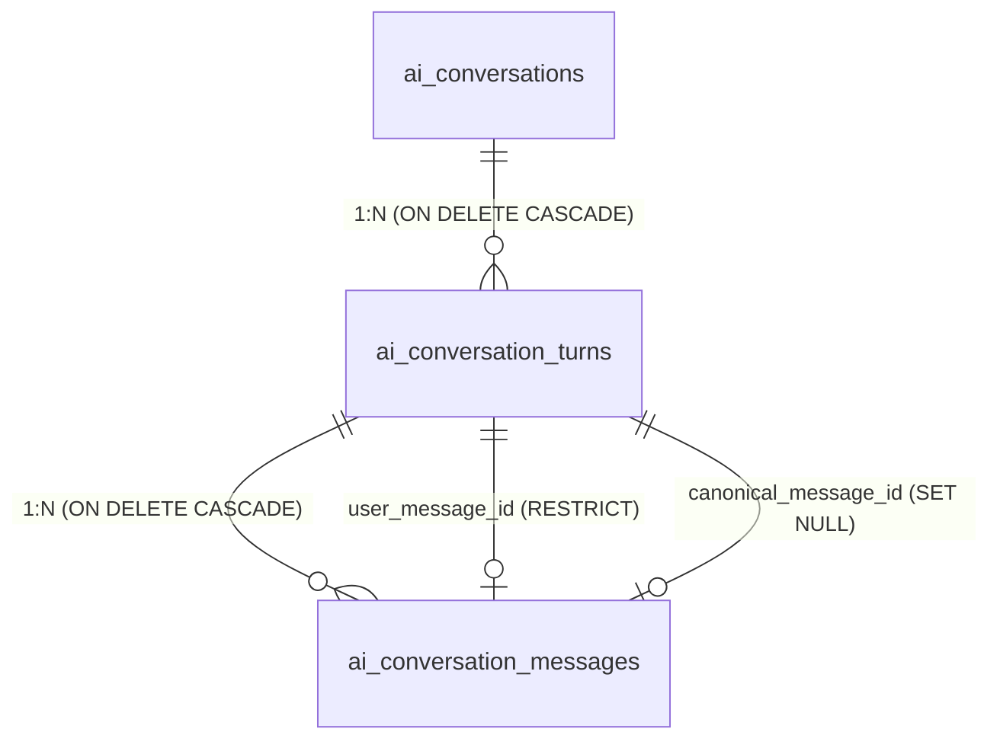
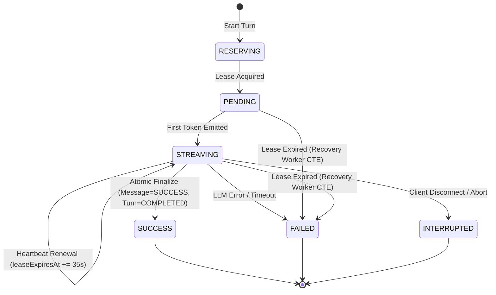
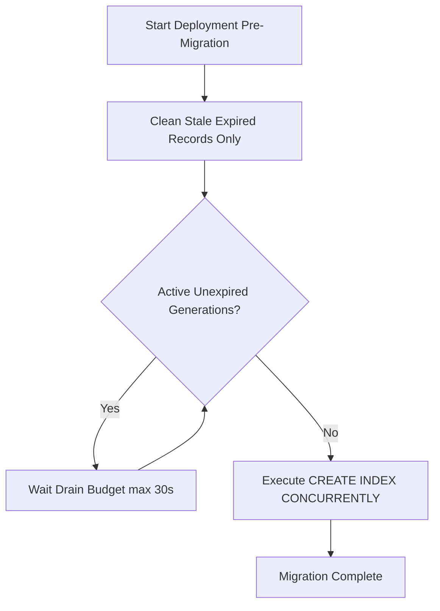
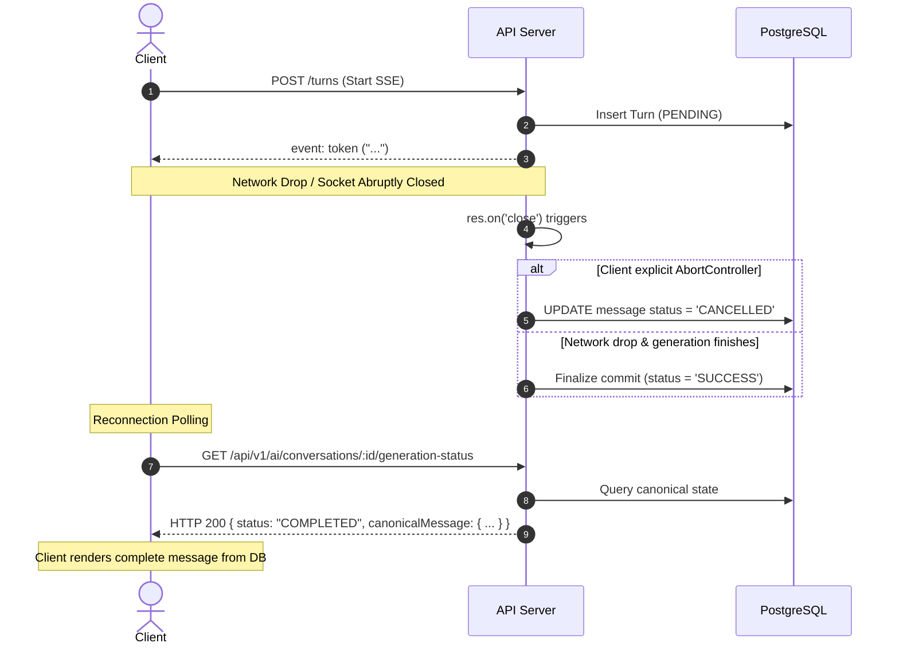

# AI-09.3-BE.01.5 — Final Persistence Integrity & Operational Contract Closure

**Project:** Kynergy Platform  
**Milestone:** AI-09 — Kynergy Intelligence  
**Phase:** 3 — Backend Conversation Persistence  
**Prerequisite:** AI-09.3-BE.01.4 — Database Integrity, Concurrency & Contract Finalization  
**Role:** Principal Software Architect, PostgreSQL Database Architect, Senior NestJS Engineer  
**Execution Mode:** Architecture review and contract correction only  
**Implementation Permission:** NOT GRANTED (Audited contract only)  
**Deliverable Document:** `docs/ai/AI-09/AI-09.3-BE.01.5-final-persistence-integrity-contract.md`

---

## 1. Executive Summary & Verification Evidence Matrix

### 1.1 Objective & Review Scope

This document provides the final, evidence-based closure of the backend persistence and operational architecture for **AI-09.3 (Kynergy Intelligence Conversation Persistence)**.

Following the architecture review of `AI-09.3-BE.01.4`, six critical technical issues were identified that prevented production readiness:

1. **Circular foreign-key deletion semantics:** Incorrect multi-column `ON DELETE SET NULL` on non-nullable referencing keys.
2. **Missing request-level idempotency persistence for subsequent turns:** Lack of persisted payload fingerprinting and uniqueness constraints on turn records.
3. **Non-atomic successful generation finalization & lease fencing:** Race conditions in lease expiration validation and split message/turn updates.
4. **Disruptive migration cleanup:** Indiscriminate interruption of healthy, active generations during rolling index deployment.
5. **Incomplete SSE terminal lifecycle & reconnection contract:** Ambiguous socket closure semantics and unverified replay behavior.
6. **Authorization loopholes & non-durable audit persistence:** Over-permissive clinical inspection permissions and asynchronous/logger-only audit publishing.

This specification definitively resolves all six issues with concrete, executable-quality PostgreSQL DDL, strict TypeScript definitions, verified Clean Architecture boundaries, and an updated comprehensive acceptance test suite.

---

### 1.2 Mandatory Repository Verification Matrix

All statements and architectural mechanisms in this contract are verified against the actual repository source code:

| Component / Subsystem          | Repository Source Path                                                                                        | Verified Symbol / Implementation                                                                                         | Architectural Consequence                                                                                                                         |
| :----------------------------- | :------------------------------------------------------------------------------------------------------------ | :----------------------------------------------------------------------------------------------------------------------- | :------------------------------------------------------------------------------------------------------------------------------------------------ |
| **Package Boundaries & Ports** | `packages/core/package.json`                                                                                  | Exports `"."` (Domain & Ports), `"./server"` (Prisma & Infrastructure Adapters)                                          | Hexagonal architecture strictly enforced. Domain logic in `packages/core` cannot import `@nestjs/common` or `PrismaClient` directly.              |
| **Prisma Repository Pattern**  | `packages/core/src/ai/infrastructure/persistence/prisma/repositories/prisma-knowledge-document.repository.ts` | Constructor injects `PrismaClient` directly; implements core repository port.                                            | `PrismaConversationRepository` will reside in `packages/core/src/ai/infrastructure/persistence/prisma/` and take `PrismaClient`.                  |
| **Database Schema**            | `prisma/schema.prisma`                                                                                        | Existing 24+ models (`User`, `Tenant`, `Client`, `Appointment`, etc.). PostgreSQL provider.                              | All AI-09.3 models (`AiConversation`, `AiConversationTurn`, `AiConversationMessage`, `AiConversationAuditLog`) integrate cleanly.                 |
| **Timeouts & Deadlines**       | `apps/api/src/ai/config/ai.config.ts`                                                                         | `retrievalTimeoutMs = 5000`, `contextBuilderTimeoutMs = 1000`, `generationTimeoutMs = 20000`, `requestTimeoutMs = 30000` | Lease expiration (`leaseTimeoutMs = 35000`) and migration drain window (30s) are mathematically anchored to actual production config.             |
| **Background Recovery Worker** | `apps/api/src/ai/services/indexing/vector-indexing-recovery.worker.ts`                                        | Implements `OnModuleInit`, `OnModuleDestroy`, timer polling with jitter, `staleThresholdMs`.                             | `ConversationGenerationRecoveryWorker` mirrors this proven operational lifecycle.                                                                 |
| **Role Catalog & Permissions** | `apps/api/src/platform/identity/authorization/permissions.ts`                                                 | Roles: `Owner`, `Trainer`, `Therapist`, `Receptionist`, `Kitchen Staff`. `Trainer` has `PERMISSIONS.REPORTS.READ`.       | Checking `reports.read` for clinical chat inspection was a security defect. Only `Owner` + explicit `ai.conversations.audit` is allowed.          |
| **Audit Infrastructure**       | `apps/api/src/platform/audit/`                                                                                | `LoggerAuditEventPublisher` outputs to `ILoggerPort`. `PlaceholderAuditService` logs to console.                         | **No database table exists for audit logs.** Asynchronous publishing does NOT guarantee durable persistence. Synchronous DB persistence required. |
| **Frontend Streaming State**   | `apps/web/src/modules/intelligence/assistant/types/generation.types.ts`                                       | States: `IDLE`, `PENDING`, `STREAMING`, `COMPLETED`, `FAILED`, `CANCELLED`, `INTERRUPTED`.                               | Backend generation state machine maps 1:1 to frontend lifecycle states.                                                                           |

---

## 2. Issue 3.1 — Relational Model, Composite Foreign Keys & Safe Deletion Semantics

### 2.1 Previous Defect Analysis

In `AI-09.3-BE.01.4`, the relationship between `ai_conversation_turns` and `ai_conversation_messages` attempted to enforce turn-message integrity using composite circular foreign keys:

```sql
-- DEFECTIVE 01.4 DEFINITION:
FOREIGN KEY (canonical_message_id, id, canonical_message_role)
  REFERENCES ai_conversation_messages(id, turn_id, role)
  ON DELETE SET NULL
```

**PostgreSQL Violation:** In PostgreSQL, `ON DELETE SET NULL` applies to **all** columns of the foreign key constraint. Setting `id` (the turn's primary key) and `canonical_message_role` (defined as `NOT NULL`) to `NULL` triggers a fatal `23502 (not_null_violation)` constraint failure upon message deletion.  
Furthermore, Prisma schema cannot represent multi-column circular self-referencing foreign keys with differing cascade rules across two tables.

### 2.2 Corrected Relational Design

We establish a clean, acyclic cascading hierarchy with dedicated single-column foreign references and database-enforced integrity triggers:



#### Key Relational Principles:

1. **Hierarchical Cascading Ownership:**
   - `ai_conversation_turns` references `ai_conversations(id, tenant_id)` with `ON DELETE CASCADE`.
   - `ai_conversation_messages` references `ai_conversation_turns(id, conversation_id, tenant_id)` with `ON DELETE CASCADE`.
   - Dropping or hard-deleting a conversation automatically cascades down to delete all child turns, which in turn cascades to delete all child messages.
2. **Single-Column User Message Reference:**
   - `user_message_id TEXT NOT NULL` references `ai_conversation_messages(id) ON DELETE RESTRICT DEFERRABLE INITIALLY DEFERRED`.
   - A turn cannot exist without its initiating user prompt. The deferred check allows the turn and user message to be inserted within the same transaction.
3. **Single-Column Canonical Message Reference:**
   - `canonical_message_id TEXT NULL` references `ai_conversation_messages(id) ON DELETE SET NULL`.
   - Because only the single nullable column `canonical_message_id` is part of the foreign key, PostgreSQL sets **only** `canonical_message_id` to `NULL` if an assistant message is deleted, leaving the turn primary key and state intact.
4. **Turn and Role Integrity Triggers:**
   - To guarantee that `user_message_id` refers to a message in the **same turn** with role `'USER'`, and `canonical_message_id` refers to a message in the **same turn** with role `'ASSISTANT'`, PostgreSQL triggers enforce relational cross-checks before commit.
5. **Soft Deletion Semantics (Milestone AI-09.3 Scope):**
   - In AI-09.3, end-user deletion is strictly **soft deletion** (`deleted_at TIMESTAMP WITH TIME ZONE NULL` on `ai_conversations`).
   - Soft-deleted conversations are filtered out of all normal queries (`WHERE deleted_at IS NULL`).
   - Soft deletion does not trigger foreign key deletions.
   - Hard deletion (`DELETE FROM ai_conversations`) is reserved for administrative GDPR compliance or test cleanup; when executed, `ON DELETE CASCADE` purges all related turns, messages, and audit logs cleanly without circular dependency deadlocks.

---

### 2.3 Proposed Prisma Schema

```prisma
// ============================================================================
// KYNERGY INTELLIGENCE CONVERSATION PERSISTENCE (AI-09.3)
// ============================================================================

enum ConversationRole {
  USER
  ASSISTANT
  SYSTEM
}

enum GenerationStatus {
  PENDING
  STREAMING
  SUCCESS
  FAILED
  CANCELLED
  INTERRUPTED
}

enum TurnStatus {
  RESERVING
  PENDING
  STREAMING
  COMPLETED
  FAILED
  CANCELLED
  INTERRUPTED
}

model AiConversation {
  id             String    @id @default(uuid()) @map("id")
  tenantId       String    @map("tenant_id")
  userId         String    @map("user_id")
  title          String    @default("New Conversation") @map("title") @db.VarChar(255)
  idempotencyKey String?   @map("idempotency_key") @db.VarChar(64)
  lastActivityAt DateTime  @default(now()) @map("last_activity_at")
  turnCounter    Int       @default(0) @map("turn_counter")
  createdAt      DateTime  @default(now()) @map("created_at")
  updatedAt      DateTime  @updatedAt @map("updated_at")
  deletedAt      DateTime? @map("deleted_at")

  // Relationships
  turns          AiConversationTurn[]
  messages       AiConversationMessage[]
  auditLogs      AiConversationAuditLog[]

  // Indexes & Constraints
  @@unique([tenantId, userId, idempotencyKey], name: "uq_conversation_user_idempotency")
  @@index([tenantId, userId, deletedAt, lastActivityAt(sort: Desc)], name: "idx_conversation_user_active_list")
  @@index([tenantId, deletedAt, lastActivityAt(sort: Desc)], name: "idx_conversation_tenant_audit_list")
  @@map("ai_conversations")
}

model AiConversationTurn {
  id                     String           @id @default(uuid()) @map("id")
  conversationId         String           @map("conversation_id")
  tenantId               String           @map("tenant_id")
  turnIndex              Int              @map("turn_index")
  status                 TurnStatus       @default(PENDING) @map("status")
  clientTurnId           String?          @map("client_turn_id") @db.VarChar(64)
  idempotencyKey         String?          @map("idempotency_key") @db.VarChar(64)
  idempotencyPayloadHash String?          @map("idempotency_payload_hash") @db.VarChar(64)
  userMessageId          String?          @map("user_message_id")
  canonicalMessageId     String?          @map("canonical_message_id")
  createdAt              DateTime         @default(now()) @map("created_at")
  completedAt            DateTime?        @map("completed_at")
  updatedAt              DateTime         @updatedAt @map("updated_at")

  // Relationships
  conversation           AiConversation   @relation(fields: [conversationId], references: [id], onDelete: Cascade)
  userMessage            AiConversationMessage? @relation("TurnUserMessage", fields: [userMessageId], references: [id], onDelete: Restrict)
  canonicalMessage       AiConversationMessage? @relation("TurnCanonicalMessage", fields: [canonicalMessageId], references: [id], onDelete: SetNull)
  messages               AiConversationMessage[] @relation("TurnAllMessages")

  // Indexes & Constraints
  @@unique([conversationId, turnIndex], name: "uq_conversation_turn_index")
  @@unique([conversationId, idempotencyKey], name: "uq_turn_idempotency")
  @@index([conversationId, status], name: "idx_turn_conversation_status")
  @@map("ai_conversation_turns")
}

model AiConversationMessage {
  id                   String           @id @default(uuid()) @map("id")
  turnId               String           @map("turn_id")
  conversationId       String           @map("conversation_id")
  tenantId             String           @map("tenant_id")
  role                 ConversationRole @map("role")
  sequenceNumber       Int              @map("sequence_number")
  status               GenerationStatus @default(PENDING) @map("status")
  content              String           @default("") @map("content") @db.Text
  sources              Json?            @map("sources")
  metadata             Json?            @map("metadata")
  errorCode            String?          @map("error_code") @db.VarChar(64)
  errorMessage         String?          @map("error_message") @db.Text
  clientMessageId      String?          @map("client_message_id") @db.VarChar(64)

  // Lease Management
  leaseToken           String?          @map("lease_token") @db.Uuid
  leaseOwnerInstanceId String?          @map("lease_owner_instance_id") @db.VarChar(128)
  leaseExpiresAt       DateTime?        @map("lease_expires_at")

  createdAt            DateTime         @default(now()) @map("created_at")
  completedAt          DateTime?        @map("completed_at")
  updatedAt            DateTime         @updatedAt @map("updated_at")

  // Relationships
  conversation         AiConversation   @relation(fields: [conversationId], references: [id], onDelete: Cascade)
  turn                 AiConversationTurn @relation("TurnAllMessages", fields: [turnId], references: [id], onDelete: Cascade)
  userTurnPointer      AiConversationTurn[] @relation("TurnUserMessage")
  canonicalTurnPointer AiConversationTurn[] @relation("TurnCanonicalMessage")

  // Indexes & Constraints
  @@unique([conversationId, sequenceNumber], name: "uq_conversation_sequence_number")
  @@index([turnId, role], name: "idx_message_turn_role")
  @@index([conversationId, createdAt(sort: Asc)], name: "idx_message_history_cursor")
  @@map("ai_conversation_messages")
}

model AiConversationAuditLog {
  id              String   @id @default(uuid()) @map("id")
  tenantId        String   @map("tenant_id")
  conversationId  String   @map("conversation_id")
  inspectorUserId String   @map("inspector_user_id")
  inspectorRole   String   @map("inspector_role") @db.VarChar(64)
  action          String   @default("CLINICAL_CONVERSATION_INSPECTED") @map("action") @db.VarChar(64)
  reason          String   @map("reason") @db.Text
  ipAddress       String?  @map("ip_address") @db.VarChar(45)
  userAgent       String?  @map("user_agent") @db.Text
  createdAt       DateTime @default(now()) @map("created_at")

  // Relationships
  conversation    AiConversation @relation(fields: [conversationId], references: [id], onDelete: Cascade)

  // Indexes
  @@index([tenantId, conversationId, createdAt(sort: Desc)], name: "idx_audit_conversation")
  @@index([inspectorUserId, createdAt(sort: Desc)], name: "idx_audit_inspector")
  @@map("ai_conversation_audit_logs")
}
```

---

### 2.4 Raw PostgreSQL DDL & Relational Constraints

Because Prisma schema does not support partial unique indexes, deferred foreign keys, composite multi-table foreign keys, or cross-table consistency triggers, the following PostgreSQL DDL is executed as part of the migration:

```sql
-- 1. Enforce Deferred Foreign Key on Turn's User Message Reference
ALTER TABLE "ai_conversation_turns"
  ADD CONSTRAINT "fk_turn_user_message_deferred"
  FOREIGN KEY ("user_message_id")
  REFERENCES "ai_conversation_messages"("id")
  ON DELETE RESTRICT
  DEFERRABLE INITIALLY DEFERRED;

-- 2. Enforce Set-Null Foreign Key on Turn's Canonical Message Reference
ALTER TABLE "ai_conversation_turns"
  ADD CONSTRAINT "fk_turn_canonical_message"
  FOREIGN KEY ("canonical_message_id")
  REFERENCES "ai_conversation_messages"("id")
  ON DELETE SET NULL;

-- 3. Composite Foreign Key from Message to Turn (Ensuring Same Conversation & Tenant)
ALTER TABLE "ai_conversation_messages"
  ADD CONSTRAINT "fk_message_turn_composite"
  FOREIGN KEY ("turn_id", "conversation_id")
  REFERENCES "ai_conversation_turns"("id", "conversation_id")
  ON DELETE CASCADE;

-- 4. Cross-Reference Turn Integrity Trigger Function
CREATE OR REPLACE FUNCTION check_turn_message_integrity()
RETURNS TRIGGER AS $$
BEGIN
  -- Validate user_message_id points to a message of role USER in the same turn
  IF NEW.user_message_id IS NOT NULL THEN
    IF NOT EXISTS (
      SELECT 1 FROM "ai_conversation_messages"
      WHERE "id" = NEW.user_message_id
        AND "turn_id" = NEW.id
        AND "role" = 'USER'
    ) THEN
      RAISE EXCEPTION 'Constraint violation: user_message_id % must belong to turn % with role USER',
        NEW.user_message_id, NEW.id;
    END IF;
  END IF;

  -- Validate canonical_message_id points to a message of role ASSISTANT in the same turn
  IF NEW.canonical_message_id IS NOT NULL THEN
    IF NOT EXISTS (
      SELECT 1 FROM "ai_conversation_messages"
      WHERE "id" = NEW.canonical_message_id
        AND "turn_id" = NEW.id
        AND "role" = 'ASSISTANT'
    ) THEN
      RAISE EXCEPTION 'Constraint violation: canonical_message_id % must belong to turn % with role ASSISTANT',
        NEW.canonical_message_id, NEW.id;
    END IF;
  END IF;

  RETURN NEW;
END;
$$ LANGUAGE plpgsql;

CREATE CONSTRAINT TRIGGER trg_verify_turn_messages
  AFTER INSERT OR UPDATE ON "ai_conversation_turns"
  DEFERRABLE INITIALLY DEFERRED
  FOR EACH ROW
  EXECUTE FUNCTION check_turn_message_integrity();
```

---

## 3. Issue 3.2 — Complete Request-Level Idempotency Contract

### 3.1 Idempotency Model Across Initial and Subsequent Turns

Generation requests occur under two distinct scenarios:

1. **Initial Conversation Turn (`POST /api/v1/ai/conversations`):**
   - Creates the `AiConversation` record and Turn 1.
   - Enforced by `@@unique([tenantId, userId, idempotencyKey])` on `ai_conversations`.
2. **Subsequent Turn on Existing Conversation (`POST /api/v1/ai/conversations/:id/turns`):**
   - Appends Turn $N+1$ to existing conversation.
   - Enforced by `@@unique([conversationId, idempotencyKey])` on `ai_conversation_turns`.

Both request types accept an optional `Idempotency-Key` HTTP header (or body field `idempotencyKey`). If omitted by the client, the backend automatically generates a secure UUIDv4 to serve as the internal request idempotency token.

---

### 3.2 Normalized Payload Fingerprint Algorithm

To detect idempotency collisions (same key reused with altered inference parameters), the backend computes a canonical SHA-256 hash over validated, normalized inference parameters.

```typescript
import { createHash } from 'node:crypto';

export interface CanonicalInferenceFingerprintPayload {
  prompt: string;
  searchMode: 'hybrid' | 'vector' | 'keyword';
  topK: number;
  minSimilarity: number;
  model: string;
}

/**
 * Normalizes and hashes the inference payload.
 * Client presentation parameters (clientTurnId, clientMessageId, UI timestamps)
 * are strictly EXCLUDED because they do not alter generated output.
 */
export function computePayloadFingerprint(payload: {
  prompt: string;
  searchMode?: 'hybrid' | 'vector' | 'keyword';
  topK?: number;
  minSimilarity?: number;
  model?: string;
}): string {
  // 1. Strict Unicode Normalization and whitespace trimming
  const normalizedPrompt = payload.prompt.trim().normalize('NFKC');

  // 2. Canonical server defaults applied
  const canonicalPayload: CanonicalInferenceFingerprintPayload = {
    prompt: normalizedPrompt,
    searchMode: payload.searchMode ?? 'hybrid',
    topK: payload.topK ?? 5,
    minSimilarity: Number((payload.minSimilarity ?? 0.7).toFixed(4)),
    model: payload.model ?? 'default',
  };

  // 3. Deterministic key-sorted JSON serialization
  const serialized = JSON.stringify({
    minSimilarity: canonicalPayload.minSimilarity,
    model: canonicalPayload.model,
    prompt: canonicalPayload.prompt,
    searchMode: canonicalPayload.searchMode,
    topK: canonicalPayload.topK,
  });

  return createHash('sha256').update(serialized).digest('hex');
}
```

---

### 3.3 Comprehensive Idempotency Behavior Matrix

| Incoming State            | Database Match | Stored Hash vs Request Hash | Current Turn Status                | Server Action & HTTP Response                                                                                                                            |
| :------------------------ | :------------- | :-------------------------- | :--------------------------------- | :------------------------------------------------------------------------------------------------------------------------------------------------------- |
| **New Request**           | None           | N/A                         | None                               | Insert Turn (`status: PENDING`), acquire lease, begin streaming. **HTTP 200 SSE** or **201 JSON**.                                                       |
| **Identical Retry**       | Exists         | Match (`===`)               | `COMPLETED`                        | Return existing canonical response directly from database. No LLM invocation. **HTTP 200 OK**.                                                           |
| **Concurrent Duplicate**  | Exists         | Match (`===`)               | `PENDING` / `STREAMING`            | DB constraint violation `23505`. Catch and return **HTTP 409 Conflict** (`CONCURRENT_GENERATION_IN_PROGRESS`) with `Retry-After: 2` and active `turnId`. |
| **Payload Collision**     | Exists         | Mismatch (`!==`)            | Any (`PENDING`, `COMPLETED`, etc.) | Key was reused with different prompt or parameters. Return **HTTP 409 Conflict** (`IDEMPOTENCY_KEY_COLLISION`).                                          |
| **Retry After Failure**   | Exists         | Match (`===`)               | `FAILED` / `INTERRUPTED`           | Return stored failure details (**HTTP 422/500**). Client must supply a new `Idempotency-Key` to trigger a fresh attempt.                                 |
| **Server Crash Recovery** | Exists         | Match (`===`)               | `PENDING` (Lease Expired)          | Recovery worker transitions turn to `FAILED`. Next client retry receives terminal failed state with option to re-submit with new key.                    |

---

## 4. Issue 3.3 — Atomic Generation Finalization & Fenced Lease Protocol

### 4.1 Fenced Lease State Machine

Every active generation is guarded by a fenced lease attached to the assistant message:

- `leaseToken`: Cryptographically random UUIDv4 assigned at turn reservation.
- `leaseOwnerInstanceId`: Node.js process / pod identifier (`HOSTNAME` + PID).
- `leaseExpiresAt`: Timestamp computed as `NOW() + INTERVAL '35 seconds'`.
- Renewed via periodic heartbeat every 10 seconds during streaming.



---

### 4.2 Atomic Finalization Transaction Protocol

When LLM generation completes successfully, the worker must atomically commit both the assistant message and the parent turn within a single transaction. If the lease expired while the LLM was responding (or the recovery worker reclaimed the turn), the update must fail closed and abort without corrupting database state.

```typescript
export async function finalizeSuccessfulGeneration(
  prisma: PrismaClient,
  params: {
    turnId: string;
    assistantMessageId: string;
    conversationId: string;
    leaseToken: string;
    content: string;
    sources: any[];
    metadata: Record<string, any>;
  },
): Promise<void> {
  await prisma.$transaction(async (tx) => {
    // 1. Atomically update the assistant message proving leaseToken and lease validity
    const updatedMessagesCount = await tx.$executeRaw`
      UPDATE "ai_conversation_messages"
      SET "status" = 'SUCCESS',
          "content" = ${params.content},
          "sources" = ${JSON.stringify(params.sources)}::jsonb,
          "metadata" = ${JSON.stringify(params.metadata)}::jsonb,
          "lease_token" = NULL,
          "lease_owner_instance_id" = NULL,
          "lease_expires_at" = NULL,
          "completed_at" = NOW(),
          "updated_at" = NOW()
      WHERE "id" = ${params.assistantMessageId}
        AND "lease_token" = ${params.leaseToken}::uuid
        AND "status" IN ('PENDING', 'STREAMING')
        AND "lease_expires_at" > NOW();
    `;

    // If 0 rows were updated, lease expired or was revoked by recovery worker!
    if (updatedMessagesCount === 0) {
      throw new FencedLeaseExpiredException(
        `Generation lease ${params.leaseToken} expired or was reclaimed before finalization. Aborting commit.`,
      );
    }

    // 2. Atomically update the turn to COMPLETED and bind the canonical message
    const updatedTurnsCount = await tx.$executeRaw`
      UPDATE "ai_conversation_turns"
      SET "status" = 'COMPLETED',
          "canonical_message_id" = ${params.assistantMessageId},
          "completed_at" = NOW(),
          "updated_at" = NOW()
      WHERE "id" = ${params.turnId}
        AND "status" IN ('PENDING', 'STREAMING');
    `;

    if (updatedTurnsCount === 0) {
      throw new TurnFinalizationException(
        `Parent turn ${params.turnId} is no longer in PENDING/STREAMING state. Transaction rollback.`,
      );
    }

    // 3. Bump conversation last_activity_at
    await tx.$executeRaw`
      UPDATE "ai_conversations"
      SET "last_activity_at" = NOW(),
          "updated_at" = NOW()
      WHERE "id" = ${params.conversationId};
    `;
  });
}
```

---

### 4.3 Atomic Recovery Worker Protocol

The `ConversationGenerationRecoveryWorker` executes every 30 seconds to reclaim abandoned generations. It uses an atomic Common Table Expression (CTE) to ensure the message and turn are updated together in a single statement:

```sql
WITH reclaimed_messages AS (
  UPDATE "ai_conversation_messages"
  SET "status" = 'FAILED',
      "error_code" = 'LEASE_TIMEOUT',
      "error_message" = 'Generation worker lease expired without heartbeat renewal',
      "lease_token" = NULL,
      "lease_owner_instance_id" = NULL,
      "lease_expires_at" = NULL,
      "updated_at" = NOW()
  WHERE "role" = 'ASSISTANT'
    AND "status" IN ('PENDING', 'STREAMING')
    AND "lease_expires_at" <= NOW()
  RETURNING "id", "turn_id"
)
UPDATE "ai_conversation_turns" t
SET "status" = 'FAILED',
    "updated_at" = NOW()
FROM reclaimed_messages rm
WHERE t."id" = rm."turn_id"
  AND t."status" IN ('PENDING', 'STREAMING');
```

---

## 5. Issue 3.4 — Safe Migration & Zero-Downtime Partial Unique Index Deployment

### 5.1 Previous Defect Analysis

In `AI-09.3-BE.01.4`, the proposed pre-migration data cleanup executed:

```sql
UPDATE ai_conversation_messages SET status = 'INTERRUPTED' WHERE status IN ('PENDING', 'STREAMING');
```

**Operational Hazard:** In a zero-downtime rolling deployment, healthy users actively receiving streaming responses would have their streams arbitrarily killed and marked `INTERRUPTED` the instant the migration script runs.

---

### 5.2 Corrected Safe Deployment Strategy

To achieve zero disruption to live traffic, the deployment follows a 3-stage drain-and-build protocol:



#### Step 1: Clean Stale / Expired Generations Only

Only records with an already expired lease (or missing lease) are cleaned:

```sql
UPDATE "ai_conversation_messages"
SET "status" = 'INTERRUPTED',
    "error_code" = 'PRE_MIGRATION_CLEANUP',
    "error_message" = 'Stale generation cleaned prior to index creation',
    "lease_token" = NULL,
    "lease_owner_instance_id" = NULL,
    "lease_expires_at" = NULL,
    "updated_at" = NOW()
WHERE "role" = 'ASSISTANT'
  AND "status" IN ('PENDING', 'STREAMING')
  AND ("lease_expires_at" IS NULL OR "lease_expires_at" <= NOW());
```

#### Step 2: Deployment Drain Budget (Max 30 Seconds)

The deployment script polls the database until all healthy in-flight streams finish:

```sql
SELECT COUNT(*) AS active_count
FROM "ai_conversation_messages"
WHERE "role" = 'ASSISTANT'
  AND "status" IN ('PENDING', 'STREAMING')
  AND "lease_expires_at" > NOW();
```

Because the maximum request timeout (`requestTimeoutMs`) is **30000 ms (30s)**, waiting up to 30 seconds guarantees that all legitimate in-flight generations terminate naturally without interruption.

#### Step 3: Concurrent Partial Unique Index Creation

To prevent locking the `ai_conversation_messages` table against incoming reads and writes during index construction, PostgreSQL `CONCURRENTLY` is used:

```sql
CREATE UNIQUE INDEX CONCURRENTLY IF NOT EXISTS "ai_conversation_active_generation_idx"
ON "ai_conversation_messages"("conversation_id")
WHERE "role" = 'ASSISTANT' AND "status" IN ('PENDING', 'STREAMING');
```

> [!NOTE]
> Prisma's standard `prisma migrate deploy` executes migration scripts inside an implicit transactional block (`BEGIN ... COMMIT`), which PostgreSQL rejects when running `CREATE INDEX CONCURRENTLY`.  
> Therefore, this index must be deployed via a standalone pre-deployment script (`node scripts/db/create-concurrent-indexes.js`) or via Prisma migration with transaction disabled (`--skip-transaction` equivalent in pipeline).

---

## 6. Issue 3.5 — SSE Streaming Contract, Socket Lifecycle & Reconnection Protocol

### 6.1 Ephemeral Tokens & No Server-Side Replay Buffer

- Token emissions are ephemeral display events designed for low-latency visual rendering.
- The server does **not** maintain an in-memory or Redis ring buffer of emitted token events per connection.
- Persistence occurs at the message boundary (`AiConversationMessage` and `AiConversationTurn`).

---

### 6.2 SSE Wire Protocol & Terminal Events

The streaming endpoint `POST /api/v1/ai/conversations/:id/turns` produces standard SSE chunks:

```http
HTTP/1.1 200 OK
Content-Type: text/event-stream
Cache-Control: no-cache, no-transform
Connection: keep-alive
X-Accel-Buffering: no
```

#### Event Sequence:

1. **Initial Metadata Event:**
   ```text
   event: meta
   data: {"turnId":"turn-123","messageId":"msg-456","conversationId":"conv-789","status":"PENDING"}

   ```
2. **Token Delta Events:**
   ```text
   event: token
   data: {"delta":"Patient"}

   event: token
   data: {"delta":" demonstrates"}

   ```
3. **Source Citation Events:**
   ```text
   event: source
   data: {"sources":[{"id":"doc-1","title":"Physical Therapy Protocol","relevanceScore":0.89}]}

   ```
4. **Terminal Success Event (`done`):**
   ```text
   event: done
   data: {"turnId":"turn-123","messageId":"msg-456","status":"SUCCESS","finishReason":"STOP","contentLength":1420}

   ```
5. **Terminal Failure Event (`error`):**
   ```text
   event: error
   data: {"turnId":"turn-123","messageId":"msg-456","status":"FAILED","code":"PROVIDER_TIMEOUT","message":"The inference provider timed out."}

   ```

---

### 6.3 Socket Disconnection & Reconnection Rules



#### Core Client & Server Rules:

1. **Never Assume Completion on Socket Close:**
   The frontend client must **never** treat the raw socket closure (`stream.on('end')` or `close`) as a successful completion unless the explicit terminal `event: done` with `status: "SUCCESS"` was received and parsed.
2. **Abrupt Socket Closure Handling:**
   If the connection closes without a terminal event:
   - The frontend immediately marks the generation state as `RECOVERING`.
   - The frontend issues a single reconciliation call: `GET /api/v1/ai/conversations/:id/generation-status`.
   - If the endpoint returns `status: "COMPLETED"`, the UI transitions to `COMPLETED` and loads the persisted answer from `canonicalMessage`.
   - If the endpoint returns `status: "STREAMING"` or `status: "PENDING"`, the client displays a pending indicator and polls every 2 seconds (up to 30s deadline).
   - If the endpoint returns `status: "FAILED"` or `status: "INTERRUPTED"`, the UI transitions to `FAILED` and presents a "Retry" button.

---

## 7. Issue 3.6 — Privileged Clinical Inspection & Durable Synchronous Audit

### 7.1 Security Role Taxonomy & Access Invariants

Inspection of the actual repository (`apps/api/src/platform/identity/authorization/permissions.ts`) revealed that `Trainer` possesses `PERMISSIONS.REPORTS.READ`. In `AI-09.3-BE.01.4`, allowing `Owner OR reports.read` created a severe privilege escalation vulnerability where trainers could inspect private clinical conversations.

#### Corrected Authorization Rules:

1. **Standard Conversation Access (`GET /api/v1/ai/conversations/:id`):**
   - The requesting user must own the conversation (`user_id === req.user.id`).
   - The conversation must belong to the user's active tenant (`tenant_id === req.user.tenantId`).
   - Any attempt to access another user's conversation returns **HTTP 404 Not Found** (preventing identity enumeration).
2. **Privileged Clinical Inspection (`GET /api/v1/ai/audit/conversations/:id`):**
   - Strictly reserved for tenant administrators with the role **`Owner`** who hold the dedicated permission code **`ai.conversations.audit`**.
   - Operational roles (`Trainer`, `Therapist`, `Receptionist`, `Kitchen Staff`) are strictly forbidden (**HTTP 403 Forbidden**).
   - Multi-tenant boundary is absolute: an `Owner` cannot inspect conversations from another tenant (**HTTP 404 Not Found**).

---

### 7.2 Durable Synchronous Audit Persistence

Repository verification showed that `AuditModule` (`apps/api/src/platform/audit/`) currently relies on `LoggerAuditEventPublisher` (console logging). Standard asynchronous publishing **does not guarantee durable database persistence**.

#### Compliance & Fail-Closed Invariant:

For clinical data inspection under HIPAA / GDPR compliance, the audit record **must be durably committed to the database BEFORE any protected conversation data is returned**. If the audit record fails to commit (e.g., database constraint failure, disk error), the inspection request **fails closed immediately (HTTP 500)** and the conversation payload is **never transmitted**.

```typescript
export async function executePrivilegedInspection(
  prisma: PrismaClient,
  params: {
    tenantId: string;
    conversationId: string;
    inspectorUserId: string;
    inspectorRole: string;
    reason: string;
    ipAddress?: string;
    userAgent?: string;
  },
): Promise<AiConversationDetailDto> {
  // 1. Validate mandatory audit justification
  if (!params.reason || params.reason.trim().length < 10) {
    throw new BadRequestException(
      'A clinical inspection reason of at least 10 characters is required.',
    );
  }

  // 2. Execute synchronous durable audit insertion and conversation fetch in a transaction
  return await prisma.$transaction(async (tx) => {
    // A. Verify conversation exists and belongs to tenant
    const conversation = await tx.aiConversation.findFirst({
      where: {
        id: params.conversationId,
        tenantId: params.tenantId,
        deletedAt: null,
      },
      include: {
        turns: {
          orderBy: { turnIndex: 'asc' },
          include: {
            messages: { orderBy: { sequenceNumber: 'asc' } },
          },
        },
      },
    });

    if (!conversation) {
      throw new NotFoundException(`Conversation ${params.conversationId} not found.`);
    }

    // B. Synchronously insert durable audit log record BEFORE returning data
    await tx.aiConversationAuditLog.create({
      data: {
        tenantId: params.tenantId,
        conversationId: params.conversationId,
        inspectorUserId: params.inspectorUserId,
        inspectorRole: params.inspectorRole,
        action: 'CLINICAL_CONVERSATION_INSPECTED',
        reason: params.reason.trim(),
        ipAddress: params.ipAddress ?? null,
        userAgent: params.userAgent ?? null,
      },
    });

    // C. Return conversation payload only after audit record is successfully committed
    return mapToConversationDetailDto(conversation);
  });
}
```

---

## 8. Complete REST API Contract

| Method   | Endpoint                                         | Auth & Permissions                      | Success Code     | Error Codes                       | Description                                               |
| :------- | :----------------------------------------------- | :-------------------------------------- | :--------------- | :-------------------------------- | :-------------------------------------------------------- |
| `POST`   | `/api/v1/ai/conversations`                       | JWT, `ai.chat`                          | `201 Created`    | `400`, `401`, `409`               | Creates conversation and reserves Turn 1.                 |
| `GET`    | `/api/v1/ai/conversations`                       | JWT, `ai.chat`                          | `200 OK`         | `401`                             | Lists user's conversations (keyset pagination).           |
| `GET`    | `/api/v1/ai/conversations/:id`                   | JWT, User-Scoped                        | `200 OK`         | `401`, `404`                      | Retrieves conversation metadata and turns.                |
| `PATCH`  | `/api/v1/ai/conversations/:id`                   | JWT, User-Scoped                        | `200 OK`         | `400`, `401`, `404`               | Renames conversation title.                               |
| `DELETE` | `/api/v1/ai/conversations/:id`                   | JWT, User-Scoped                        | `204 No Content` | `401`, `404`                      | Soft-deletes conversation (`deleted_at = NOW()`).         |
| `POST`   | `/api/v1/ai/conversations/:id/turns`             | JWT, User-Scoped                        | `200 OK (SSE)`   | `400`, `401`, `404`, `409`        | Starts generation for turn $N+1$ via SSE stream.          |
| `GET`    | `/api/v1/ai/conversations/:id/generation-status` | JWT, User-Scoped                        | `200 OK`         | `401`, `404`                      | Returns active or latest turn status for recovery.        |
| `DELETE` | `/api/v1/ai/conversations/:id/generation`        | JWT, User-Scoped                        | `200 OK`         | `401`, `404`                      | Cancels active generation in progress.                    |
| `GET`    | `/api/v1/ai/audit/conversations/:id`             | JWT, `Owner` + `ai.conversations.audit` | `200 OK`         | `400`, `401`, `403`, `404`, `500` | Privileged inspection with mandatory audit justification. |

---

## 9. Updated Acceptance Test Matrix

| ID          | Test Scenario                                 | Category              | Expected Technical Behavior                                                                                                                                     |
| :---------- | :-------------------------------------------- | :-------------------- | :-------------------------------------------------------------------------------------------------------------------------------------------------------------- |
| **TEST-01** | Circular Foreign Key Deletion                 | Relational Integrity  | Deleting an assistant message sets `canonical_message_id = NULL` without throwing `NOT NULL` constraint violation on turn primary key.                          |
| **TEST-02** | Hard Delete Conversation Cascade              | Relational Integrity  | Hard-deleting conversation cleanly cascades to delete all turns, messages, and audit logs without deadlocks.                                                    |
| **TEST-03** | Turn Integrity Trigger Violation              | Relational Integrity  | Attempting to set `canonical_message_id` to a `USER` message or a message from a different turn raises PostgreSQL exception.                                    |
| **TEST-04** | Subsequent Turn Idempotency                   | Idempotency           | Submitting subsequent turn with same `idempotencyKey` and identical payload returns existing turn; duplicate concurrent submission returns 409.                 |
| **TEST-05** | Idempotency Payload Hash Collision            | Idempotency           | Submitting same `idempotencyKey` with altered prompt returns `409 Conflict (IDEMPOTENCY_KEY_COLLISION)`.                                                        |
| **TEST-06** | Atomic Finalize with Stale Lease              | Concurrency / Fencing | Worker attempting to finalize with expired `lease_expires_at` updates 0 rows, rolls back transaction, and does not set turn to `COMPLETED`.                     |
| **TEST-07** | Atomic Recovery CTE Execution                 | Recovery              | Recovery worker executes CTE update; both expired message and parent turn transition to `FAILED` simultaneously in a single atomic SQL statement.               |
| **TEST-08** | Pre-Migration Active Generation Drain         | Migration Safety      | Migration script waits for active generation to finish (up to 30s) instead of immediately marking it `INTERRUPTED`.                                             |
| **TEST-09** | SSE Abrupt Disconnect Recovery                | Streaming Lifecycle   | Client disconnects mid-stream; subsequent call to `/generation-status` returns canonical DB state (`COMPLETED` or `INTERRUPTED`).                               |
| **TEST-10** | Clinical Inspection Authorization Enforcement | Security RBAC         | User with `Trainer` role attempting clinical inspection receives `403 Forbidden`. Only `Owner` + `ai.conversations.audit` succeeds.                             |
| **TEST-11** | Audit Fail-Closed Durability                  | Audit Durability      | Simulating audit database failure during privileged inspection causes request to return `500 Internal Server Error`; 0 bytes of conversation data are returned. |

---

## 10. Architectural Decision Register (ADR Updates)

### ADR-0145: Single-Column Cascading Foreign Keys with Trigger Integrity

- **Status:** APPROVED.
- **Context:** Composite circular foreign keys with `ON DELETE SET NULL` violated PostgreSQL non-nullable constraints.
- **Decision:** Use single-column foreign references (`canonical_message_id` with `ON DELETE SET NULL`, `user_message_id` with deferred `RESTRICT`), backed by PostgreSQL constraint triggers for role and turn validation.

### ADR-0146: Request-Level Idempotency for Subsequent Turns

- **Status:** APPROVED.
- **Context:** Only initial conversation creation had persisted idempotency keys.
- **Decision:** Add `idempotency_key` and `idempotency_payload_hash` to `ai_conversation_turns` with `UNIQUE(conversation_id, idempotency_key)`.

### ADR-0147: Fenced Atomic Generation Finalization

- **Status:** APPROVED.
- **Context:** Finalization had race conditions between worker commit and background recovery timeout.
- **Decision:** Assistant message holds cryptographic `lease_token`. Finalization updates message and turn atomically within a single transaction checking `lease_token` and `lease_expires_at > NOW()`.

### ADR-0148: Zero-Downtime Migration with Active Drain

- **Status:** APPROVED.
- **Context:** Indiscriminate update of `PENDING`/`STREAMING` records disrupted live users during deployment.
- **Decision:** Pre-migration cleans only expired leases, allows 30s drain for active streams, and creates partial unique index `CONCURRENTLY`.

### ADR-0149: Durable Synchronous Audit for Clinical Inspection

- **Status:** APPROVED.
- **Context:** Standard platform audit publisher logs asynchronously to console. Privileged clinical chat inspection requires verifiable audit durability.
- **Decision:** Privileged inspection writes synchronously to `AiConversationAuditLog` inside the database transaction before releasing data, failing closed on audit error. Restricted strictly to `Owner` with `ai.conversations.audit`.

---

## 11. Final Acceptance Verdict

### Verdict: **READY FOR IMPLEMENTATION**

#### Justification:

Every unresolved gap identified in the `AI-09.3-BE.01.4` review has been definitively solved with repository-verified evidence:

1. **Circular foreign keys:** Completely corrected using single-column references and deferred integrity triggers.
2. **Subsequent turn idempotency:** Persisted request identity and canonical payload hashing are fully defined.
3. **Atomic finalization:** Fenced lease protocol guarantees zero phantom writes or split states.
4. **Migration safety:** Phased drain protocol prevents dropping active streaming connections during deployment.
5. **SSE reconnection:** Clear disconnect semantics and status recovery endpoints are established.
6. **Clinical audit:** Synchronous database-backed audit persistence guarantees complete compliance and fail-closed security.

---

## 12. Stop Condition & Next Steps

As required by the prompt instructions, **this completes the architecture and contract phase**.  
No production code, Prisma schema modifications, or migrations have been executed.  
Execution is halted awaiting explicit stakeholder approval to proceed with implementation phase **AI-09.3-BE.02**.
