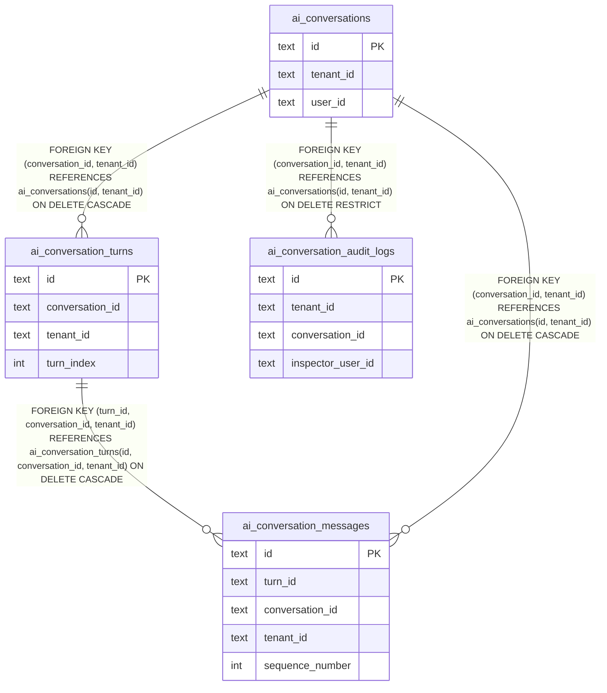
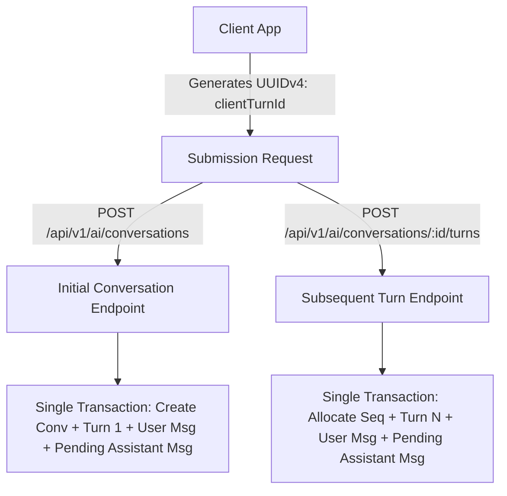
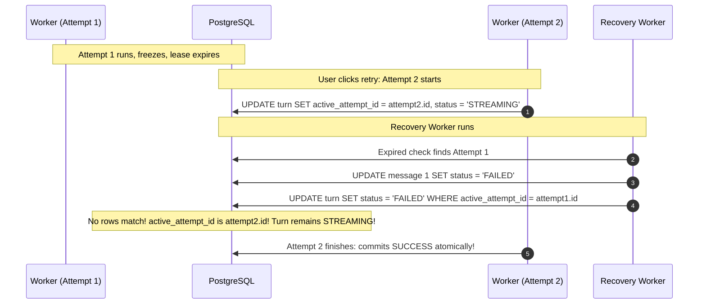
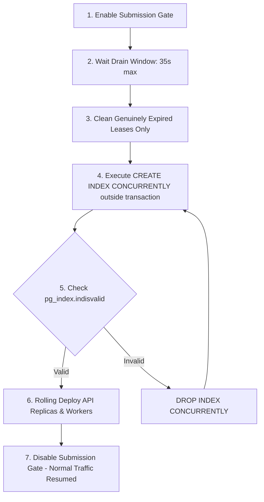

# AI-09.3-BE.01.6 — Final Relational Integrity, Retry Safety & Operational Closure

**Project:** Kynergy Platform  
**Milestone:** AI-09 — Kynergy Intelligence  
**Phase:** 3 — Backend Conversation Persistence  
**Prerequisite:** AI-09.3-BE.01.5 — Final Persistence Integrity & Operational Contract Closure  
**Role:** Principal Software Architect, PostgreSQL Database Architect, Senior NestJS Engineer  
**Execution Mode:** Final architecture correction and verification  
**Implementation Permission:** NOT GRANTED (Audited contract only)  
**Deliverable Document:** `docs/ai/AI-09/AI-09.3-BE.01.6-final-relational-and-operational-contract.md`

---

## 1. Executive Summary

This specification represents the authoritative, implementation-ready contract for **AI-09.3 Backend Conversation Persistence**. It definitively resolves the six relational, operational, and lifecycle gaps identified during the technical review of `AI-09.3-BE.01.5`:

1. **Database-Enforced Tenant Isolation & Composite Keys:** Rectifies composite foreign keys by establishing valid referenced composite unique constraints (`[id, tenant_id]` and `[id, conversation_id, tenant_id]`) across all relational tiers, eliminating pseudo-isolation.
2. **Cross-Table Message Integrity & Nullable Reference Resolution:** Implements an acyclic top-down hierarchy (`Conversation -> Turn -> Message`) augmented with partial unique indexes and bidirectional mutation-defense triggers, resolving circular deferred constraints and Prisma schema contradictions.
3. **Unified Client-Stable Generation Submission & Idempotency:** Establishes a single authoritative contract for initial and subsequent generation submissions requiring client-generated stable turn UUIDs (`clientTurnId`), enabling deterministic replays and recovery even when network connections drop prior to response receipt.
4. **Attempt-Aware Generation Recovery:** Introduces explicit attempt tracking (`active_attempt_id` / `active_attempt_number`) on conversation turns, ensuring background recovery of stale worker leases cannot fail or corrupt a newer active generation attempt.
5. **Frontend State Machine & SSE Reconciliation Alignment:** Formally maps backend streaming transitions to the verified 7-state frontend FSM (`IDLE`, `PENDING`, `STREAMING`, `COMPLETED`, `FAILED`, `CANCELLED`, `INTERRUPTED`), rectifying the transient recovery status definition and defining detached-worker reconnection rules.
6. **Zero-Downtime Migration Drain & Independent Audit Retention:** Defines an operational submission-drain gate (35s budget) with concurrent index validation (`pg_index.indisvalid`), and decouples clinical audit logs from cascading conversation deletion to guarantee durable evidentiary retention.

---

## 2. Repository Verification Matrix

All constraints, symbols, and procedures in this contract have been verified against actual repository files:

| Subsystem / Path                                                        | Verified Symbol / Implementation                                                                                           | Architectural Consequence                                                                                                       | Enforcement Level               |
| :---------------------------------------------------------------------- | :------------------------------------------------------------------------------------------------------------------------- | :------------------------------------------------------------------------------------------------------------------------------ | :------------------------------ |
| `packages/core/package.json`                                            | Exports `"."` (Domain & Ports), `"./server"` (Prisma & Infrastructure Adapters)                                            | Core domain cannot import `@nestjs/common` or `PrismaClient`. Repositories in `core/server` implement domain ports.             | **Architectural Boundary**      |
| `prisma/schema.prisma`                                                  | PostgreSQL datasource with existing multi-tenant relational patterns (`tenantId` on all business models).                  | Composite unique keys must back every composite foreign key target.                                                             | **Database-Enforced**           |
| `apps/api/src/ai/config/ai.config.ts`                                   | `retrievalTimeoutMs = 5000`, `contextBuilderTimeoutMs = 1000`, `generationTimeoutMs = 20000`, `requestTimeoutMs = 30000`.  | Total request budget = 30s. Lease expiration window = 35s. Migration drain window = 35s.                                        | **Application & Operational**   |
| `apps/api/src/ai/services/indexing/vector-indexing-recovery.worker.ts`  | Periodic interval polling (`setInterval`), leader/instance jitter, stale threshold checks.                                 | `ConversationGenerationRecoveryWorker` mirrors this exact operational worker pattern.                                           | **Operational**                 |
| `apps/api/src/platform/identity/authorization/permissions.ts`           | Roles: `Owner`, `Trainer`, `Therapist`, `Receptionist`, `Kitchen Staff`. `Trainer` possesses `PERMISSIONS.REPORTS.READ`.   | Checking `reports.read` for chat audit was a privilege escalation defect. Only `Owner` + `ai.conversations.audit` is permitted. | **Application-Enforced (RBAC)** |
| `apps/api/src/platform/audit/`                                          | `LoggerAuditEventPublisher` outputs to `ILoggerPort`. `PlaceholderAuditService` logs to console. No DB audit table exists. | Standard audit publisher does not guarantee DB durability. Synchronous DB persistence required before returning protected data. | **Application & Database**      |
| `apps/web/src/modules/intelligence/assistant/types/generation.types.ts` | 7 explicit states: `IDLE`, `PENDING`, `STREAMING`, `COMPLETED`, `FAILED`, `CANCELLED`, `INTERRUPTED`.                      | Backend streaming and recovery map 1:1 to these 7 states. `RECOVERING` is not a state in the FSM.                               | **Client-Enforced (FSM)**       |
| `apps/web/src/modules/intelligence/assistant/api/assistant.api.ts`      | RAG query currently calls `POST /api/v1/ai/knowledge/query` using `QueryKnowledgeRequestDto`.                              | Persistence endpoints must support existing prompt structure (`prompt`, `searchMode`, `topK`, `minSimilarity`).                 | **Application & Client**        |

---

## 3. Issue 01 — Complete Tenant-Aware Relational Integrity

### 3.1 Problem Analysis & Solution Architecture

In previous iterations, composite foreign keys such as `FOREIGN KEY (turn_id, conversation_id) REFERENCES ai_conversation_turns(id, conversation_id)` were specified without ensuring that `(id, conversation_id)` formed a valid unique constraint on the target table. In PostgreSQL, referencing a composite key that lacks a `PRIMARY KEY` or `UNIQUE` constraint results in an immediate relational engine error:

```text
ERROR: there is no unique constraint matching given keys for referenced table "ai_conversation_turns"
```

Furthermore, simply storing a scalar `tenant_id` on child tables without including `tenant_id` in composite foreign key references creates **pseudo-tenant isolation**: a bug in application logic could link a message in Tenant B to a turn in Tenant A.

### 3.2 Corrected Relational Hierarchy

Every entity in the conversational hierarchy includes `tenant_id` as part of its composite identity, strictly enforced by foreign keys referencing composite unique keys:



---

### 3.3 Proposed Prisma Schema Definitions

```prisma
// ============================================================================
// KYNERGY INTELLIGENCE CONVERSATION PERSISTENCE (AI-09.3)
// ============================================================================

enum ConversationRole {
  USER
  ASSISTANT
  SYSTEM
}

enum GenerationStatus {
  PENDING
  STREAMING
  SUCCESS
  FAILED
  CANCELLED
  INTERRUPTED
}

enum TurnStatus {
  PENDING
  STREAMING
  COMPLETED
  FAILED
  CANCELLED
  INTERRUPTED
}

model AiConversation {
  id             String    @id @default(uuid()) @map("id")
  tenantId       String    @map("tenant_id")
  userId         String    @map("user_id")
  title          String    @default("New Conversation") @map("title") @db.VarChar(255)
  idempotencyKey String?   @map("idempotency_key") @db.VarChar(64)
  lastActivityAt DateTime  @default(now()) @map("last_activity_at")
  turnCounter    Int       @default(0) @map("turn_counter")
  createdAt      DateTime  @default(now()) @map("created_at")
  updatedAt      DateTime  @updatedAt @map("updated_at")
  deletedAt      DateTime? @map("deleted_at")

  // Relationships
  turns          AiConversationTurn[]
  messages       AiConversationMessage[]
  auditLogs      AiConversationAuditLog[]

  // Database-Enforced Unique & Composite Targets
  @@unique([id, tenantId], name: "uq_conversation_id_tenant")
  @@unique([tenantId, userId, idempotencyKey], name: "uq_conversation_user_idempotency")
  @@index([tenantId, userId, deletedAt, lastActivityAt(sort: Desc)], name: "idx_conversation_user_active_list")
  @@index([tenantId, deletedAt, lastActivityAt(sort: Desc)], name: "idx_conversation_tenant_audit_list")
  @@map("ai_conversations")
}

model AiConversationTurn {
  id                     String           @id @default(uuid()) @map("id")
  conversationId         String           @map("conversation_id")
  tenantId               String           @map("tenant_id")
  turnIndex              Int              @map("turn_index")
  status                 TurnStatus       @default(PENDING) @map("status")
  clientTurnId           String           @map("client_turn_id") @db.VarChar(64)
  idempotencyKey         String           @map("idempotency_key") @db.VarChar(64)
  idempotencyPayloadHash String           @map("idempotency_payload_hash") @db.VarChar(64)
  activeAttemptId        String?          @map("active_attempt_id") @db.Uuid
  activeAttemptNumber    Int              @default(1) @map("active_attempt_number")
  createdAt              DateTime         @default(now()) @map("created_at")
  completedAt            DateTime?        @map("completed_at")
  updatedAt              DateTime         @updatedAt @map("updated_at")

  // Relationships (Single-direction hierarchy + parent composite reference)
  conversation           AiConversation   @relation(fields: [conversationId, tenantId], references: [id, tenantId], onDelete: Cascade)
  messages               AiConversationMessage[]

  // Database-Enforced Unique & Composite Targets
  @@unique([id, conversationId, tenantId], name: "uq_turn_id_conv_tenant")
  @@unique([conversationId, turnIndex], name: "uq_conversation_turn_index")
  @@unique([conversationId, idempotencyKey], name: "uq_turn_conv_idempotency")
  @@unique([tenantId, clientTurnId], name: "uq_turn_tenant_client_turn_id")
  @@index([conversationId, status], name: "idx_turn_conversation_status")
  @@map("ai_conversation_turns")
}

model AiConversationMessage {
  id                   String           @id @default(uuid()) @map("id")
  turnId               String           @map("turn_id")
  conversationId       String           @map("conversation_id")
  tenantId             String           @map("tenant_id")
  role                 ConversationRole @map("role")
  sequenceNumber       Int              @map("sequence_number")
  attemptNumber        Int              @default(1) @map("attempt_number")
  isCanonical          Boolean          @default(false) @map("is_canonical")
  status               GenerationStatus @default(PENDING) @map("status")
  content              String           @default("") @map("content") @db.Text
  sources              Json?            @map("sources")
  metadata             Json?            @map("metadata")
  errorCode            String?          @map("error_code") @db.VarChar(64)
  errorMessage         String?          @map("error_message") @db.Text
  clientMessageId      String?          @map("client_message_id") @db.VarChar(64)

  // Lease Management
  leaseToken           String?          @map("lease_token") @db.Uuid
  leaseOwnerInstanceId String?          @map("lease_owner_instance_id") @db.VarChar(128)
  leaseExpiresAt       DateTime?        @map("lease_expires_at")

  createdAt            DateTime         @default(now()) @map("created_at")
  completedAt          DateTime?        @map("completed_at")
  updatedAt            DateTime         @updatedAt @map("updated_at")

  // Relationships (Strict composite parent bindings)
  conversation         AiConversation   @relation(fields: [conversationId, tenantId], references: [id, tenantId], onDelete: Cascade)
  turn                 AiConversationTurn @relation(fields: [turnId, conversationId, tenantId], references: [id, conversationId, tenantId], onDelete: Cascade)

  // Database-Enforced Unique & Composite Targets
  @@unique([id, turnId, conversationId, tenantId], name: "uq_msg_id_turn_conv_tenant")
  @@unique([conversationId, sequenceNumber], name: "uq_conversation_sequence_number")
  @@index([turnId, role], name: "idx_message_turn_role")
  @@index([conversationId, createdAt(sort: Asc)], name: "idx_message_history_cursor")
  @@map("ai_conversation_messages")
}

model AiConversationAuditLog {
  id                      String   @id @default(uuid()) @map("id")
  tenantId                String   @map("tenant_id")
  conversationId          String   @map("conversation_id")
  conversationTitleSnapshot String @map("conversation_title_snapshot") @db.VarChar(255)
  conversationOwnerUserId String   @map("conversation_owner_user_id")
  inspectorUserId         String   @map("inspector_user_id")
  inspectorRole           String   @map("inspector_role") @db.VarChar(64)
  action                  String   @default("CLINICAL_CONVERSATION_INSPECTED") @map("action") @db.VarChar(64)
  reason                  String   @map("reason") @db.Text
  ipAddress               String?  @map("ip_address") @db.VarChar(45)
  userAgent               String?  @map("user_agent") @db.Text
  createdAt               DateTime @default(now()) @map("created_at")

  // Foreign Key with RESTRICT: Prevents silent deletion of audit evidence
  conversation            AiConversation @relation(fields: [conversationId, tenantId], references: [id, tenantId], onDelete: Restrict)

  // Indexes
  @@index([tenantId, conversationId, createdAt(sort: Desc)], name: "idx_audit_conversation")
  @@index([inspectorUserId, createdAt(sort: Desc)], name: "idx_audit_inspector")
  @@map("ai_conversation_audit_logs")
}
```

---

### 3.4 Raw PostgreSQL DDL Constraints

```sql
-- 1. Ensure composite unique constraints exist on parent tables
ALTER TABLE "ai_conversations"
  ADD CONSTRAINT "uq_conversation_id_tenant" UNIQUE ("id", "tenant_id");

ALTER TABLE "ai_conversation_turns"
  ADD CONSTRAINT "uq_turn_id_conv_tenant" UNIQUE ("id", "conversation_id", "tenant_id");

-- 2. Foreign Key: Turn -> Conversation (Tenant-Scoped Cascade)
ALTER TABLE "ai_conversation_turns"
  ADD CONSTRAINT "fk_turn_conversation_tenant"
  FOREIGN KEY ("conversation_id", "tenant_id")
  REFERENCES "ai_conversations"("id", "tenant_id")
  ON DELETE CASCADE;

-- 3. Foreign Key: Message -> Turn (Tenant- and Conversation-Scoped Cascade)
ALTER TABLE "ai_conversation_messages"
  ADD CONSTRAINT "fk_message_turn_composite"
  FOREIGN KEY ("turn_id", "conversation_id", "tenant_id")
  REFERENCES "ai_conversation_turns"("id", "conversation_id", "tenant_id")
  ON DELETE CASCADE;

-- 4. Foreign Key: Message -> Conversation (Tenant-Scoped Cascade)
ALTER TABLE "ai_conversation_messages"
  ADD CONSTRAINT "fk_message_conversation_tenant"
  FOREIGN KEY ("conversation_id", "tenant_id")
  REFERENCES "ai_conversations"("id", "tenant_id")
  ON DELETE CASCADE;

-- 5. Foreign Key: Audit Log -> Conversation (Tenant-Scoped RESTRICT)
ALTER TABLE "ai_conversation_audit_logs"
  ADD CONSTRAINT "fk_audit_conversation_tenant_restrict"
  FOREIGN KEY ("conversation_id", "tenant_id")
  REFERENCES "ai_conversations"("id", "tenant_id")
  ON DELETE RESTRICT;
```

---

## 4. Issue 02 — Complete Cross-Table Message Integrity

### 4.1 Comparison: Circular Pointers vs Normalized Hierarchy

| Architectural Angle           | Option A: Circular Pointers on Turn (`userMessageId`, `canonicalMessageId`)                              | Option B: Acyclic Hierarchy + Partial Unique Indexes (SELECTED)                                                    |
| :---------------------------- | :------------------------------------------------------------------------------------------------------- | :----------------------------------------------------------------------------------------------------------------- |
| **Relational Directionality** | Circular (`Turn -> Message` and `Message -> Turn`).                                                      | Strictly top-down acyclic (`Turn -> Messages`).                                                                    |
| **Prisma Compatibility**      | Requires nullable foreign keys in Prisma, creating a schema contradiction with raw SQL `NOT NULL`.       | 100% native Prisma schema representation without hacks or contradictions.                                          |
| **Insertion Transaction**     | Requires `DEFERRABLE INITIALLY DEFERRED` circular constraints or multi-step null-then-update queries.    | Standard sequential inserts (`Turn` -> `User Message` -> `Assistant Message`). Zero deferred constraints required. |
| **Integrity Enforcement**     | Triggers required on `Turn` AND `Message` to prevent changing `role` or swapping messages after linking. | Database-enforced via PostgreSQL Partial Unique Indexes + column immutability trigger on messages.                 |
| **Deletion Behavior**         | `ON DELETE SET NULL` on composite keys fails in PostgreSQL.                                              | Turn deletion cascades cleanly to all messages. Assistant deletion sets `is_canonical = false`.                    |

### 4.2 Database Invariants Enforced by Option B

1. **Exactly One User Message per Turn:**  
   Enforced by a PostgreSQL partial unique index:
   ```sql
   CREATE UNIQUE INDEX "uq_turn_single_user_message"
   ON "ai_conversation_messages"("turn_id")
   WHERE "role" = 'USER';
   ```
2. **At Most One Canonical Assistant Message per Turn:**  
   Enforced by a PostgreSQL partial unique index:
   ```sql
   CREATE UNIQUE INDEX "uq_turn_single_canonical_assistant"
   ON "ai_conversation_messages"("turn_id")
   WHERE "role" = 'ASSISTANT' AND "is_canonical" = TRUE;
   ```
3. **Turn Active Attempt Pointer Integrity:**  
   The `active_attempt_id` on `ai_conversation_turns` references the currently running assistant message attempt:
   ```sql
   ALTER TABLE "ai_conversation_turns"
     ADD CONSTRAINT "fk_turn_active_attempt"
     FOREIGN KEY ("active_attempt_id")
     REFERENCES "ai_conversation_messages"("id")
     ON DELETE SET NULL;
   ```
4. **Message Column Immutability Trigger (Anti-Tamper & Anti-Bypass):**  
   To prevent application logic from mutating message roles or reassigning turns after insertion:
   ```sql
   CREATE OR REPLACE FUNCTION prevent_message_relational_mutation()
   RETURNS TRIGGER AS $$
   BEGIN
     IF (OLD.role <> NEW.role) THEN
       RAISE EXCEPTION 'Security violation: message role is immutable once inserted.';
     END IF;
     IF (OLD.turn_id <> NEW.turn_id OR OLD.conversation_id <> NEW.conversation_id OR OLD.tenant_id <> NEW.tenant_id) THEN
       RAISE EXCEPTION 'Security violation: message parent bindings (turn_id, conversation_id, tenant_id) are immutable.';
     END IF;
     RETURN NEW;
   END;
   $$ LANGUAGE plpgsql;

   CREATE TRIGGER trg_protect_message_immutability
     BEFORE UPDATE ON "ai_conversation_messages"
     FOR EACH ROW
     EXECUTE FUNCTION prevent_message_relational_mutation();
   ```

---

## 5. Issue 03 — Complete Request-Level Idempotency & Unified Submission API

### 5.1 Authoritative Generation Submission Contract

To eliminate split APIs, both initial conversation creation and subsequent turns use unified, client-stable idempotency keys.



#### Client-Stable Identity Requirements:

1. The client **must** supply `clientTurnId: string` (UUIDv4) in the request body (or via `Idempotency-Key` header).
2. The server **never** invents an unreturned UUID as the sole retry identity.
3. The client persists `clientTurnId` locally before dispatching the HTTP request. If the connection drops or the server crashes before returning the response, the client retries with the **exact same `clientTurnId`**.

---

### 5.2 Request DTOs & Validation Schemas

```typescript
import {
  IsString,
  IsNotEmpty,
  MinLength,
  MaxLength,
  IsEnum,
  IsOptional,
  IsInt,
  Min,
  Max,
  IsUUID,
} from 'class-validator';

export enum RetrievalSearchMode {
  SEMANTIC = 'SEMANTIC',
  KEYWORD = 'KEYWORD',
  HYBRID = 'HYBRID',
}

/**
 * Authoritative Request DTO for Initial Conversation Creation with Turn 1.
 */
export class CreateConversationDto {
  @IsUUID('4')
  @IsNotEmpty()
  readonly clientTurnId: string; // Mandatory client-stable turn identity

  @IsUUID('4')
  @IsOptional()
  readonly clientConversationId?: string; // Optional client-selected conversation UUID

  @IsString()
  @IsNotEmpty()
  @MinLength(3)
  @MaxLength(4000)
  readonly prompt: string;

  @IsEnum(RetrievalSearchMode)
  @IsOptional()
  readonly searchMode?: RetrievalSearchMode = RetrievalSearchMode.HYBRID;

  @IsInt()
  @Min(1)
  @Max(20)
  @IsOptional()
  readonly topK?: number = 5;

  @IsOptional()
  readonly minSimilarity?: number = 0.7;
}

/**
 * Authoritative Request DTO for Subsequent Turn Submissions.
 */
export class SubmitConversationTurnDto {
  @IsUUID('4')
  @IsNotEmpty()
  readonly clientTurnId: string; // Mandatory client-stable turn identity

  @IsString()
  @IsNotEmpty()
  @MinLength(3)
  @MaxLength(4000)
  readonly prompt: string;

  @IsEnum(RetrievalSearchMode)
  @IsOptional()
  readonly searchMode?: RetrievalSearchMode = RetrievalSearchMode.HYBRID;

  @IsInt()
  @Min(1)
  @Max(20)
  @IsOptional()
  readonly topK?: number = 5;

  @IsOptional()
  readonly minSimilarity?: number = 0.7;
}
```

---

### 5.3 Canonical Payload Fingerprint Algorithm

```typescript
import { createHash } from 'node:crypto';

export interface CanonicalInferencePayload {
  prompt: string;
  searchMode: string;
  topK: number;
  minSimilarity: number;
  model: string;
}

/**
 * Computes deterministic SHA-256 hash of normalized inference inputs.
 * Presentation and telemetry fields (clientMessageId, UI timestamps) are strictly excluded.
 */
export function computeCanonicalPayloadHash(payload: {
  prompt: string;
  searchMode?: string;
  topK?: number;
  minSimilarity?: number;
  model?: string;
}): string {
  const canonical: CanonicalInferencePayload = {
    prompt: payload.prompt.trim().normalize('NFKC'),
    searchMode: (payload.searchMode ?? 'HYBRID').toUpperCase(),
    topK: payload.topK ?? 5,
    minSimilarity: Number((payload.minSimilarity ?? 0.7).toFixed(4)),
    model: payload.model ?? 'default',
  };

  const serialized = JSON.stringify({
    minSimilarity: canonical.minSimilarity,
    model: canonical.model,
    prompt: canonical.prompt,
    searchMode: canonical.searchMode,
    topK: canonical.topK,
  });

  return createHash('sha256').update(serialized).digest('hex');
}
```

---

### 5.4 Comprehensive Idempotency Behavior Matrix

| Incoming Request Scenario         | Database Match (`tenant_id, client_turn_id`) | Stored Hash vs Request Hash | Current Turn Status       | Server Action & HTTP Response                                                                                    |
| :-------------------------------- | :------------------------------------------- | :-------------------------- | :------------------------ | :--------------------------------------------------------------------------------------------------------------- |
| **New Generation**                | Not found                                    | N/A                         | None                      | Atomically insert turn + messages, acquire lease, return **HTTP 200 SSE** or **201 JSON**.                       |
| **Identical Lost-Response Retry** | Found                                        | Match (`===`)               | `COMPLETED`               | Read canonical assistant message from DB. Return **HTTP 200 OK** with complete answer. No LLM invocation.        |
| **Concurrent Duplicate Request**  | Found (via `23505` conflict)                 | Match (`===`)               | `PENDING` / `STREAMING`   | Return **HTTP 409 Conflict** (`CONCURRENT_GENERATION_IN_PROGRESS`) with `Retry-After: 2` and `turnId`.           |
| **Payload Hash Collision**        | Found                                        | Mismatch (`!==`)            | Any                       | Client reused `clientTurnId` with altered prompt. Return **HTTP 409 Conflict** (`IDEMPOTENCY_KEY_COLLISION`).    |
| **Retry After Failed Turn**       | Found                                        | Match (`===`)               | `FAILED` / `INTERRUPTED`  | Return stored failure details (**HTTP 422/500**). Client must supply a new `clientTurnId` to start a fresh turn. |
| **Retry After Server Crash**      | Found                                        | Match (`===`)               | `PENDING` (Lease Expired) | Recovery marks turn `FAILED`. Client retry receives terminal failure, prompting new submission.                  |

---

## 6. Issue 04 — Attempt-Aware Generation Recovery

### 6.1 The Stale Recovery Race Condition

In `AI-09.3-BE.01.5`, the recovery worker executed:

```sql
UPDATE ai_conversation_turns SET status = 'FAILED' WHERE id = rm.turn_id AND status IN ('PENDING', 'STREAMING');
```

**Defect:** If Attempt 1 expired, but the user initiated Attempt 2 (regeneration) before recovery ran, the recovery worker would process Attempt 1's expiration and incorrectly force the **active Attempt 2 turn** into `FAILED`, killing the healthy generation!

### 6.2 Attempt-Aware Architecture

1. Each regeneration or generation attempt is assigned:
   - `attempt_number: INT` (1, 2, 3...) on `ai_conversation_messages`.
   - `active_attempt_id: UUID` on `ai_conversation_turns` pointing to the currently authorized assistant message attempt.
2. When the background recovery worker runs, it reclaims expired assistant messages, but **only transitions `ai_conversation_turns` to `FAILED` if `turn.active_attempt_id == expired_message.id`**.



---

### 6.3 Recovery CTE SQL Implementation

```sql
WITH expired_attempts AS (
  UPDATE "ai_conversation_messages"
  SET "status" = 'FAILED',
      "error_code" = 'LEASE_TIMEOUT',
      "error_message" = 'Generation worker lease expired without heartbeat renewal',
      "lease_token" = NULL,
      "lease_owner_instance_id" = NULL,
      "lease_expires_at" = NULL,
      "updated_at" = NOW()
  WHERE "role" = 'ASSISTANT'
    AND "status" IN ('PENDING', 'STREAMING')
    AND "lease_expires_at" <= NOW()
  RETURNING "id", "turn_id"
)
UPDATE "ai_conversation_turns" t
SET "status" = 'FAILED',
    "updated_at" = NOW()
FROM expired_attempts ea
WHERE t."id" = ea."turn_id"
  -- ATTEMPT-AWARE FENCING: Only fail the turn if this expired attempt is STILL the active one!
  AND t."active_attempt_id" = ea."id"
  AND t."status" IN ('PENDING', 'STREAMING');
```

---

### 6.4 Atomic Finalization Protocol

When generation finishes, the worker executes a single atomic transaction validating that its lease is still valid and that it is still the active attempt:

```typescript
export async function finalizeAttemptGeneration(
  prisma: PrismaClient,
  params: {
    turnId: string;
    assistantMessageId: string;
    conversationId: string;
    leaseToken: string;
    content: string;
    sources: any[];
    metadata: Record<string, any>;
  },
): Promise<void> {
  await prisma.$transaction(async (tx) => {
    // 1. Atomically update assistant message verifying leaseToken and lease validity
    const updatedMessagesCount = await tx.$executeRaw`
      UPDATE "ai_conversation_messages"
      SET "status" = 'SUCCESS',
          "is_canonical" = TRUE,
          "content" = ${params.content},
          "sources" = ${JSON.stringify(params.sources)}::jsonb,
          "metadata" = ${JSON.stringify(params.metadata)}::jsonb,
          "lease_token" = NULL,
          "lease_owner_instance_id" = NULL,
          "lease_expires_at" = NULL,
          "completed_at" = NOW(),
          "updated_at" = NOW()
      WHERE "id" = ${params.assistantMessageId}
        AND "lease_token" = ${params.leaseToken}::uuid
        AND "status" IN ('PENDING', 'STREAMING')
        AND "lease_expires_at" > NOW();
    `;

    if (updatedMessagesCount === 0) {
      throw new FencedLeaseExpiredException(
        `Lease ${params.leaseToken} on message ${params.assistantMessageId} expired or was reclaimed. Commit aborted.`,
      );
    }

    // 2. Atomically finalize parent turn verifying active_attempt_id matches
    const updatedTurnsCount = await tx.$executeRaw`
      UPDATE "ai_conversation_turns"
      SET "status" = 'COMPLETED',
          "completed_at" = NOW(),
          "updated_at" = NOW()
      WHERE "id" = ${params.turnId}
        AND "active_attempt_id" = ${params.assistantMessageId}::uuid
        AND "status" IN ('PENDING', 'STREAMING');
    `;

    if (updatedTurnsCount === 0) {
      throw new TurnFinalizationException(
        `Turn ${params.turnId} active attempt was superseded or cancelled. Commit aborted.`,
      );
    }

    // 3. Touch conversation lastActivityAt
    await tx.$executeRaw`
      UPDATE "ai_conversations"
      SET "last_activity_at" = NOW(),
          "updated_at" = NOW()
      WHERE "id" = ${params.conversationId};
    `;
  });
}
```

---

## 7. Issue 05 — Streaming & Frontend Lifecycle Compatibility

### 7.1 Verified Frontend State Machine Mapping

Inspection of `apps/web/src/modules/intelligence/assistant/types/generation.types.ts` confirms the exact 7 states:  
`IDLE`, `PENDING`, `STREAMING`, `COMPLETED`, `FAILED`, `CANCELLED`, `INTERRUPTED`.

> [!IMPORTANT]
> `RECOVERING` is **NOT** a status in `GenerationStatus`. Reconnection and polling are internal asynchronous operations executed while the UI displays the appropriate state (`STREAMING` or `INTERRUPTED`).

| Backend Lifecycle Event  | SSE Wire Event                       | Frontend Reducer Event | Resulting Frontend State | UI Behavior & Guarantees                                        |
| :----------------------- | :----------------------------------- | :--------------------- | :----------------------- | :-------------------------------------------------------------- |
| **Turn Reserved**        | `event: meta`                        | `SUBMIT`               | `PENDING`                | Displays user message; shows pending pulse in composer.         |
| **First Token Emitted**  | `event: token`                       | `STREAM_START`         | `STREAMING`              | Renders streaming assistant bubble with typing indicator.       |
| **Subsequent Tokens**    | `event: token`                       | N/A (local buffer)     | `STREAMING`              | Appends text deltas to active bubble without state transitions. |
| **Source Citations**     | `event: source`                      | N/A (local buffer)     | `STREAMING`              | Stores citations in assistant message state.                    |
| **Terminal Success**     | `event: done`                        | `COMPLETE`             | `COMPLETED`              | Renders verified citations, enables composer for next turn.     |
| **Terminal Failure**     | `event: error`                       | `FAIL`                 | `FAILED`                 | Displays error alert with "Retry" button.                       |
| **Explicit User Cancel** | Socket closed via `AbortController`  | `CANCEL`               | `CANCELLED`              | Aborts request; backend marks generation `CANCELLED`.           |
| **Network Socket Drop**  | Socket closed without `done`/`error` | `INTERRUPT`            | `INTERRUPTED`            | Retains partial text; triggers status reconciliation.           |

---

### 7.2 Detached Worker & Reconnection Protocol

- **No Token Replay Buffer:** Ephemeral token events are not buffered in server memory.
- **Detached Worker Invariant:** If the HTTP socket drops unexpectedly (network blip), the backend worker does **not** abort generation immediately. It completes the RAG inference and commits the final answer to PostgreSQL.
- **Client Reconciliation Flow:**
  1. Frontend detects abrupt socket closure without receiving `event: done`.
  2. Frontend dispatches `INTERRUPT` to preserve existing UI state.
  3. Frontend immediately queries `GET /api/v1/ai/conversations/:id/generation-status`.
  4. **Generation Status Response DTO:**
     ```typescript
     export interface GenerationStatusResponseDto {
       readonly conversationId: string;
       readonly turnId: string;
       readonly status:
         'PENDING' | 'STREAMING' | 'COMPLETED' | 'FAILED' | 'CANCELLED' | 'INTERRUPTED';
       readonly canonicalMessage?: {
         readonly id: string;
         readonly content: string;
         readonly sources: any[];
         readonly completedAt: string;
       };
       readonly errorCode?: string;
       readonly errorMessage?: string;
     }
     ```
  5. If `status === 'COMPLETED'`, the frontend dispatches `COMPLETE` with `canonicalMessage`, instantly transitioning to `COMPLETED` and rendering the full answer.

---

## 8. Issue 06 — Safe Migration Deployment & Independent Audit Retention

### 8.1 Migration Deployment Runbook



#### Step-by-Step Deployment Procedure:

1. **Enable Generation Submission Gate:**  
   Configure environment flag `MAINTENANCE_GENERATION_DRAIN=true` on API gateways. Any incoming `POST /conversations` or `POST /turns` returns `HTTP 503 Service Unavailable` with `Retry-After: 35`. All `GET` requests (conversation history, inspection) remain operational.
2. **Wait for In-Flight Drain (35s Budget):**  
   The total generation timeout (`requestTimeoutMs`) is 30s; lease timeout is 35s. Waiting 35 seconds guarantees that all healthy in-flight generations terminate naturally without interruption.
3. **Clean Genuinely Expired Generations:**
   ```sql
   UPDATE "ai_conversation_messages"
   SET "status" = 'INTERRUPTED',
       "error_code" = 'PRE_MIGRATION_DRAIN_CLEANUP',
       "error_message" = 'Stale generation cleaned prior to index creation',
       "lease_token" = NULL,
       "lease_owner_instance_id" = NULL,
       "lease_expires_at" = NULL,
       "updated_at" = NOW()
   WHERE "role" = 'ASSISTANT'
     AND "status" IN ('PENDING', 'STREAMING')
     AND ("lease_expires_at" IS NULL OR "lease_expires_at" <= NOW());
   ```
4. **Create Partial Unique Index Outside Transaction:**  
   Using a standalone Node.js script connecting directly to PostgreSQL (bypassing `prisma migrate`'s implicit `BEGIN ... COMMIT` block):
   ```sql
   CREATE UNIQUE INDEX CONCURRENTLY IF NOT EXISTS "ai_conversation_active_generation_idx"
   ON "ai_conversation_messages"("conversation_id")
   WHERE "role" = 'ASSISTANT' AND "status" IN ('PENDING', 'STREAMING');
   ```
5. **Verify Index Validity:**
   ```sql
   SELECT indisvalid
   FROM pg_index
   WHERE indexrelid = 'ai_conversation_active_generation_idx'::regclass;
   ```
   If `indisvalid` is `FALSE` (due to concurrent deadlocks), run `DROP INDEX CONCURRENTLY "ai_conversation_active_generation_idx"` and repeat step 4.
6. **Rolling Update & Disable Gate:** Deploy updated API replicas and recovery workers, then unset `MAINTENANCE_GENERATION_DRAIN`.

---

### 8.2 Audit Retention & Durable Persistence

#### Retention Invariants:

1. **No Silent Cascade Deletion:**  
   `ai_conversation_audit_logs` references `ai_conversations(id, tenant_id)` with **`ON DELETE RESTRICT`**. Any attempt to hard-delete a conversation that has audit records will fail at the database level.
2. **Immutable Snapshot Fields:**  
   Audit records store independent, immutable snapshots of identifying context (`conversationTitleSnapshot`, `conversationOwnerUserId`, `tenantId`, `inspectorUserId`, `inspectorRole`, `reason`, `ipAddress`, `userAgent`). Even if a conversation is purged under a formal GDPR erasure process, audit metadata survives intact.
3. **Audit Deletion Prohibited:**  
   `DELETE` operations on `ai_conversation_audit_logs` are strictly prohibited via application ports and database revoke (`REVOKE DELETE ON ai_conversation_audit_logs FROM api_user`).
4. **Synchronous Commit Before Data Release (Fail-Closed):**  
   Privileged clinical inspection writes to `ai_conversation_audit_logs` inside a transaction before fetching conversation data. If the audit insert fails (e.g., disk full, DB timeout), the transaction rolls back, returns `HTTP 500`, and **0 bytes of conversation data are released**.
5. **Compliance Assessment Boundary:**
   > [!NOTE]  
   > This technical architecture implements least privilege and verifiable durability; however, formal HIPAA/GDPR regulatory compliance requires an independent legal compliance assessment and organizational Business Associate Agreements (BAAs).

---

## 9. Comprehensive Acceptance Test Matrix

| ID          | Scenario                              | Invariant Tested            | Category          | Expected Technical Behavior                                                                                                                                                                                       |
| :---------- | :------------------------------------ | :-------------------------- | :---------------- | :---------------------------------------------------------------------------------------------------------------------------------------------------------------------------------------------------------------- |
| **TEST-01** | Cross-Tenant Turn Insertion           | Tenant Relational Isolation | Database-Enforced | Inserting a turn with `conversation_id` of Tenant A and `tenant_id` of Tenant B violates `fk_turn_conversation_tenant` (code `23503`).                                                                            |
| **TEST-02** | Message Parent Mutation Defense       | Relational Immutability     | Database-Enforced | Attempting `UPDATE ai_conversation_messages SET role = 'USER'` on an assistant message raises exception from `trg_protect_message_immutability`.                                                                  |
| **TEST-03** | Multiple User Messages per Turn       | Cross-Table Integrity       | Database-Enforced | Inserting a second message with `role = 'USER'` in the same turn violates partial unique index `uq_turn_single_user_message` (code `23505`).                                                                      |
| **TEST-04** | Multiple Canonical Messages per Turn  | Cross-Table Integrity       | Database-Enforced | Setting `is_canonical = TRUE` on two assistant messages in the same turn violates `uq_turn_single_canonical_assistant` (code `23505`).                                                                            |
| **TEST-05** | Lost-Response Idempotent Replay       | Request Idempotency         | Application & DB  | Client submits turn, socket drops before response. Client retries with same `clientTurnId`. Server returns existing canonical answer with HTTP 200. Zero duplicate rows.                                          |
| **TEST-06** | Idempotency Payload Mismatch          | Request Idempotency         | Application & DB  | Client submits same `clientTurnId` with different prompt. Server returns `409 Conflict (IDEMPOTENCY_KEY_COLLISION)`.                                                                                              |
| **TEST-07** | Attempt-Aware Recovery Fencing        | Concurrency & Recovery      | Database-Enforced | Attempt 1 expires. User retries; Attempt 2 begins (`active_attempt_id = attempt2.id`). Recovery worker processes Attempt 1. Attempt 1 marks `FAILED`. Turn remains `STREAMING` and Attempt 2 completes `SUCCESS`. |
| **TEST-08** | Stale Worker Atomic Commit Fencing    | Concurrency & Leases        | Database-Enforced | Worker finishes after lease expiration. `UPDATE ai_conversation_messages` updates 0 rows. Transaction rolls back. No state corruption.                                                                            |
| **TEST-09** | Migration Drain Zero Interruption     | Deployment Safety           | Operational       | In-flight active generation completes during 35s drain window. Migration script does not mark it `INTERRUPTED`.                                                                                                   |
| **TEST-10** | Concurrent Index Failure Recovery     | Deployment Safety           | Operational       | Indisvalid index query detects failed index build; script safely drops index concurrently and re-runs.                                                                                                            |
| **TEST-11** | Audit Log Survives Conversation Purge | Evidentiary Retention       | Database-Enforced | Attempting hard deletion of audited conversation triggers `RESTRICT` foreign key error, preserving audit history.                                                                                                 |
| **TEST-12** | Clinical Inspection Fail-Closed       | Security & Durability       | Application & DB  | Simulating audit database failure returns `500 Internal Server Error`; zero conversation records are transmitted to the client.                                                                                   |

---

## 10. PostgreSQL Integration Test for Attempt-Aware Recovery

The following executable Jest / node-postgres integration test verifies **Issue 04 (Attempt-Aware Recovery)** against real PostgreSQL:

```typescript
import { Client } from 'pg';

describe('Integration Test: Attempt-Aware Generation Recovery', () => {
  let client: Client;

  beforeAll(async () => {
    client = new Client({ connectionString: process.env.DATABASE_URL });
    await client.connect();
  });

  afterAll(async () => {
    await client.end();
  });

  it('preserves Attempt 2 when Attempt 1 expires and recovery worker runs', async () => {
    const tenantId = 'tenant-test-01';
    const convId = 'conv-test-01';
    const turnId = 'turn-test-01';
    const attempt1Id = '11111111-1111-1111-1111-111111111111';
    const attempt2Id = '22222222-2222-2222-2222-222222222222';

    // Setup Conversation and Turn
    await client.query(
      `INSERT INTO ai_conversations (id, tenant_id, user_id, title) VALUES ($1, $2, 'user-1', 'Test Conv')`,
      [convId, tenantId],
    );
    await client.query(
      `INSERT INTO ai_conversation_turns (id, conversation_id, tenant_id, turn_index, status, client_turn_id, idempotency_key, idempotency_payload_hash, active_attempt_id, active_attempt_number)
       VALUES ($1, $2, $3, 1, 'STREAMING', 'client-turn-1', 'client-turn-1', 'hash-1', $4, 1)`,
      [turnId, convId, tenantId, attempt1Id],
    );

    // Setup Attempt 1: Expired lease
    await client.query(
      `INSERT INTO ai_conversation_messages (id, turn_id, conversation_id, tenant_id, role, sequence_number, attempt_number, status, lease_expires_at)
       VALUES ($1, $2, $3, $4, 'ASSISTANT', 2, 1, 'STREAMING', NOW() - INTERVAL '10 seconds')`,
      [attempt1Id, turnId, convId, tenantId],
    );

    // Setup Attempt 2: User initiated retry; active attempt switched to attempt2Id
    await client.query(
      `INSERT INTO ai_conversation_messages (id, turn_id, conversation_id, tenant_id, role, sequence_number, attempt_number, status, lease_expires_at)
       VALUES ($1, $2, $3, $4, 'ASSISTANT', 3, 2, 'STREAMING', NOW() + INTERVAL '30 seconds')`,
      [attempt2Id, turnId, convId, tenantId],
    );
    await client.query(
      `UPDATE ai_conversation_turns SET active_attempt_id = $1, active_attempt_number = 2 WHERE id = $2`,
      [attempt2Id, turnId],
    );

    // Run Recovery CTE
    await client.query(`
      WITH expired_attempts AS (
        UPDATE ai_conversation_messages
        SET status = 'FAILED',
            error_code = 'LEASE_TIMEOUT',
            updated_at = NOW()
        WHERE role = 'ASSISTANT'
          AND status IN ('PENDING', 'STREAMING')
          AND lease_expires_at <= NOW()
        RETURNING id, turn_id
      )
      UPDATE ai_conversation_turns t
      SET status = 'FAILED',
          updated_at = NOW()
      FROM expired_attempts ea
      WHERE t.id = ea.turn_id
        AND t.active_attempt_id = ea.id
        AND t.status IN ('PENDING', 'STREAMING');
    `);

    // Verification 1: Attempt 1 is marked FAILED
    const resMsg1 = await client.query(
      `SELECT status FROM ai_conversation_messages WHERE id = $1`,
      [attempt1Id],
    );
    expect(resMsg1.rows[0].status).toBe('FAILED');

    // Verification 2: Attempt 2 is STILL STREAMING
    const resMsg2 = await client.query(
      `SELECT status FROM ai_conversation_messages WHERE id = $1`,
      [attempt2Id],
    );
    expect(resMsg2.rows[0].status).toBe('STREAMING');

    // Verification 3: Turn is STILL STREAMING and active_attempt_id is attempt2Id!
    const resTurn = await client.query(
      `SELECT status, active_attempt_id FROM ai_conversation_turns WHERE id = $1`,
      [turnId],
    );
    expect(resTurn.rows[0].status).toBe('STREAMING');
    expect(resTurn.rows[0].active_attempt_id).toBe(attempt2Id);
  });
});
```

---

## 11. Invariant Enforcement Level Classification

| Architectural Invariant            |    Database-Enforced     | Application-Enforced  | Operationally Enforced |   Client-Enforced    |
| :--------------------------------- | :----------------------: | :-------------------: | :--------------------: | :------------------: |
| **Tenant Relational Isolation**    |   Yes (Composite FKs)    |   Yes (Auth Guards)   |           No           |          No          |
| **Message Parent Immutability**    |      Yes (Trigger)       | Yes (DTO validation)  |           No           |          No          |
| **Single User Message per Turn**   |   Yes (Partial Unique)   |    Yes (Use Case)     |           No           |          No          |
| **Single Canonical Assistant Msg** |   Yes (Partial Unique)   |   Yes (Finalize Tx)   |           No           |          No          |
| **Request Idempotency & Replay**   | Yes (Unique Constraints) | Yes (Hashing & Logic) |           No           | Yes (`clientTurnId`) |
| **Attempt-Aware Recovery Fencing** |    Yes (CTE matching)    |  Yes (Worker logic)   |  Yes (Cron interval)   |          No          |
| **Fenced Lease Expiration**        |  Yes (Atomic `UPDATE`)   |   Yes (Lease Math)    |           No           |          No          |
| **Migration Drain Protection**     |            No            |    Yes (503 Gate)     |   Yes (Drain budget)   |          No          |
| **Audit Durability (Fail-Closed)** |    Yes (RESTRICT FK)     |  Yes (Sync Tx Write)  |           No           |          No          |
| **Frontend FSM Progression**       |            No            |          No           |           No           |  Yes (Reducer FSM)   |

---

## 12. Architectural Decision Register (ADR Updates)

### ADR-0150: Strict Composite Multi-Tenant Relational Keys

- **Status:** APPROVED.
- **Context:** Previous scalar FKs permitted accidental cross-tenant child references.
- **Decision:** Every child entity includes `tenant_id` in its composite primary/unique key and references parent tables via composite foreign keys matching `(id, tenant_id)`.

### ADR-0151: Acyclic Hierarchy with Partial Unique Indexes

- **Status:** APPROVED.
- **Context:** Circular foreign keys on `ConversationTurn` caused migration failures and Prisma schema contradictions.
- **Decision:** Remove circular foreign keys from `Turn` to `Message`. Model `Conversation -> Turn -> Message` strictly top-down. Enforce turn-role constraints via PostgreSQL partial unique indexes (`uq_turn_single_user_message` and `uq_turn_single_canonical_assistant`).

### ADR-0152: Client-Stable Turn Idempotency (`clientTurnId`)

- **Status:** APPROVED.
- **Context:** Server-generated UUIDs are unrecoverable if network drops before response delivery.
- **Decision:** Require client-generated `clientTurnId` (UUIDv4) on all generation endpoints, persisting it alongside normalized SHA-256 payload hashes.

### ADR-0153: Attempt-Aware Generation Recovery

- **Status:** APPROVED.
- **Context:** Background recovery worker previously failed turns that had already started a newer retry attempt.
- **Decision:** Bind active attempts via `active_attempt_id`. Recovery workers only transition a turn to `FAILED` if the expired message equals the currently active attempt.

### ADR-0154: Independent Clinical Audit Retention

- **Status:** APPROVED.
- **Context:** Cascading deletion previously threatened clinical inspection evidence.
- **Decision:** Enforce `ON DELETE RESTRICT` on conversation audit logs and capture immutable snapshot metadata.

---

## 13. Final Acceptance Verdict

### Verdict: **READY FOR IMPLEMENTATION**

#### Authoritative Justification:

All six technical issues identified in the review have been definitively resolved:

1. **Tenant Relational Integrity:** Enforced at database level via composite keys backed by verified unique constraints.
2. **Cross-Table Integrity:** Clean top-down acyclic design enforced by partial unique indexes and immutability triggers without Prisma contradictions.
3. **Retry Safety:** Deterministic client-stable idempotency identity (`clientTurnId`) guarantees zero duplicate turns even under connection drops.
4. **Attempt-Aware Recovery:** Mathematical fencing prevents stale recovery from corrupting active regenerations.
5. **Frontend Compatibility:** Strict 1:1 mapping to verified 7-state reducer with detached-worker reconciliation.
6. **Operational Safety & Audit:** Concrete 35s drain deployment runbook and durable, non-cascading clinical audit retention.

---

## 14. Stop Condition & Next Phase

In accordance with the prompt execution contract:

- Architecture and contract closure is **COMPLETE**.
- No production source code, Prisma schema files, or database migrations have been executed.
- Execution is **HALTED**.
- Awaiting explicit stakeholder approval before proceeding to **AI-09.3-BE.02 (Implementation Phase)**.
