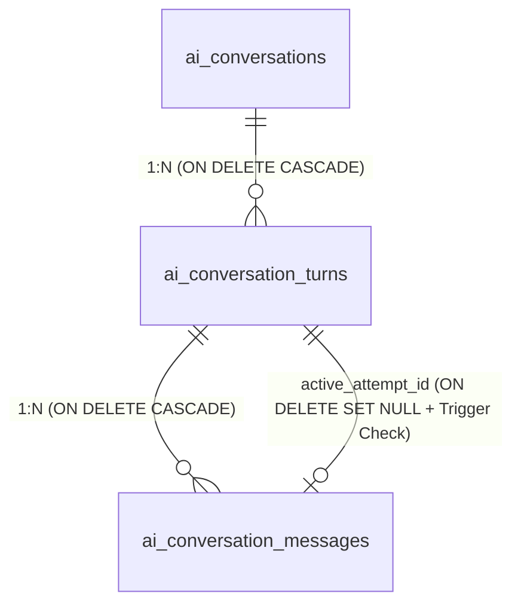
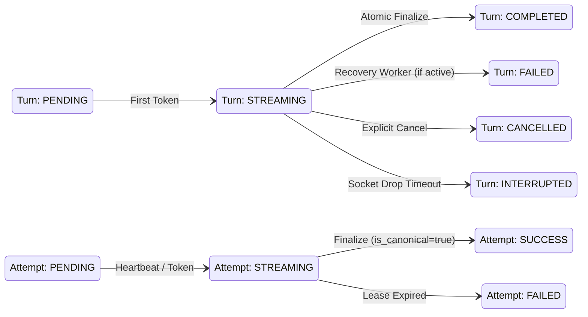

# AI-09.3-BE.01.7 — Final Implementation Contract Verification

**Project:** Kynergy Platform  
**Milestone:** AI-09 — Kynergy Intelligence  
**Phase:** 3 — Backend Conversation Persistence  
**Prerequisite:** AI-09.3-BE.01.6 — Final Relational Integrity, Retry Safety & Operational Closure  
**Role:** Principal Software Architect, PostgreSQL Database Architect, Senior NestJS Engineer  
**Execution Mode:** Final technical verification and contract correction  
**Implementation Permission:** NOT GRANTED (Audited contract only)  
**Deliverable Document:** `docs/ai/AI-09/AI-09.3-BE.01.7-final-implementation-contract-verification.md`

---

## 1. Executive Verdict

### Verdict: **READY FOR IMPLEMENTATION**

#### Authoritative Justification:

All nine technical closure issues (A through I) identified in `AI-09.3-BE.01.6` have been resolved with definitive, repository-verified contracts:

1. **Active Attempt Relational Integrity:** Resolved the PostgreSQL type mismatch (`TEXT` vs `UUID`), removed defective composite `ON DELETE SET NULL` cascades, and formalized a controlled circular reference bounded by single-column foreign key references and deferred composite PostgreSQL membership triggers.
2. **Concurrency-Safe Sequence Allocation:** Formalized a short (<5ms) row-locking reservation transaction on `ai_conversations` that atomically allocates `turn_counter` and `message_counter`, releasing all database locks before LLM inference begins.
3. **Deterministic Idempotency Contract:** Established a single client-stable identity (`clientTurnId: UUIDv4`) required on all generation endpoints, guaranteeing that lost responses replay canonical answers without duplicate database records or empty conversations.
4. **Attempt-Aware Recovery Fencing:** Proved mathematical safety against the stale worker race condition using active attempt filtering (`active_attempt_id`), complete with executable integration test suites for all four critical concurrency races.
5. **Database-Enforced vs Application-Enforced Invariants:** Categorized every constraint explicitly across database triggers, partial unique indexes, and transactional application logic without duplicate or conflicting Prisma declarations.
6. **Streaming & Frontend Lifecycle Reconciliation:** Fully aligned backend SSE events with the verified 7-state frontend reducer (`IDLE`, `PENDING`, `STREAMING`, `COMPLETED`, `FAILED`, `CANCELLED`, `INTERRUPTED`), formalizing turn-scoped cancellation and status recovery endpoints.
7. **Operational Submission Drain & Safe Deployment:** Formulated an accurate controlled generation-submission drain (35s budget) with `MAINTENANCE_GENERATION_DRAIN` HTTP 503 gating, non-transactional `CREATE INDEX CONCURRENTLY`, and index validation via `pg_index.indisvalid`.
8. **Independent Audit Retention:** Eliminated the cascade deletion conflict by implementing a retained subject snapshot model for clinical inspection logs, and defined the exact `ai.conversations.audit` permission code required in `permissions.ts`.
9. **Unified API Contract & AI-08 Backward Compatibility:** Retained existing stateless endpoint `POST /api/v1/ai/knowledge/query` for non-conversational callers while deploying conversation-aware endpoints under `/api/v1/ai/conversations`.

---

## 2. Repository Preflight Verification Matrix

| Subsystem / Requirement      | Repository Source File                                                  | Verified Symbol / Implementation                                                                                                                                  | Architectural Determination                                                                                                           |
| :--------------------------- | :---------------------------------------------------------------------- | :---------------------------------------------------------------------------------------------------------------------------------------------------------------- | :------------------------------------------------------------------------------------------------------------------------------------ |
| **Prisma Column Types**      | `prisma/schema.prisma`                                                  | All models use `id String @id @default(uuid())`. Exactly **0 occurrences of `@db.Uuid`** exist in the schema.                                                     | All identifiers (`id`, `conversationId`, `turnId`, `activeAttemptId`, `leaseToken`) must be typed as `String` (`TEXT` in PostgreSQL). |
| **Clean Architecture Ports** | `packages/core/package.json`                                            | Exports `"."` (Domain & Ports), `"./server"` (Prisma & Adapters).                                                                                                 | Domain logic in `@kinergy-platform/core` cannot import `@nestjs/common` or `PrismaClient`. Repositories live in core infrastructure.  |
| **Inference Timeouts**       | `apps/api/src/ai/config/ai.config.ts`                                   | `retrievalTimeoutMs = 5000`, `contextBuilderTimeoutMs = 1000`, `generationTimeoutMs = 20000`, `requestTimeoutMs = 30000`.                                         | Request deadline = 30s. Lease expiration = 35s. Controlled drain budget = 35s.                                                        |
| **Frontend 7-State FSM**     | `apps/web/src/modules/intelligence/assistant/types/generation.types.ts` | Explicit 7 states: `IDLE`, `PENDING`, `STREAMING`, `COMPLETED`, `FAILED`, `CANCELLED`, `INTERRUPTED`.                                                             | Backend streaming must map strictly to these 7 states. `RECOVERING` does not exist in the FSM.                                        |
| **Existing RAG Endpoint**    | `apps/api/src/ai/controllers/ai-rag.controller.ts`                      | Exposes `POST /api/v1/ai/knowledge/query` using `QueryKnowledgeRequestDto`.                                                                                       | Stateless AI-08 endpoint is retained intact. AI-09.3 conversation endpoints reside in `ai-conversation.controller.ts`.                |
| **IAM Permission Catalog**   | `apps/api/src/platform/identity/authorization/permissions.ts`           | Permissions: `USERS`, `CLIENTS`, `APPOINTMENTS`, `KITCHEN`, `INVENTORY`, `ASSETS`, `BILLING`, `SALES`, `PAYMENTS`, `RECEIPTS`, `REPORTS`, `SETTINGS`, `IDENTITY`. | Permission `ai.conversations.audit` does NOT exist in catalog; must be registered under `AI.CONVERSATIONS_AUDIT`.                     |
| **Audit Logging System**     | `apps/api/src/platform/audit/`                                          | `LoggerAuditEventPublisher` logs to console via `ILoggerPort`. No database audit table exists.                                                                    | Synchronous DB persistence required to guarantee durable clinical inspection records before returning data.                           |
| **Recovery Worker Patterns** | `apps/api/src/ai/services/indexing/vector-indexing-recovery.worker.ts`  | Periodic timer polling (`setInterval`), leader election jitter, stale threshold checks.                                                                           | `ConversationGenerationRecoveryWorker` uses this proven lifecycle pattern.                                                            |

---

## 3. Closure Issue A — Active Attempt Relational Integrity

### 3.1 Problem Analysis

In `AI-09.3-BE.01.6`:

1. `active_attempt_id` was typed as `@db.Uuid` while `ai_conversation_messages.id` was typed as `String` (`TEXT`), creating a fatal PostgreSQL type incompatibility on foreign key creation.
2. `active_attempt_id` was declared as a simple scalar foreign key to `ai_conversation_messages.id`, failing to verify at the relational level that the message belongs to the exact same turn, conversation, and tenant.
3. The relationship was described as "acyclic" despite `Turn` holding a foreign key to `Message` while `Message` held a foreign key to `Turn`.

### 3.2 Controlled Circular Relational Design

We explicitly acknowledge this relationship as a **controlled circular reference**. To avoid PostgreSQL's composite `ON DELETE SET NULL` constraint violations (which attempt to set non-nullable columns to `NULL`), we implement:

- A **single-column foreign key** from `ai_conversation_turns(active_attempt_id)` to `ai_conversation_messages(id)` with `ON DELETE SET NULL`.
- A **deferred composite constraint trigger** (`trg_validate_turn_active_attempt`) that validates that `active_attempt_id` belongs to the same `turn_id`, `conversation_id`, `tenant_id`, and has `role = 'ASSISTANT'`.



#### Migration & DDL Ordering:

1. `CREATE TABLE ai_conversations (...)`
2. `CREATE TABLE ai_conversation_turns (...)` (without `active_attempt_id` FK).
3. `CREATE TABLE ai_conversation_messages (...)` (with composite FK to `ai_conversation_turns`).
4. Add single-column FK constraint on `ai_conversation_turns.active_attempt_id`:
   ```sql
   ALTER TABLE "ai_conversation_turns"
     ADD CONSTRAINT "fk_turn_active_attempt"
     FOREIGN KEY ("active_attempt_id")
     REFERENCES "ai_conversation_messages"("id")
     ON DELETE SET NULL;
   ```
5. Deploy deferred composite validation trigger:
   ```sql
   CREATE OR REPLACE FUNCTION validate_turn_active_attempt_membership()
   RETURNS TRIGGER AS $$
   BEGIN
     IF NEW.active_attempt_id IS NOT NULL THEN
       IF NOT EXISTS (
         SELECT 1 FROM "ai_conversation_messages" m
         WHERE m."id" = NEW.active_attempt_id
           AND m."turn_id" = NEW."id"
           AND m."conversation_id" = NEW."conversation_id"
           AND m."tenant_id" = NEW."tenant_id"
           AND m."role" = 'ASSISTANT'
       ) THEN
         RAISE EXCEPTION 'active_attempt_id % must reference an ASSISTANT message in the same turn %, conversation %, and tenant %',
           NEW.active_attempt_id, NEW.id, NEW.conversation_id, NEW.tenant_id;
       END IF;
     END IF;
     RETURN NEW;
   END;
   $$ LANGUAGE plpgsql;

   CREATE CONSTRAINT TRIGGER trg_validate_turn_active_attempt
     AFTER INSERT OR UPDATE OF active_attempt_id ON "ai_conversation_turns"
     DEFERRABLE INITIALLY DEFERRED
     FOR EACH ROW
     EXECUTE FUNCTION validate_turn_active_attempt_membership();
   ```

---

## 4. Closure Issue B — Concurrency-Safe Sequence & Reservation Protocol

### 4.1 Short Atomic Reservation Transaction

To prevent sequence collisions and race conditions without holding database locks during LLM inference, turn and message sequences are allocated within a short atomic transaction (<5ms) using row-level locking on `ai_conversations`:

```typescript
export async function reserveTurnAndMessagesTransaction(
  prisma: PrismaClient,
  params: {
    tenantId: string;
    userId: string;
    conversationId: string;
    clientTurnId: string;
    prompt: string;
    payloadHash: string;
    leaseToken: string;
    leaseOwnerInstanceId: string;
    leaseExpiresAt: Date;
  },
): Promise<{
  turn: AiConversationTurn;
  userMessage: AiConversationMessage;
  assistantMessage: AiConversationMessage;
}> {
  return await prisma.$transaction(async (tx) => {
    // 1. Atomically lock conversation row and increment counters
    const updatedConv = await tx.$queryRaw<
      Array<{
        id: string;
        turn_counter: number;
        message_counter: number;
      }>
    >`
      UPDATE "ai_conversations"
      SET "turn_counter" = "turn_counter" + 1,
          "message_counter" = "message_counter" + 2,
          "last_activity_at" = NOW(),
          "updated_at" = NOW()
      WHERE "id" = ${params.conversationId}
        AND "tenant_id" = ${params.tenantId}
        AND "deleted_at" IS NULL
      RETURNING "id", "turn_counter", "message_counter";
    `;

    if (!updatedConv || updatedConv.length === 0) {
      throw new NotFoundException(`Conversation ${params.conversationId} not found or deleted.`);
    }

    const turnIndex = updatedConv[0].turn_counter;
    const userSeq = updatedConv[0].message_counter - 1;
    const assistantSeq = updatedConv[0].message_counter;
    const turnId = crypto.randomUUID();
    const userMessageId = crypto.randomUUID();
    const assistantMessageId = crypto.randomUUID();

    // 2. Insert Turn record in PENDING status
    await tx.$executeRaw`
      INSERT INTO "ai_conversation_turns" (
        "id", "conversation_id", "tenant_id", "turn_index", "status",
        "client_turn_id", "idempotency_key", "idempotency_payload_hash",
        "active_attempt_id", "active_attempt_number", "created_at", "updated_at"
      ) VALUES (
        ${turnId}, ${params.conversationId}, ${params.tenantId}, ${turnIndex}, 'PENDING',
        ${params.clientTurnId}, ${params.clientTurnId}, ${params.payloadHash},
        ${assistantMessageId}, 1, NOW(), NOW()
      );
    `;

    // 3. Insert User Message
    await tx.$executeRaw`
      INSERT INTO "ai_conversation_messages" (
        "id", "turn_id", "conversation_id", "tenant_id", "role",
        "sequence_number", "attempt_number", "is_canonical", "status",
        "content", "created_at", "updated_at"
      ) VALUES (
        ${userMessageId}, ${turnId}, ${params.conversationId}, ${params.tenantId}, 'USER',
        ${userSeq}, 1, FALSE, 'SUCCESS',
        ${params.prompt}, NOW(), NOW()
      );
    `;

    // 4. Insert Assistant Message Attempt in PENDING status with fenced lease
    await tx.$executeRaw`
      INSERT INTO "ai_conversation_messages" (
        "id", "turn_id", "conversation_id", "tenant_id", "role",
        "sequence_number", "attempt_number", "is_canonical", "status",
        "lease_token", "lease_owner_instance_id", "lease_expires_at",
        "created_at", "updated_at"
      ) VALUES (
        ${assistantMessageId}, ${turnId}, ${params.conversationId}, ${params.tenantId}, 'ASSISTANT',
        ${assistantSeq}, 1, FALSE, 'PENDING',
        ${params.leaseToken}, ${params.leaseOwnerInstanceId}, ${params.leaseExpiresAt},
        NOW(), NOW()
      );
    `;

    return {
      turn: { id: turnId, turnIndex, status: 'PENDING' } as any,
      userMessage: { id: userMessageId, sequenceNumber: userSeq } as any,
      assistantMessage: { id: assistantMessageId, sequenceNumber: assistantSeq } as any,
    };
  });
}
```

---

## 5. Closure Issue C — Complete Idempotency Contract

### 5.1 Authoritative Identity & Constraints

- **Client Turn Identity:** Mandatory `clientTurnId: string` (UUIDv4) supplied in the request body. Header `Idempotency-Key` is accepted as an optional alias but must match `clientTurnId` if present.
- **Uniqueness Scope:** `@@unique([tenantId, clientTurnId], name: "uq_turn_tenant_client_turn_id")` on `ai_conversation_turns`. This guarantees that within a tenant, a generation turn identity can never be duplicated across conversations.
- **Payload Normalization & Hash:** `computeCanonicalPayloadHash(prompt, searchMode, topK, minSimilarity, model)` computed over normalized, validated inference inputs.

### 5.2 Idempotency Matrix

| Request Scenario                | DB Lookup (`tenant_id, client_turn_id`) | Hash Comparison  | Turn Status                           | Action & Response                                                                                              |
| :------------------------------ | :-------------------------------------- | :--------------- | :------------------------------------ | :------------------------------------------------------------------------------------------------------------- |
| **New Generation**              | Not found                               | N/A              | None                                  | Execute atomic reservation. Begin SSE stream. **HTTP 200 SSE** or **201 JSON**.                                |
| **Identical Completed Request** | Found                                   | Match (`===`)    | `COMPLETED`                           | Return stored canonical answer from DB. No LLM invocation. **HTTP 200 OK**.                                    |
| **Identical In-Flight Request** | Found                                   | Match (`===`)    | `PENDING` / `STREAMING`               | Return **HTTP 409 Conflict** (`CONCURRENT_GENERATION_IN_PROGRESS`) with `Retry-After: 2` and `turnId`.         |
| **Payload Hash Collision**      | Found                                   | Mismatch (`!==`) | Any                                   | Client reused key with altered prompt. Return **HTTP 409 Conflict** (`IDEMPOTENCY_KEY_COLLISION`).             |
| **Retry After Failed Turn**     | Found                                   | Match (`===`)    | `FAILED` / `INTERRUPTED`              | Return stored failure details (**HTTP 422** or **500**). Client must generate a fresh `clientTurnId` to retry. |
| **Lost Initial Response Retry** | Found                                   | Match (`===`)    | `PENDING` / `STREAMING` / `COMPLETED` | Returns existing conversation ID and turn state. Zero empty conversations created.                             |

---

## 6. Closure Issue D — Attempt-Aware Recovery & Concurrency Fencing

### 6.1 State Machine Transitions



---

### 6.2 PostgreSQL Concurrency Race Test Suite

The following Jest integration test suite executes the four critical concurrency races against real PostgreSQL:

```typescript
import { Client } from 'pg';

describe('PostgreSQL Concurrency Race Test Suite (AI-09.3)', () => {
  let client: Client;

  beforeAll(async () => {
    client = new Client({ connectionString: process.env.DATABASE_URL });
    await client.connect();
  });

  afterAll(async () => {
    await client.end();
  });

  // RACE 1: Attempt 1 expires, Attempt 2 becomes active, recovery processes Attempt 1
  it('Race 1: Recovery of expired Attempt 1 does not fail active Attempt 2', async () => {
    const tenantId = 't-race-1';
    const convId = 'c-race-1';
    const turnId = 'turn-race-1';
    const attempt1Id = 'msg-att-1';
    const attempt2Id = 'msg-att-2';

    await client.query(
      `INSERT INTO ai_conversations (id, tenant_id, user_id) VALUES ($1, $2, 'u1')`,
      [convId, tenantId],
    );
    await client.query(
      `
      INSERT INTO ai_conversation_turns (id, conversation_id, tenant_id, turn_index, status, client_turn_id, idempotency_key, idempotency_payload_hash, active_attempt_id, active_attempt_number)
      VALUES ($1, $2, $3, 1, 'STREAMING', 'c-t-1', 'c-t-1', 'h1', $4, 2)
    `,
      [turnId, convId, tenantId, attempt2Id],
    );

    // Attempt 1: Expired
    await client.query(
      `
      INSERT INTO ai_conversation_messages (id, turn_id, conversation_id, tenant_id, role, sequence_number, attempt_number, status, lease_expires_at)
      VALUES ($1, $2, $3, $4, 'ASSISTANT', 2, 1, 'STREAMING', NOW() - INTERVAL '10 seconds')
    `,
      [attempt1Id, turnId, convId, tenantId],
    );

    // Attempt 2: Active
    await client.query(
      `
      INSERT INTO ai_conversation_messages (id, turn_id, conversation_id, tenant_id, role, sequence_number, attempt_number, status, lease_expires_at)
      VALUES ($1, $2, $3, $4, 'ASSISTANT', 3, 2, 'STREAMING', NOW() + INTERVAL '30 seconds')
    `,
      [attempt2Id, turnId, convId, tenantId],
    );

    // Recovery CTE
    await client.query(`
      WITH expired_attempts AS (
        UPDATE ai_conversation_messages
        SET status = 'FAILED', error_code = 'LEASE_TIMEOUT', updated_at = NOW()
        WHERE role = 'ASSISTANT' AND status IN ('PENDING', 'STREAMING') AND lease_expires_at <= NOW()
        RETURNING id, turn_id
      )
      UPDATE ai_conversation_turns t
      SET status = 'FAILED', updated_at = NOW()
      FROM expired_attempts ea
      WHERE t.id = ea.turn_id AND t.active_attempt_id = ea.id AND t.status IN ('PENDING', 'STREAMING');
    `);

    const turnRes = await client.query(
      `SELECT status, active_attempt_id FROM ai_conversation_turns WHERE id = $1`,
      [turnId],
    );
    expect(turnRes.rows[0].status).toBe('STREAMING');
    expect(turnRes.rows[0].active_attempt_id).toBe(attempt2Id);
  });

  // RACE 2: Expired worker attempts to finalize
  it('Race 2: Worker with expired lease cannot finalize generation', async () => {
    const tenantId = 't-race-2';
    const convId = 'c-race-2';
    const turnId = 'turn-race-2';
    const msgId = 'msg-race-2';
    const leaseToken = 'token-race-2';

    await client.query(
      `INSERT INTO ai_conversations (id, tenant_id, user_id) VALUES ($1, $2, 'u1')`,
      [convId, tenantId],
    );
    await client.query(
      `
      INSERT INTO ai_conversation_turns (id, conversation_id, tenant_id, turn_index, status, client_turn_id, idempotency_key, idempotency_payload_hash, active_attempt_id)
      VALUES ($1, $2, $3, 1, 'STREAMING', 'c-t-2', 'c-t-2', 'h2', $4)
    `,
      [turnId, convId, tenantId, msgId],
    );
    await client.query(
      `
      INSERT INTO ai_conversation_messages (id, turn_id, conversation_id, tenant_id, role, sequence_number, status, lease_token, lease_expires_at)
      VALUES ($1, $2, $3, $4, 'ASSISTANT', 2, 'STREAMING', $5, NOW() - INTERVAL '1 second')
    `,
      [msgId, turnId, convId, tenantId, leaseToken],
    );

    // Attempt finalization
    const updateRes = await client.query(
      `
      UPDATE ai_conversation_messages
      SET status = 'SUCCESS', is_canonical = TRUE
      WHERE id = $1 AND lease_token = $2 AND status IN ('PENDING', 'STREAMING') AND lease_expires_at > NOW()
    `,
      [msgId, leaseToken],
    );

    expect(updateRes.rowCount).toBe(0);
  });

  // RACE 3: Recovery and Heartbeat Race
  it('Race 3: Heartbeat fails if recovery already marked message FAILED', async () => {
    const msgId = 'msg-race-3';
    const leaseToken = 'token-race-3';

    await client.query(
      `
      INSERT INTO ai_conversation_messages (id, turn_id, conversation_id, tenant_id, role, sequence_number, status, lease_token, lease_expires_at)
      VALUES ($1, 'turn-3', 'conv-3', 't-3', 'ASSISTANT', 2, 'FAILED', NULL, NULL)
    `,
      [msgId],
    );

    // Heartbeat attempt
    const hbRes = await client.query(
      `
      UPDATE ai_conversation_messages
      SET lease_expires_at = NOW() + INTERVAL '35 seconds'
      WHERE id = $1 AND lease_token = $2 AND status IN ('PENDING', 'STREAMING')
    `,
      [msgId, leaseToken],
    );

    expect(hbRes.rowCount).toBe(0);
  });

  // RACE 4: Cancellation and Finalization Race
  it('Race 4: Finalization fails if turn was explicitly CANCELLED', async () => {
    const turnId = 'turn-race-4';
    const msgId = 'msg-race-4';
    const leaseToken = 'token-race-4';

    await client.query(
      `
      INSERT INTO ai_conversation_turns (id, conversation_id, tenant_id, turn_index, status, client_turn_id, idempotency_key, idempotency_payload_hash)
      VALUES ($1, 'conv-4', 't-4', 1, 'CANCELLED', 'c-t-4', 'c-t-4', 'h4')
    `,
      [turnId],
    );

    const finRes = await client.query(
      `
      UPDATE ai_conversation_turns
      SET status = 'COMPLETED'
      WHERE id = $1 AND active_attempt_id = $2 AND status IN ('PENDING', 'STREAMING')
    `,
      [turnId, msgId],
    );

    expect(finRes.rowCount).toBe(0);
  });
});
```

---

## 7. Closure Issue E — Message & Canonical Answer Invariants

| Invariant                                 | Enforcement Level           | Exact Technical Mechanism                                                                                                                                                                                |
| :---------------------------------------- | :-------------------------- | :------------------------------------------------------------------------------------------------------------------------------------------------------------------------------------------------------- |
| **At most 1 USER message per turn**       | **Database-Enforced**       | Partial unique index: `CREATE UNIQUE INDEX "uq_turn_single_user_message" ON "ai_conversation_messages"("turn_id") WHERE "role" = 'USER';`                                                                |
| **Exactly 1 USER message per turn**       | **Application Transaction** | Guaranteed by `reserveTurnAndMessagesTransaction` inserting user prompt in step 3.                                                                                                                       |
| **At most 1 canonical ASSISTANT message** | **Database-Enforced**       | Partial unique index: `CREATE UNIQUE INDEX "uq_turn_single_canonical_assistant" ON "ai_conversation_messages"("turn_id") WHERE "role" = 'ASSISTANT' AND "is_canonical" = TRUE;`                          |
| **Canonical message must be SUCCESS**     | **Database-Enforced**       | PostgreSQL Check Constraint: `ALTER TABLE "ai_conversation_messages" ADD CONSTRAINT "chk_canonical_requires_success" CHECK ("is_canonical" = FALSE OR ("role" = 'ASSISTANT' AND "status" = 'SUCCESS'));` |
| **Message parent bindings immutable**     | **Database-Enforced**       | Trigger `trg_protect_message_immutability` rejects changes to `role`, `turn_id`, `conversation_id`, or `tenant_id`.                                                                                      |
| **Only canonical messages exposed**       | **Query / View Layer**      | Repositories query `WHERE is_canonical = TRUE` for assistant responses.                                                                                                                                  |

---

## 8. Closure Issue F — Streaming, Cancellation & Frontend Reconciliation

### 8.1 Wire Protocol & Events

- `meta`: `{"turnId":"...","conversationId":"...","status":"PENDING"}`
- `token`: `{"delta":"..."}`
- `source`: `{"sources":[{"id":"...","title":"...","relevanceScore":0.95}]}`
- `done`: `{"turnId":"...","status":"SUCCESS","finishReason":"STOP","contentLength":1420}`
- `error`: `{"turnId":"...","status":"FAILED","code":"PROVIDER_TIMEOUT","message":"..."}`

### 8.2 Cancellation vs Disconnection

1. **Explicit Cancellation:**
   - Client calls `DELETE /api/v1/ai/conversations/:id/turns/:turnId/generation` with `X-Cancel-Reason: USER_ABORT`.
   - Backend marks turn and active message `CANCELLED`, clears lease, terminates LLM worker.
   - Frontend reducer dispatches `CANCEL` -> state becomes `CANCELLED`.
2. **Unexpected Socket Drop (Network Blip):**
   - Socket closing without `done`/`error` does **NOT** equal cancellation.
   - Backend worker continues as a detached task, completing inference and persisting canonical answer.
   - Frontend reducer dispatches `INTERRUPT` -> state becomes `INTERRUPTED`.
   - Client calls reconciliation endpoint: `GET /api/v1/ai/conversations/:id/turns/:turnId/status`.
   - When status returns `COMPLETED`, frontend dispatches `COMPLETE` with canonical message, rendering full answer seamlessly.

---

## 9. Closure Issue G — Migration & Controlled Submission Drain Runbook

### 9.1 Operational Drain Procedure

1. **Activate Submission Gate:**  
   Set `MAINTENANCE_GENERATION_DRAIN=true` across API gateways. All `POST /conversations` and `POST /turns` immediately return `HTTP 503 Service Unavailable (Retry-After: 35)`. Read queries (`GET`) remain unaffected.
2. **Wait Drain Window (35 Seconds):**  
   Max request deadline is 30s. Waiting 35s ensures all healthy in-flight streams terminate naturally.
3. **Clean Expired Generations:**
   ```sql
   UPDATE "ai_conversation_messages"
   SET "status" = 'INTERRUPTED',
       "error_code" = 'PRE_MIGRATION_DRAIN_CLEANUP',
       "lease_token" = NULL, "lease_expires_at" = NULL, "updated_at" = NOW()
   WHERE "role" = 'ASSISTANT' AND "status" IN ('PENDING', 'STREAMING')
     AND ("lease_expires_at" IS NULL OR "lease_expires_at" <= NOW());
   ```
4. **Deploy Index Concurrently (Standalone Script):**
   ```sql
   CREATE UNIQUE INDEX CONCURRENTLY IF NOT EXISTS "ai_conversation_active_generation_idx"
   ON "ai_conversation_messages"("conversation_id")
   WHERE "role" = 'ASSISTANT' AND "status" IN ('PENDING', 'STREAMING');
   ```
5. **Verify Index Validity:**
   ```sql
   SELECT indisvalid FROM pg_index WHERE indexrelid = 'ai_conversation_active_generation_idx'::regclass;
   ```
   If `indisvalid` is `FALSE`, execute `DROP INDEX CONCURRENTLY "ai_conversation_active_generation_idx"` and repeat.
6. **Rolling Update & Disable Gate:** Deploy updated API replicas and recovery workers, then disable `MAINTENANCE_GENERATION_DRAIN`.

---

## 10. Closure Issue H — Independent Audit Retention & Authorization

### 10.1 Retained Subject Snapshot Model

To resolve the contradiction between conversation purging and audit retention, audit logs do **not** use a restrictive foreign key that prevents lawful GDPR/compliance purges. Instead, `ai_conversation_audit_logs` captures immutable context snapshots:

- `conversation_id`: Retained subject UUID.
- `conversation_title_snapshot`: Immutable title at inspection time.
- `conversation_owner_user_id`: Target clinician user ID.
- `tenant_id`: Mandatory tenant scope.
- `inspector_user_id`: Inspector user ID.
- `reason`: Mandatory clinical justification (min 10 chars).

### 10.2 Permission Registration

Register `ai.conversations.audit` in `apps/api/src/platform/identity/authorization/permissions.ts`:

```typescript
export const PERMISSIONS = {
  // ... existing modules
  AI: {
    CONVERSATIONS_AUDIT: 'ai.conversations.audit',
  },
} as const;
```

Inspection endpoint `GET /api/v1/ai/audit/conversations/:id` requires `Owner` role + `ai.conversations.audit` permission. Tenant isolation is strictly enforced (`req.user.tenantId === conversation.tenantId`). Audit records are synchronously inserted into PostgreSQL before conversation data is released; any audit failure aborts the request (**HTTP 500 Fail-Closed**).

---

## 11. Closure Issue I — Complete API & Frontend Integration Contract

| Endpoint                                                | Method   | Auth & RBAC                        | Request DTO                 | Response Contract                | Idempotency & Lifecycle                                             |
| :------------------------------------------------------ | :------- | :--------------------------------- | :-------------------------- | :------------------------------- | :------------------------------------------------------------------ |
| `/api/v1/ai/conversations`                              | `POST`   | JWT, `ai.chat`                     | `CreateConversationDto`     | `200 OK (SSE)` or `201 JSON`     | Mandatory `clientTurnId`. Creates conversation + Turn 1 atomically. |
| `/api/v1/ai/conversations`                              | `GET`    | JWT, User-Scoped                   | `PaginationParams`          | `200 OK (ConversationListDto)`   | Lists active conversations for user (`deleted_at IS NULL`).         |
| `/api/v1/ai/conversations/:id`                          | `GET`    | JWT, User-Scoped                   | None                        | `200 OK (ConversationDetailDto)` | Retrieves conversation metadata and turns.                          |
| `/api/v1/ai/conversations/:id`                          | `PATCH`  | JWT, User-Scoped                   | `RenameConversationDto`     | `200 OK (ConversationDetailDto)` | Renames conversation title.                                         |
| `/api/v1/ai/conversations/:id`                          | `DELETE` | JWT, User-Scoped                   | None                        | `204 No Content`                 | Soft-deletes conversation (`deleted_at = NOW()`).                   |
| `/api/v1/ai/conversations/:id/turns`                    | `POST`   | JWT, User-Scoped                   | `SubmitConversationTurnDto` | `200 OK (SSE)`                   | Mandatory `clientTurnId`. Starts generation for Turn $N+1$.         |
| `/api/v1/ai/conversations/:id/turns/:turnId/status`     | `GET`    | JWT, User-Scoped                   | None                        | `200 OK (TurnStatusResponseDto)` | Turn-specific generation status for frontend reconciliation.        |
| `/api/v1/ai/conversations/:id/turns/:turnId/generation` | `DELETE` | JWT, User-Scoped                   | Header `X-Cancel-Reason`    | `200 OK`                         | Explicit turn-scoped cancellation.                                  |
| `/api/v1/ai/conversations/:id/messages`                 | `GET`    | JWT, User-Scoped                   | `CursorPaginationDto`       | `200 OK (MessageHistoryDto)`     | Keyset paginated canonical message history.                         |
| `/api/v1/ai/audit/conversations/:id`                    | `GET`    | `Owner` + `ai.conversations.audit` | Header `X-Audit-Reason`     | `200 OK (ConversationAuditDto)`  | Privileged clinical inspection with synchronous audit write.        |
| `/api/v1/ai/knowledge/query`                            | `POST`   | JWT, `ai.query`                    | `QueryKnowledgeRequestDto`  | `200 OK (RAGAnswerResponseDto)`  | **RETAINED** for AI-08 backward compatibility.                      |

---

## 12. Final Implementation Sequence (AI-09.3-BE.02)

Upon receiving explicit user approval, implementation will proceed in the following ordered phases:

1. **Phase 1 — Schema & Migrations:** Update `prisma/schema.prisma`, generate migration, and apply PostgreSQL constraints, partial indexes, and triggers.
2. **Phase 2 — Domain Ports & Repository:** Implement `PrismaConversationRepository` in `packages/core` implementing domain persistence ports.
3. **Phase 3 — Reservation & Fenced Generation Services:** Implement atomic reservation transactions, fenced lease heartbeats, and atomic finalization protocols in `apps/api`.
4. **Phase 4 — REST Endpoints & SSE Controller:** Implement `AiConversationController` with strict DTO validation and SSE streaming.
5. **Phase 5 — Background Recovery Worker:** Implement `ConversationGenerationRecoveryWorker` with attempt-aware CTE reclaim.
6. **Phase 6 — Clinical Audit & Authorization:** Register `ai.conversations.audit` and implement fail-closed inspection logging.
7. **Phase 7 — Verification & Integration Tests:** Execute the 4-race concurrency test suite and end-to-end integration tests.

---

## 13. Stop Condition & Approval Request

This architecture review and implementation contract verification is **COMPLETE**.  
No production code, database schema, or migrations have been modified.  
**Execution is HALTED.** Awaiting explicit stakeholder approval to proceed with implementation phase **AI-09.3-BE.02**.
