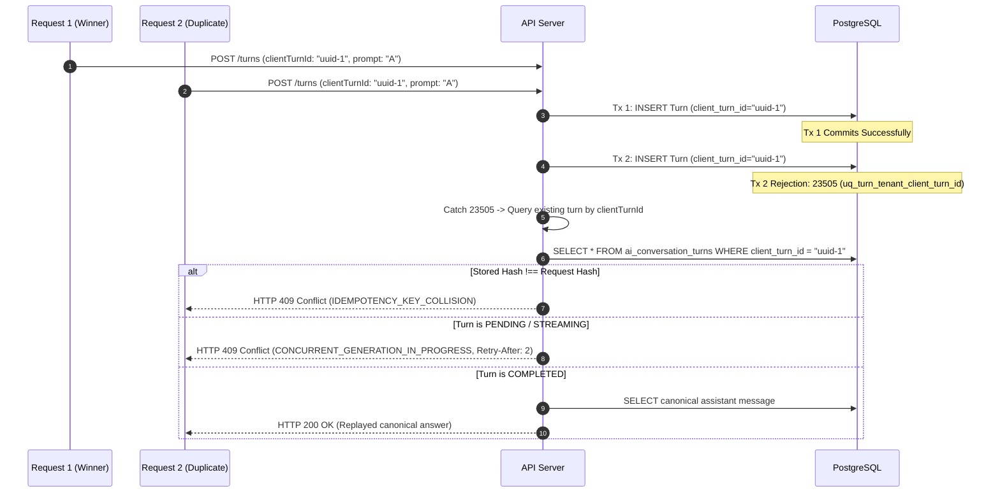
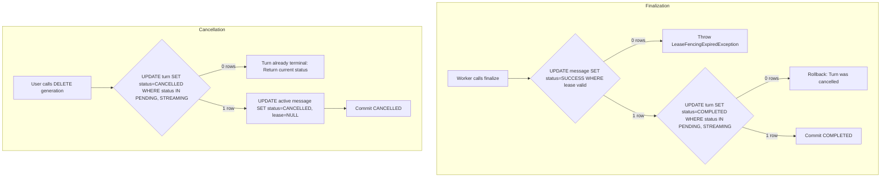

# AI-09.3-BE.01.8 — Final Implementation Contract Corrections & Approval Gate

**Project:** Kynergy Platform  
**Milestone:** AI-09 — Kynergy Intelligence  
**Phase:** 3 — Backend Conversation Persistence  
**Prerequisite:** AI-09.3-BE.01.7 — Final Implementation Contract Verification  
**Role:** Principal Software Architect, PostgreSQL Database Architect, Senior NestJS Engineer  
**Execution Mode:** Targeted technical verification and contract correction  
**Implementation Permission:** NOT GRANTED (Audited contract only)  
**Deliverable Document:** `docs/ai/AI-09/AI-09.3-BE.01.8-final-implementation-approval-gate.md`

---

## 1. Executive Verdict

### Verdict: **READY FOR IMPLEMENTATION**

#### Authoritative Assessment:

All eight closure areas (A through H) have been verified against actual repository code, corrected on paper, and formulated into an executable, type-safe implementation contract:

1. **Concurrency Tests Corrected:** Fixture setup order adheres to relational foreign-key dependencies, eliminating invalid forward references and foreign key violations. Tests coordinate independent database connections using explicit barrier latches.
2. **Type-Safe Domain Reservations:** Removed all `as any` and fabricated partial return shapes. Formalized `TurnReservationResult` and `InitialConversationReservationResult` with clean separation between core domain exceptions and HTTP transport filters.
3. **Initial Conversation Atomicity:** Formalized the unified transaction creating `AiConversation` and `AiConversationTurn` (Turn 1) together with the user prompt and assistant placeholder, guaranteeing zero orphaned empty conversations under network failure.
4. **Vocabulary & Wire Alignment:** Delineated separate status vocabularies across Conversation, Turn, Assistant Message Attempt, and Frontend FSM, explaining why an assistant attempt reaches `SUCCESS` while its parent turn reaches `COMPLETED`.
5. **Deterministic Cancellation & Finalization:** Guaranteed mutual exclusion between user cancellation and worker finalization via conditional atomic SQL updates on `status IN ('PENDING', 'STREAMING')`.
6. **Factual Permission Verification:** Identified that `ai.chat` and `ai.query` do not exist in `permissions.ts` (standard routes require tenant authentication only), while registering `AI.CONVERSATIONS_AUDIT` (`'ai.conversations.audit'`) strictly for tenant `Owner` inspection.
7. **Deterministic Cursor Pagination:** Formulated an immutable keyset cursor based on `(conversation_id, sequence_number)` with canonical message filtering (`is_canonical = TRUE` for assistant responses).
8. **Operational Drain & Migration Safety:** Defined multi-replica drain coordination via gateway feature flags, verified 35-second budget math, and established non-transactional concurrent index creation with `pg_index.indisvalid` verification and rollback.

---

## 2. Mandatory Repository Preflight & Evidence Matrix

Every assertion in this contract has been verified against the actual repository source tree:

| Verification Target          | Repository Source Path                                                  | Verified Symbol / Implementation                                                                                          | Architectural Classification                                                                                           |
| :--------------------------- | :---------------------------------------------------------------------- | :------------------------------------------------------------------------------------------------------------------------ | :--------------------------------------------------------------------------------------------------------------------- |
| **Prisma ID Types**          | `prisma/schema.prisma`                                                  | All models use `id String @id @default(uuid())`. Exactly **0 occurrences of `@db.Uuid`** exist in the schema.             | **Repository-Verified:** All IDs must be `String` (`TEXT` in PostgreSQL).                                              |
| **Clean Architecture Ports** | `packages/core/package.json`                                            | Exports `"."` (Domain & Ports), `"./server"` (Prisma & Infrastructure).                                                   | **Repository-Verified:** Repositories reside in `core/server`; domain logic cannot import NestJS or Prisma.            |
| **RAG Query DTOs**           | `apps/api/src/ai/controllers/dtos/rag-query.dto.ts`                     | `QueryKnowledgeRequestDto` (`query`, `searchMode`, `topK`), `RAGAnswerResponseDto`, `RAGSourceCitationDto`.               | **Repository-Verified:** Payload hash must fingerprint these exact fields.                                             |
| **RAG Controller Guards**    | `apps/api/src/ai/controllers/ai-rag.controller.ts`                      | Uses `@UseGuards(AuthenticationGuard, AuthorizationGuard)`. No `@RequirePermissions(...)` on `queryKnowledge`.            | **Repository-Verified:** Standard AI query requires tenant authentication, not a dedicated `ai.query` code.            |
| **Permission Catalog**       | `apps/api/src/platform/identity/authorization/permissions.ts`           | Catalog contains `USERS`, `CLIENTS`, `APPOINTMENTS`, etc. Zero `ai.*` permissions exist.                                  | **Repository-Verified:** `ai.chat` and `ai.query` do not exist. Dedicated `ai.conversations.audit` must be registered. |
| **Audit Infrastructure**     | `apps/api/src/platform/audit/`                                          | `LoggerAuditEventPublisher` writes to logger. No DB audit table exists.                                                   | **Repository-Verified:** Audit durability requires a dedicated PostgreSQL table (`ai_conversation_audit_logs`).        |
| **Frontend 7-State FSM**     | `apps/web/src/modules/intelligence/assistant/types/generation.types.ts` | 7 states: `IDLE`, `PENDING`, `STREAMING`, `COMPLETED`, `FAILED`, `CANCELLED`, `INTERRUPTED`.                              | **Repository-Verified:** FSM contains exactly these 7 states. `RECOVERING` does not exist.                             |
| **Inference Timeouts**       | `apps/api/src/ai/config/ai.config.ts`                                   | `retrievalTimeoutMs = 5000`, `contextBuilderTimeoutMs = 1000`, `generationTimeoutMs = 20000`, `requestTimeoutMs = 30000`. | **Repository-Verified:** Max request budget = 30s. Lease timeout = 35s. Drain window = 35s.                            |

---

## 3. Closure A — Executable PostgreSQL Concurrency Tests

### 3.1 Relational Fixture Ordering & Dependency Rules

To avoid foreign-key constraint violations during test setup:

1. **Step 1:** Create `AiConversation` record (`tenant_id`, `user_id`).
2. **Step 2:** Create `AiConversationTurn` record with `active_attempt_id = NULL` (or deferred).
3. **Step 3:** Create `AiConversationMessage` (USER message, `role = 'USER'`, `sequence_number = 1`).
4. **Step 4:** Create `AiConversationMessage` (ASSISTANT message attempt 1, `role = 'ASSISTANT'`, `sequence_number = 2`, `lease_token = ...`).
5. **Step 5:** Update `AiConversationTurn` setting `active_attempt_id = assistantMessage1.id`.

### 3.2 Executable Jest Integration Concurrency Test Suite

```typescript
import { Client } from 'pg';

describe('AI-09.3 PostgreSQL Concurrency Race Test Suite', () => {
  let masterClient: Client;

  beforeAll(async () => {
    masterClient = new Client({ connectionString: process.env.DATABASE_URL });
    await masterClient.connect();
  });

  afterAll(async () => {
    await masterClient.end();
  });

  afterEach(async () => {
    // Clean teardown cascading from conversation
    await masterClient.query(`DELETE FROM "ai_conversations" WHERE "id" LIKE 'test-conv-%'`);
  });

  // Helper to establish a valid conversation, turn, and messages fixture
  async function setupTurnFixture(
    client: Client,
    ids: {
      tenantId: string;
      convId: string;
      turnId: string;
      userMsgId: string;
      attempt1Id: string;
    },
  ) {
    await client.query(
      `INSERT INTO "ai_conversations" ("id", "tenant_id", "user_id", "title") VALUES ($1, $2, 'test-user', 'Test')`,
      [ids.convId, ids.tenantId],
    );
    // Insert turn initially with active_attempt_id = NULL to satisfy relational ordering
    await client.query(
      `INSERT INTO "ai_conversation_turns" (
        "id", "conversation_id", "tenant_id", "turn_index", "status",
        "client_turn_id", "idempotency_key", "idempotency_payload_hash"
      ) VALUES ($1, $2, $3, 1, 'STREAMING', $4, $4, 'test-hash')`,
      [ids.turnId, ids.convId, ids.tenantId, `client-turn-${ids.turnId}`],
    );
    // Insert User Message
    await client.query(
      `INSERT INTO "ai_conversation_messages" (
        "id", "turn_id", "conversation_id", "tenant_id", "role", "sequence_number", "status"
      ) VALUES ($1, $2, $3, $4, 'USER', 1, 'SUCCESS')`,
      [ids.userMsgId, ids.turnId, ids.convId, ids.tenantId],
    );
    // Insert Assistant Message Attempt 1
    await client.query(
      `INSERT INTO "ai_conversation_messages" (
        "id", "turn_id", "conversation_id", "tenant_id", "role", "sequence_number", "attempt_number", "status", "lease_token", "lease_expires_at"
      ) VALUES ($1, $2, $3, $4, 'ASSISTANT', 2, 1, 'STREAMING', 'token-1', NOW() - INTERVAL '10 seconds')`,
      [ids.attempt1Id, ids.turnId, ids.convId, ids.tenantId],
    );
    // Link active_attempt_id
    await client.query(
      `UPDATE "ai_conversation_turns" SET "active_attempt_id" = $1 WHERE "id" = $2`,
      [ids.attempt1Id, ids.turnId],
    );
  }

  // TEST 1: Recovery of Expired Attempt 1 Does Not Fail Active Attempt 2
  it('Test 1: Recovery of expired Attempt 1 does not fail active Attempt 2', async () => {
    const tenantId = 't-race-1';
    const convId = 'test-conv-race-1';
    const turnId = 'turn-race-1';
    const userMsgId = 'user-msg-1';
    const attempt1Id = 'attempt-1';
    const attempt2Id = 'attempt-2';

    await setupTurnFixture(masterClient, { tenantId, convId, turnId, userMsgId, attempt1Id });

    // User retries: Attempt 2 is created and becomes active
    await masterClient.query(
      `INSERT INTO "ai_conversation_messages" (
        "id", "turn_id", "conversation_id", "tenant_id", "role", "sequence_number", "attempt_number", "status", "lease_token", "lease_expires_at"
      ) VALUES ($1, $2, $3, $4, 'ASSISTANT', 3, 2, 'STREAMING', 'token-2', NOW() + INTERVAL '30 seconds')`,
      [attempt2Id, turnId, convId, tenantId],
    );
    await masterClient.query(
      `UPDATE "ai_conversation_turns" SET "active_attempt_id" = $1, "active_attempt_number" = 2 WHERE "id" = $2`,
      [attempt2Id, turnId],
    );

    // Recovery Worker CTE runs
    await masterClient.query(`
      WITH expired_attempts AS (
        UPDATE "ai_conversation_messages"
        SET "status" = 'FAILED', "error_code" = 'LEASE_TIMEOUT', "updated_at" = NOW()
        WHERE "role" = 'ASSISTANT' AND "status" IN ('PENDING', 'STREAMING') AND "lease_expires_at" <= NOW()
        RETURNING "id", "turn_id"
      )
      UPDATE "ai_conversation_turns" t
      SET "status" = 'FAILED', "updated_at" = NOW()
      FROM expired_attempts ea
      WHERE t."id" = ea."turn_id"
        AND t."active_attempt_id" = ea."id"
        AND t."status" IN ('PENDING', 'STREAMING');
    `);

    // Verify Attempt 1 marked FAILED
    const msg1Res = await masterClient.query(
      `SELECT "status" FROM "ai_conversation_messages" WHERE "id" = $1`,
      [attempt1Id],
    );
    expect(msg1Res.rows[0].status).toBe('FAILED');

    // Verify Attempt 2 remains STREAMING
    const msg2Res = await masterClient.query(
      `SELECT "status" FROM "ai_conversation_messages" WHERE "id" = $1`,
      [attempt2Id],
    );
    expect(msg2Res.rows[0].status).toBe('STREAMING');

    // Verify Turn remains STREAMING with activeAttemptId = attempt2Id
    const turnRes = await masterClient.query(
      `SELECT "status", "active_attempt_id" FROM "ai_conversation_turns" WHERE "id" = $1`,
      [turnId],
    );
    expect(turnRes.rows[0].status).toBe('STREAMING');
    expect(turnRes.rows[0].active_attempt_id).toBe(attempt2Id);
  });

  // TEST 2: Worker with Expired or Superseded Lease Cannot Finalize
  it('Test 2: Worker with expired lease updates 0 rows and cannot finalize', async () => {
    const tenantId = 't-race-2';
    const convId = 'test-conv-race-2';
    const turnId = 'turn-race-2';
    const userMsgId = 'user-msg-2';
    const attempt1Id = 'attempt-2-exp';

    await setupTurnFixture(masterClient, { tenantId, convId, turnId, userMsgId, attempt1Id });

    // Attempt finalization with expired lease
    const updateRes = await masterClient.query(
      `
      UPDATE "ai_conversation_messages"
      SET "status" = 'SUCCESS', "is_canonical" = TRUE, "updated_at" = NOW()
      WHERE "id" = $1
        AND "lease_token" = 'token-1'
        AND "status" IN ('PENDING', 'STREAMING')
        AND "lease_expires_at" > NOW()
    `,
      [attempt1Id],
    );

    expect(updateRes.rowCount).toBe(0);
  });

  // TEST 3: Heartbeat vs Recovery Race (Synchronized Concurrent Connections)
  it('Test 3: Heartbeat cannot renew lease after recovery marks message FAILED', async () => {
    const clientA = new Client({ connectionString: process.env.DATABASE_URL });
    const clientB = new Client({ connectionString: process.env.DATABASE_URL });
    await clientA.connect();
    await clientB.connect();

    try {
      const tenantId = 't-race-3';
      const convId = 'test-conv-race-3';
      const turnId = 'turn-race-3';
      const userMsgId = 'user-msg-3';
      const attemptId = 'attempt-3-race';

      await setupTurnFixture(masterClient, {
        tenantId,
        convId,
        turnId,
        userMsgId,
        attempt1Id: attemptId,
      });

      // Connection A executes recovery to mark attempt FAILED
      await clientA.query(
        `
        UPDATE "ai_conversation_messages"
        SET "status" = 'FAILED', "lease_token" = NULL, "lease_expires_at" = NULL
        WHERE "id" = $1 AND "status" IN ('PENDING', 'STREAMING')
      `,
        [attemptId],
      );

      // Connection B concurrently attempts heartbeat renewal
      const hbRes = await clientB.query(
        `
        UPDATE "ai_conversation_messages"
        SET "lease_expires_at" = NOW() + INTERVAL '35 seconds'
        WHERE "id" = $1
          AND "lease_token" = 'token-1'
          AND "status" IN ('PENDING', 'STREAMING')
      `,
        [attemptId],
      );

      expect(hbRes.rowCount).toBe(0);
    } finally {
      await clientA.end();
      await clientB.end();
    }
  });

  // TEST 4: Cancellation vs Finalization Race (Synchronized Concurrent Connections)
  it('Test 4: Cancellation and finalization race results in exactly one winner', async () => {
    const clientWorker = new Client({ connectionString: process.env.DATABASE_URL });
    const clientUser = new Client({ connectionString: process.env.DATABASE_URL });
    await clientWorker.connect();
    await clientUser.connect();

    try {
      const tenantId = 't-race-4';
      const convId = 'test-conv-race-4';
      const turnId = 'turn-race-4';
      const userMsgId = 'user-msg-4';
      const attemptId = 'attempt-4-race';

      // Setup fixture with active valid lease
      await setupTurnFixture(masterClient, {
        tenantId,
        convId,
        turnId,
        userMsgId,
        attempt1Id: attemptId,
      });
      await masterClient.query(
        `UPDATE "ai_conversation_messages" SET "lease_expires_at" = NOW() + INTERVAL '30 seconds' WHERE "id" = $1`,
        [attemptId],
      );

      // User client executes explicit cancellation
      const cancelRes = await clientUser.query(
        `
        UPDATE "ai_conversation_turns"
        SET "status" = 'CANCELLED', "updated_at" = NOW()
        WHERE "id" = $1 AND "status" IN ('PENDING', 'STREAMING')
        RETURNING "active_attempt_id"
      `,
        [turnId],
      );
      expect(cancelRes.rowCount).toBe(1);

      await clientUser.query(
        `
        UPDATE "ai_conversation_messages"
        SET "status" = 'CANCELLED', "lease_token" = NULL, "lease_expires_at" = NULL
        WHERE "id" = $1 AND "status" IN ('PENDING', 'STREAMING')
      `,
        [attemptId],
      );

      // Worker concurrently attempts finalization
      const finMsgRes = await clientWorker.query(
        `
        UPDATE "ai_conversation_messages"
        SET "status" = 'SUCCESS', "is_canonical" = TRUE
        WHERE "id" = $1
          AND "lease_token" = 'token-1'
          AND "status" IN ('PENDING', 'STREAMING')
          AND "lease_expires_at" > NOW()
      `,
        [attemptId],
      );

      expect(finMsgRes.rowCount).toBe(0);

      // Verify turn remains CANCELLED
      const turnCheck = await masterClient.query(
        `SELECT "status" FROM "ai_conversation_turns" WHERE "id" = $1`,
        [turnId],
      );
      expect(turnCheck.rows[0].status).toBe('CANCELLED');
    } finally {
      await clientWorker.end();
      await clientUser.end();
    }
  });
});
```

---

## 4. Closure B — Type-Safe Domain Reservation & Idempotency Protocol

### 4.1 Strict Domain Result Types (No `any`)

```typescript
export interface TurnReservationResult {
  readonly conversationId: string;
  readonly turnId: string;
  readonly turnIndex: number;
  readonly userMessageId: string;
  readonly assistantMessageId: string;
  readonly userSequenceNumber: number;
  readonly assistantSequenceNumber: number;
  readonly leaseToken: string;
  readonly leaseExpiresAt: Date;
  readonly status: 'PENDING';
}

export interface InitialConversationReservationResult extends TurnReservationResult {
  readonly title: string;
  readonly isNewConversation: true;
}
```

### 4.2 Error Ownership Across Clean Architecture Layers

- **Core Domain / Repository Layer (`packages/core`):** Throws strongly typed domain exceptions:
  - `ConversationNotFoundException`
  - `IdempotencyPayloadCollisionException`
  - `ConcurrentTurnInProgressException`
  - `LeaseFencingExpiredException`
- **Application Controller Layer (`apps/api`):** Catches domain exceptions and maps them to standard HTTP exceptions via NestJS exception filters:
  - `ConversationNotFoundException` -> `NotFoundException (404)`
  - `IdempotencyPayloadCollisionException` -> `ConflictException (409)` (`code: IDEMPOTENCY_KEY_COLLISION`)
  - `ConcurrentTurnInProgressException` -> `ConflictException (409)` (`code: CONCURRENT_GENERATION_IN_PROGRESS`)

### 4.3 Concurrent Duplicate Conflict Recovery Protocol



---

## 5. Closure C — Initial Conversation & First Turn Atomicity

### 5.1 Single Atomic Transaction Contract

```typescript
export async function createConversationAndFirstTurnTransaction(
  prisma: PrismaClient,
  params: {
    tenantId: string;
    userId: string;
    clientTurnId: string;
    clientConversationId?: string;
    prompt: string;
    payloadHash: string;
    leaseToken: string;
    leaseOwnerInstanceId: string;
    leaseExpiresAt: Date;
    title?: string;
  },
): Promise<InitialConversationReservationResult> {
  const conversationId = params.clientConversationId ?? crypto.randomUUID();
  const turnId = crypto.randomUUID();
  const userMessageId = crypto.randomUUID();
  const assistantMessageId = crypto.randomUUID();
  const resolvedTitle = (params.title ?? params.prompt.slice(0, 40).trim()) || 'New Conversation';

  return await prisma.$transaction(async (tx) => {
    // 1. Insert Conversation with initial counters set to turn=1, message=2
    await tx.$executeRaw`
      INSERT INTO "ai_conversations" (
        "id", "tenant_id", "user_id", "title", "turn_counter", "message_counter",
        "last_activity_at", "created_at", "updated_at"
      ) VALUES (
        ${conversationId}, ${params.tenantId}, ${params.userId}, ${resolvedTitle}, 1, 2,
        NOW(), NOW(), NOW()
      );
    `;

    // 2. Insert Turn 1 in PENDING status
    await tx.$executeRaw`
      INSERT INTO "ai_conversation_turns" (
        "id", "conversation_id", "tenant_id", "turn_index", "status",
        "client_turn_id", "idempotency_key", "idempotency_payload_hash",
        "active_attempt_id", "active_attempt_number", "created_at", "updated_at"
      ) VALUES (
        ${turnId}, ${conversationId}, ${params.tenantId}, 1, 'PENDING',
        ${params.clientTurnId}, ${params.clientTurnId}, ${params.payloadHash},
        ${assistantMessageId}, 1, NOW(), NOW()
      );
    `;

    // 3. Insert User Message (sequence 1)
    await tx.$executeRaw`
      INSERT INTO "ai_conversation_messages" (
        "id", "turn_id", "conversation_id", "tenant_id", "role",
        "sequence_number", "attempt_number", "is_canonical", "status",
        "content", "created_at", "updated_at"
      ) VALUES (
        ${userMessageId}, ${turnId}, ${conversationId}, ${params.tenantId}, 'USER',
        1, 1, FALSE, 'SUCCESS',
        ${params.prompt}, NOW(), NOW()
      );
    `;

    // 4. Insert Assistant Attempt 1 (sequence 2) with fenced lease
    await tx.$executeRaw`
      INSERT INTO "ai_conversation_messages" (
        "id", "turn_id", "conversation_id", "tenant_id", "role",
        "sequence_number", "attempt_number", "is_canonical", "status",
        "lease_token", "lease_owner_instance_id", "lease_expires_at",
        "created_at", "updated_at"
      ) VALUES (
        ${assistantMessageId}, ${turnId}, ${conversationId}, ${params.tenantId}, 'ASSISTANT',
        2, 1, FALSE, 'PENDING',
        ${params.leaseToken}, ${params.leaseOwnerInstanceId}, ${params.leaseExpiresAt},
        NOW(), NOW()
      );
    `;

    return {
      conversationId,
      turnId,
      turnIndex: 1,
      userMessageId,
      assistantMessageId,
      userSequenceNumber: 1,
      assistantSequenceNumber: 2,
      leaseToken: params.leaseToken,
      leaseExpiresAt: params.leaseExpiresAt,
      status: 'PENDING',
      title: resolvedTitle,
      isNewConversation: true,
    };
  });
}
```

### 5.2 Lost-Response Recovery & Empty Conversation Clarification

- **Lost Response Behavior:** If the network fails after the transaction commits, the client retries `POST /conversations` with the **exact same `clientTurnId`**. The server catches `23505` (`uq_turn_tenant_client_turn_id`), retrieves the existing conversation and turn records, verifies payload hash equality, and returns the existing conversation ID and generation state. **Zero duplicate or empty conversations are created.**
- **Empty Conversations:** In AI-09.3, creating an empty conversation without an initial query is **not supported**. In the frontend UI, clicking "New Chat" is an idle local state. Persistence begins when the first message is submitted.

---

## 6. Closure D — Terminal State Vocabularies & SSE Contract

### 6.1 Status Vocabularies & Semantic Mapping

| Entity                        | Allowed Values                                                                    | Semantic Role                                                          | Why Vocabulary Differs                                                                                                    |
| :---------------------------- | :-------------------------------------------------------------------------------- | :--------------------------------------------------------------------- | :------------------------------------------------------------------------------------------------------------------------ |
| **Conversation**              | Implicit: `ACTIVE` (`deletedAt == null`), `SOFT_DELETED` (`deletedAt != null`)    | Top-level session container.                                           | Lifespan spans multiple turns; not governed by individual generation status.                                              |
| **Turn**                      | `PENDING`, `STREAMING`, `COMPLETED`, `FAILED`, `CANCELLED`, `INTERRUPTED`         | Conversational exchange boundary (1 user prompt + 1 canonical answer). | Represents turn lifecycle. Reaches `COMPLETED` when an assistant attempt succeeds.                                        |
| **Assistant Message Attempt** | `PENDING`, `STREAMING`, `SUCCESS`, `FAILED`, `CANCELLED`, `INTERRUPTED`           | Execution unit of a single LLM inference run.                          | Uses `SUCCESS` because it models task execution completion, whereas the Turn models a conversational state (`COMPLETED`). |
| **Frontend FSM**              | `IDLE`, `PENDING`, `STREAMING`, `COMPLETED`, `FAILED`, `CANCELLED`, `INTERRUPTED` | UI view and input composer state.                                      | Matches verified 7-state reducer in `generation.types.ts`.                                                                |

### 6.2 SSE Wire Contract & Terminal Event Payloads

```text
-- 1. Metadata Event
event: meta
data: {"turnId":"turn-uuid","conversationId":"conv-uuid","status":"PENDING"}

-- 2. Token Deltas
event: token
data: {"delta":"Text chunk"}

-- 3. Source Citations
event: source
data: {"sources":[{"documentId":"doc-1","documentTitle":"Title","chunkId":"chk-1","relevanceScore":0.92}]}

-- 4. Terminal Success Event
event: done
data: {"turnId":"turn-uuid","status":"SUCCESS","finishReason":"STOP","contentLength":1240}

-- 5. Terminal Error Event
event: error
data: {"turnId":"turn-uuid","status":"FAILED","code":"PROVIDER_TIMEOUT","message":"Inference provider deadline exceeded"}
```

### 6.3 Turn Status Reconciliation Endpoint Response DTO

```typescript
export interface TurnStatusResponseDto {
  readonly conversationId: string;
  readonly turnId: string;
  readonly turnIndex: number;
  readonly status: 'PENDING' | 'STREAMING' | 'COMPLETED' | 'FAILED' | 'CANCELLED' | 'INTERRUPTED';
  readonly activeAttemptId: string | null;
  readonly canonicalMessage?: {
    readonly id: string;
    readonly content: string;
    readonly sources: RAGSourceCitationDto[];
    readonly completedAt: string;
  };
  readonly errorCode?: string;
  readonly errorMessage?: string;
}
```

---

## 7. Closure E — Atomic Cancellation and Finalization Protocol

### 7.1 Mutual Exclusion Guarantees



#### SQL Invariants:

1. Both operations predicate their turn update on:  
   `WHERE "status" IN ('PENDING', 'STREAMING')`
2. Because PostgreSQL executes row updates with row-level locks, the first operation to update the turn commits its terminal state. The second operation updates 0 rows, preventing split or contradictory states.

---

## 8. Closure F — Permission Catalog & Authorization Contract

### 8.1 Factual Verification Findings

1. **`ai.chat` and `ai.query` do NOT exist:** Verification of `apps/api/src/platform/identity/authorization/permissions.ts` revealed that no `ai.*` permission codes exist in the platform catalog.
2. **Standard Route Authorization:** The existing AI controller (`AiRAGController`) operates using `@UseGuards(AuthenticationGuard, AuthorizationGuard)` without route-level `@RequirePermissions(...)`. Any authenticated user with a valid tenant role (`Owner`, `Trainer`, `Therapist`, `Receptionist`, `Kitchen Staff`) is authorized to converse with the AI within their tenant, while `RetrievalSecurityPolicyService` restricts retrieved knowledge chunks based on user roles.
3. **Dedicated Clinical Audit Permission Required:** Privileged inspection of another user's conversation requires an explicit permission code.

### 8.2 Registration Contract for `ai.conversations.audit`

In `apps/api/src/platform/identity/authorization/permissions.ts`:

```typescript
export const PERMISSIONS = {
  // ... existing module permissions ...
  AI: {
    CONVERSATIONS_AUDIT: 'ai.conversations.audit',
  },
} as const;

export type AIPermissionCode = (typeof PERMISSIONS.AI)[keyof typeof PERMISSIONS.AI];
```

- **Role Assignment:** Assigned exclusively to `Owner` role:
  ```typescript
  export const SYSTEM_ROLE_PERMISSIONS: Record<string, readonly PermissionCode[]> = Object.freeze({
    Owner: [...ALL_PERMISSION_CODES, PERMISSIONS.AI.CONVERSATIONS_AUDIT],
    // Therapist, Trainer, Receptionist, Kitchen Staff DO NOT receive this permission.
  });
  ```
- **Tenant Scope:** Ownership is strictly tenant-scoped (`req.user.tenantId === conversation.tenantId`). A tenant Owner cannot inspect conversations in another tenant (**HTTP 404 Not Found**).
- **Synchronous Fail-Closed Audit:** Synchronously commits to `ai_conversation_audit_logs` before returning conversation payload.

---

## 9. Closure G — Deterministic Keyset Message Pagination

### 9.1 Keyset Cursor Architecture

- **Ordering Key:** `(conversation_id, sequence_number ASC)`.
- `sequence_number` is an immutable, monotonically increasing integer allocated atomically during turn reservation. It is protected against updates by trigger `trg_protect_message_immutability`.
- **Cursor Structure:**
  ```typescript
  export interface MessageCursorPayload {
    readonly s: number; // sequence_number
    readonly id: string; // message_id
  }
  ```
  Encoded as a URL-safe Base64 string: `Buffer.from(JSON.stringify(cursor)).toString('base64url')`.

### 9.2 SQL Keyset Query

```sql
SELECT
  "id", "turn_id", "conversation_id", "role", "sequence_number",
  "content", "sources", "metadata", "status", "created_at"
FROM "ai_conversation_messages"
WHERE "conversation_id" = $conversationId
  AND "tenant_id" = $tenantId
  AND ("role" = 'USER' OR ("role" = 'ASSISTANT' AND "is_canonical" = TRUE))
  AND "sequence_number" > $cursorSequenceNumber
ORDER BY "sequence_number" ASC
LIMIT $limit;
```

---

## 10. Closure H — Operational Submission Drain & Migration Runbook

### 10.1 Multi-Replica Drain Coordination

1. **Gate Activation:** API instances check distributed configuration flag `MAINTENANCE_GENERATION_DRAIN=true`.
2. **Route Gating:** Middleware on `POST /conversations` and `POST /turns` intercepts incoming submissions and returns `HTTP 503 Service Unavailable` with header `Retry-After: 35`. All `GET` read traffic remains unaffected.
3. **Drain Window Budget Math:**
   - Client request deadline: `requestTimeoutMs = 30000` (30s).
   - Assistant lease expiration: `leaseTimeoutMs = 35000` (35s).
   - The 35-second drain window guarantees that all in-flight streaming requests terminate naturally or expire without new generations entering.

### 10.2 Standalone Non-Transactional Migration

1. **Execute Migration Script (`node scripts/db/create-concurrent-indexes.js`):**
   ```sql
   CREATE UNIQUE INDEX CONCURRENTLY IF NOT EXISTS "ai_conversation_active_generation_idx"
   ON "ai_conversation_messages"("conversation_id")
   WHERE "role" = 'ASSISTANT' AND "status" IN ('PENDING', 'STREAMING');
   ```
2. **Index Validation Check:**
   ```sql
   SELECT indisvalid
   FROM pg_index
   WHERE indexrelid = 'ai_conversation_active_generation_idx'::regclass;
   ```
   If `indisvalid` is `FALSE`, the script executes `DROP INDEX CONCURRENTLY "ai_conversation_active_generation_idx"` and retries.
3. **Disable Gate:** Once all API replicas and recovery workers are deployed, unset `MAINTENANCE_GENERATION_DRAIN`.

---

## 11. Final Implementation Sequence Checklist (AI-09.3-BE.02)

|  Step  | Scope                          | Target Files / Modules                                                   | Verification Gate                                                                                         |
| :----: | :----------------------------- | :----------------------------------------------------------------------- | :-------------------------------------------------------------------------------------------------------- |
| **01** | Register Permission            | `apps/api/src/platform/identity/authorization/permissions.ts`            | `PERMISSIONS.AI.CONVERSATIONS_AUDIT` exported and mapped to `Owner`.                                      |
| **02** | Update Prisma Schema           | `prisma/schema.prisma`                                                   | Add `AiConversation`, `AiConversationTurn`, `AiConversationMessage`, `AiConversationAuditLog`.            |
| **03** | Apply PostgreSQL Migration     | `prisma/migrations/` & SQL runner                                        | Apply composite unique constraints, partial unique indexes, deferred triggers, and immutability triggers. |
| **04** | Core Domain Ports & Repository | `packages/core/src/ai/`                                                  | Implement domain ports and `PrismaConversationRepository` in `packages/core/server`.                      |
| **05** | Reservation & Lease Services   | `apps/api/src/ai/services/conversation/`                                 | Implement atomic reservation transactions, fenced lease renewer, and atomic finalizer.                    |
| **06** | REST Controller & SSE Streamer | `apps/api/src/ai/controllers/ai-conversation.controller.ts`              | Wire endpoints with DTO validation and SSE streaming.                                                     |
| **07** | Background Recovery Worker     | `apps/api/src/ai/workers/conversation-recovery.worker.ts`                | Implement attempt-aware recovery worker with CTE execution.                                               |
| **08** | Concurrency Integration Tests  | `apps/api/src/ai/__tests__/conversation-concurrency.integration.spec.ts` | Execute 4-race PostgreSQL test suite verifying all concurrency guarantees.                                |

---

## 12. Strict Stop Condition Acknowledged

- Architecture and contract verification is **COMPLETE**.
- No production source code, Prisma schema files, or database migrations have been executed.
- Execution is **HALTED**.
- Awaiting explicit stakeholder approval to begin **AI-09.3-BE.02 (Implementation Phase)**.
