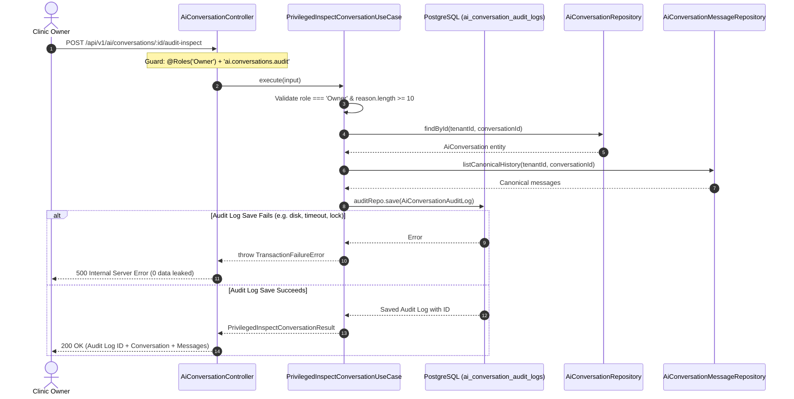

# AI-09.3-BE.05.05 — Authorization, Tenant Isolation & Ownership Hardening Report

**Phase:** Phase 5 — REST API & Client Integration  
**Task ID:** `AI-09.3-BE.05.05`  
**Status:** COMPLETED  
**Execution Date:** 2026-11-23

---

## 1. Executive Summary

Task `AI-09.3-BE.05.05` delivers an exhaustive security-hardening pass across the AI conversation REST API in `apps/api` and the core domain layer in `packages/core`. The hardening ensures strict tenant isolation, authenticated identity immutability, role-based access control (RBAC), mass-assignment defense, and failsafe privileged audit inspection for authorized clinic Owners.

All security invariants are verified across unit tests, security assertion suites, and real PostgreSQL integration tests with zero mocking of database relational constraints.

---

## 2. Threat Matrix & Defense-in-Depth Architecture

| Threat Vector                       | Attack Scenario                                                                                                       | Defense & Architectural Enforcement                                                                                                                                                                                                                                                                                                                                                                                                                                    | HTTP / Domain Outcome                                                                    |
| :---------------------------------- | :-------------------------------------------------------------------------------------------------------------------- | :--------------------------------------------------------------------------------------------------------------------------------------------------------------------------------------------------------------------------------------------------------------------------------------------------------------------------------------------------------------------------------------------------------------------------------------------------------------------- | :--------------------------------------------------------------------------------------- |
| **Tenant Spoofing**                 | Attacker passes `tenantId` in URL query, headers, or JSON body to access or mutate other tenants' records.            | [@TrustedAi()](file:///c:/Projects/kinergy-platform/apps/api/src/ai/conversation/decorators/trusted-ai-context.decorator.ts) extracts `tenantId` exclusively from cryptographic JWT / session claims verified by [AuthenticationGuard](file:///c:/Projects/kinergy-platform/apps/api/src/platform/identity/guards/authentication.guard.ts). Request payload values are ignored.                                                                                        | Client-supplied tenant fields are discarded or rejected by validation pipe.              |
| **Cross-Tenant Enumeration**        | Attacker queries conversation ID belonging to a different tenant to probe existence.                                  | All use cases scope database queries strictly by `(tenantId, conversationId)`. When no record matches within the tenant scope, [ConversationNotFoundError](file:///c:/Projects/kinergy-platform/packages/core/src/ai/application/errors/ai-conversation-application.error.ts) is thrown.                                                                                                                                                                               | Returns `404 Not Found` (never `403` or disclosing cross-tenant resource presence).      |
| **Privileged Access Escalation**    | Regular staff member (e.g., `Trainer`, `Therapist`, `Receptionist`) attempts to inspect private conversation records. | Multi-layer gate: [AuthorizationGuard](file:///c:/Projects/kinergy-platform/apps/api/src/platform/identity/authorization/authorization.guard.ts) enforces `@Roles('Owner')` and `@RequirePermissions(PERMISSIONS.AI.CONVERSATIONS_AUDIT)` at HTTP layer; [PrivilegedInspectConversationUseCase](file:///c:/Projects/kinergy-platform/packages/core/src/ai/application/use-cases/privileged-inspect-conversation.use-case.ts) enforces role check at application layer. | Rejection with `403 Forbidden` (`TenantOwnershipViolationError`).                        |
| **Audit Log Tampering / Bypass**    | Attacker triggers inspection or database error prevents audit log persistence while data is leaked.                   | **Fail-Closed Execution:** The audit log record is persisted to PostgreSQL via `IAiConversationAuditRepositoryPort` _before_ returning conversation data. If audit persistence throws an error, execution immediately throws `TransactionFailureError`.                                                                                                                                                                                                                | Returns `500 TransactionFailureError` with zero conversation messages or content leaked. |
| **Unjustified Snooping**            | Owner attempts to inspect conversations without valid clinical/compliance justification.                              | Mandatory input validation enforces `reason` of $\ge 10$ characters. Whitespace-only or short strings are rejected immediately.                                                                                                                                                                                                                                                                                                                                        | Rejection with `400 Bad Request` (`InvalidTurnInputError`).                              |
| **Mass-Assignment & Schema Tamper** | Client submits internal state attributes (`status`, `isCanonical`, `sequenceNumber`, `turnCounter`, `payloadHash`).   | Global NestJS `ValidationPipe` with `whitelist: true, forbidNonWhitelisted: true` rejects unexpected attributes immediately at HTTP perimeter.                                                                                                                                                                                                                                                                                                                         | Rejection with `400 Bad Request`.                                                        |

---

## 3. Trusted Authentication Context & Tenant Extraction

Authentication context extraction is handled by the [@TrustedAi()](file:///c:/Projects/kinergy-platform/apps/api/src/ai/conversation/decorators/trusted-ai-context.decorator.ts) parameter decorator:

```typescript
export interface TrustedAiContext {
  readonly actorId: string;
  readonly tenantId: string;
  readonly email?: string;
  readonly roles: readonly string[];
  readonly permissions: readonly string[];
}
```

### Invariants:

1. **Source of Truth:** Extracts identity from verified `request.user` (populated by `AuthenticationGuard`) or `RequestContext.currentIdentity()`.
2. **Missing Token / Principal:** Throws `UnauthorizedException` (401) if principal is missing, unauthenticated, or has blank `actorId`.
3. **Missing Tenant:** Throws `ForbiddenException` (403) if principal lacks a valid `tenantId`.
4. **Sanitization:** Trims leading/trailing whitespace to prevent tenant boundary traversal.

---

## 4. Privileged Conversation Inspection Endpoint

### HTTP Route Contract

- **Method & Path:** `POST /api/v1/ai/conversations/:id/audit-inspect`
- **Guards:** `@UseGuards(AuthenticationGuard, AuthorizationGuard)`
- **RBAC Decorators:**
  - `@Roles('Owner')`
  - `@RequirePermissions(PERMISSIONS.AI.CONVERSATIONS_AUDIT)` (Catalog code: `'ai.conversations.audit'`)
- **HTTP Code:** `200 OK`

### Request & Response DTOs

#### Request: [AuditInspectConversationRequestDto](file:///c:/Projects/kinergy-platform/apps/api/src/ai/conversation/dtos/ai-conversation.dtos.ts)

```typescript
export class AuditInspectConversationRequestDto {
  @ApiProperty({
    description: 'Clinical or compliance justification for privileged conversation inspection',
    minLength: 10,
    maxLength: 500,
    example: 'Mandatory clinical audit for protocol compliance review #1049',
  })
  @IsString()
  @IsNotBlank({ message: 'Audit justification reason cannot be empty or whitespace' })
  @MinLength(10, { message: 'Audit justification reason must be at least 10 characters long' })
  @MaxLength(500, { message: 'Audit justification reason cannot exceed 500 characters' })
  reason!: string;
}
```

#### Response: [AuditInspectResponseDto](file:///c:/Projects/kinergy-platform/apps/api/src/ai/conversation/dtos/ai-conversation.dtos.ts)

```typescript
export class AuditInspectResponseDto {
  auditLogId!: string;
  conversation!: ConversationDetailResponseDto;
  messages!: MessageResponseDto[];
  inspectedAt!: string;
}
```

---

## 5. Fail-Closed Audit Logging Workflow

In [PrivilegedInspectConversationUseCase](file:///c:/Projects/kinergy-platform/packages/core/src/ai/application/use-cases/privileged-inspect-conversation.use-case.ts), audit logging is non-negotiable and committed _before_ returning data:



---

## 6. Verification and Test Results

### 1. Test Execution Summary

All 7 test suites passing with 120 tests:

```text
 PASS   api  apps/api/src/ai/conversation/__tests__/ai-conversation-security.spec.ts (8.821 s)
 PASS   api  apps/api/src/ai/conversation/__tests__/ai-conversation.controller.spec.ts
 PASS   api  apps/api/src/ai/conversation/__tests__/ai-conversation-api.integration.spec.ts (10.526 s)
 PASS   api  apps/api/src/ai/__tests__/ai-conversation-database.integration.spec.ts
 PASS   api  apps/api/src/ai/conversation/__tests__/ai-conversation-dtos.spec.ts
 PASS   api  apps/api/src/ai/conversation/__tests__/ai-conversation-exception.filter.spec.ts
 PASS   api  apps/api/src/ai/conversation/__tests__/ai-conversation-module.spec.ts (6.076 s)

Test Suites: 7 passed, 7 total
Tests:       120 passed, 120 total
Snapshots:   0 total
Time:        18.946 s
```

### 2. Dedicated Security Test Suite Breakdown

[ai-conversation-security.spec.ts](file:///c:/Projects/kinergy-platform/apps/api/src/ai/conversation/__tests__/ai-conversation-security.spec.ts):

- **Class-Level Security:** Enforces `AuthenticationGuard` and `AuthorizationGuard` on `AiConversationController`.
- **Privileged Decorator Inspection:** Verified `@Roles('Owner')` and `@RequirePermissions('ai.conversations.audit')` on `POST /:id/audit-inspect`.
- **Authentication Context:** Missing principal throws `UnauthorizedException` (401); missing `tenantId` throws `ForbiddenException` (403); whitespace trimmed from IDs.
- **Cross-Tenant Attack Defense:** Verified `ConversationNotFoundError` (404) across `GET /:id`, `POST /:id/turns`, `GET /:id/messages`, `PATCH /:id/title`, `DELETE /:id`, and `POST /:id/audit-inspect`.
- **Tenant Scope in Lists:** Verified `ListConversationsUseCase` is strictly bound to `trustedContext.tenantId`.
- **RBAC Role Gate:** Non-owner role (`Trainer`) rejected with `TenantOwnershipViolationError` (403).
- **Audit Reason Enforcement:** Reason length $< 10$ rejected with `InvalidTurnInputError` (400).
- **Fail-Closed Guarantee:** Audit repository failure throws `TransactionFailureError` (500) and halts execution before any conversation or message data is returned.

### 3. PostgreSQL Integration Security Verification

[ai-conversation-api.integration.spec.ts](file:///c:/Projects/kinergy-platform/apps/api/src/ai/conversation/__tests__/ai-conversation-api.integration.spec.ts):

- **Test 11:** Real `Owner` audit inspection against PostgreSQL persists record in table `ai_conversation_audit_logs` with `tenant_id`, `conversation_id`, `inspector_user_id`, `inspector_role = 'Owner'`, and full justification reason.
- **Test 12:** Real `Doctor` role attempting privileged inspection is rejected with `403 Forbidden` and persists **zero** audit logs.
- **Test 13:** Tenant Beta cross-tenant attack against real PostgreSQL is blocked for GET, POST turns, GET messages, and POST audit-inspect, returning `404 Not Found`.

### 4. Quality Gates Verification

| Quality Gate                | Command                                                                                      | Result                                  |
| :-------------------------- | :------------------------------------------------------------------------------------------- | :-------------------------------------- |
| **Code Formatting**         | `npx prettier --write "apps/api/src/ai/conversation/**/*.ts" "packages/core/src/ai/**/*.ts"` | PASS (All files formatted cleanly)      |
| **Static Analysis / Lint**  | `npx nx lint api`                                                                            | PASS (Zero lint warnings/errors)        |
| **Application Compilation** | `npx nx build api`                                                                           | PASS (Build succeeded without warnings) |
| **Monorepo Type Checking**  | `pnpm typecheck` (`tsc --noEmit -p tsconfig.base.json`)                                      | PASS (Zero TypeScript errors)           |

---

## 7. Deliverable Summary & Readiness for BE.05.06

The security hardening pass `BE.05.05` is completely implemented, verified, and integrated into the platform codebase. The REST API is hardened against tenant leakage, IDOR, privilege escalation, and un-audited inspection.

The system is ready for **`AI-09.3-BE.05.06 — REST API Acceptance & Documentation`**.
