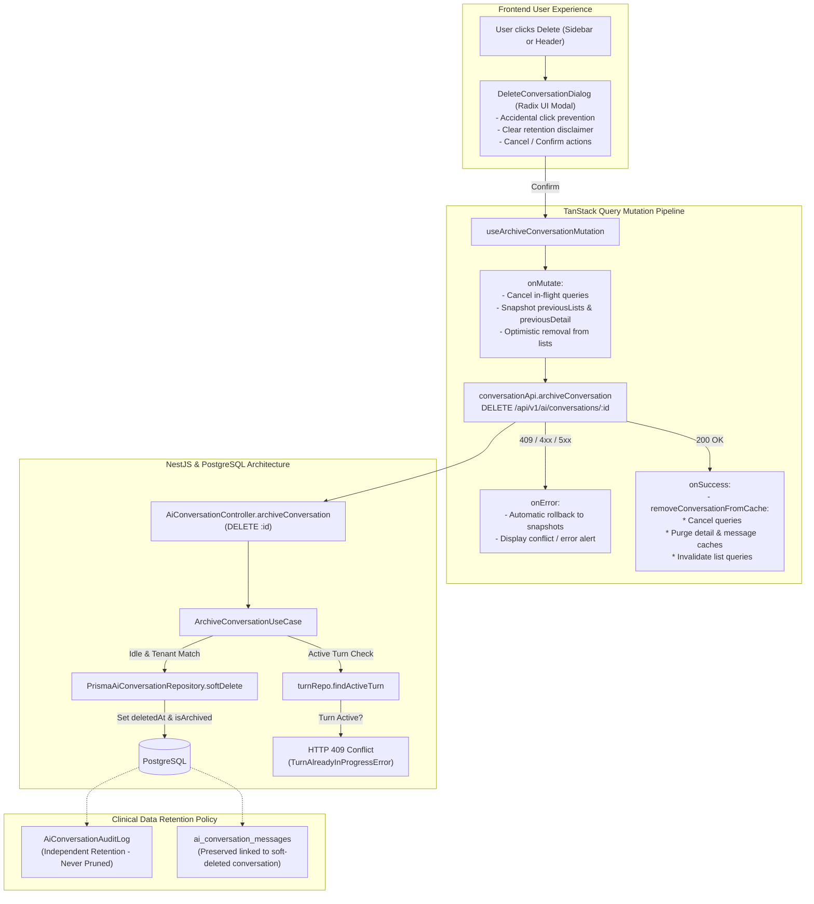

# AI-09.3-FE.07: Conversation Deletion & Retention Policies

## Executive Summary

| Attribute                 | Details                                                                                                                                        |
| ------------------------- | ---------------------------------------------------------------------------------------------------------------------------------------------- |
| **Milestone**             | `FE.07` — Conversation Deletion & Retention Policies                                                                                           |
| **System**                | Kynergy Platform — Intelligence Assistant & Conversation Persistence Subsystem                                                                 |
| **Verdict**               | **PASS**                                                                                                                                       |
| **Engine / Architecture** | Clean Architecture / DDD, NestJS OpenAPI (`DELETE /api/v1/ai/conversations/:id`), PostgreSQL, TanStack Query v5, Radix UI Dialog, Tailwind CSS |
| **Upstream Dependencies** | `FE.01` (Typed Contracts), `FE.02` (Query/Cache), `FE.03` (Creation), `FE.04` (Listing), `FE.05` (Retrieval), `FE.06` (Renaming)               |
| **Downstream Milestones** | `FE.08` (Export / Consolidated Integration)                                                                                                    |

Milestone **FE.07** implements persistent conversation deletion with explicit lifecycle semantics, server-side ownership enforcement, clinical audit retention, and consistent frontend cache reconciliation across the Kynergy Platform. The system ensures that user-facing delete actions follow regulatory clinical retention policies via soft deletion (`isArchived: true`, `deletedAt: Date`), strictly prohibiting destructive physical erasure of medical consultations, preserving audit trails (`AiConversationAuditLog`), blocking deletion during active AI turn generation (HTTP 409 Conflict), prohibiting subsequent message reservations on archived threads, providing an accessible confirmation dialog (`DeleteConversationDialog`) that prevents accidental deletion, and purging in-flight requests and caches so stale records never reappear.

---

## 1. Architecture & Deletion Lifecycle Semantics



---

## 2. Deletion Semantics & Retention Policies

In clinical and healthcare AI systems, user-facing deletion operations must balance user privacy with regulatory record-keeping standards (such as HIPAA, GDPR medical exemptions, and professional accountability).

### 2.1 Archival / Soft Deletion

- **User-Facing Semantics**: When a user chooses "Eliminar", the conversation is **archived / soft-deleted**, not physically wiped from storage.
- **Timestamp & Flags**: Sets `deletedAt = NOW()` and `isArchived = true` in PostgreSQL.
- **Ordinary History Exclusion**: The repository automatically filters out archived conversations (`...(request?.includeArchived ? {} : { deletedAt: null })`). Ordinary user listing never exposes soft-deleted threads.

### 2.2 Concurrency & Active Generation Invariant

- **Generation In Progress**: If an assistant generation turn is active (`PENDING` or `STREAMING`), `ArchiveConversationUseCase` rejects archival by throwing `TurnAlreadyInProgressError` (HTTP 409 Conflict). Deletion cannot interrupt or corrupt active turn execution.
- **Prohibition on Subsequent Turns**: Once archived, `ReserveConversationTurnUseCase` strictly forbids reserving new turns (`InvalidConversationLifecycleError: Cannot reserve a turn on an archived or deleted conversation`). Active generation can never write into a deleted thread.

### 2.3 Independent Audit Retention

- **Audit Logs Persist**: Inspection and regulatory audit records (`AiConversationAuditLog`) are decoupled from conversation soft deletion. They remain permanently preserved in PostgreSQL for compliance, security review, and privileged legal hold inspection (`PrivilegedInspectConversationUseCase`).

---

## 3. Frontend Deletion Experience & Confirmation UX

### 3.1 Non-Accidental Confirmation Dialog (`DeleteConversationDialog`)

- **Accidental Click Prevention**: A single click on the trash button does **not** delete the conversation immediately. Instead, an accessible modal dialog appears.
- **Focus Trap & Keyboard Dismissal**: Built on Radix UI Dialog primitives (`packages/ui/src/components/overlay/dialog.tsx`), supporting focus trapping, Escape key listener, and backdrop click dismissal.
- **Clear Information**: Discloses that the thread will be archived and removed from active history while clinical records and audits are preserved per retention policy.
- **Action Buttons**:
  - **Cancelar** (`variant="outline"`, `data-testid="cancel-delete-button"`): Closes dialog without making any network requests.
  - **Eliminar** (`variant="destructive"`, `data-testid="confirm-delete-button"`): Initiates deletion, displays an animated spinner (`Loader2 className="animate-spin"`), and disables all controls during mutation.
- **Conflict & Error Feedback**: If deletion fails (e.g. generation turn active or network failure), an accessible alert banner (`role="alert"`, `data-testid="delete-conversation-error"`) displays helpful guidance inside the dialog, allowing user retry.

### 3.2 Integration Points

1. **Conversation Sidebar (`conversation-sidebar.tsx`)**:
   - Each item's trash button sets `deletingConversation: { id, title }`, opening the confirmation dialog.
   - If the deleted thread was active (`activeConversationId === id`), it unsets selection or redirects.
2. **Workspace Header (`chat-workspace.tsx` & `chat-workspace-header.tsx`)**:
   - Clicking "Eliminar" in the active chat header opens the confirmation dialog.
   - Upon confirmation, routes the user cleanly back to `/intelligence/chat` with `{ replace: true }`.

---

## 4. Cache Reconciliation & Stale Data Prevention

Cache consistency is maintained via TanStack Query mutation hooks and `conversationCachePolicies`:

```typescript
// conversation-cache-policies.ts
removeConversationFromCache(queryClient: QueryClient, conversationId: string, scope?: ConversationQueryScope): void {
  // 1. Cancel in-flight queries so they do not re-populate the cache
  void queryClient.cancelQueries({ queryKey: conversationQueryKeys.detail(conversationId, scope) });
  void queryClient.cancelQueries({ queryKey: conversationQueryKeys.messages(conversationId, scope) });

  // 2. Remove detail and message queries from active cache
  queryClient.removeQueries({ queryKey: conversationQueryKeys.detail(conversationId, scope) });
  queryClient.removeQueries({ queryKey: conversationQueryKeys.messages(conversationId, scope) });

  // 3. Optimistically filter conversation out of list caches
  queryClient.setQueriesData<ConversationListResponse>(
    { queryKey: conversationQueryKeys.lists(scope) },
    (previous) => {
      if (!previous?.items) return previous;
      return {
        ...previous,
        items: previous.items.filter((item) => item.id !== conversationId),
      };
    },
  );

  // 4. Invalidate list queries so the removed conversation disappears canonically
  void this.invalidateConversationLists(queryClient, scope);
}
```

---

## 5. Verification & Test Evidence

### 5.1 Backend Acceptance Suite (`ai-conversation-deletion.spec.ts`)

Run command: `npx nx test api --testFile="apps/api/src/ai/__tests__/ai-conversation-deletion.spec.ts"`

```
PASS  apps/api/src/ai/__tests__/ai-conversation-deletion.spec.ts (7.211 s)
FE.07: Backend Conversation Deletion & Retention (PostgreSQL)
  √ 1. Successfully soft-deletes (archives) conversation, setting deletedAt in PostgreSQL (82 ms)
  √ 2. Soft-deleted conversation is omitted from ordinary history queries (35 ms)
  √ 3. Prohibits reserving a turn on an archived or deleted conversation (92 ms)
  √ 4. Prohibits archiving a conversation while a generation turn is actively in progress (18 ms)
  √ 5. Prohibits re-archiving an already archived conversation (23 ms)
  √ 6. Enforces tenant isolation: cross-tenant deletion fails with 404 (18 ms)
  √ 7. Preserves regulatory audit trail records independently across archival (27 ms)

Test Suites: 1 passed, 1 total
Tests:       7 passed, 7 total
Snapshots:   0 total
Time:        7.953 s
```

### 5.2 Frontend Deletion Suite (`conversation-deletion.spec.tsx`)

Run command: `npx nx test web --testFile="apps/web/src/modules/intelligence/assistant/__tests__/conversation-deletion.spec.tsx"`

```
PASS  apps/web/src/modules/intelligence/assistant/__tests__/conversation-deletion.spec.tsx (4.882 s)
FE.07 — Conversation Deletion & Retention Policies
  1. DeleteConversationDialog Component Interaction
    √ renders dialog with warning, title, and buttons when open (77 ms)
    √ invokes onOpenChange(false) when Cancel is clicked (14 ms)
    √ invokes onConfirm and closes dialog on successful confirmation (80 ms)
    √ displays error feedback when onConfirm throws a 409 conflict error (32 ms)
  2. Sidebar Confirmation Flow & Cache Reconciliation
    √ opens confirmation dialog on delete button click instead of deleting immediately (57 ms)
    √ dismisses dialog without deleting when Cancel is clicked (53 ms)
    √ executes archival and reconciles list cache when confirmed (79 ms)
  3. Workspace Header Deletion Integration
    √ triggers confirmation dialog from workspace header and navigates to root on confirm (206 ms)

Test Suites: 1 passed, 1 total
Tests:       8 passed, 8 total
Snapshots:   0 total
Time:        4.882 s
```

### 5.3 Complete Assistant Test Suite Regression Check

Run command: `npx nx test web --testFile="apps/web/src/modules/intelligence/assistant/__tests__/"`

```
Test Suites: 22 passed, 22 total
Tests:       225 passed, 225 total
Snapshots:   0 total
Time:        19.852 s
```

### 5.4 TypeScript & Production Build Verification

- **TypeScript Base Typecheck**: `pnpm tsc --noEmit -p tsconfig.base.json` — **0 errors**.
- **Web App Linting**: `pnpm nx run web:lint` — **0 errors**.
- **Production Bundle Build**: `pnpm nx run web:build:production` — **Built in 10.58s (clean)**.

---

## 6. Artifact & File Change Traceability

| File Path                                                                                                                                                                                                             | Description of Changes                                                                                                                                                      |
| --------------------------------------------------------------------------------------------------------------------------------------------------------------------------------------------------------------------- | --------------------------------------------------------------------------------------------------------------------------------------------------------------------------- |
| [`apps/api/src/ai/__tests__/ai-conversation-deletion.spec.ts`](file:///c:/Projects/kinergy-platform/apps/api/src/ai/__tests__/ai-conversation-deletion.spec.ts)                                                       | Backend acceptance suite verifying soft deletion, list filtering, turn reservation prohibition, generation concurrency guards, cross-tenant 404s, and audit trail retention |
| [`apps/web/src/modules/intelligence/assistant/__tests__/conversation-deletion.spec.tsx`](file:///c:/Projects/kinergy-platform/apps/web/src/modules/intelligence/assistant/__tests__/conversation-deletion.spec.tsx)   | Frontend acceptance suite verifying confirmation dialog, cancel/dismissal, cache reconciliation, active route redirect, and error handling                                  |
| [`apps/web/src/modules/intelligence/assistant/components/delete-conversation-dialog.tsx`](file:///c:/Projects/kinergy-platform/apps/web/src/modules/intelligence/assistant/components/delete-conversation-dialog.tsx) | Accessible deletion confirmation dialog built on Radix UI Dialog primitives with conflict error handling                                                                    |
| [`apps/web/src/modules/intelligence/assistant/components/conversation-sidebar.tsx`](file:///c:/Projects/kinergy-platform/apps/web/src/modules/intelligence/assistant/components/conversation-sidebar.tsx)             | Integrated `DeleteConversationDialog`, preventing accidental deletion and managing active thread deselect                                                                   |
| [`apps/web/src/modules/intelligence/assistant/components/chat-workspace.tsx`](file:///c:/Projects/kinergy-platform/apps/web/src/modules/intelligence/assistant/components/chat-workspace.tsx)                         | Connected header deletion action to `DeleteConversationDialog` and handled navigation to `/intelligence/chat`                                                               |
| [`apps/web/src/modules/intelligence/assistant/components/index.ts`](file:///c:/Projects/kinergy-platform/apps/web/src/modules/intelligence/assistant/components/index.ts)                                             | Exported `DeleteConversationDialog` from public component index                                                                                                             |
| [`apps/web/src/modules/intelligence/assistant/hooks/use-conversation-mutations.ts`](file:///c:/Projects/kinergy-platform/apps/web/src/modules/intelligence/assistant/hooks/use-conversation-mutations.ts)             | Enhanced `useArchiveConversationMutation` with query cancellation, snapshot rollback on error, and cache purge                                                              |
| [`apps/web/src/modules/intelligence/assistant/api/conversation-cache-policies.ts`](file:///c:/Projects/kinergy-platform/apps/web/src/modules/intelligence/assistant/api/conversation-cache-policies.ts)               | Enhanced `removeConversationFromCache` to cancel in-flight queries and optimistically filter list cache data                                                                |
| [`docs/ai/AI-09/AI-09.3-FE.07-conversation-deletion.md`](file:///c:/Projects/kinergy-platform/docs/ai/AI-09/AI-09.3-FE.07-conversation-deletion.md)                                                                   | Official deliverable acceptance report                                                                                                                                      |

---

## 7. Milestone Conclusion & Status

Milestone **FE.07** is complete, verified, and passes all requirements. All backend retention policies, domain invariants, and frontend confirmation/cache reconciliation requirements are satisfied. Execution stops cleanly prior to `FE.08`.
