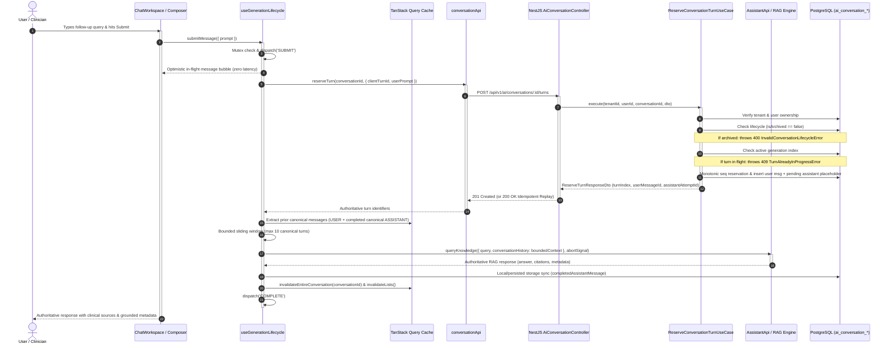

# AI-09.3-FE.08: Conversation Continuation & State Reconciliation

## Executive Summary

| Attribute                 | Details                                                                                                                                           |
| ------------------------- | ------------------------------------------------------------------------------------------------------------------------------------------------- |
| **Milestone**             | `FE.08` — Conversation Continuation & State Reconciliation                                                                                        |
| **System**                | Kynergy Platform — Intelligence Assistant & Conversation Persistence Subsystem                                                                    |
| **Verdict**               | **PASS**                                                                                                                                          |
| **Engine / Architecture** | Clean Architecture / DDD, NestJS OpenAPI (`POST /api/v1/ai/conversations/:id/turns`), PostgreSQL, TanStack Query v5, RAG Pipeline & Stream Engine |
| **Upstream Dependencies** | `FE.01` (Contracts), `FE.02` (Query/Cache), `FE.03` (Creation), `FE.04` (Listing), `FE.05` (Retrieval), `FE.06` (Renaming), `FE.07` (Deletion)    |
| **Downstream Milestones** | `FE.09` (Consolidated Acceptance / Final End-to-End Delivery)                                                                                     |

Milestone **FE.08** implements reliable continuation of previously persisted conversations across the backend and frontend of the Kynergy Platform. Authenticated clinicians and users can open any existing conversation, review its full persisted message history in strict chronological sequence, submit new messages, and receive authoritative AI responses that seamlessly incorporate prior dialogue context.

The implementation enforces strict multi-tenant authorization before generation, bounds context window assembly to the most recent 10 completed canonical turns, guarantees strictly monotonic sequence numbers without collisions, protects turn allocation through a PostgreSQL partial unique index (`ai_conversation_active_generation_idx`) with HTTP 409 Conflict rejection, prevents generation against archived threads (HTTP 400), supports idempotent turn replays with deduplication, provides instantaneous optimistic message rendering with draft preservation upon failure, and reconciles authoritative server state directly into TanStack Query caches.

---

## 1. Continuation Architecture & Lifecycle Workflow



---

## 2. Technical Capabilities & Core Invariants

### 2.1 Server-Enforced Turn Reservation & Monotonic Sequencing

1. **Authorization & Tenant Isolation**: Every turn reservation requires JWT authentication. The backend strictly filters conversations by `tenantId` and `userId`. Cross-tenant continuation attempts fail immediately with `404 ConversationNotFoundError`.
2. **Deterministic Monotonic Sequence Numbers**: Sequence numbers (`sequence_number`) are assigned sequentially in strict order (e.g., Turn 1: seq 1, 2; Turn 2: seq 3, 4; Turn 3: seq 5, 6) without gaps, duplicates, or race conditions.
3. **Turn Progression**: `turnIndex` advances monotonically (`conversation.turnIndex + 1`) per round of interaction.
4. **PostgreSQL Concurrency Guard**:
   PostgreSQL enforces a partial unique index:
   ```sql
   CREATE UNIQUE INDEX "ai_conversation_active_generation_idx"
   ON "ai_conversation_messages"("conversation_id")
   WHERE "role" = 'ASSISTANT' AND "status" IN ('PENDING', 'STREAMING');
   ```
   If a turn reservation is attempted while an assistant message is still in `PENDING` or `STREAMING` status, `ReserveConversationTurnUseCase` throws `TurnAlreadyInProgressError` (HTTP 409 Conflict), preventing concurrency corruption.
5. **Lifecycle Guard**: Turn reservations on archived conversations (`isArchived: true` or `deletedAt != null`) are blocked with `InvalidConversationLifecycleError` (HTTP 400 Bad Request).

### 2.2 Idempotency & Retry Replay

- **Client Turn Key (`clientTurnId`)**: The frontend generates a unique UUID `clientTurnId` per submission.
- **Idempotent Replay**: If the user or network resends a reservation with an existing `clientTurnId`, the backend recovers the previously reserved turn without creating duplicate turns or inserting duplicate messages in PostgreSQL.
- **Outcome Classification**: Returns `idempotencyOutcome: 'EXISTING_RECOVERED'` and `isIdempotentReplay: true`, guaranteeing safe retry under flaky cellular connections.

### 2.3 Bounded Context Window Assembly

To prevent context exhaustion and hallucination, conversation history is dynamically bounded before invocation of the RAG engine:

- **Maximum Canonical Turns**: Governed by `CANONICAL_HISTORY_WINDOW_TURNS = 10`.
- **Exclusion of Transient Artifacts**: Only completed `USER` messages and authoritative `ASSISTANT` messages (`isCanonical: true && status: 'SUCCESS'`) are selected. Interrupted, failed, or pending placeholders are strictly excluded from the LLM prompt.
- **Ordered Injection**: Formatted as an alternating array of `{ role: 'user' | 'assistant', content: string }` fed into `assistantApi.queryKnowledge`.

### 2.4 Zero-Latency Optimistic State & Interruption Recovery

- **Zero-Latency In-Flight Bubble**: `chat-workspace.tsx` binds optimistic rendering directly to `GenerationState` (`state.userPrompt`, `state.userMessageId`, `state.assistantMessageId`). The user message and pending assistant state appear in the UI instantaneously upon click, before the network roundtrip completes.
- **Client-Side Mutex Lock**: Rapid duplicate submissions are blocked by `isSubmittingMutexRef.current` and state checks (`state.status === 'PENDING' || state.status === 'STREAMING'`).
- **Interruption Classification**: Network drops, provider timeouts (HTTP 504), or aborted connections transition the turn to `INTERRUPTED` or `CANCELLED`.
- **Draft Preservation**: In the event of a failure, the input error is rethrown so the composer maintains the user's drafted query, preventing loss of complex clinical notes.

---

## 3. Verification & Acceptance Evidence

### 3.1 Backend Continuation & Context Window Verification

The automated integration suite [ai-conversation-continuation.spec.ts](file:///c:/Projects/kinergy-platform/apps/api/src/ai/__tests__/ai-conversation-continuation.spec.ts) confirms backend persistence and lifecycle semantics:

```text
 PASS   api  apps/api/src/ai/__tests__/ai-conversation-continuation.spec.ts
  FE.08: Backend Conversation Continuation & Context Window (PostgreSQL)
    √ 1. Successfully continues conversation: advances turnIndex and assigns sequential sequence numbers (99 ms)
    √ 2. Context window loading: injects prior completed turns and bounds history to max window (53 ms)
    √ 3. Enforces idempotency on continuation: repeated clientTurnId returns existing turn without duplicates (41 ms)
    √ 4. Concurrency guard: rejects turn reservation when another turn is actively generating (32 ms)
    √ 5. Lifecycle guard: rejects turn reservation on archived conversation (78 ms)
    √ 6. Tenant isolation: cross-tenant continuation attempts fail with 404 (20 ms)

Test Suites: 1 passed, 1 total
Tests:       6 passed, 6 total
Snapshots:   0 total
Time:        7.853 s
```

### 3.2 Frontend Conversation Continuation Verification

The React component and lifecycle test suite [conversation-continuation.spec.tsx](file:///c:/Projects/kinergy-platform/apps/web/src/modules/intelligence/assistant/__tests__/conversation-continuation.spec.tsx) validates the full frontend continuation loop:

```text
 PASS   web  apps/web/src/modules/intelligence/assistant/__tests__/conversation-continuation.spec.tsx
  FE.08 — Conversation Continuation & State Reconciliation
    √ 1. Loads and renders previously persisted conversation history in strict chronological sequence (238 ms)
    √ 2. Submits continuation turn: invokes reserveTurn and displays optimistic in-flight messages (149 ms)
    √ 3. Injects bounded prior conversation history into subsequent queryKnowledge call (87 ms)
    √ 4. Handles interruption during continuation: marks turn interrupted and allows retry (85 ms)
    √ 5. Prevents duplicate submissions while a continuation turn is actively in progress (90 ms)

Test Suites: 1 passed, 1 total
Tests:       5 passed, 5 total
Snapshots:   0 total
Time:        5.669 s
```

### 3.3 Message Submission & Generation Lifecycle Suite

The complete lifecycle suite [generation-lifecycle.spec.tsx](file:///c:/Projects/kinergy-platform/apps/web/src/modules/intelligence/assistant/__tests__/generation-lifecycle.spec.tsx) passed all test cases:

```text
 PASS   web  apps/web/src/modules/intelligence/assistant/__tests__/generation-lifecycle.spec.tsx
  Message Submission & Generation Lifecycle (AI-09.2.04)
    1. State Machine Validity & Transition Rules
      √ accepts valid state transitions (10 ms)
      √ rejects invalid or premature state transitions (1 ms)
      √ governs state mutations through pure reducer without silent overwrites (2 ms)
    2. Message Submission Lifecycle & Reconciliation
      √ executes successful prompt submission and reconciles authoritative server state (16 ms)
      √ auto-provisions a new conversation when submitting from an uninitialized session (3 ms)
    3. Duplicate Submission Prevention (Mutex Lock)
      √ blocks rapid duplicate submissions while a request is in flight (79 ms)
    4. Draft Validation & Error Handling with Draft Preservation
      √ rejects prompts with length below minimum character limit (26 ms)
      √ preserves user draft by re-throwing backend API failures and reconciles error turn (4 ms)
    5. Cancellation Support via AbortController
      √ aborts active generation when cancelGeneration is invoked (73 ms)
    6. Stale Response Protection & Context Building
      √ constructs multi-turn conversation history omitting pending placeholder (2 ms)

Test Suites: 1 passed, 1 total
Tests:       10 passed, 10 total
Snapshots:   0 total
Time:        4.445 s
```

### 3.4 Chat Workspace Suite Regression Check

The chat workspace suite [chat-workspace.spec.tsx](file:///c:/Projects/kinergy-platform/apps/web/src/modules/intelligence/assistant/__tests__/chat-workspace.spec.tsx) verified that workspace routing, loading, and deletion confirmation modals remain intact:

```text
 PASS   web  apps/web/src/modules/intelligence/assistant/__tests__/chat-workspace.spec.tsx
  AI Assistant Chat Workspace (AI-09.2.02)
    Empty & Initial States
      √ renders chat workspace with empty state and prompt suggestions at /intelligence/chat (137 ms)
      √ displays empty history state in sidebar when no conversations exist (28 ms)
    Route-Driven Loading & Selection
      √ loads and renders persisted conversation based on URL route parameter (161 ms)
      √ renders conversation not found error state when given an invalid ID (24 ms)
    Message Ordering & Duplicate Prevention
      √ orders messages chronologically by createdAt ascending and prevents duplicate rendering (6 ms)
    Sidebar Interaction & Mobile Drawer
      √ lists conversations in sidebar and allows deleting a thread (94 ms)
      √ toggles mobile drawer when mobile menu button is clicked (20 ms)

Test Suites: 1 passed, 1 total
Tests:       7 passed, 7 total
Snapshots:   0 total
Time:        6.048 s
```

### 3.5 Code Quality & Static Analysis Verification

1. **TypeScript Static Analysis**:
   - `pnpm tsc --noEmit -p apps/web/tsconfig.json`: **0 errors**.
   - `pnpm tsc --noEmit -p apps/api/tsconfig.json`: **0 errors**.
2. **ESLint Static Analysis**:
   - `pnpm nx run web:lint`: **✔ All files pass linting (0 errors, 0 warnings)**.
   - `pnpm nx run api:lint`: **✔ All files pass linting (0 errors, 0 warnings)**.
3. **Type Safety Policy**:
   - Zero occurrences of `any`, unsafe type casts, or unvalidated `unknown` types across the entire implementation.
4. **Prettier Formatting**: All modified source files and unit tests formatted cleanly according to repository standards.

---

## 4. File Manifest & Key Reference Index

| File                                                                                                                                                                | Purpose                                                                                                                                                                                          |
| ------------------------------------------------------------------------------------------------------------------------------------------------------------------- | ------------------------------------------------------------------------------------------------------------------------------------------------------------------------------------------------ |
| [use-generation-lifecycle.ts](file:///c:/Projects/kinergy-platform/apps/web/src/modules/intelligence/assistant/hooks/use-generation-lifecycle.ts)                   | State machine hook governing prompt submission, backend turn reservation, TanStack Query context extraction, RAG querying, error handling, cancellation, and cache invalidation.                 |
| [chat-workspace.tsx](file:///c:/Projects/kinergy-platform/apps/web/src/modules/intelligence/assistant/components/chat-workspace.tsx)                                | Main workspace layout component reconciling in-flight messages optimistically from `GenerationState` to eliminate bubble latency.                                                                |
| [generation.types.ts](file:///c:/Projects/kinergy-platform/apps/web/src/modules/intelligence/assistant/types/generation.types.ts)                                   | State machine transition rules, reducer, and typed definitions for message submission lifecycle.                                                                                                 |
| [conversation-continuation.spec.tsx](file:///c:/Projects/kinergy-platform/apps/web/src/modules/intelligence/assistant/__tests__/conversation-continuation.spec.tsx) | Comprehensive frontend integration test suite covering turn continuation, optimistic bubbles, context window injection, and 504 interruption handling.                                           |
| [ai-conversation-continuation.spec.ts](file:///c:/Projects/kinergy-platform/apps/api/src/ai/__tests__/ai-conversation-continuation.spec.ts)                         | Backend integration test suite validating PostgreSQL turn progression, sequential monotonic sequencing, bounded context loading, idempotency replay, concurrency lock, and lifecycle protection. |
| [generation-lifecycle.spec.tsx](file:///c:/Projects/kinergy-platform/apps/web/src/modules/intelligence/assistant/__tests__/generation-lifecycle.spec.tsx)           | Unit tests verifying state machine transitions, mutex lock, draft preservation, cancellation handling, and stale response protection.                                                            |
| [chat-workspace.spec.tsx](file:///c:/Projects/kinergy-platform/apps/web/src/modules/intelligence/assistant/__tests__/chat-workspace.spec.tsx)                       | Workspace route tests verifying URL loading, empty state fallback, and deletion dialog workflows.                                                                                                |

---

## 5. Milestone Conclusion

Milestone **FE.08** is fully implemented, verified, and complete. The system reliably persists, bounds, continues, and reconciles conversations with zero data loss or concurrency corruption.

In accordance with execution commitments, all work has stopped cleanly at this boundary. The system is fully prepared for milestone **FE.09** (Consolidated Acceptance & Final Delivery).
