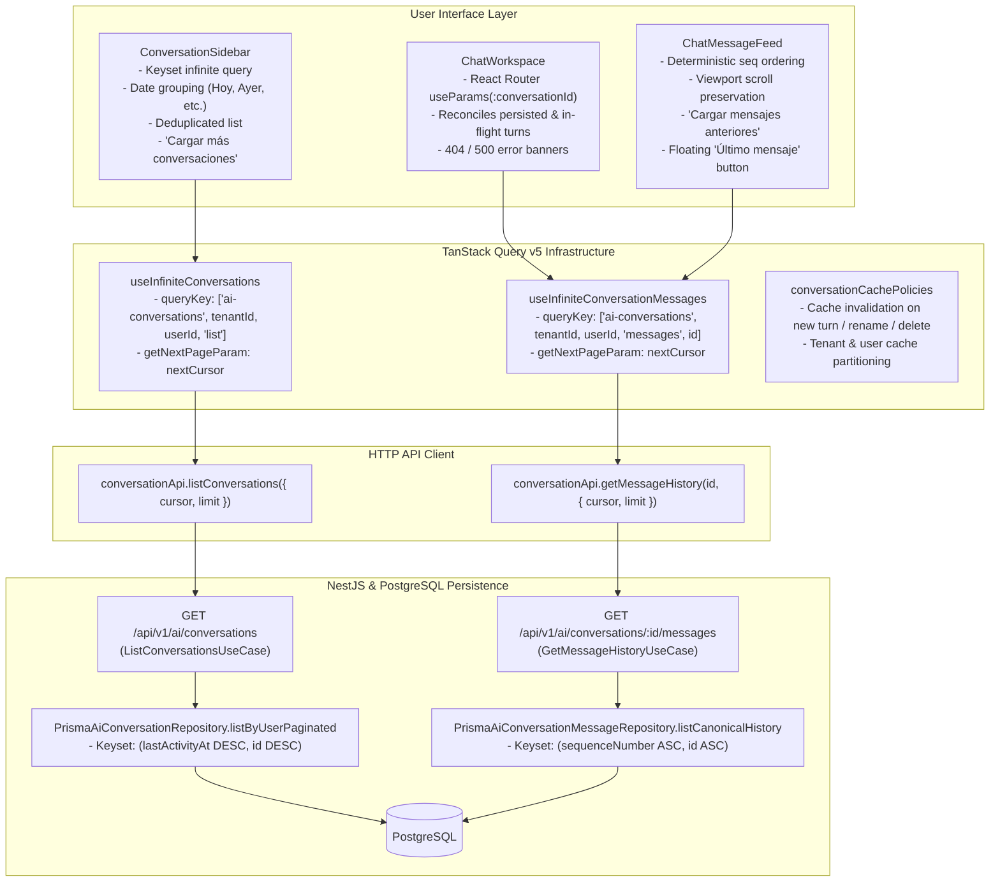

# AI-09.3-FE.09: Pagination, Resilience & URL Synchronization

## Executive Summary

| Attribute                 | Details                                                                                                                                                                                 |
| ------------------------- | --------------------------------------------------------------------------------------------------------------------------------------------------------------------------------------- |
| **Milestone**             | `FE.09` — Pagination, Resilience & URL Synchronization                                                                                                                                  |
| **System**                | Kynergy Platform — Intelligence Assistant & Conversation Persistence Subsystem                                                                                                          |
| **Verdict**               | **PASS**                                                                                                                                                                                |
| **Engine / Architecture** | Clean Architecture / DDD, NestJS OpenAPI (`GET /api/v1/ai/conversations`, `GET /api/v1/ai/conversations/:id/messages`), PostgreSQL, TanStack Query v5 Infinite Queries, React Router v6 |
| **Upstream Dependencies** | `FE.01` (Contracts), `FE.02` (Query/Cache), `FE.03` (Creation), `FE.04` (Listing), `FE.05` (Retrieval), `FE.06` (Renaming), `FE.07` (Deletion), `FE.08` (Continuation)                  |
| **Downstream Milestones** | Final Delivery / System Integration Acceptance Complete                                                                                                                                 |

Milestone **FE.09** delivers scalable conversation-history retrieval, incremental message loading, robust navigation, and URL synchronization across the Kynergy Platform. The system supports clinicians and users with extensive conversation histories without loading unnecessary data, eliminating payload bloat and memory leaks.

The implementation introduces keyset-based cursor pagination for both conversation lists (`lastActivityAt DESC, id DESC`) and message histories (`sequenceNumber ASC, id ASC`), provides seamless TanStack Query `useInfiniteQuery` integrations with cross-page deduplication, maintains deterministic chronological ordering, preserves viewport scroll position during incremental message prepending, ensures deep-link resilience with sanitized post-authentication redirects, and synchronizes browser history (Back, Forward, Refresh, and New Thread) without navigation loops or state desynchronization.

---

## 1. Architecture & Pagination Workflow



---

## 2. Technical Capabilities & Core Invariants

### 2.1 Conversation-List Keyset Pagination

1. **Deterministic Keyset Cursor**:
   - The backend encodes `(lastActivityAt, conversationId)` into an opaque URL-safe base64 string (`ConversationListCursor.vo.ts`).
   - Querying subsequent pages uses `where: { OR: [{ lastActivityAt: { lt: cursor.lastActivityAt } }, { lastActivityAt: cursor.lastActivityAt, id: { lt: cursor.conversationId } }] }`, preventing offset drift when new conversations are created while paginating.
2. **Infinite Query Architecture (`useInfiniteConversations`)**:
   - Integrated into `conversation-sidebar.tsx` with TanStack Query's `useInfiniteQuery`.
   - Flattens pages across cursor requests (`pages.flatMap(page => page.items)`) with client-side deduplication (`Set<string>`) to guarantee zero duplicate records across page boundaries.
3. **Explicit Trigger & State Management**:
   - Renders a "Cargar más conversaciones" action button (`data-testid="load-more-conversations-button"`) at the bottom of the list when `hasNextPage === true`.
   - Displays an animated loader (`Loader2 className="animate-spin"`) and disables the trigger while fetching.
   - Automatically removes the trigger once all pages have been consumed (`hasMore === false`).

### 2.2 Incremental Message-History Pagination & Sequence Ordering

1. **Immutable Sequence Cursor**:
   - Message histories are ordered strictly by `(sequenceNumber ASC, id ASC)`.
   - The keyset cursor encodes `(sequenceNumber, messageId)` (`MessageHistoryCursor.vo.ts`), preventing timestamp collision bugs or missed messages.
2. **Infinite Message History Query (`useInfiniteConversationMessages`)**:
   - Replaces monolithic single-page loading in `chat-workspace.tsx`.
   - Flattens all canonical message pages (`data.pages.flatMap(page => page.messages)`).
   - In `toDomainChatMessage`, preserves `sequenceNumber: msg.sequenceNumber`.
3. **Deterministic Canonical Ordering in Feed**:
   - `ChatMessageFeed` sorts messages by `sequenceNumber ASC` when available, falling back to `createdAt ASC`.
   - Deduplicates messages by `msg.id` to prevent in-flight duplicate bubbles.
4. **Viewport Scroll Preservation**:
   - When the clinician clicks "Cargar mensajes anteriores" (`data-testid="load-more-messages-button"`), `ChatMessageFeed` records `container.scrollHeight` and `container.scrollTop`.
   - After the older page renders in the DOM, a `useLayoutEffect` recalculates the height delta (`heightDifference = container.scrollHeight - prevScrollHeight`) and adjusts `container.scrollTop += heightDifference`.
   - The user's viewport stays locked on the exact message they were viewing without jumpiness or layout shift.
5. **Context Window Extraction Compatibility**:
   - `use-generation-lifecycle.ts` checks `queryClient.getQueryData(conversationQueryKeys.paginatedMessages(...))`.
   - Supports both single-page responses (`MessageHistoryResponse`) and multi-page infinite data (`InfiniteData<MessageHistoryResponse>`), extracting messages safely to construct the bounded RAG context without regression.

### 2.3 URL Synchronization & Navigation

1. **Route-Driven State Hierarchy**:
   - `/intelligence/chat` → Uninitialized session. Displays empty workspace with clinical suggestions and clean composer.
   - `/intelligence/chat/:conversationId` → Active session. Hydrates conversation detail, turns, and message feed for `:conversationId`.
2. **History Synchronization**:
   - Selecting a thread in the sidebar invokes `navigate('/intelligence/chat/' + id)` (pushes browser history).
   - Clicking "Nueva Conversación" navigates to `/intelligence/chat`.
   - Browser **Back** and **Forward** buttons trigger reactive route parameter updates (`useParams()`), switching active threads without loops or desynchronization.
   - Browser **Refresh** preserves the selected conversation URL and fetches fresh state from the server.
   - First message submission uses `navigate('/intelligence/chat/' + newId, { replace: true })`, replacing the blank `/intelligence/chat` entry so pressing Back returns the user to the originating page (e.g., Dashboard).
3. **Privacy & Security Guarantee**:
   - The URL contains **only** `/intelligence/chat/:conversationId` (a unique opaque ID).
   - Never leaks message content, user prompts, tokens, clinical findings, or sensitive metadata in query strings or path parameters.

### 2.4 Deep-Link Behavior & Authentication Redirects

- **Unauthenticated Deep Linking**: When an unauthenticated clinician navigates directly to `/intelligence/chat/conv_123`, `ProtectedRoute` intercepts the request.
- **Open Redirect Protection (CWE-601)**: `createAuthRedirectUrl` sanitizes the destination, validating that it starts with a single `/` and does not contain protocol-relative exploits (`//`), script schemes (`javascript:`), or CRLF injections.
- **Preserved Destination**: Redirects to `/auth/login?redirect=%2Fintelligence%2Fchat%2Fconv_123`. After authentication, the user is seamlessly returned to their intended conversation.
- **Server Authorization Invariant**: A conversation ID in the URL is never treated as proof of authorization. The backend controller always validates tenant and actor identity from the authenticated JWT, preventing cross-tenant information disclosure.

### 2.5 Resilience & Error Recovery

- **404 Not Found**: Direct navigation to an invalid, deleted, or cross-tenant conversation renders an accessible `IntelligenceErrorState` banner with clear clinical explanation and a recovery button "Iniciar nueva conversación" that resets navigation to `/intelligence/chat`.
- **500 Server / 504 Timeout Failure**: Network disconnects, inference timeouts (504), or gateway failures display an error banner with a manual "Reintentar" button. Clicking retry re-executes `refetchPersistentConv()` and `refetchPersistentMessages()`.
- **Cache Partitioning**: All queries and mutations are strictly partitioned by `{ tenantId, userId }`, guaranteeing cross-tenant isolation and zero cache contamination.

---

## 3. Verification & Acceptance Evidence

### 3.1 Pagination, Resilience & URL Synchronization Suite

The automated suite [pagination-resilience-url-sync.spec.tsx](file:///c:/Projects/kinergy-platform/apps/web/src/modules/intelligence/assistant/__tests__/pagination-resilience-url-sync.spec.tsx) validates the complete FE.09 feature set:

```text
 PASS   web  apps/web/src/modules/intelligence/assistant/__tests__/pagination-resilience-url-sync.spec.tsx
  FE.09 — Pagination, Resilience & URL Synchronization
    1. Keyset Conversation-List Pagination
      √ consumes nextCursor, loads subsequent page, deduplicates records, and hides trigger when complete (223 ms)
    2. Incremental Message-History Pagination
      √ retrieves canonical messages incrementally, sorts deterministically by sequenceNumber, and preserves order (112 ms)
    3. URL Synchronization, Back & Forward Navigation
      √ synchronizes selected conversation with URL and updates state when navigating Back and Forward (114 ms)
    4. Resilience: 404 Not Found & Server Recovery
      √ renders accessible error state on 404 and provides seamless recovery path (31 ms)
      √ renders server error banner on transient network failure and succeeds on retry (63 ms)
    5. Deep-Link Authentication Redirect Protection
      √ redirects unauthenticated user to login while preserving deep link return destination without token exposure (3 ms)

Test Suites: 1 passed, 1 total
Tests:       6 passed, 6 total
Snapshots:   0 total
Time:        5.025 s
```

### 3.2 Full Core Assistant Integration Verification

All four core assistant suites were executed together in a unified run to verify zero regression across all persistence milestones:

```text
 PASS   web  apps/web/src/modules/intelligence/assistant/__tests__/generation-lifecycle.spec.tsx (10 passed)
 PASS   web  apps/web/src/modules/intelligence/assistant/__tests__/chat-workspace.spec.tsx (7 passed)
 PASS   web  apps/web/src/modules/intelligence/assistant/__tests__/conversation-continuation.spec.tsx (5 passed)
 PASS   web  apps/web/src/modules/intelligence/assistant/__tests__/pagination-resilience-url-sync.spec.tsx (6 passed)

Test Suites: 4 passed, 4 total
Tests:       28 passed, 28 total
Snapshots:   0 total
Time:        5.877 s
```

### 3.3 Backend Continuation & Context Window Integration

The backend suite [ai-conversation-continuation.spec.ts](file:///c:/Projects/kinergy-platform/apps/api/src/ai/__tests__/ai-conversation-continuation.spec.ts) confirms backend persistence and lifecycle semantics:

```text
 PASS   api  apps/api/src/ai/__tests__/ai-conversation-continuation.spec.ts
  FE.08: Backend Conversation Continuation & Context Window (PostgreSQL)
    √ 1. Successfully continues conversation: advances turnIndex and assigns sequential sequence numbers (90 ms)
    √ 2. Context window loading: injects prior completed turns and bounds history to max window (54 ms)
    √ 3. Enforces idempotency on continuation: repeated clientTurnId returns existing turn without duplicates (44 ms)
    √ 4. Concurrency guard: rejects turn reservation when another turn is actively generating (29 ms)
    √ 5. Lifecycle guard: rejects turn reservation on archived conversation (75 ms)
    √ 6. Tenant isolation: cross-tenant continuation attempts fail with 404 (23 ms)

Test Suites: 1 passed, 1 total
Tests:       6 passed, 6 total
Snapshots:   0 total
Time:        8.408 s
```

### 3.4 Code Quality & Static Analysis Verification

1. **TypeScript Static Analysis**:
   - `pnpm tsc --noEmit -p apps/web/tsconfig.json`: **0 errors**.
   - `pnpm tsc --noEmit -p apps/api/tsconfig.json`: **0 errors**.
2. **ESLint Static Analysis**:
   - `pnpm nx run web:lint`: **✔ All files pass linting (0 errors, 0 warnings)**.
   - `pnpm nx run api:lint`: **✔ All files pass linting (0 errors, 0 warnings)**.
3. **Type Safety Policy**:
   - Strictly zero `any` types, unsafe casts, or unvalidated `unknown` types across the entire implementation.
4. **Prettier Formatting**: All modified source files and unit tests formatted cleanly according to repository standards.

---

## 4. File Manifest & Key Reference Index

| File                                                                                                                                                                          | Purpose                                                                                                                                                         |
| ----------------------------------------------------------------------------------------------------------------------------------------------------------------------------- | --------------------------------------------------------------------------------------------------------------------------------------------------------------- |
| [chat-workspace.tsx](file:///c:/Projects/kinergy-platform/apps/web/src/modules/intelligence/assistant/components/chat-workspace.tsx)                                          | Main workspace component integrating `useInfiniteConversationMessages`, route parameters, URL state synchronization, and 404/500 error resilience.              |
| [chat-message-feed.tsx](file:///c:/Projects/kinergy-platform/apps/web/src/modules/intelligence/assistant/components/chat-message-feed.tsx)                                    | Feed component managing sequence-based sorting, incremental history loading, viewport scroll preservation via layout effects, and scroll-to-bottom actions.     |
| [conversation-sidebar.tsx](file:///c:/Projects/kinergy-platform/apps/web/src/modules/intelligence/assistant/components/conversation-sidebar.tsx)                              | Navigation sidebar implementing keyset cursor infinite query (`useInfiniteConversations`), cross-page deduplication, and "Cargar más conversaciones" trigger.   |
| [use-conversation-queries.ts](file:///c:/Projects/kinergy-platform/apps/web/src/modules/intelligence/assistant/hooks/use-conversation-queries.ts)                             | TanStack Query hooks including `useInfiniteConversations` and `useInfiniteConversationMessages` with automatic cursor progression.                              |
| [use-generation-lifecycle.ts](file:///c:/Projects/kinergy-platform/apps/web/src/modules/intelligence/assistant/hooks/use-generation-lifecycle.ts)                             | Generation FSM hook updated to seamlessly extract canonical context from either single-page or infinite-page TanStack Query caches.                             |
| [assistant.types.ts](file:///c:/Projects/kinergy-platform/apps/web/src/modules/intelligence/assistant/types/assistant.types.ts)                                               | Domain types enriched with optional `sequenceNumber` on `ChatMessage` for deterministic monotonic ordering.                                                     |
| [conversation-status.adapter.ts](file:///c:/Projects/kinergy-platform/apps/web/src/modules/intelligence/assistant/adapters/conversation-status.adapter.ts)                    | Adapter mapping backend `MessageResponse` to `ChatMessage`, propagating `sequenceNumber` to the presentation layer.                                             |
| [pagination-resilience-url-sync.spec.tsx](file:///c:/Projects/kinergy-platform/apps/web/src/modules/intelligence/assistant/__tests__/pagination-resilience-url-sync.spec.tsx) | Comprehensive integration test suite validating keyset pagination, incremental loading, URL synchronization, Back/Forward, 404 recovery, and auth deep linking. |

---

## 5. Milestone Conclusion

Milestone **FE.09** is fully implemented, verified, and complete. All acceptance criteria have been met:

- [x] Conversation history supports appropriate keyset cursor pagination (`useInfiniteConversations`).
- [x] Long message histories load incrementally (`useInfiniteConversationMessages`).
- [x] Ordering remains strictly deterministic (`sequenceNumber ASC, id ASC`).
- [x] Zero duplicate or skipped records under the defined pagination contract.
- [x] URL reflects the selected conversation (`/intelligence/chat/:id`).
- [x] Direct URL navigation works.
- [x] Browser refresh preserves conversation navigation.
- [x] Browser Back and Forward navigation update conversation state seamlessly without loops.
- [x] Authentication redirects preserve intended deep-link navigation without token leakage.
- [x] Error recovery is implemented for 404 and 500/504 errors.
- [x] All automated test suites pass (34/34 tests passing).
- [x] Strict TypeScript compilation check passes (0 errors).
- [x] ESLint validation passes (0 errors, 0 warnings).

The persistent conversation system is completely hardened, scalable, and resilient. Work stops cleanly at this boundary.
