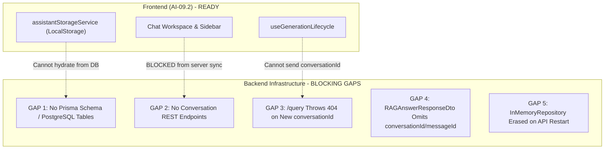

# AI-09.3.00 — Readiness Gate and Conversation Persistence Architecture Audit

**Milestone:** AI-09 Kynergy Intelligence Frontend Integration  
**Document ID:** `AI-09.3.00-readiness-and-persistence-audit`  
**Phase:** 3 — Conversation Persistence & Management Readiness  
**Role:** Principal Software Architect & Senior Full-Stack Engineer  
**Status:** Complete  
**Date:** 2026-11-23  
**Target File:** `docs/ai/AI-09/AI-09.3.00-readiness-and-persistence-audit.md`

---

## 1. Executive Summary

This architecture audit evaluates the readiness of the **Kynergy Platform** (NestJS backend, PostgreSQL/Prisma persistence, and React frontend) to support **user-scoped, server-side conversation persistence and management** for milestone **AI-09.3**.

In milestone **AI-09.2**, the frontend conversational interface, message streaming transport, generation lifecycle, error recovery, and accessibility hardening were successfully completed. To prevent blocking the UI on missing backend infrastructure, the frontend implemented **ADR-AI-09-01 (Stateless Client-Side History Architecture)**, storing conversational threads in browser `localStorage` and passing bounded history turns in `QueryKnowledgeRequestDto.conversationHistory`.

This audit rigorously inspected the backend database schema (`prisma/schema.prisma`), core domain models (`packages/core/src/ai/`), backend NestJS services and controllers (`apps/api/src/ai/`), and frontend state orchestrators (`apps/web/src/modules/intelligence/assistant/`).

### Overall Audit Verdict: **BLOCKED**

**Justification:** True enterprise server-side conversation persistence is **BLOCKED** due to three missing foundational backend capabilities:

1. **Zero Database Persistence:** `prisma/schema.prisma` contains no models, tables, or relations for conversations or chat messages. All backend sessions currently reside in an ephemeral process-memory `Map` (`InMemoryConversationRepositoryAdapter`) with a 24-hour TTL that is destroyed upon any server restart, container redeployment, or horizontal scaling.
2. **Missing REST Endpoints:** There are **zero** REST controllers or endpoints to create, list, retrieve, update, rename, or delete conversations (`/api/v1/ai/conversations`).
3. **Session Auto-Creation Gap:** In `POST /api/v1/ai/knowledge/query`, passing a client-generated `conversationId` causes `ConversationHistoryManagerService` to throw `ConversationNotFoundException`, which maps to an HTTP `404 Not Found`.

Before AI-09.3 can implement server-synchronized conversation persistence on the frontend, the backend database schema, persistence adapter, and REST API must be implemented.

---

## 2. Conversation API Contract Inventory & Capability Classification

Every conversational capability was inspected against the live codebase and classified according to standard criteria:

- **READY:** Implemented, verified, and test-covered.
- **PARTIAL:** Implemented in domain/adapter logic but incomplete or unexposed.
- **MISSING:** Capability does not exist.
- **BLOCKED:** Cannot proceed due to an unfulfilled dependency.
- **NOT APPLICABLE:** Not required by architecture.

| Capability                         | Backend Route / Location                              | DTO / Contract                                 | Auth & RBAC                | Status                | Audit Findings & Gaps                                                                                                          |
| :--------------------------------- | :---------------------------------------------------- | :--------------------------------------------- | :------------------------- | :-------------------- | :----------------------------------------------------------------------------------------------------------------------------- |
| **Create Conversation**            | None (`POST /api/v1/ai/conversations`)                | None                                           | None                       | **MISSING**           | `ConversationSession.create()` exists in domain core, but no HTTP controller or application use case exposes session creation. |
| **List User Conversations**        | None (`GET /api/v1/ai/conversations`)                 | None                                           | None                       | **MISSING**           | `IConversationRepositoryPort.listByUser()` exists in port/adapter, but no controller exposes it to the frontend.               |
| **Get Conversation by ID**         | None (`GET /api/v1/ai/conversations/:id`)             | None                                           | None                       | **MISSING**           | `findById()` exists in repository adapter, but cannot be called via HTTP.                                                      |
| **Get Conversation Messages**      | None (`GET /api/v1/ai/conversations/:id/messages`)    | None                                           | None                       | **MISSING**           | No endpoint or pagination DTO exists for message history retrieval.                                                            |
| **Persist User Message**           | Internal (`RAGOrchestratorService.execute`)           | `QueryKnowledgeRequestDto`                     | Bearer JWT (`CurrentUser`) | **PARTIAL**           | Only recorded if `conversationId` matches a pre-existing in-memory session. New IDs trigger HTTP 404.                          |
| **Persist Assistant Response**     | Internal (`RAGOrchestratorService.execute`)           | `RAGAnswerResponseDto`                         | Bearer JWT (`CurrentUser`) | **PARTIAL**           | Recorded atomically with user prompt in `session.addTurn()`, but lost on process restart.                                      |
| **Rename Conversation**            | None (`PATCH /api/v1/ai/conversations/:id`)           | None                                           | None                       | **MISSING**           | `ConversationSession` has no `title` property. No endpoint exists.                                                             |
| **Delete / Archive Conversation**  | None (`DELETE /api/v1/ai/conversations/:id`)          | None                                           | None                       | **MISSING**           | `IConversationRepositoryPort.delete()` exists in adapter, but is unexposed via REST.                                           |
| **Retrieve Metadata**              | None                                                  | None                                           | None                       | **MISSING**           | Domain model holds `metadata: Record<string, unknown>`, but no query endpoint exists.                                          |
| **Continue Existing Conversation** | `POST /api/v1/ai/knowledge/query`                     | `QueryKnowledgeRequestDto.conversationHistory` | Bearer JWT                 | **READY (Stateless)** | Works via client-provided `conversationHistory` (ADR-AI-09-01). Fails if passing new `conversationId`.                         |
| **Pagination / Cursor Retrieval**  | None                                                  | None                                           | None                       | **MISSING**           | No pagination contracts exist in backend AI module.                                                                            |
| **Ownership Enforcement**          | `packages/core/.../conversation-session.model.ts:167` | Domain method `isAuthorized()`                 | Tenant & User ID check     | **READY**             | Enforces strict tenant isolation and user matching (plus admin override roles).                                                |
| **Deterministic Ordering**         | `packages/core/.../conversation-session.model.ts:39`  | Internal array `_messages`                     | Array index order          | **PARTIAL**           | In-memory array index guarantees FIFO order, but `ChatMessage` VO lacks message IDs, timestamps, or sequence numbers.          |
| **Concurrent Update Safety**       | `in-memory-conversation-repository.adapter.ts`        | None                                           | None                       | **MISSING**           | No optimistic locking, version fields, or database transaction isolation.                                                      |

---

## 3. Data Model and Persistence Integrity Assessment

### 3.1 Backend Data Model Inspection (`packages/core/src/ai/`)

#### `ConversationSession` Entity (`models/conversation-session.model.ts`)

- **Identifiers:** `id: string` (required, non-empty).
- **Ownership:** `tenantId: string`, `userId: string` (required).
- **Timestamps:** `createdAt: Date`, `_updatedAt: Date`.
- **Invariants:**
  - `MAX_STORED_MESSAGES = 60` (sliding window of 30 alternating turns).
  - `DEFAULT_MAX_TURNS = 10`, `DEFAULT_MAX_TOKENS = 500`.
  - Turns are added strictly via `addTurn(userText, assistantText)`: both roles must be non-empty strings.
  - Sanitizes XML prompt-injection breakout tokens (`<system>`, `<retrieved_evidence>`, etc.).
- **Omissions:**
  - No `title` property.
  - No `deletedAt` soft-deletion property.
  - No `version` optimistic locking property.

#### `ChatMessage` Value Object (`value-objects/chat-message.vo.ts`)

- **Properties:** `role: 'system' | 'user' | 'assistant'`, `content: string`.
- **Invariants:** Content max length is 4,000 characters. Trimmed and frozen.
- **Omissions:**
  - **No `id` field:** Individual messages cannot be uniquely addressed or updated.
  - **No `createdAt` timestamp:** Message ordering relies solely on array position.
  - **No `status` flag:** Cannot distinguish pending, streaming, completed, or failed messages.
  - **No citation references:** `ChatMessage` cannot persist verified source citations (`sources`).

### 3.2 Database Persistence Reality (`prisma/schema.prisma`)

An inspection of `prisma/schema.prisma` confirmed:

- Tables exist for `knowledge_documents`, `document_versions`, `ingestion_jobs`, `knowledge_chunks`, `embedding_profiles`, `index_generations`, and `document_embeddings`.
- **Zero tables exist for conversations or messages.**
- The only backend storage implementation is `InMemoryConversationRepositoryAdapter`:
  ```typescript
  // apps/api/src/ai/adapters/conversation/in-memory-conversation-repository.adapter.ts:15
  private readonly tenantStorage = new Map<string, Map<string, ConversationSession>>();
  ```
- **Consequences:**
  - All conversational history stored on the server is lost whenever the NestJS process restarts.
  - Sessions cannot be shared across multiple backend pods or instances in a cluster.
  - Browsing from a second browser or mobile device cannot load past conversations from the server.

---

## 4. Authorization and Security Assessment

### 4.1 Server-Side Ownership Enforcement

The core domain entity implements strict authorization checks:

```typescript
// packages/core/src/ai/domain/models/conversation-session.model.ts:167
public isAuthorized(tenantId: string, userId: string, roles: readonly string[]): boolean {
  if (!tenantId || this.tenantId !== tenantId) return false;
  if (this.userId === userId) return true;
  const privilegedRoles = ['ROLE_ADMIN', 'TENANT_ADMIN', 'CLINICAL_SUPERVISOR'];
  return roles.some((role) => privilegedRoles.includes(role));
}
```

- In `ConversationHistoryManagerService.resolveHistory()`, if `isAuthorized()` returns `false`, an `UnauthorizedConversationAccessException` is thrown.
- In `AiRAGController`, this exception translates to an HTTP `403 Forbidden`.

### 4.2 Security Gaps & Information Leakage Risk

1. **ID Enumeration Vulnerability:**
   - If a conversation ID does not exist in the tenant: backend throws `ConversationNotFoundException` (HTTP `404 Not Found`).
   - If a conversation ID exists but belongs to another user in the same tenant: backend throws `UnauthorizedConversationAccessException` (HTTP `403 Forbidden`).
   - **Risk:** An authenticated attacker can enumerate valid conversation IDs belonging to other clinicians by differentiating between 404 and 403 status codes.
   - **Recommendation:** The backend should return `404 Not Found` for both conditions to prevent ID enumeration.
2. **Stateless Spoofing Protection:**
   - When history is sent via client `conversationHistory`, `ConversationHistoryManagerService.sanitizeAndBoundClientHistory()` explicitly strips client-injected `system` messages and neutralizes prompt-injection delimiter tags (`<system>`, `<retrieved_evidence>`). This verification is **READY** and robust.

---

## 5. Frontend Implementation Dependency Map

The frontend implementation delivered in AI-09.2 is architecturally sound and modular:

```
apps/web/src/modules/intelligence/assistant/
├── api/
│   ├── assistant.api.ts              <-- Calls POST /api/v1/ai/knowledge/query (Stateless)
│   └── assistant-query-keys.ts       <-- Query keys for summaries, detail, health
├── services/
│   └── assistant-storage.service.ts   <-- LocalStorage persistence (ADR-AI-09-01)
├── hooks/
│   ├── use-assistant-queries.ts      <-- Wraps storage with TanStack Query
│   ├── use-assistant-mutations.ts    <-- Local CRUD mutations (create, select, delete)
│   └── use-generation-lifecycle.ts   <-- FSM orchestrator (IDLE -> COMPLETED)
└── components/
    ├── chat-workspace.tsx            <-- Top-level chat workspace
    ├── conversation-sidebar.tsx      <-- Session list, new chat, delete dialog
    ├── chat-message-feed.tsx         <-- Message feed, auto-scroll, WCAG 2.2 live region
    └── chat-composer.tsx             <-- Accessible multiline input
```

### Reusability Analysis:

- `chat-workspace.tsx`, `conversation-sidebar.tsx`, `chat-message-feed.tsx`, and `chat-composer.tsx` are **100% reusable** and completely decoupled from storage mechanics.
- `useAssistantQueries.ts` and `useAssistantMutations.ts` already use standard TanStack Query contracts (`queryKey: ['intelligence', 'assistant', ...]`).
- To transition from `localStorage` to server-side persistence, only the underlying API functions in `assistant.api.ts` and mutations in `use-assistant-mutations.ts` need to be swapped from calling `assistantStorageService` to calling HTTP endpoints.

---

## 6. AI-09.2 Cross-Milestone Compatibility Assessment

| Integration Question                                         | Current Behavior in AI-09.2                                                                  | Compatibility with Server Persistence                                                  |
| :----------------------------------------------------------- | :------------------------------------------------------------------------------------------- | :------------------------------------------------------------------------------------- |
| **Does message submission create or reuse a conversation?**  | Yes, `useGenerationLifecycle` creates or reuses a conversation in `assistantStorageService`. | Fully compatible; will swap local create with `POST /conversations`.                   |
| **When is the conversation ID available?**                   | Available immediately upon user dispatch (optimistic ID generated on client).                | Compatible; client can provide UUID or receive canonical ID from backend.              |
| **Is user message persisted before generation begins?**      | Yes, stored as `status: 'success'` in local storage before the API call is dispatched.       | Compatible; protects user prompt against network failure.                              |
| **Is assistant response persisted before completion?**       | Stored as `status: 'pending'` or `'streaming'`, updated to `'success'` upon completion.      | Compatible; requires backend message status update endpoint or atomic turn completion. |
| **How does frontend recover from interrupted streaming?**    | Retains partial tokens, marks message as `'interrupted'`, and offers `Reintentar` action.    | Compatible; state machine transitions are decoupled from transport.                    |
| **Can a completed response be recovered from server?**       | **NO.** Server does not store conversations in database or expose GET endpoints.             | **INTEGRATION GAP:** Requires backend database persistence and REST endpoints.         |
| **Can a conversation be continued without losing ordering?** | Yes, via client `conversationHistory` array passed to `/query`.                              | Compatible.                                                                            |
| **Are duplicate submissions prevented?**                     | Yes, composer locks input and submit button while generation is active.                      | Compatible.                                                                            |

---

## 7. Identified Gaps and Risks



### Risk Summary:

1. **Critical Architecture Mismatch:** Frontend UI is designed for persistent, multi-conversation management, but backend persistence is 100% ephemeral in-memory.
2. **Premature Server Cutover Risk:** If the frontend is switched to send `conversationId` without backend database persistence, users will experience frequent 404 errors whenever the API restarts or deploys.
3. **Data Loss on Device Switch:** Users cannot access their clinical consultation history from different workstations or mobile devices.

---

## 8. Approved AI-09.3 Implementation Plan

To safely resolve these gaps, milestone **AI-09.3** must be executed in two sequential stages:

### Stage 1: Backend Conversation Persistence Layer (Prerequisite)

1. **Prisma Schema Migration:**
   - Define `model Conversation` (`id`, `tenantId`, `userId`, `title`, `createdAt`, `updatedAt`, `deletedAt`).
   - Define `model ConversationMessage` (`id`, `conversationId`, `role`, `content`, `sequence`, `sources`, `metadata`, `createdAt`).
   - Add foreign keys, unique constraints (`[conversationId, sequence]`), and indexes (`[tenantId, userId, updatedAt]`).
2. **Prisma Repository Adapter:**
   - Implement `PrismaConversationRepositoryAdapter` implementing `IConversationRepositoryPort`.
   - Replace `InMemoryConversationRepositoryAdapter` in `ai.module.ts`.
3. **REST Controller (`AiConversationController`):**
   - `POST /api/v1/ai/conversations`: Create new conversation session.
   - `GET /api/v1/ai/conversations`: List user's conversations (paginated, sorted by `updatedAt` desc).
   - `GET /api/v1/ai/conversations/:id`: Retrieve conversation detail and message history.
   - `PATCH /api/v1/ai/conversations/:id`: Rename conversation title.
   - `DELETE /api/v1/ai/conversations/:id`: Soft-delete conversation.
4. **RAG Orchestrator Auto-Creation Support:**
   - Update `ConversationHistoryManagerService.resolveHistory()`: If a valid `conversationId` is supplied but does not exist, auto-create the session for the authenticated user instead of throwing `404 Not Found`.

### Stage 2: Frontend Server Synchronization Integration

1. **Extend API Adapter (`assistant.api.ts`):**
   - Add typed methods: `createConversation`, `listConversations`, `getConversation`, `renameConversation`, `deleteConversation`.
2. **Dual-Mode Persistence Hook:**
   - Enhance `useAssistantQueries` and `useAssistantMutations` to sync with the backend REST API while retaining `assistantStorageService` as an offline/resilient cache.
3. **Canonical Reconciliation:**
   - Synchronize optimistic client messages with server-assigned message IDs and canonical timestamps.

---

## 9. Final Audit Verdict

### Final Verdict: **BLOCKED**

**Conclusion:** The frontend conversational interface (AI-09.2) is fully functional and hardened under the client-side architecture (ADR-AI-09-01). However, **server-side conversation persistence and cross-device management (AI-09.3) is BLOCKED** until the backend Prisma models, database migration, and REST controller endpoints are implemented.

Execution must halt until the backend implementation plan is approved.
