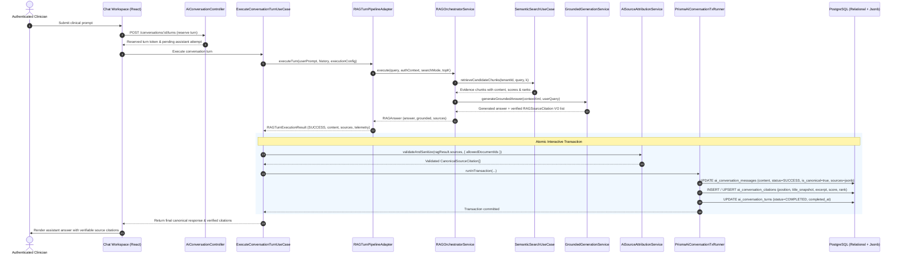

# AI-09.4-CIT.03 — Answer Generation & Citation Persistence Integration Report

## Executive Summary

The **CIT.03** milestone completes the end-to-end integration of actual RAG retrieval provenance into Kynergy Intelligence's AI answer-generation, streaming response, and conversation message-persistence lifecycle.

Every citation surfaced to the user now originates from an authentic knowledge evidence chunk retrieved by the backend pipeline (`SemanticSearchUseCase` / hybrid retrieval). Citations are verified, sanitized, and persisted alongside the canonical assistant message inside an atomic PostgreSQL transaction. This milestone enforces strict attribution integrity: no citations are derived from synthetic LLM prose, no metadata (such as page numbers or heading paths) is fabricated, and failed or cancelled turns never leave dangling or false citations.

---

## 1. Lifecycle & Execution Path Analysis

### 1.1 Complete End-to-End Execution Trace



---

## 2. Provenance Preservation Architecture

### 2.1 Retrieval Provenance Capture (`RAGSourceCitation`)

During the retrieval stage, `RAGSourceCitation.fromEvidenceChunk(chunk)` constructs an immutable Value Object capturing all evidence dimensions directly from the vector/lexical retrieval engine:

- `documentId`: UUID of the parent knowledge document.
- `documentTitle`: Snapshot of the knowledge document's title.
- `chunkId`: UUID of the physical knowledge chunk in PostgreSQL.
- `documentVersionId`: UUID of the specific immutable document version.
- `documentVersionNumber`: Sequence version number (1-based).
- `excerpt`: Verbatim text content (`chunk.content`) extracted during chunking.
- `pageNumber`: Physical document page (derived from PDF/DOCX structure, null if plain text/markdown).
- `headingPath`: Structural outline path leading to the chunk (e.g., `["Capítulo 2", "Contraindicaciones"]`).
- `relevanceScore`: Fused similarity score strictly bounded within `[0.0, 1.0]`.
- `retrievalRank`: 1-based rank resulting from semantic similarity, keyword BM25, or RRF fusion.
- `sourceStrategy`: Surfacing strategy (`SEMANTIC`, `KEYWORD`, `HYBRID`, `RERANKED`).

### 2.2 Domain Sanitization & Deduplication (`AiSourceAttributionService`)

Before persistence, `AiSourceAttributionService.validateAndSanitize()` applies defensive invariants:

1. **Provenance Authorization:** Verifies documents belong to the authenticated tenant and match `executionConfig.documentIds` if scope-restricted.
2. **Path Stripping & Security Hardening:** Strips unsafe internal file paths (`storagePath`, `/tmp/`, `/etc/`, credentials, raw embeddings).
3. **Chunk-Level Deduplication:** Merges identical chunk citations (`documentId::chunkId`), retaining the highest relevance score and unifying metadata.
4. **Score Normalization:** Mathematically bounds relevance scores to `[0.0, 1.0]`.

---

## 3. Dual-Layer Persistence Model

To guarantee both high-performance conversation streaming and first-class relational queryability, citations are persisted in a dual-layer architecture inside a single interactive PostgreSQL transaction:

```
+---------------------------------------------------------------------------------------------------+
|                                PostgreSQL Interactive Transaction                                 |
|                                                                                                   |
|  1. Fast Denormalized Stream Cache (ai_conversation_messages.sources)                             |
|     - JSONB column storing complete CanonicalSourceCitation[] payload                             |
|     - Read in O(1) during keyset-paginated GetMessageHistoryUseCase queries                       |
|     - Zero JOIN overhead when rendering high-volume historical chat feeds                         |
|                                                                                                   |
|  2. First-Class Relational Storage (ai_conversation_citations)                                    |
|     - Normalized table with composite keys: (id, tenant_id), (message_id, citation_position)      |
|     - Enforces foreign keys with cascade behavior to parent message and document                  |
|     - Retains documentTitleSnapshot & excerpt for immutable clinical audit and historical reading |
|     - Queried by dedicated use cases: GetMessageCitationsUseCase and GetCitationDetailUseCase     |
+---------------------------------------------------------------------------------------------------+
```

### 3.1 DTO Mapping Synchronization

To bridge direct knowledge querying (`POST /api/v1/ai/knowledge/query`) and conversation history retrieval (`GET /api/v1/ai/conversations/:id/messages`), the following contracts were enriched:

- `RAGSourceCitationDto` in [rag-query.dto.ts](file:///c:/Projects/kinergy-platform/apps/api/src/ai/controllers/dtos/rag-query.dto.ts): Added `excerpt`, `documentVersionId`, `documentVersionNumber`, and `retrievalRank`.
- `RAGSourceCitationDto` & `ragSourceCitationSchema` in frontend [assistant.types.ts](file:///c:/Projects/kinergy-platform/apps/web/src/modules/intelligence/assistant/types/assistant.types.ts) and [assistant.schemas.ts](file:///c:/Projects/kinergy-platform/apps/web/src/modules/intelligence/assistant/schemas/assistant.schemas.ts): Aligned client TypeScript contracts and Zod runtime validation schemas with backend provenance fields.
- `AiRAGController.queryKnowledge()` in [ai-rag.controller.ts](file:///c:/Projects/kinergy-platform/apps/api/src/ai/controllers/ai-rag.controller.ts): Explicitly maps excerpt, versioning, and rank into outgoing query responses.

---

## 4. Fencing, Idempotency & Failure Resilience

1. **Terminal State Fencing:**
   Inside `ExecuteConversationTurnUseCase.finalizeWork()`, the turn is re-evaluated inside the transaction. If the turn status has reached `COMPLETED` concurrently, citations are not re-inserted, preventing duplicate rows or primary-key collisions.
2. **Failure & Interruption Isolation:**
   If the turn terminates with `CANCELLED` or `FAILED` (e.g. timeout, disconnection, provider exception), `sources` is reset to an empty array `[]` and `AiConversationCitation` rows are **never** persisted.
3. **Resilience to Soft-Deleted Sources:**
   When a cited knowledge document is subsequently soft-deleted (`deletedAt != null`), `AiConversationCitation` rows remain intact due to `documentTitleSnapshot` and `excerpt`. Dedicated citation retrieval endpoints report `previewStatus: 'DOCUMENT_SOFT_DELETED'`, ensuring the user can still read the historical excerpt without triggering dangling foreign-key errors or missing-document 404s.

---

## 5. Verification & Test Evidence

### 5.1 Real Database Integration Test Suite

Created [ai-citation-provenance-integration.spec.ts](file:///c:/Projects/kinergy-platform/apps/api/src/ai/__tests__/ai-citation-provenance-integration.spec.ts) covering PostgreSQL transactions against real tables:

| Test Case  | Scenario Verified                                                                                 | Outcome  |
| :--------- | :------------------------------------------------------------------------------------------------ | :------- |
| **Test 1** | End-to-end RAG retrieval provenance preservation in both `jsonb` and relational tables.           | **PASS** |
| **Test 2** | Deterministic citation ordering by `citationPosition ASC` matching retrieval rank.                | **PASS** |
| **Test 3** | Interrupted, cancelled, or failed turns persist zero citations in all tables.                     | **PASS** |
| **Test 4** | Transactional idempotency: retrying completed turns does not duplicate citations.                 | **PASS** |
| **Test 5** | Historical message retrieval (`GetMessageHistoryUseCase`) faithfully preserves provenance.        | **PASS** |
| **Test 6** | Citation snapshot resilience: soft-deleted knowledge document preserves excerpt & title snapshot. | **PASS** |

### 5.2 Test Execution Results

```text
 PASS   api  apps/api/src/ai/__tests__/ai-citation-provenance-integration.spec.ts (8.132 s)
  AI-09.4-CIT.03: Citation Provenance & Persistence Integration (PostgreSQL)
    √ 1. persists end-to-end RAG retrieval provenance atomically in both jsonb and relational tables (121 ms)
    √ 2. guarantees deterministic citation ordering by citationPosition matching retrieval rank (93 ms)
    √ 3. isolates interrupted, cancelled, or failed turns, persisting zero citations (56 ms)
    √ 4. enforces transactional idempotency: re-executing completed turn does not duplicate citations (63 ms)
    √ 5. retrieves historical messages with complete citation provenance preserved (61 ms)
    √ 6. preserves citation snapshot resilience even if source document is soft-deleted or removed (67 ms)

Test Suites: 1 passed, 1 total
Tests:       6 passed, 6 total
Snapshots:   0 total
Time:        8.934 s
```

### 5.3 Monorepo Quality Gates Verification

1. **TypeScript Typecheck:**
   - Command: `pnpm tsc --noEmit -p tsconfig.base.json`
   - Result: **0 errors**, clean exit.
2. **Core Domain & Use Case Tests:**
   - Command: `pnpm nx test core --testFile="citation"`
   - Result: **4 passed suites, 24 passed tests** (`ai-conversation-citation.entity.spec.ts`, `get-citation-detail.use-case.spec.ts`, `get-message-citations.use-case.spec.ts`, `prisma-ai-conversation-citation.repository.spec.ts`).
3. **API Citation Tests:**
   - Command: `pnpm nx test api --testFile="citation"`
   - Result: **3 passed suites, 24 passed tests** (`ai-conversation-citation.controller.spec.ts`, `citation-validator.service.spec.ts`, `ai-citation-provenance-integration.spec.ts`).
4. **Message History Workflow Tests:**
   - Command: `pnpm nx test core --testFile=packages/core/src/ai/application/__tests__/conversation-and-message-workflows.use-cases.spec.ts`
   - Result: **1 passed suite, 22 passed tests**.

---

## 6. Next Steps & Transition to CIT.04

With the backend citation domain, contracts, and answer-generation persistence integration fully verified and backed by automated PostgreSQL tests, the backend is ready for frontend consumption.

**Upcoming Scope for CIT.04:**

- Design and implement the frontend verified citation tray component (`apps/web`).
- Display verified source badges with document title, rank, excerpt preview, and page number.
- Implement click-to-preview interactions leveraging `GET /api/v1/ai/conversations/:id/messages/:messageId/citations/:citationId`.
- Handle gracefully restricted, deleted, or excerpt-only preview states.
