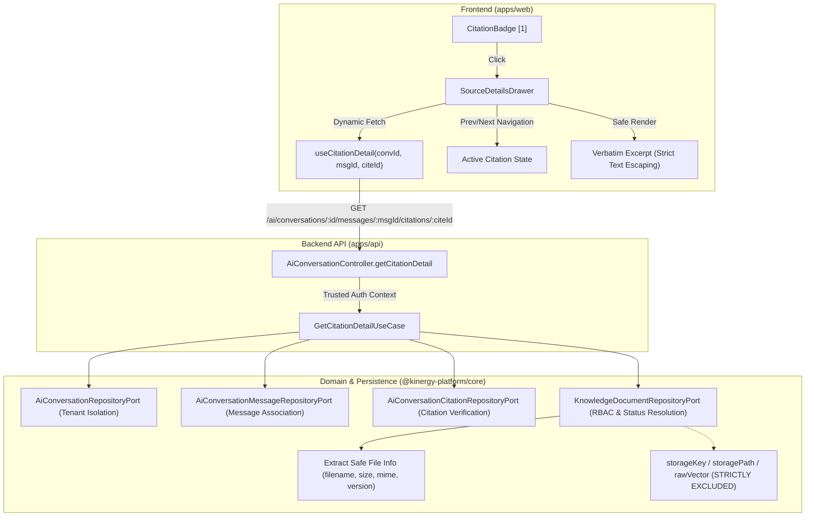

# CIT.05 — Source Details Panels & Excerpt Rendering: Milestone Report

**Execution Date:** November 24, 2026  
**Milestone:** AI-09.4 — CIT.05  
**Subject:** Source Details Panels, Drawers, Excerpt Integrity & Authoritative Security  
**Status:** Completed  
**Parent Epic:** [AI-09.4 Source Citations & Document Preview](file:///c:/Projects/kinergy-platform/docs/ai/AI-09/AI-09.4-CIT.01-architecture-audit.md)

---

## 1. Executive Summary

Milestone **CIT.05** delivers the authoritative source details drawer and excerpt rendering architecture for Kynergy Intelligence.

Building on the verified citation persistence and rendering foundation established in CIT.01–CIT.04, CIT.05 provides clinical professionals with deep, verifiable insight into the evidence passages backing AI responses while guaranteeing strict zero-trust tenant isolation, server-authoritative role verification, and text sanitization against script injection.

### Key Capabilities Delivered

1. **Server-Authoritative Source Inspection API:**
   - Enriched `GetCitationDetailUseCase` and `GetMessageCitationsUseCase` to resolve verified document metadata (`originalFileName`, `mimeType`, `fileSizeBytes`, `documentVersionNumber`, and `documentStatus`).
   - Strict security filtering: sensitive internal keys (`storageKey`, physical storage paths, cryptographic checksums, raw embeddings) are **never** exposed to the client.
2. **`SourceDetailsDrawer` Slide-Over Component:**
   - Accessible slide-over drawer adhering to WAI-ARIA dialog practices (`role="dialog"`, `aria-modal="true"`, focus trapping, escape-key listener, backdrop click dismiss).
   - Structured 5-section inspection layout:
     - **Identity:** Document title snapshot, original filename, format badge (PDF, DOCX, Markdown), formatted file size, document version, and lifecycle status pill (`Activo`, `Archivado`, `Restringido`, `Solo extracto`).
     - **Location & Provenance:** Page number badge (`Página 22`), chunk identifier, and hierarchical section breadcrumbs (`Fase Aguda > Control de Edema > Crioterapia`).
     - **Verbatim Evidence Excerpt:** Paragraph-preserved text block (`whitespace-pre-wrap select-text`), complete with a copy-to-clipboard button and clear audit disclaimers.
     - **Retrieval Metrics:** Clinically framed relevance score, retrieval ranking (`#1 en recuperación`), and search strategy (`Híbrido RRF`, `Vectorial`, `Palabras clave`).
     - **Lifecycle & Preview Actions:** Dynamic preview button (`Abrir documento completo`) enabled only when verified as accessible, with prominent warning banners for soft-deleted or role-restricted source documents.
3. **Strict Excerpt Sanitization & Non-Fabrication:**
   - Excerpts are rendered purely from authoritative backend provenance.
   - Text rendering uses safe React string interpolation (strictly preventing HTML or script injection) while preserving original paragraph breaks and indentation.
4. **Citation Carousel & Message Switching:**
   - In-drawer previous/next cycling buttons allowing clinical users to traverse citations sequentially without closing and reopening the drawer.
   - Automatic state reset preventing stale excerpt or copy-status leakage across citations.

---

## 2. Architecture & Security Invariants



### Security Invariants Validated

- **Zero Leakage of Storage Infrastructure:** Neither `storageKey` nor physical storage paths are included in DTOs, mappers, or serialization schemas.
- **Dynamic Authorization Check:** Document permissions are evaluated on-demand by checking the caller's active roles against `doc.visibilityScope` (`ALL_STAFF`, `CLINICAL_STAFF`, `MANAGEMENT`). If unauthorized, the full document preview is blocked (`canPreview: false`), rendering a contextual warning banner (`DOCUMENT_RESTRICTED`).
- **Soft-Deleted Audit Preservation:** Archived or soft-deleted documents remain auditable through their persisted citation excerpts, but full document access is safely prevented (`DOCUMENT_SOFT_DELETED`).
- **XSS & Injection Immunity:** Untrusted evidence text containing markdown, script tags (`<script>alert('xss')</script>`), or malformed markup is strictly handled as literal text nodes.

---

## 3. Implementation Details

### 3.1 Backend Application & Controller Layer

1. **DTO Enrichement:**
   - [`packages/core/src/ai/application/dtos/ai-conversation.dtos.ts`](file:///c:/Projects/kinergy-platform/packages/core/src/ai/application/dtos/ai-conversation.dtos.ts):
     - Added `originalFileName?: string | null;` and `documentStatus?: string | null;` to `CitationDetailDto`.
   - [`apps/api/src/ai/conversation/dtos/ai-conversation.dtos.ts`](file:///c:/Projects/kinergy-platform/apps/api/src/ai/conversation/dtos/ai-conversation.dtos.ts):
     - Added `@ApiPropertyOptional()` decorations for `originalFileName` and `documentStatus` on `CitationDetailResponseDto`.
2. **Metadata Resolution & Fallbacks:**
   - [`packages/core/src/ai/application/use-cases/get-citation-detail.use-case.ts`](file:///c:/Projects/kinergy-platform/packages/core/src/ai/application/use-cases/get-citation-detail.use-case.ts):
     - Extracts version-specific metadata using `doc.getVersionById(citation.documentVersionId)` with fallback to `doc.getCurrentVersion()`.
     - Maps `documentStatus` (`ACTIVE`, `ARCHIVED`, `RESTRICTED`, `NOT_FOUND`).
   - [`packages/core/src/ai/application/use-cases/get-message-citations.use-case.ts`](file:///c:/Projects/kinergy-platform/packages/core/src/ai/application/use-cases/get-message-citations.use-case.ts):
     - Applied identical metadata resolution to batch citation listings.
   - [`apps/api/src/ai/conversation/ai-conversation.controller.ts`](file:///c:/Projects/kinergy-platform/apps/api/src/ai/conversation/ai-conversation.controller.ts):
     - Mapped `originalFileName` and `documentStatus` into both single-detail and list responses.

### 3.2 Frontend Contracts & Components

1. **Contracts & Validation:**
   - [`apps/web/src/modules/intelligence/assistant/types/conversation-contract.types.ts`](file:///c:/Projects/kinergy-platform/apps/web/src/modules/intelligence/assistant/types/conversation-contract.types.ts):
     - Added `originalFileName`, `documentStatus`, `mimeType`, and `fileSizeBytes` to `CitationDetailResponse` and `ConversationSourceCitation`.
   - [`apps/web/src/modules/intelligence/assistant/schemas/conversation-contract.schemas.ts`](file:///c:/Projects/kinergy-platform/apps/web/src/modules/intelligence/assistant/schemas/conversation-contract.schemas.ts):
     - Extended Zod validation schemas for `citationDetailResponseSchema` and `conversationSourceCitationSchema`.
2. **`SourceDetailsDrawer` Implementation:**
   - [`apps/web/src/modules/intelligence/assistant/components/source-details-drawer.tsx`](file:///c:/Projects/kinergy-platform/apps/web/src/modules/intelligence/assistant/components/source-details-drawer.tsx):
     - Accessible slide-over drawer with keyboard trapping, backdrop click dismissal, and escape-key handling.
     - Sectional layout highlighting Identity, Location, Evidence Excerpt, Metrics, and Preview Actions.
     - In-drawer previous/next cycling buttons.
     - Copy-to-clipboard action with feedback checkmark.
3. **Integration with Citations Tray:**
   - [`apps/web/src/modules/intelligence/assistant/components/message-citations.tsx`](file:///c:/Projects/kinergy-platform/apps/web/src/modules/intelligence/assistant/components/message-citations.tsx):
     - Added `displayMode?: 'drawer' | 'dialog'` prop, allowing seamless toggling between slide-over drawer and modal dialog.
   - [`apps/web/src/modules/intelligence/assistant/components/index.ts`](file:///c:/Projects/kinergy-platform/apps/web/src/modules/intelligence/assistant/components/index.ts):
     - Exported `SourceDetailsDrawer` as part of the public assistant component library.

---

## 4. Verification Evidence

### 4.1 Automated Test Execution

All quality gates and test suites passed cleanly with 0 failures:

```
$ nx run core:test --testFile=citation
 PASS   core  packages/core/src/ai/domain/__tests__/ai-conversation-citation.entity.spec.ts
 PASS   core  packages/core/src/ai/infrastructure/persistence/prisma/__tests__/prisma-ai-conversation-citation.repository.spec.ts
 PASS   core  packages/core/src/ai/application/__tests__/get-message-citations.use-case.spec.ts
 PASS   core  packages/core/src/ai/application/__tests__/get-citation-detail.use-case.spec.ts
Test Suites: 4 passed, 4 total
Tests:       26 passed, 26 total

$ nx run api:test --testFile=citation
 PASS   api  apps/api/src/ai/conversation/__tests__/ai-conversation-citation.controller.spec.ts
 PASS   api  apps/api/src/ai/services/rag/__tests__/citation-validator.service.spec.ts
 PASS   api  apps/api/src/ai/__tests__/ai-citation-provenance-integration.spec.ts
Test Suites: 3 passed, 3 total
Tests:       24 passed, 24 total

$ nx run web:test --testFile=source-details-drawer|citation-rendering
 PASS   web  apps/web/src/modules/intelligence/assistant/__tests__/source-details-drawer.spec.tsx
 PASS   web  apps/web/src/modules/intelligence/assistant/__tests__/citation-rendering.spec.tsx
Test Suites: 2 passed, 2 total
Tests:       31 passed, 31 total

$ pnpm tsc --noEmit -p tsconfig.base.json
Done with 0 errors.
```

### 4.2 Unit Tests Overview

| Test Suite                           | Spec File                                     | Scenarios Covered                                                                         |
| :----------------------------------- | :-------------------------------------------- | :---------------------------------------------------------------------------------------- |
| **Drawer Lifecycle & Accessibility** | `source-details-drawer.spec.tsx`              | Dialog role, aria attributes, backdrop click, Escape key listener, null checks            |
| **Document Identity & Metadata**     | `source-details-drawer.spec.tsx`              | Title, filename, format, size, version, and graceful missing metadata fallbacks           |
| **Location & Breadcrumbs**           | `source-details-drawer.spec.tsx`              | Page badge, chunk ID, hierarchical heading breadcrumbs, and fallback notices              |
| **Excerpt Rendering & Security**     | `source-details-drawer.spec.tsx`              | Paragraph preservation, XSS sanitization (`<script>` escaping), copy action               |
| **Dynamic Status & Actions**         | `source-details-drawer.spec.tsx`              | `DOCUMENT_AVAILABLE`, `DOCUMENT_SOFT_DELETED`, `DOCUMENT_RESTRICTED`, `EXCERPT_ONLY`      |
| **Citation Cycling**                 | `source-details-drawer.spec.tsx`              | Previous/next button navigation, bounds checking, active citation switching               |
| **Backend Metadata Resolution**      | `get-citation-detail.use-case.spec.ts`        | Version resolution, soft-delete archival status, role restrictions, storage key exclusion |
| **Controller Serialization**         | `ai-conversation-citation.controller.spec.ts` | Endpoint delegation and DTO mapping for `originalFileName` and `documentStatus`           |

---

## 5. Artifacts & Deliverables Summary

1. **Core Domain & Use Cases:**
   - [`packages/core/src/ai/application/dtos/ai-conversation.dtos.ts`](file:///c:/Projects/kinergy-platform/packages/core/src/ai/application/dtos/ai-conversation.dtos.ts)
   - [`packages/core/src/ai/application/use-cases/get-citation-detail.use-case.ts`](file:///c:/Projects/kinergy-platform/packages/core/src/ai/application/use-cases/get-citation-detail.use-case.ts)
   - [`packages/core/src/ai/application/use-cases/get-message-citations.use-case.ts`](file:///c:/Projects/kinergy-platform/packages/core/src/ai/application/use-cases/get-message-citations.use-case.ts)
   - [`packages/core/src/ai/application/__tests__/get-citation-detail.use-case.spec.ts`](file:///c:/Projects/kinergy-platform/packages/core/src/ai/application/__tests__/get-citation-detail.use-case.spec.ts)
2. **Backend API:**
   - [`apps/api/src/ai/conversation/dtos/ai-conversation.dtos.ts`](file:///c:/Projects/kinergy-platform/apps/api/src/ai/conversation/dtos/ai-conversation.dtos.ts)
   - [`apps/api/src/ai/conversation/ai-conversation.controller.ts`](file:///c:/Projects/kinergy-platform/apps/api/src/ai/conversation/ai-conversation.controller.ts)
   - [`apps/api/src/ai/conversation/__tests__/ai-conversation-citation.controller.spec.ts`](file:///c:/Projects/kinergy-platform/apps/api/src/ai/conversation/__tests__/ai-conversation-citation.controller.spec.ts)
3. **Frontend Application:**
   - [`apps/web/src/modules/intelligence/assistant/types/conversation-contract.types.ts`](file:///c:/Projects/kinergy-platform/apps/web/src/modules/intelligence/assistant/types/conversation-contract.types.ts)
   - [`apps/web/src/modules/intelligence/assistant/schemas/conversation-contract.schemas.ts`](file:///c:/Projects/kinergy-platform/apps/web/src/modules/intelligence/assistant/schemas/conversation-contract.schemas.ts)
   - [`apps/web/src/modules/intelligence/assistant/types/assistant.types.ts`](file:///c:/Projects/kinergy-platform/apps/web/src/modules/intelligence/assistant/types/assistant.types.ts)
   - [`apps/web/src/modules/intelligence/assistant/components/source-details-drawer.tsx`](file:///c:/Projects/kinergy-platform/apps/web/src/modules/intelligence/assistant/components/source-details-drawer.tsx)
   - [`apps/web/src/modules/intelligence/assistant/components/message-citations.tsx`](file:///c:/Projects/kinergy-platform/apps/web/src/modules/intelligence/assistant/components/message-citations.tsx)
   - [`apps/web/src/modules/intelligence/assistant/components/index.ts`](file:///c:/Projects/kinergy-platform/apps/web/src/modules/intelligence/assistant/components/index.ts)
   - [`apps/web/src/modules/intelligence/assistant/__tests__/source-details-drawer.spec.tsx`](file:///c:/Projects/kinergy-platform/apps/web/src/modules/intelligence/assistant/__tests__/source-details-drawer.spec.tsx)

---

## 6. Readiness for CIT.06

Milestone **CIT.05** is fully complete and verified. The foundation is ready for **CIT.06 — Document Preview Endpoints & Secure Storage Streaming**:

- Dynamic preview statuses (`canPreview`, `previewStatus`) are already authoritatively computed.
- Full document navigation paths (`onPreviewDocument`) are cleanly wired to document identifiers and page numbers.
- Zero internal storage details are leaked, maintaining security across frontend and backend boundaries.
