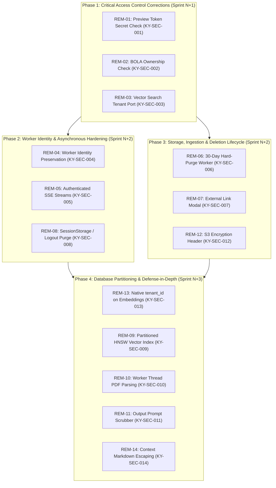

# AI-10 — Remediation Plan: Kynergy Intelligence

**System Name:** Kynergy Intelligence Platform  
**Milestone:** AI-10.0 — Security, Isolation, and Hardening (SEC.09 Final Deliverable)  
**Document ID:** `AI-10-REMEDIATION-PLAN`  
**Assessment Date:** November 27, 2026  
**Roles:** Chief Information Security Architect, Principal Application Security Engineer, and Engineering Risk Manager

---

## 1. Remediation Backlog & Detailed Engineering Specifications

This plan translates the 14 security findings (`KY-SEC-001` through `KY-SEC-014`) into prioritized, dependency-aware engineering tasks.

---

### Priority Tier P1: Critical Access Control & Authorization (Target: Sprint N+1)

#### Task REM-01: Remove Hardcoded Secret Fallback in `PreviewTokenService`

- **Finding ID:** `KY-SEC-001` | **CVSS v3.1:** 6.5 (Medium) | **Priority:** **P1 (High)**
- **Root Cause:** Hardcoded static secret string in `PreviewTokenService.getSecret()` and missing `.env.example` entry.
- **Recommended Change:**
  1. Throw fatal exception in `onModuleInit()` if neither `AI_PREVIEW_TOKEN_SECRET` nor `JWT_SECRET` is configured in environment variables.
  2. Validate that secret string has minimum length of 32 characters (256 bits).
  3. Add `AI_PREVIEW_TOKEN_SECRET` to `.env.example`.
- **Affected Modules:** `apps/api/src/ai/services/preview-token.service.ts`
- **Dependencies:** None.
- **Database / API Implications:** None.
- **Security Acceptance Criteria:** Service fails to initialize if secret is unset or <32 characters; no hardcoded strings exist in source.
- **Required Tests:** Unit test in `preview-token.service.spec.ts` asserting module startup throws on missing secret.
- **Deployment Considerations:** Inject `AI_PREVIEW_TOKEN_SECRET` into production container environment variables prior to container start.
- **Rollback Considerations:** Revert to previous service version if configuration issues arise; zero database impact.
- **Relative Complexity:** Low (2 Engineering Hours).

---

#### Task REM-02: Enforce User-Level Ownership on Conversation Mutation (BOLA Fix)

- **Finding ID:** `KY-SEC-002` | **CVSS v3.1:** 5.4 (Medium) | **Priority:** **P1 (High)**
- **Root Cause:** Controller checks `conv.tenantId === actor.tenantId` but omits `conv.userId === actor.userId`.
- **Recommended Change:** Update `assertConversationAccess` in `ai-conversation.controller.ts`:
  ```typescript
  const isOwner = conv.userId === actor.userId;
  const isTenantAdmin = actor.roles.includes('admin') || actor.roles.includes('super_admin');
  if (!isOwner && !isTenantAdmin) {
    throw new ForbiddenException('You do not have permission to modify this conversation');
  }
  ```
- **Affected Modules:** `apps/api/src/ai/conversation/ai-conversation.controller.ts`
- **Dependencies:** None.
- **Database / API Implications:** Preserves existing API contract; returns 403 Forbidden for non-owners.
- **Security Acceptance Criteria:** Requests to `PATCH /ai/conversations/:id/title` and `DELETE /ai/conversations/:id` by non-owner return 403 Forbidden unless actor holds `admin` role.
- **Required Tests:** Integration test in `ai-conversation-security.spec.ts` asserting 403 when User A attempts mutation of User B's conversation.
- **Deployment Considerations:** Can be deployed independently without downtime.
- **Rollback Considerations:** Revert controller code.
- **Relative Complexity:** Low (4 Engineering Hours).

---

#### Task REM-03: Scope Low-Level Vector Similarity Search to Tenant

- **Finding ID:** `KY-SEC-003` | **CVSS v3.1:** 4.8 (Medium) | **Priority:** **P1 (High)**
- **Root Cause:** `IVectorStorePort.similaritySearch` raw SQL query filters only on `index_generation_id`.
- **Recommended Change:**
  1. Update `IVectorStorePort.similaritySearch(tenantId: string, indexGenId: string, vector: number[], topK: number, minScore: number)` in `packages/core`.
  2. In `PrismaVectorStoreRepository`, join `knowledge_chunks` -> `knowledge_documents` and add `AND d.tenant_id = $tenantId`.
- **Affected Modules:** `packages/core/src/ai/domain/ports/vector-store.port.ts`, `packages/core/.../prisma-vector-store.repository.ts`
- **Dependencies:** None.
- **Database / API Implications:** Internal core port method signature change; requires updating all repository callers and mocks.
- **Security Acceptance Criteria:** Low-level similarity search returns 0 vectors when querying with mismatched tenant ID.
- **Required Tests:** Integration test in `vector-persistence.integration.spec.ts` testing cross-tenant search isolation.
- **Deployment Considerations:** Coordinated deployment across `packages/core` and `apps/api`.
- **Rollback Considerations:** Revert interface and repository implementation.
- **Relative Complexity:** Medium (6 Engineering Hours).

---

### Priority Tier P2: Asynchronous Integrity, Retention & Client Security (Target: Sprint N+2)

#### Task REM-04: Preserve Validated Actor Identity in BullMQ Turn Generation Worker

- **Finding ID:** `KY-SEC-004` | **CVSS v3.1:** 4.3 (Medium) | **Priority:** **P2 (Medium)**
- **Root Cause:** Interrupted BullMQ jobs recover with empty roles (`roles: []`), failing closed on retrieval.
- **Recommended Change:**
  1. Include full serialized `actorContext` (including `roles`) in the BullMQ turn generation job data payload.
  2. On job recovery, validate against PostgreSQL `User` record to ensure user account is active and roles remain valid.
- **Affected Modules:** `apps/api/src/ai/services/generation/ai-turn-generation.worker.ts`
- **Dependencies:** BullMQ job schema update.
- **Database / API Implications:** Adds user status lookup query on job recovery.
- **Security Acceptance Criteria:** Interrupted jobs resume with correct user roles and successfully retrieve authorized documents.
- **Required Tests:** Worker recovery integration test in `generation-resilience.spec.ts`.
- **Deployment Considerations:** Ensure worker handles both legacy and updated job payloads during rolling deployment.
- **Rollback Considerations:** Revert worker code; flush stalled queue jobs if schema mismatch occurs.
- **Relative Complexity:** Medium (6 Engineering Hours).

---

#### Task REM-05: Authenticate SSE Citation Streaming Endpoint

- **Finding ID:** `KY-SEC-005` | **CVSS v3.1:** 4.3 (Medium) | **Priority:** **P2 (Medium)**
- **Root Cause:** Public endpoint without Bearer token defaults user roles to empty, dropping clinical citations.
- **Recommended Change:** Implement short-lived, single-use ticket-based authentication:
  1. API endpoint `POST /ai/conversations/:id/stream-ticket` generates a signed 60-second ticket containing tenant and roles.
  2. SSE endpoint `GET /ai/conversations/:id/stream?ticket=...` validates ticket and extracts actor context.
- **Affected Modules:** `apps/api/src/ai/conversation/ai-conversation.controller.ts`, `apps/web/src/modules/intelligence`
- **Dependencies:** Coordinated API and Web client changes.
- **Database / API Implications:** Adds ticket issuance endpoint; enforces authentication on SSE route.
- **Security Acceptance Criteria:** SSE connection without valid ticket or Bearer token is rejected with 401 Unauthorized.
- **Required Tests:** Integration test in `ai-conversation-citation.controller.spec.ts`.
- **Deployment Considerations:** Deploy API ticket endpoint first; deploy web client update second; enforce auth on SSE stream third.
- **Rollback Considerations:** Maintain fallback to unauthenticated stream during migration window.
- **Relative Complexity:** Medium (6 Engineering Hours).

---

#### Task REM-06: Implement Automated Hard-Purge Retention Worker

- **Finding ID:** `KY-SEC-006` | **CVSS v3.1:** 4.3 (Medium) | **Priority:** **P2 (Medium)**
- **Root Cause:** Soft-deleted documents retain physical disk/S3 files and plain-text chunk records indefinitely.
- **Recommended Change:**
  1. Implement `DocumentRetentionWorker` scheduled via BullMQ cron (daily execution).
  2. Queries documents where `deleted_at < NOW() - INTERVAL '30 days'`.
  3. Executes `storagePort.deleteFile(doc.storageKey)` and cascades deletion of `knowledge_chunks`.
- **Affected Modules:** `apps/api/src/ai/services/indexing/vector-cleanup.service.ts`
- **Dependencies:** Scheduled queue worker infrastructure.
- **Database / API Implications:** Hard deletes expired rows from PostgreSQL.
- **Security Acceptance Criteria:** Documents soft-deleted >30 days have binary files and chunk text permanently destroyed.
- **Required Tests:** Worker integration test in `vector-cleanup.service.spec.ts`.
- **Deployment Considerations:** Verify storage delete permissions in S3 IAM policy.
- **Rollback Considerations:** Disable worker schedule in Redis.
- **Relative Complexity:** Medium (8 Engineering Hours).

---

#### Task REM-07: Implement External Link Warning Modal and Domain Allowlist

- **Finding ID:** `KY-SEC-007` | **CVSS v3.1:** 4.3 (Medium) | **Priority:** **P2 (Medium)**
- **Root Cause:** `MarkdownRenderer` allows arbitrary `https://` URLs without warning or allowlist.
- **Recommended Change:** In `apps/web/.../markdown-renderer.tsx`, intercept click events on `<a>` tags:
  1. If link target domain matches internal allowlist, open directly.
  2. If external domain, open confirmation modal alerting user they are leaving the Kynergy secure environment.
- **Affected Modules:** `apps/web/src/modules/intelligence/assistant/components/markdown-renderer.tsx`
- **Dependencies:** None.
- **Database / API Implications:** None (Frontend only).
- **Security Acceptance Criteria:** Clicking external link opens warning dialog; malicious phishing links require explicit user consent.
- **Required Tests:** Component unit test in `markdown-renderer.spec.tsx`.
- **Deployment Considerations:** Frontend SPA build deployment.
- **Rollback Considerations:** Revert frontend bundle.
- **Relative Complexity:** Medium (6 Engineering Hours).

---

#### Task REM-08: Transition Assistant Cache to SessionStorage and Clear on Logout

- **Finding ID:** `KY-SEC-008` | **CVSS v3.1:** 3.8 (Low) | **Priority:** **P2 (Medium)**
- **Root Cause:** Unencrypted browser `localStorage` retains conversation history across shared workstation sessions.
- **Recommended Change:**
  1. Migrate `AssistantStorageService` storage backend from `localStorage` to `sessionStorage` (cleared on tab close).
  2. Subscribe to `authService.logout$` and explicitly execute `assistantStorageService.clearAll()`.
- **Affected Modules:** `apps/web/src/modules/intelligence/assistant/services/assistant-storage.service.ts`
- **Dependencies:** `AuthService` integration in web client.
- **Database / API Implications:** None (Frontend only).
- **Security Acceptance Criteria:** User logout completely purges all cached conversations and draft messages from browser storage.
- **Required Tests:** Unit test in `assistant-storage.service.spec.ts`.
- **Deployment Considerations:** Client deployment.
- **Rollback Considerations:** Revert frontend bundle.
- **Relative Complexity:** Low (4 Engineering Hours).

---

### Priority Tier P3: Defense-in-Depth, Scalability & Hygiene (Target: Sprint N+3)

#### Task REM-09: Partition HNSW Vector Indexes by Tenant ID

- **Finding ID:** `KY-SEC-009` | **CVSS v3.1:** 3.7 (Low) | **Priority:** **P3 (Low)**
- **Root Cause:** Global unpartitioned HNSW index causes graph truncation/recall starvation for smaller tenants.
- **Recommended Change:** Implement PostgreSQL table partitioning by `tenant_id` on `document_embeddings` or create filtered partial indexes.
- **Complexity:** High (16 Engineering Hours).

#### Task REM-10: Offload Heavy Document Parsing to Worker Threads

- **Finding ID:** `KY-SEC-010` | **CVSS v3.1:** 3.7 (Low) | **Priority:** **P3 (Low)**
- **Root Cause:** CPU-intensive PDF parsing runs in the Node.js API process event loop.
- **Recommended Change:** Offload extraction to Node.js `worker_threads` or dedicated BullMQ queue worker.
- **Complexity:** Medium (12 Engineering Hours).

#### Task REM-11: Implement Post-Generation System Prompt Output Scrubber

- **Finding ID:** `KY-SEC-011` | **CVSS v3.1:** 3.3 (Low) | **Priority:** **P3 (Low)**
- **Root Cause:** Absence of post-generation string filter scanning for system prompt canary strings.
- **Recommended Change:** Add string/regex filter in `GroundedGenerationService` stripping canary strings from answer stream.
- **Complexity:** Low (4 Engineering Hours).

#### Task REM-12: Add Explicit ServerSideEncryption Header to S3 Storage Adapter

- **Finding ID:** `KY-SEC-012` | **CVSS v3.1:** 3.1 (Low) | **Priority:** **P3 (Low)**
- **Root Cause:** `PutObjectCommandInput` omits `ServerSideEncryption: 'AES256'`.
- **Recommended Change:** Add explicit encryption parameter in `S3StorageAdapter.saveFile()`.
- **Complexity:** Low (1 Engineering Hour).

#### Task REM-13: Add Native `tenant_id` Column to `document_embeddings`

- **Finding ID:** `KY-SEC-013` | **CVSS v3.1:** 3.1 (Low) | **Priority:** **P3 (Low)**
- **Root Cause:** `DocumentEmbedding` schema model relies entirely on 3-way joins to enforce tenant isolation.
- **Recommended Change:** Add `tenant_id String @db.Uuid` to `schema.prisma`, backfill from `knowledge_documents`, set NOT NULL.
- **Complexity:** Medium (8 Engineering Hours).

#### Task REM-14: Normalize and Escape Markdown Headings in Context Evidence Blocks

- **Finding ID:** `KY-SEC-014` | **CVSS v3.1:** 2.6 (Low) | **Priority:** **P3 (Low)**
- **Root Cause:** Document chunk text containing `### USER INQUIRY:` can confuse prompt sectioning.
- **Recommended Change:** Indent evidence chunk text or transform leading `#` characters in `RagContextBuilderService`.
- **Complexity:** Low (2 Engineering Hours).

---

## 2. Implementation Phases and Dependency Flow



---

## 3. Verification & Regression Test Matrix

|  Task ID   | Automated Test Suite                          |  Test Type  | Acceptance Assertion                                                                    |
| :--------: | :-------------------------------------------- | :---------: | :-------------------------------------------------------------------------------------- |
| **REM-01** | `preview-token.service.spec.ts`               |    Unit     | Assert fatal exception thrown when `AI_PREVIEW_TOKEN_SECRET` is unset.                  |
| **REM-02** | `ai-conversation-security.spec.ts`            | Integration | Assert 403 Forbidden when User A attempts PATCH/DELETE on User B's conversation.        |
| **REM-03** | `vector-persistence.integration.spec.ts`      | Integration | Assert `similaritySearch` returns empty array when querying mismatched `tenantId`.      |
| **REM-04** | `generation-resilience.spec.ts`               | Integration | Assert rehydrated worker job preserves clinician roles and retrieves authorized chunks. |
| **REM-05** | `ai-conversation-citation.controller.spec.ts` | Integration | Assert 401 Unauthorized when connecting to SSE stream without valid ticket or Bearer.   |
| **REM-06** | `vector-cleanup.service.spec.ts`              | Integration | Assert hard-purge worker deletes binary file from disk/S3 and purges chunk text rows.   |
| **REM-07** | `markdown-renderer.spec.tsx`                  |  Unit (UI)  | Assert clicking external link opens warning dialog; internal links bypass modal.        |
| **REM-08** | `assistant-storage.service.spec.ts`           |  Unit (UI)  | Assert `authService.logout$` purges all assistant conversation keys from storage.       |
| **REM-09** | `hybrid-retrieval.integration.spec.ts`        | Integration | Benchmark semantic recall across dense asymmetric multi-tenant datasets.                |
| **REM-10** | `pdf-parser.adapter.spec.ts`                  | Integration | Assert event loop lag remains <50ms during concurrent parsing of 500-page PDF.          |
| **REM-11** | `grounded-generation.service.spec.ts`         |    Unit     | Assert canary phrase is stripped if model attempts verbatim output.                     |
| **REM-12** | `s3-storage.adapter.spec.ts`                  |    Unit     | Assert `ServerSideEncryption: 'AES256'` parameter passed to S3 client.                  |
| **REM-13** | `schema-integrity.spec.ts`                    | Integration | Assert `tenant_id` non-null constraint and foreign key on `document_embeddings`.        |
| **REM-14** | `rag-context-builder.service.spec.ts`         |    Unit     | Assert markdown headers in evidence chunks are indented or escaped.                     |

---

## 4. Operational Sign-Off and Execution Governance

The execution of this remediation plan requires formal sign-off from the following architectural stakeholders:

- **Lead Security Architect:** Approves authorization and cryptographic implementations (REM-01, REM-02, REM-03, REM-05).
- **Core Platform Architect:** Approves database schema migrations, BullMQ worker changes, and partitioning (REM-04, REM-09, REM-13).
- **Frontend Engineering Lead:** Approves web client storage migration and link modal (REM-07, REM-08).
- **Privacy & Compliance Officer:** Approves retention purge schedule and shared workstation caching policies (REM-06, REM-08).
