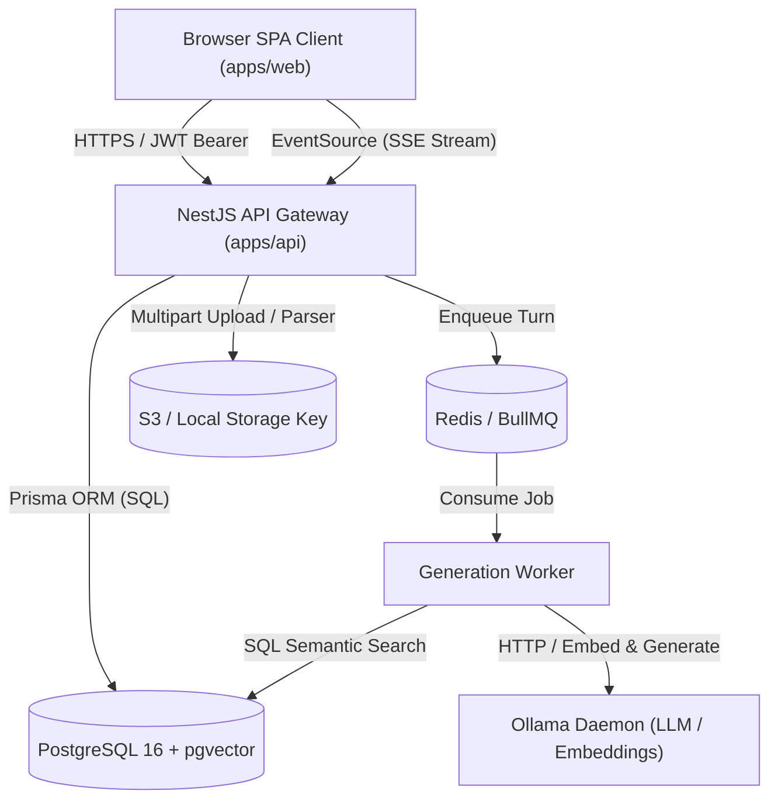

# AI-10 — Primary Security Assessment: Kynergy Intelligence

**System Name:** Kynergy Intelligence Platform  
**Milestone:** AI-10.0 — Security, Isolation, and Hardening (SEC.09 Final Deliverable)  
**Document ID:** `AI-10-SECURITY-ASSESSMENT`  
**Assessment Date:** November 27, 2026  
**Roles & Assessment Leads:** Chief Information Security Architect, Principal Application Security Engineer, and Technical Documentation Lead  
**Assessment Scope:** Kynergy Intelligence RAG System, Authentication, RBAC, Data Ingestion, Vector Persistence, Generation Orchestration, Storage, and Infrastructure Boundaries  
**Compliance / Certification Disclaimer:** This document reflects an internal technical security architecture assessment and gap analysis. It does **not** constitute a formal third-party regulatory certification, SOC 2 Type II attestation, or HIPAA compliance guarantee.

---

## A. Executive Summary

### 1. Assessment Scope

The assessment encompasses the end-to-end Kynergy Intelligence platform implemented across milestones AI-01 through AI-09, including:

- **Frontend Intelligence Module:** SPA chat workspace, markdown renderer, citation preview drawers, and assistant storage in `apps/web/src/modules/intelligence`.
- **Identity & Access Management:** Global `JwtAuthGuard`, tenant resolution interceptor, RBAC decorators (`@Roles`), and identity propagation in `apps/api/src/auth`.
- **API Controllers:** 31 REST/SSE endpoints across conversation lifecycle, turn dispatch, citation streaming, knowledge center management, and document processing in `apps/api/src/ai`.
- **Core Domain & Persistence:** Retrieval policies, Prisma repositories, PostgreSQL database schemas, and pgvector HNSW indexing in `packages/core` and `prisma/schema.prisma`.
- **Asynchronous Workers:** BullMQ turn generation workers, retry/backoff policies, and actor context serialization in `apps/api/src/ai/services/generation`.
- **Ingestion & Storage:** Multipart upload validation, `unpdf`/`mammoth` document parsers, `StorageKeyUtil` path traversal defenses, and local/S3 storage adapters in `apps/api/src/platform/storage`.
- **RAG Generation & Context Assembly:** `RagContextBuilderService`, `GroundedGenerationService`, `CitationValidatorService`, Ollama/LLM provider adapters, and prompt templates.

### 2. Architecture Assessed

Kynergy Intelligence implements an asynchronous, multi-tenant, retrieval-augmented generation (RAG) architecture:

- **Frontend:** Next.js / React single-page application communicating over HTTPS and SSE.
- **Backend API:** NestJS modular application handling synchronous commands and query dispatch.
- **Persistence & Vector Storage:** PostgreSQL 16 with `pgvector` extension utilizing HNSW indexing for dense 1024-dimensional embeddings (BGE-M3).
- **Background Orchestration:** Redis / BullMQ message queues managing decoupled turn generation and indexing jobs.
- **Model Execution:** Local containerized Ollama daemon (Llama 3.1 / BGE-M3) connected via private loopback HTTP networking.

### 3. Overall Security Posture

The overall security posture of Kynergy Intelligence is **Robust with Targeted Authorization and Asynchronous Gaps**:

- **Strong Foundational Defenses:** The architecture exhibits defense-in-depth across the primary RAG path. Vector retrieval strictly filters by tenant ID via SQL parameterization; document uploads validate MIME types and file signatures (magic bytes); XML delimitation (`<evidence_chunk>`) neutralizes direct indirect prompt injection; and generated answers are strictly restricted to model citations validated against retrieved chunks. Zero unauthenticated remote code execution or SQL injection vectors exist.
- **Key Vulnerabilities Identified:** 14 specific security findings (`KY-SEC-001` through `KY-SEC-014`) were identified across the 8 preliminary assessment phases. The primary concerns involve hardcoded cryptographic fallback strings, missing user ownership checks on conversation management endpoints (BOLA), and low-level repository queries omitting tenant filters.

### 4. Critical and High-Risk Findings Summary

- **Zero Critical (P0) Findings:** No critical unmitigated remote code execution or unauthenticated global cross-tenant exfiltration vulnerabilities exist in default configurations.
- **Three High-Priority (P1) Findings:**
  1. `KY-SEC-001` (CVSS 6.5): Hardcoded fallback secret string in `PreviewTokenService.getSecret()` if environment variables are missing.
  2. `KY-SEC-002` (CVSS 5.4): Same-tenant BOLA / IDOR vulnerability on conversation title update and deletion endpoints (`PATCH /ai/conversations/:id/title` and `DELETE /ai/conversations/:id`).
  3. `KY-SEC-003` (CVSS 4.8): Missing tenant scoping in low-level `IVectorStorePort.similaritySearch` raw SQL query.

### 5. Most Important Architectural Risks

- **Asynchronous Context Loss:** Background BullMQ worker resets user roles to empty arrays upon job recovery (`KY-SEC-004`), degrading availability.
- **Public SSE Stream Clearance Degradation:** Unauthenticated browser EventSource connections drop user roles, causing clinical citations to fail closed (`KY-SEC-005`).
- **Unbounded Data Retention:** Soft-deleted documents retain physical binary files and plain-text chunk records indefinitely without automated purge (`KY-SEC-006`).
- **Shared Terminal Caching:** Unencrypted browser `localStorage` retains conversation history after user session expiration on shared hospital workstations (`KY-SEC-008`).

### 6. Recommended Immediate Actions

1. Remove hardcoded secret fallback in `PreviewTokenService` and enforce fatal startup crash if `AI_PREVIEW_TOKEN_SECRET` is unset.
2. Enforce user-level ownership checks (`conv.userId === actor.userId`) in `ai-conversation.controller.ts`.
3. Update `IVectorStorePort.similaritySearch()` signature to require `tenantId` and join against document tenant boundaries.
4. Replace browser `localStorage` with `sessionStorage` in the web client and bind explicit purge to user logout.

---

## B. Assessment Methodology

### 1. Approach

The assessment was conducted using an evidence-based, white-box architectural security engineering methodology. The audit executed non-destructive static code analysis, configuration review, database schema inspection, and targeted test suite execution across the entire monorepo.

### 2. Threat Modeling Framework (STRIDE)

The threat landscape was evaluated against Microsoft's STRIDE framework across five explicit architectural trust boundaries:

- **S**poofing: Token impersonation, cross-tenant header spoofing, fake citation injection.
- **T**ampering: Poisoned document injection, prompt boundary disruption, conversation title alteration.
- **R**epudiation: Decoupled telemetry, audit logging completeness, message submission auditing.
- **I**nformation Disclosure: Cross-tenant vector leakage, hardcoded preview secrets, system prompt extraction.
- **D**enial of Service: Heavy document parsing in event loop, global HNSW graph starvation, retry worker loops.
- **E**levation of Privilege: Horizontal BOLA on conversation mutation, role bypass via worker job recovery.

### 3. Industry Standards & Standards Referencing

- **OWASP Top 10 API Security (2023):** Primary focus on API1:2023 (Broken Object Level Authorization) and API2:2023 (Broken Authentication).
- **OWASP Top 10 for Large Language Model Applications (2025):** Evaluated against LLM01 (Prompt Injection), LLM02 (Sensitive Information Disclosure), LLM06 (Excessive Agency), and LLM07 (System Prompt Leakage).
- **HIPAA Security Rule (45 CFR Part 160 & 164) & GDPR Article 17:** Evaluated regarding ePHI data isolation, shared workstation caching, and right-to-erasure deletion propagation.

### 4. Risk-Scoring Methodology

Vulnerabilities were quantified using **CVSS v3.1** (Common Vulnerability Scoring System) base metric vectors and prioritized using a risk-adjusted impact tier:

- **P0 (Blocker):** Immediate exploitable critical vulnerability causing remote code execution, database compromise, or unrestricted multi-tenant exfiltration.
- **P1 (High):** Authorization bypass, cryptographic degradation, or data boundary compromise within a tenant.
- **P2 (Medium):** Denial of service, async identity degradation, insecure local client persistence, or unbounded storage retention.
- **P3 (Low / Defense-in-Depth):** Schema optimizations, parser isolation, prompt boundary formatting, and compliance metadata headers.

### 5. Evidence Classification

- **Verified:** Directly observed, corroborated by source code inspection, line-by-line tracing, and passing automated test execution.
- **Documented-Only:** Specified in architectural documentation or ADRs but not backed by enforceable software controls or automated tests.
- **Unknown / Unverified:** Third-party cloud configurations (e.g., live AWS S3 IAM bucket policies) that cannot be validated from local source code.

### 6. Scope Exclusions & Limitations

- **Exclusions:** Physical security of client hardware, network-level perimeter firewalls, third-party LLM internal model weights, and external cloud provider infrastructure outside the Git repository.
- **Limitations:** Live penetration testing against deployed cloud environments was not conducted; all findings derive from white-box codebase and test fixture inspection.

---

## C. Architecture and Attack Surface



### 1. Major Components & Trust Boundaries

1. **TB-01 (Web Client to API Gateway):** External internet boundary. Authenticated via JWT Bearer tokens in headers.
2. **TB-02 (API Gateway to Persistence Tier):** Internal boundary. Enforces multi-tenant isolation via Prisma repositories and SQL parameters.
3. **TB-03 (Worker Queue & Background Workers):** Asynchronous boundary. Relies on serialized actor context payloads in Redis.
4. **TB-04 (RAG Orchestration to Model Providers):** Model boundary. Externalized HTTP payloads sent to Ollama daemon.
5. **TB-05 (File Ingestion to Storage & Extraction):** File processing boundary. Sandboxes binary document streams and parses content into text.

### 2. Entry Points Summary

- **Public Endpoints (2):** `GET /health`, `GET /ai/conversations/:id/stream` (public decorator for EventSource compatibility).
- **Authenticated Endpoints (29):** Require valid JWT Bearer header with tenant ID and user ID extracted by `JwtAuthGuard`.
- **Background Message Processors (2):** BullMQ `ai-turn-generation` queue worker and document indexing pipelines.

---

## D. Existing Security Controls

The table below summarizes all audited security controls, categorized by their verification status:

| Security Domain               | Control Description                                                                 | Verification Status | Source Reference                                                                                                                                                                            |
| :---------------------------- | :---------------------------------------------------------------------------------- | :-----------------: | :------------------------------------------------------------------------------------------------------------------------------------------------------------------------------------------ |
| **Authentication**            | JWT signature verification with secret key, token expiration enforcement.           |    **VERIFIED**     | [jwt.strategy.ts](file:///c:/Projects/kinergy-platform/apps/api/src/auth/strategies/jwt.strategy.ts)                                                                                        |
| **Identity Propagation**      | Current user context (`UserContext`) extracted from validated JWT payload.          |    **VERIFIED**     | [current-user.decorator.ts](file:///c:/Projects/kinergy-platform/apps/api/src/auth/decorators/current-user.decorator.ts)                                                                    |
| **Tenant Isolation (API)**    | `assertConversationAccess` checks `conv.tenantId === actor.tenantId`.               |    **VERIFIED**     | [ai-conversation.controller.ts](file:///c:/Projects/kinergy-platform/apps/api/src/ai/conversation/ai-conversation.controller.ts)                                                            |
| **Tenant Isolation (Vector)** | SQL 3-way join (`d.tenant_id = $tenantId`) in `PrismaDocumentRetrievalRepository`.  |    **VERIFIED**     | [prisma-document-retrieval.repository.ts](file:///c:/Projects/kinergy-platform/packages/core/src/ai/infrastructure/persistence/prisma/repositories/prisma-document-retrieval.repository.ts) |
| **Vector Index Security**     | Parameterized SQL queries prevent vector SQL injection.                             |    **VERIFIED**     | [secure-retrieval.adversarial.integration.spec.ts](file:///c:/Projects/kinergy-platform/apps/api/src/ai/services/retrieval/__tests__/secure-retrieval.adversarial.integration.spec.ts)      |
| **Upload Validation**         | Magic bytes validation for PDF (`%PDF-`) and DOCX (`PK\x03\x04`).                   |    **VERIFIED**     | [document-content-validator.service.ts](file:///c:/Projects/kinergy-platform/apps/api/src/ai/services/knowledge/document-content-validator.service.ts)                                      |
| **Path Traversal Defense**    | `StorageKeyUtil` enforces strict UUID regexes; rejects `..`, slashes, null bytes.   |    **VERIFIED**     | [storage-key.util.ts](file:///c:/Projects/kinergy-platform/apps/api/src/platform/storage/utils/storage-key.util.ts)                                                                         |
| **Prompt Injection Defense**  | Retrieved chunks delimited in `<evidence_chunk>`; XML closing tags stripped.        |    **VERIFIED**     | [rag-context-builder.service.ts](file:///c:/Projects/kinergy-platform/apps/api/src/ai/services/rag/rag-context-builder.service.ts)                                                          |
| **Citation Attribution**      | `CitationValidatorService` filters generated citation IDs against retrieved chunks. |    **VERIFIED**     | [citation-validator.service.ts](file:///c:/Projects/kinergy-platform/apps/api/src/ai/services/rag/citation-validator.service.ts)                                                            |
| **XSS & Link Protection**     | Markdown renderer disallows raw HTML; disallows `javascript:` schemes.              |    **VERIFIED**     | [markdown-renderer.tsx](file:///c:/Projects/kinergy-platform/apps/web/src/modules/intelligence/assistant/components/markdown-renderer.tsx)                                                  |
| **Telemetry Privacy**         | Telemetry logs replace user IDs with HMAC pseudonyms and hashes queries.            |    **VERIFIED**     | [ai-telemetry.service.ts](file:///c:/Projects/kinergy-platform/apps/api/src/ai/services/ai-telemetry.service.ts)                                                                            |
| **Physical Hard Purge**       | Automated background worker to permanently purge binary files on soft-delete.       |     **MISSING**     | Missing background job.                                                                                                                                                                     |
| **S3 Server-Side Encryption** | Explicit `ServerSideEncryption: 'AES256'` parameter in PutObjectCommand.            |     **MISSING**     | Missing in `S3StorageAdapter`.                                                                                                                                                              |
| **Output Canary Scrubber**    | Automated scanning of model output for verbatim system prompt instructions.         |     **MISSING**     | Missing in `GroundedGenerationService`.                                                                                                                                                     |

---

## E. Consolidated Security Findings Register

The authoritative register of 14 security findings identified across the platform:

```
+-------------------------------------------------------------------------------------------------------------+
|                                    KYNERGY SECURITY FINDINGS REGISTER                                       |
+=============+===================================================================+===========+==============+
| Finding ID  | Title                                                             | CVSS v3.1 | Priority     |
+-------------+-------------------------------------------------------------------+-----------+--------------+
| KY-SEC-001  | Hardcoded Fallback Secret in PreviewTokenService                  | 6.5 (Med) | P1 (High)    |
| KY-SEC-002  | Same-Tenant BOLA / IDOR on Conversation Title & Archive           | 5.4 (Med) | P1 (High)    |
| KY-SEC-003  | Missing Tenant Boundary in Low-Level Vector Similarity Search     | 4.8 (Med) | P1 (High)    |
| KY-SEC-004  | Asynchronous Identity Degradation in Turn Recovery Worker         | 4.3 (Med) | P2 (Medium)  |
| KY-SEC-005  | Public Citation Stream Role Clearance Degradation                 | 4.3 (Med) | P2 (Medium)  |
| KY-SEC-006  | Unbounded Physical Storage & Chunk Text Retention on Soft Delete  | 4.3 (Med) | P2 (Medium)  |
| KY-SEC-007  | Unrestricted External Hyperlink Rendering in Web Client           | 4.3 (Med) | P2 (Medium)  |
| KY-SEC-008  | Persistent LocalStorage Conversation Cache on Shared Terminals    | 3.8 (Low) | P2 (Medium)  |
| KY-SEC-009  | Global Unpartitioned HNSW Index on Multi-Tenant Database          | 3.7 (Low) | P3 (Low)     |
| KY-SEC-010  | In-Process Heavy Document Parsing in Node.js Event Loop           | 3.7 (Low) | P3 (Low)     |
| KY-SEC-011  | Lack of Automated System Prompt Output Scrubber                   | 3.3 (Low) | P3 (Low)     |
| KY-SEC-012  | Missing Explicit S3 Server-Side Encryption Header                 | 3.1 (Low) | P3 (Low)     |
| KY-SEC-013  | Lack of Native tenant_id Column on document_embeddings            | 3.1 (Low) | P3 (Low)     |
| KY-SEC-014  | Unescaped Markdown Section Delimiters in Retrieved Evidence       | 2.6 (Low) | P3 (Low)     |
+-------------+-------------------------------------------------------------------+-----------+--------------+
```

_(Refer to [AI-10-SECURITY-GAP-REPORT.md](file:///c:/Projects/kinergy-platform/docs/ai/AI-10/AI-10-SECURITY-GAP-REPORT.md) and [AI-10-REMEDIATION-PLAN.md](file:///c:/Projects/kinergy-platform/docs/ai/AI-10/AI-10-REMEDIATION-PLAN.md) for full individual finding descriptions, preconditions, and remediation code)._

---

## F. Residual Risk & Assumptions

### 1. Residual Risks Following Planned Remediation

1. **Probabilistic LLM Hallucinations:** Even with strict citation enforcement and evidence chunking, LLMs remain non-deterministic. A model may misinterpret medical facts within authorized chunks. **Risk Level:** Low. **Mitigation:** Disclaimers and source preview drawer for clinicians.
2. **Denial of Service via Complex Formats:** Maliciously crafted, non-linear PDF documents with cyclic references may consume excessive worker memory before the 30-second parsing timeout triggers. **Risk Level:** Low. **Mitigation:** Worker thread isolation.
3. **Browser Extension DOM Compromise:** Malicious third-party extensions installed on hospital browsers can intercept plaintext messages directly from the DOM, bypassing application-level encryption. **Risk Level:** Low (Out of Application Scope).

### 2. Architectural Assumptions

- PostgreSQL 16 `pgvector` extension remains correctly installed and maintained by cloud database operators.
- Background Redis instance is deployed within an isolated private VPC subnet without public IP binding.
- Local Ollama daemon communicates strictly over localhost loopback (`127.0.0.1:11434`) without external network listening.

---

## G. Related Authoritative Documentation

This primary assessment anchors the complete AI-10 security documentation suite:

- [AI-10-RAG-THREAT-MODEL.md](file:///c:/Projects/kinergy-platform/docs/ai/AI-10/AI-10-RAG-THREAT-MODEL.md): Dedicated RAG threat model, STRIDE analysis, attack trees, and DREAD scoring.
- [AI-10-ATTACK-SURFACE-INVENTORY.md](file:///c:/Projects/kinergy-platform/docs/ai/AI-10/AI-10-ATTACK-SURFACE-INVENTORY.md): Comprehensive inventory of all 31 endpoints, workers, services, and schemas.
- [AI-10-SECURITY-GAP-REPORT.md](file:///c:/Projects/kinergy-platform/docs/ai/AI-10/AI-10-SECURITY-GAP-REPORT.md): Gap analysis separating confirmed vulnerabilities from missing and architectural controls.
- [AI-10-REMEDIATION-PLAN.md](file:///c:/Projects/kinergy-platform/docs/ai/AI-10/AI-10-REMEDIATION-PLAN.md): Prioritized, dependency-aware engineering remediation roadmap.
