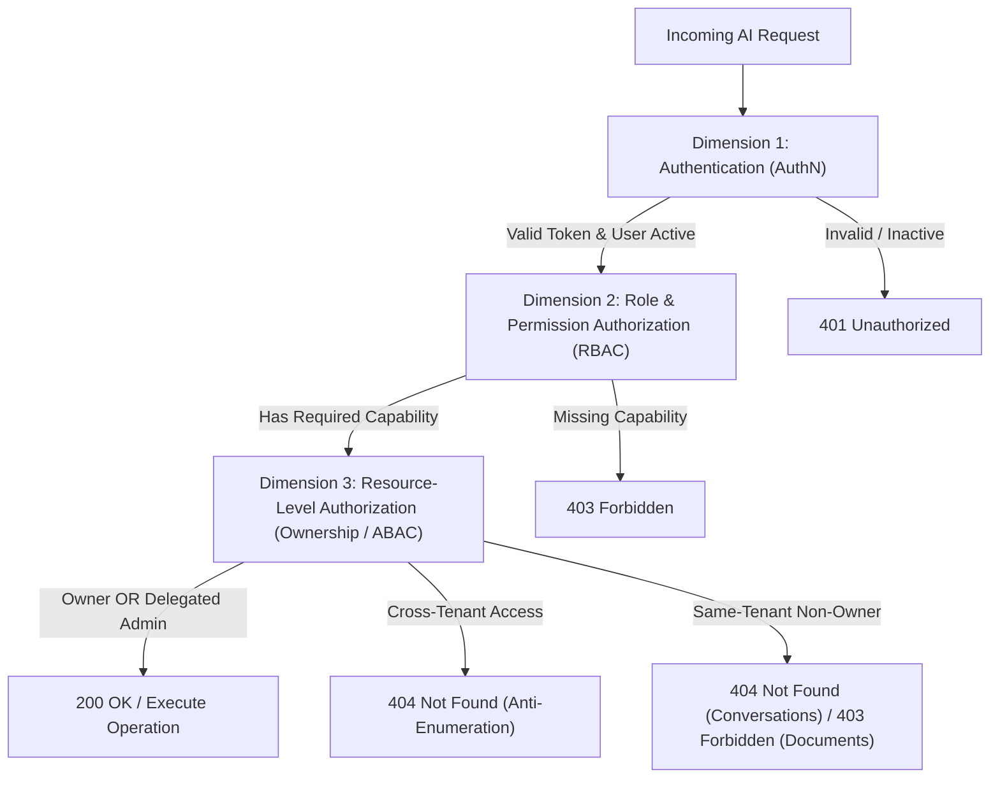

# AI-10.1 — Authoritative AI Authorization Policy and Architecture

**System Name:** Kynergy Intelligence Platform  
**Milestone:** AI-10.1 — Identity Propagation, RBAC & Resource-Level Authorization  
**Document ID:** `AI-10.1-AUTHORIZATION-POLICY`  
**Effective Date:** November 27, 2026  
**Role:** Principal Security Architect  
**Policy Status:** APPROVED FOR IMPLEMENTATION

---

## 1. Policy Objectives & Core Security Invariants

### 1.1 Purpose

This policy establishes the authoritative security architecture, access control rules, and behavioral specifications governing every artificial intelligence and retrieval-augmented generation (RAG) operation within the Kynergy Platform. Every AI controller, application use case, domain service, repository port, background queue, and worker must comply with this policy.

### 1.2 Core Security Invariants

```
+=============================================================================================================+
|                                        AUTHORITATIVE SECURITY INVARIANTS                                     |
+=============================================================================================================+
| INV-01: Server-Derived Identity    | Identity and tenant scope are strictly derived from cryptographically   |
|                                    | verified server-side authentication tokens. Client-provided parameters  |
|                                    | (in body, query, or custom headers) are NEVER authoritative.            |
+------------------------------------+-------------------------------------------------------------------------+
| INV-02: Fail-Closed Default        | Any missing, malformed, expired, revoked, or inconsistent authorization |
|                                    | context must immediately fail closed and deny access.                   |
+------------------------------------+-------------------------------------------------------------------------+
| INV-03: Two-Tier Boundary Defense  | Resource access requires satisfying TWO distinct boundaries:            |
|                                    | 1. Tenant Boundary (Absolute physical data partition).                  |
|                                    | 2. Resource-Level Authorization (Ownership or RBAC capability).         |
+------------------------------------+-------------------------------------------------------------------------+
| INV-04: Non-Enumeration (Anti-IDOR)| Cross-tenant access attempts MUST return 404 Not Found to prevent       |
|                                    | resource enumeration and leak of existence across organizations.        |
+------------------------------------+-------------------------------------------------------------------------+
| INV-05: Pre-Retrieval LLM Isolation| Retrieval authorization filtering occurs in SQL BEFORE vector ranking   |
|                                    | and context assembly. Unauthorized text is NEVER sent to the LLM.       |
+------------------------------------+-------------------------------------------------------------------------+
| INV-06: Asynchronous Auth Parity   | Background workers must execute with the initiating user's validated    |
|                                    | permissions and must re-verify user status upon crash recovery.         |
+=============================================================================================================+
```

---

## 2. Trusted Identity Context Definition

### 2.1 The Unified Identity Models

Every incoming HTTP request passing through `AuthenticationGuard` results in an immutable `AuthenticatedUserContext`. For AI operations, the `@TrustedAi()` parameter decorator extracts this into a strongly typed `TrustedAiContext`.

```typescript
export interface TrustedAiContext {
  /** Authoritative internal User UUID from validated JWT subject claim ('sub') */
  readonly actorId: string;

  /** Authoritative Tenant UUID from validated JWT tenant claim ('tenantId') */
  readonly tenantId: string;

  /** Primary user email address associated with the authenticated account */
  readonly email?: string;

  /** Canonical user roles assigned to the user within this tenant */
  readonly roles: readonly string[];

  /** Flattened, authoritative permission codes resolved for the user */
  readonly permissions: readonly string[];
}
```

### 2.2 Authoritative vs. Client-Controlled Attributes

| Attribute            | Origin & Storage                          | Authoritative? | Client Overridable? | Processing Rule                                      |
| :------------------- | :---------------------------------------- | :------------: | :-----------------: | :--------------------------------------------------- |
| `actorId` (`userId`) | JWT `sub` verified against `User` table   |    **YES**     |      **NEVER**      | Ignored if sent in request body or query string.     |
| `tenantId`           | JWT `tenantId` claim                      |    **YES**     |      **NEVER**      | Headers like `x-tenant-id` are strictly ignored.     |
| `roles`              | `User.roles` in PostgreSQL                |    **YES**     |      **NEVER**      | Derived exclusively from server-side database state. |
| `permissions`        | `DefaultPermissionResolver`               |    **YES**     |      **NEVER**      | Computed server-side from active role mappings.      |
| `tokenVersion`       | JWT `tokenVersion` vs `User.tokenVersion` |    **YES**     |      **NEVER**      | Mismatch triggers immediate 401 session revocation.  |
| Client Turn ID       | Request body (`clientTurnId`)             |     **NO**     |       Allowed       | Treated purely as an idempotency deduplication key.  |

---

## 3. The Three Dimensions of Authorization

Kynergy enforces a clear separation between the three dimensions of access control:



1. **Authentication (AuthN):** Confirms identity (`actorId`), validates active account status (`status === ACTIVE`), and verifies token validity.
2. **Capability Authorization (RBAC):** Confirms whether the principal's role grants them the right to perform a class of actions within the tenant (e.g., `ai.documents.upload`).
3. **Resource-Level Authorization (Ownership / Scope):** Confirms whether the principal has access to the _specific instance_ of a resource based on ownership (`userId === doc.uploadedBy` or `userId === conv.userId`), visibility scope clearance, or an authorized administrative role.

---

## 4. Platform RBAC Reuse & AI Permission Catalog

### 4.1 Reusing Existing Platform Roles

Kynergy AI reuses the existing platform IAM role catalog without creating a parallel role structure:

- **`Owner` / `SuperAdmin`:** Full administrative, configuration, and audit capabilities across all tenant AI assets.
- **`Therapist` / `Physiotherapist` / `Doctor` (Clinical Tier):** Clearance for clinical knowledge bases, consultation creation, and document uploading.
- **`Trainer` (Operational Tier):** Clearance for training and operational knowledge bases; consultation creation.
- **`Receptionist` / `Kitchen Staff` (General Staff):** Clearance strictly for general staff documents (`ALL_STAFF`); general assistant queries.

### 4.2 Reusing `RetrievalSecurityPolicyService` Visibility Mapping

Knowledge documents continue to be governed by `VisibilityScope` enums resolved via `RetrievalSecurityPolicyService`:

- `VisibilityScope.ALL_STAFF`: Accessible to all authenticated tenant staff.
- `VisibilityScope.CLINICAL_STAFF`: Accessible strictly to Clinical Tier (`Therapist`, `Doctor`) and `Owner`/`Admin`.
- `VisibilityScope.MANAGEMENT`: Accessible strictly to Executive Tier (`Owner`, `Admin`, `Manager`).

### 4.3 Authoritative AI Permission Additions (`PERMISSIONS.AI`)

To replace ad-hoc string comparisons in controllers with declarative `@RequirePermissions()` decorators, the platform permission catalog in `apps/api/src/platform/identity/authorization/permissions.ts` is formally expanded:

```typescript
export const PERMISSIONS = {
  // ... existing modules ...
  AI: {
    CONVERSATIONS_CREATE: 'ai.conversations.create',
    CONVERSATIONS_MANAGE: 'ai.conversations.manage',
    CONVERSATIONS_AUDIT: 'ai.conversations.audit',
    DOCUMENTS_UPLOAD: 'ai.documents.upload',
    DOCUMENTS_MANAGE: 'ai.documents.manage',
    KNOWLEDGE_QUERY: 'ai.knowledge.query',
  },
} as const;
```

#### Business & Security Justifications:

- `ai.conversations.create`: Allows starting chat sessions and dispatching turns. Granted to all staff.
- `ai.conversations.manage`: Allows archiving or managing any conversation within the tenant. Restricted to `Owner` and `Admin`.
- `ai.conversations.audit`: Allows privileged supervisory inspection with mandatory audit logging. Restricted to `Owner`.
- `ai.documents.upload`: Allows uploading new knowledge documents. Granted to `Owner`, `Therapist`, `Trainer`.
- `ai.documents.manage`: Allows editing, soft-deleting, restoring, or reindexing any document in the tenant. Restricted to `Owner`, `Admin`, `Manager`.
- `ai.knowledge.query`: Allows direct semantic retrieval queries. Granted to all staff.

---

## 5. Comprehensive Resource-Operation Authorization Matrix

The table below defines the exact authorization rule for every AI endpoint across the platform:

| Resource Type     | Operation & Route                          | Required Permission       | Resource Authorization Rule                                                                                     | Mismatch Status |
| :---------------- | :----------------------------------------- | :------------------------ | :-------------------------------------------------------------------------------------------------------------- | :-------------: |
| **Document**      | `POST /api/v1/ai/documents/upload`         | `ai.documents.upload`     | Tenant-scoped; sets `uploadedBy = actor.actorId`                                                                |  403 Forbidden  |
| **Document**      | `GET /api/v1/ai/documents`                 | None (Auth)               | Scoped to `tenantId`; filtered by `actor.roles` visibility scopes                                               |   Empty List    |
| **Document**      | `GET /api/v1/ai/documents/:id`             | None (Auth)               | `doc.tenantId === actor.tenantId` AND actor has clearance for `doc.visibilityScope`                             |  404 Not Found  |
| **Document**      | `PATCH /api/v1/ai/documents/:id`           | None                      | `doc.tenantId === actor.tenantId` AND (`doc.uploadedBy === actor.actorId` OR actor has `ai.documents.manage`)   |    404 / 403    |
| **Document**      | `DELETE /api/v1/ai/documents/:id`          | None                      | `doc.tenantId === actor.tenantId` AND (`doc.uploadedBy === actor.actorId` OR actor has `ai.documents.manage`)   |    404 / 403    |
| **Document**      | `POST /api/v1/ai/documents/:id/restore`    | `ai.documents.manage`     | `doc.tenantId === actor.tenantId` AND actor has `ai.documents.manage`                                           |    404 / 403    |
| **Version**       | `GET /api/v1/ai/documents/:id/versions`    | None (Auth)               | `doc.tenantId === actor.tenantId` AND clearance for `doc.visibilityScope`                                       |  404 Not Found  |
| **Version**       | `GET /.../versions/:verId/download`        | None (Auth)               | `doc.tenantId === actor.tenantId` AND clearance for `doc.visibilityScope`                                       |  404 Not Found  |
| **Ingestion**     | `POST /.../ingestion/retry`                | None                      | `doc.tenantId === actor.tenantId` AND (`doc.uploadedBy === actor.actorId` OR actor has `ai.documents.manage`)   |    404 / 403    |
| **Ingestion**     | `POST /.../ingestion/cancel`               | None                      | `doc.tenantId === actor.tenantId` AND (`doc.uploadedBy === actor.actorId` OR actor has `ai.documents.manage`)   |    404 / 403    |
| **Ingestion**     | `GET /api/v1/ai/knowledge/ingestion/jobs`  | `ai.documents.manage`     | Scoped to `actor.tenantId`; administrative monitoring only                                                      |  403 Forbidden  |
| **RAG Query**     | `POST /api/v1/ai/rag/query`                | `ai.knowledge.query`      | Scoped to `actor.tenantId`; pre-retrieval SQL filters by allowed visibility scopes                              | 0 Chunks Found  |
| **Preview**       | `POST /ai/citations/preview-token`         | None (Auth)               | `chunk.tenantId === actor.tenantId` AND clearance for document visibility scope                                 |  404 Not Found  |
| **Preview**       | `GET /ai/citations/preview`                | HMAC Token                | Timing-safe HMAC token verification; bounds chunk to token tenant                                               |    401 / 404    |
| **Conversation**  | `POST /ai/conversations`                   | `ai.conversations.create` | Tenant-scoped; sets `userId = actor.actorId`                                                                    |  403 Forbidden  |
| **Conversation**  | `GET /ai/conversations`                    | None (Auth)               | Strictly filtered by `tenantId === actor.tenantId AND userId === actor.actorId`                                 |   Empty List    |
| **Conversation**  | `GET /ai/conversations/:id`                | None (Auth)               | Strictly restricted: `conv.tenantId === actor.tenantId AND conv.userId === actor.actorId`                       |  404 Not Found  |
| **Conversation**  | `GET /ai/conversations/:id/messages`       | None (Auth)               | Strictly restricted: `conv.tenantId === actor.tenantId AND conv.userId === actor.actorId`                       |  404 Not Found  |
| **Conversation**  | `PATCH /ai/conversations/:id/title`        | None (Auth)               | Strictly restricted: `conv.tenantId === actor.tenantId AND conv.userId === actor.actorId`                       |  404 Not Found  |
| **Conversation**  | `DELETE /ai/conversations/:id`             | None (Auth)               | `conv.tenantId === actor.tenantId` AND (`conv.userId === actor.actorId` OR actor has `ai.conversations.manage`) |    404 / 403    |
| **Conversation**  | `POST /ai/conversations/:id/turns`         | `ai.conversations.create` | Strictly restricted: `conv.tenantId === actor.tenantId AND conv.userId === actor.actorId`                       |  404 Not Found  |
| **Conversation**  | `POST /ai/conversations/:id/cancel`        | None (Auth)               | Strictly restricted: `conv.tenantId === actor.tenantId AND conv.userId === actor.actorId`                       |  404 Not Found  |
| **Audit Inspect** | `POST /ai/conversations/:id/audit-inspect` | `ai.conversations.audit`  | Enforces `@Roles('Owner')`; immutable audit log committed before return                                         |    403 / 400    |
| **Stream**        | `GET /ai/conversations/:id/stream`         | Token / Ticket            | Validates ticket; strictly asserts `conv.userId === ticket.userId`                                              |    401 / 404    |
| **Feedback**      | `POST /.../messages/:msgId/feedback`       | None (Auth)               | `conv.userId === actor.actorId`; feedback records `userId = actor.actorId`                                      |  404 Not Found  |
| **Feedback**      | `GET /.../messages/:msgId/feedback`        | None (Auth)               | Strictly scoped to feedback created by `actor.actorId`                                                          |  404 Not Found  |
| **Feedback**      | `DELETE /.../messages/:msgId/feedback`     | None (Auth)               | Strictly scoped to feedback created by `actor.actorId`                                                          |  404 Not Found  |

---

## 6. Document Ownership & Knowledge Source Access Rules

### 6.1 Two-Tier Access Evaluation Rule

Every document access decision follows an explicit two-tier policy:

```typescript
function canUserAccessDocument(actor: TrustedAiContext, doc: KnowledgeDocument): boolean {
  // Tier 1: Strict Physical Tenant Partition
  if (doc.tenantId !== actor.tenantId) {
    return false; // Result: 404 Not Found (Zero Leakage)
  }

  // Tier 2: RBAC Visibility Scope Clearance
  const allowedScopes = retrievalSecurityPolicy.resolveAllowedVisibilityScopes(actor.roles);
  return allowedScopes.includes(doc.visibilityScope);
}
```

### 6.2 Document Mutation Rule (Edit / Delete / Restore / Retry)

```typescript
function canUserManageDocument(actor: TrustedAiContext, doc: KnowledgeDocument): boolean {
  if (doc.tenantId !== actor.tenantId) {
    return false;
  }
  // Rule A: The original uploader can always manage their document
  if (actor.actorId === doc.uploadedBy) {
    return true;
  }
  // Rule B: Users with administrative management capability can manage any document
  return (
    actor.permissions.includes(PERMISSIONS.AI.DOCUMENTS_MANAGE) ||
    actor.roles.some((r) => ['owner', 'superadmin', 'admin', 'manager'].includes(r.toLowerCase()))
  );
}
```

---

## 7. Conversation Ownership & Anti-BOLA Rules

### 7.1 Consultation Privacy Principle

In clinical and wellness settings, a clinician's consultation dialogue with the AI assistant contains sensitive observations, draft differential considerations, and patient context. **Conversations are private to the creator by default.**

### 7.2 Strict Creator Scoping Rule

For all standard conversation lifecycle operations:

```typescript
function assertConversationOwnership(actor: TrustedAiContext, conv: AiConversation): void {
  // Rule 1: Tenant Boundary
  if (conv.tenantId !== actor.tenantId) {
    throw new ConversationNotFoundError(conv.id, actor.tenantId);
  }

  // Rule 2: User Ownership Assertion (Anti-BOLA)
  if (conv.userId !== actor.actorId) {
    // Fail closed with 404 Not Found to prevent IDOR enumeration across peer clinicians
    throw new ConversationNotFoundError(conv.id, actor.tenantId);
  }
}
```

### 7.3 Administrative Archival Override

Only archiving (`DELETE /ai/conversations/:id`) permits an administrative override:

```typescript
function assertCanArchiveConversation(actor: TrustedAiContext, conv: AiConversation): void {
  if (conv.tenantId !== actor.tenantId) {
    throw new ConversationNotFoundError(conv.id, actor.tenantId);
  }

  const isOwner = conv.userId === actor.actorId;
  const isAdmin =
    actor.permissions.includes(PERMISSIONS.AI.CONVERSATIONS_MANAGE) ||
    actor.roles.some((r) => ['owner', 'superadmin', 'admin'].includes(r.toLowerCase()));

  if (!isOwner && !isAdmin) {
    throw new ForbiddenException('You do not have permission to archive this conversation');
  }
}
```

### 7.4 Privileged Inspection Protocol (`auditInspect`)

Supervisors and clinic owners cannot directly view peer conversations via standard endpoints. Inspection is strictly isolated to `POST /ai/conversations/:id/audit-inspect`:

1. Requires `@Roles('Owner')` and `PERMISSIONS.AI.CONVERSATIONS_AUDIT`.
2. Requires a structured justification reason (`reason.length >= 10`).
3. Writes an immutable audit row to `ai_conversation_audit_logs`.
4. Fails closed: if the database audit write fails, zero conversation data or messages are returned.

---

## 8. Background Job & Asynchronous Authorization Rules

### 8.1 In-Flight Turn Dispatch

When an active turn is submitted, `AiTurnDispatcherService` packages the verified `actorContext`:

```typescript
{
  tenantId: auth.tenantId,
  userId: auth.actorId,
  conversationId,
  turnId,
  actorContext: {
    roles: auth.roles,
    permissions: auth.permissions,
  }
}
```

### 8.2 Worker Recovery Authorization Rehydration (`AiTurnGenerationWorker`)

When a background turn is recovered following a worker restart or lease timeout, the worker must re-verify the initiating user's identity:

1. Worker retrieves parent conversation: `conv = convRepo.findById(tenantId, turn.conversationId)`.
2. Worker queries PostgreSQL via `IUserRepository.findById(conv.userId)`.
3. **Account Status Verification:** If user does not exist or `user.status !== UserStatus.ACTIVE`, worker aborts the turn immediately, marking it `FAILED` with error code `ACCOUNT_INACTIVE`.
4. **Role Rehydration:** Worker rehydrates `actorContext.roles` with the user's _current_ roles from the database, preventing permissions drift.

---

## 9. Error Conventions & Anti-Enumeration Requirements

To prevent malicious actors from probing and enumerating resources belonging to other users or organizations:

```
+---------------------------------------------------------------------------------------------------------+
|                                    HTTP RESPONSE ERROR CONVENTIONS                                      |
+=========================+===================================================+===========================+
| Scenario                | Security Condition                                | Expected HTTP Response    |
+-------------------------+---------------------------------------------------+---------------------------+
| Unauthenticated         | Missing / expired / invalid JWT token             | 401 Unauthorized          |
| Missing Tenant          | Principal has no assigned tenant in JWT           | 403 Forbidden             |
| Cross-Tenant Access     | Requested resource belongs to another tenant      | 404 Not Found             |
| Peer Conversation Access| Same tenant, but conversation owned by peer       | 404 Not Found             |
| Peer Document Mutation  | Same tenant, but non-admin editing peer document  | 403 Forbidden             |
| Inactive Account        | User account disabled in PostgreSQL               | 401 Unauthorized          |
| Document Deleted        | Document soft-deleted (`deleted_at IS NOT NULL`)  | 404 Not Found             |
| Generation Conflict     | Archiving conversation while turn is actively run | 409 Conflict              |
+-------------------------+---------------------------------------------------+---------------------------+
```

---

## 10. Audit Logging Conventions

All authorization audit events must adhere to privacy-preserving compliance mandates:

- **Logged Attributes:** `timestamp`, `event` (e.g., `ai.turn.dispatched`, `ai.document.uploaded`, `ai.conversation.archived`), `tenantId`, `actorId` (HMAC pseudonym or UUID), `resourceId`, `decision` (`PERMIT`/`DENY`).
- **Strict Redactions:** Plain-text conversation queries, generated answer text, raw document chunks, passwords, JWT tokens, and HMAC secrets must **NEVER** appear in application logs or telemetry.

---

## 11. Mapping AI-10.0 Security Findings to Policy

|   Finding ID   | Title                             | Specific Policy Enforcement Rule                                                                                                                  |
| :------------: | :-------------------------------- | :------------------------------------------------------------------------------------------------------------------------------------------------ |
| **KY-SEC-001** | Hardcoded Preview Token Fallback  | Section 2.1: Enforce mandatory environment variable check for `AI_PREVIEW_TOKEN_SECRET` with >=32 char validation; fatal boot failure if missing. |
| **KY-SEC-002** | Same-Tenant BOLA on Conversations | Section 7.2: Enforce `assertConversationOwnership(actor, conv)` requiring `conv.userId === actor.actorId` on all conversation endpoints.          |
| **KY-SEC-003** | Low-Level Vector Search Scoping   | Section 1.2 (INV-03): Require `tenantId` parameter in `IVectorStorePort.similaritySearch` and join on documents.                                  |
| **KY-SEC-004** | Worker Identity Degradation       | Section 8.2: Dynamic user lookup via `IUserRepository` upon turn recovery to rehydrate roles.                                                     |
| **KY-SEC-005** | Public SSE Stream Role Drop       | Section 5: Transition SSE streaming to authenticated tickets (`GET /stream?ticket=...`).                                                          |
| **KY-SEC-006** | Unbounded Soft-Delete Retention   | Section 1.2 (INV-05): Automated 30-day hard-purge worker for files and chunks.                                                                    |
| **KY-SEC-008** | Shared Terminal LocalStorage      | Section 1.2 (INV-01): Client assistant storage bound to `sessionStorage` with explicit logout purge.                                              |

---

## 12. Architectural Decision Records (ADRs) Created

This policy is anchored by three formal Architectural Decision Records:

1. [ADR-AI-10-001: Resource-Level Conversation Authorization and BOLA Defense](file:///c:/Projects/kinergy-platform/docs/ai/AI-10-ADRS/ADR-AI-10-001-resource-level-conversation-authorization-and-bola-defense.md)
2. [ADR-AI-10-002: Dynamic Background Worker Identity Rehydration](file:///c:/Projects/kinergy-platform/docs/ai/AI-10-ADRS/ADR-AI-10-002-dynamic-background-worker-identity-rehydration.md)
3. [ADR-AI-10-003: Authoritative AI Permission Catalog Standardization](file:///c:/Projects/kinergy-platform/docs/ai/AI-10-ADRS/ADR-AI-10-003-authoritative-ai-permission-catalog-standardization.md)
