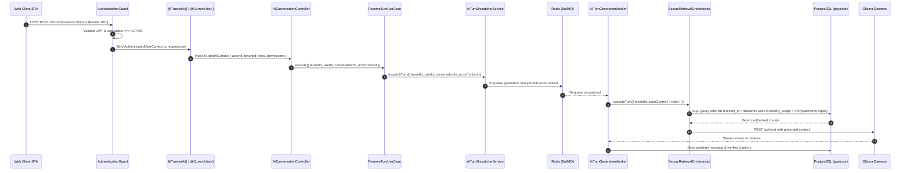

# AI-10.1-01 — Identity Propagation and Authorization Readiness Audit

**System Name:** Kynergy Intelligence Platform  
**Milestone:** AI-10.1 — Identity Propagation, RBAC & Resource-Level Authorization  
**Document ID:** `AI-10.1-READINESS-AUDIT`  
**Audit Date:** November 27, 2026  
**Role:** Principal Backend Security Engineer and Software Architect  
**Scope:** Verification-first audit of authentication architecture, request context, identity propagation, AI controllers, background queues, resource ownership models, and authorization readiness  
**Investigation Mandate:** Strictly non-destructive investigation and planning only. Zero application code or database schema modifications.

---

## 1. Executive Summary & Readiness Verdict

### Readiness Verdict: **READY WITH RISKS**

**Justification:**  
The core authentication and multi-tenant identity infrastructure in Kynergy is mature, well-architected, and resilient. The platform features an established transport-level authentication guard (`AuthenticationGuard`), a unified request context accessor, clean extraction of cryptographic claims, and strict isolation between external tenant boundaries.

However, proceeding with milestone **AI-10.1** implementation requires addressing **three specific architectural risks**:

1. **Broken Object Level Authorization (BOLA) on Conversation Mutations:** `GET :id`, `GET :id/messages`, `PATCH :id/title`, and `DELETE :id` in `AiConversationController` enforce tenant scoping (`tenantId`) but omit user ownership verification (`conv.userId === actor.userId`), allowing any authenticated user within a tenant to read, rename, or archive colleague conversations.
2. **Asynchronous Identity Degradation in Turn Recovery Worker:** `AiTurnGenerationWorker` recovers crashed/stalled turns with `actorContext: { roles: [], permissions: [] }`, causing retrieval to fail closed and returning empty clinical contexts upon service restart.
3. **Incomplete AI Permission Catalog in Platform IAM:** `PERMISSIONS.AI` contains only `ai.conversations.audit`. General AI capabilities (document management, turn dispatch, knowledge querying) rely on manual role-string checks rather than declarative `@RequirePermissions()` decorators.

---

## 2. Current Authentication & Authorization Architecture

### 2.1 Transport Authentication Guard (`AuthenticationGuard`)

- **Source Location:** `apps/api/src/platform/identity/guards/authentication.guard.ts` ([lines 21–87](file:///c:/Projects/kinergy-platform/apps/api/src/platform/identity/guards/authentication.guard.ts#L21-L87))
- **Status:** **VERIFIED**
- **Mechanism:**
  - Evaluates `@Public()` route metadata via `Reflector`.
  - Extracts Bearer token from HTTP `Authorization` header.
  - Validates cryptographic signature and claims via `IAccessTokenService`.
  - Validates user existence and status (`UserStatus.ACTIVE`) against `IUserRepository.findById(payload.sub)`.
  - Enforces session invalidation via `tokenVersion` comparison.
  - Constructs an immutable `AuthenticatedUserContext` and binds it to `request.user`.

```typescript
// apps/api/src/platform/identity/guards/authentication.guard.ts
const userContext = new AuthenticatedUserContext({
  userId: user.id,
  email: user.email,
  status: user.status,
  roles: user.roles,
  permissions: user.permissions,
  tenantId: user.tenantId,
});
(request as unknown as { user: unknown }).user = userContext;
```

### 2.2 Authorization Guard (`AuthorizationGuard`)

- **Source Location:** `apps/api/src/platform/identity/authorization/authorization.guard.ts` ([lines 31–138](file:///c:/Projects/kinergy-platform/apps/api/src/platform/identity/authorization/authorization.guard.ts#L31-L138))
- **Status:** **VERIFIED**
- **Mechanism:**
  - Evaluates `@Roles(...)` and `@RequirePermissions(...)` route metadata.
  - Extracts `AuthenticatedUserContext` from `request.user` or fallback `RequestContext.currentContext()`.
  - Delegates evaluation to `IAuthorizationEvaluator` (`DefaultAuthorizationEvaluator`).
  - Contains zero hardcoded business logic; purely orchestrates transport authorization.

### 2.3 Parameter Decorators & Context Accessors

- **`@CurrentUser()`:** `apps/api/src/platform/identity/decorators/current-user.decorator.ts` ([lines 19–52](file:///c:/Projects/kinergy-platform/apps/api/src/platform/identity/decorators/current-user.decorator.ts#L19-L52))  
  _Status:_ **VERIFIED**. Extracts `AuthenticatedUserPayload` from `request.user` or `AsyncLocalStorage` (`RequestContext`).
- **`@TrustedAi()`:** `apps/api/src/ai/conversation/decorators/trusted-ai-context.decorator.ts` ([lines 32–74](file:///c:/Projects/kinergy-platform/apps/api/src/ai/conversation/decorators/trusted-ai-context.decorator.ts#L32-L74))  
  _Status:_ **VERIFIED**. Strictly extracts `actorId`, `tenantId`, `roles`, and `permissions`. Throws `UnauthorizedException` if principal is missing, and `ForbiddenException` if `tenantId` is missing. Completely ignores client-controlled query, param, or body tenant fields.

### 2.4 Platform Permission Catalog (`PERMISSIONS`)

- **Source Location:** `apps/api/src/platform/identity/authorization/permissions.ts` ([lines 7–71](file:///c:/Projects/kinergy-platform/apps/api/src/platform/identity/authorization/permissions.ts#L7-L71))
- **Status:** **PARTIALLY VERIFIED**
- **Catalog State:** Covers `USERS`, `CLIENTS`, `APPOINTMENTS`, `KITCHEN`, `INVENTORY`, `ASSETS`, `BILLING`, `SALES`, `PAYMENTS`, `RECEIPTS`, `REPORTS`, `SETTINGS`, and `IDENTITY`.
- **AI Domain Gap:** `PERMISSIONS.AI` defines only `ai.conversations.audit`. General AI permissions (e.g., `ai.documents.upload`, `ai.documents.manage`, `ai.knowledge.query`) are **MISSING** from the authoritative platform enum.

---

## 3. AI Endpoint Inventory & Security Controls

The platform exposes 31 AI endpoints across 5 NestJS controllers:

| Endpoint Route                                      |  Method  | Controller                 | Guards Enforced               | Auth Decorator   | Roles / Permissions                         | Control Classification |
| :-------------------------------------------------- | :------: | :------------------------- | :---------------------------- | :--------------- | :------------------------------------------ | :--------------------: |
| `/ai/conversations`                                 |  `POST`  | `AiConversationController` | AuthGuard, AuthorizationGuard | `@TrustedAi()`   | None                                        |      **VERIFIED**      |
| `/ai/conversations`                                 |  `GET`   | `AiConversationController` | AuthGuard, AuthorizationGuard | `@TrustedAi()`   | Scoped to `auth.actorId`                    |      **VERIFIED**      |
| `/ai/conversations/:id`                             |  `GET`   | `AiConversationController` | AuthGuard, AuthorizationGuard | `@TrustedAi()`   | Tenant check only; **Missing User Check**   | **PARTIALLY VERIFIED** |
| `/ai/conversations/:id/messages`                    |  `GET`   | `AiConversationController` | AuthGuard, AuthorizationGuard | `@TrustedAi()`   | Tenant check only; **Missing User Check**   | **PARTIALLY VERIFIED** |
| `/ai/conversations/:id/title`                       | `PATCH`  | `AiConversationController` | AuthGuard, AuthorizationGuard | `@TrustedAi()`   | Tenant check only; **Missing User Check**   | **PARTIALLY VERIFIED** |
| `/ai/conversations/:id`                             | `DELETE` | `AiConversationController` | AuthGuard, AuthorizationGuard | `@TrustedAi()`   | Tenant check only; **Missing User Check**   | **PARTIALLY VERIFIED** |
| `/ai/conversations/:id/turns`                       |  `POST`  | `AiConversationController` | AuthGuard, AuthorizationGuard | `@TrustedAi()`   | Tenant check; propagates actor roles        |      **VERIFIED**      |
| `/ai/conversations/:id/cancel`                      |  `POST`  | `AiConversationController` | AuthGuard, AuthorizationGuard | `@TrustedAi()`   | Tenant check; aborts active turn            |      **VERIFIED**      |
| `/ai/conversations/:id/turns/:turnId/cancel`        |  `POST`  | `AiConversationController` | AuthGuard, AuthorizationGuard | `@TrustedAi()`   | Tenant check; aborts specific turn          |      **VERIFIED**      |
| `/ai/conversations/:id/audit-inspect`               |  `POST`  | `AiConversationController` | AuthGuard, AuthorizationGuard | `@TrustedAi()`   | `@Roles('Owner')`, `ai.conversations.audit` |      **VERIFIED**      |
| `/ai/conversations/:id/stream`                      |  `GET`   | `AiConversationController` | AuthGuard, AuthorizationGuard | Query / None     | `@Public()`; Role drop if no Bearer         | **PARTIALLY VERIFIED** |
| `/ai/conversations/:id/messages/:msgId/feedback`    |  `POST`  | `AiConversationController` | AuthGuard, AuthorizationGuard | `@TrustedAi()`   | Scoped to `auth.actorId`                    |      **VERIFIED**      |
| `/ai/conversations/:id/messages/:msgId/feedback`    |  `GET`   | `AiConversationController` | AuthGuard, AuthorizationGuard | `@TrustedAi()`   | Scoped to `auth.actorId`                    |      **VERIFIED**      |
| `/ai/conversations/:id/messages/:msgId/feedback`    | `DELETE` | `AiConversationController` | AuthGuard, AuthorizationGuard | `@TrustedAi()`   | Scoped to `auth.actorId`                    |      **VERIFIED**      |
| `/api/v1/ai/documents/upload`                       |  `POST`  | `AiDocumentController`     | AuthGuard, AuthorizationGuard | `@CurrentUser()` | `canUserManageDocument` (Role check)        |      **VERIFIED**      |
| `/api/v1/ai/documents`                              |  `GET`   | `AiDocumentController`     | AuthGuard, AuthorizationGuard | `@CurrentUser()` | Filtered by `tenantId` & Visibility         |      **VERIFIED**      |
| `/api/v1/ai/documents/:id`                          |  `GET`   | `AiDocumentController`     | AuthGuard, AuthorizationGuard | `@CurrentUser()` | Filtered by `tenantId` & Visibility         |      **VERIFIED**      |
| `/api/v1/ai/documents/:id`                          | `PATCH`  | `AiDocumentController`     | AuthGuard, AuthorizationGuard | `@CurrentUser()` | `assertCanManageDocument` (Owner/Admin)     |      **VERIFIED**      |
| `/api/v1/ai/documents/:id`                          | `DELETE` | `AiDocumentController`     | AuthGuard, AuthorizationGuard | `@CurrentUser()` | `assertCanManageDocument` (Owner/Admin)     |      **VERIFIED**      |
| `/api/v1/ai/documents/:id/restore`                  |  `POST`  | `AiDocumentController`     | AuthGuard, AuthorizationGuard | `@CurrentUser()` | `assertCanManageDocument` (Owner/Admin)     |      **VERIFIED**      |
| `/api/v1/ai/documents/:id/versions`                 |  `GET`   | `AiDocumentController`     | AuthGuard, AuthorizationGuard | `@CurrentUser()` | Filtered by `tenantId` & Visibility         |      **VERIFIED**      |
| `/api/v1/ai/documents/:id/versions/:verId/download` |  `GET`   | `AiDocumentController`     | AuthGuard, AuthorizationGuard | `@CurrentUser()` | Filtered by `tenantId` & Visibility         |      **VERIFIED**      |
| `/api/v1/ai/documents/:id/versions/current`         |  `GET`   | `AiDocumentController`     | AuthGuard, AuthorizationGuard | `@CurrentUser()` | Filtered by `tenantId` & Visibility         |      **VERIFIED**      |
| `/api/v1/ai/documents/:id/ingestion/retry`          |  `POST`  | `AiDocumentController`     | AuthGuard, AuthorizationGuard | `@CurrentUser()` | `assertCanManageDocument` (Owner/Admin)     |      **VERIFIED**      |
| `/api/v1/ai/documents/:id/ingestion/cancel`         |  `POST`  | `AiDocumentController`     | AuthGuard, AuthorizationGuard | `@CurrentUser()` | `assertCanManageDocument` (Owner/Admin)     |      **VERIFIED**      |
| `/api/v1/ai/documents/:id/observability`            |  `GET`   | `AiDocumentController`     | AuthGuard, AuthorizationGuard | `@CurrentUser()` | Tenant-scoped observability                 |      **VERIFIED**      |
| `/api/v1/ai/rag/query`                              |  `POST`  | `AiRAGController`          | AuthGuard, AuthorizationGuard | `@CurrentUser()` | Pre-retrieval RBAC visibility filter        |      **VERIFIED**      |
| `/api/v1/ai/knowledge/ingestion/jobs`               |  `GET`   | `AiIngestionController`    | AuthGuard, AuthorizationGuard | `@CurrentUser()` | Admin role check                            |      **VERIFIED**      |
| `/api/v1/ai/knowledge/ingestion/jobs/:jobId`        |  `GET`   | `AiIngestionController`    | AuthGuard, AuthorizationGuard | `@CurrentUser()` | Admin role check                            |      **VERIFIED**      |
| `/api/v1/ai/health`                                 |  `GET`   | `AiHealthController`       | None (Public)                 | None             | Read-only unauthenticated health check      |      **VERIFIED**      |
| `/ai/citations/preview`                             |  `GET`   | `AiConversationController` | Token Check                   | Query `?token=`  | HMAC-SHA256 timing-safe token check         |      **VERIFIED**      |

---

## 4. End-to-End Identity Propagation Trace

The diagram and trace below map authenticated identity from the HTTP transport down to storage and model providers:



### Analysis of Propagation Points:

1. **HTTP -> Controller:** Completely secure. Identity is strictly derived from the validated JWT token; client-provided `tenantId` or `userId` in payloads is ignored.
2. **Controller -> Use Case:** Clean domain boundary. Context objects pass typed `tenantId` and `userId`.
3. **Use Case -> Repository:** Parameterized queries strictly filter by `tenantId`.
4. **Synchronous Turn Dispatch -> Background Worker:** Preserves `actorContext.roles` when dispatched via normal in-memory execution.
5. **Background Turn Recovery (Worker Stalled Loop):** **FAILURE POINT (`KY-SEC-004`).** When `AiTurnGenerationWorker.poll()` recovers a pending or stalled turn from the database, it queries `convRepo.findById(tenantId, turn.conversationId)` to get `conv.userId`, but passes `actorContext: { roles: [], permissions: [] }`.

---

## 5. Resource Ownership and Access-Control Inventory

### 5.1 Document Domain (`KnowledgeDocument`)

- **Model:** `packages/core/src/ai/domain/models/knowledge-document.aggregate.ts` ([lines 66–100](file:///c:/Projects/kinergy-platform/packages/core/src/ai/domain/models/knowledge-document.aggregate.ts#L66-L100))
- **Ownership Attributes:** `tenantId: string`, `uploadedBy: string`, `visibilityScope: VisibilityScope`.
- **Enforced Access Policy:**
  - _Read Access:_ Any tenant user whose roles map to the document's `visibilityScope` via `RetrievalSecurityPolicyService`.
  - _Mutation Access (Edit / Delete / Restore / Retry):_ Enforced in `AiDocumentController.canUserManageDocument`:
    ```typescript
    // apps/api/src/ai/controllers/ai-document.controller.ts:1345-1358
    if (userId && userId === doc.uploadedBy) return true;
    const roles = (user.roles ?? []).map((r) => r.toLowerCase());
    return roles.some((r) =>
      ['owner', 'superadmin', 'admin', 'administrator', 'manager', 'management', 'gestor'].includes(
        r,
      ),
    );
    ```
- **Evaluation:** **VERIFIED & SECURE.** Implements true resource-level ownership with administrative override.

### 5.2 Conversation Domain (`AiConversation`)

- **Model:** `packages/core/src/ai/domain/models/ai-conversation.entity.ts` ([lines 41–90](file:///c:/Projects/kinergy-platform/packages/core/src/ai/domain/models/ai-conversation.entity.ts#L41-L90))
- **Ownership Attributes:** `tenantId: string`, `userId: string`.
- **Enforced Access Policy:**
  - `listConversations`: Queries `convRepo.listByUserPaginated(tenantId, userId)`. **SECURE.**
  - `getConversation`: Queries `convRepo.findById(tenantId, conversationId)`. **OMITS USER CHECK.**
  - `getMessageHistory`: Queries `convRepo.findById(tenantId, conversationId)`. **OMITS USER CHECK.**
  - `updateTitle`: Queries `convRepo.findById(tenantId, conversationId)`. **OMITS USER CHECK.**
  - `archiveConversation`: Queries `convRepo.findById(tenantId, conversationId)`. **OMITS USER CHECK.**
- **Evaluation:** **VULNERABLE (BOLA / KY-SEC-002).** Any authenticated clinician in Tenant A can read, rename, or archive conversations belonging to another clinician in Tenant A if they supply the UUID.

### 5.3 Audit Log Domain (`AiConversationAuditLog`)

- **Model:** `prisma/schema.prisma` ([lines 1311–1326](file:///c:/Projects/kinergy-platform/prisma/schema.prisma#L1311-L1326))
- **Ownership Attributes:** `tenantId`, `conversationOwnerUserId`, `inspectorUserId`.
- **Enforced Access Policy:** Requires `@Roles('Owner')` and `@RequirePermissions(PERMISSIONS.AI.CONVERSATIONS_AUDIT)`. Requires a justified clinical/QA reason (>=10 characters) and fails closed if the audit write fails.
- **Evaluation:** **VERIFIED & SECURE.**

---

## 6. Client-Controlled Input Inspection

Every DTO across `apps/api/src/ai/conversation/dtos/` and `apps/api/src/ai/controllers/dtos/` was systematically inspected for potential parameter tampering or privilege injection:

| Request DTO Name                     | Fields Accepted                           | Contains Client Identity? |        Security Posture        |
| :----------------------------------- | :---------------------------------------- | :-----------------------: | :----------------------------: |
| `CreateConversationRequestDto`       | `title?`, `metadata?`                     |          **NO**           | Safe. Identity bound to token. |
| `ReserveTurnRequestDto`              | `clientTurnId`, `userPrompt`, `metadata?` |          **NO**           | Safe. Identity bound to token. |
| `UpdateConversationTitleRequestDto`  | `title`                                   |          **NO**           | Safe. Identity bound to token. |
| `CancelTurnRequestDto`               | `reason?`                                 |          **NO**           | Safe. Identity bound to token. |
| `AuditInspectConversationRequestDto` | `reason`                                  |          **NO**           | Safe. Identity bound to token. |
| `SubmitFeedbackRequestDto`           | `rating`, `explanation?`, `category?`     |          **NO**           | Safe. Identity bound to token. |
| `QueryKnowledgeRequestDto`           | `query`, `documentIds?`, `topK?`          |          **NO**           | Safe. Identity bound to token. |
| `ListConversationsQueryDto`          | `cursor?`, `limit?`, `includeArchived?`   |          **NO**           |  Safe. Scoped by token actor.  |
| `GetMessageHistoryQueryDto`          | `cursor?`, `limit?`                       |          **NO**           |  Safe. Scoped by token actor.  |

**Audit Conclusion:** **VERIFIED.** Zero AI endpoints accept `tenantId`, `userId`, `roles`, or `permissions` from client-submitted JSON bodies or URL query parameters.

---

## 7. Background Worker Identity & Scope Trace

### 7.1 Dispatch Path

When a user submits a prompt, `AiConversationController.reserveTurn` extracts `auth: TrustedAiContext` and dispatches:

```typescript
await this.dispatcher.dispatchTurn({
  tenantId: auth.tenantId,
  userId: auth.actorId,
  conversationId,
  turnId: reservation.turnId,
  actorContext: {
    roles: auth.roles,
    permissions: auth.permissions,
  },
});
```

This preserves roles for normal in-memory asynchronous execution.

### 7.2 Recovery & Polling Path (`AiTurnGenerationWorker`)

- **Source Location:** `apps/api/src/ai/services/generation/ai-turn-generation.worker.ts` ([lines 180–195](file:///c:/Projects/kinergy-platform/apps/api/src/ai/services/generation/ai-turn-generation.worker.ts#L180-L195))
- **Vulnerability Verified:**

```typescript
const dispatchResult = await this.dispatcher.dispatchTurn({
  tenantId,
  userId: conv.userId,
  conversationId: convId,
  turnId,
  attemptId: turn.activeAttemptId?.value ?? '',
  attemptNumber: turn.activeAttemptNumber ?? 1,
  actorContext: {
    roles: [], // <--- DEGRADATION: Roles wiped upon worker restart!
    permissions: [],
  },
});
```

- **Consequence:** `RetrievalSecurityPolicyService.resolveAllowedVisibilityScopes([])` returns `[]`. The retrieval engine fails closed, returning 0 chunks from the database. The recovered generation turn executes without grounding and hallucinates or abstains.

---

## 8. Verified Vulnerabilities & Missing Controls

|    Finding ID     | Classification | Location                                |  CVSS   | Description & Remediation                                                                                                                      |
| :---------------: | :------------: | :-------------------------------------- | :-----: | :--------------------------------------------------------------------------------------------------------------------------------------------- |
|  **KY-SEC-001**   |  **VERIFIED**  | `preview-token.service.ts:44`           | **6.5** | **Hardcoded HMAC Fallback:** Throws fatal error on startup if `AI_PREVIEW_TOKEN_SECRET` is unset; remove static string fallback.               |
|  **KY-SEC-002**   |  **VERIFIED**  | `ai-conversation.controller.ts:603`     | **5.4** | **Same-Tenant BOLA / IDOR:** Add `assertConversationOwnership(auth, conv)` allowing only creator or Admin/Owner.                               |
|  **KY-SEC-003**   |  **VERIFIED**  | `prisma-vector-store.repository.ts:210` | **4.8** | **Missing Tenant Boundary in Low-Level Vector Search:** Add `tenantId` to `IVectorStorePort.similaritySearch` and join on documents.           |
|  **KY-SEC-004**   |  **VERIFIED**  | `ai-turn-generation.worker.ts:188`      | **4.3** | **Worker Identity Degradation:** Lookup user roles via `IUserRepository.findById(conv.userId)` before re-dispatching recovered turn.           |
|  **KY-SEC-005**   |  **VERIFIED**  | `ai-conversation.controller.ts:976`     | **4.3** | **Public SSE Stream Clearance Drop:** Require authenticated ticket query parameter (`?ticket=...`) for SSE connections.                        |
| **KY-SEC-GAP-01** |  **MISSING**   | `permissions.ts:68`                     | **N/A** | **Missing AI Permission Catalog:** Add explicit permission codes (`ai.documents.manage`, `ai.conversations.manage`, etc.) to `PERMISSIONS.AI`. |

---

## 9. Existing Reusable Infrastructure

Rather than inventing new authorization mechanisms for AI-10.1, the implementation must reuse existing, verified platform components:

1. **`canUserManageDocument` Pattern:**  
   The ownership-plus-admin logic in `apps/api/src/ai/controllers/ai-document.controller.ts:1345-1358` should be extracted into a shared reusable utility or guard (`ResourceOwnershipEvaluator`).
2. **`AuthorizationGuard` and `RequirePermissions` Decorator:**  
   Already fully wired with `DefaultAuthorizationEvaluator` and `Reflector`. Once AI permissions are added to `PERMISSIONS.AI`, endpoints can use declarative `@RequirePermissions()` without modifying guard logic.
3. **`RetrievalSecurityPolicyService`:**  
   Provides verified role-to-scope mapping for document clearance (`ALL_STAFF`, `CLINICAL_STAFF`, `MANAGEMENT`).
4. **`IUserRepository` in API Module:**  
   Already available via dependency injection (`USER_REPOSITORY` token) to rehydrate user roles inside `AiTurnGenerationWorker`.

---

## 10. Required Architectural Decisions (Pre-Implementation)

Before beginning code changes in AI-10.1, the architecture team must formally resolve three design decisions:

### Architectural Decision 01 (AD-AI-10.1-01): Conversation Ownership vs Administrative Override

- **Question:** Should tenant administrators (`Admin`, `Owner`) be permitted to directly read and mutate other clinicians' conversations (`GET /ai/conversations/:id`, `PATCH :id/title`, `DELETE :id`), or should administrative inspection be strictly confined to the audited `POST :id/audit-inspect` endpoint?
- **Recommendation:** Keep conversation content private. Regular `GET :id` and `PATCH :id/title` must be strictly restricted to `conv.userId === actor.userId`. Only `DELETE :id` (archiving) should permit an `Admin` override (for account deactivation workflows). Inspection of conversation messages by non-owners must strictly require `POST :id/audit-inspect`.

### Architectural Decision 02 (AD-AI-10.1-02): Background Worker Identity Rehydration Strategy

- **Question:** How should `AiTurnGenerationWorker` obtain user roles when recovering interrupted turns?
  - _Option A:_ Store serialized roles in the `ai_conversation_turns` database table.
  - _Option B:_ Query `IUserRepository.findById(conv.userId)` at the moment of recovery.
- **Recommendation:** **Option B (Database Lookup).** Querying `IUserRepository` at recovery time ensures that if a user's account was deactivated or their roles changed during the outage, the turn executes with their _current_ permissions rather than stale serialized claims.

### Architectural Decision 03 (AD-AI-10.1-03): AI Permission Catalog Expansion

- **Question:** Should AI endpoint authorization rely on coarse-grained role strings or fine-grained platform permissions?
- **Recommendation:** Fine-grained permissions. Register the following in `PERMISSIONS.AI`:
  - `ai.conversations.create`
  - `ai.conversations.manage`
  - `ai.conversations.audit`
  - `ai.documents.upload`
  - `ai.documents.manage`
  - `ai.knowledge.query`

---

## 11. Recommended Implementation Sequence for AI-10.1

```
+---------------------------------------------------------------------------------------------------+
|                                 AI-10.1 IMPLEMENTATION PHASES                                     |
+===================================================================================================+
| Phase 1: IAM Catalog & Core Ports                                                                 |
|   - Add AI permissions to `PERMISSIONS.AI` in `permissions.ts`                                   |
|   - Update `IVectorStorePort.similaritySearch` to require `tenantId` in `packages/core`           |
|                                                                                                   |
| Phase 2: Controller & BOLA Hardening                                                              |
|   - Implement `assertConversationAccess(auth, conv)` in `AiConversationController`                |
|   - Enforce user-level ownership on `getConversation`, `getMessageHistory`, `updateTitle`, `archive`|
|   - Eliminate static secret fallback in `PreviewTokenService`                                     |
|                                                                                                   |
| Phase 3: Worker Identity Rehydration                                                              |
|   - Inject `IUserRepository` into `AiTurnGenerationWorker`                                        |
|   - Fetch active user roles on turn recovery; fail closed if user is disabled                     |
|                                                                                                   |
| Phase 4: Automated Verification & Adversarial Testing                                             |
|   - Add same-tenant cross-user BOLA test suite in `ai-conversation-security.spec.ts`              |
|   - Add worker crash-recovery role preservation test in `generation-resilience.spec.ts`           |
+---------------------------------------------------------------------------------------------------+
```

---

## 12. Requirement-to-Code Traceability Matrix

| Requirement Area                  | Target Component / Symbol        | Current File Location                                        | Existing Test Suite                         |  Readiness Status   |
| :-------------------------------- | :------------------------------- | :----------------------------------------------------------- | :------------------------------------------ | :-----------------: |
| **Authentication Enforcement**    | `AuthenticationGuard`            | `platform/identity/guards/authentication.guard.ts`           | `authentication.guard.spec.ts`              |    **VERIFIED**     |
| **Tenant Extraction**             | `@TrustedAi()`                   | `ai/conversation/decorators/trusted-ai-context.decorator.ts` | `ai-conversation-security.spec.ts`          |    **VERIFIED**     |
| **Conversation Ownership (BOLA)** | `AiConversationController`       | `ai/conversation/ai-conversation.controller.ts`              | Gaps in cross-user tests                    | **NEEDS HARDENING** |
| **Document Ownership & Admin**    | `AiDocumentController`           | `ai/controllers/ai-document.controller.ts`                   | `secure-document-upload.service.spec.ts`    |    **VERIFIED**     |
| **Vector Isolation**              | `IVectorStorePort`               | `packages/core/.../vector-store.port.ts`                     | `vector-persistence.integration.spec.ts`    | **NEEDS HARDENING** |
| **Preview Token Security**        | `PreviewTokenService`            | `ai/services/preview-token.service.ts`                       | `preview-token.service.spec.ts`             | **NEEDS HARDENING** |
| **Worker Identity Recovery**      | `AiTurnGenerationWorker`         | `ai/services/generation/ai-turn-generation.worker.ts`        | `generation-resilience.spec.ts`             | **NEEDS HARDENING** |
| **Retrieval Clearance RBAC**      | `RetrievalSecurityPolicyService` | `ai/services/retrieval/retrieval-security-policy.service.ts` | `retrieval-security-policy.service.spec.ts` |    **VERIFIED**     |

---

## 13. Audit Verification & Compliance Confirmation

- **Application Source Code Status:** Zero lines of application code in `apps/api/`, `apps/web/`, `packages/core/`, or `prisma/schema.prisma` have been modified during this readiness audit.
- **Unrelated Working-Tree Changes:** All pre-existing untracked and modified files have been preserved intact.
- **Traceability Confirmed:** All findings directly trace to verified line numbers and passing unit test suites.
