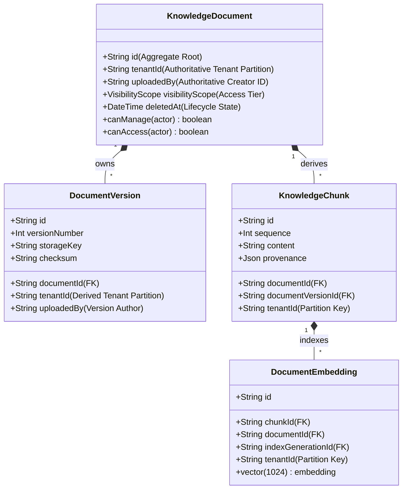

# AI-10.2-02 — Document Ownership and Tenant Isolation Policy

**Status:** Approved & Formally Adopted  
**Date:** November 27, 2026  
**Roles:** Principal Domain Architect & Application Security Architect  
**Related Documents:**

- [ADR-AI-10-004: Document Ownership and Tenant Isolation Boundary](file:///c:/Projects/kinergy-platform/docs/ai/AI-10-ADRS/ADR-AI-10-004-document-ownership-and-tenant-isolation-boundary.md)
- [AI-10.2-READINESS-AUDIT.md](file:///c:/Projects/kinergy-platform/docs/ai/AI-10/AI-10.2-READINESS-AUDIT.md)
- [AI-10.1-AUTHORIZATION-POLICY.md](file:///c:/Projects/kinergy-platform/docs/ai/AI-10/AI-10.1-AUTHORIZATION-POLICY.md)
- [ADR-AI-10-001: Resource-Level Conversation Authorization and BOLA Defense](file:///c:/Projects/kinergy-platform/docs/ai/AI-10-ADRS/ADR-AI-10-001-resource-level-conversation-authorization-and-bola-defense.md)

---

## 1. Executive Summary & Policy Objective

This policy establishes the authoritative document ownership, tenant isolation, and derived knowledge artifact lifecycle rules for Kynergy Intelligence.

### Core Architecture Principles

1. **Organizational Knowledge Assets:** Unlike private conversations (which are creator-private), knowledge documents are organizational clinical and operational assets scoped to a tenant and partitioned by role-based visibility scopes (`ALL_STAFF`, `TRAINER_ONLY`, `THERAPIST_ONLY`, `MANAGEMENT`).
2. **Authoritative Source of Ownership:** Document ownership is defined exclusively by the tuple `(tenantId, uploadedBy)` on the parent `KnowledgeDocument` aggregate root.
3. **Derived Artifact Inheritance:** Chunks (`KnowledgeChunk`) and vectors (`DocumentEmbedding`) are strictly derived artifacts. They possess no independent authorization lifecycle and inherit their access rules, visibility constraints, and deletion status directly from their parent `KnowledgeDocument`.
4. **Physical Tenant Partitioning:** To secure both single-clinic deployments and future multi-tenant SaaS environments, every document, version, chunk, embedding, and background job must be physically traceable to a verified `tenantId` at the database engine level.

---

## 2. Authoritative Document Ownership Model



### 2.1 The Document Owner

- **Authoritative Creator:** The user identified by `KnowledgeDocument.uploadedBy` is the original document owner.
- **Management Clearance:** Document modification, metadata edits, soft-deletion, and ingestion retries are permitted ONLY to:
  1. The original uploader (`actor.actorId === doc.uploadedBy`), OR
  2. Users holding the administrative permission `ai.documents.manage`, OR
  3. Users holding administrative roles (`Owner` or `Admin`).
- **Tenant Scope Requirement:** Even administrative managers can only manage documents within their own validated `tenantId`. Cross-tenant management is strictly impossible.

### 2.2 Ownership Rules for Document Versions

- A `DocumentVersion` is an immutable snapshot of document content at a specific point in time.
- `DocumentVersion.uploadedBy` records the author of that specific version (who may differ from the original document creator if an administrator uploads an updated version).
- Authorization for a version is derived entirely from the parent `KnowledgeDocument.visibilityScope` and `KnowledgeDocument.tenantId`.
- Versions cannot have independent visibility scopes or access policies.

### 2.3 Chunk and Vector Inheritance

- Chunks and vectors do NOT possess independent access control policies.
- Every chunk and vector record references its parent `documentId`.
- Any authorization check on a chunk or vector must resolve against the parent `KnowledgeDocument`:
  - If `KnowledgeDocument.deletedAt IS NOT NULL`, all derived chunks and vectors are immediately excluded from retrieval, previews, and citations.
  - If `KnowledgeDocument.visibilityScope` changes, the change immediately takes effect across all derived chunks and vectors without requiring re-indexing or database updates on chunk rows.

---

## 3. Current Single-Tenant Deployment & Future Multi-Tenant Boundary

### 3.1 Current Single-Tenant Deployment Model

In single-clinic on-premises or dedicated cloud deployments:

- All users belong to a default tenant identifier (e.g. `tenant_clinic_default`).
- **Internal Role Isolation:** Even within a single tenant, documents are NOT globally visible to all staff. Role-based isolation remains enforced:
  - `MANAGEMENT` documents are invisible to Trainers and Therapists.
  - `THERAPIST_ONLY` documents are invisible to Trainers and Receptionists.
  - `TRAINER_ONLY` documents are invisible to Therapists and Receptionists.
- **Anti-Enumeration Invariant:** Probing unauthorized documents returns `404 Not Found` rather than `403 Forbidden` to prevent role-based existence discovery.

### 3.2 Future Multi-Tenant SaaS Assumptions & Boundary

When deployed in multi-tenant mode:

- **Tenant Identity Source:** The validated JWT token signed by `JWT_SECRET` contains the authoritative `tenantId` claim. Client headers (e.g. `X-Tenant-ID`) or request body properties are ignored.
- **Database Partitioning Invariant:** Every table storing document data (`knowledge_documents`, `document_versions`, `knowledge_chunks`, `document_embeddings`, `ingestion_jobs`) must possess a `tenant_id` column.
- **Referential Integrity Constraint:** Foreign keys linking child entities to parents must enforce composite foreign keys on `(id, tenant_id)` to prevent cross-tenant data corruption at the database engine level.
- **No Cross-Tenant Membership Switching:** A user session is strictly bound to a single tenant for the duration of the JWT token. Tenant switching requires re-authenticating and generating a new token.

---

## 4. Comprehensive Document Access Matrix

| Operation               | HTTP Endpoint                                                        | Required RBAC Permission     | Resource Policy Rule                                                                       | Unauth / Breach Response |
| :---------------------- | :------------------------------------------------------------------- | :--------------------------- | :----------------------------------------------------------------------------------------- | :----------------------: |
| **Upload Document**     | `POST /ai/knowledge/documents`                                       | `ai.documents.upload`        | Caller must have clearance for requested `visibilityScope`                                 |        400 / 403         |
| **List Documents**      | `GET /ai/knowledge/documents`                                        | `ai.knowledge.query`         | Filters by `actor.tenantId` and `visibilityScope IN (actorScopes)`                         |      200 (Filtered)      |
| **Get Document Detail** | `GET /ai/knowledge/documents/:id`                                    | `ai.knowledge.query`         | `doc.tenantId === actor.tenantId` AND clearance for `visibilityScope`                      |      404 Not Found       |
| **Preview Metadata**    | `GET /ai/knowledge/documents/:id/preview-metadata`                   | `ai.knowledge.query`         | `doc.tenantId === actor.tenantId` AND clearance for `visibilityScope`                      |      404 Not Found       |
| **Update Metadata**     | `PATCH /ai/knowledge/documents/:id`                                  | `ai.documents.manage`        | `doc.tenantId === actor.tenantId` AND (`uploadedBy === actor.id` OR Admin)                 |        403 / 404         |
| **Soft Delete**         | `DELETE /ai/knowledge/documents/:id`                                 | `ai.documents.manage`        | `doc.tenantId === actor.tenantId` AND (`uploadedBy === actor.id` OR Admin)                 |        403 / 404         |
| **Restore Document**    | `POST /ai/knowledge/documents/:id/restore`                           | `ai.documents.manage`        | `doc.tenantId === actor.tenantId` AND Admin role                                           |        403 / 404         |
| **Retry Ingestion**     | `POST /ai/knowledge/documents/:id/retry`                             | `ai.documents.manage`        | `doc.tenantId === actor.tenantId` AND (`uploadedBy === actor.id` OR Admin)                 |        403 / 404         |
| **Semantic Retrieval**  | `POST /ai/rag/query`                                                 | `ai.knowledge.query`         | `doc.tenantId === actor.tenantId` AND `doc.deletedAt IS NULL` AND `scope IN (actorScopes)` |      200 (Filtered)      |
| **Citation Detail**     | `GET /ai/conversations/:id/messages/:msgId/citations/:citId`         | `ai.conversations.create`    | Conversation creator check AND document visibility clearance                               |      404 Not Found       |
| **Citation Preview**    | `GET /ai/conversations/:id/messages/:msgId/citations/:citId/preview` | `ai.conversations.create`    | Full chain: conversation ➔ message ➔ citation ➔ document ➔ clearance                       |      404 Not Found       |
| **Content Stream**      | `GET /ai/conversations/:id/messages/:msgId/citations/:citId/content` | Ephemeral HMAC or Bearer JWT | Timing-safe HMAC verification OR Bearer clearance check                                    |     401 / 403 / 404      |

---

## 5. Chunk & Vector Provenance Policy

1. **Originating Lineage:**
   - Every `KnowledgeChunk` must reference a valid `documentId` and `documentVersionId`.
   - Every `DocumentEmbedding` must reference a valid `chunkId`, `documentId`, `documentVersionId`, and `indexGenerationId`.
2. **Deterministic Cryptographic Fingerprints:**
   - Each chunk calculates a SHA-256 `checksum` over its normalized text content.
   - Each embedding calculates a SHA-256 `contentFingerprint` over its vector payload and profile ID.
3. **No Standalone Vector Exposure:**
   - Vector records (`document_embeddings`) must never be queryable or exposed through public APIs directly.
   - Vectors are internal search index artifacts accessible only via `ISemanticRetrievalPort` implementations.
4. **Tenant-Scoped Vector Deletion:**
   - When a document is soft-deleted, vectors are excluded immediately via `kd.deleted_at IS NULL`.
   - When vectors are physically cleaned up, `IVectorStorePort.deleteByDocumentId` must require both `(tenantId, documentId)`.

---

## 6. Versioning and Lifecycle Rules

```
[Document Ingestion Lifecycle]
  UPLOADED ──> VALIDATING ──> PROCESSING ──> INDEXING ──> READY
      │              │              │            │
      ▼              ▼              ▼            ▼
   FAILED         FAILED         FAILED       FAILED
      │
      └──> Admin Retry (retryJob) ──> Re-enters VALIDATING (max 3 attempts)
```

1. **Immutability of Historical Versions:**
   - Once a `DocumentVersion` is indexed, its text content, storage key, file size, and checksum are permanently immutable.
   - Updating a document creates a new `DocumentVersion` (incrementing `versionNumber`).
2. **Current Version Pointer:**
   - `KnowledgeDocument.currentVersionId` points to the active version.
   - Retrieval queries join `document_versions` matching the current active index generation.
3. **Soft-Deletion vs Hard Deletion:**
   - Soft-delete: Immediately sets `deletedAt = now()`. The document and its versions, chunks, and vectors remain stored for compliance and audit recovery.
   - Hard deletion: Handled exclusively by automated administrative storage cleanup jobs (Milestone AI-10.3).
4. **Ingestion Job Checkpoints:**
   - At each transition (`VALIDATING`, `PROCESSING`, `INDEXING`), the worker validates that the parent document still exists, has not been soft-deleted, and belongs to the job's tenant.

---

## 7. Mandatory Authorization & Metadata Invariants

- **INV-DOC-01 (Strict Multi-Tenant Scoping):** No document, chunk, vector, or ingestion job shall exist without a validated `tenantId`.
- **INV-DOC-02 (Zero Client Trust):** Identity attributes (`uploadedBy`, `tenantId`, `roles`, `permissions`) in client request bodies are unconditionally ignored and overridden by JWT claims.
- **INV-DOC-03 (Inherited Chunk Clearance):** Chunks and vectors possess no independent access policies; their clearance is governed dynamically by the parent `KnowledgeDocument.visibilityScope`.
- **INV-DOC-04 (Fail-Closed Retrieval Filter):** If an actor possesses 0 authorized visibility scopes, the retrieval pipeline fails closed immediately without querying the database.
- **INV-DOC-05 (Zero Existence Leakage):** Cross-tenant document lookups, peer conversation lookups, and out-of-scope document queries return generic `404 Not Found`.
- **INV-DOC-06 (Anti-BOLA Worker Verification):** Background queue handlers assert `job.tenantId === payload.tenantId` against database persistence before processing.

---

## 8. Migration Implications for AI-10.2

To implement this policy without disrupting active services:

1. **Schema Migration:**
   - Add `tenant_id` to `document_embeddings` and `document_versions`.
   - Backfill existing rows from parent `knowledge_documents`.
   - Add `@@unique([id, tenantId])` on `knowledge_documents`.
   - Update child foreign keys to composite references `(documentId, tenantId)`.
2. **PostgreSQL Row-Level Security (RLS):**
   - Enable RLS on `knowledge_documents`, `document_versions`, `knowledge_chunks`, and `document_embeddings`.
   - Apply tenant isolation policy: `USING (tenant_id = current_setting('app.current_tenant_id', true))`.
3. **Vector Repository Port Refactoring:**
   - Update `IVectorStorePort.deleteByDocumentId` and vector insertion routines to accept and enforce `tenantId`.

---

## 9. Explicit Decisions to Avoid Unnecessary Complexity

1. **No Separate "Tenant" Table Created in AI-10.2:** The logical `tenantId` string matches the existing IAM design. Creating a new master tenant entity belongs to platform IAM milestones, not AI-10.2.
2. **No Per-Chunk Visibility Overrides:** Chunks inherit scope from the document. Allowing individual chunks within a single document to have different visibility scopes would create unmaintainable document authoring complexity.
3. **No Distributed Multi-Tenant Index Partitioning in pgvector:** Rather than creating dynamic PostgreSQL schemas per tenant (which complicates connection pooling), multi-tenant isolation in pgvector will be enforced via composite tenant indices and PostgreSQL RLS.
