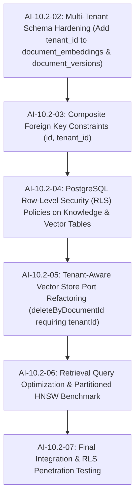

# AI-10.2-01 — Document Authorization and Tenant Isolation Readiness Audit

**Status:** Completed & Accepted  
**Readiness Verdict:** **READY WITH RISKS**  
**Date:** November 27, 2026  
**Auditor / Roles:** Principal Application Security Architect & Senior Backend Engineer  
**Scope:** Document, Document Version, Chunk, Embedding, Index Generation, Vector Persistence (pgvector), and Retrieval Pipelines  
**Baseline Inputs:**

- [AI-10-SECURITY-ASSESSMENT.md](file:///c:/Projects/kinergy-platform/docs/ai/AI-10/AI-10-SECURITY-ASSESSMENT.md)
- [AI-10-SECURITY-GAP-REPORT.md](file:///c:/Projects/kinergy-platform/docs/ai/AI-10/AI-10-SECURITY-GAP-REPORT.md)
- [AI-10-REMEDIATION-PLAN.md](file:///c:/Projects/kinergy-platform/docs/ai/AI-10/AI-10-REMEDIATION-PLAN.md)
- [AI-10.1-AUTHORIZATION-POLICY.md](file:///c:/Projects/kinergy-platform/docs/ai/AI-10/AI-10.1-AUTHORIZATION-POLICY.md)
- [AI-10.1-SECURITY-TEST-REPORT.md](file:///c:/Projects/kinergy-platform/docs/ai/AI-10/AI-10.1-SECURITY-TEST-REPORT.md)
- [AI-10.1-FINAL-ACCEPTANCE.md](file:///c:/Projects/kinergy-platform/docs/ai/AI-10/AI-10.1-FINAL-ACCEPTANCE.md)

---

## 1. Executive Summary

Milestone **AI-10.2-01** conducts a verification-first readiness audit of the Kynergy Intelligence document, chunk, embedding, and vector persistence layer to determine the exact requirements, technical prerequisites, and architectural risks for implementing **AI-10.2 (Document Authorization and Database Engine Multi-Tenancy)**.

### Audit Verdict: **READY WITH RISKS**

The system is ready to implement AI-10.2. While application-level and API-level tenant controls are currently robust following the completion of AI-10.1, the database persistence tier currently lacks physical tenant constraints, lacks tenant identifiers on key vector tables, has zero native PostgreSQL Row-Level Security (RLS), and executes vector similarity searches using a global, unpartitioned HNSW index.

### Primary Audit Discoveries:

1. **Logical Multi-Tenancy without Master Tenant Table:** `tenantId` is an unconstrained string across business tables; no relational `tenants` or `organizations` table exists in PostgreSQL.
2. **Missing `tenant_id` on Vectors and Versions:** Neither `document_embeddings` nor `document_versions` contains a `tenant_id` column. Tenant filtering relies exclusively on relational `JOIN` operations across 5 tables (`document_embeddings` ➔ `index_generations`, `knowledge_documents`, `document_versions`, `knowledge_chunks`).
3. **No Database-Enforced Cross-Table Tenant Integrity:** `knowledge_chunks` has `tenant_id`, but its foreign key to `knowledge_documents` references only `document_id` (not `(document_id, tenant_id)`). The database engine does not prevent mismatched tenant associations between parent documents and child chunks.
4. **Global Unpartitioned HNSW Vector Index:** The pgvector index `idx_document_embeddings_hnsw` is created globally on `document_embeddings("embedding")`. Similarity queries perform post-filtering via SQL `JOIN` clauses, creating performance degradation risks at scale and candidate graph exhaustion.
5. **Zero Row-Level Security (RLS) in PostgreSQL:** Zero RLS policies exist in any Prisma migration or PostgreSQL table.

---

## 2. Current Ownership & Tenant Architecture

```mermaid
classDiagram
    class User {
        +String id (PK)
        +String email
        +String tenantId (Nullable)
        +String roleId
    }
    class KnowledgeDocument {
        +String id (PK)
        +String tenantId
        +String uploadedBy
        +VisibilityScope visibilityScope
        +DateTime deletedAt (Nullable)
    }
    class DocumentVersion {
        +String id (PK)
        +String documentId (FK)
        +String uploadedBy
        +String checksum
        +String storageKey
        (LACKS tenantId)
    }
    class KnowledgeChunk {
        +String id (PK)
        +String tenantId
        +String documentId (FK)
        +String documentVersionId (FK)
        +String content
        +Json metadata
    }
    class IndexGeneration {
        +String id (PK)
        +String tenantId
        +Int generationNumber
        +IndexGenerationStatus status
    }
    class DocumentEmbedding {
        +String id (PK)
        +String chunkId (FK)
        +String documentId (FK)
        +String documentVersionId (FK)
        +String indexGenerationId (FK)
        +vector(1024) embedding
        (LACKS tenantId)
    }

    KnowledgeDocument "1" <--> "*" DocumentVersion : documentId
    KnowledgeDocument "1" <--> "*" KnowledgeChunk : documentId
    DocumentVersion "1" <--> "*" KnowledgeChunk : documentVersionId
    KnowledgeChunk "1" <--> "*" DocumentEmbedding : chunkId
    KnowledgeDocument "1" <--> "*" DocumentEmbedding : documentId
    IndexGeneration "1" <--> "*" DocumentEmbedding : indexGenerationId
```

### Analysis of Ownership & Scoping:

- **Deployment Topology:** The application is deployed in a **shared-database, shared-schema, logically multi-tenant architecture**.
- **Document Ownership Invariants:**
  - `KnowledgeDocument.tenantId`: Authoritative tenant partition.
  - `KnowledgeDocument.uploadedBy`: Holds the `userId` of the creator.
  - `KnowledgeDocument.visibilityScope`: Authoritative access tier (`ALL_STAFF`, `TRAINER_ONLY`, `THERAPIST_ONLY`, `MANAGEMENT`).
- **Inconsistencies & Anomalies Identified:**
  - `DocumentVersion.uploadedBy`: Tracks the author of subsequent versions. If User B updates a document created by User A, version 2 reflects User B's identity, while the parent document aggregate remains bound to User A.
  - `KnowledgeChunk` and `DocumentEmbedding` do not store `visibilityScope` or `uploadedBy`. They rely on `KnowledgeDocument` for authorization.
  - While AI-09.3 introduced composite unique constraints on `ai_conversations` (`@@unique([id, tenantId])`) and composite foreign keys on child tables, `knowledge_documents` only has single-column primary keys (`id`), allowing child tables to omit `tenant_id` from foreign key references.

---

## 3. Document-to-Chunk-to-Vector Data Flow

```
[POST /api/v1/ai/knowledge/documents] (Upload Request)
         │
         ├─ 1. Identity & Scope Extraction (JWT Claims)
         ├─ 2. Storage Upload: s3://bucket/tenants/{tenantId}/knowledge_base/{timestamp}/{fileName}
         ├─ 3. Atomic DB Write:
         │      * KnowledgeDocument (tenantId, uploadedBy, visibilityScope)
         │      * DocumentVersion (storageKey, checksum, uploadedBy) [NO tenantId]
         │      * IngestionJob (tenantId, documentId, documentVersionId, status=UPLOADED)
         │
         ▼
[IngestionOrchestratorService / Background Worker]
         │
         ├─ 4. Anti-BOLA Verification: Asserts DB job.tenantId === payload.tenantId
         ├─ 5. Document State Verification: Asserts doc.deletedAt IS NULL
         ├─ 6. DocumentProcessingPipelineService: Parses text, chunks into KnowledgeChunk objects
         ├─ 7. PrismaKnowledgeChunkRepository.saveChunks:
         │      * Inserts into "knowledge_chunks" (tenantId, documentId, documentVersionId, sequence)
         │
         ▼
[VectorIndexingOrchestratorService]
         │
         ├─ 8. Embedding Generation: Ollama / provider computes 1024-dimension float vector
         └─ 9. Raw SQL Bulk Insertion:
                INSERT INTO "document_embeddings" (
                  id, chunk_id, document_id, document_version_id,
                  index_generation_id, profile_id, dimensions,
                  embedding, content_fingerprint, created_at
                ) VALUES (...)
                [CRITICAL: tenant_id is NOT populated into document_embeddings]
```

---

## 4. Schema & Referential-Integrity Inventory

| Model / Table          | Primary Key | Tenant Column | Foreign Keys                                                            | Constraints & Indices                                                              | Assessment                                                                                 |
| :--------------------- | :---------- | :-----------: | :---------------------------------------------------------------------- | :--------------------------------------------------------------------------------- | :----------------------------------------------------------------------------------------- |
| `knowledge_documents`  | `id` (UUID) |  `tenant_id`  | None                                                                    | Index on `tenant_id`, `(tenant_id, visibilityScope)`, `(tenant_id, deletedAt)`     | **VERIFIED** Application partitioned; lacks composite `(id, tenantId)` PK/UQ.              |
| `document_versions`    | `id` (UUID) |   **NONE**    | `document_id` ➔ `knowledge_documents(id)`                               | Unique on `(document_id, version_number)`, `(document_id, checksum)`               | **VERIFIED** Missing `tenant_id` column; cannot be directly scoped without join.           |
| `ingestion_jobs`       | `id` (UUID) |  `tenant_id`  | `document_id`, `document_version_id`                                    | Index on `(tenant_id, status)`, `next_retry_at`                                    | **VERIFIED** Properly partitioned; FKs lack composite tenant constraint.                   |
| `knowledge_chunks`     | `id` (UUID) |  `tenant_id`  | `document_id`, `document_version_id`                                    | Unique on `(document_version_id, sequence)`, Index on `tenant_id`                  | **VERIFIED** Has `tenant_id`, but FK does not enforce `chunk.tenant_id === doc.tenant_id`. |
| `embedding_profiles`   | `id` (UUID) |   **NONE**    | None                                                                    | Unique on `profile_id`                                                             | **VERIFIED** System-wide configuration table (legitimately global).                        |
| `index_generations`    | `id` (UUID) |  `tenant_id`  | `profile_id` ➔ `embedding_profiles`                                     | Unique on `(tenant_id, generation_number)`, Index on `tenant_id`                   | **VERIFIED** Properly partitioned by tenant and generation number.                         |
| `document_embeddings`  | `id` (UUID) |   **NONE**    | `chunk_id`, `document_id`, `document_version_id`, `index_generation_id` | Unique on `(chunk_id, index_generation_id)`, CHECK `dimensions = 1024`, HNSW index | **VERIFIED** Lacks `tenant_id`; global unpartitioned HNSW index.                           |
| `vector_indexing_jobs` | `id` (UUID) |  `tenant_id`  | `generation_id` ➔ `index_generations`                                   | Index on `tenant_id`, `status`                                                     | **VERIFIED** Properly partitioned by tenant.                                               |

---

## 5. Vector Persistence & Retrieval Analysis

### Vector Engine & Index Mechanics:

- **Engine:** PostgreSQL 16+ with `pgvector` extension (`vector(1024)` data type).
- **Metric:** Cosine Distance (`vector_cosine_ops`, operator `<=>`).
- **Index:** `idx_document_embeddings_hnsw` (`USING hnsw ("embedding" vector_cosine_ops)`).
- **Retrieval Query Structure (`PrismaSemanticRetrievalRepository`):**
  ```sql
  SELECT de.id, de.chunk_id, 1 - (de.embedding <=> $1::vector) AS similarity, ...
  FROM "document_embeddings" de
  JOIN "index_generations" ig ON ig."id" = de."index_generation_id"
  JOIN "knowledge_documents" kd ON kd."id" = de."document_id"
  JOIN "document_versions" dv ON dv."id" = de."document_version_id"
  JOIN "knowledge_chunks" kc ON kc."id" = de."chunk_id"
  WHERE ig."tenant_id" = $2
    AND kd."tenant_id" = $2
    AND kc."tenant_id" = $2
    AND kd."deleted_at" IS NULL
    AND kd."visibility_scope"::text IN ($3, ...)
  ORDER BY (de."embedding" <=> $1::vector) ASC, de."id" ASC
  LIMIT $topK;
  ```

### Critical Vector Security Findings:

1. **Candidate Selection & Post-Filtering Risk (PARTIALLY VERIFIED):**
   - In pgvector, an HNSW index on `embedding` traverses the global nearest-neighbor graph.
   - When WHERE predicates are attached to joined tables (`kd.tenant_id = $2`), pgvector applies filters _during or after_ index traversal (iterative scan).
   - If a tenant represents a small percentage of total vectors, traversal limits (`hnsw.ef_search`) can be reached before `topK` matching chunks for that specific tenant are discovered, returning fewer results or degraded relevance.
2. **Missing `tenant_id` on Vectors (VERIFIED):**
   - Because `document_embeddings` lacks `tenant_id`, direct SQL queries or bulk maintenance scripts (such as `VectorCleanupService.deleteByDocumentId(documentId)`) operate without tenant constraints.
3. **Absence of PostgreSQL RLS (VERIFIED):**
   - If an application defect or accidental raw query queries `document_embeddings` without joins, PostgreSQL engine allows all rows to be read.

---

## 6. Metadata Propagation Analysis

| Metadata Attribute   | Source Record       |       Chunks Copy?       |     Vectors Copy?     | Update Anomaly Risk                                                                                       |
| :------------------- | :------------------ | :----------------------: | :-------------------: | :-------------------------------------------------------------------------------------------------------- |
| `tenantId`           | `KnowledgeDocument` | **Yes** (`kc.tenant_id`) |        **No**         | Medium (mismatch possible if raw SQL bypasses mapper)                                                     |
| `visibilityScope`    | `KnowledgeDocument` |          **No**          |        **No**         | **Low (Clean)**: Scope changes on `KnowledgeDocument` take effect immediately without re-indexing chunks. |
| `deletedAt`          | `KnowledgeDocument` |          **No**          |        **No**         | **Low (Clean)**: Soft-deletion immediately excludes all chunks and vectors via SQL join.                  |
| `uploadedBy`         | `KnowledgeDocument` |          **No**          |        **No**         | Low: Uploader identity is permanently referenced to parent document.                                      |
| `contentFingerprint` | Extracted Text      |   `checksum` (SHA-256)   | `content_fingerprint` | Low: Deduplication and tamper detection verified.                                                         |

---

## 7. Version, Citation, and Preview Access Analysis

1. **Document Versions:**
   - Versions are strictly immutable (`DocumentVersion` records are never updated after creation).
   - `DocumentVersion` lacks `tenant_id`; resolving a version by `versionId` requires a join or parent document lookup.
2. **Citations:**
   - Stored in `ai_conversation_citations` with composite foreign key to `ai_conversation_messages` (`fields: [messageId, turnId, conversationId, tenantId]`).
   - Stores `documentId`, `documentVersionId`, `chunkId`, and `documentTitleSnapshot`.
3. **Previews:**
   - `GET /api/v1/ai/conversations/:id/messages/:msgId/citations/:citId/preview` enforces full chain: conversation creator check ➔ message check ➔ citation check ➔ document existence & non-deleted check ➔ role visibility clearance.
   - Ephemeral preview tokens are signed with HMAC-SHA256, binding tenant, user, conversation, message, citation, and roles for 5 minutes.

---

## 8. Worker and Concurrency Analysis

1. **Transaction Boundaries:**
   - Chunk parsing and vector indexing use isolated Prisma `$transaction` blocks.
   - Vector persistence uses `INSERT ... ON CONFLICT ("chunk_id", "index_generation_id") DO UPDATE`.
2. **Soft-Delete Races:**
   - If a document is soft-deleted while a worker job is in `PROCESSING` or `INDEXING`, the worker verifies `doc.deletedAt IS NULL` at each status transition and terminates immediately if deleted (`DOCUMENT_NOT_FOUND`).
3. **Ingestion Retries:**
   - `IngestionRecoveryWorker` safely reclaims stalled jobs without re-creating documents. Exponential backoff and maximum 3 attempts are enforced.

---

## 9. Verified Vulnerabilities & Security Gaps Register

| Finding ID      | Title                                          | Classification | Impact | Root Cause & Mitigation Scope for AI-10.2                                                                                                |
| :-------------- | :--------------------------------------------- | :------------: | :----: | :--------------------------------------------------------------------------------------------------------------------------------------- |
| **GAP-10.2-01** | `document_embeddings` lacks `tenant_id`        |  **VERIFIED**  |  High  | Prevents native RLS and partitioned indexing; must add column and populate via migration.                                                |
| **GAP-10.2-02** | `document_versions` lacks `tenant_id`          |  **VERIFIED**  | Medium | Direct version lookups lack physical tenant scoping; must add column and foreign key constraint.                                         |
| **GAP-10.2-03** | Lack of Composite Tenant FKs in Knowledge Base |  **VERIFIED**  |  High  | `knowledge_chunks` can theoretically be inserted with mismatched `tenant_id`; must enforce composite `(id, tenant_id)` FKs.              |
| **GAP-10.2-04** | Global Unpartitioned HNSW Index                |  **VERIFIED**  | Medium | Potential multi-tenant candidate dilution and index traversal degradation; evaluate partial indices or tenant partitioning.              |
| **GAP-10.2-05** | No PostgreSQL Row-Level Security (RLS)         |  **VERIFIED**  |  High  | Zero defense-in-depth if application filters are omitted; must implement PostgreSQL RLS policies with `SET LOCAL app.current_tenant_id`. |
| **GAP-10.2-06** | Vector Deletion without Tenant Predicate       |  **VERIFIED**  | Medium | `deleteByDocumentId` deletes vectors solely by `document_id`; must require `(tenant_id, document_id)`.                                   |

---

## 10. Recommended Implementation Sequence for AI-10.2

To address the identified gaps without service disruption, the following sequential implementation is recommended:



1. **Step 1: Schema Migration (Additive):**
   - Add `tenant_id TEXT` to `document_embeddings` and `document_versions`.
   - Backfill existing rows from `knowledge_documents`.
   - Mark `tenant_id NOT NULL`.
2. **Step 2: Composite Constraints:**
   - Add `@@unique([id, tenantId])` on `knowledge_documents`.
   - Alter foreign keys in `document_versions`, `knowledge_chunks`, and `document_embeddings` to reference `(document_id, tenant_id)`.
3. **Step 3: PostgreSQL Native Row-Level Security (RLS):**
   - Enable RLS on `knowledge_documents`, `document_versions`, `knowledge_chunks`, `document_embeddings`, and `index_generations`.
   - Create security policies: `CREATE POLICY tenant_isolation_policy ON ... USING (tenant_id = current_setting('app.current_tenant_id', true))`.
4. **Step 4: Vector Repository Refactoring:**
   - Update `IVectorStorePort` and vector indexing services to pass `tenantId` into `document_embeddings` insertions and deletions.
5. **Step 5: Adversarial RLS Regression Testing:**
   - Validate that raw SQL queries without `tenant_id` fail closed or return 0 rows when RLS session variable is set.

---

## 11. Final Readiness Verdict

# **VERDICT: READY WITH RISKS**

The Kynergy AI subsystem is fully ready to transition into **AI-10.2**. Core application authorization invariants are solid, but database schema additions (`tenant_id` on vectors and versions), composite foreign keys, and PostgreSQL RLS policies are essential to achieve defense-in-depth data isolation.
