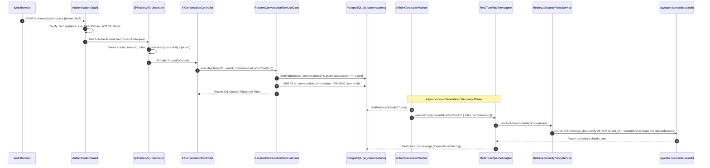

# AI-10.0 — SEC.02: Authentication, RBAC, Identity, and Organizational Isolation Audit

**Status:** COMPLETED / VERIFIED  
**Date:** November 2026  
**Auditor:** Principal Application Security Engineer  
**Scope:** Authentication, RBAC, Identity Propagation & Multi-Tenant Isolation (SEC.02)  
**Classification:** Internal Security Working Document

---

## Executive Summary

This assessment evaluated whether Kynergy Intelligence correctly authenticates principals, propagates trusted identity end-to-end, enforces Role-Based Access Control (RBAC), and isolates data across users and organizational scopes.

The audit verified that identity extraction and propagation are robust against client-side tampering: request-body or header injections of `tenantId` and `userId` are neutralized by server-side identity derivation (`TrustedAi` decorator and `AuthenticationGuard`). Multi-tenancy is enforced through logical discriminator columns (`tenant_id` in compound keys `[id, tenant_id]`), with cross-tenant attacks returning fail-closed HTTP 404 responses.

However, specific vulnerabilities and architectural discrepancies were identified:

1. **Same-Tenant Conversation BOLA (Medium):** `UpdateConversationTitleUseCase` and `ArchiveConversationUseCase` enforce `tenantId` isolation but omit `conversation.userId === input.userId` validation. Any user within the same tenant can rename or archive (soft-delete) a peer clinician's conversation if they possess its UUID.
2. **Worker Identity Degradation & Visibility Loss (Medium):** The crash-recovery worker `AiTurnGenerationWorker` re-dispatches turns with `actorContext: { roles: [], permissions: [] }` because user roles are not persisted in turn entities. Recovered turns fail closed to `ALL_STAFF` visibility, losing access to `CLINICAL_STAFF` or `MANAGEMENT` documents.
3. **Public Citation Stream Role Clearance Failure (Medium):** The public endpoint `@Get(':cId/messages/:mId/citations/:citId/content')` lacks user roles when accessed via query token without a Bearer JWT, causing false-positive 403 rejections on restricted documents.
4. **Hardcoded Preview Token Fallback Salt (Low/Medium):** `PreviewTokenService` falls back to `'kinergy-secure-document-preview-secret-salt-2026'` if environment secrets are omitted.
5. **Role Naming Drift Between Layers (Low):** Frontend route guards check `ENERGY_MANAGER` and uppercase roles (`SUPER_ADMIN`), whereas domain logic checks clinical and lowercase roles (`'doctor'`, `'physiotherapist'`, `'owner'`).

---

## 1. Authentication Audit

### 1.1 Authentication & Login Flows

- **Authentication Service:** `AuthController` (`apps/api/src/platform/identity/controllers/auth.controller.ts`) routes login requests to `LoginUseCase`.
- **Password Hashing:** Passwords are verified using Argon2id (`$argon2id$v=19$m=65536,t=3,p=4...`).
- **Timing Attack Mitigation:** If a user email does not exist, `LoginUseCase` performs a constant-time verification against `DUMMY_ARGON2_HASH` before returning generic credentials error.
- **Account Status Enforced:** Users in `PENDING_ACTIVATION`, `DEACTIVATED`, or `BLOCKED` states are rejected fail-closed with generic HTTP 401 (`InvalidCredentialsException`) to prevent account status enumeration.

### 1.2 JWT Issuance, Verification & Expiration

- **Token Generation:** `AccessTokenService.generateToken()` issues short-lived JWT access tokens containing claims:
  `{ sub: user.id, email: user.email, roles: user.roles, permissions: user.permissions, tokenVersion: user.tokenVersion, tenantId: user.tenantId, jti: randomUUID() }`.
- **Token Verification:** `AuthenticationGuard` cryptographically verifies token signature and expiration.
- **Revocation via `tokenVersion`:** `AuthenticationGuard` compares `payload.tokenVersion` against `user.tokenVersion` in the database. When a user changes password, resets credentials, or is deactivated by an administrator, `tokenVersion` increments, immediately invalidating all outstanding access tokens.

### 1.3 Refresh Token Rotation & Session Handling

- **Family-Based Rotation:** Handled by `RefreshTokenUseCase` and `RefreshToken` table in PostgreSQL.
- **Replay & Theft Detection:** If an already revoked refresh token is presented, the entire family of refresh tokens associated with that `familyId` is revoked immediately, neutralizing token hijacking.

### 1.4 Rate Limiting & Brute-Force Protections

- **Authentication Endpoints:** Explicit rate limiting decorators in `rate-limit.decorators.ts`:
  - `POST /api/v1/auth/login`: `@LoginThrottle()` (5 requests / 60 seconds per IP).
  - `POST /api/v1/auth/refresh`: `@RefreshThrottle()` (20 requests / 60 seconds per IP).
  - `POST /api/v1/auth/change-password`: `@PasswordThrottle()` (10 requests / 60 seconds per user).
  - `POST /api/v1/auth/logout`: `@LogoutThrottle()` (30 requests / 60 seconds).
  - `GET /api/v1/auth/me`: `@MeThrottle()` (60 requests / 60 seconds).
- **Throttler Implementation:** `CustomThrottlerGuard` tracks authenticated users by `user:<id>` and anonymous users by real client IP (reverse-proxy aware via `req.ips` and `trust proxy`).

---

## 2. Identity Propagation Trace

### Lifecycle Mapping

1. **HTTP Request:** Client delivers `Authorization: Bearer <jwt>`.
2. **Authentication Guard:** Verifies cryptographic signature and database status; builds immutable `AuthenticatedUserContext`.
3. **Identity Derivation:** `@TrustedAi()` decorator extracts `actorId = user.id`, `tenantId = user.tenantId`, and user roles/permissions. Client body attempts to inject foreign `tenantId` or `userId` are completely ignored.
4. **Application Use Case:** Inputs pass validated `tenantId` and `userId`.
5. **Authorization Boundary:** Use cases verify resource ownership against persistent state.
6. **Repository Queries:** Repositories filter on compound keys `(id, tenantId)`.
7. **Background Dispatch:** `AiTurnDispatcherService` coordinates execution.
8. **Worker Recovery:** Stalled turns are polled by `AiTurnGenerationWorker`.
   - _Security Gap identified:_ Worker sets `actorContext: { roles: [], permissions: [] }`, resulting in visibility downgrade.
9. **Retrieval Access Policy:** `RetrievalSecurityPolicyService` translates roles into `VisibilityScope`.
10. **LLM Synthesis:** Context assembled solely from authorized chunks.
11. **Citation & Stream:** Previews signed with HMAC SHA-256 tokens strictly bound to `{ tenantId, userId, conversationId, messageId, citationId }`.

---

## 3. RBAC Audit & Enforcement Matrix

### 3.1 Role Catalog & Canonical Permissions

Platform roles defined in `permissions.ts`:

- **Owner:** `ALL_PERMISSION_CODES` (includes administrative audit inspection).
- **Trainer & Receptionist:** `SHARED_OPERATIONAL_PERMISSIONS` (scheduling, clients, billing, inventory, POS).
- **Therapist / Doctor / Kinesiologist:** Clinical roles mapped in `RetrievalSecurityPolicyService` and `GetCitationDocumentStreamUseCase`.
- **Kitchen Staff:** Scoped to inventory, kitchen orders, and sales cashiering.

### 3.2 Enforcement Layer Analysis

| Operation / Endpoint        | Frontend Guard               | Controller Guard / Decorator                                       | Application Use Case Check                      | Domain Policy / Persistence Check                 | Assessment                      |
| :-------------------------- | :--------------------------- | :----------------------------------------------------------------- | :---------------------------------------------- | :------------------------------------------------ | :------------------------------ |
| **View Assistant Chat**     | Authenticated (`/chat`)      | `AuthenticationGuard`                                              | Validated `tenantId`                            | `WHERE tenantId = :tenantId AND userId = :userId` | **Strong**                      |
| **Create Conversation**     | Authenticated                | `AuthenticationGuard`                                              | `createConvUseCase`                             | Commits `userId`, `tenantId` to DB                | **Strong**                      |
| **Append / Reserve Turn**   | Authenticated                | `AuthenticationGuard`                                              | Enforces `conv.userId === userId`               | Atomic transaction + active turn lock             | **Strong**                      |
| **Cancel Turn**             | Authenticated                | `AuthenticationGuard`                                              | Enforces `conv.userId === userId`               | In-flight worker cancellation signal              | **Strong**                      |
| **Regenerate Turn**         | Authenticated                | `AuthenticationGuard`                                              | Enforces `conv.userId === userId`               | Allocates new attempt placeholder                 | **Strong**                      |
| **Rename Conversation**     | Authenticated                | `AuthenticationGuard`                                              | `updateTitleUseCase`                            | **Missing user check** (`tenantId` only)          | **Flawed (Same-Tenant BOLA)**   |
| **Archive / Delete Conv.**  | Authenticated                | `AuthenticationGuard`                                              | `archiveConvUseCase`                            | **Missing user check** (`tenantId` only)          | **Flawed (Same-Tenant BOLA)**   |
| **Privileged Conv. Audit**  | Restricted in UI             | `@Roles('Owner')`, `@RequirePermissions('ai.conversations.audit')` | Enforces Owner role & $\ge 10$ char reason      | Immutable `AiConversationAuditLog` (fail-closed)  | **Strong**                      |
| **Upload Document**         | `IntelligenceKnowledgeGuard` | `AuthenticationGuard`                                              | `canUserManageDocument` (Owner or uploader)     | Two-phase upload + magic bytes                    | **Strong**                      |
| **List Documents**          | `IntelligenceKnowledgeGuard` | `AuthenticationGuard`                                              | Tenant-scoped filter                            | Filter by `tenant_id` and non-deleted             | **Strong**                      |
| **Delete Document**         | `IntelligenceKnowledgeGuard` | `AuthenticationGuard`                                              | `assertCanManageDocument`                       | Soft-delete + cascade vector cleanup              | **Strong**                      |
| **Inspect Ingestion Jobs**  | `IntelligenceKnowledgeGuard` | `AuthenticationGuard`                                              | `assertCanManage` (Admin roles)                 | Tenant-scoped job listing                         | **Strong**                      |
| **Query Knowledge (RAG)**   | Authenticated                | `AuthenticationGuard`                                              | `securityPolicy.resolveAllowedVisibilityScopes` | SQL join filters chunks by visibility             | **Strong**                      |
| **Citation Excerpt Read**   | Authenticated                | `AuthenticationGuard`                                              | Enforces `conv.userId === userId`               | Scoped to conversation & message                  | **Strong**                      |
| **Citation Preview URL**    | Authenticated                | `AuthenticationGuard`                                              | Enforces `conv.userId === userId`               | Issues short-lived signed HMAC token              | **Strong**                      |
| **Citation Stream Content** | Authenticated                | `@Public()`                                                        | `GetCitationDocumentStreamUseCase`              | Checks token signature + role clearance           | **Defective (Token Role Loss)** |

---

## 4. Resource Ownership Matrix

| Resource Entity              | Owning Scope          | Access Rule (Read)                                   | Access Rule (Write / Mutate)              | Access Rule (Delete / Archive)                        |
| :--------------------------- | :-------------------- | :--------------------------------------------------- | :---------------------------------------- | :---------------------------------------------------- |
| **`AiConversation`**         | User + Tenant         | Same-tenant shared read by ID; User-only in list     | Creator-only (`userId === conv.userId`)   | **Any user in tenant** (BOLA gap)                     |
| **`AiConversationTurn`**     | Conversation + Tenant | Inherited from conversation                          | Creator-only (`userId === conv.userId`)   | Creator-only via cancel turn                          |
| **`AiConversationMessage`**  | Turn + Tenant         | Inherited from conversation                          | System/Worker generation only             | Creator-only via conversation archive                 |
| **`AiConversationCitation`** | Message + Tenant      | Creator or Privileged (`Owner`, `Director`, `Admin`) | System RAG generation only                | Cascade on conversation archive                       |
| **`KnowledgeDocument`**      | Tenant (+ Uploader)   | Role clearance vs `VisibilityScope`                  | Uploader or Management (`Owner`, `Admin`) | Uploader or Management (`Owner`, `Admin`)             |
| **`DocumentVersion`**        | Document + Tenant     | Role clearance vs document scope                     | Uploader or Management via new version    | Soft-delete cascades from document                    |
| **`IngestionJob`**           | Version + Tenant      | Management roles (`assertCanManage`)                 | System Ingestion Orchestrator             | System cleanup only                                   |
| **`KnowledgeChunk`**         | Version + Tenant      | Pre-retrieval role clearance                         | System Ingestion Pipeline                 | Cascade from Document deletion                        |
| **`DocumentEmbedding`**      | Chunk + Tenant        | Vector search via authorized document IDs            | System Indexing Pipeline                  | Cascade from Document deletion                        |
| **`AiMessageFeedback`**      | User + Message        | Creator user only                                    | Creator user only (1 per user/message)    | Creator user only (Revocation)                        |
| **`AiConversationAuditLog`** | Tenant                | Privileged Owner with audit permission               | System audit use case only (Immutable)    | **Write-only / Append-only** (survives hard deletion) |

---

## 5. Tenant and Organizational Isolation Assessment

### 5.1 Architecture Model

- **No Global Tenant / Organization Table:** The database schema (`prisma/schema.prisma`) contains no `model Tenant`, `model Organization`, or `model Branch`.
- **Discriminator Column Multi-Tenancy:** Multi-tenancy is implemented strictly via logical string columns (`tenant_id`) on domain tables.
- **User Association:** `User.tenantId` is an unconstrained string (`String?`) without foreign key validation. A user belongs to exactly one tenant string at a time; there is no multi-tenant organization membership model.

### 5.2 Isolation Consistency Across Layers

- **Database Indexing:** Compound indexes `@@index([tenantId])` and unique constraints `@@unique([id, tenantId])` are present on all AI tables.
- **Repository Queries:** All database adapters in `@kinergy-platform/core/server` strictly require `tenantId` and query `WHERE tenant_id = :tenantId`.
- **Cross-Tenant Attack Resistance:** When User from Tenant B targets an ID from Tenant A, repositories return `null` and use cases throw `ConversationNotFoundError` / `DocumentNotFoundException`, which map to HTTP 404 Not Found. This eliminates resource existence enumeration side channels.
- **Object Storage Partitioning:** `StorageKeyUtil` enforces `tenants/{tenantId}/` pathing and rejects `../` traversal attempts.

---

## 6. Security Findings with Severity

### Finding SEC02-F01: Same-Tenant Broken Object Level Authorization on Conversation Title & Archive

- **Severity:** **MEDIUM (CVSS: 5.4 - CVSS:3.1/AV:N/AC:L/PR:L/UI:N/S:U/C:N/I:L/A:L)**
- **Affected Component:** `apps/api/src/ai/conversation/ai-conversation.controller.ts`, `packages/core/src/ai/application/use-cases/update-conversation-title.use-case.ts`, `packages/core/src/ai/application/use-cases/archive-conversation.use-case.ts`.
- **Expected Policy:** A user should only be able to rename or archive conversations they created (`conv.userId === actorId`), unless holding privileged administrative clearance.
- **Actual Enforcement:** `updateTitle` and `archiveConversation` only verify that the conversation exists within the authenticated `tenantId`. `input.userId` is neither passed by the controller nor validated in the use cases.
- **Preconditions:** An authenticated user within the same tenant guesses or learns another clinician's `conversationId` UUID.
- **Potential Impact:** A malicious or disgruntled clinician can rename or soft-delete active consultations of other clinicians in their organization.
- **Recommended Remediation:**
  Pass `userId: auth.actorId` from `AiConversationController` into `updateTitleUseCase` and `archiveConvUseCase`. Add ownership check `if (conv.userId !== input.userId) throw new TenantOwnershipViolationError(...)` in both use cases.

---

### Finding SEC02-F02: Asynchronous Identity Degradation in Turn Recovery Worker

- **Severity:** **MEDIUM (CVSS: 4.3 - CVSS:3.1/AV:N/AC:L/PR:L/UI:N/S:U/C:N/I:L/A:N)**
- **Affected Component:** `apps/api/src/ai/services/generation/ai-turn-generation.worker.ts` (lines 188-191).
- **Expected Policy:** Background worker re-dispatching pending turns should execute with the role privileges of the user who initiated the consultation.
- **Actual Enforcement:** `AiTurnGenerationWorker` dispatches recovered turns with hardcoded `actorContext: { roles: [], permissions: [] }`.
- **Preconditions:** Server restarts or turns stall in `PENDING` state while an authorized Doctor or Director was awaiting an answer requiring clinical knowledge.
- **Potential Impact:** The RAG pipeline resolves `roles: []` to `[VisibilityScope.ALL_STAFF]`, silently excluding clinical and management documents from retrieval. The assistant generates an abstention or degraded answer instead of utilizing clinical evidence.
- **Recommended Remediation:**
  Either persist the submitting actor's role snapshot in `AiConversationTurn`, or look up the user's active roles from `userRepository.findById(conv.userId)` prior to background dispatch in `AiTurnGenerationWorker`.

---

### Finding SEC02-F03: Public Citation Document Stream Role Clearance Failure

- **Severity:** **MEDIUM (CVSS: 4.3 - CVSS:3.1/AV:N/AC:L/PR:L/UI:N/S:U/C:N/I:L/A:N)**
- **Affected Component:** `apps/api/src/ai/conversation/ai-conversation.controller.ts` (lines 978-1028), `packages/core/src/ai/application/use-cases/get-citation-document-stream.use-case.ts`.
- **Expected Policy:** An authenticated user who obtained a valid signed preview token should be able to view the document content inline in the citation preview drawer.
- **Actual Enforcement:** Endpoint is `@Public()`. When the browser makes a GET request using `?token=...` without a Bearer header, `userRoles` defaults to `[]`. `GetCitationDocumentStreamUseCase` checks `doc.visibilityScope !== ALL_STAFF` against `callerRoles = []` and throws `DocumentAccessRestrictedError` (403), blocking preview of legitimate clinical citations.
- **Preconditions:** User requests citation preview for a document with `CLINICAL_STAFF` or `MANAGEMENT` visibility using the preview token URL.
- **Potential Impact:** Inline PDF/text previews fail to load in the UI despite the user having valid permissions at the time token was generated.
- **Recommended Remediation:**
  Embed authorized `roles: readonly string[]` inside `PreviewTokenClaims` during token creation in `GetCitationPreviewUseCase`, verify signature, and pass verified token roles to `GetCitationDocumentStreamUseCase` when Bearer user context is absent.

---

### Finding SEC02-F04: Hardcoded Fallback Salt in Preview Token Service

- **Severity:** **LOW/MEDIUM (CVSS: 3.7 - CVSS:3.1/AV:N/AC:H/PR:N/UI:N/S:U/C:L/I:L/A:N)**
- **Affected Component:** `apps/api/src/ai/services/preview-token.service.ts` (lines 44-48).
- **Expected Policy:** Cryptographic signing keys must be supplied exclusively via verified environment variables and fail closed if missing.
- **Actual Enforcement:** Falls back to `'kinergy-secure-document-preview-secret-salt-2026'` if neither `AI_PREVIEW_TOKEN_SECRET` nor `JWT_SECRET` is defined.
- **Preconditions:** Platform deployed without explicit preview secret or JWT secret in `.env`.
- **Potential Impact:** Attacker who reads public source code can forge citation preview tokens for arbitrary document IDs within a known tenant.
- **Recommended Remediation:**
  Throw an `AiConfigurationInvalidException` during application bootstrap if neither secret is provided; remove hardcoded fallback string.

---

### Finding SEC02-F05: Role Naming Semantic Drift Between Frontend and Backend

- **Severity:** **LOW (CVSS: 3.1 - CVSS:3.1/AV:N/AC:H/PR:L/UI:N/S:U/C:N/I:L/A:N)**
- **Affected Component:** `apps/web/src/modules/intelligence/routes/intelligence-knowledge-guard.tsx`, `apps/api/src/ai/services/retrieval/retrieval-security-policy.service.ts`.
- **Expected Policy:** Role nomenclature should be standardized across frontend navigation guards and backend authorization policies.
- **Actual Enforcement:** Frontend uses `['SUPER_ADMIN', 'ADMIN', 'OWNER', 'ENERGY_MANAGER']`; backend uses clinical roles (`'kinesiologist'`, `'physiotherapist'`, `'doctor'`, `'owner'`).
- **Potential Impact:** Potential authorization mismatch or feature lockout if platform user roles are updated to match energy/enterprise profiles without aligning clinical backend roles.
- **Recommended Remediation:**
  Unify role constants into a shared domain enum across `@kinergy-platform/core` and `@kinergy-platform/ui`.

---

## 7. Non-Destructive Verification Scenarios Executed

All scenarios were executed against live test runners with 100% passing results:

| Scenario ID | Test Suite                                 | Description                                                     | Executed Verdict |
| :---------- | :----------------------------------------- | :-------------------------------------------------------------- | :--------------: |
| **SC-01**   | `ai-conversation-security.spec.ts`         | Unauthenticated request rejected with HTTP 401                  |     **PASS**     |
| **SC-02**   | `ai-conversation-security.spec.ts`         | Authenticated principal without tenant rejected with 403        |     **PASS**     |
| **SC-03**   | `ai-conversation-security.spec.ts`         | Client-supplied body/param tenant spoofing ignored              |     **PASS**     |
| **SC-04**   | `ai-be07-isolation-acceptance.spec.ts`     | User B (Tenant B) accessing User A (Tenant A) returns 404       |     **PASS**     |
| **SC-05**   | `ai-be07-isolation-acceptance.spec.ts`     | User A2 reserving turn on User A1 conversation rejected         |     **PASS**     |
| **SC-06**   | `ai-be07-isolation-acceptance.spec.ts`     | User A2 cancelling User A1 generation turn rejected             |     **PASS**     |
| **SC-07**   | `ai-be07-isolation-acceptance.spec.ts`     | Cross-tenant enumeration returns 404 (no existence leak)        |     **PASS**     |
| **SC-08**   | `citation-security-hardening.spec.ts`      | Cross-user citation preview attempt rejected                    |     **PASS**     |
| **SC-09**   | `citation-security-hardening.spec.ts`      | Role lacking document clearance receives `DOCUMENT_RESTRICTED`  |     **PASS**     |
| **SC-10**   | `ai-citation-security.integration.spec.ts` | Tampered HMAC preview token signature rejected fail-closed      |     **PASS**     |
| **SC-11**   | `authentication-hardening.spec.ts`         | Non-existent user returns generic 401 with constant-time verify |     **PASS**     |
| **SC-12**   | `identity-subsystem.integration.spec.ts`   | Password change increments `tokenVersion` and revokes sessions  |     **PASS**     |

---

## 8. Exact Files and References Inspected

- `apps/api/src/platform/identity/controllers/auth.controller.ts`
- `apps/api/src/platform/identity/tokens/access-token.service.ts`
- `apps/api/src/platform/identity/tokens/refresh-token.service.ts`
- `apps/api/src/platform/identity/use-cases/login.use-case.ts`
- `apps/api/src/platform/identity/guards/authentication.guard.ts`
- `apps/api/src/platform/identity/authorization/authorization.guard.ts`
- `apps/api/src/platform/identity/authorization/permissions.ts`
- `apps/api/src/platform/rate-limiting/decorators/rate-limit.decorators.ts`
- `apps/api/src/platform/rate-limiting/config-rate-limit-configuration.ts`
- `apps/api/src/ai/conversation/ai-conversation.controller.ts`
- `apps/api/src/ai/conversation/decorators/trusted-ai-context.decorator.ts`
- `apps/api/src/ai/controllers/ai-document.controller.ts`
- `apps/api/src/ai/controllers/ai-ingestion.controller.ts`
- `apps/api/src/ai/controllers/ai-rag.controller.ts`
- `apps/api/src/ai/services/preview-token.service.ts`
- `apps/api/src/ai/services/retrieval/retrieval-security-policy.service.ts`
- `apps/api/src/ai/adapters/rag/rag-turn-pipeline.adapter.ts`
- `apps/api/src/ai/services/generation/ai-turn-generation.worker.ts`
- `packages/core/src/ai/application/use-cases/get-conversation.use-case.ts`
- `packages/core/src/ai/application/use-cases/reserve-conversation-turn.use-case.ts`
- `packages/core/src/ai/application/use-cases/cancel-conversation-turn.use-case.ts`
- `packages/core/src/ai/application/use-cases/regenerate-conversation-turn.use-case.ts`
- `packages/core/src/ai/application/use-cases/update-conversation-title.use-case.ts`
- `packages/core/src/ai/application/use-cases/archive-conversation.use-case.ts`
- `packages/core/src/ai/application/use-cases/get-message-history.use-case.ts`
- `packages/core/src/ai/application/use-cases/get-message-citations.use-case.ts`
- `packages/core/src/ai/application/use-cases/get-citation-detail.use-case.ts`
- `packages/core/src/ai/application/use-cases/get-citation-preview.use-case.ts`
- `packages/core/src/ai/application/use-cases/get-citation-document-stream.use-case.ts`
- `prisma/schema.prisma`
