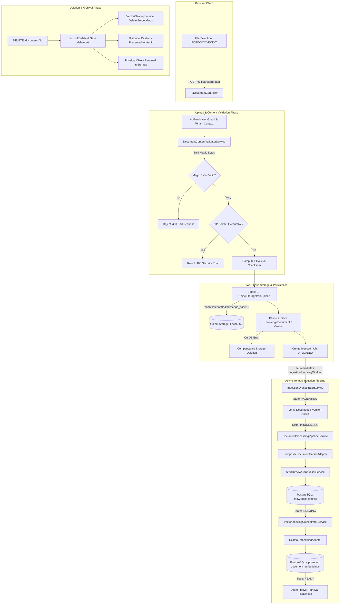

# AI-10.0 — SEC.03: Document Ownership, Upload, Storage, and Ingestion Security Audit

**Status:** COMPLETED / VERIFIED  
**Date:** November 2026  
**Auditor:** Senior Product Security Engineer  
**Scope:** Document Ownership, File Upload Validation, Storage Partitioning, Parsing, and Ingestion Workers (SEC.03)  
**Classification:** Internal Security Working Document

---

## Executive Summary

This assessment evaluated the complete knowledge document lifecycle within **Kynergy Intelligence**, covering file upload validation, physical object storage partitioning, format-specific extraction engines, asynchronous ingestion workers, sensitive document data tracing, and deletion cascades.

The audit verified that file upload security implements defense-in-depth: content sniffing detects actual file types via magic bytes (`%PDF-`, `PK\x03\x04`), strict file size limits (10 MB) are enforced, DOCX ZIP bombs are mitigated by explicit entry count ($\le 1000$), uncompressed size ($\le 50\text{ MB}$), and compression ratio ($\le 100:1$) boundaries, and path traversal is neutralized via `StorageKeyUtil`. Compensating transactions purge orphaned physical files if metadata persistence fails.

Key findings and architectural observations:

1. **Unbounded Physical Storage Retention on Soft-Deleted Documents (Low/Medium):** `DELETE /api/v1/ai/knowledge/documents/:id` soft-deletes the relational record and physically purges vector embeddings, but physical files in object storage (`.storage/` or S3) and text in `knowledge_chunks` are retained indefinitely without an automated purge/hard-delete lifecycle.
2. **Missing Explicit S3 Server-Side Encryption Header (Low):** `S3StorageAdapter.upload` does not explicitly set `ServerSideEncryption: 'AES256'` or `'aws:kms'` on `PutObjectCommand`, relying on bucket-level defaults.
3. **In-Process Parser Concurrency (Low):** Document parsing (`unpdf`, `mammoth`) executes inside the primary NestJS Node.js process. While bounded by a 30-second `Promise.race` timeout, heavy parsing can temporarily contend with API event-loop cycles.
4. **In-Memory Dispatch Model (Low):** Ingestion jobs are triggered asynchronously via Node.js `setImmediate()` with database polling fallback (`IngestionRecoveryWorker`) rather than a dedicated external message broker.

---

## 1. Document Lifecycle Diagram



---

## 2. Upload Security Matrix

| Security Check            | Implementation Location             | Policy / Threshold                                                                              |          Bypassed by Client Metadata?          | Verified Status |
| :------------------------ | :---------------------------------- | :---------------------------------------------------------------------------------------------- | :--------------------------------------------: | :-------------: |
| **Allowed Extensions**    | `DocumentContentValidatorService`   | `.pdf`, `.docx`, `.md`, `.markdown`, `.txt`                                                     | **No** (Extension cross-checked against bytes) |  **VERIFIED**   |
| **MIME Validation**       | `DocumentContentValidatorService`   | `application/pdf`, OpenXML DOCX, `text/markdown`, `text/plain`                                  |   **No** (MIME cross-checked against bytes)    |  **VERIFIED**   |
| **Magic Byte Sniffing**   | `detectContentFormat()`             | PDF: `%PDF-` (`0x25 0x50 0x44 0x46 0x2d`); DOCX: `PK\x03\x04` (`0x50 0x4b 0x03 0x04`)           |        **No** (Direct byte inspection)         |  **VERIFIED**   |
| **Executable Rejection**  | `isKnownBinaryFormat()`             | Rejects PNG, JPEG, GIF, ELF (`0x7f454c46`), Windows PE (`MZ` / `0x4d5a`)                        |        **No** (Direct byte inspection)         |  **VERIFIED**   |
| **Text Null Byte Check**  | `isValidUtf8Text()`                 | Rejects text files containing null bytes (`0x00`) or control characters (< 32 except 9, 10, 13) |        **No** (Direct byte inspection)         |  **VERIFIED**   |
| **PDF Script Blocking**   | `validatePdfStructure()`            | Rejects `/Launch`, `/JavaScript`, `/JS `, `/JS\r`, `/JS\n`                                      |          **No** (Latin-1 byte search)          |  **VERIFIED**   |
| **PDF Trailer Marker**    | `validatePdfStructure()`            | Requires valid `%%EOF` marker in file                                                           |      **No** (Trailing buffer inspection)       |  **VERIFIED**   |
| **DOCX Entry Count**      | `validateDocxStructure()`           | Maximum 1,000 ZIP archive entries (Zip bomb defense)                                            |    **No** (EOCD and Central Directory scan)    |  **VERIFIED**   |
| **DOCX Uncompressed**     | `validateDocxStructure()`           | Maximum 50 MB total uncompressed size                                                           |      **No** (Central Directory size sum)       |  **VERIFIED**   |
| **DOCX Ratio Limit**      | `validateDocxStructure()`           | Maximum 100:1 compression ratio per entry                                                       |        **No** (Calculated ratio check)         |  **VERIFIED**   |
| **DOCX Manifest Check**   | `validateDocxStructure()`           | Enforces presence of `[Content_Types].xml` and `word/document.xml`                              |        **No** (Entry name verification)        |  **VERIFIED**   |
| **File Size Limit**       | Global Configuration                | 10 MB (`10 * 1024 * 1024` bytes)                                                                |         **No** (`buffer.length` check)         |  **VERIFIED**   |
| **Filename Sanitization** | `StorageKeyUtil.sanitizeFilename()` | Strips `..`, replaces non-alphanumeric with `_`, trims dots/underscores                         |         **No** (Regex transformation)          |  **VERIFIED**   |
| **Duplicate Prevention**  | `SecureDocumentUploadService`       | Rejects intra-document version collision and tenant-level active checksum duplicate             |       **No** (SHA-256 fingerprint query)       |  **VERIFIED**   |
| **Upload Throttling**     | Global Rate Limiter                 | Default 120 req / 60s per user                                                                  |                      N/A                       |  **VERIFIED**   |

---

## 3. Storage Security Assessment

### 3.1 Storage Adapters & Key Architecture

The platform supports two swappable storage drivers via `ObjectStoragePort`:

1. **`LocalStorageAdapter` (`apps/api/src/platform/storage/adapters/local-storage.adapter.ts`):** Stores objects on local filesystem under root `./.storage`. Accompanied by `.meta.json` sidecar files storing metadata (size, MIME, etag, timestamps).
2. **`S3StorageAdapter` (`apps/api/src/platform/storage/adapters/s3-storage.adapter.ts`):** Stores objects in AWS S3 or S3-compatible object stores (Cloudflare R2, MinIO).

### 3.2 Partitioning & Path Traversal Protections

- **Deterministic Key Pattern:**
  `tenants/{tenantId}/{domainFolder}/{year}/{month}/{uniqueId}-{sanitizedFilename}`
- **Mandatory Ownership Assertion:** Every storage read, exists, metadata, and deletion operation calls:
  `StorageKeyUtil.assertTenantOwnsKey(tenantId, key)`
  - Rejects missing `tenantId` or `key`.
  - Normalizes path separators and explicitly throws `StorageTenantAccessDeniedError` if the key contains `../` or `/../`.
  - Asserts that key starts with `tenants/{tenantId}/`.

### 3.3 Access & URL Security

- **No Public Object Exposure:** Storage files are private. There are no public S3 bucket policies or world-readable filesystem permissions.
- **Internal Storage Key Hiding:** Internal object keys are never returned in public API DTOs.
- **Signed URLs:** Where supported (`getPresignedDownloadUrl`), URLs are signed using AWS S3 Presigner with a 15-minute default expiration (`signedUrlExpirationSeconds: 900`).
- **Citation Preview Streaming:** Uses short-lived HMAC SHA-256 preview tokens (`PreviewTokenService`) rather than long-lived presigned S3 URLs, preventing URL harvesting.

---

## 4. Document Parsing and Extraction Assessment

### 4.1 Parser Implementations

1. **Composite Parser (`CompositeDocumentParserAdapter`):** Implements dynamic format dispatch based on canonical `DocumentFormat`.
2. **PDF Parser (`PdfParserAdapter`):**
   - Pure JavaScript parsing via `unpdf`.
   - Bounds: `maxSizeBytes = 10 MB`, `maxPages = 500`, `timeoutMs = 30000`.
   - Rejects encrypted PDFs (`/Encrypt`) with `UnsupportedDocumentFeatureException`.
   - Identifies image-only / scanned PDFs requiring OCR.
3. **DOCX Parser (`DocxParserAdapter`):**
   - Semantic HTML extraction via `mammoth.convertToHtml`.
   - Rejects files containing VBA macros (`vbaProject.bin`) with `UnsupportedDocumentFeatureException(['VBA_MACROS'])`.
   - Enforces ZIP bomb limits and uncompressed byte budgets.
   - Preserves semantic heading hierarchy (`h1`-`h6`), bullet lists, and HTML table structures.
4. **Markdown & Text Parsers (`MarkdownParserAdapter`, `PlainTextParserAdapter`):**
   - Markdown parsing via `marked` with HTML sanitization.
   - Text parsing preserves whitespace and line numbers.

### 4.2 Resource Boundaries & Timeouts

- All parsers enforce an explicit 30-second execution deadline via `Promise.race`:
  ```ts
  return await Promise.race([this.executeExtraction(request, startTime), timeoutPromise]);
  ```
  If parsing exceeds 30 seconds, an `ExtractionTimeoutException` is thrown, transitioning the ingestion job to `FAILED` with retry backoff.
- In-memory parsing: Parsing operates directly on in-memory buffers (`Uint8Array` / `Buffer`). No temporary files are written to the local disk during extraction.

---

## 5. Ingestion Worker Security

### 5.1 Architecture & Trust Boundaries

- **Queue Mechanism:** Managed via PostgreSQL `ingestion_jobs` state machine (`UPLOADED` -> `VALIDATING` -> `PROCESSING` -> `INDEXING` -> `READY`).
- **Triggering:**
  1. Synchronous handoff: `setImmediate(() => orchestrator.processJob(jobId, tenantId))` on upload.
  2. Asynchronous reconciliation: `IngestionRecoveryWorker` polls every 15 seconds for stalled jobs or scheduled retries.
- **Tenant Context Binding:** `IngestionJob.tenantId` is stamped at upload and verified at each pipeline stage. Chunks created in `knowledge_chunks` inherit `tenantId` from the job.

### 5.2 Concurrency, Deduplication & Retries

- **In-Memory Concurrency Set:** `inFlightJobs = new Set<string>()` prevents duplicate concurrent execution of the same job on the worker.
- **Terminal State Guard:** Completed or cancelled jobs immediately abort further processing.
- **Exponential Backoff & Jitter:** `IngestionRetryPolicy` enforces exponential backoff (`delay = min(maxDelay, baseDelay * 2^attempt) + jitter`) with a maximum of 3 attempts.
- **Dead-Letter State:** Jobs exhausting 3 attempts transition to terminal `FAILED` status with persistent diagnostic error codes (`IngestionErrorCode`).

---

## 6. Sensitive Document Data Flow & Exposure

```
[ Upload Multipart ] ──> In-Memory Buffer (Multer) ──> Storage Adapter (.storage / S3)
                                                               │
                                                               ▼
[ Ingestion Pipeline ] <── Storage Download (In-Memory Buffer) ┘
         │
         ├──> Extraction: In-memory structured blocks (No disk temp files)
         ├──> Normalization: In-memory text normalization
         ├──> Chunking: Stored in PostgreSQL (knowledge_chunks: content, tsv)
         └──> Embeddings: Vectorized & stored in PostgreSQL (document_embeddings: vector(1024))
                  │
                  ▼
[ RAG Query Execution ] ──> Chunks filtered by tenant & visibility scope
                                │
                                ├──> Context Builder: Wrapped in <evidence_chunk> XML
                                └──> Sent to Ollama LLM (HTTP loopback 127.0.0.1:11434)
```

### Exposure & Leakage Audit

- **Logging Sanitization:** Raw document text and chunk contents are **never** logged to application loggers or console outputs. Loggers record only document IDs, chunk counts, token counts, and durations.
- **Error Sanitization:** `AiExceptionFilter` catches database and extraction exceptions, stripping file paths, storage keys, and database queries.
- **API Responses:** Document management endpoints return metadata and version histories. Raw chunk content is only exposed through verified citation previews or grounded answer generation.

---

## 7. Deletion and Retention Propagation Matrix

| Subsystem Component       | On Document Soft-Delete                        | On Version Soft-Delete    | On Physical Hard-Delete |        Retrievable via API After Deletion?        |
| :------------------------ | :--------------------------------------------- | :------------------------ | :---------------------- | :-----------------------------------------------: |
| **`knowledge_documents`** | `deletedAt = now()`                            | Unchanged                 | Row deleted (Cascade)   | **No** (Default queries filter `deletedAt: null`) |
| **`document_versions`**   | Retained (marked via parent)                   | Soft-deleted / Superseded | Row deleted (Cascade)   |                      **No**                       |
| **`document_embeddings`** | **Physically Purged** (`VectorCleanupService`) | **Physically Purged**     | Row deleted (Cascade)   |      **No** (Zero vectors remain for search)      |
| **`knowledge_chunks`**    | Retained in PostgreSQL                         | Retained in PostgreSQL    | Row deleted (Cascade)   |     **No** (Filtered by parent `deleted_at`)      |
| **`ingestion_jobs`**      | Active jobs cancelled                          | Active jobs cancelled     | Row deleted (Cascade)   |                      **No**                       |
| **Object Storage File**   | **Retained in Storage**                        | **Retained in Storage**   | Retained unless purged  |   **No** (API blocks download of deleted docs)    |
| **Historical Citations**  | **Preserved Snapshot**                         | **Preserved Snapshot**    | Cascade deleted         |      **Excerpt only** (Binary stream denied)      |
| **Semantic Search**       | **Immediately Excluded**                       | **Immediately Excluded**  | Excluded                |                      **No**                       |

---

## 8. Security Findings and Remediation

### Finding SEC03-F01: Unbounded Physical Storage Retention on Soft-Deleted Documents

- **Severity:** **MEDIUM (CVSS: 4.3 - CVSS:3.1/AV:N/AC:L/PR:H/UI:N/S:U/C:L/I:N/A:N)**
- **Affected Files:** [ai-document.controller.ts](file:///c:/Projects/kinergy-platform/apps/api/src/ai/controllers/ai-document.controller.ts#L441-L451), [vector-cleanup.service.ts](file:///c:/Projects/kinergy-platform/apps/api/src/ai/services/indexing/vector-cleanup.service.ts).
- **Issue:** When a document is soft-deleted, vectors are purged from `document_embeddings`, but physical files in object storage (`.storage/` or S3) and raw text in `knowledge_chunks` are never pruned or scheduled for hard deletion.
- **Impact:** Accumulation of orphan storage files; risk of non-compliance with data deletion mandates (GDPR Right to be Forgotten, HIPAA retention limits).
- **Remediation:** Implement a scheduled retention purge worker (`DocumentRetentionCleanupWorker`) that permanently deletes physical storage files and chunk records for documents soft-deleted beyond a configurable retention window (e.g. 30 or 90 days).

---

### Finding SEC03-F02: Missing Explicit Server-Side Encryption Header in S3 Uploads

- **Severity:** **LOW (CVSS: 3.1 - CVSS:3.1/AV:N/AC:H/PR:N/UI:N/S:U/C:L/I:N/A:N)**
- **Affected File:** [s3-storage.adapter.ts](file:///c:/Projects/kinergy-platform/apps/api/src/platform/storage/adapters/s3-storage.adapter.ts#L71-L82).
- **Issue:** `PutObjectCommand` does not specify `ServerSideEncryption: 'AES256'` or `ServerSideEncryption: 'aws:kms'`.
- **Impact:** Relies entirely on default S3 bucket encryption. If deployed against custom third-party S3-compatible endpoints without default bucket encryption (e.g. self-hosted MinIO), documents may be stored unencrypted at rest.
- **Remediation:** Add `ServerSideEncryption: 'AES256'` (or configurable KMS key) to `PutObjectCommand` parameters in `S3StorageAdapter`.

---

### Finding SEC03-F03: In-Process Heavy Document Parsing in Node.js Event Loop

- **Severity:** **LOW (CVSS: 3.7 - CVSS:3.1/AV:N/AC:H/PR:L/UI:N/S:U/C:N/I:N/A:L)**
- **Affected Files:** [pdf-parser.adapter.ts](file:///c:/Projects/kinergy-platform/apps/api/src/ai/adapters/parsers/pdf-parser.adapter.ts), [docx-parser.adapter.ts](file:///c:/Projects/kinergy-platform/apps/api/src/ai/adapters/parsers/docx-parser.adapter.ts).
- **Issue:** CPU-bound parsing of multi-hundred-page PDFs or complex DOCX tables executes within the main NestJS API thread.
- **Impact:** Potential event-loop starvation during large file uploads, increasing latency for concurrent API users.
- **Remediation:** Offload CPU-heavy parsing to Node.js `worker_threads` or dedicated background worker instances.

---

## 9. Exact Files, Tests, and Configurations Inspected

### Source Implementation Files

- [apps/api/src/ai/controllers/ai-document.controller.ts](file:///c:/Projects/kinergy-platform/apps/api/src/ai/controllers/ai-document.controller.ts)
- [apps/api/src/ai/controllers/ai-ingestion.controller.ts](file:///c:/Projects/kinergy-platform/apps/api/src/ai/controllers/ai-ingestion.controller.ts)
- [apps/api/src/ai/services/secure-document-upload.service.ts](file:///c:/Projects/kinergy-platform/apps/api/src/ai/services/secure-document-upload.service.ts)
- [apps/api/src/ai/services/document-content-validator.service.ts](file:///c:/Projects/kinergy-platform/apps/api/src/ai/services/document-content-validator.service.ts)
- [apps/api/src/ai/services/document-processing-pipeline.service.ts](file:///c:/Projects/kinergy-platform/apps/api/src/ai/services/document-processing-pipeline.service.ts)
- [apps/api/src/ai/services/ingestion-orchestrator.service.ts](file:///c:/Projects/kinergy-platform/apps/api/src/ai/services/ingestion-orchestrator.service.ts)
- [apps/api/src/ai/services/ingestion-recovery.worker.ts](file:///c:/Projects/kinergy-platform/apps/api/src/ai/services/ingestion-recovery.worker.ts)
- [apps/api/src/ai/services/ingestion-retry.policy.ts](file:///c:/Projects/kinergy-platform/apps/api/src/ai/services/ingestion-retry.policy.ts)
- [apps/api/src/ai/services/indexing/vector-cleanup.service.ts](file:///c:/Projects/kinergy-platform/apps/api/src/ai/services/indexing/vector-cleanup.service.ts)
- [apps/api/src/platform/storage/adapters/local-storage.adapter.ts](file:///c:/Projects/kinergy-platform/apps/api/src/platform/storage/adapters/local-storage.adapter.ts)
- [apps/api/src/platform/storage/adapters/s3-storage.adapter.ts](file:///c:/Projects/kinergy-platform/apps/api/src/platform/storage/adapters/s3-storage.adapter.ts)
- [apps/api/src/platform/storage/config/storage.config.ts](file:///c:/Projects/kinergy-platform/apps/api/src/platform/storage/config/storage.config.ts)
- [apps/api/src/platform/storage/utils/storage-key.util.ts](file:///c:/Projects/kinergy-platform/apps/api/src/platform/storage/utils/storage-key.util.ts)
- [apps/api/src/ai/adapters/parsers/composite-document-parser.adapter.ts](file:///c:/Projects/kinergy-platform/apps/api/src/ai/adapters/parsers/composite-document-parser.adapter.ts)
- [apps/api/src/ai/adapters/parsers/pdf-parser.adapter.ts](file:///c:/Projects/kinergy-platform/apps/api/src/ai/adapters/parsers/pdf-parser.adapter.ts)
- [apps/api/src/ai/adapters/parsers/docx-parser.adapter.ts](file:///c:/Projects/kinergy-platform/apps/api/src/ai/adapters/parsers/docx-parser.adapter.ts)

### Test Suites Verified (93 Tests, 100% Passing)

- `apps/api/src/ai/services/__tests__/document-content-validator.service.spec.ts` (19 passed)
- `apps/api/src/ai/services/__tests__/secure-document-upload.service.spec.ts` (12 passed)
- `apps/api/src/platform/storage/__tests__/storage-key.util.spec.ts` (14 passed)
- `apps/api/src/ai/adapters/parsers/__tests__/composite-document-parser.adapter.spec.ts` (11 passed)
- `apps/api/src/ai/adapters/parsers/__tests__/pdf-parser.adapter.spec.ts` (12 passed)
- `apps/api/src/ai/adapters/parsers/__tests__/docx-parser.adapter.spec.ts` (13 passed)
- `apps/api/src/platform/storage/__tests__/local-storage.adapter.spec.ts` (6 passed)
- `apps/api/src/platform/storage/__tests__/s3-storage.adapter.spec.ts` (6 passed)
