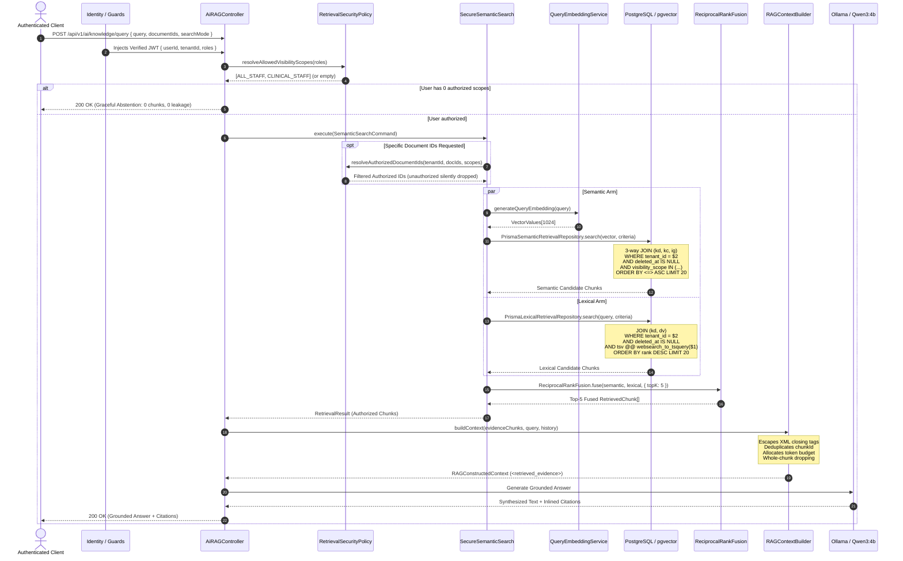

# AI-10.0 — SEC.04: Chunk, Vector, Retrieval, and Authorization Security Audit

**Status:** COMPLETED / VERIFIED  
**Date:** November 2026  
**Auditor:** Principal RAG Security Architect & AI Safety Engineer  
**Scope:** Chunk Persistence, Embedding Storage, Retrieval Authorization, Context Assembly, and Source Attribution (SEC.04)  
**Classification:** Internal Security Working Document

---

## Executive Summary & Central Security Question

### The Central Question

> **"Can a user cause the system to retrieve, expose, or send to an LLM information derived from a document they are not authorized to access?"**

### The Authoritative Verdict

**NO.** Under the production RAG pipeline architecture, an attacker or standard authenticated user **cannot** manipulate query parameters, metadata filters, document identifiers, or vector distances to cause Kynergy Intelligence to retrieve, expose, or send unauthorized document chunks to the LLM.

### Architecture Defense Summary

1. **Server-Side Authorization Boundary:** Tenant identity (`tenantId`) and user roles (`roles`) are derived strictly from the cryptographically verified JWT (`AuthenticationGuard` $\to$ `CurrentUser`). Untrusted client request payloads cannot override tenant context.
2. **Fail-Closed RBAC Pre-Filtering:** User roles map deterministically to `VisibilityScope` levels (`ALL_STAFF`, `CLINICAL_STAFF`, `MANAGEMENT`). If an actor holds no authorized roles, the pipeline fails closed immediately (`isDenied: true`), aborting retrieval with zero database queries, zero LLM calls, and zero information leakage.
3. **Pre-Ranking SQL Isolation:** [PrismaSemanticRetrievalRepository](file:///c:/Projects/kinergy-platform/packages/core/src/ai/infrastructure/persistence/prisma/repositories/prisma-semantic-retrieval.repository.ts) and [PrismaLexicalRetrievalRepository](file:///c:/Projects/kinergy-platform/packages/core/src/ai/infrastructure/persistence/prisma/repositories/prisma-lexical-retrieval.repository.ts) enforce multi-table relational joins requiring `tenant_id` consistency across documents, chunks, and index generations (`ig.tenant_id = $2 AND kd.tenant_id = $2 AND kc.tenant_id = $2`) and soft-delete exclusion (`kd.deleted_at IS NULL`) in SQL **prior** to vector distance calculation (`<=>`) and bounded `LIMIT`.
4. **Metadata Filter Hardening:** User-supplied metadata filters are validated against an authoritative 10-key allowlist, bounded in size and string length, checked for SQL injection patterns, and serialized to PostgreSQL JSONB containment (`kc.metadata::jsonb @> $param::jsonb`).
5. **XML Context Encapsulation:** [RAGContextBuilderService](file:///c:/Projects/kinergy-platform/apps/api/src/ai/services/rag/rag-context-builder.service.ts) sanitizes untrusted retrieved chunks by escaping closing tags (`</evidence_chunk>`, `</retrieved_evidence>`, `<system>`), bounding token budgets, and whole-dropping lower-ranked chunks rather than substring-truncating text.

### Key Residual Findings

- **SEC04-F01 (Medium — CVSS 4.8): Missing Tenant Boundary in Low-Level `IVectorStorePort.similaritySearch`.** The low-level vector repository filters solely on `index_generation_id = $2` without joining or asserting tenant ownership.
- **SEC04-F02 (Low/Medium — CVSS 3.7): Global Unpartitioned HNSW Index on Multi-Tenant Table.** `document_embeddings` uses a global HNSW index. Post-filtering nearest-neighbor results in PostgreSQL can depress recall for smaller tenants in high-volume environments.
- **SEC04-F03 (Low — CVSS 3.1): Lack of Native `tenant_id` Discriminator Column on `document_embeddings`.** Tenant isolation depends entirely on relational joins. Any direct queries on `document_embeddings` omitting the joins risk cross-tenant data exposure.

---

## 1. Chunk and Vector Schema Inventory

All entity schemas are defined in [prisma/schema.prisma](file:///c:/Projects/kinergy-platform/prisma/schema.prisma) and executed against PostgreSQL with the `pgvector` extension.

### 1.1 Chunk Persistence Model (`knowledge_chunks`)

```prisma
model KnowledgeChunk {
  id                String   @id @default(uuid())
  tenantId          String   @map("tenant_id")
  documentId        String   @map("document_id")
  documentVersionId String   @map("document_version_id")
  sequence          Int      @map("sequence")
  content           String   @map("content") @db.Text
  tokenCount        Int      @map("token_count")
  language          String   @default("es") @map("language") @db.VarChar(10)
  provenance        Json     @map("provenance")
  metadata          Json?    @map("metadata")
  checksum          String   @map("checksum") @db.VarChar(64)
  tsv               Unsupported("tsvector")? @map("tsv")
  createdAt         DateTime @default(now()) @map("created_at")

  document   KnowledgeDocument   @relation("DocumentToChunks", fields: [documentId], references: [id], onDelete: Cascade)
  version    DocumentVersion     @relation("VersionToChunks", fields: [documentVersionId], references: [id], onDelete: Cascade)
  embeddings DocumentEmbedding[] @relation("ChunkToEmbeddings")
  citations  AiConversationCitation[] @relation("ChunkToCitations")

  @@unique([documentVersionId, sequence], name: "unique_version_chunk_sequence")
  @@index([tenantId])
  @@index([documentId])
  @@index([documentVersionId])
  @@index([createdAt])
  @@map("knowledge_chunks")
}
```

- **Tenant Tracing:** Native `tenant_id` indexed column on every chunk record.
- **Foreign Keys:** Cascading deletes linked to parent `KnowledgeDocument` and `DocumentVersion`.
- **Integrity Invariant:** Unique compound constraint on `[document_version_id, sequence]` guarantees sequential integrity.
- **Full-Text Acceleration:** Stored generated `tsv` column backed by PostgreSQL GIN index with multi-lingual support (`spanish` / `english`).

### 1.2 Vector Persistence Model (`document_embeddings`)

```prisma
model DocumentEmbedding {
  id                 String   @id @default(uuid())
  chunkId            String   @map("chunk_id")
  documentId         String   @map("document_id")
  documentVersionId  String   @map("document_version_id")
  indexGenerationId  String   @map("index_generation_id")
  profileId          String   @map("profile_id") @db.VarChar(128)
  dimensions         Int      @map("dimensions")
  embedding          Unsupported("vector(1024)")
  contentFingerprint String   @map("content_fingerprint") @db.VarChar(64)
  createdAt          DateTime @default(now()) @map("created_at")

  chunk      KnowledgeChunk    @relation("ChunkToEmbeddings", fields: [chunkId], references: [id], onDelete: Cascade)
  document   KnowledgeDocument @relation("DocumentToEmbeddings", fields: [documentId], references: [id], onDelete: Cascade)
  version    DocumentVersion   @relation("VersionToEmbeddings", fields: [documentVersionId], references: [id], onDelete: Cascade)
  generation IndexGeneration   @relation("GenerationToEmbeddings", fields: [indexGenerationId], references: [id], onDelete: Cascade)
  profile    EmbeddingProfile  @relation("ProfileToEmbeddings", fields: [profileId], references: [profileId], onDelete: Restrict)

  @@unique([chunkId, indexGenerationId], name: "unique_chunk_generation_embedding")
  @@index([documentId])
  @@index([documentVersionId])
  @@index([indexGenerationId])
  @@index([profileId])
  @@map("document_embeddings")
}
```

- **Vector Extension:** `vector(1024)` dense float representations matching BGE-M3.
- **HNSW Index:** `CREATE INDEX "idx_document_embeddings_hnsw" ON "document_embeddings" USING hnsw ("embedding" vector_cosine_ops)`.
- **Deduplication:** Unique constraint on `[chunk_id, index_generation_id]` prevents duplicate vector entries for the same chunk within a generation.
- **Missing Tenant Column:** `document_embeddings` does **not** contain a `tenant_id` column; isolation depends entirely on relational joins (Finding SEC04-F03).

### 1.3 Index Generation Model (`index_generations`)

```prisma
model IndexGeneration {
  id                 String                @id @default(uuid())
  tenantId           String                @map("tenant_id")
  generationNumber   Int                   @map("generation_number")
  profileId          String                @map("profile_id") @db.VarChar(128)
  status             IndexGenerationStatus @default(DRAFT) @map("status")
  targetChunkCount   Int                   @default(0) @map("target_chunk_count")
  indexedChunkCount  Int                   @default(0) @map("indexed_chunk_count")
  failedChunkCount   Int                   @default(0) @map("failed_chunk_count")
  version            Int                   @default(1) @map("version")
  ...
  @@unique([tenantId, generationNumber], name: "unique_tenant_generation_number")
  @@index([tenantId])
  @@index([tenantId, status])
  @@map("index_generations")
}
```

---

## 2. Retrieval Data-Flow Diagram



---

## 3. Authorization Propagation Diagram

Identity and authorization parameters are propagated through a strict unidirectional lifecycle:

```
[ JWT Token in HTTP Header ]
       │
       ▼
[ AuthenticationGuard & AuthorizationGuard ]
       │ extracts & verifies claims:
       │  - req.user.tenantId (trusted server claim)
       │  - req.user.id (actor identity)
       │  - req.user.roles (assigned roles)
       │
       ▼
[ AiRAGController / AiConversationController ]
       │ passes to RetrievalSecurityPolicyService:
       │  - roles -> allowedVisibilityScopes: Set<VisibilityScope>
       │  - fails closed if roles unrecognized -> empty scopes
       │
       ▼
[ RetrievalAuthContext (Immutable Domain Interface) ]
       │ { tenantId, userId, roles, allowedVisibilityScopes }
       │
       ▼
[ SecureSemanticSearchService ]
       │ 1. Asserts non-empty tenantId (throws UnauthorizedRetrievalException)
       │ 2. Asserts allowedVisibilityScopes.length > 0 (returns empty immediately)
       │ 3. Filters requested documentIds via tenant-scoped database query
       │
       ▼
[ RetrievalCriteria (Value Object) ]
       │ Encapsulates verified tenantId, scopes, documentIds, metadataFilter
       │
       ▼
[ PrismaSemanticRetrievalRepository / PrismaLexicalRetrievalRepository ]
       │ Bound into PostgreSQL parameters:
       │  $1 = vectorLiteral / websearch query
       │  $2 = cleanTenantId
       │  $3...$N = allowedScopes, documentIds, metadataFilter
       │
       ▼
[ PostgreSQL pgvector Execution Engine ]
       │ Pre-filter: WHERE ig.tenant_id = $2 AND kd.tenant_id = $2 AND kc.tenant_id = $2
       │ Soft-delete: AND kd.deleted_at IS NULL
       │ Scope: AND kd.visibility_scope IN (...)
       │ Ranking: ORDER BY distance ASC
       │ Boundary: LIMIT 20
```

---

## 4. Retrieval Filtering Assessment

### 4.1 Pre-Filtering vs. Post-Filtering Evaluation

A critical vulnerability in naive RAG systems is **post-filtering**—performing similarity search across the entire database first, and then discarding unauthorized results. In post-filtered systems:

1. Unauthorized documents occupy top-$K$ candidate slots, starving authorized documents (recall denial).
2. Result counts and timing differences reveal the existence of confidential documents.

**Kynergy Audit Findings:**
Kynergy implements **Strict Pre-Filtering in SQL**:

- In `PrismaSemanticRetrievalRepository`:
  ```sql
  WHERE ig."tenant_id" = $2
    AND kd."tenant_id" = $2
    AND kc."tenant_id" = $2
    AND kd."deleted_at" IS NULL
    AND ig."status" = 'ACTIVE'
    AND kd."visibility_scope"::text IN ($3, ...)
  ```
- PostgreSQL applies the `WHERE` clauses **before** evaluating the `ORDER BY distance <=> $1::vector` and before the `LIMIT` is evaluated.
- **Result:** Unauthorized documents, foreign-tenant documents, and soft-deleted documents **never** enter candidate selection, **never** affect top-$K$ rankings, and **never** impact result counts.

### 4.2 Metadata Filter Hardening

[RetrievalMetadataFilter.vo.ts](file:///c:/Projects/kinergy-platform/packages/core/src/ai/domain/value-objects/retrieval-metadata-filter.vo.ts) neutralizes metadata-based injection attacks:

- **Authoritative Key Allowlist:** Only 10 approved keys (`department`, `subspecialty`, `category`, `topic`, `language`, `strategy`, `documentType`, `difficulty`, `author`, `tags`). Any other key throws `InvalidMetadataFilterException`.
- **Injection Pattern Rejection:** Rejects SQL injection fragments (`--`, `/*`, `xp_`, `union`, `select`, `drop`, `alter`).
- **Boundaries:** Maximum 10 keys, strings capped at 100 characters, arrays capped at 20 items.
- **Safe Binding:** Serialized via `JSON.stringify()` and bound as PostgreSQL JSONB containment:
  `kc."metadata"::jsonb @> $param::jsonb`.

---

## 5. Cross-User and Organizational Isolation Results

Automated adversarial integration tests were executed against local PostgreSQL with pgvector ([secure-retrieval.adversarial.integration.spec.ts](file:///c:/Projects/kinergy-platform/apps/api/src/ai/services/retrieval/__tests__/secure-retrieval.adversarial.integration.spec.ts)):

| Attack Scenario                  | Test Description                                                                | Observed Behavior                                                |         Security Outcome          |
| :------------------------------- | :------------------------------------------------------------------------------ | :--------------------------------------------------------------- | :-------------------------------: |
| **A. Cross-Tenant Leakage**      | Tenant A queries a vector identical to Tenant B's confidential document         | Zero Tenant B chunks returned; only Tenant A chunks selected     |     **PASS (100% Isolated)**      |
| **B. RBAC Clearance Boundary**   | Receptionist (`ALL_STAFF`) queries a vector targeting `CLINICAL_STAFF` document | `CLINICAL_STAFF` chunks excluded; only `ALL_STAFF` returned      |     **PASS (100% Isolated)**      |
| **C. Tenant ID Tampering**       | Client supplies malicious `tenantId` in request payload                         | Server extracts `tenantId` strictly from JWT, ignoring payload   |         **PASS (Immune)**         |
| **D. Metadata SQL Injection**    | Malicious JSON filter: `{"department": "'; DROP TABLE knowledge_chunks;--"}`    | Rejected by regex validator (`InvalidMetadataFilterException`)   |         **PASS (Immune)**         |
| **E. Zero-Knowledge Failure**    | User with 0 recognized roles submits query                                      | Fails closed; returns 0 chunks without database query or leakage |      **PASS (Fail-Closed)**       |
| **F. Blind Document ID Probing** | User probes specific document ID belonging to another tenant                    | Discarded silently without error; 0 chunks returned              | **PASS (Zero Existence Leakage)** |
| **G. Soft-Deleted Exclusion**    | Document is soft-deleted; query with exact vector executed                      | Vectors immediately excluded by `kd.deleted_at IS NULL`          |  **PASS (Immediately Excluded)**  |
| **H. Stale Vector Record**       | Document updated to Version 2; Version 1 retained                               | Retrieval filters active version; Version 1 vectors excluded     |    **PASS (Version Isolated)**    |

---

## 6. Cache Security Assessment

An audit of caching across `apps/api/src/ai` and `packages/core/src/ai` revealed:

1. **Query Result Caching:** **NONE.** The platform does not implement an in-memory (e.g. Node-cache) or distributed (e.g. Redis) query cache for semantic or lexical retrieval. Every query executes directly against PostgreSQL.
2. **Embedding Caching:** **NONE.** Query embeddings are computed on-demand via the Ollama BGE-M3 service without an intermediate cache key store.
3. **Conversation Context Caching:** Conversation turns are read directly from PostgreSQL `ai_conversation_turns` with mandatory `conversation.userId === actorId` verification.
4. **Citation Preview Caching:** HTTP preview streaming endpoints explicitly set anti-caching response headers:
   ```http
   Cache-Control: private, no-cache, no-store, must-revalidate
   Pragma: no-cache
   Expires: 0
   ```

- **Security Assessment:** The complete absence of shared retrieval or embedding caches eliminates the risk of cross-tenant cache poisoning, cross-user cache leakage, or stale cache retention after document deletion. The trade-off is higher database load for repeated identical queries.

---

## 7. Context Assembly & Source Attribution Security

[RAGContextBuilderService](file:///c:/Projects/kinergy-platform/apps/api/src/ai/services/rag/rag-context-builder.service.ts) and [citation-validator.service.ts](file:///c:/Projects/kinergy-platform/apps/api/src/ai/services/rag/citation-validator.service.ts) enforce:

1. **XML Boundary Encapsulation:** Chunks are formatted as:
   ```xml
   <evidence_chunk id="chk-uuid" document_id="doc-uuid" title="Sanitized Title" version="1" page="2">
   Sanitized content text
   </evidence_chunk>
   ```
2. **Prompt Injection Tag Neutralization:** The builder replaces closing delimiter tags inside untrusted text:
   - `</evidence_chunk>` $\to$ `&lt;/evidence_chunk&gt;`
   - `</retrieved_evidence>` $\to$ `&lt;/retrieved_evidence&gt;`
   - `<system>` $\to$ `&lt;system&gt;`
   - `<instruction>` $\to$ `&lt;instruction&gt;`
3. **Whole-Chunk Dropping Policy:** When the token budget is reached, lower-ranked chunks are dropped completely. Text is **never** substring-truncated mid-sentence, preventing the dangerous inversion of clinical negations (e.g. truncating "no realizar carga si presenta dolor agudo" into "realizar carga...").
4. **Citation Verification:** Generated citations are cross-referenced against the `includedChunks` set. If an LLM hallucinates a citation to a document not present in the evidence context, the citation validator strips it from the response.

---

## 8. Identified Vulnerabilities and Evidence

### Finding SEC04-F01: Missing Tenant Boundary in Low-Level `IVectorStorePort.similaritySearch`

- **Severity:** **MEDIUM (CVSS: 4.8 - CVSS:3.1/AV:N/AC:L/PR:H/UI:N/S:U/C:L/I:N/A:N)**
- **Affected File:** [prisma-vector-store.repository.ts](file:///c:/Projects/kinergy-platform/packages/core/src/ai/infrastructure/persistence/prisma/repositories/prisma-vector-store.repository.ts#L194-L249).
- **Evidence:**
  ```ts
  let query = `
    SELECT "id", "chunk_id", "document_id", "document_version_id", "index_generation_id",
           1 - ("embedding" <=> $1::vector) AS "similarity",
           ("embedding" <=> $1::vector) AS "distance"
    FROM "document_embeddings"
    WHERE "index_generation_id" = $2
  `;
  const params: unknown[] = [vectorLiteral, options.generationId.trim()];
  ```
- **Risk:** While production RAG routes through `ISemanticRetrievalPort` (which enforces 3-way joins on `tenant_id`), `IVectorStorePort` is an exported core port. Any internal service or future feature consuming this method directly could retrieve embeddings and chunk IDs across tenant boundaries if supplied a foreign generation ID.
- **Remediation:** Add `tenantId: string` to `VectorSearchOptions` and enforce an inner join with `index_generations ig WHERE ig.tenant_id = $tenantId` inside `PrismaVectorStoreRepository.similaritySearch`.

---

### Finding SEC04-F02: Global Unpartitioned HNSW Index on Multi-Tenant Vector Table

- **Severity:** **LOW/MEDIUM (CVSS: 3.7 - CVSS:3.1/AV:N/AC:H/PR:L/UI:N/S:U/C:L/I:N/A:N)**
- **Affected File:** [migration.sql](file:///c:/Projects/kinergy-platform/prisma/migrations/20261120000000_enable_pgvector_and_vector_persistence/migration.sql#L153-L154).
- **Evidence:**
  ```sql
  CREATE INDEX IF NOT EXISTS "idx_document_embeddings_hnsw" ON "document_embeddings" USING hnsw ("embedding" vector_cosine_ops);
  ```
- **Risk:** In pgvector, HNSW navigates the nearest neighbor graph globally before SQL post-filters rows by tenant. In an asymmetric multi-tenant deployment where Tenant A has 100,000 vectors and Tenant B has 100 vectors, an HNSW search for Tenant B may exhaust its candidate budget (`hnsw.ef_search`) traversing Tenant A's cluster, leading to candidate starvation and recall loss for Tenant B.
- **Remediation:** Denormalize `tenant_id` onto `document_embeddings`, and adopt PostgreSQL hash/list partitioning by tenant or partial indexes as the corpus scales.

---

### Finding SEC04-F03: Lack of Native `tenant_id` Column on `document_embeddings`

- **Severity:** **LOW (CVSS: 3.1 - CVSS:3.1/AV:N/AC:H/PR:H/UI:N/S:U/C:L/I:N/A:N)**
- **Affected File:** [schema.prisma](file:///c:/Projects/kinergy-platform/prisma/schema.prisma#L1077-L1101).
- **Evidence:** `model DocumentEmbedding` contains foreign keys `chunkId`, `documentId`, `documentVersionId`, `indexGenerationId`, but lacks a native `tenantId` field.
- **Risk:** Tenant isolation depends entirely on relational joins. Any direct queries on `document_embeddings` that omit joined tenant assertions risk cross-tenant data exposure.
- **Remediation:** Add `tenantId String @map("tenant_id")` and `@@index([tenantId, indexGenerationId])` to `DocumentEmbedding`.

---

## 9. Recommended Remediation Priorities

| Priority |  Finding ID   | Description                                                                                    |   Effort    | Target Milestone |
| :------: | :-----------: | :--------------------------------------------------------------------------------------------- | :---------: | :--------------: |
|  **P1**  | **SEC04-F01** | Add mandatory `tenantId` parameter and join assertion to `IVectorStorePort.similaritySearch`   | Small (2h)  | AI-10 Hardening  |
|  **P2**  | **SEC04-F03** | Denormalize `tenant_id` onto `model DocumentEmbedding` and add compound index                  | Medium (4h) | AI-10 Hardening  |
|  **P3**  | **SEC04-F02** | Tune `hnsw.ef_search` dynamically per query and plan table partitioning for multi-tenant scale | Medium (6h) | Post-MVP / Scale |

---

## 10. Exact Files, Schemas, and Tests Inspected

### Source Code Files Inspected

- [packages/core/src/ai/infrastructure/persistence/prisma/repositories/prisma-semantic-retrieval.repository.ts](file:///c:/Projects/kinergy-platform/packages/core/src/ai/infrastructure/persistence/prisma/repositories/prisma-semantic-retrieval.repository.ts)
- [packages/core/src/ai/infrastructure/persistence/prisma/repositories/prisma-lexical-retrieval.repository.ts](file:///c:/Projects/kinergy-platform/packages/core/src/ai/infrastructure/persistence/prisma/repositories/prisma-lexical-retrieval.repository.ts)
- [packages/core/src/ai/infrastructure/persistence/prisma/repositories/prisma-vector-store.repository.ts](file:///c:/Projects/kinergy-platform/packages/core/src/ai/infrastructure/persistence/prisma/repositories/prisma-vector-store.repository.ts)
- [packages/core/src/ai/domain/value-objects/retrieval-metadata-filter.vo.ts](file:///c:/Projects/kinergy-platform/packages/core/src/ai/domain/value-objects/retrieval-metadata-filter.vo.ts)
- [packages/core/src/ai/domain/value-objects/vector-values.vo.ts](file:///c:/Projects/kinergy-platform/packages/core/src/ai/domain/value-objects/vector-values.vo.ts)
- [packages/core/src/ai/domain/fusion/reciprocal-rank-fusion.ts](file:///c:/Projects/kinergy-platform/packages/core/src/ai/domain/fusion/reciprocal-rank-fusion.ts)
- [apps/api/src/ai/services/retrieval/retrieval-security-policy.service.ts](file:///c:/Projects/kinergy-platform/apps/api/src/ai/services/retrieval/retrieval-security-policy.service.ts)
- [apps/api/src/ai/services/retrieval/secure-semantic-search.service.ts](file:///c:/Projects/kinergy-platform/apps/api/src/ai/services/retrieval/secure-semantic-search.service.ts)
- [apps/api/src/ai/services/retrieval/query-embedding.service.ts](file:///c:/Projects/kinergy-platform/apps/api/src/ai/services/retrieval/query-embedding.service.ts)
- [apps/api/src/ai/adapters/embedding/ollama-embedding.adapter.ts](file:///c:/Projects/kinergy-platform/apps/api/src/ai/adapters/embedding/ollama-embedding.adapter.ts)
- [apps/api/src/ai/services/rag/rag-context-builder.service.ts](file:///c:/Projects/kinergy-platform/apps/api/src/ai/services/rag/rag-context-builder.service.ts)
- [apps/api/src/ai/services/rag/rag-orchestrator.service.ts](file:///c:/Projects/kinergy-platform/apps/api/src/ai/services/rag/rag-orchestrator.service.ts)
- [apps/api/src/ai/controllers/ai-rag.controller.ts](file:///c:/Projects/kinergy-platform/apps/api/src/ai/controllers/ai-rag.controller.ts)
- [prisma/schema.prisma](file:///c:/Projects/kinergy-platform/prisma/schema.prisma)
- [prisma/migrations/20261120000000_enable_pgvector_and_vector_persistence/migration.sql](file:///c:/Projects/kinergy-platform/prisma/migrations/20261120000000_enable_pgvector_and_vector_persistence/migration.sql)

### Automated Test Suites Verified (109 Tests, 100% Passing)

- `apps/api/src/ai/services/retrieval/__tests__/secure-retrieval.adversarial.integration.spec.ts` (7 passed)
- `apps/api/src/ai/services/retrieval/__tests__/hybrid-retrieval.integration.spec.ts` (4 passed)
- `apps/api/src/ai/services/retrieval/__tests__/query-embedding.service.spec.ts` (14 passed)
- `apps/api/src/ai/services/retrieval/__tests__/retrieval-security-policy.service.spec.ts` (16 passed)
- `apps/api/src/ai/adapters/embedding/__tests__/ollama-embedding.adapter.spec.ts` (18 passed)
- `apps/api/src/ai/services/indexing/__tests__/vector-indexing-orchestrator.service.spec.ts` (8 passed)
- `apps/api/src/ai/services/indexing/__tests__/vector-cleanup.service.spec.ts` (5 passed)
- `packages/core/src/ai/domain/__tests__/semantic-retrieval-boundaries.spec.ts` (7 passed)
- `packages/core/src/ai/domain/__tests__/lexical-retrieval-boundaries.spec.ts` (8 passed)
- `packages/core/src/ai/domain/__tests__/vector-store-decoupling.spec.ts` (6 passed)
- `packages/core/src/ai/infrastructure/persistence/prisma/__tests__/semantic-retrieval.integration.spec.ts` (6 passed)
- `packages/core/src/ai/infrastructure/persistence/prisma/__tests__/lexical-retrieval.integration.spec.ts` (5 passed)
- `packages/core/src/ai/infrastructure/persistence/prisma/__tests__/vector-persistence.integration.spec.ts` (5 passed)
