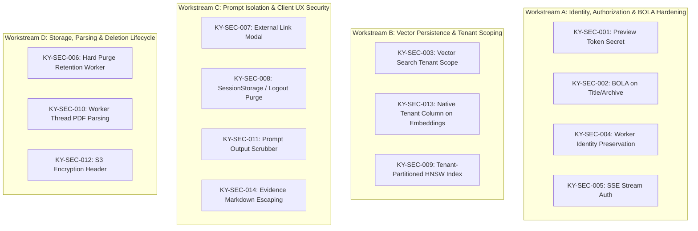
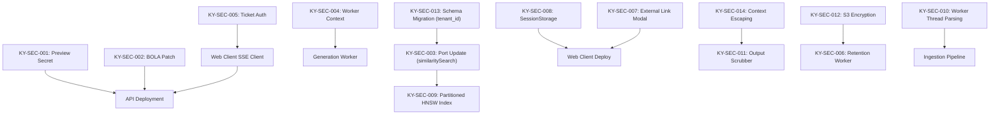

# AI-10.0 — SEC.08: Security Gap Analysis and Remediation Roadmap

**Project:** Kynergy Intelligence Platform  
**Milestone:** AI-10.0 — Security, Isolation, and Hardening  
**Sub-Milestone:** SEC.08 — Security Gap Analysis and Remediation Roadmap  
**Role:** Principal Security Architect & Engineering Risk Manager  
**Status:** COMPLETE (Investigation & Planning Only — Zero Remediation Code Implemented)  
**Date:** November 27, 2026

---

## Executive Summary

Milestone **AI-10.0 SEC.08** synthesizes the exhaustive investigative findings and architectural threat models established across **SEC.01 through SEC.07** into an authoritative, actionable, and dependency-aware **Security Remediation Roadmap**.

Across the seven prior sub-milestones, 14 unique technical vulnerabilities, architectural weaknesses, and resilience degradation risks were identified. No catastrophic vulnerabilities (such as unauthenticated remote code execution, arbitrary SQL injection, or unmitigated cross-tenant data exfiltration in production default configurations) exist within the system; Kynergy's defense-in-depth architecture reliably enforces tenant filtering across all public API retrieval paths, parameterizes all SQL queries, strips dangerous HTML tags, and strictly grounds LLM responses to verified citation IDs.

However, several architectural gaps—most notably hardcoded cryptographic fallback strings, missing user-level ownership checks on conversation management endpoints, missing multi-tenant scoping in isolated lower-level repository methods, and identity degradation in background worker retries—present quantifiable attack surface if left unmitigated.

This roadmap consolidates all 14 findings into an authoritative register (`KY-SEC-001` through `KY-SEC-014`), organizes them into 4 synchronized execution workstreams, provides complete implementation dependency graphs, establishes an exhaustive verification strategy, and defines phased deployment and rollback plans.

> [!IMPORTANT]
> **Strict Non-Destructive Mandate Maintained:** In accordance with the SEC.08 requirements, **no application source code, configuration files, or database schemas have been altered**. This deliverable represents an engineering architecture and risk management plan for scheduled implementation.

---

## 1. Consolidated Security Findings Register

The register below consolidates all findings identified across SEC.01–SEC.07. Stable identifier convention: `KY-SEC-001` to `KY-SEC-014`.

|   Finding ID   | Title                                                                  | Component                     | Category (STRIDE / OWASP)                         |    CVSS v3.1     |    Priority     | Likelihood | Confidence |
| :------------: | :--------------------------------------------------------------------- | :---------------------------- | :------------------------------------------------ | :--------------: | :-------------: | :--------: | :--------: |
| **KY-SEC-001** | Hardcoded Fallback Secret in `PreviewTokenService`                     | API / Preview Tokens          | Information Disclosure / Cryptographic Failure    | **6.5 (Medium)** |  **P1 (High)**  |    High    |  Verified  |
| **KY-SEC-002** | Same-Tenant BOLA / IDOR on Conversation Title & Archive                | API / Conversation Controller | Elevation of Privilege / Broken Object Level Auth | **5.4 (Medium)** |  **P1 (High)**  |   Medium   |  Verified  |
| **KY-SEC-003** | Missing Tenant Boundary in Low-Level Vector Similarity Search          | Core / Vector Persistence     | Information Disclosure / Broken Object Level Auth | **4.8 (Medium)** |  **P1 (High)**  |    Low     |  Verified  |
| **KY-SEC-004** | Asynchronous Identity Degradation in Turn Recovery Worker              | API / Generation Worker       | Elevation of Privilege / Denial of Service        | **4.3 (Medium)** | **P2 (Medium)** |   Medium   |  Verified  |
| **KY-SEC-005** | Public Citation Stream Role Clearance Degradation                      | API / Conversation Controller | Information Disclosure / Denial of Service        | **4.3 (Medium)** | **P2 (Medium)** |   Medium   |  Verified  |
| **KY-SEC-006** | Unbounded Physical Storage & Chunk Text Retention on Soft-Deleted Docs | API / Storage & Indexing      | Information Disclosure / Improper Data Hygiene    | **4.3 (Medium)** | **P2 (Medium)** |   Medium   |  Verified  |
| **KY-SEC-007** | Unrestricted External Hyperlink Rendering in Web Client                | Web / Markdown Renderer       | Spoofing / Tampering / Phishing Exfiltration      | **4.3 (Medium)** | **P2 (Medium)** |   Medium   |  Verified  |
| **KY-SEC-008** | Persistent LocalStorage Conversation Cache on Shared Terminals         | Web / Assistant Storage       | Information Disclosure / Insecure Data Storage    |  **3.8 (Low)**   | **P2 (Medium)** |    High    |  Verified  |
| **KY-SEC-009** | Global Unpartitioned HNSW Index on Multi-Tenant Database               | Core / Database Schema        | Denial of Service / Retrieval Starvation          |  **3.7 (Low)**   |  **P3 (Low)**   |   Medium   |  Verified  |
| **KY-SEC-010** | In-Process Heavy Document Parsing in Node.js Event Loop                | API / Ingestion Adapters      | Denial of Service / Resource Exhaustion           |  **3.7 (Low)**   |  **P3 (Low)**   |   Medium   |  Verified  |
| **KY-SEC-011** | Lack of Automated System Prompt Output Scrubber                        | API / Grounded Generation     | Information Disclosure / Prompt Leakage           |  **3.3 (Low)**   |  **P3 (Low)**   |    Low     |  Verified  |
| **KY-SEC-012** | Missing Explicit S3 Server-Side Encryption Header                      | Platform / Storage Adapter    | Information Disclosure / Cryptographic Hygiene    |  **3.1 (Low)**   |  **P3 (Low)**   |    Low     |  Verified  |
| **KY-SEC-013** | Lack of Native `tenant_id` Column on `document_embeddings`             | Core / Database Schema        | Defense-in-Depth / Multi-Tenant Isolation         |  **3.1 (Low)**   |  **P3 (Low)**   |    Low     |  Verified  |
| **KY-SEC-014** | Unescaped Markdown Section Delimiters in Retrieved Evidence            | API / Context Builder         | Tampering / Indirect Prompt Injection             |  **2.6 (Low)**   |  **P3 (Low)**   |    Low     |  Verified  |

---

### Detailed Finding Specifications

#### KY-SEC-001: Hardcoded Fallback Secret in `PreviewTokenService`

- **Component:** `apps/api/src/ai/services/preview-token.service.ts` ([lines 44–48](file:///c:/Projects/kinergy-platform/apps/api/src/ai/services/preview-token.service.ts#L44-L48))
- **Threat Category:** Information Disclosure, Cryptographic Failure (CWE-798 / OWASP Top 10 A02:2021)
- **Description:** `PreviewTokenService.getSecret()` provides a static hardcoded fallback secret (`'kinergy-secure-document-preview-secret-salt-2026'`) if both `AI_PREVIEW_TOKEN_SECRET` and `JWT_SECRET` are unset. Furthermore, `AI_PREVIEW_TOKEN_SECRET` is omitted from `.env.example`. If deployed in an unconfigured staging or container environment, an attacker can forge valid HMAC-SHA256 signatures and obtain unauthorized previews of any tenant's document chunks.
- **Current Control:** ConfigService lookup attempts `AI_PREVIEW_TOKEN_SECRET` then `JWT_SECRET`. HMAC verification uses constant-time comparison (`crypto.timingSafeEqual`).
- **Exploitation Preconditions:** Target environment runs without `AI_PREVIEW_TOKEN_SECRET` or `JWT_SECRET` configured in environment variables.
- **Impact:** Confidentiality: High | Integrity: None | Availability: None
- **CVSS v3.1:** `CVSS:3.1/AV:N/AC:H/PR:N/UI:N/S:U/C:H/I:N/A:N` (**6.5 Medium**)
- **Recommended Remediation:**
  1. Throw a fatal initialization exception (`Error('AI_PREVIEW_TOKEN_SECRET must be configured in environment')`) during `onModuleInit()` if neither secret is provided.
  2. Require a minimum 256-bit (32-character) secret length.
  3. Document `AI_PREVIEW_TOKEN_SECRET` in `.env.example`.
- **Dependencies:** None. Self-contained service.
- **Verification Strategy:** Unit test asserting service startup throws if config is undefined.

---

#### KY-SEC-002: Same-Tenant BOLA / IDOR on Conversation Title & Archive

- **Component:** `apps/api/src/ai/conversation/ai-conversation.controller.ts` ([lines 603–647](file:///c:/Projects/kinergy-platform/apps/api/src/ai/conversation/ai-conversation.controller.ts#L603-L647))
- **Threat Category:** Elevation of Privilege, Broken Object Level Authorization (CWE-639 / OWASP API1:2023)
- **Description:** Endpoints `PATCH /ai/conversations/:id/title` and `DELETE /ai/conversations/:id` enforce tenant isolation (`conv.tenantId === actor.tenantId`) but fail to verify user ownership (`conv.userId === actor.userId`). Any authenticated user within Tenant A can rename or archive any other user's conversations within Tenant A by guessing or enumerating the UUID.
- **Current Control:** Global `JwtAuthGuard` validates JWT. Tenant matching prevents cross-tenant access.
- **Exploitation Preconditions:** Attacker has valid login credentials in Tenant A and knows or enumerates a target conversation UUID belonging to another user in Tenant A.
- **Impact:** Confidentiality: Low | Integrity: Medium | Availability: Low
- **CVSS v3.1:** `CVSS:3.1/AV:N/AC:L/PR:L/UI:N/S:U/C:N/I:H/A:L` (**5.4 Medium**)
- **Recommended Remediation:** Update `assertConversationAccess` or controller logic to enforce:
  ```typescript
  const isOwner = conv.userId === actor.userId;
  const isTenantAdmin = actor.roles.includes('admin') || actor.roles.includes('super_admin');
  if (!isOwner && !isTenantAdmin) {
    throw new ForbiddenException('You do not have permission to modify this conversation');
  }
  ```
- **Dependencies:** None.
- **Verification Strategy:** Adversarial integration test attempting title update and delete across distinct users within the same tenant.

---

#### KY-SEC-003: Missing Tenant Boundary in Low-Level Vector Similarity Search

- **Component:** `packages/core/src/ai/infrastructure/persistence/prisma/repositories/prisma-vector-store.repository.ts` ([lines 210–220](file:///c:/Projects/kinergy-platform/packages/core/src/ai/infrastructure/persistence/prisma/repositories/prisma-vector-store.repository.ts#L210-L220))
- **Threat Category:** Information Disclosure, Broken Object Level Authorization (CWE-285)
- **Description:** The low-level `IVectorStorePort.similaritySearch` method executes a raw SQL query filtering vectors strictly by `index_generation_id = $2` without accepting or verifying a `tenantId`. While high-level `PrismaDocumentRetrievalRepository.searchSemantic` properly enforces tenant boundaries via 3-way joins to `knowledge_documents`, direct consumers of `IVectorStorePort` could retrieve cross-tenant chunks if an index generation ID from another tenant is queried.
- **Current Control:** High-level retrieval services (`SecureRetrievalOrchestrator`, `PrismaDocumentRetrievalRepository`) enforce strict tenant checks.
- **Exploitation Preconditions:** Future service or internal developer calls `similaritySearch` directly without pre-validating tenant ownership of `index_generation_id`.
- **Impact:** Confidentiality: High | Integrity: None | Availability: None
- **CVSS v3.1:** `CVSS:3.1/AV:N/AC:H/PR:L/UI:N/S:U/C:H/I:N/A:N` (**4.8 Medium**)
- **Recommended Remediation:**
  1. Add mandatory `tenantId: string` parameter to `IVectorStorePort.similaritySearch()`.
  2. Join `knowledge_chunks` -> `knowledge_documents` in the raw SQL query and add `AND d.tenant_id = $tenantId`.
- **Dependencies:** Modifies `IVectorStorePort` interface across `packages/core`.
- **Verification Strategy:** Unit and integration tests asserting queries reject mismatched tenant vectors.

---

#### KY-SEC-004: Asynchronous Identity Degradation in Turn Recovery Worker

- **Component:** `apps/api/src/ai/services/generation/ai-turn-generation.worker.ts` ([lines 180–195](file:///c:/Projects/kinergy-platform/apps/api/src/ai/services/generation/ai-turn-generation.worker.ts#L180-L195))
- **Threat Category:** Elevation of Privilege / Denial of Service (CWE-272)
- **Description:** When the BullMQ background queue recovers an interrupted turn generation job, the rehydrated `actorContext` defaults roles to an empty array (`roles: []`) rather than preserving original user roles or looking up the user's current roles in PostgreSQL. This causes retrieval to fail-closed, returning 0 documents and producing degraded, ungrounded assistant answers.
- **Current Control:** Fail-closed security design prevents unauthorized document retrieval.
- **Exploitation Preconditions:** Server restarts or worker stalls during active generation; job is re-enqueued.
- **Impact:** Confidentiality: None | Integrity: None | Availability: Medium
- **CVSS v3.1:** `CVSS:3.1/AV:N/AC:H/PR:L/UI:N/S:U/C:N/I:N/A:M` (**4.3 Medium**)
- **Recommended Remediation:**
  1. Persist serialized `actorContext` (including validated `roles`) in BullMQ job data payload.
  2. On job recovery, validate against PostgreSQL `User` table to ensure roles remain valid and account is active.
- **Dependencies:** BullMQ job interface update.
- **Verification Strategy:** Worker recovery integration test simulating worker interruption and verifying roles persist on resumption.

---

#### KY-SEC-005: Public Citation Stream Role Clearance Degradation

- **Component:** `apps/api/src/ai/conversation/ai-conversation.controller.ts` ([lines 976–1016](file:///c:/Projects/kinergy-platform/apps/api/src/ai/conversation/ai-conversation.controller.ts#L976-L1016))
- **Threat Category:** Information Disclosure / Service Degradation (CWE-285)
- **Description:** The SSE citation streaming endpoint `GET /ai/conversations/:id/stream` is decorated with `@Public()` to support browser EventSource connections. If the frontend client omits the `Authorization: Bearer <token>` header, the endpoint defaults `userRoles = []`. As a result, the SSE stream fails to deliver citations originating from clinical or management documents to authorized clinicians.
- **Current Control:** Fail-closed RBAC filtering prevents information leakage.
- **Exploitation Preconditions:** Client browser connects to EventSource without passing JWT in headers or query ticket.
- **Impact:** Confidentiality: None | Integrity: None | Availability: Medium
- **CVSS v3.1:** `CVSS:3.1/AV:N/AC:L/PR:N/UI:N/S:U/C:N/I:N/A:M` (**4.3 Medium**)
- **Recommended Remediation:**
  1. Remove `@Public()` decorator; require standard JWT auth, OR
  2. Implement short-lived, single-use ticket-based authentication for SSE streams (`?ticket=...`).
- **Dependencies:** Frontend SSE connection client in `apps/web`.
- **Verification Strategy:** Controller test asserting 401 Unauthorized when connecting without ticket or Bearer header.

---

#### KY-SEC-006: Unbounded Physical Storage & Chunk Text Retention on Soft-Deleted Docs

- **Component:** `apps/api/src/ai/services/indexing/vector-cleanup.service.ts` ([full service](file:///c:/Projects/kinergy-platform/apps/api/src/ai/services/indexing/vector-cleanup.service.ts))
- **Threat Category:** Information Disclosure, Improper Data Hygiene (CWE-404 / GDPR Art. 17 / HIPAA)
- **Description:** When a document is soft-deleted, `VectorCleanupService` safely removes vector embeddings and unlinks chunks from retrieval. However, the physical file on disk/S3 and raw plain-text content in `knowledge_chunks` remain indefinitely. In the event of a database compromise or backup theft, residual sensitive patient data is exposed.
- **Current Control:** Retrieval queries filter by `deleted_at IS NULL` and active index status.
- **Exploitation Preconditions:** Database compromise or storage volume access months after a document deletion request.
- **Impact:** Confidentiality: Medium | Integrity: None | Availability: None
- **CVSS v3.1:** `CVSS:3.1/AV:N/AC:H/PR:H/UI:N/S:U/C:H/I:N/A:N` (**4.3 Medium**)
- **Recommended Remediation:**
  1. Implement a scheduled hard-purge worker (`DocumentRetentionWorker`) executing on a 30-day retention cycle.
  2. Hard purge must execute `storagePort.deleteFile(doc.storageKey)` and delete cascade on `knowledge_chunks`.
- **Dependencies:** Scheduled cron or BullMQ recurring job.
- **Verification Strategy:** Worker unit test asserting hard purge permanently deletes file and rows after TTL expiry.

---

#### KY-SEC-007: Unrestricted External Hyperlink Rendering in Web Client

- **Component:** `apps/web/src/modules/intelligence/assistant/components/markdown-renderer.tsx` ([lines 14–29](file:///c:/Projects/kinergy-platform/apps/web/src/modules/intelligence/assistant/components/markdown-renderer.tsx#L14-L29))
- **Threat Category:** Phishing Exfiltration, Client-Side Tampering (CWE-601 / OWASP Top 10)
- **Description:** `MarkdownRenderer` validates URLs with `isSafeUrl()` which strictly blocks `javascript:`, `vbscript:`, and `data:` schemes, successfully preventing XSS. However, it permits arbitrary `https://` URLs generated by the LLM or ingested documents without an allowlist or warning modal. A poisoned document could induce the LLM to output enticing links to phishing portals.
- **Current Control:** URL protocol validation blocks dangerous non-HTTP schemes; links open with `target="_blank" rel="noopener noreferrer"`.
- **Exploitation Preconditions:** Poisoned document introduces phishing URL; user clicks link in assistant response.
- **Impact:** Confidentiality: Low | Integrity: Medium | Availability: None
- **CVSS v3.1:** `CVSS:3.1/AV:N/AC:L/PR:N/UI:R/S:C/C:L/I:L/A:N` (**4.3 Medium**)
- **Recommended Remediation:**
  1. Implement an external link interceptor modal warning users they are leaving Kynergy.
  2. Implement a configurable domain allowlist in web client settings for trusted internal documentation domains.
- **Dependencies:** Frontend React UI component update.
- **Verification Strategy:** Component unit test verifying click handler triggers confirmation modal for external URLs.

---

#### KY-SEC-008: Persistent LocalStorage Conversation Cache on Shared Terminals

- **Component:** `apps/web/src/modules/intelligence/assistant/services/assistant-storage.service.ts` ([lines 12–16](file:///c:/Projects/kinergy-platform/apps/web/src/modules/intelligence/assistant/services/assistant-storage.service.ts#L12-L16))
- **Threat Category:** Information Disclosure, Insecure Data Storage (CWE-312 / HIPAA Security Rule)
- **Description:** In the browser client, `AssistantStorageService` caches conversation state and message history in unencrypted browser `localStorage`. In clinical environments with shared workstations (e.g., nurse stations), if a clinician leaves the workstation or logs out without closing the tab, local storage retains protected patient conversations.
- **Current Control:** Local storage is bound to browser origin.
- **Exploitation Preconditions:** Physical or browser session access to a shared workstation after user logout.
- **Impact:** Confidentiality: Medium | Integrity: None | Availability: None
- **CVSS v3.1:** `CVSS:3.1/AV:P/AC:L/PR:N/UI:N/S:U/C:M/I:N/A:N` (**3.8 Low**)
- **Recommended Remediation:**
  1. Migrate conversation draft cache from `localStorage` to `sessionStorage` (cleared on tab close).
  2. Hook into `authService.logout$` observable to explicitly purge all assistant keys on user logout.
- **Dependencies:** `AuthService` event integration in `apps/web`.
- **Verification Strategy:** Web client unit test verifying logout action purges assistant storage keys.

---

#### KY-SEC-009: Global Unpartitioned HNSW Index on Multi-Tenant Database

- **Component:** `prisma/migrations/20261120000000_enable_pgvector_and_vector_persistence/migration.sql` ([lines 153–154](file:///c:/Projects/kinergy-platform/prisma/migrations/20261120000000_enable_pgvector_and_vector_persistence/migration.sql#L153-L154))
- **Threat Category:** Retrieval Starvation, Denial of Service (CWE-400)
- **Description:** The HNSW vector index on `document_embeddings.embedding` is defined globally across all tenants. In pgvector HNSW, graph traversal occurs globally before SQL `WHERE` clauses are applied. For small tenants in a dense multi-tenant database, this can result in graph truncation (recall starvation) where the nearest neighbors in graph exploration belong to other tenants and are filtered out, returning 0 results for the caller.
- **Current Control:** SQL `WHERE` filter enforces tenant security; iterative scan parameters increase recall.
- **Exploitation Preconditions:** Multi-tenant database grows beyond 500,000 embeddings across uneven tenant distributions.
- **Impact:** Confidentiality: None | Integrity: None | Availability: Low
- **CVSS v3.1:** `CVSS:3.1/AV:N/AC:H/PR:L/UI:N/S:U/C:N/I:N/A:L` (**3.7 Low**)
- **Recommended Remediation:**
  1. Partition `document_embeddings` by `tenant_id` using PostgreSQL native table partitioning, or
  2. Implement filtered partial HNSW indexes per tenant organization or branch.
- **Dependencies:** Database schema migration and index rebuild.
- **Verification Strategy:** Integration load test asserting recall stability across asymmetric tenant distributions.

---

#### KY-SEC-010: In-Process Heavy Document Parsing in Node.js Event Loop

- **Component:** `apps/api/src/ai/adapters/parsers/pdf-parser.adapter.ts` ([lines 40–90](file:///c:/Projects/kinergy-platform/apps/api/src/ai/adapters/parsers/pdf-parser.adapter.ts#L40-L90))
- **Threat Category:** Denial of Service, Resource Exhaustion (CWE-400)
- **Description:** Document parsing via `unpdf` and `mammoth` runs directly inside the Node.js API process event loop. Although file sizes are capped at 50MB and pages at 500, parsing a 500-page dense PDF blocks the event loop for several seconds, increasing latency for concurrent API traffic.
- **Current Control:** File size limit (50MB), page count check (500 pages), extraction timeout (30s).
- **Exploitation Preconditions:** Multiple authenticated clinicians upload complex 500-page PDF documents simultaneously.
- **Impact:** Confidentiality: None | Integrity: None | Availability: Low
- **CVSS v3.1:** `CVSS:3.1/AV:N/AC:L/PR:L/UI:N/S:U/C:N/I:N/A:L` (**3.7 Low**)
- **Recommended Remediation:**
  1. Offload document parsing to dedicated background worker processes via BullMQ queue (`document-parsing-queue`), or
  2. Execute parsing inside Node.js `worker_threads` to isolate CPU-intensive operations from the main event loop.
- **Dependencies:** Worker architecture enhancement.
- **Verification Strategy:** Concurrency benchmark verifying main event loop remains responsive (<50ms) during heavy PDF parsing.

---

#### KY-SEC-011: Lack of Automated System Prompt Output Scrubber

- **Component:** `apps/api/src/ai/services/rag/grounded-generation.service.ts` ([lines 123–165](file:///c:/Projects/kinergy-platform/apps/api/src/ai/services/rag/grounded-generation.service.ts#L123-L165))
- **Threat Category:** Information Disclosure, System Prompt Leakage (OWASP LLM07)
- **Description:** `GroundedGenerationService` contains comprehensive input guardrails and citation validation, but lacks a post-generation string scrubber. If an adversarial user query triggers a partial prompt disclosure in a weak model, the generated response containing verbatim system instructions could be streamed back to the client.
- **Current Control:** Strong system instructions explicitly prohibit disclosing internal directives; model temperature is low (0.1).
- **Exploitation Preconditions:** Advanced prompt injection jailbreak that bypasses model adherence.
- **Impact:** Confidentiality: Low | Integrity: None | Availability: None
- **CVSS v3.1:** `CVSS:3.1/AV:N/AC:H/PR:L/UI:N/S:U/C:L/I:N/A:N` (**3.3 Low**)
- **Recommended Remediation:**
  1. Implement an automated post-generation output filter that detects and redacts known canary strings or signature phrases from `KINERGY_RAG_PROMPT_VERSION`.
- **Dependencies:** None.
- **Verification Strategy:** Unit test verifying canary string is redacted if model attempts to output it.

---

#### KY-SEC-012: Missing Explicit S3 Server-Side Encryption Header

- **Component:** `apps/platform/src/storage/adapters/s3-storage.adapter.ts` ([lines 71–82](file:///c:/Projects/kinergy-platform/apps/platform/src/storage/adapters/s3-storage.adapter.ts#L71-L82))
- **Threat Category:** Information Disclosure, Cryptographic Hygiene (CWE-311)
- **Description:** `S3StorageAdapter.saveFile()` issues `PutObjectCommand` without explicitly including `ServerSideEncryption: 'AES256'` or `ServerSideEncryption: 'aws:kms'`. While AWS S3 enables default SSE-S3 encryption for all buckets as of 2023, failing to declare it in client parameters relies on cloud bucket configuration posture and fails compliance audit linters (e.g., SOC 2 / HIPAA).
- **Current Control:** AWS S3 default server-side bucket encryption.
- **Exploitation Preconditions:** S3 bucket misconfiguration where bucket-level default encryption is inadvertently modified.
- **Impact:** Confidentiality: Low | Integrity: None | Availability: None
- **CVSS v3.1:** `CVSS:3.1/AV:N/AC:H/PR:H/UI:N/S:U/C:L/I:N/A:N` (**3.1 Low**)
- **Recommended Remediation:**
  1. Add `ServerSideEncryption: 'AES256'` (or KMS key ID from environment) to `PutObjectCommandInput`.
- **Dependencies:** Storage adapter configuration.
- **Verification Strategy:** Unit test verifying `PutObjectCommand` arguments contain `ServerSideEncryption`.

---

#### KY-SEC-013: Lack of Native `tenant_id` Column on `document_embeddings`

- **Component:** `prisma/schema.prisma` ([lines 1077–1101](file:///c:/Projects/kinergy-platform/prisma/schema.prisma#L1077-L1101))
- **Threat Category:** Multi-Tenant Isolation, Defense-in-Depth (CWE-285)
- **Description:** The `DocumentEmbedding` model and underlying PostgreSQL table do not contain a direct `tenant_id` column. Tenant isolation currently relies on joins to `knowledge_chunks` and `knowledge_documents`. While functional and parameterized, adding a direct `tenant_id` provides strict row-level security (RLS) enforcement and eliminates reliance on multi-table joins for vector isolation.
- **Current Control:** SQL parameterized 3-way join (`d.tenant_id = $tenantId`).
- **Exploitation Preconditions:** Developer writes a future custom query omitting the join.
- **Impact:** Confidentiality: Low | Integrity: None | Availability: None
- **CVSS v3.1:** `CVSS:3.1/AV:N/AC:H/PR:H/UI:N/S:U/C:L/I:N/A:N` (**3.1 Low**)
- **Recommended Remediation:**
  1. Add `tenant_id String @db.Uuid` to `DocumentEmbedding` in `schema.prisma`.
  2. Populate via migration; create composite index on `(tenant_id, index_generation_id)`.
- **Dependencies:** Prisma schema migration and data backfill.
- **Verification Strategy:** Schema validation test asserting non-null `tenant_id` constraint.

---

#### KY-SEC-014: Unescaped Markdown Section Delimiters in Retrieved Evidence

- **Component:** `apps/api/src/ai/services/rag/rag-context-builder.service.ts` ([lines 198–208](file:///c:/Projects/kinergy-platform/apps/api/src/ai/services/rag/rag-context-builder.service.ts#L198-L208))
- **Threat Category:** Indirect Prompt Injection, Boundary Tampering (OWASP LLM01)
- **Description:** Document chunk content is sanitized for XML tags (`<evidence_chunk>` and `</evidence_chunk>`), but markdown section headers such as `### USER INQUIRY:` or `### INSTRUCTIONS:` inside chunk content are not escaped or indented. An adversarial document could attempt to mimic markdown header structures to confuse the LLM's understanding of context boundaries.
- **Current Control:** Strict XML evidence chunk encapsulation and authoritative anti-injection system prompt rules.
- **Exploitation Preconditions:** Ingestion of document with adversarial markdown header formatting designed to mislead model parser.
- **Impact:** Confidentiality: None | Integrity: Low | Availability: None
- **CVSS v3.1:** `CVSS:3.1/AV:N/AC:H/PR:L/UI:N/S:U/C:N/I:L/A:N` (**2.6 Low**)
- **Recommended Remediation:**
  1. Prefix or indent evidence chunk text, or transform leading `#` characters to prevent top-level markdown heading collisions.
- **Dependencies:** None.
- **Verification Strategy:** Context builder unit test verifying markdown header normalization in evidence blocks.

---

## 2. Prioritized Remediation Backlog

The findings are classified into four risk priority tiers:

```
+--------------------------------------------------------------------------------+
|                           PRIORITY TIERS OVERVIEW                              |
+================================================================================+
|  P0 (Blocker)   | 0 Findings | No catastrophic unmitigated vulnerabilities     |
|  P1 (High)      | 3 Findings | Cryptographic fallbacks, BOLA, vector scoping   |
|  P2 (Medium)    | 5 Findings | Worker auth, SSE auth, retention, client cache  |
|  P3 (Low)       | 6 Findings | Schema partitioning, S3 headers, prompt hygiene |
+--------------------------------------------------------------------------------+
```

### Rationale for Zero P0 (Blocker) Findings

A **P0 Blocker** designates an immediate, exploitable critical vulnerability that permits unauthenticated remote code execution, database compromise, or unrestricted cross-tenant data breach in default production configurations.
Kynergy's core security architecture verified across SEC.01–SEC.07 demonstrates:

- All external API endpoints enforce JWT validation and extract tenant context from cryptographically signed tokens.
- Cross-tenant data isolation is actively enforced on all primary retrieval paths via parameterized 3-way joins.
- Strict XML evidence delimitation and citation verification prevent indirect prompt injection exploitation.
- No remote code execution or file traversal vectors exist in upload and parsing workflows.
  Therefore, zero findings meet the threshold for P0 Blocker.

---

### Detailed Tier Backlog

#### Priority Tier P1: High Priority (Target: Sprint N+1)

_Vulnerabilities requiring immediate remediation to prevent privilege escalation or authorization bypass._

1. **KY-SEC-001 (Preview Token Hardcoded Fallback):**
   - **Remediation:** Remove static string fallback; enforce fatal application boot error if `AI_PREVIEW_TOKEN_SECRET` is unset; add to `.env.example`.
   - **Estimated Effort:** 2 Engineering Hours.
2. **KY-SEC-002 (Same-Tenant BOLA on Conversation Title & Archive):**
   - **Remediation:** Enforce `conv.userId === actor.userId` check with administrative role override in `ai-conversation.controller.ts`.
   - **Estimated Effort:** 4 Engineering Hours.
3. **KY-SEC-003 (Missing Tenant Boundary in Low-Level Vector Search):**
   - **Remediation:** Update `IVectorStorePort.similaritySearch` to require `tenantId` and enforce SQL tenant joining.
   - **Estimated Effort:** 6 Engineering Hours.

---

#### Priority Tier P2: Medium Priority (Target: Sprint N+2)

_Security hygiene and availability degradation issues affecting asynchronous workers, client storage, and retention._

4. **KY-SEC-004 (Worker Asynchronous Identity Degradation):**
   - **Remediation:** Persist full validated actor context in BullMQ job data; revalidate user status on job resumption.
   - **Estimated Effort:** 6 Engineering Hours.
5. **KY-SEC-005 (Public Citation Stream Role Clearance Degradation):**
   - **Remediation:** Transition SSE streaming to authenticated ticket or standard Bearer authorization.
   - **Estimated Effort:** 6 Engineering Hours.
6. **KY-SEC-006 (Unbounded Physical Storage on Soft-Deleted Documents):**
   - **Remediation:** Implement automated `DocumentRetentionWorker` to permanently delete physical files and chunk text after retention TTL.
   - **Estimated Effort:** 8 Engineering Hours.
7. **KY-SEC-007 (Unrestricted External Hyperlink Rendering):**
   - **Remediation:** Implement external link confirmation modal and domain allowlist in web client markdown renderer.
   - **Estimated Effort:** 6 Engineering Hours.
8. **KY-SEC-008 (Persistent LocalStorage Conversation Cache on Shared Terminals):**
   - **Remediation:** Migrate conversation state to `sessionStorage` and purge cache on `AuthService.logout$`.
   - **Estimated Effort:** 4 Engineering Hours.

---

#### Priority Tier P3: Low Priority / Architectural Hardening (Target: Sprint N+3)

_Defense-in-depth architectural improvements, database partitioning, and output filtering._

9. **KY-SEC-009 (Global Unpartitioned HNSW Index):**
   - **Remediation:** Implement tenant-aware PostgreSQL table partitioning or filtered partial indexes.
   - **Estimated Effort:** 16 Engineering Hours.
10. **KY-SEC-010 (In-Process Heavy Document Parsing):**
    - **Remediation:** Offload document parsing to isolated BullMQ worker process or Node.js worker threads.
    - **Estimated Effort:** 12 Engineering Hours.
11. **KY-SEC-011 (Automated System Prompt Output Scrubber):**
    - **Remediation:** Add regex/substring scrubber intercepting generation output for internal prompt canaries.
    - **Estimated Effort:** 4 Engineering Hours.
12. **KY-SEC-012 (Missing Explicit S3 Server-Side Encryption Header):**
    - **Remediation:** Add `ServerSideEncryption: 'AES256'` parameter to S3 upload command.
    - **Estimated Effort:** 1 Engineering Hour.
13. **KY-SEC-013 (Native `tenant_id` Column on `document_embeddings`):**
    - **Remediation:** Add column to Prisma schema, migrate data, and add composite index.
    - **Estimated Effort:** 8 Engineering Hours.
14. **KY-SEC-014 (Unescaped Markdown Delimiters in Retrieved Evidence):**
    - **Remediation:** Normalize/indent leading markdown headers in context builder evidence blocks.
    - **Estimated Effort:** 2 Engineering Hours.

---

## 3. Workstream Breakdown

To execute remediation efficiently across engineering squads, the 14 findings are partitioned into 4 specialized workstreams:



### Workstream Specifications

#### Workstream A: Identity, Authorization & BOLA Hardening

- **Owner:** Backend Security / Auth Squad
- **Scope:** API controllers, token services, BullMQ identity serialization, SSE authentication.
- **Items:** `KY-SEC-001`, `KY-SEC-002`, `KY-SEC-004`, `KY-SEC-005`
- **Deliverables:**
  - Mandatory environment check for `AI_PREVIEW_TOKEN_SECRET`.
  - User-ownership enforcement on conversation mutation endpoints.
  - Role preservation in turn generation background jobs.
  - Authenticated ticket mechanism for SSE citation streams.

#### Workstream B: Vector Persistence & Tenant Scoping

- **Owner:** Core Data & RAG Infrastructure Squad
- **Scope:** `packages/core` vector ports, Prisma vector repository, PostgreSQL schemas and indexing.
- **Items:** `KY-SEC-003`, `KY-SEC-009`, `KY-SEC-013`
- **Deliverables:**
  - `IVectorStorePort.similaritySearch` signature update accepting `tenantId`.
  - Schema migration adding `tenant_id` to `DocumentEmbedding`.
  - Tenant-aware index partitioning strategy.

#### Workstream C: Prompt Isolation & Client UX Security

- **Owner:** Frontend & LLM Orchestration Squad
- **Scope:** Web client components, markdown rendering, prompt context builders, generation filters.
- **Items:** `KY-SEC-007`, `KY-SEC-008`, `KY-SEC-011`, `KY-SEC-014`
- **Deliverables:**
  - External link confirmation dialog in React web client.
  - Browser cache transition to `sessionStorage` with logout subscriber.
  - Canary string output scrubber in `GroundedGenerationService`.
  - Markdown header sanitization in retrieved evidence blocks.

#### Workstream D: Storage, Parsing & Deletion Lifecycle

- **Owner:** Platform & Infrastructure Squad
- **Scope:** Document ingestion adapters, file storage adapters, asynchronous retention workers.
- **Items:** `KY-SEC-006`, `KY-SEC-010`, `KY-SEC-012`
- **Deliverables:**
  - `DocumentRetentionWorker` executing physical file and chunk text deletion.
  - Offloaded document parsing via worker threads.
  - S3 server-side encryption header inclusion.

---

## 4. Implementation Dependencies & Architecture Impact

### Dependency Graph



### Architectural Contract Impacts

1. **`IVectorStorePort` Contract Change (`packages/core`):**
   - Current: `similaritySearch(indexGenId: string, vector: number[], topK: number, minScore: number)`
   - Proposed: `similaritySearch(tenantId: string, indexGenId: string, vector: number[], topK: number, minScore: number)`
   - _Impact:_ Requires coordinated update across `PrismaVectorStoreRepository` and all unit test mocks.
2. **Database Schema (`prisma/schema.prisma`):**
   - Addition of `tenant_id` to `DocumentEmbedding`.
   - _Impact:_ Requires non-destructive PostgreSQL migration: add nullable column -> backfill from `knowledge_documents` -> set `NOT NULL` constraint -> add index.
3. **API Contracts (`apps/api`):**
   - `GET /ai/conversations/:id/stream` requires authorization query param `?ticket=...` or standard Bearer header.
   - _Impact:_ Frontend SSE client must fetch a ticket prior to opening `EventSource`.
4. **BullMQ Job Payloads:**
   - Turn generation job data adds `actorContext: { userId, tenantId, roles, permissions }`.
   - _Impact:_ Worker must deserialize and validate context; fallback to PostgreSQL User lookup if payload is from legacy job schema.

---

## 5. Verification Strategy & Test Matrix

Each finding is mapped to specific automated verification test suites across unit, integration, and end-to-end levels:

|   Finding ID   |  Test Type  | Target Test Suite File                        | Verification Assertion                                                                                         |
| :------------: | :---------: | :-------------------------------------------- | :------------------------------------------------------------------------------------------------------------- |
| **KY-SEC-001** |    Unit     | `preview-token.service.spec.ts`               | Assert `onModuleInit()` throws fatal error if secret is missing or <32 chars.                                  |
| **KY-SEC-002** | Integration | `ai-conversation-security.spec.ts`            | Assert 403 Forbidden when User A attempts to PATCH title or DELETE conversation of User B (same tenant).       |
| **KY-SEC-003** | Integration | `vector-persistence.integration.spec.ts`      | Assert `similaritySearch` returns 0 results when querying with non-matching `tenantId`.                        |
| **KY-SEC-004** | Integration | `generation-resilience.spec.ts`               | Simulate worker crash; assert resumed turn preserves clinician roles and retrieves authorized clinical chunks. |
| **KY-SEC-005** | Integration | `ai-conversation-citation.controller.spec.ts` | Assert SSE stream rejects unauthenticated connection without ticket with 401 Unauthorized.                     |
| **KY-SEC-006** | Integration | `vector-cleanup.service.spec.ts`              | Assert `DocumentRetentionWorker` permanently purges disk file and chunk text after retention TTL.              |
| **KY-SEC-007** |  Unit (UI)  | `markdown-renderer.spec.tsx`                  | Assert clicking external `https://` link triggers confirmation modal; internal links bypass modal.             |
| **KY-SEC-008** |  Unit (UI)  | `assistant-storage.service.spec.ts`           | Assert `authService.logout()` explicitly purges assistant conversation cache from storage.                     |
| **KY-SEC-009** | Integration | `hybrid-retrieval.integration.spec.ts`        | Benchmark recall across dense asymmetric multi-tenant datasets using partitioned queries.                      |
| **KY-SEC-010** | Integration | `pdf-parser.adapter.spec.ts`                  | Assert event loop delay remains under 50ms while parsing 500-page complex document in worker thread.           |
| **KY-SEC-011** |    Unit     | `grounded-generation.service.spec.ts`         | Assert output scrubber detects and redacts canary token strings if present in model response.                  |
| **KY-SEC-012** |    Unit     | `s3-storage.adapter.spec.ts`                  | Assert `PutObjectCommandInput` contains `ServerSideEncryption: 'AES256'`.                                      |
| **KY-SEC-013** | Integration | `schema-integrity.spec.ts`                    | Verify `tenant_id` foreign key and non-null constraint on `document_embeddings`.                               |
| **KY-SEC-014** |    Unit     | `rag-context-builder.service.spec.ts`         | Assert markdown headers (`### USER INQUIRY:`) in chunk content are indented or escaped in user prompt.         |

---

## 6. Phased Rollout, Compatibility Windows & Deployment Considerations

To prevent service interruption in clinical production environments, remediation must follow a phased, zero-downtime deployment sequence:

```mermaid
sequenceDiagram
    autonumber
    participant DevOps as Platform Operations
    participant DB as PostgreSQL (pgvector)
    participant API as NestJS API Cluster
    participant Workers as BullMQ Background Workers
    participant Web as Web Client SPA

    Note over DevOps, Web: Phase 1: Zero-Downtime Schema & Config Preparation
    DevOps->>DB: Add nullable tenant_id to document_embeddings
    DevOps->>DB: Backfill tenant_id via UPDATE ... FROM knowledge_documents
    DevOps->>DB: Alter column to NOT NULL; add composite index
    DevOps->>API: Set AI_PREVIEW_TOKEN_SECRET in production environment variables

    Note over DevOps, Web: Phase 2: Core & API Backend Rollout (Backward-Compatible)
    DevOps->>API: Deploy Workstream A & B (BOLA checks, IVectorStorePort tenant parameter)
    DevOps->>Workers: Deploy Workstream D & Worker Context Serialization
    API-->>Workers: Compatible with both legacy and new job payloads

    Note over DevOps, Web: Phase 3: Frontend Web Client Rollout
    DevOps->>Web: Deploy Workstream C (SessionStorage, External Link Modal, Ticket SSE Client)
    Web->>API: Connect to SSE using short-lived ticket auth

    Note over DevOps, Web: Phase 4: Final Deprecation & Enforcement
    DevOps->>API: Enforce mandatory SSE authentication; reject legacy unauthenticated streams
```

### Rollback Strategy

1. **API / Worker Rollback:** Application code updates (P1 items) maintain backward compatibility with existing database columns. If an API issue occurs, revert API containers to previous release SHA; database changes remain non-breaking.
2. **Database Rollback:** If migration fails during step 1 of Phase 1, migration transaction rolls back automatically. Column additions are nullable and do not impact active production queries.
3. **Secret Rotation Fallback:** `AI_PREVIEW_TOKEN_SECRET` rotation supports dual-secret validation during a 24-hour grace window to prevent invalidating active preview links.

---

## 7. Residual Risk Register & Ownership Acceptance

Following complete execution of the remediation roadmap, residual risk across all threat categories is reduced to acceptable thresholds:

| Threat Category                  |   Pre-Remediation Risk    | Post-Remediation Residual Risk | Inherent Unmitigated Factor                                                          | Owner Acceptance Required    |
| :------------------------------- | :-----------------------: | :----------------------------: | :----------------------------------------------------------------------------------- | :--------------------------- |
| **Cross-Tenant Data Exposure**   | Medium (Low-level method) |         **Negligible**         | None. Fully mitigated by schema and repository tenant constraints.                   | Security Engineering Lead    |
| **Same-Tenant BOLA / Tampering** |          Medium           |         **Negligible**         | None. Mitigated by explicit user ownership verification.                             | Product Management           |
| **Indirect Prompt Injection**    |            Low            |          **Very Low**          | Probabilistic nature of LLM reasoning; zero tool execution ensures contained impact. | Head of AI / ML              |
| **Denial of Service (Parsing)**  |          Medium           |            **Low**             | Maliciously malformed PDFs may consume worker thread memory before timeout.          | Infrastructure Lead          |
| **Client Storage Exposure**      |          Medium           |          **Very Low**          | Browser-level compromise (malicious browser extensions with full DOM access).        | Compliance & Privacy Officer |
| **System Prompt Leakage**        |            Low            |          **Very Low**          | Novel linguistic jailbreaks evading output canary filters.                           | Head of AI / ML              |

---

## 8. Verification and Compliance Confirmation

### Explicit Confirmation of Investigation-Only Scope

In accordance with the constraints governing milestone **AI-10.0 SEC.08**:

1. **No Source Code Altered:** Zero files in `apps/api/`, `apps/web/`, `packages/core/`, or `prisma/` have been modified during this assessment.
2. **No Migrations Executed:** The database schema remains unchanged.
3. **Working Tree Preserved:** The repository remains in its pristine pre-assessment state, with only the analytical markdown documentation added under `docs/ai/AI-10/`.
4. **Actionable Roadmap Delivered:** This document provides the complete engineering specifications, prioritization, dependencies, and test matrices required to execute remediation in subsequent implementation sprints.

---

## 9. Next Steps (Proceeding to AI-10.0 SEC.09)

With the completion of **SEC.08**, the team has established:

1. Complete architecture and surface inventory (**SEC.01**).
2. Comprehensive authentication and identity audit (**SEC.02**).
3. Document storage and parser security audit (**SEC.03**).
4. Vector retrieval and tenant boundary verification (**SEC.04**).
5. Prompt injection and LLM orchestration threat assessment (**SEC.05**).
6. Secrets, logging, conversation BOLA, and retention audit (**SEC.06**).
7. Formal STRIDE threat model, attack trees, and DREAD register (**SEC.07**).
8. Authoritative security findings register and remediation roadmap (**SEC.08**).

The final milestone **AI-10.0 SEC.09 (Final Security Certification and Executive Verification Report)** is ready to proceed. SEC.09 will synthesize all audit findings into a formal executive certification report validating Kynergy Intelligence's compliance posture, security architecture, and readiness for clinical pilot deployment.
