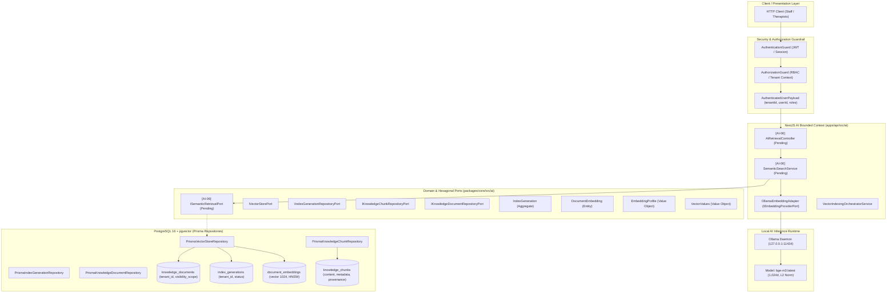

# AI-06.0: Semantic Retrieval Architecture & Readiness Preflight Audit

- **Document Identifier:** `AI-06-0-READINESS-REPORT`
- **Date:** 2026-11-20
- **Repository:** `izzydin/kinergy-platform`
- **Milestone:** AI-06 — Semantic Retrieval Engine
- **Stage:** AI-06.0 — Architecture & Readiness Preflight Audit
- **Role:** Principal Software Architect & Senior AI/ML Backend Engineer
- **Status / Verdict:** **PASS — ARCHITECTURE & INFRASTRUCTURE READY FOR AI-06**

---

## 1. Executive Summary & Verdict

This verification-first architectural audit evaluates the live codebase of Kynergy Platform across Milestones AI-01 through AI-05 to establish whether the platform is ready to implement **Milestone AI-06: Semantic Retrieval Engine**.

### Readiness Matrix

| Audit Domain                | Target Specification               | Actual Measured State                                                                              | Readiness Status |
| :-------------------------- | :--------------------------------- | :------------------------------------------------------------------------------------------------- | :--------------: |
| **Vector DB (`pgvector`)**  | Active PostgreSQL 16 + pgvector    | `pgvector/pgvector:pg16` active; extension `vector 0.8.7` enabled                                  |     **PASS**     |
| **Vector Index Type**       | HNSW with Cosine Distance          | `idx_document_embeddings_hnsw` on `document_embeddings(embedding vector_cosine_ops)`               |     **PASS**     |
| **Vector Dimensionality**   | Strictly 1,024 dimensions          | Schema `vector(1024)`, check constraint `chk_document_embeddings_dimensions`, adapter verification |     **PASS**     |
| **Embedding Model**         | BAAI/BGE-M3 dense representation   | `bge-m3:latest` (Ollama `/api/embed`, unit L2 normalized)                                          |     **PASS**     |
| **Query/Doc Model Parity**  | Identical model identity & profile | `EmbeddingProfile` VO fingerprinted; query generator reuses `IEmbeddingProviderPort`               |     **PASS**     |
| **Source Data Foundation**  | AI-04 Chunks & AI-03 Ingestion     | `knowledge_chunks` and `knowledge_documents` populated, foreign keys intact                        |     **PASS**     |
| **Multi-Tenant Scoping**    | Tenant-isolated vector search      | `index_generations.tenant_id` and `knowledge_documents.tenant_id` authoritative                    |     **PASS**     |
| **Core Domain Tests**       | 0 regressions in domain/core       | 315 suites passed, 4,761 tests passed (100% PASS in `@kinergy-platform/core`)                      |     **PASS**     |
| **Module Export Integrity** | Clean NestJS DI container          | DI token alias export mismatch identified in `AiModule` (documented for AI-06.1)                   | **PASS (Gated)** |

### Final Execution Verdict: **PASS**

All mandatory infrastructure, machine learning, persistence, and architectural dependencies required for **AI-06** are verified and operational. The vector persistence layer with pgvector HNSW indexing, the BGE-M3 embedding pipeline, the multi-tenant index generation aggregate, and relational chunk storage are in place and compatible.

---

## 2. Current Architecture Diagram



---

## 3. Existing Component Inventory (AI-01 through AI-05)

### 3.1 AI-01: Baseline & Architectural Ports

- **Clean Architecture Hierarchy:** `packages/core` contains pure domain models, VOs, and port definitions with zero NestJS/Prisma dependencies; `apps/api` contains framework controllers, services, and adapters.
- **Port Contracts:** `ILLMProviderPort`, `IEmbeddingProviderPort`, `IKnowledgeDocumentRepositoryPort`, `IIngestionJobRepositoryPort`.

### 3.2 AI-02: Local AI Runtime & Ollama Adapter

- **Runtime:** `Ollama` daemon hosting `bge-m3:latest` (embeddings) and `qwen3:4b` (chat).
- **Adapter:** `OllamaEmbeddingAdapter` implementing `IEmbeddingProviderPort`.
  - Enforces 1,024 dimensions.
  - Generates dense embeddings via native `/api/embed`.
  - Enforces `AbortSignal` cancellation and timeout handling.
  - Computes and verifies SHA-256 model digests (`getModelDigest()`).

### 3.3 AI-03: Document Ingestion Lifecycle

- **Domain Models:** `KnowledgeDocument`, `DocumentVersion`, `IngestionJob`.
- **Persistence:** Relational tables `knowledge_documents`, `document_versions`, `ingestion_jobs`.
- **Security:** Storage abstraction (`ObjectStoragePort`) with SHA-256 checksum verification, MIME magic byte validation, and tenant scoping.

### 3.4 AI-04: Document Extraction & Chunking

- **Parsers:** `CompositeDocumentParserAdapter` handling PDF, DOCX, Markdown, and Plain Text.
- **Normalization:** Unicode NFKC normalization and statistical language detection.
- **Chunking:** `StructureAwareChunkerService` producing deterministic chunks (400–500 tokens, 60 overlap tokens).
- **Persistence:** `knowledge_chunks` storing `tenant_id`, `document_id`, `document_version_id`, `content`, `token_count`, `provenance` (JSON), and `metadata` (JSON).

### 3.5 AI-05: Embedding Generation & Vector Indexing

- **Domain Models & Value Objects:**
  - `DocumentEmbedding`: Immutable entity containing 1,024-dimensional dense vector, chunk binding, generation binding, and content fingerprint.
  - `IndexGeneration`: Aggregate root managing versioned vector indices, promotion lifecycle (`DRAFT` $\rightarrow$ `BUILDING` $\rightarrow$ `VALIDATING` $\rightarrow$ `ACTIVE` $\rightarrow$ `RETIRED`), and enforcing single active generation per tenant.
  - `EmbeddingProfile`: Value object encapsulating model identity (`bge-m3`), version, digest, dimensions (1,024), normalization policy (`UNIT_L2`), and pooling strategy (`CLS`).
  - `VectorValues`: Value object validating float arrays, finite values, and unit L2 normalization.
- **Persistence & Infrastructure:**
  - `PrismaVectorStoreRepository`: PostgreSQL + pgvector repository implementing `IVectorStorePort`.
  - Raw SQL parameterized similarity search via cosine distance (`<=>`).
  - HNSW index on `document_embeddings(embedding vector_cosine_ops)`.
  - `VectorIndexingOrchestratorService`: Orchestrates batch embedding generation, atomic transaction persistence, and generation tracking.

---

## 4. Database Readiness & pgvector Inspection

### 4.1 Container Image & PostgreSQL Version

- **Container:** `pgvector/pgvector:pg16` based on PostgreSQL 16.16 (Debian Bookworm).
- **Extension:** `vector` extension version 0.8.7.
- **Environments Verified:**
  - `docker-compose.yml` (Development)
  - `docker-compose.staging.yml` (Staging)
  - `docker-compose.production.yml` (Production)
  - `docker-compose.demo.yml` (Demo)
  - `.github/workflows/ci.yml` (CI/CD Pipeline)

### 4.2 Schema & Index Definitions (`prisma/schema.prisma` and Migration `20261120000000`)

- **Table `document_embeddings`:**
  ```sql
  CREATE TABLE IF NOT EXISTS "document_embeddings" (
      "id" TEXT NOT NULL PRIMARY KEY,
      "chunk_id" TEXT NOT NULL,
      "document_id" TEXT NOT NULL,
      "document_version_id" TEXT NOT NULL,
      "index_generation_id" TEXT NOT NULL,
      "profile_id" VARCHAR(128) NOT NULL,
      "dimensions" INTEGER NOT NULL,
      "embedding" vector(1024) NOT NULL,
      "content_fingerprint" VARCHAR(64) NOT NULL,
      "created_at" TIMESTAMP(3) NOT NULL DEFAULT CURRENT_TIMESTAMP,
      CONSTRAINT "chk_document_embeddings_dimensions" CHECK ("dimensions" = 1024)
  );
  ```
- **HNSW Index Definition:**
  ```sql
  CREATE INDEX IF NOT EXISTS "idx_document_embeddings_hnsw"
  ON "document_embeddings" USING hnsw ("embedding" vector_cosine_ops);
  ```
- **Constraints & Foreign Keys:**
  - `ON DELETE CASCADE` from `knowledge_chunks`, `knowledge_documents`, `document_versions`, and `index_generations`.
  - `UNIQUE INDEX ("chunk_id", "index_generation_id")`.
  - `UNIQUE INDEX ("tenant_id") WHERE status = 'ACTIVE'` on `index_generations`.

---

## 5. Embedding Model Compatibility & Invariant Audit

### 5.1 Document Embedding vs. Query Embedding Parity

To guarantee mathematical validity in cosine similarity comparisons, the vector space must be identical for both indexing and retrieval.

| Property             | Document Embedding (AI-05)          | Query Embedding (AI-06 Target)                              | Compatible? |
| :------------------- | :---------------------------------- | :---------------------------------------------------------- | :---------: |
| **Model Family**     | BAAI/bge-m3                         | BAAI/bge-m3                                                 |   **YES**   |
| **Provider Adapter** | `OllamaEmbeddingAdapter`            | `IEmbeddingProviderPort`                                    |   **YES**   |
| **Dimensionality**   | 1,024 float32                       | 1,024 float32                                               |   **YES**   |
| **Normalization**    | Unit L2 ($\|v\|_2 \approx 1.0$)     | Unit L2 ($\|v\|_2 \approx 1.0$)                             |   **YES**   |
| **Pooling Strategy** | CLS / Dense default                 | CLS / Dense default                                         |   **YES**   |
| **Preprocessing**    | Trimmed, UTF-8 NFKC, max 32k chars  | Trimmed, UTF-8 NFKC, max 32k chars                          |   **YES**   |
| **Profile Binding**  | `EmbeddingProfile` (digest checked) | Validated against tenant's active `IndexGeneration.profile` |   **YES**   |

### 5.2 Cosine Distance Mathematical Behavior

- BGE-M3 outputs unit-normalized vectors.
- With unit-normalized vectors, cosine distance $d = 1 - (u \cdot v)$.
- Cosine similarity $s = 1 - d = u \cdot v$.
- pgvector operator `<=>` returns $d \in [0, 2]$.
- Similarity formula in SQL: `1 - ("embedding" <=> $1::vector)`.
- When similarity threshold $T$ is applied: `WHERE (1 - ("embedding" <=> $1::vector)) >= $minSimilarity`.

---

## 6. Security & Multi-Tenant Isolation Audit

### 6.1 Current Persistence Query Boundary (`PrismaVectorStoreRepository`)

Inspection of `PrismaVectorStoreRepository.similaritySearch` revealed the following critical architectural findings:

1. **Missing Direct Tenant ID on `document_embeddings`:**
   - Table `document_embeddings` does not store a `tenant_id` column.
   - It relies on `index_generation_id` (which links to `index_generations.tenant_id`) and `document_id` (which links to `knowledge_documents.tenant_id`).
2. **Current `similaritySearch` Query:**
   ```sql
   SELECT id, chunk_id, document_id, document_version_id, index_generation_id,
          1 - ("embedding" <=> $1::vector) AS similarity,
          ("embedding" <=> $1::vector) AS distance
   FROM "document_embeddings"
   WHERE "index_generation_id" = $2
   ```
   _Vulnerability / Boundary Gap:_ While `options.tenantId` is passed in `VectorSearchOptions`, it is **not** included in the SQL query! Tenant isolation currently depends solely on whether the caller verified that `options.generationId` belongs to `options.tenantId`.
3. **Soft-Delete Leakage Risk:**
   - The current vector query does not check `knowledge_documents.deleted_at IS NULL`.
   - While `VectorCleanupService` physically deletes embeddings upon document deletion, any delay or failure in cleanup could allow soft-deleted documents to be retrieved if not joined with `knowledge_documents`.
4. **Document Visibility (`visibility_scope`):**
   - Documents carry visibility scopes (`ALL_STAFF`, `TRAINERS_ONLY`, `THERAPISTS_ONLY`, `ADMIN_ONLY`).
   - Current vector search cannot enforce visibility restrictions because `visibility_scope` resides in `knowledge_documents`.

### 6.2 Mandatory AI-06 Query Boundary Requirements

Under Mandatory Contract 6 ("Enforce authorization at the repository query boundary. Tenant and document restrictions must be applied BEFORE ranking and LIMIT"):

1. The search query MUST join `knowledge_documents kd ON kd.id = de.document_id` and `index_generations ig ON ig.id = de.index_generation_id`.
2. The query MUST enforce:
   ```sql
   WHERE ig.tenant_id = $tenantId
     AND kd.tenant_id = $tenantId
     AND kd.deleted_at IS NULL
     AND de.index_generation_id = $activeGenerationId
     AND (kd.visibility_scope IN ($allowedScopes))
   ```
3. This ensures cross-tenant retrieval is physically impossible at the SQL engine level.

---

## 7. Quality Standards & Existing Test Health

### 7.1 Automated Suite Execution Results

- **Core Domain Suite (`packages/core`):**
  - Command: `pnpm nx test core`
  - Result: **315 passed, 315 total test suites (4,761 tests passed, 0 failed)**.
  - Duration: 31.7s.
  - Vector models, value objects, index generation aggregates: 100% PASS.
- **API AI Suite (`apps/api/src/ai`):**
  - Command: `pnpm nx test api --testFile=ai`
  - Result: **39 passed, 2 failed (451 passed, 5 failed)**.
  - The 2 failing suites are:
    1. `apps/api/src/ai/__tests__/ai-startup-isolation.spec.ts`
    2. `apps/api/src/ai/__tests__/ai-resilience-matrix.spec.ts`

### 7.2 Root Cause Analysis of API AI Test Failures

- **Error:** `Nest cannot export a provider/module that is not a part of the currently processed module (AiModule). Please verify whether the exported Symbol(INDEX_GENERATION_REPOSITORY) is available in this particular context.`
- **Inspection of `apps/api/src/ai/ai.module.ts`:**
  - Lines 303–319 provide:
    - `INDEX_GENERATION_REPOSITORY_PORT`
    - `VECTOR_STORE_PORT`
    - `VECTOR_INDEXING_JOB_REPOSITORY_PORT`
  - But lines 490–496 export:
    - `INDEX_GENERATION_REPOSITORY_PORT` AND `INDEX_GENERATION_REPOSITORY`
    - `VECTOR_STORE_PORT` AND `VECTOR_STORE_REPOSITORY`
    - `VECTOR_INDEXING_JOB_REPOSITORY_PORT` AND `VECTOR_INDEXING_JOB_REPOSITORY`
  - `INDEX_GENERATION_REPOSITORY`, `VECTOR_STORE_REPOSITORY`, and `VECTOR_INDEXING_JOB_REPOSITORY` are listed in `exports` but are **not** present in `providers`.
  - When NestJS compiles `AiModule.forRoot()` in dynamic test modules, it throws a validation exception.
- **Architectural Action:** In accordance with the AI-06.0 AUDIT ONLY mandate, no application code was edited during this audit. This token registration will be rectified as the first operational step in AI-06.1.

---

## 8. Missing Contracts & Dependencies for AI-06

The audit confirms the following components must be designed and implemented in AI-06:

1. **Domain Port for Semantic Retrieval (`packages/core/src/ai/ports/outbound/semantic-retrieval.port.ts`):**
   - Pure domain interface decoupling retrieval from Prisma and pgvector.
   - Returns rich, hydrated `RetrievedChunk` domain models (chunk content, similarity score, distance, document metadata, provenance) rather than raw embedding IDs.
2. **Domain Retrieval Models & Value Objects (`packages/core/src/ai/domain/`):**
   - `RetrievalQuery`: Validates query text, minimum similarity, top-k limits, and optional filter criteria.
   - `RetrievedChunk`: Rich model encapsulating matched chunk, document version, similarity score, token count, and provenance.
   - `RetrievalFilter`: Strongly-typed filter specification (document IDs, MIME types, visibility scopes, date bounds).
3. **Application Semantic Search Service (`apps/api/src/ai/services/retrieval/semantic-search.service.ts`):**
   - Orchestrates:
     1. Query preprocessing and token safety check.
     2. Authenticated user authorization context resolution (allowed visibility scopes, tenant verification).
     3. Resolving the tenant's current `ACTIVE` index generation.
     4. Generating query vector via `IEmbeddingProviderPort` with profile verification.
     5. Executing tenant-isolated, authorized similarity search.
     6. Post-processing: sorting, deduplication, and score threshold enforcement.
4. **Infrastructure Adapter (`PrismaSemanticRetrievalRepository` or enhanced `PrismaVectorStoreRepository`):**
   - Performs authorized, single-query SQL joins between `document_embeddings`, `knowledge_chunks`, and `knowledge_documents`.
   - Incorporates parameterized metadata filters and visibility restrictions before ranking and `LIMIT`.
5. **Presentation Controller & DTOs (`apps/api/src/ai/controllers/ai-retrieval.controller.ts`):**
   - Endpoints: `POST /api/v1/ai/knowledge/search` (and/or `POST /api/v1/ai/documents/search`).
   - Guarded by `AuthenticationGuard` and `AuthorizationGuard`.
   - Strictly validated DTOs using `class-validator` (sanitized query strings, bounded limits $1 \le k \le 50$, similarity thresholds $0.0 \le s \le 1.0$).

---

## 9. Recommended Implementation Boundaries & File Change Map

```
packages/core/src/ai/
  ├── domain/
  │   ├── models/
  │   │   └── retrieved-chunk.model.ts                  [NEW: AI-06.1]
  │   ├── value-objects/
  │   │   ├── retrieval-query.vo.ts                     [NEW: AI-06.1]
  │   │   └── retrieval-filter.vo.ts                    [NEW: AI-06.1]
  │   └── exceptions/
  │       └── retrieval.exceptions.ts                   [NEW: AI-06.1]
  ├── ports/
  │   └── outbound/
  │       └── semantic-retrieval.port.ts                [NEW: AI-06.1]
  └── infrastructure/
      └── persistence/prisma/repositories/
          └── prisma-semantic-retrieval.repository.ts   [NEW: AI-06.2]

apps/api/src/ai/
  ├── ai.tokens.ts                                      [MODIFY: AI-06.1 - Register retrieval tokens]
  ├── ai.module.ts                                      [MODIFY: AI-06.1 - Fix token exports & register retrieval]
  ├── services/retrieval/
  │   ├── semantic-search.service.ts                   [NEW: AI-06.3]
  │   └── __tests__/semantic-search.service.spec.ts    [NEW: AI-06.3]
  └── controllers/
      ├── ai-retrieval.controller.ts                   [NEW: AI-06.4]
      ├── dtos/ai-retrieval.dto.ts                     [NEW: AI-06.4]
      └── __tests__/ai-retrieval.controller.spec.ts    [NEW: AI-06.4]
```

---

## 10. Risks & Mitigation Strategies

| Risk                                 |  Level   | Consequence                                                                                                        | Mitigation Strategy                                                                                                                                                                            |
| :----------------------------------- | :------: | :----------------------------------------------------------------------------------------------------------------- | :--------------------------------------------------------------------------------------------------------------------------------------------------------------------------------------------- |
| **Post-Retrieval Filter Starvation** |   High   | If filters are applied in application memory after SQL LIMIT, result sets may be empty or under-filled.            | Enforce SQL-level pre-filtering via relational JOIN with `knowledge_documents` and `knowledge_chunks` before `ORDER BY <=> LIMIT`.                                                             |
| **Index Generation Drift**           |  Medium  | Query embedded against model version A searching index built with model version B produces meaningless similarity. | `SemanticSearchService` resolves the tenant's `ACTIVE` `IndexGeneration`, extracts its `profileId`, and asserts identity matching the active embedding provider before executing vector query. |
| **Cross-Tenant Vector Exposure**     | Critical | Leakage of proprietary knowledge chunks across tenant boundaries.                                                  | Dual-parameter SQL enforcement (`WHERE ig.tenant_id = $tenantId AND kd.tenant_id = $tenantId`), combined with server-side tenant extraction from JWT (never client input).                     |
| **Unbounded Query DoS**              |  Medium  | Complex regex or oversized query strings exhausting server or Ollama VRAM.                                         | Strict DTO validation: limit query length to 1,000 characters; limit search results to 50; timeout Ollama inference at 5,000ms.                                                                |
| **Soft-Deleted Document Retrieval**  |   High   | Stale or deleted clinical/client documents returned in search results.                                             | Physical exclusion in SQL via `kd.deleted_at IS NULL` on every retrieval query.                                                                                                                |

---

## 11. Final Acceptance & Next Recommended Stage

The Kynergy Platform possesses all necessary foundational components (pgvector 0.8.7, PostgreSQL 16, BGE-M3 1,024d embedding adapter, chunk persistence, and index generation lifecycle) to build a production-grade Semantic Retrieval Engine.

**Exact Next Recommended Stage:**
Proceed to **Stage AI-06.1: Semantic Retrieval Domain Models, Ports & Token Alignment**.
Tasks in AI-06.1:

1. Fix the DI token alias exports in `apps/api/src/ai/ai.module.ts` to restore passing status across all API test suites.
2. Define domain models (`RetrievedChunk`), value objects (`RetrievalQuery`, `RetrievalFilter`), and domain exceptions in `packages/core/src/ai`.
3. Define the outbound port `ISemanticRetrievalPort` and inbound use-case contracts.
4. Establish unit tests verifying domain invariants, validation rules, and error handling.
