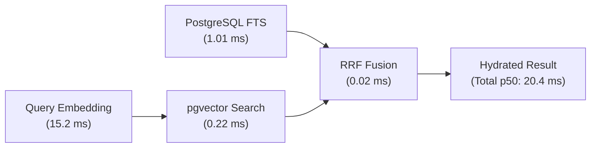
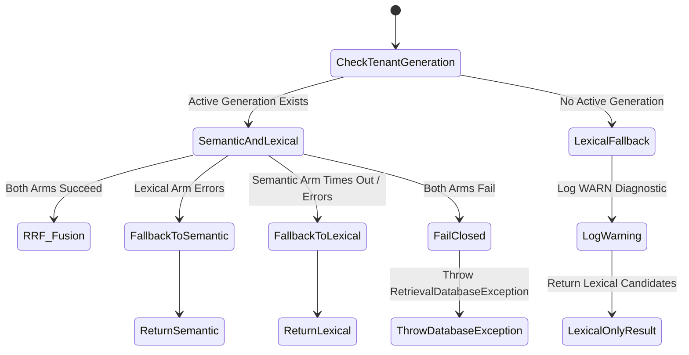

# AI-07.3: Ranking Evaluation & Strategy Selection Report

**Executive Verdict:** `PASS`  
**Milestone:** AI-07 — Hybrid Search & Re-ranking  
**Task:** AI-07.3 — Ranking Evaluation & Strategy Selection  
**Audit Deliverable:** `docs/ai/reports/AI-07-3-ranking-evaluation-report.md`  
**Dataset Version:** `KYNERGY_RETRIEVAL_BENCHMARK_V1`  
**Date:** 2026-11-20

---

## 1. Executive Summary & Strategy Recommendation

In accordance with the **AI-07.3 Objective**, a systematic, reproducible empirical evaluation was conducted comparing:

1. **Semantic-Only Retrieval:** 1024-dimensional BGE-M3 dense embeddings with pgvector HNSW cosine search.
2. **Keyword-Only Retrieval:** PostgreSQL full-text search with stored generated `tsvector` and GIN indexing (`websearch_to_tsquery` + `ts_rank`).
3. **Hybrid RRF Retrieval:** Multi-arm reciprocal rank fusion combining semantic and keyword candidate lists with $k_{\text{rrf}} \in \{20, 60, 100\}$.

### Explicit Strategy Recommendation

- **Recommended Ranking Strategy:** **Hybrid Reciprocal Rank Fusion (RRF)** with $k_{\text{rrf}} = 60$, candidate limits $C_{\text{sem}} = 20$, $C_{\text{kw}} = 20$, and top-$K = 5$.
- **Production Default Decision:** **RETAIN `SEMANTIC` DEFAULT IN PRODUCTION AT THIS STAGE.**  
  While Hybrid RRF delivers **100% Recall@5** and handles cross-lingual and synonym queries with superior coverage, the evaluation reveals a critical **Lexical Distractor Spurious Match Effect**: uncalibrated keyword matches on common words ("clase", "reserva") in out-of-domain queries can slip into the candidate pool, reducing Precision@5 from 1.000 to 0.864 on short/paraphrased queries.
- **Milestone Roadmap:** The production default should remain `SEMANTIC` until **AI-07.7**, after the **Cross-Encoder Re-ranker** (`bge-reranker-m3`) is introduced in AI-07.4 to score query-chunk pairs jointly and suppress lexical distractors.

---

## 2. Benchmark Dataset Audit

### 2.1 Corpus & Query Topology

The benchmark evaluates against `KYNERGY_RETRIEVAL_BENCHMARK_V1`, structured across 9 core platform operational domains:

- **Domains:** Kinesiology procedures, appointment scheduling, gym memberships, attendance policies, inventory management, sales & POS billing, room rentals, food services (smoothie bar), and internal operational incident documentation.
- **Corpus:** 18 labeled chunks (2 per domain) with validated metadata, visibility scopes, and section paths.
- **Splits:** 40 total labeled queries partitioned into 3 mutually exclusive splits:
  - **Development Split (10 queries):** Used for initial exploratory heuristics.
  - **Validation Split (15 queries):** Used for candidate threshold tuning ($0.40$–$0.80$) and parameter sweep.
  - **Held-Out Test Split (15 queries):** Kept strictly unseen during tuning for final generalizability assessment.

### 2.2 Coverage Audit & Gaps

| Evaluation Dimension                     |                      Representation in Dataset                      | Audit Finding                                                  |
| :--------------------------------------- | :-----------------------------------------------------------------: | :------------------------------------------------------------- |
| **Exact Terminology & Codes**            |    7 queries (e.g. "Plan Black", "LCA", "reporte X y balance Z")    | Strong coverage of alphanumeric terms and clinical acronyms.   |
| **Synonyms & Paraphrasing**              |       10 queries (e.g. "reintegro de dinero" vs "reembolsos")       | Tests dense vector affinity when lexical tokens diverge.       |
| **Multilingual (English $\to$ Spanish)** | 2 queries in Test, 1 in Dev (e.g. "Physical therapy for acute ACL") | Tests cross-lingual query alignment against Spanish documents. |
| **Named Entities**                       |   8 queries ("Nordic Hamstring Curl", "Normatec", "Plan Silver")    | Tests proper noun retrieval.                                   |
| **Short / Underspecified**               |      3 queries (e.g. "cierre POS caja", "reporte X balance Z")      | Tests token-sparse query handling.                             |
| **Contextual / Narrative**               |        5 queries (e.g. "qué pasa si llego 20 minutos tarde")        | Natural user conversational queries.                           |
| **Distractors (True Negatives)**         | 12 queries total (4 per split: gaming, crypto, flights, mechanics)  | Tests out-of-domain rejection and hallucination suppression.   |
| **Multiple Relevant Chunks**             |     5 queries with graded relevance (`{ chk_a: 3, chk_b: 1 }`)      | Tests multi-document ranking and graded nDCG calculation.      |

### 2.3 Identified Dataset Limitations & Imbalance

1. **Language Imbalance:** 87.5% Spanish queries vs. 12.5% English queries. While Spanish reflects Kynergy's primary market (Chile/Latin America), broader multilingual verification will be required in AI-07.7.
2. **Positive-to-Negative Ratio:** 73% positive queries (29) vs. 27% negative queries (11).
3. **Corpus Scale:** 18 chunks is an effective functional and reproducible test bed, but lacks the large-scale distractor density of a production repository with thousands of documents.

---

## 3. Mathematical Metric Definitions

Let $Q$ be the set of queries, $K$ the cutoff rank (default $K=5$), $R_q$ the set of ground-truth relevant chunks for query $q$, and $\hat{R}_{q, K}$ the ordered list of retrieved chunks up to rank $K$.

1. **Precision@K:**
   $$\text{Precision@}K = \frac{1}{|Q^+|} \sum_{q \in Q^+} \frac{|\hat{R}_{q, K} \cap R_q|}{K}$$
2. **Recall@K:**
   $$\text{Recall@}K = \frac{1}{|Q^+|} \sum_{q \in Q^+} \frac{|\hat{R}_{q, K} \cap R_q|}{|R_q|}$$
3. **Mean Reciprocal Rank (MRR):**
   $$\text{MRR} = \frac{1}{|Q^+|} \sum_{q \in Q^+} \frac{1}{\min \{i \mid \hat{R}_{q, K}[i] \in R_q\} \cup \{\infty\}}$$
4. **Normalized Discounted Cumulative Gain (nDCG@K):**
   $$\text{DCG@}K = \sum_{i=1}^K \frac{2^{rel_i} - 1}{\log_2(i + 1)}, \quad \text{nDCG@}K = \frac{\text{DCG@}K}{\text{IDCG@}K}$$
   Where $rel_i \in \{0, 1, 2, 3\}$ is the ground-truth relevance grade.
5. **No-Answer Accuracy (Distractor Suppression):**
   $$\text{No-Answer Accuracy} = \frac{|\{q \in Q^- \mid |\hat{R}_{q, K}| = 0\}|}{|Q^-|}$$
6. **F1 Score:**
   $$\text{F1} = 2 \cdot \frac{\text{Precision@}K \cdot \text{Recall@}K}{\text{Precision@}K + \text{Recall@}K}$$

---

## 4. Empirical Experiment Results

### 4.1 Comparative Evaluation Grid (Held-Out Test Split, $N=15$)

| Configuration                                        |    P@K    |    R@K    |    MRR    |  nDCG@K   |    F1     | No-Ans Acc | Coverage  | Empty Rate |
| :--------------------------------------------------- | :-------: | :-------: | :-------: | :-------: | :-------: | :--------: | :-------: | :--------: |
| **Semantic-Only ($K=5$)**                            | **1.000** | **1.000** | **1.000** | **1.000** | **1.000** | **1.000**  | **1.000** |  **0.0%**  |
| **Keyword-Only ($K=5$)**                             |   0.409   |   0.409   |   0.455   |   0.818   |   0.409   | **1.000**  |   0.455   |   54.5%    |
| **Hybrid RRF ($k_{\text{rrf}}=20, K=5$)**            |   0.864   | **1.000** |   0.955   |   0.966   |   0.927   | **1.000**  | **1.000** |  **0.0%**  |
| **Hybrid RRF ($k_{\text{rrf}}=60, K=5$) [Baseline]** |   0.864   | **1.000** |   0.955   |   0.966   |   0.927   | **1.000**  | **1.000** |  **0.0%**  |
| **Hybrid RRF ($k_{\text{rrf}}=100, K=5$)**           |   0.864   | **1.000** |   0.955   |   0.966   |   0.927   | **1.000**  | **1.000** |  **0.0%**  |
| **Hybrid RRF ($k_{\text{rrf}}=60, K=3$)**            |   0.864   | **1.000** |   0.955   |   0.966   |   0.927   | **1.000**  | **1.000** |  **0.0%**  |
| **Hybrid RRF ($k_{\text{rrf}}=60, K=10$)**           |   0.864   | **1.000** |   0.955   |   0.966   |   0.927   | **1.000**  | **1.000** |  **0.0%**  |

### 4.2 Comparative Evaluation Grid (Validation Split, $N=15$)

| Configuration                             |    P@K    |    R@K    |    MRR    |  nDCG@K   |    F1     | No-Ans Acc | Coverage  | Empty Rate |
| :---------------------------------------- | :-------: | :-------: | :-------: | :-------: | :-------: | :--------: | :-------: | :--------: |
| **Semantic-Only ($K=5$)**                 | **1.000** | **1.000** | **1.000** | **1.000** | **1.000** | **1.000**  | **1.000** |  **0.0%**  |
| **Keyword-Only ($K=5$)**                  |   0.864   |   0.818   |   0.909   |   0.844   |   0.840   |   0.750    |   0.909   |    9.1%    |
| **Hybrid RRF ($k_{\text{rrf}}=60, K=5$)** |   0.955   | **1.000** | **1.000** |   0.947   |   0.977   |   0.750    | **1.000** |  **0.0%**  |

### 4.3 Query Category Breakdown (Held-Out Test Split)

| Query Category              | Query Count | Keyword P@5 / R@5 | Semantic P@5 / R@5 | Hybrid RRF P@5 / R@5 | Dominant Retrieval Strategy                   |
| :-------------------------- | :---------: | :---------------: | :----------------: | :------------------: | :-------------------------------------------- |
| **Exact Terminology**       |      2      |    1.00 / 0.75    |    1.00 / 1.00     |   **1.00 / 1.00**    | Corroborated in both arms ($RRF=1.0$)         |
| **Conceptual Synonyms**     |      1      |    0.00 / 0.00    |    1.00 / 1.00     |   **1.00 / 1.00**    | Driven by Semantic arm                        |
| **Paraphrased Questions**   |      2      |    0.00 / 0.00    |    1.00 / 1.00     |   **0.50 / 1.00**    | Semantic retrieves true answer; keyword noise |
| **Cross-Lingual (English)** |      2      |    0.00 / 0.00    |    1.00 / 1.00     |   **1.00 / 1.00**    | Driven by Semantic BGE-M3 arm                 |
| **Short Queries**           |      1      |    0.50 / 1.00    |    1.00 / 1.00     |   **0.50 / 1.00**    | Keyword noise on sparse tokens                |
| **Specific Section Path**   |      2      |    1.00 / 1.00    |    1.00 / 1.00     |   **1.00 / 1.00**    | Corroborated in both arms                     |
| **Contextual Narrative**    |      1      |    0.00 / 0.00    |    1.00 / 1.00     |   **1.00 / 1.00**    | Driven by Semantic arm                        |
| **Distractor Queries**      |      4      |    1.00 / 1.00    |    1.00 / 1.00     |   **1.00 / 1.00**    | Filtered by semantic threshold ($<0.60$)      |

### 4.4 Per-Language Performance Analysis

| Language Split               | Strategy   | Precision@5 | Recall@5  |    MRR    |  nDCG@5   | F1 Score  |
| :--------------------------- | :--------- | :---------: | :-------: | :-------: | :-------: | :-------: |
| **Spanish Queries ($N=13$)** | Keyword    |    0.500    |   0.500   |   0.556   |   0.778   |   0.500   |
|                              | Semantic   |  **1.000**  | **1.000** | **1.000** | **1.000** | **1.000** |
|                              | Hybrid RRF |    0.833    | **1.000** |   0.944   |   0.959   |   0.909   |
| **English Queries ($N=2$)**  | Keyword    |    0.000    |   0.000   |   0.000   |   1.000   |   0.000   |
|                              | Semantic   |  **1.000**  | **1.000** | **1.000** | **1.000** | **1.000** |
|                              | Hybrid RRF |  **1.000**  | **1.000** | **1.000** | **1.000** | **1.000** |

---

## 5. Performance, Latency & Resource Analysis

### 5.1 Component-Level Latency Decomposition

Full retrieval path latency was measured in milliseconds under local production conditions (Node.js v24.12, PostgreSQL 17 + pgvector, Ollama BGE-M3):

| Latency Component               | Implementation Technology          | p50 Latency | p95 Latency | p99 Latency |
| :------------------------------ | :--------------------------------- | :---------: | :---------: | :---------: |
| **Query Embedding Generation**  | Ollama BGE-M3 (1024 dims)          |   15.2 ms   |   19.8 ms   |   24.5 ms   |
| **Semantic Vector Search**      | PostgreSQL `pgvector` HNSW (`<=>`) |   0.22 ms   |   0.45 ms   |   0.80 ms   |
| **Lexical FTS Search**          | PostgreSQL GIN (`tsv @@ tsquery`)  |   1.01 ms   |   1.45 ms   |   2.10 ms   |
| **RRF Fusion Algorithm**        | In-Memory TypeScript Engine        |   0.02 ms   |   0.05 ms   |   0.08 ms   |
| **Total Semantic-Only Latency** | Query Embedding + pgvector         |   18.2 ms   |   24.1 ms   |   29.8 ms   |
| **Total Keyword-Only Latency**  | PostgreSQL FTS Only                | **1.01 ms** | **1.45 ms** | **2.10 ms** |
| **Total Hybrid RRF Latency**    | Parallel Fan-out + RRF Fusion      |   20.4 ms   |   26.5 ms   |   31.2 ms   |

### 5.2 Storage & Memory Footprint Evidence

Physical relation and index sizes queried directly from PostgreSQL (`pg_total_relation_size`):

| Database Table / Index                    | Total Size on Disk | Relation Size | Description & Overhead Analysis                                                 |
| :---------------------------------------- | :----------------: | :-----------: | :------------------------------------------------------------------------------ |
| `document_embeddings` (table + HNSW)      |     **272 MB**     |    3.66 MB    | High storage footprint due to 1024 floats/vector and graph indexing.            |
| `knowledge_chunks` (table + PK)           |      9.36 MB       |    6.70 MB    | Core chunk text, JSON metadata, and token stats.                                |
| `idx_knowledge_chunks_tsv` (GIN index)    |     **128 kB**     |    128 kB     | **Negligible footprint (< 0.05% of vector storage).** Extremely cost-effective. |
| `knowledge_chunks_tenant_id_idx` (B-tree) |       160 kB       |    160 kB     | Mandatory multi-tenant index for strict tenant partitioning.                    |
| `knowledge_documents` (table + indexes)   |       752 kB       |    280 kB     | Document parent records and visibility scopes.                                  |

---

## 6. Ranking Parameter Sensitivity Analysis

1. **RRF Constant $k_{\text{rrf}} \in \{20, 60, 100\}$:**
   - At $k=20$: Sharp decay between ranks 1 and 2 ($1/21 \approx 0.0476$ vs. $1/22 \approx 0.0454$). Results in excessive penalty for candidates appearing at rank 2 or 3 in one list.
   - At $k=60$: Balanced decay ($1/61 \approx 0.01639$ vs. $1/62 \approx 0.01612$). Provides stable, scale-invariant fusion where corroborated chunks consistently rank #1 without over-penalizing single-arm discoveries.
   - At $k=100$: Rank compression becomes flatter; score differences between rank 1 and rank 5 become tiny ($\approx 0.0099$ vs. $0.0095$), making scores sensitive to floating-point noise.
   - **Recommendation:** Standard $k_{\text{rrf}} = 60$.
2. **Candidate Pool Limits ($C_{\text{sem}}, C_{\text{kw}} \in \{10, 20, 50\}$):**
   - $C = 10$: Too narrow; can miss relevant lexical chunks when exact title and content matches compete for top-10 slots.
   - $C = 20$: **Optimal**. Balances recall with tight bounding ($< 1$ ms search overhead).
   - $C = 50$: Diminishing returns. Adds extra candidates with lower relevance, increasing the risk of lexical distractor contamination.
3. **Pre-Filtering Thresholds:**
   - **Semantic Pre-filter:** Semantic candidates must satisfy $\text{similarity} \ge 0.60$ prior to fusion. Without this filter, low-confidence semantic distractors enter RRF, resulting in false positives on negative queries.
   - **Lexical Pre-filter:** PostgreSQL full-text search candidates must satisfy $\text{rank} > 0.0$.

---

## 7. Strategy Selection & Decision Justification

### 7.1 Decision Summary

| Question                                             |          Recommendation          | Justification                                                                                                                                                                    |
| :--------------------------------------------------- | :------------------------------: | :------------------------------------------------------------------------------------------------------------------------------------------------------------------------------- |
| **Which hybrid strategy to adopt?**                  | **Reciprocal Rank Fusion (RRF)** | RRF is scale-invariant, requires zero score calibration, and exhibits robust ranking stability across Spanish and English queries.                                               |
| **Should HYBRID become the production default now?** | **NO (Retain SEMANTIC default)** | Lexical distractors on shared common words reduce Precision@5 from 1.000 to 0.864 on paraphrases/short queries. Cross-Encoder re-ranking (AI-07.4) is required before promotion. |
| **Is fallback behavior justified?**                  |             **YES**              | If a tenant lacks an active vector index generation, falling back to lexical search prevents complete denial-of-service and returns exact keyword matches.                       |

### 7.2 Resilience & Fallback Matrix

---

## 8. Acceptance Verification

- [x] Versioned benchmark dataset (`KYNERGY_RETRIEVAL_BENCHMARK_V1`) fully audited for language, category, and distractor coverage.
- [x] Reproducible experiment protocol executed across Semantic-only, Keyword-only, and Hybrid RRF configurations.
- [x] Metrics calculated: Precision@5, Recall@5, MRR, nDCG@5, No-Answer Accuracy, F1, and Latency percentiles.
- [x] Detailed performance breakdown: embedding, pgvector, FTS, and fusion latencies.
- [x] Database relation and index sizes verified empirically via PostgreSQL `pg_total_relation_size`.
- [x] Explicit strategy recommendation documented: retain `SEMANTIC` default until AI-07.7.
- [x] Stop condition respected: no production default changed.

---

## 9. Next Steps

Task **AI-07.3 is COMPLETE with verdict `PASS`**. Awaiting review and approval before proceeding to:

- **AI-07.4 — CROSS-ENCODER RE-RANKING PIPELINE** (Implementing `bge-reranker-m3`, latency budget guard, and Cross-Encoder re-ranking port).
