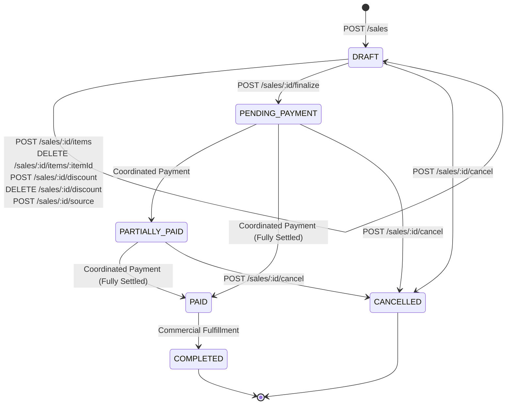

# Kinergy Platform - OpenAPI 3.0 Reference & API Specification

- **Status:** Active & Production-Hardened Specification
- **Base Route Prefix:** `/api/v1`
- **Interactive Documentation URL:** `http://localhost:3000/api/docs` (Swagger UI)
- **Security Scheme:** HTTP Bearer Token (`Bearer <JWT>`)

---

## 1. Overview & Swagger Configuration

The Kinergy Platform API is structured following RESTful principles, Clean Architecture, and Domain-Driven Design (DDD). The interactive OpenAPI 3.0 documentation is auto-generated during application bootstrap via `@nestjs/swagger` (`DocumentBuilder` in `apps/api/src/main.ts`).

```
http://localhost:3000/api/docs
```

- **Title**: Kinergy Platform API
- **Description**: Enterprise Energy & Sustainability Management System API
- **Version**: 1.0
- **Security Scheme**: `bearerAuth` (JWT Access Token)

---

## 2. Standard Response Envelopes & Error Structures

### 2.1 Success Response (`200 OK` / `201 Created`)

All successful API operations return a standardized `Result<T>` envelope:

```json
{
  "success": true,
  "data": {
    "id": "usr_9b1deb4d-3b7d-416b-9548-52ee8c8230e5",
    "email": "operator@kinergy.com",
    "roles": ["OPERATOR"],
    "status": "ACTIVE"
  },
  "error": null,
  "timestamp": "2026-07-29T12:00:00.000Z"
}
```

### 2.2 Generic Authentication Failure (`401 Unauthorized`)

Public authentication failures (`/auth/login`, `/auth/refresh`) return generic uninformative error messages to prevent account harvesting:

```json
{
  "statusCode": 401,
  "error": "Unauthorized",
  "message": "Invalid email or password.",
  "timestamp": "2026-07-29T12:00:00.000Z",
  "path": "/api/v1/auth/login"
}
```

### 2.3 Validation Failure (`400 Bad Request`)

Payload validation failures triggered by `GlobalSanitizationValidationPipe` or Zod schemas return formatted field validation issues:

```json
{
  "statusCode": 400,
  "error": "Bad Request",
  "message": [
    "email must be a valid email address",
    "password must be at least 12 characters long"
  ],
  "timestamp": "2026-07-29T12:00:00.000Z",
  "path": "/api/v1/users"
}
```

### 2.4 Authorization Failure (`403 Forbidden`)

Triggered by `AuthorizationGuard` when the authenticated identity lacks required roles or permissions:

```json
{
  "statusCode": 403,
  "error": "Forbidden",
  "message": "Access Denied: Insufficient permission 'users.write'. Required: ['users.write'].",
  "timestamp": "2026-07-29T12:00:00.000Z",
  "path": "/api/v1/users"
}
```

### 2.5 Transport Rate Limit Failure (`429 Too Many Requests`)

Triggered by `@nestjs/throttler` custom guards when rate limits are exceeded:

```json
{
  "statusCode": 429,
  "error": "Too Many Requests",
  "message": "ThrottlerException: Too Many Requests",
  "timestamp": "2026-07-29T12:00:00.000Z",
  "path": "/api/v1/auth/login"
}
```

### 2.6 Resource Not Found & Multi-Tenant Boundary Isolation (`404 Not Found`)

Triggered when target entity does not exist or when a caller attempts cross-tenant or unauthorized cross-client access to a protected resource (ADR-0135 §9). Returning uniform `404 Not Found` prevents cross-tenant resource enumeration:

```json
{
  "statusCode": 404,
  "error": "Not Found",
  "message": "Sale with ID 'sale_01j9876543210abcdef' was not found."
}
```

### 2.7 Concurrency Collisions & Duplicate Entity Conflict (`409 Conflict`)

Triggered by optimistic concurrency control (OCC) version mismatches or duplicate idempotent entity creation races (`@@unique([tenantId, saleId])`):

```json
{
  "statusCode": 409,
  "error": "Conflict",
  "code": "OPTIMISTIC_LOCK_ERROR",
  "message": "Optimistic lock failure: Sale with ID 'sale_01j987654321' was modified concurrently (expected version: 2)."
}
```

### 2.8 Invariant & Commercial Lifecycle Violations (`422 Unprocessable Entity`)

Triggered when an operation is structurally valid but violates domain lifecycle invariants (e.g., submitting an empty sale, attempting settlement against a cancelled order, overpayment beyond remaining balance, or premature receipt issuance):

```json
{
  "statusCode": 422,
  "error": "Unprocessable Entity",
  "code": "INVALID_SALE_TRANSITION",
  "message": "Cannot transition Sale from status 'DRAFT' to status 'PAID' (Cannot pay draft sale directly.)."
}
```

### 2.9 Sanitized Infrastructure & Internal Server Failures (`500 Internal Server Error`)

Unexpected infrastructure failures (e.g. database connection drops, Prisma client errors, or unexpected runtime faults) are strictly sanitized. Responses **never** expose stack traces, SQL queries, database connection URLs, credentials, table/schema names, JWTs, or Prisma exception codes:

```json
{
  "statusCode": 500,
  "error": "Internal Server Error",
  "message": "An unexpected internal server error occurred."
}
```

Internal security configuration failures (`SecurityConfigurationException`) are likewise caught and safely converted to a clean 500 response without leaking internal configuration constraints.

### 2.10 Diagnostic Tracing & Correlation Identifiers (`x-correlation-id` / `x-request-id`)

Every incoming request supports distributed correlation tracking via standard HTTP headers:

- `x-correlation-id` (primary distributed tracing header)
- `x-request-id` (supported gateway / proxy tracing header)
- `correlation-id` (fallback header)

When provided:

1. The platform automatically echoes `x-correlation-id` (and `x-request-id` when supplied) in the HTTP response headers.
2. Structured server logs attach `[<correlationId>]` prefix to all log messages.
3. Diagnostic log sanitization strips credit card PANs (`****-****-****-[MASKED]`), Bearer tokens (`Bearer [REDACTED]`), JWT payloads (`[REDACTED_TOKEN]`), database connection strings (`postgresql://[REDACTED_DATABASE_URL]`), and passwords/secrets.

### 2.11 Error Contract Alignment Matrix (Phase 1 & Phase 7)

| Failure Category              | Trigger Exception / Condition                                                         | HTTP Status                 | Response Contract Shape                                                                                         | Leaks Suppressed                                            |
| :---------------------------- | :------------------------------------------------------------------------------------ | :-------------------------- | :-------------------------------------------------------------------------------------------------------------- | :---------------------------------------------------------- |
| **Missing / Expired Auth**    | `UnauthorizedException`, `InvalidTokenException`, `AuthException`                     | `401 Unauthorized`          | `{ statusCode: 401, error: "Unauthorized", message: "..." }`                                                    | Secrets, raw JWT claims, stack traces                       |
| **Insufficient Permissions**  | `ForbiddenException`, `PaymentUnauthorizedException`, `SaleUnauthorizedException`     | `403 Forbidden`             | `{ statusCode: 403, error: "Forbidden", message: "..." }`                                                       | Evaluator AST, resolved permissions, internal user contexts |
| **Domain Validation**         | `InvalidMoneyException`, `InvalidDiscountException`, `BadRequestException`            | `400 Bad Request`           | `{ statusCode: 400, error: "Bad Request", code?: "...", message: "..." }`                                       | Internal class names, memory traces                         |
| **Resource Not Found**        | `SaleNotFoundException`, `PaymentNotFoundException`, `ReceiptNotFoundException`       | `404 Not Found`             | `{ statusCode: 404, error: "Not Found", message: "..." }`                                                       | Cross-tenant database IDs, existence probes                 |
| **Lifecycle Invariant**       | `EmptySaleException`, `InvalidSaleTransitionException`, `PaymentOverpaymentException` | `422 Unprocessable Entity`  | `{ statusCode: 422, error: "Unprocessable Entity", code?: "...", message: "..." }`                              | Schema details, stack traces                                |
| **Concurrency / Conflict**    | `SaleOptimisticLockException`, `DuplicateReceiptException`, `DuplicateSaleException`  | `409 Conflict`              | `{ statusCode: 409, error: "Conflict", code: "...", message: "..." }`                                           | Internal database lock tables                               |
| **Unexpected Infrastructure** | `PrismaClientKnownRequestError`, `Error`, `SecurityConfigurationException`            | `500 Internal Server Error` | `{ statusCode: 500, error: "Internal Server Error", message: "An unexpected internal server error occurred." }` | SQL statements, connection URLs, passwords, stack traces    |

---

## 3. Comprehensive Endpoint Catalog

### 3.1 Health Check (`/health`)

| HTTP Method | Route     | Protection  | Summary & Description                                                               | Expected Status Codes |
| :---------- | :-------- | :---------- | :---------------------------------------------------------------------------------- | :-------------------- |
| `GET`       | `/health` | `@Public()` | **Get Health Status**: Returns system health status, timestamp, and process uptime. | `200 OK`              |

### 3.2 Authentication Module (`/auth`)

| HTTP Method | Route           | Protection                                 | Permission Required | Summary & Description                                                                                                                                                                               | Expected Status Codes                                                             |
| :---------- | :-------------- | :----------------------------------------- | :------------------ | :-------------------------------------------------------------------------------------------------------------------------------------------------------------------------------------------------- | :-------------------------------------------------------------------------------- |
| `POST`      | `/auth/login`   | `@Public()`, `@LoginThrottle()`            | None                | **Authenticate User**: Validates user credentials, executes constant-time dummy Argon2id check on missing users, checks account lifecycle state, and returns JWT Access Token + Refresh Token pair. | `200 OK`<br/>`400 Bad Request`<br/>`401 Unauthorized`<br/>`429 Too Many Requests` |
| `POST`      | `/auth/refresh` | `@Public()`, `@RefreshThrottle()`          | None                | **Refresh Token Pair**: Consumes active Refresh Token, evaluates sliding-window rotation (RTR), checks for family reuse/replay attacks, and returns new TokenPair.                                  | `200 OK`<br/>`400 Bad Request`<br/>`401 Unauthorized`<br/>`429 Too Many Requests` |
| `POST`      | `/auth/logout`  | `AuthenticationGuard`, `@LogoutThrottle()` | Authenticated       | **User Logout**: Revokes current Refresh Token family in database and clears HTTP-Only session cookies.                                                                                             | `200 OK`<br/>`401 Unauthorized`                                                   |
| `GET`       | `/auth/me`      | `AuthenticationGuard`, `@MeThrottle()`     | Authenticated       | **Get Current User Context**: Returns authenticated user identity context (`userId`, `email`, `roles`, `permissions`, `tenantId`).                                                                  | `200 OK`<br/>`401 Unauthorized`                                                   |

### 3.3 Identity & User Management Module (`/users`)

| HTTP Method | Route                   | Protection                                  | Permission Required | Summary & Description                                                                                                                             | Expected Status Codes                                                                         |
| :---------- | :---------------------- | :------------------------------------------ | :------------------ | :------------------------------------------------------------------------------------------------------------------------------------------------ | :-------------------------------------------------------------------------------------------- |
| `POST`      | `/users`                | `AuthenticationGuard`, `AuthorizationGuard` | `users.write`       | **Create User Account**: Onboards new user record in target tenant. Validates password complexity (`PasswordPolicyService`) and email uniqueness. | `201 Created`<br/>`400 Bad Request`<br/>`401 Unauthorized`<br/>`403 Forbidden`                |
| `GET`       | `/users`                | `AuthenticationGuard`, `AuthorizationGuard` | `users.read`        | **Search & Paginate Users**: Returns paginated user directory filtered by status, role, or email search string.                                   | `200 OK`<br/>`401 Unauthorized`<br/>`403 Forbidden`                                           |
| `GET`       | `/users/:id`            | `AuthenticationGuard`, `AuthorizationGuard` | `users.read`        | **Get User by ID**: Retrieves single user identity aggregate details by unique user ID.                                                           | `200 OK`<br/>`401 Unauthorized`<br/>`403 Forbidden`<br/>`404 Not Found`                       |
| `PATCH`     | `/users/:id`            | `AuthenticationGuard`, `AuthorizationGuard` | `users.write`       | **Update User**: Updates user roles, email, or tenant context bindings.                                                                           | `200 OK`<br/>`400 Bad Request`<br/>`401 Unauthorized`<br/>`403 Forbidden`<br/>`404 Not Found` |
| `POST`      | `/users/:id/activate`   | `AuthenticationGuard`, `AuthorizationGuard` | `users.write`       | **Activate User Account**: Executes state transition to `ACTIVE` status via `UserStatusStateMachine`.                                             | `200 OK`<br/>`400 Bad Request`<br/>`401 Unauthorized`<br/>`403 Forbidden`<br/>`404 Not Found` |
| `POST`      | `/users/:id/deactivate` | `AuthenticationGuard`, `AuthorizationGuard` | `users.delete`      | **Deactivate User Account**: Executes state transition to `DEACTIVATED` status, invalidating all refresh tokens.                                  | `200 OK`<br/>`401 Unauthorized`<br/>`403 Forbidden`<br/>`404 Not Found`                       |
| `DELETE`    | `/users/:id`            | `AuthenticationGuard`, `AuthorizationGuard` | `users.delete`      | **Soft Delete User**: Soft deletes user record (`status = DELETED`, sets `deletedAt`), invalidating token version.                                | `200 OK`<br/>`401 Unauthorized`<br/>`403 Forbidden`<br/>`404 Not Found`                       |

### 3.4 Sales & Commercial Operations Module (`/api/v1/sales`)

The Sales API provides deterministic point-of-sale checkout sessions, item snapshots, item-level discounts, order-level discounts, authoritative totals calculation, and commercial lifecycle management. All monetary amounts are computed and serialized according to the **Milestone 7.4 Canonical Monetary Policy** ([ADR-0114](file:///c:/Projects/kinergy-platform/docs/adr/0114-canonical-monetary-policy-and-sale-totals.md)) and the **Milestone 7.14 HTTP Contract** ([ADR-0136](file:///c:/Projects/kinergy-platform/docs/adr/0136-sales-api-architecture-and-contracts.md)), eliminating floating-point drift by performing all arithmetic operations in integer cents (half-up rounding to 2 decimal places).

#### 3.4.1 Endpoints Catalog & Security Matrix

All sales routes require authentication via `AuthenticationGuard` and role-based / permission-based authorization via `AuthorizationGuard`.

| HTTP Method | Route                                  | Protection                                  | Permission Required               | Allowed Roles                                                  | Summary & Description                                                                                                                                                                               | Expected Status Codes                                                                                                 |
| :---------- | :------------------------------------- | :------------------------------------------ | :-------------------------------- | :------------------------------------------------------------- | :-------------------------------------------------------------------------------------------------------------------------------------------------------------------------------------------------- | :-------------------------------------------------------------------------------------------------------------------- |
| `POST`      | `/api/v1/sales`                        | `AuthenticationGuard`, `AuthorizationGuard` | `sales.create`                    | `Owner`, `Manager`, `Receptionist`, `Kitchen Staff`            | **Create Sale**: Initializes a new commercial checkout session in `DRAFT` status with exact zero totals (`$0.00`) or optional initial items/discounts. Supports `x-idempotency-key` header.         | `201 Created`<br/>`400 Bad Request`<br/>`401 Unauthorized`<br/>`403 Forbidden`<br/>`409 Conflict`                     |
| `GET`       | `/api/v1/sales`                        | `AuthenticationGuard`, `AuthorizationGuard` | `sales.read`                      | `Owner`, `Manager`, `Receptionist`, `Kitchen Staff`, `Trainer` | **List Sales**: Returns paginated, filtered, and deterministically sorted sales summaries with client scoping, date-range filtering, and compound sort support. Compatible with frontend DataTable. | `200 OK`<br/>`400 Bad Request`<br/>`401 Unauthorized`<br/>`403 Forbidden`                                             |
| `GET`       | `/api/v1/sales/:id`                    | `AuthenticationGuard`, `AuthorizationGuard` | `sales.read`                      | `Owner`, `Manager`, `Receptionist`, `Kitchen Staff`, `Trainer` | **Get Sale by ID**: Returns complete sale aggregate representation with line items, structured `MoneyResponseDto` totals, and flat summary projections. Enforces multi-tenant boundary isolation.   | `200 OK`<br/>`401 Unauthorized`<br/>`403 Forbidden`<br/>`404 Not Found`                                               |
| `GET`       | `/api/v1/sales/:id/calculate`          | `AuthenticationGuard`, `AuthorizationGuard` | `sales.read`                      | `Owner`, `Manager`, `Receptionist`, `Kitchen Staff`, `Trainer` | **Calculate Authoritative Totals**: Computes 13 canonical formulas in integer cents without persistence writes or row lock contention. Returns `SaleTotalsResponseDto`.                             | `200 OK`<br/>`401 Unauthorized`<br/>`403 Forbidden`<br/>`404 Not Found`                                               |
| `POST`      | `/api/v1/sales/:id/source`             | `AuthenticationGuard`, `AuthorizationGuard` | `sales.create`                    | `Owner`, `Manager`, `Receptionist`, `Kitchen Staff`            | **Assign Commercial Origin**: Explicitly binds commercial source reference (`SourceReferenceInputDto`). Permitted strictly in `DRAFT` status.                                                       | `200 OK`<br/>`400 Bad Request`<br/>`401 Unauthorized`<br/>`403 Forbidden`<br/>`404 Not Found`<br/>`409 Conflict`      |
| `POST`      | `/api/v1/sales/:id/items`              | `AuthenticationGuard`, `AuthorizationGuard` | `sales.create`                    | `Owner`, `Manager`, `Receptionist`, `Kitchen Staff`            | **Add Sale Item**: Adds a line item with optional item-level discount. Recalculates order subtotal, discountTotal, and total deterministically. Permitted strictly in `DRAFT`.                      | `200 OK`<br/>`400 Bad Request`<br/>`401 Unauthorized`<br/>`403 Forbidden`<br/>`404 Not Found`<br/>`409 Conflict`      |
| `DELETE`    | `/api/v1/sales/:id/items/:itemId`      | `AuthenticationGuard`, `AuthorizationGuard` | `sales.create`                    | `Owner`, `Manager`, `Receptionist`, `Kitchen Staff`            | **Remove Sale Item**: Removes line item from `DRAFT` checkout session and recalibrates financial totals. Permitted strictly in `DRAFT`.                                                             | `200 OK`<br/>`400 Bad Request`<br/>`401 Unauthorized`<br/>`403 Forbidden`<br/>`404 Not Found`<br/>`409 Conflict`      |
| `POST`      | `/api/v1/sales/:id/discount`           | `AuthenticationGuard`, `AuthorizationGuard` | `sales.create`                    | `Owner`, `Manager`, `Receptionist`, `Kitchen Staff`            | **Apply Order Discount**: Applies percentage (0–100%) or fixed discount ($\le \text{subtotal}$) to order. Permitted strictly in `DRAFT`.                                                            | `200 OK`<br/>`400 Bad Request`<br/>`401 Unauthorized`<br/>`403 Forbidden`<br/>`404 Not Found`<br/>`409 Conflict`      |
| `DELETE`    | `/api/v1/sales/:id/discount`           | `AuthenticationGuard`, `AuthorizationGuard` | `sales.create`                    | `Owner`, `Manager`, `Receptionist`, `Kitchen Staff`            | **Remove Order Discount**: Clears order-level discount and recalculates totals. Permitted strictly in `DRAFT`.                                                                                      | `200 OK`<br/>`401 Unauthorized`<br/>`403 Forbidden`<br/>`404 Not Found`<br/>`409 Conflict`                            |
| `POST`      | `/api/v1/sales/:id/finalize`           | `AuthenticationGuard`, `AuthorizationGuard` | `sales.create`                    | `Owner`, `Manager`, `Receptionist`, `Kitchen Staff`            | **Finalize Sale**: Permanently freezes commercial terms and transitions status from `DRAFT` to `PENDING_PAYMENT`. Rejects empty sales (`EMPTY_SALE`). Supported alias: `/submit-for-payment`.       | `200 OK`<br/>`400 Bad Request`<br/>`401 Unauthorized`<br/>`403 Forbidden`<br/>`404 Not Found`<br/>`422 Unprocessable` |
| `POST`      | `/api/v1/sales/:id/cancel`             | `AuthenticationGuard`, `AuthorizationGuard` | `sales.cancel`                    | `Owner`, `Manager`, `Receptionist`                             | **Cancel Sale**: Transitions sale to terminal `CANCELLED` status with mandatory audit justification reason. Permitted from `DRAFT`, `PENDING_PAYMENT`, `PARTIALLY_PAID`.                            | `200 OK`<br/>`400 Bad Request`<br/>`401 Unauthorized`<br/>`403 Forbidden`<br/>`404 Not Found`<br/>`422 Unprocessable` |
| `POST`      | `/api/v1/sales/:id/coordinate-payment` | `AuthenticationGuard`, `AuthorizationGuard` | `sales.create`, `payments.manage` | `Owner`, `Manager`, `Receptionist`                             | **Coordinate Payment Settlement**: Synchronizes verified settlement against the Sale balance. Enforces coordinated balance updates across aggregates.                                               | `200 OK`<br/>`400 Bad Request`<br/>`401 Unauthorized`<br/>`403 Forbidden`<br/>`404 Not Found`<br/>`422 Unprocessable` |

---

#### 3.4.2 Query Parameters & DataTable URL-Driven Contract (`GET /api/v1/sales`)

The `GET /api/v1/sales` endpoint fully supports the platform's URL-driven DataTable standard ([Contract Documentation](file:///c:/Projects/kinergy-platform/docs/frontend/sales_url_query_contract.md)). Query parameters can be passed individually or as serialized URL search strings.

| Parameter           | In      | Type     | Required | Default       | Constraints & Allowed Values                                                                                | Description                                                                                                       |
| :------------------ | :------ | :------- | :------- | :------------ | :---------------------------------------------------------------------------------------------------------- | :---------------------------------------------------------------------------------------------------------------- |
| `page`              | `query` | `number` | No       | `1`           | Integer $\ge 1$                                                                                             | 1-indexed page number for pagination.                                                                             |
| `limit`             | `query` | `number` | No       | `20`          | Integer $1 \le \text{limit} \le 100$                                                                        | Page size limit. Maximum allowed page size is 100.                                                                |
| `cursor`            | `query` | `string` | No       | `undefined`   | Non-empty string, max 255 chars                                                                             | Optional cursor for cursor-based pagination.                                                                      |
| `q`                 | `query` | `string` | No       | `undefined`   | String, max 255 chars                                                                                       | Free-text search filter matching source reference code substring or exact Sale ID.                                |
| `search`            | `query` | `string` | No       | `undefined`   | String, max 255 chars                                                                                       | Canonical alias for free-text search filter `q`.                                                                  |
| `clientId`          | `query` | `string` | No       | `undefined`   | String, max 255 chars                                                                                       | Filter sales by customer/client identifier.                                                                       |
| `status`            | `query` | `string` | No       | `undefined`   | `DRAFT`, `PENDING_PAYMENT`, `PARTIALLY_PAID`, `PAID`, `COMPLETED`, `CANCELLED`, `REFUNDED`                  | Filter sales by lifecycle status. Case-insensitive normalization.                                                 |
| `sourceType`        | `query` | `string` | No       | `undefined`   | `KINESIOLOGY_SESSION`, `GYM_MEMBERSHIP`, `FOOD`, `DRINK`, `ROOM_RENTAL`, `INVENTORY_ITEM`, `CUSTOM_SERVICE` | Filter sales by catalog origin category.                                                                          |
| `sourceReferenceId` | `query` | `string` | No       | `undefined`   | String, max 255 chars                                                                                       | Filter sales by external origin entity reference identifier.                                                      |
| `fromDate`          | `query` | `string` | No       | `undefined`   | Valid ISO-8601 string (e.g. `2026-10-01T00:00:00.000Z`)                                                     | Filter sales created on or after this timestamp (inclusive). Must be $\le \text{toDate}$.                         |
| `dateFrom`          | `query` | `string` | No       | `undefined`   | Valid ISO-8601 string                                                                                       | Canonical frontend alias for `fromDate`.                                                                          |
| `toDate`            | `query` | `string` | No       | `undefined`   | Valid ISO-8601 string (e.g. `2026-10-31T23:59:59.999Z`)                                                     | Filter sales created on or before this timestamp (inclusive). Must be $\ge \text{fromDate}$.                      |
| `dateTo`            | `query` | `string` | No       | `undefined`   | Valid ISO-8601 string                                                                                       | Canonical frontend alias for `toDate`.                                                                            |
| `sort`              | `query` | `string` | No       | `undefined`   | Compound format: `<field>.<direction>` (e.g. `createdAt.desc`, `total.asc`)                                 | Compound sort parameter matching frontend DataTable convention. Overrides individual `sortField`/`sortDirection`. |
| `sortField`         | `query` | `string` | No       | `'createdAt'` | `createdAt`, `total`, `totalAmount`, `status`                                                               | Primary sort field. Mapped directly to database indexes.                                                          |
| `sortDirection`     | `query` | `string` | No       | `'desc'`      | `asc`, `desc`                                                                                               | Sort direction.                                                                                                   |

##### Date and Timezone Semantics

1. **ISO-8601 Strict Parsing**: Date filters (`fromDate`, `toDate`, `dateFrom`, `dateTo`) must be valid ISO-8601 extended format strings with timezone indicators (e.g. `2026-10-01T00:00:00.000Z` or `2026-10-01T08:00:00-04:00`).
2. **Normalized UTC Evaluation**: All dates are normalized to UTC in database queries (`createdAt >= fromDateUtc` and `createdAt <= toDateUtc`).
3. **Range Inversion Protection**: Supplying `fromDate > toDate` (or `dateFrom > dateTo`) triggers an immediate `400 Bad Request` with an explanatory message: `"fromDate cannot be later than toDate"`.
4. **Timezone Preservation in Responses**: Timestamp properties in response payloads (`createdAt`, `updatedAt`) are serialized strictly as UTC ISO-8601 strings ending in `Z`.

---

#### 3.4.3 Monetary Serialization & Precision Rules (`MoneyResponseDto`)

All commercial calculations strictly adhere to **Phase 7.4 Monetary Architecture**:

- **Integer Cents Base**: Monetary amounts are stored and calculated in integer cents to completely eliminate IEEE 754 floating-point inaccuracies.
- **Structured Representation**: Every monetary total is returned as a structured `MoneyResponseDto`:
  - `amount`: Number in major units with 2 decimal places (e.g., `49.99`).
  - `currency`: ISO-4217 3-letter currency code (e.g., `"USD"`).
  - `formatted`: String formatted with exact 2 decimals (e.g., `"49.99"`).
  - `cents`: Exact integer cents (e.g., `4999`).
- **Flat Read Projections**: For lightweight grid integration, flat summary properties (`subtotalAmount`, `discountTotalAmount`, `totalAmount`) are exposed alongside the structured objects.
- **Invariants**:
  - Gross Subtotal: $\text{subtotal} = \sum (\text{item.quantity} \times \text{item.unitPrice}) \ge 0.00$.
  - Total Discount: $0.00 \le \text{discountTotal} \le \text{subtotal}$.
  - Net Payable Total: $\text{total} = \text{subtotal} - \text{discountTotal} \ge 0.00$.

```json
{
  "subtotal": {
    "amount": 99.98,
    "currency": "USD",
    "formatted": "99.98",
    "cents": 9998
  },
  "discountTotal": {
    "amount": 15.0,
    "currency": "USD",
    "formatted": "15.00",
    "cents": 1500
  },
  "total": {
    "amount": 84.98,
    "currency": "USD",
    "formatted": "84.98",
    "cents": 8498
  },
  "subtotalAmount": 99.98,
  "discountTotalAmount": 15.0,
  "totalAmount": 84.98
}
```

---

#### 3.4.4 Commercial Lifecycle & Invariant Constraints

Commercial sales transition through an explicit, deterministic state machine:



##### Lifecycle Invariants & Business Rules

1. **DRAFT Mutability**: Line items, discounts, and source bindings can **only** be modified while the sale is in `DRAFT` status. Any mutation attempted on `PENDING_PAYMENT`, `PARTIALLY_PAID`, `PAID`, `COMPLETED`, or `CANCELLED` results in `409 Conflict` or `422 Unprocessable Entity`.
2. **Finalization Requirements**: Finalizing a sale (`POST /sales/:id/finalize`) transitions status from `DRAFT` to `PENDING_PAYMENT`. It enforces that the sale contains at least one line item (`itemCount > 0`). Finalizing an empty sale fails with `422 Unprocessable Entity` (`EMPTY_SALE`).
3. **Cancellation Rules**: Cancelling a sale (`POST /sales/:id/cancel`) requires a non-empty audit `reason` (max 255 chars). It is permitted from `DRAFT`, `PENDING_PAYMENT`, and `PARTIALLY_PAID`. Sales in `PAID` or `COMPLETED` cannot be cancelled via this endpoint (requires formal refund workflow). Already cancelled sales cannot be cancelled again.
4. **Server-Controlled Status & Totals**: Clients **cannot** directly set or modify `status`, `subtotal`, `discountTotal`, `total`, `itemCount`, `createdAt`, or `updatedAt`. Any attempt to supply these fields in request payloads is rejected or stripped by `GlobalSanitizationValidationPipe`.

---

#### 3.4.5 Source-Reference Contract (ADR-0121)

The generic commercial source origin model decouples the Sales domain from specific upstream modules (gym memberships, food & beverage POS, kinesiology treatment sessions):

- **`type`**: `SaleSourceType` (`KINESIOLOGY_SESSION`, `GYM_MEMBERSHIP`, `FOOD`, `DRINK`, `ROOM_RENTAL`, `INVENTORY_ITEM`, `CUSTOM_SERVICE`).
- **`referenceId`**: Opaque external domain identifier (string, max 255 chars, no control characters).
- **`referenceCode`**: Optional human-readable order number or receipt code (string, max 255 chars).
- **Walk-In Checkout**: In-person sales or direct point-of-sale checkouts do not require an upstream source and can omit `sourceReference` entirely.

---

#### 3.4.6 Writable Fields vs. Server-Controlled Fields Matrix

| Field Name                              | Type               | Client Writable?           | Controller / Endpoint                     | Notes                                                         |
| :-------------------------------------- | :----------------- | :------------------------- | :---------------------------------------- | :------------------------------------------------------------ |
| `id`                                    | `string`           | Optional at Creation       | `POST /sales`                             | Client can supply custom ID or leave for server generation.   |
| `idempotencyKey`                        | `string`           | Yes                        | `POST /sales` (body or header)            | Prevents duplicate checkout creation.                         |
| `currency`                              | `string`           | Optional at Creation       | `POST /sales`                             | 3-letter ISO-4217 (default: `USD`). Immutable after creation. |
| `clientId`                              | `string`           | Optional at Creation       | `POST /sales`                             | Associated customer identity.                                 |
| `sourceReference`                       | `object`           | Yes                        | `POST /sales`, `POST /sales/:id/source`   | Generic upstream commercial origin reference.                 |
| `items`                                 | `array`            | Yes (in `DRAFT`)           | `POST /sales`, `POST /sales/:id/items`    | Writable only while in `DRAFT`.                               |
| `orderDiscount`                         | `object`           | Yes (in `DRAFT`)           | `POST /sales`, `POST /sales/:id/discount` | Writable only while in `DRAFT`.                               |
| `reason`                                | `string`           | Yes (mandatory)            | `POST /sales/:id/cancel`                  | Audit justification for cancellation.                         |
| `status`                                | `string`           | **No (Server-Controlled)** | State Machine Only                        | Transitions via dedicated lifecycle endpoints.                |
| `subtotal` / `subtotalAmount`           | `Money` / `number` | **No (Calculated)**        | Authoritative Domain Engine               | Sum of item gross totals.                                     |
| `discountTotal` / `discountTotalAmount` | `Money` / `number` | **No (Calculated)**        | Authoritative Domain Engine               | Sum of item and order discounts.                              |
| `total` / `totalAmount`                 | `Money` / `number` | **No (Calculated)**        | Authoritative Domain Engine               | Deterministic net payable: `subtotal - discountTotal`.        |
| `itemCount`                             | `number`           | **No (Calculated)**        | Authoritative Domain Engine               | Count of active line items.                                   |
| `tenantId`                              | `string`           | **No (Server-Controlled)** | Identity Context                          | Injected strictly from verified JWT token payload.            |
| `createdAt` / `updatedAt`               | `string`           | **No (Server-Controlled)** | Persistence Layer                         | Managed strictly by database timestamps.                      |

---

#### 3.4.7 Request & Response DTO Schemas & Practical Examples

##### 1. Create Sale (`POST /api/v1/sales`)

###### Request (`CreateSaleRequestDto`)

```json
{
  "currency": "USD",
  "clientId": "client_456",
  "sourceReference": {
    "type": "FOOD",
    "referenceId": "food_order_123",
    "referenceCode": "ORD-2026-0042"
  },
  "items": [
    {
      "description": "Electrolyte Energy Drink 500ml",
      "skuOrCode": "BEV-ELEC-01",
      "quantity": 2,
      "unitPriceAmount": 4.5,
      "discount": {
        "type": "PERCENTAGE",
        "value": 10,
        "reason": "Happy Hour 10% Promo"
      }
    }
  ]
}
```

###### Response (`201 Created` - `SaleResponseDto`)

```json
{
  "id": "sale_01j9876543210abcdef",
  "tenantId": "tenant_123",
  "clientId": "client_456",
  "currency": "USD",
  "status": "DRAFT",
  "sourceReference": {
    "type": "FOOD",
    "referenceId": "food_order_123",
    "referenceCode": "ORD-2026-0042"
  },
  "subtotal": {
    "amount": 9.0,
    "currency": "USD",
    "formatted": "9.00",
    "cents": 900
  },
  "discountTotal": {
    "amount": 0.9,
    "currency": "USD",
    "formatted": "0.90",
    "cents": 90
  },
  "total": {
    "amount": 8.1,
    "currency": "USD",
    "formatted": "8.10",
    "cents": 810
  },
  "subtotalAmount": 9.0,
  "discountTotalAmount": 0.9,
  "totalAmount": 8.1,
  "itemCount": 1,
  "items": [
    {
      "id": "item_01j9877890123abcdef",
      "description": "Electrolyte Energy Drink 500ml",
      "skuOrCode": "BEV-ELEC-01",
      "quantity": 2,
      "unitPrice": {
        "amount": 4.5,
        "currency": "USD",
        "formatted": "4.50",
        "cents": 450
      },
      "subtotal": {
        "amount": 9.0,
        "currency": "USD",
        "formatted": "9.00",
        "cents": 900
      },
      "discountTotal": {
        "amount": 0.9,
        "currency": "USD",
        "formatted": "0.90",
        "cents": 90
      },
      "total": {
        "amount": 8.1,
        "currency": "USD",
        "formatted": "8.10",
        "cents": 810
      },
      "discount": {
        "type": "PERCENTAGE",
        "value": 10,
        "reason": "Happy Hour 10% Promo"
      }
    }
  ],
  "version": 1,
  "createdAt": "2026-10-14T12:00:00.000Z",
  "updatedAt": "2026-10-14T12:00:00.000Z"
}
```

##### 2. Add Sale Item (`POST /api/v1/sales/:id/items`)

###### Request (`AddSaleItemRequestDto`)

```json
{
  "description": "Premium Whey Protein Isolate (1.5 kg)",
  "skuOrCode": "RET-PROT-001",
  "quantity": 1,
  "unitPriceAmount": 49.99,
  "discount": {
    "type": "FIXED_AMOUNT",
    "value": 5.0,
    "reason": "Manager Special"
  }
}
```

##### 3. Apply Order Discount (`POST /api/v1/sales/:id/discount`)

###### Request (`ApplySaleDiscountRequestDto`)

```json
{
  "type": "PERCENTAGE",
  "value": 15,
  "reason": "VIP Member Appreciation Discount"
}
```

##### 4. Calculate Authoritative Totals (`GET /api/v1/sales/:id/calculate`)

###### Response (`200 OK` - `SaleTotalsResponseDto`)

```json
{
  "saleId": "sale_01j9876543210abcdef",
  "currency": "USD",
  "subtotal": {
    "amount": 58.99,
    "currency": "USD",
    "formatted": "58.99",
    "cents": 5899
  },
  "discountTotal": {
    "amount": 14.75,
    "currency": "USD",
    "formatted": "14.75",
    "cents": 1475
  },
  "total": {
    "amount": 44.24,
    "currency": "USD",
    "formatted": "44.24",
    "cents": 4424
  },
  "subtotalAmount": 58.99,
  "discountTotalAmount": 14.75,
  "totalAmount": 44.24,
  "itemCount": 2,
  "orderDiscount": {
    "type": "PERCENTAGE",
    "value": 15,
    "reason": "VIP Member Appreciation Discount"
  }
}
```

##### 5. Finalize Sale (`POST /api/v1/sales/:id/finalize`)

###### Request (`FinalizeSaleRequestDto` - Optional)

```json
{
  "notes": "Checkout confirmed at Front Desk Terminal 1"
}
```

###### Response (`200 OK` - `SaleResponseDto`)

Transitions status to `"status": "PENDING_PAYMENT"`, permanently locking items and discounts.

##### 6. Cancel Sale (`POST /api/v1/sales/:id/cancel`)

###### Request (`CancelSaleRequestDto`)

```json
{
  "reason": "Customer payment declined and customer left the premises"
}
```

###### Response (`200 OK` - `SaleResponseDto`)

Transitions status to `"status": "CANCELLED"`.

##### 7. List Sales Orders (`GET /api/v1/sales?clientId=client_456&status=DRAFT&page=1&limit=20&sort=createdAt.desc`)

###### Response (`200 OK` - `PaginatedSalesResponseDto`)

```json
{
  "items": [
    {
      "id": "sale_01j9876543210abcdef",
      "currency": "USD",
      "status": "DRAFT",
      "clientId": "client_456",
      "subtotal": {
        "amount": 58.99,
        "currency": "USD",
        "formatted": "58.99",
        "cents": 5899
      },
      "discountTotal": {
        "amount": 14.75,
        "currency": "USD",
        "formatted": "14.75",
        "cents": 1475
      },
      "total": {
        "amount": 44.24,
        "currency": "USD",
        "formatted": "44.24",
        "cents": 4424
      },
      "subtotalAmount": 58.99,
      "discountTotalAmount": 14.75,
      "totalAmount": 44.24,
      "itemCount": 2,
      "sourceReference": {
        "type": "FOOD",
        "referenceId": "food_order_123",
        "referenceCode": "ORD-2026-0042"
      },
      "createdAt": "2026-10-14T12:00:00.000Z",
      "updatedAt": "2026-10-14T12:05:00.000Z"
    }
  ],
  "total": 1,
  "page": 1,
  "limit": 20,
  "totalPages": 1
}
```

---

### 3.5 Payments Module (`/api/v1/sales/:saleId/payments` & `/api/v1/payments`)

The Payments API provides autonomous financial settlement operations for commercial sale orders, supporting cash counter payments, asynchronous QR dynamic codes, multi-tender split settlement, and pending tender cancellation.

All monetary amounts strictly adhere to the **Phase 7.4 Monetary Policy** ([ADR-0108](../adr/0108-money-representation.md), [ADR-0114](../adr/0114-canonical-monetary-policy-and-sale-totals.md), [ADR-0115](../adr/0115-payment-domain-canonical-architecture.md), [ADR-0138](../adr/0138-payment-api-architecture-and-contracts.md)).

- **Authoritative Traceability Report**: [`docs/api/payment_api_traceability_report.md`](payment_api_traceability_report.md)
- **OpenAPI / Swagger Contract Verification**: `apps/api/src/sales/__tests__/payments-openapi-contract.spec.ts`

```text
Sale = commercial transaction / amount owed

Payment = money paid toward a Sale

> Payment does not replace or recalculate Sale totals.
```

#### Endpoints Catalog

| HTTP Method | Route                            | Protection                                  | Permission Required | Allowed Roles                                       | Summary & Description                                                                                                                 | Expected Status Codes                                                                                                                         |
| :---------- | :------------------------------- | :------------------------------------------ | :------------------ | :-------------------------------------------------- | :------------------------------------------------------------------------------------------------------------------------------------ | :-------------------------------------------------------------------------------------------------------------------------------------------- |
| `POST`      | `/api/v1/sales/:saleId/payments` | `AuthenticationGuard`, `AuthorizationGuard` | `payments.create`   | `Owner`, `Manager`, `Receptionist`, `Kitchen Staff` | **Record Payment Tender**: Records cash or QR payment against a finalized sale order in `PENDING_PAYMENT` or `PARTIALLY_PAID` status. | `201 Created`<br/>`400 Bad Request`<br/>`401 Unauthorized`<br/>`403 Forbidden`<br/>`404 Not Found`<br/>`409 Conflict`<br/>`422 Unprocessable` |
| `GET`       | `/api/v1/sales/:saleId/payments` | `AuthenticationGuard`, `AuthorizationGuard` | `payments.read`     | `Owner`, `Manager`, `Receptionist`, `Kitchen Staff` | **List Sale Payments**: Returns chronological payment transactions settling a given sale.                                             | `200 OK`<br/>`400 Bad Request`<br/>`401 Unauthorized`<br/>`403 Forbidden`<br/>`404 Not Found`                                                 |
| `GET`       | `/api/v1/payments/:id`           | `AuthenticationGuard`, `AuthorizationGuard` | `payments.read`     | `Owner`, `Manager`, `Receptionist`, `Kitchen Staff` | **Get Payment by ID**: Retrieves individual payment transaction details by unique payment ID.                                         | `200 OK`<br/>`400 Bad Request`<br/>`401 Unauthorized`<br/>`403 Forbidden`<br/>`404 Not Found`                                                 |
| `GET`       | `/api/v1/payments`               | `AuthenticationGuard`, `AuthorizationGuard` | `payments.read`     | `Owner`, `Manager`, `Receptionist`                  | **List Payments (Paginated)**: Searches, filters, and paginates payments across the entire tenant ledger.                             | `200 OK`<br/>`400 Bad Request`<br/>`401 Unauthorized`<br/>`403 Forbidden`                                                                     |
| `POST`      | `/api/v1/payments/:id/complete`  | `AuthenticationGuard`, `AuthorizationGuard` | `payments.manage`   | `Owner`, `Manager`, `Receptionist`                  | **Complete Payment**: Transitions a `PENDING` payment to `COMPLETED`, records `paidAt` timestamp, and advances Sale balance.          | `200 OK`<br/>`400 Bad Request`<br/>`401 Unauthorized`<br/>`403 Forbidden`<br/>`404 Not Found`<br/>`409 Conflict`<br/>`422 Unprocessable`      |
| `POST`      | `/api/v1/payments/:id/fail`      | `AuthenticationGuard`, `AuthorizationGuard` | `payments.manage`   | `Owner`, `Manager`, `Receptionist`                  | **Fail Payment**: Transitions a `PENDING` payment to terminal `FAILED` status with audit reason.                                      | `200 OK`<br/>`400 Bad Request`<br/>`403 Forbidden`<br/>`404 Not Found`<br/>`409 Conflict`<br/>`422 Unprocessable`                             |
| `POST`      | `/api/v1/payments/:id/cancel`    | `AuthenticationGuard`, `AuthorizationGuard` | `payments.manage`   | `Owner`, `Manager`                                  | **Cancel Pending Tender**: Voids an unsettled `PENDING` payment transaction. Completed payments are permanently immutable.            | `200 OK`<br/>`400 Bad Request`<br/>`401 Unauthorized`<br/>`403 Forbidden`<br/>`404 Not Found`<br/>`409 Conflict`<br/>`422 Unprocessable`      |
| `POST`      | `/api/v1/payments/:id/settle`    | `AuthenticationGuard`, `AuthorizationGuard` | `payments.manage`   | `Owner`, `Manager`, `Receptionist`                  | **Settle Payment (Alias)**: Canonical alias for `/complete`, transitioning `PENDING` to `COMPLETED`/`SETTLED`.                        | `200 OK`<br/>`400 Bad Request`<br/>`403 Forbidden`<br/>`404 Not Found`<br/>`409 Conflict`<br/>`422 Unprocessable`                             |

#### Request Schemas

> **Critical Rule**: Client request DTOs strictly prohibit sending server-controlled fields (`paidAt`, `createdAt`, or `version`). Every state transition is executed exclusively through explicit lifecycle endpoints. Any client-supplied lifecycle timestamps or arbitrary status codes are rejected by `GlobalSanitizationValidationPipe`.

##### 1. `RecordPaymentRequestDto` (`POST /api/v1/sales/:saleId/payments`, `POST /api/v1/payments`)

```json
{
  "method": "CASH",
  "amount": 49.99,
  "currency": "USD",
  "status": "COMPLETED",
  "reference": "DRAWER-01-RECEIPT-99"
}
```

- **`method`** (string, required): Supported tender method: `CASH` or `QR`.
- **`amount`** (number, required): Major currency units ($> 0$, max 2 decimal places).
- **`currency`** (string, optional): 3-letter uppercase ISO-4217 code (default `"USD"`). Must match parent `Sale` currency.
- **`status`** (string, optional): Initial status (`PENDING` or `COMPLETED`, default: `COMPLETED`).
- **`reference`** (string, optional): External correlation or cash drawer audit trace (max 100 characters; alphanumeric and `#-_/.: `; no credit card PANs).

##### 2. `CompletePaymentRequestDto` / `SettlePaymentRequestDto` (`POST /api/v1/payments/:id/complete`, `POST /api/v1/payments/:id/settle`)

```json
{
  "reference": "QR-CONFIRMED-TRACE-12345"
}
```

- **`reference`** (string, optional): Provider settlement confirmation trace (max 100 characters).

##### 3. `FailPaymentRequestDto` (`POST /api/v1/payments/:id/fail`)

```json
{
  "reason": "Payment gateway rejected transaction: insufficient funds"
}
```

- **`reason`** (string, optional): Decline justification or gateway error code (max 255 characters).

##### 4. `CancelPaymentRequestDto` (`POST /api/v1/payments/:id/cancel`)

```json
{
  "reason": "Customer opted to tender cash instead"
}
```

- **`reason`** (string, optional): Operator justification for voiding pending tender (max 255 characters).

##### 5. `ListPaymentsQueryDto` (`GET /api/v1/payments`)

Query parameters supporting pagination (`page`, `limit`), filtering (`saleId`, `status`, `method`, `fromDate`, `toDate`), and sorting (`sortBy`, `sortDirection`).

#### Response Schema (`PaymentResponseDto`)

```json
{
  "id": "a1b2c3d4-e5f6-7a8b-9c0d-1e2f3a4b5c6d",
  "saleId": "f5e4d3c2-b1a0-9f8e-7d6c-5b4a3f2e1d0c",
  "method": "CASH",
  "amount": {
    "amount": 49.99,
    "currency": "USD",
    "formatted": "49.99",
    "cents": 4999
  },
  "amountValue": 49.99,
  "status": "COMPLETED",
  "reference": "DRAWER-01-RECEIPT-99",
  "paidAt": "2026-10-15T12:00:00.000Z",
  "createdAt": "2026-10-15T12:00:00.000Z",
  "version": 1
}
```

- **`method` values**: Supported: `CASH`, `QR`.
- **`status` values**: Exact 4 states: `PENDING`, `COMPLETED`, `FAILED`, `CANCELLED`.
- **`amount` structure**: Canonical `MoneyResponseDto` providing `amount` (float), `currency` (ISO-4217), `formatted` (2-decimal string), and `cents` (safe integer).
- **`amountValue`**: Direct decimal scalar for simplified frontend binding.
- **`paidAt`**: ISO-8601 UTC timestamp populated strictly when `status == COMPLETED`, or `null` for non-completed states.
- **`version`**: OCC integer version counter ($\ge 1$). Zero persistence fields (`tenantId`, ORM metadata) leaked.

---

### 3.6 Receipts Module (`/api/v1/sales/:saleId/receipt`, `/api/v1/receipts`)

The Receipts Module implements Milestone 7.7 ([ADR-0117](../adr/0117-receipt-domain-boundary-and-document-model.md), [ADR-0118](../adr/0118-sale-reference-and-receipt-identification-strategy.md)), providing immutable, legal proof-of-purchase customer vouchers for settled transactions.

- **Authoritative Contract Specification**: [`docs/api/receipt-canonical-response-contract.md`](receipt-canonical-response-contract.md)
- **Domain Specification**: [`docs/domain/receipt-domain-specification.md`](../domain/receipt-domain-specification.md)

#### Available Endpoints

| Method | Endpoint Route                  | Description                                       | AuthZ Permissions | Status Codes                             |
| :----- | :------------------------------ | :------------------------------------------------ | :---------------- | :--------------------------------------- |
| `POST` | `/api/v1/sales/:saleId/receipt` | Idempotent receipt issuance for settled sale      | `receipts.manage` | `201`, `400`, `401`, `403`, `404`, `422` |
| `POST` | `/api/v1/receipts`              | Idempotent issuance with `saleId` in request body | `receipts.manage` | `201`, `400`, `401`, `403`, `404`, `422` |
| `GET`  | `/api/v1/sales/:saleId/receipt` | Retrieve receipt voucher by associated Sale ID    | `receipts.read`   | `200`, `401`, `403`, `404`               |
| `GET`  | `/api/v1/receipts/:id`          | Retrieve receipt by UUID or receipt number        | `receipts.read`   | `200`, `401`, `403`, `404`               |

#### Request Payloads

##### 1. `IssueReceiptRequestDto` (`POST /api/v1/sales/:saleId/receipt`)

```json
{
  "saleReference": "ORD-2026-00042"
}
```

- **`saleReference`** (string, optional): External client order reference code (max 100 characters). If omitted, defaults to sale sourceCode or saleId.
- **`receiptId`** (string, optional): Client-generated UUID for deterministic idempotency correlation.
- **Financial Security Invariant**: Clients CANNOT submit subtotal, discounts, totals, payment method, or payment status. All financial values are derived server-side from authoritative Sale and Payment aggregates.

##### 2. `IssueReceiptDirectRequestDto` (`POST /api/v1/receipts`)

```json
{
  "saleId": "f5e4d3c2-b1a0-9f8e-7d6c-5b4a3f2e1d0c",
  "saleReference": "ORD-2026-00042"
}
```

- **`saleId`** (string, required): Canonical target commercial Sale UUID identifier.

#### Canonical Response Schema (`ReceiptResponseDto`)

```json
{
  "id": "rcpt_9b1deb4d-3b7d-416b-9548-52ee8c8230e5",
  "tenantId": "tenant_wellness_center",
  "saleId": "sale_7f3e2a1b-4c5d-6e7f-8a9b-0c1d2e3f4a5b",
  "receiptNumber": "REC-2026-000421",
  "saleReference": "ORD-2026-00042",
  "issuedAt": "2026-09-25T14:30:00.000Z",
  "status": "ISSUED",
  "reprintCount": 0,
  "lastReprintedAt": null,
  "clientSnapshot": {
    "clientId": "cli_01j9876543210abcdef",
    "referenceNumber": "CLI-2026-00042",
    "fullName": "Jane Doe",
    "email": "jane.doe@example.com",
    "phone": "+1-555-0199"
  },
  "items": [
    {
      "itemId": "item_01j9876543210abcdef",
      "sourceType": "MEMBERSHIP_PLAN",
      "sourceId": "mem_plan_gold_annual",
      "description": "Gold Annual Gym Membership",
      "skuOrCode": "GYM-ANN-01",
      "quantity": 1,
      "unitPrice": { "amount": 100.0, "currency": "USD", "formatted": "100.00", "cents": 10000 },
      "discountTotal": { "amount": 10.0, "currency": "USD", "formatted": "10.00", "cents": 1000 },
      "subtotal": { "amount": 100.0, "currency": "USD", "formatted": "100.00", "cents": 10000 },
      "total": { "amount": 90.0, "currency": "USD", "formatted": "90.00", "cents": 9000 }
    }
  ],
  "itemCount": 1,
  "subtotal": { "amount": 100.0, "currency": "USD", "formatted": "100.00", "cents": 10000 },
  "discountTotal": { "amount": 10.0, "currency": "USD", "formatted": "10.00", "cents": 1000 },
  "total": { "amount": 90.0, "currency": "USD", "formatted": "90.00", "cents": 9000 },
  "currency": "USD",
  "payments": [
    {
      "paymentId": "pay_01j9876543210abcdef",
      "method": "CASH",
      "amount": { "amount": 90.0, "currency": "USD", "formatted": "90.00", "cents": 9000 },
      "status": "COMPLETED",
      "reference": "DRAWER-01-REGISTER",
      "paidAt": "2026-09-25T14:29:45.000Z"
    }
  ],
  "paymentMethod": "CASH",
  "paymentStatus": "COMPLETED"
}
```

- **Reference Fields**: `id`, `tenantId`, `saleId`, `receiptNumber`, `status`, `reprintCount`, `lastReprintedAt`.
- **Historical Snapshot Fields**: `saleReference`, `issuedAt`, `clientSnapshot` (or `null` for walk-ins), `items`, `subtotal`, `discountTotal`, `total`, `currency`, `payments`, `paymentMethod`, `paymentStatus`.
- **Zero Internal Persistence Leaks**: `version` (OCC), `createdAt`, `updatedAt`, and raw Prisma `Decimal` instances are strictly excluded.

---

## 4. HTTP Status Code Reference

| Status Code                | Meaning           | System Trigger & Cause                                                                          |
| :------------------------- | :---------------- | :---------------------------------------------------------------------------------------------- |
| `200 OK`                   | Request Succeeded | Read or mutation operation completed cleanly.                                                   |
| `201 Created`              | Resource Created  | New entity successfully persisted in database.                                                  |
| `400 Bad Request`          | Validation Error  | Payload failed Zod or validation pipe rules, or invalid tender method.                          |
| `401 Unauthorized`         | AuthN Failure     | Missing/invalid Bearer token, expired JWT, or invalid login credentials.                        |
| `403 Forbidden`            | AuthZ Failure     | Authenticated identity lacks required role or permission code, or cross-tenant access.          |
| `404 Not Found`            | Resource Missing  | Requested entity ID (Sale or Payment) does not exist in target tenant scope.                    |
| `409 Conflict`             | OCC Conflict      | Optimistic Concurrency Control collision (`PaymentOptimisticLockException`); state was mutated. |
| `422 Unprocessable Entity` | Domain Rule Error | Operation rejected by business rules (Sale not payable, invalid state transition, overpayment). |
| `429 Too Many Requests`    | Rate Limited      | Request count exceeded rate limit sliding window.                                               |
| `500 Internal Error`       | Server Failure    | Uncaught exception logged to platform telemetry.                                                |

---

## 5. Phase 7 Authorization Test Suite & Matrix (ADR-0135, ADR-0111, ADR-0114)

### 5.1 Architecture & Test Levels

The authorization test suite for Phase 7 (Commercial Sales, Payments, and Receipts) is co-located at:
[`apps/api/src/sales/__tests__/phase7-authorization-matrix.spec.ts`](file:///c:/Projects/kinergy-platform/apps/api/src/sales/__tests__/phase7-authorization-matrix.spec.ts)

It implements six distinct testing levels:

1. **Level 1 — Permission Catalog and Role-Mapping Unit Tests:**
   - Validates `@Roles` and `@Permissions` metadata reflection on controllers via `Reflector`.
   - Verifies normalization across dot-notation (`sales.create`) and colon-notation (`sales:create`).
   - Asserts capability inheritance hierarchies: `billing.manage` covers all sales, payments, and receipts; `sales.manage` subsumes `sales.create`, `sales.read`, `sales.cancel`, and `receipts.read`; `payments.manage` subsumes `payments.create` and `payments.read`; wildcard `*` covers all operations.

2. **Level 2 — Authorization Evaluator and Guard Architecture Tests:**
   - Validates `AuthorizationGuard` wiring with `DefaultAuthorizationEvaluator`.
   - Proves fail-closed security when requests lack an authenticated identity (`UnauthorizedException`).
   - Proves fail-closed security when an identity is marked `BLOCKED` or `SUSPENDED` (`UnauthorizedException`).
   - Asserts clean `ForbiddenException` errors containing zero internal evaluator AST details, SQL statements, or sensitive claims.

3. **Level 3 — Controller / API Route Integration Tests:**
   - Evaluates all **24 protected operations** across `SalesController`, `PaymentsController`, and `ReceiptsController`.
   - Confirms HTTP 401 on unauthenticated calls, HTTP 403 on missing roles/permissions, and successful access for authorized principals.

4. **Level 4 — Application Use Case Tests for Protected Entry Points:**
   - Executes domain-level checks (`checkSaleAuthorization`, `checkPaymentAuthorization`, `checkReceiptAuthorization`).
   - Verifies strict multi-tenant isolation (ADR-0135 §9: cross-tenant access returns 404 to eliminate resource enumeration vectors).
   - Validates client self-ownership boundaries (clients may view their own receipts, but receive 403 on foreign receipts).

5. **Level 5 — Persistence Integration Tests for Denied Mutations:**
   - Utilizes spy repositories (`SpySaleRepository`, `SpyPaymentRepository`, `SpyReceiptRepository`) tracking persistence calls (`saveCount`).
   - Proves that unauthorized mutation attempts leave the database completely untouched (`saveCount === 0`).
   - Proves that authorized principals attempting invalid domain operations (e.g. finalizing empty sales, overpayments) fail at the domain boundary without mutating persisted state.

6. **Level 6 — Cross-Module Regression and Financial Coordination Tests:**
   - Preserves coverage of `CompletePayment` coordinating Payment settlement (`COMPLETED`), Sale balance reconciliation (`PAID`), and Receipt issuance.
   - Enforces Receipt Immutability: duplicate issuance returns the existing receipt voucher without creating duplicates.
   - Verifies Segregation of Duties: roles cannot cross operational boundaries (e.g., Receptionists cannot cancel payments; Trainers cannot record payments).
   - Proves zero data leakage: denied responses never expose monetary amounts, line-item details, or customer PII.

---

### 5.2 Unit vs. Integration Coverage

| Dimension             | Unit Tests (Levels 1 & 2)                                                                                                                | Integration Tests (Levels 3, 4, 5 & 6)                                                                                                                  |
| :-------------------- | :--------------------------------------------------------------------------------------------------------------------------------------- | :------------------------------------------------------------------------------------------------------------------------------------------------------ |
| **Scope**             | Decorator metadata reflection, role/permission normalization, capability hierarchy resolution, and guard fail-closed logic in isolation. | End-to-end execution through `AuthorizationGuard`, NestJS ExecutionContext, Controller methods, RequestContext, Application Handlers, and Repositories. |
| **Wiring Verified**   | Evaluator algorithms, role strings, wildcard matching.                                                                                   | Real guard execution, decorator discovery, parameter injection (`@CurrentUser`), tenant isolation, and repository transaction boundaries.               |
| **Mocking Strategy**  | Evaluator runs with deterministic user context objects; zero external services.                                                          | Controller handlers run with Spy Repositories that track save invocations and guarantee non-mutation. Zero mock bypass of authorization.                |
| **Speed & Isolation** | Sub-millisecond execution per test case.                                                                                                 | Fast in-memory integration testing (<6 seconds for 65 tests), completely order-independent and without shared mutable state.                            |

---

### 5.3 Complete Operation Inventory & Verification Matrix (24 Operations)

|  #  | Domain Module | Operation / Route                                          | Required Roles                                       | Required Permissions                 | Unauthenticated | Missing Permission | Authorized Valid |  Invalid Domain Op  | Non-Mutation Verified |
| :-: | :------------ | :--------------------------------------------------------- | :--------------------------------------------------- | :----------------------------------- | :-------------: | :----------------: | :--------------: | :-----------------: | :-------------------: |
|  1  | Sales         | `createSale` (POST `/sales`)                               | Owner, Manager, Receptionist, Kitchen Staff          | `sales.create`                       |       401       |        403         |       201        |    400 (Bad DTO)    | Yes (`saveCount: 0`)  |
|  2  | Sales         | `getSale` (GET `/sales/:id`)                               | Owner, Manager, Receptionist, Kitchen Staff, Trainer | `sales.read`                         |       401       |        403         |       200        |   404 (Not Found)   |      N/A (Read)       |
|  3  | Sales         | `addItem` (POST `/sales/:id/items`)                        | Owner, Manager, Receptionist, Kitchen Staff          | `sales.create`                       |       401       |        403         |       200        |  422 (Sale Closed)  | Yes (`saveCount: 0`)  |
|  4  | Sales         | `removeItem` (DELETE `/sales/:id/items/:itemId`)           | Owner, Manager, Receptionist, Kitchen Staff          | `sales.create`                       |       401       |        403         |       200        |  422 (Sale Closed)  | Yes (`saveCount: 0`)  |
|  5  | Sales         | `applyDiscount` (POST `/sales/:id/discounts`)              | Owner, Manager, Receptionist, Kitchen Staff          | `sales.create`                       |       401       |        403         |       200        |  422 (Sale Closed)  | Yes (`saveCount: 0`)  |
|  6  | Sales         | `removeDiscount` (DELETE `/sales/:id/discounts/:discId`)   | Owner, Manager, Receptionist, Kitchen Staff          | `sales.create`                       |       401       |        403         |       200        |  422 (Sale Closed)  | Yes (`saveCount: 0`)  |
|  7  | Sales         | `finalizeSale` (POST `/sales/:id/finalize`)                | Owner, Manager, Receptionist, Kitchen Staff          | `sales.create`                       |       401       |        403         |       200        |  422 (Empty items)  | Yes (`saveCount: 0`)  |
|  8  | Sales         | `cancelSale` (POST `/sales/:id/cancel`)                    | Owner, Manager                                       | `sales.cancel`                       |       401       |        403         |       200        | 422 (Already Paid)  | Yes (`saveCount: 0`)  |
|  9  | Sales         | `assignSource` (POST `/sales/:id/source`)                  | Owner, Manager, Receptionist, Kitchen Staff          | `sales.create`                       |       401       |        403         |       200        |  422 (Sale Closed)  | Yes (`saveCount: 0`)  |
| 10  | Sales         | `calculateSale` (POST `/sales/:id/calculate`)              | Owner, Manager, Receptionist, Kitchen Staff          | `sales.read`                         |       401       |        403         |       200        |   404 (Not Found)   |      N/A (Query)      |
| 11  | Sales         | `listSales` (GET `/sales`)                                 | Owner, Manager, Receptionist, Kitchen Staff, Trainer | `sales.read`                         |       401       |        403         |       200        |   400 (Bad query)   |      N/A (Query)      |
| 12  | Payments      | `recordPayment` (POST `/sales/:id/payments`)               | Owner, Manager, Receptionist, Kitchen Staff          | `payments.create`                    |       401       |        403         |       201        | 422 (Sale not open) | Yes (`saveCount: 0`)  |
| 13  | Payments      | `getPaymentById` (GET `/payments/:id`)                     | Owner, Manager, Receptionist, Kitchen Staff          | `payments.read`                      |       401       |        403         |       200        |   404 (Not Found)   |      N/A (Read)       |
| 14  | Payments      | `getPaymentsBySaleId` (GET `/sales/:id/payments`)          | Owner, Manager, Receptionist, Kitchen Staff          | `payments.read`                      |       401       |        403         |       200        |   404 (Not Found)   |      N/A (Read)       |
| 15  | Payments      | `getSalePaymentHistory` (GET `/sales/:id/payment-history`) | Owner, Manager, Receptionist, Kitchen Staff          | `payments.read`                      |       401       |        403         |       200        |   404 (Not Found)   |      N/A (Read)       |
| 16  | Payments      | `completePayment` (POST `/payments/:id/complete`)          | Owner, Manager, Receptionist                         | `payments.create`, `payments.manage` |       401       |        403         |       200        |  422 (Not pending)  | Yes (`saveCount: 0`)  |
| 17  | Payments      | `settlePayment` (POST `/payments/:id/settle`)              | Owner, Manager, Receptionist                         | `payments.create`, `payments.manage` |       401       |        403         |       200        |  422 (Not pending)  | Yes (`saveCount: 0`)  |
| 18  | Payments      | `failPayment` (POST `/payments/:id/fail`)                  | Owner, Manager, Receptionist                         | `payments.create`, `payments.manage` |       401       |        403         |       200        |  422 (Not pending)  | Yes (`saveCount: 0`)  |
| 19  | Payments      | `cancelPayment` (POST `/payments/:id/cancel`)              | Owner, Manager                                       | `payments.manage`                    |       401       |        403         |       200        |  422 (Not pending)  | Yes (`saveCount: 0`)  |
| 20  | Payments      | `listPayments` (GET `/payments`)                           | Owner, Manager, Receptionist, Kitchen Staff          | `payments.read`                      |       401       |        403         |       200        |   400 (Bad query)   |      N/A (Query)      |
| 21  | Receipts      | `issueReceipt` (POST `/sales/:id/receipt`)                 | Owner, Manager, Receptionist, Kitchen Staff          | `receipts.manage`                    |       401       |        403         |       201        |  422 (Sale unpaid)  | Yes (`saveCount: 0`)  |
| 22  | Receipts      | `issueReceiptDirect` (POST `/receipts`)                    | Owner, Manager, Receptionist, Kitchen Staff          | `receipts.manage`                    |       401       |        403         |       201        |  422 (Sale unpaid)  | Yes (`saveCount: 0`)  |
| 23  | Receipts      | `getReceiptById` (GET `/receipts/:id`)                     | Owner, Manager, Receptionist, Client (Owner)         | `receipts.read`                      |       401       |        403         |       200        |   404 (Not Found)   |      N/A (Read)       |
| 24  | Receipts      | `getReceiptBySale` (GET `/sales/:id/receipt`)              | Owner, Manager, Receptionist, Client (Owner)         | `receipts.read`                      |       401       |        403         |       200        |   404 (Not Found)   |      N/A (Read)       |

---

### 5.4 Proof of Non-Mutation and Zero Data Leakage

1. **Persisted State Immutability on Authorization Failure:**
   - When an unauthenticated principal or unprivileged role (e.g., Kitchen Staff attempting `cancelSale` or Trainer attempting `recordPayment`) submits a mutation, the request is terminated at the NestJS Guard before reaching handlers or database transactions.
   - In persistence integration tests (Level 5), spy repositories record `saveCount === 0`. The database state is completely unchanged.
2. **Persistence Guarantee on Invalid Domain Operations:**
   - When an authorized principal executes an illegal business operation (e.g., attempting to complete a payment that exceeds the remaining sale balance, or attempting to issue a receipt for an unpaid sale), domain invariants raise domain exceptions (`SaleEmptyItemsException`, `SaleNotPayableException`, `ReceiptPaymentMismatchException`).
   - Repositories are never invoked to persist corrupt or inconsistent state (`saveCount === 0`).
3. **Zero Information Leakage in Rejection Responses:**
   - Denied responses return standard `401 Unauthorized` or `403 Forbidden` envelopes without exposing item lines, customer names, payment IDs, card tokens, or account balances.
   - Multi-tenant boundary violations return `404 Not Found` (ADR-0135 §9) to prevent attackers from determining whether an ID exists in another tenant.
   - Internal permission engine ASTs, SQL strings, and Prisma schema details are stripped from exception messages.
