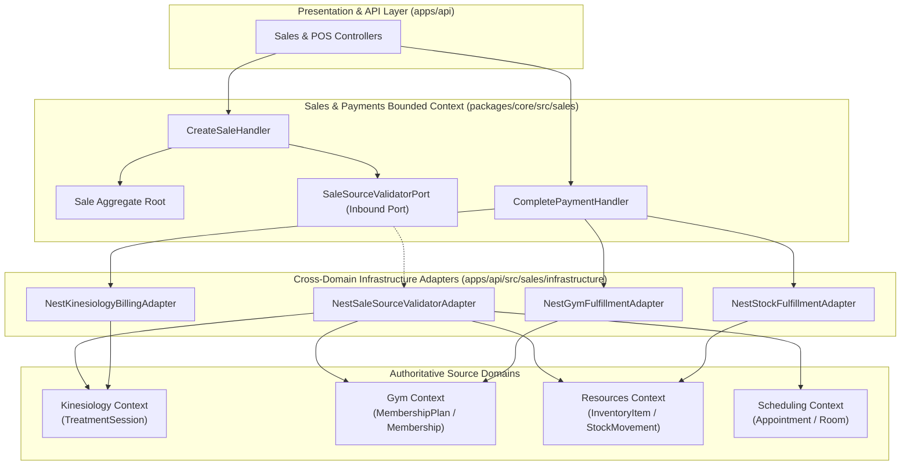

# Cross-Domain Commercial Integration Architecture Specification

- **Status**: Accepted (Approved by Project Owner)
- **Milestone**: Phase 7 — Milestone 7.19: Cross-Domain Integration & End-to-End Commercial Orchestration
- **Bounded Contexts Involved**:
  - **Commercial Sales & Financial Ledger** (`packages/core/src/sales`, `apps/api/src/sales`)
  - **Kinesiology & Clinical Treatments** (`packages/core/src/kinesiology`, `apps/api/src/kinesiology`)
  - **Gym Management & Memberships** (`packages/core/src/gym`, `apps/api/src/gym`)
  - **Resources & Consumable Inventory** (`packages/core/src/resources`, `apps/api/src/resources`)
  - **Scheduling & Appointments** (`packages/core/src/scheduling`, `apps/api/src/scheduling`)
- **Author**: Principal Integration Architect & Senior Domain Architect
- **Governing ADRs**:
  - [ADR-0110: Sale Transaction Ownership and Source Bounded-Context Integrity](../adr/0110-sale-ownership.md)
  - [ADR-0120: Commercial Transaction Uniqueness and Sale Idempotency](../adr/0120-commercial-transaction-uniqueness-and-sale-idempotency.md)
  - [ADR-0121: Sale Source References and Commercial Origin Model](../adr/0121-sale-source-references-and-commercial-origin-model.md)
  - [ADR-0135: Sales, Payments & Receipts Authorization and Security](../adr/0135-sales-payments-receipts-authorization-and-security.md)
  - [ADR-0139: Cross-Domain Commercial Integration Contract, Source Resolution, and Fulfillment Orchestration](../adr/0139-cross-domain-commercial-integration-contract.md)

---

## 1. System Topology & Cross-Domain Boundaries

---

## 2. Canonical Source Matrix

| Commercial Source Type    | Upstream Domain      | Primary Key Entity             | Billability Precondition                          | Authoritative Price Source         | Single-Billing Invariant                             | Post-Payment Fulfillment        |
| :------------------------ | :------------------- | :----------------------------- | :------------------------------------------------ | :--------------------------------- | :--------------------------------------------------- | :------------------------------ |
| **`KINESIOLOGY_SESSION`** | Kinesiology          | `treatment_sessions.id`        | `status === 'COMPLETED'`                          | Appointment Service Fee Schedule   | **Enforced**: At most 1 active Sale per session      | `markSessionBilled()`           |
| **`GYM_MEMBERSHIP`**      | Gym Management       | `membership_plans.id` / `code` | `status === 'ACTIVE'`                             | `MembershipPlan.priceAmount`       | **Repeatable**: Multiple purchases allowed           | `activateOrRenew()`             |
| **`FOOD`**                | Resources Management | `inventory_items.id` / `sku`   | `status === 'ACTIVE'` & Category `HEALTHY_MEALS`  | `InventoryItem.sellingPriceAmount` | **Repeatable**: Unlimited per SKU                    | `sellStock()` (stock decrement) |
| **`DRINK`**               | Resources Management | `inventory_items.id` / `sku`   | `status === 'ACTIVE'` & Category `HEALTHY_DRINKS` | `InventoryItem.sellingPriceAmount` | **Repeatable**: Unlimited per SKU                    | `sellStock()` (stock decrement) |
| **`ROOM_RENTAL`**         | Scheduling           | `rooms.id` / Booking           | `status === 'CONFIRMED'`                          | Room Hourly Rate                   | **Enforced**: At most 1 active Sale per booking slot | Mark booking paid               |

---

## 3. Operational Single-Billing vs Repeatable Invariants

### 3.1 Single-Billing Defense (Clinical Sessions)

Clinical sessions are strictly single-occurrence medical interactions. Re-billing a completed clinical session constitutes fiscal duplicate billing:

1. `CreateSaleHandler` invokes `saleRepository.findBySourceReference('KINESIOLOGY_SESSION', sessionId, tenantId)`.
2. If an active (non-cancelled) Sale exists:
   - If `command.idempotencyKey` matches the existing Sale ID, return existing `SaleDTO` (idempotent 200).
   - If transaction parameters differ or new Sale is attempted, throw `DuplicateSaleException` (HTTP 409 Conflict).

### 3.2 Repeatable Purchases (Consumables & Memberships)

1. Purchasing a bottle of water (`DRINK`) or an energy bar (`FOOD`) does **not** consume or exhaust the product definition. Multiple sales may reference the identical `sourceId` simultaneously.
2. Purchasing a Gym Membership Plan (`GYM_MEMBERSHIP`) does not exhaust the plan. A client may renew their plan or purchase additional passes.

---

## 4. Multi-Tenant & Zero Client Trust Invariants

1. **Organization Isolation**: Every source validation input passes `tenantId`. The adapter verifies `upstreamEntity.tenantId === context.tenantId`. Cross-tenant checkout returns `TenantMismatchException` (HTTP 404).
2. **Actor Propagation**: Cashier / receptionist user identity is passed via verified JWT (`@CurrentUser()`). Request bodies are prohibited from specifying `actorId` or `userId`.
3. **GDPR Cascade Immunity**: Sales references `clientId` solely as an optional scalar string without relational foreign keys. If a client record is purged or anonymized, sales transaction history remains uncorrupted.

---

## 5. Automated Verification & Testing Strategy

A 4-tier test pyramid will guard this integration:

1. **Domain Purity Unit Tests**: Verify `SaleSource` VO and `SourceReference` VO maintain 0 imports of foreign packages (`sales-architecture-boundaries.spec.ts`).
2. **Application Handler Specification**: Unit tests for `CreateSaleHandler` asserting rejection of uncompleted sessions, missing sources, and cross-tenant probes (`create-sale.handler.spec.ts`).
3. **Cross-Domain Adapter Integration**: Verify NestJS adapters correctly map Prisma delegates without cross-domain relational joins.
4. **End-to-End POS Checkout Workflows**: Supertest suites executing complete sales:
   - Clinical Session Checkout -> Paid -> Billed
   - Gym Plan Purchase -> Paid -> Membership Activated
   - Retail Food POS Checkout -> Paid -> Stock Decremented
