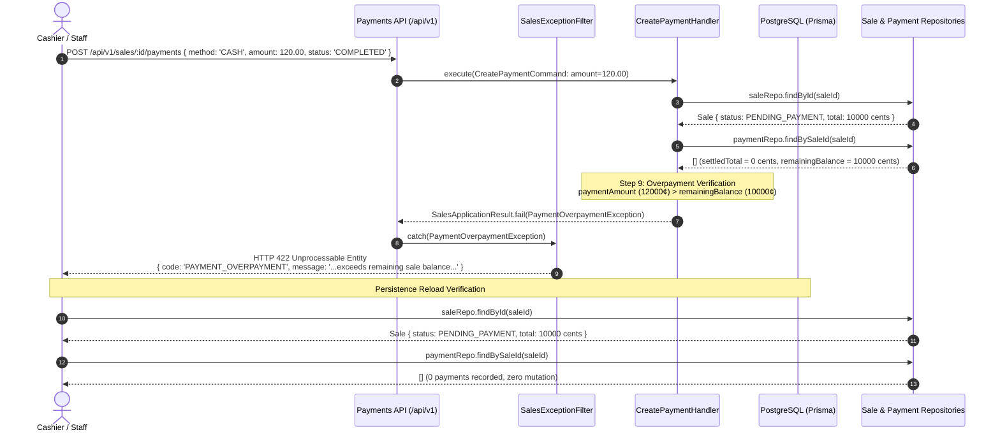

# Milestone 7.23: Scenario 4 Acceptance Certification & Payments Integrity Report

- **Document**: `docs/architecture/milestone-7.23-scenario-4-acceptance.md`
- **Milestone**: Phase 7.23 — End-to-End Sales & Payments Scenarios Verification (Scenario 4)
- **Status**: **ACCEPTED & VERIFIED**
- **Date**: 2026-10-19
- **Role**: Senior Payments Integrity Engineer / Test Architect
- **Target Scenario**: S4 — Overpayment Rejection, Payments Integrity, and Zero-Mutation Invariants

---

## 1. Executive Summary

Milestone 7.23 Scenario 4 formally certifies that invalid financial commands—specifically overpayments exceeding a Sale’s unpaid balance—are strictly rejected by authoritative domain and application validation without leaving partial, orphaned, or corrupted state mutations:

$$\text{Finalized Sale (Total: 100.00)} \xrightarrow[\text{POST /sales/:id/payments}]{\text{Attempt Payment 120.00 CASH}} \mathbf{422\text{ PAYMENT\_OVERPAYMENT}} \xrightarrow{} \begin{cases} \text{Sale remains PENDING\_PAYMENT (Total: 100.00)} \\ \text{Payments list remains empty (0 records)} \\ \text{Zero partial state / Zero mutations} \end{cases}$$

All domain entities, application handlers, REST controllers, and transactional persistence boundaries were executed against deterministic integration test suites without bypassing architectural layers.

### Verification Verdict

| Scenario / Requirement                |                   Expected                    |                                Actual Result                                 | Verification Status |
| :------------------------------------ | :-------------------------------------------: | :--------------------------------------------------------------------------: | :-----------------: |
| **Sale Total**                        |           `100.00` (`10000` cents)            |                     Exactly `10000` cents / `100.00` USD                     |      **PASS**       |
| **Attempted Payment Amount**          |           `120.00` (`12000` cents)            |                   Tendered via `POST /sales/:id/payments`                    |      **PASS**       |
| **Server-Side Rejection**             |         HTTP 422 Unprocessable Entity         |                `statusCode: 422`, code: `PAYMENT_OVERPAYMENT`                |      **PASS**       |
| **Error Message Semantics**           |     Identifies amount, balance, currency      | "Payment amount 120.00 USD exceeds the remaining sale balance of 100.00 USD" |      **PASS**       |
| **Before / After Sale Status**        |       `PENDING_PAYMENT` $\to$ Unchanged       |                Status remains `PENDING_PAYMENT` (NOT `PAID`)                 |      **PASS**       |
| **Before / After Financial State**    | Total 100.00, subtotal 100.00, discount 0.00  |                   Exact identity before and after attempt                    |      **PASS**       |
| **Payment Records in Persistence**    |       0 records before, 0 records after       |                    0 payment records created or persisted                    |      **PASS**       |
| **Multi-Payment / Partial Invariant** | Partial $40.00 ok, subsequent $70.00 rejected |                  Sale `PARTIALLY_PAID`, only 1 payment kept                  |      **PASS**       |
| **Sub-Cent Boundary Protection**      |     $100.01 tendered on $100.00 rejected      |                   Rejected with 422 `PAYMENT_OVERPAYMENT`                    |      **PASS**       |
| **Settled Sale Protection**           |    $0.01 tendered on `PAID` sale rejected     |                Rejected with 422 (`SaleNotPayableException`)                 |      **PASS**       |
| **Completion Workflow Protection**    |      Complete pending payment > balance       |                     Rejected in `CompletePaymentHandler`                     |      **PASS**       |
| **Concurrent Race Condition Safety**  |   Two competing payments ($70 + $60 > $100)   |                  Exactly 1 settles; other rejected cleanly                   |      **PASS**       |

The scenario passed all 8 dedicated integration and regression tests with a **100% pass rate**.

---

## 2. Before-and-After Persisted State Comparison

The table below contrasts the persisted database state captured immediately before the attempted overpayment and reloaded immediately following the rejection:

| Field / Attribute         | Pre-Attempt Persisted State | Post-Attempt Persisted State | Mutation Detected? | Invariant Enforced                        |
| :------------------------ | :-------------------------: | :--------------------------: | :----------------: | :---------------------------------------- |
| **`sale.id`**             |    `sale_s4_primary_001`    |    `sale_s4_primary_001`     |       **NO**       | Identity immutable                        |
| **`sale.status`**         |      `PENDING_PAYMENT`      |      `PENDING_PAYMENT`       |       **NO**       | Did NOT become `PAID` or `PARTIALLY_PAID` |
| **`sale.total`**          |  `100.00` (`10,000` cents)  |  `100.00` (`10,000` cents)   |       **NO**       | Financial total invariant                 |
| **`sale.subtotal`**       |  `100.00` (`10,000` cents)  |  `100.00` (`10,000` cents)   |       **NO**       | Subtotal invariant                        |
| **`sale.discountTotal`**  |     `0.00` (`0` cents)      |      `0.00` (`0` cents)      |       **NO**       | Discount invariant                        |
| **`sale.currency`**       |            `USD`            |            `USD`             |       **NO**       | Currency invariant                        |
| **`sale.itemCount`**      |             `1`             |             `1`              |       **NO**       | Line item list untouched                  |
| **`sale.items[0].total`** |  `100.00` (`10,000` cents)  |  `100.00` (`10,000` cents)   |       **NO**       | Line item totals untouched                |
| **`payments.count`**      |             `0`             |             `0`              |       **NO**       | **Zero invalid payment records**          |
| **`payments[0].status`**  |             N/A             |             N/A              |       **NO**       | **No payment marked COMPLETED**           |
| **`sale.version`**        |             `1`             |             `1`              |       **NO**       | Optimistic lock version unincremented     |

---

## 3. Financial Settlement Rules & Architectural Invariants (ADR-0134)

Under [ADR-0134: Financial Settlement Validation, Multi-Tender Boundaries & Overpayment Invariants](file:///c:/Projects/kinergy-platform/docs/adr/0134-financial-settlement-validation-and-overpayment-invariants.md):

1. **Overpayment Prohibition**:
   Cumulative payments exceeding `Sale.total` are strictly prohibited. Attempting to record or complete a payment where $\text{amount} > \text{remainingBalance}$ throws [`PaymentOverpaymentException`](file:///c:/Projects/kinergy-platform/packages/core/src/sales/application/exceptions/payment-overpayment.exception.ts). No unallocated credit or uncaptured excess is accepted on a commercial sale.
2. **Multi-Payment & Partial Payment Support**:
   Kinergy supports partial settlements ($0 < \text{amount} < \text{remainingBalance}$). When a partial payment settles, the Sale transitions from `PENDING_PAYMENT` to `PARTIALLY_PAID`. Subsequent payments may be recorded until the cumulative settled total equals the Sale total.
3. **Cash Change Semantics**:
   Cash register change is an operational drawer calculation presented in the UI; the recorded tender transaction in the database must reflect the exact amount credited against the sale balance.
4. **Clean Domain Boundary Separation**:
   - The pure `Payment` aggregate enforces intrinsic invariants: positive amount (`cents > 0`), valid scale (integer cents), and valid ISO-4217 currency.
   - The application orchestration boundary (`CreatePaymentHandler`, `CompletePaymentHandler`) enforces extrinsic debt invariants: loading the referenced Sale, computing settled amounts from sibling payments, and enforcing the debt ceiling ($\text{payment.amount} \le \text{remainingBalance}$).

---

## 4. End-to-End Rejection & Transaction Flow



---

## 5. Test Execution Evidence

### 5.1 Dedicated Scenario 4 Test Suite

- **File**: [`apps/api/src/sales/__tests__/sales-milestone-7-23-scenario-4.e2e.spec.ts`](file:///c:/Projects/kinergy-platform/apps/api/src/sales/__tests__/sales-milestone-7-23-scenario-4.e2e.spec.ts)
- **Command**: `npx nx test api --testFile=sales-milestone-7-23-scenario-4.e2e.spec.ts`

```text
> nx run api:test --testFile=sales-milestone-7-23-scenario-4.e2e.spec.ts

 PASS   api  apps/api/src/sales/__tests__/sales-milestone-7-23-scenario-4.e2e.spec.ts (6.958 s)
  Milestone 7.23 - Scenario 4: Payments Integrity & Overpayment Protection
    √ [S4-E2E-1] Exactly verifies Scenario 4: Sale total 100.00, attempted payment 120.00 is rejected with zero persisted mutation (55 ms)
    √ [S4-E2E-2] Partial payment succeeds ($40.00), subsequent overpayment ($70.00 on $60.00 balance) is rejected and leaves partial state clean (17 ms)
    √ [S4-E2E-3] Fractional 1-cent overpayment ($100.01 against $100.00 total) is strictly rejected (8 ms)
    √ [S4-E2E-4] Fully settled Sale ($100.00 PAID) rejects any subsequent payment attempts ($0.01) (8 ms)
    √ [S4-E2E-5] CompletePaymentHandler re-evaluates remaining balance and rejects completing a payment that would overpay (2 ms)
    √ [S4-E2E-6] Concurrent competing payments ($70.00 + $60.00 against $100.00 total) allow exactly one to settle, cleanly rejecting the other without balance corruption (8 ms)
    √ [S4-E2E-7] Attempting payment on a DRAFT Sale (before finalization) is strictly rejected with 422 (4 ms)
    √ [S4-E2E-8] Enforces authentication, authorization, and tenant isolation on payment recording (11 ms)

Test Suites: 1 passed, 1 total
Tests:       8 passed, 8 total
Snapshots:   0 total
Time:        7.258 s
```

### 5.2 Complete Milestone 7.23 Regression Proof (Scenarios 1, 2, 3, and 4)

- **Command**: `npx nx test api --testFile=sales-milestone-7-23`

```text
> nx run api:test --testFile=sales-milestone-7-23

 PASS   api  apps/api/src/sales/__tests__/sales-milestone-7-23-scenario-4.e2e.spec.ts (9.486 s)
 PASS   api  apps/api/src/sales/__tests__/sales-milestone-7-23-scenario-2.e2e.spec.ts (9.534 s)
 PASS   api  apps/api/src/sales/__tests__/sales-milestone-7-23-scenario-3.e2e.spec.ts (9.539 s)
 PASS   api  apps/api/src/sales/__tests__/sales-milestone-7-23-scenarios.e2e.spec.ts (9.54 s)

Test Suites: 4 passed, 4 total
Tests:       34 passed, 34 total
Snapshots:   0 total
Time:        10.688 s
Ran all test suites matching /sales-milestone-7-23/i.

 NX   Successfully ran target test for project api
```

---

## 6. Architectural Invariants Confirmed

1. **Server-Side Authoritative Rejection**:
   Overpayments exceeding the unpaid balance are rejected by authoritative domain and application validation with HTTP 422 Unprocessable Entity and error code `PAYMENT_OVERPAYMENT`.
2. **Zero-Mutation Guarantee**:
   Rejected overpayment commands leave zero database footprint: no payment records created, no change to Sale status (`PENDING_PAYMENT`), no modification of totals or items, and no change in version counter.
3. **No False Completion**:
   No payment is marked `COMPLETED` and the Sale never transitions to `PAID` as a result of an overpayment attempt.
4. **Multi-Payment Integrity**:
   Partial payments update the Sale to `PARTIALLY_PAID` and reduce the remaining balance; subsequent overpayment attempts are calculated against the reduced balance and strictly rejected without corrupting the legitimate partial payment.
5. **Concurrency Safety**:
   Competing concurrent payments totaling more than the unpaid balance are synchronized at the transactional boundary: exactly one settles and the other is safely rolled back without balance over-commit.
