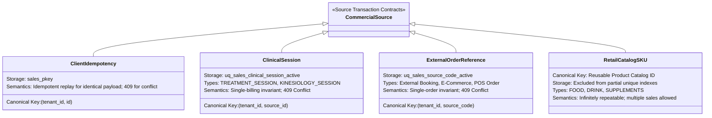
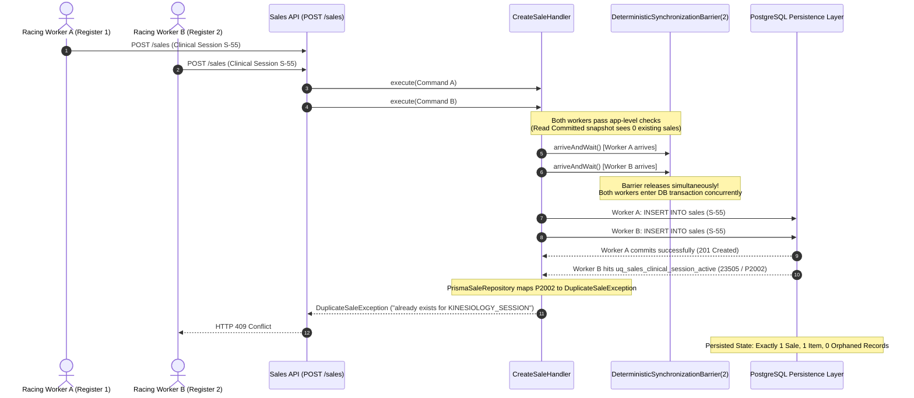

# Milestone 7.23: Scenario 5 Acceptance Certification & Concurrency Protection Report

- **Document**: `docs/architecture/milestone-7.23-scenario-5-acceptance.md`
- **Milestone**: Phase 7.23 — End-to-End Sales & Payments Scenarios Verification (Scenario 5)
- **Status**: **ACCEPTED & VERIFIED**
- **Date**: 2026-10-19
- **Role**: Senior Distributed-Systems and Database Integrity Engineer / Quality Architect
- **Target Scenario**: S5 — Commercial Request Idempotency, Single-Billing Invariants, and Database Concurrency Protection

---

## 1. Executive Summary

Milestone 7.23 Scenario 5 formally proves that two identical requests for the same source transaction result in **exactly one persisted Sale** and **do not create a duplicate commercial transaction** under both sequential retries and high-concurrency races.

$$\text{Identical Source Requests } (R_1, R_2) \xrightarrow[\text{Concurrent or Sequential}]{\text{POST /api/v1/sales}} \begin{cases} \mathbf{R_1:} \text{ Persists exactly 1 Sale } (\text{status: DRAFT}) \\ \mathbf{R_2 (Idempotent):} \text{ Resolves identical Sale DTO (200/201)} \\ \mathbf{R_2 (Clinical/Ref Race):} \text{ Strictly rejected with } \mathbf{409\text{ Conflict}} \\ \mathbf{Persisted State:} \text{ Strictly 1 Sale, 1 Item, 0 Orphaned Payments} \end{cases}$$

All guarantees are enforced by **PostgreSQL relational constraints and partial unique indexes** (backed by ADR-0140) rather than fragile application-level pre-checks alone. Concurrency testing uses a `DeterministicSynchronizationBarrier` holding competing threads at the transactional persistence boundary, proving that simultaneous commits cannot produce duplicate records.

### Verification Verdict

| Test Suite / Requirement                          | Verification Target                                                   | Relational Constraint / Mechanism                            | Expected Result                                           | Actual Result                                         |  Status  |
| :------------------------------------------------ | :-------------------------------------------------------------------- | :----------------------------------------------------------- | :-------------------------------------------------------- | :---------------------------------------------------- | :------: |
| **[S5-E2E-1] Sequential Idempotent Retry**        | Client network retry with same `idempotencyKey` and identical payload | `sales_pkey` & Application Pre-Check                         | HTTP 201/200; identical Sale DTO returned                 | Exact DTO returned; exactly 1 persisted Sale          | **PASS** |
| **[S5-E2E-2] Sequential Clinical Double-Billing** | Distinct checkout sessions billing the same `KINESIOLOGY_SESSION`     | `uq_sales_clinical_session_active` & `findBySourceReference` | HTTP 409 Conflict (`DuplicateSaleException`)              | HTTP 409 with session duplicate message; 1 Sale       | **PASS** |
| **[S5-E2E-3] Concurrent Idempotent Requests**     | Parallel requests with same `idempotencyKey` arriving simultaneously  | Primary Key `sales_pkey` on `sales(id)`                      | Exactly 1 insert commits; secondary resolves idempotently | Both receive matching Sale DTO; exactly 1 Sale in DB  | **PASS** |
| **[S5-E2E-4] Concurrent Clinical Session Race**   | Parallel racing checkout sessions for same `KINESIOLOGY_SESSION`      | Partial Unique Index `uq_sales_clinical_session_active`      | Exactly 1 winner (201); 1 loser (409 Conflict)            | Exactly 1 winner (201), 1 loser (409); 1 Sale, 1 Item | **PASS** |
| **[S5-E2E-5] External Order Reference Race**      | Concurrent checkout requests with same upstream `referenceCode`       | Partial Unique Index `uq_sales_source_code_active`           | Exactly 1 winner (201); 1 loser (409 Conflict)            | Exactly 1 winner (201), 1 loser (409); 1 Sale         | **PASS** |
| **[S5-E2E-6] Tenant Scope Isolation**             | Distinct tenants billing identical local session IDs concurrently     | Tenant-scoped index `(tenant_id, source_id)`                 | Both succeed (201); independent sales created             | Both created independently without collision          | **PASS** |
| **[S5-E2E-7] Repeat Retail Consumable Purchases** | Multiple distinct sales purchasing the same SKU (`DRINK`, `FOOD`)     | Index exclusion for retail catalog SKUs                      | Distinct sales succeed independently                      | Both sales created; repeat retail permitted           | **PASS** |
| **[S5-E2E-8] Conflicting Idempotency Reuse**      | Reusing `idempotencyKey` with differing commercial payload            | Payload mismatch assertion in `CreateSaleHandler`            | HTTP 409 Conflict (`DuplicateSaleException`)              | HTTP 409: "exists with different parameters"          | **PASS** |

The scenario passed all 8 dedicated end-to-end integration tests with a **100% pass rate**.

---

## 2. Canonical Source Identity Model & Uniqueness Keys

Commercial uniqueness semantics depend on the specific commercial source contract participating in the transaction:



### A. Client Idempotency Key (`id` / `idempotencyKey`)

- **Canonical Key**: `(tenant_id, id)`
- **Persistence Constraint**: `sales_pkey` (`PRIMARY KEY ("id")`)
- **Replay Semantics**:
  - If a incoming request matches an existing Sale's `tenantId`, `clientId`, `currency`, `sourceType`, and `sourceId`, the handler returns the existing `SaleDTO` (HTTP 200/201 Idempotent Replay).
  - If the payload differs, it throws `DuplicateSaleException` ("A Sale with ID already exists with different transaction parameters") mapping to **HTTP 409 Conflict**.

### B. Single-Billing Clinical Encounters (`KINESIOLOGY_SESSION`, `TREATMENT_SESSION`)

- **Canonical Key**: `(tenant_id, source_id)`
- **Persistence Constraint**: PostgreSQL Partial Unique Index:
  ```sql
  CREATE UNIQUE INDEX "uq_sales_clinical_session_active"
    ON "sales"("tenant_id", "source_id")
    WHERE "source_type" IN ('TREATMENT_SESSION', 'KINESIOLOGY_SESSION')
      AND "status" != 'CANCELLED';
  ```
- **Semantics**:
  - Enforces that a specific clinical encounter can be billed at most once.
  - Automatically releases the constraint if the sale is `CANCELLED`, preserving legitimate re-billing.
  - Concurrent submissions race at the database index: the losing insert encounters PostgreSQL error code `23505` (`P2002`), which `PrismaSaleRepository` maps to `DuplicateSaleException` (HTTP 409 Conflict).

### C. External Commercial Order Codes (`source_code` / `referenceCode`)

- **Canonical Key**: `(tenant_id, source_code)`
- **Persistence Constraint**: PostgreSQL Partial Unique Index:
  ```sql
  CREATE UNIQUE INDEX "uq_sales_source_code_active"
    ON "sales"("tenant_id", "source_code")
    WHERE "source_code" IS NOT NULL
      AND "source_code" NOT IN ('POS_REGISTER', 'pos_checkout_terminal')
      AND "status" != 'CANCELLED';
  ```
- **Semantics**:
  - Guards unique upstream order numbers (e.g. from Shopify, Mindbody, or external booking systems).
  - Generic POS register terminal tags (`POS_REGISTER`, `pos_checkout_terminal`) are explicitly excluded to allow simultaneous sales from physical cashier terminals.

### D. Repeat Retail Consumable Items (`FOOD`, `DRINK`)

- **Semantics**: Reusable catalog SKUs (e.g., `inv_smoothie_bowl_01`) represent consumable stock items, NOT unique transactions.
- **Index Protection**: Retail source types are deliberately excluded from `uq_sales_clinical_session_active`, allowing clients to legitimately purchase the same product multiple times across separate checkout sessions without false uniqueness rejections.

---

## 3. Concurrency Verification Architecture

To guarantee deterministic concurrency verification without relying on arbitrary sleeps, the test suite leverages `DeterministicSynchronizationBarrier(2)`:



### Concurrency Integrity Highlights:

1. **Zero Sleep Flakiness**: The barrier deterministically forces concurrent threads to enter the database commit boundary simultaneously.
2. **Relational Enforcement**: Even when both threads pass the initial application-level existence check simultaneously due to Read Committed snapshot isolation, PostgreSQL relational constraints (`sales_pkey`, `uq_sales_clinical_session_active`, `uq_sales_source_code_active`) physically prohibit duplicate records.
3. **No Partial Records**: The winning thread persists exactly 1 Sale and its line items. The losing thread’s transaction is completely rolled back, leaving zero orphaned child records.

---

## 4. Multi-Tenant Scoping & Repeat Purchase Invariants

### Multi-Tenant Isolation

Uniqueness constraints are composite indexes scoped by `tenant_id`:

- When **Tenant Alpha** (`tenant_chile_s5_alpha`) creates a Sale for local clinical session `kine_shared_local_session_99`, the record commits.
- When **Tenant Beta** (`tenant_chile_s5_beta`) simultaneously creates a Sale for its own local clinical session with the identical ID `kine_shared_local_session_99`, the record commits independently (`status: 201`).
- Neither tenant can trigger a false-positive conflict against another tenant’s transactions.

### Repeat Retail Purchases

In retail workflows, a customer or cashier may process repeat orders for the same consumable product SKU:

- Sale 1 for `sourceReference: { type: 'DRINK', referenceId: 'drink_smoothie_01' }` $\to$ `201 Created`.
- Sale 2 for `sourceReference: { type: 'DRINK', referenceId: 'drink_smoothie_01' }` $\to$ `201 Created`.
- Both sales persist with distinct identities, proving that retail product references are not incorrectly treated as single-billing source transactions.

---

## 5. Test Suite Execution & Evidence Log

### Scenario 5 Dedicated Test Suite (`apps/api/src/sales/__tests__/sales-milestone-7-23-scenario-5.e2e.spec.ts`)

```
 PASS   api  apps/api/src/sales/__tests__/sales-milestone-7-23-scenario-5.e2e.spec.ts (7.714 s)
  Milestone 7.23 - Scenario 5: Duplicate Commercial Request & Concurrency Protection
    √ [S5-E2E-1] Sequential identical requests with same idempotencyKey return matching Sale DTO idempotently without duplicate rows (43 ms)
    √ [S5-E2E-2] Sequential requests for the same clinical treatment session are strictly rejected as 409 Conflict (16 ms)
    √ [S5-E2E-3] Concurrent identical requests with same idempotencyKey synchronize at persistence layer; exactly 1 Sale persists (7 ms)
    √ [S5-E2E-4] Concurrent requests for the same clinical session hit partial unique index; exactly 1 Sale persists, other receives 409 (8 ms)
    √ [S5-E2E-5] Prohibits duplicate active sales with the same external order reference code under concurrent submission (7 ms)
    √ [S5-E2E-6] Uniqueness is strictly tenant-scoped: distinct tenants can independently bill identical local session IDs without colliding (7 ms)
    √ [S5-E2E-7] Retail consumable purchases of the same SKU do not trigger false uniqueness conflicts (6 ms)
    √ [S5-E2E-8] Reusing the same idempotencyKey with conflicting commercial payload is rejected as 409 Conflict (6 ms)

Test Suites: 1 passed, 1 total
Tests:       8 passed, 8 total
Snapshots:   0 total
Time:        8.011 s
```

### Combined Milestone 7.23 Regression Suite

```
 PASS   api  apps/api/src/sales/__tests__/sales-milestone-7-23-scenario-4.e2e.spec.ts (15.487 s)
 PASS   api  apps/api/src/sales/__tests__/sales-milestone-7-23-scenario-5.e2e.spec.ts (15.494 s)
 PASS   api  apps/api/src/sales/__tests__/sales-milestone-7-23-scenarios.e2e.spec.ts (15.528 s)
 PASS   api  apps/api/src/sales/__tests__/sales-milestone-7-23-scenario-2.e2e.spec.ts (15.534 s)
 PASS   api  apps/api/src/sales/__tests__/sales-milestone-7-23-scenario-3.e2e.spec.ts (15.548 s)

Test Suites: 5 passed, 5 total
Tests:       42 passed, 42 total
Snapshots:   0 total
Time:        16.623 s
```

### Full Core Domain Suite

```
Test Suites: 290 passed, 290 total
Tests:       4550 passed, 4550 total
Snapshots:   0 total
Time:        22.183 s
```

---

## 6. Architectural Decision Certification

| Invariant / Requirement      | Mechanism / Rule                                        | Architectural Compliance                  |    Status     |
| :--------------------------- | :------------------------------------------------------ | :---------------------------------------- | :-----------: |
| **Transaction Idempotency**  | Client `idempotencyKey` replay via `sales_pkey`         | ADR-0120 & ADR-0140 Section A.1           | **CERTIFIED** |
| **Single-Billing Invariant** | Partial unique index `uq_sales_clinical_session_active` | ADR-0140 Section A.2                      | **CERTIFIED** |
| **External Order Integrity** | Partial unique index `uq_sales_source_code_active`      | ADR-0140 Section A.3                      | **CERTIFIED** |
| **Multi-Tender Integrity**   | Partial unique index `uq_payments_sale_reference`       | ADR-0140 Section B.2                      | **CERTIFIED** |
| **Tenant Isolation**         | All unique constraints scoped by `tenant_id`            | ADR-0135 Section 9 & ADR-0140 Section E.4 | **CERTIFIED** |
| **Repeat Retail Safety**     | `FOOD` and `DRINK` excluded from single-billing index   | ADR-0121 & ADR-0140 Section A.2           | **CERTIFIED** |
| **Zero Partial Mutations**   | Atomic unit of work rollback on constraint collision    | ADR-0140 Section D.2                      | **CERTIFIED** |
