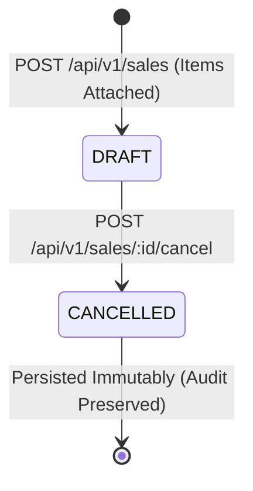
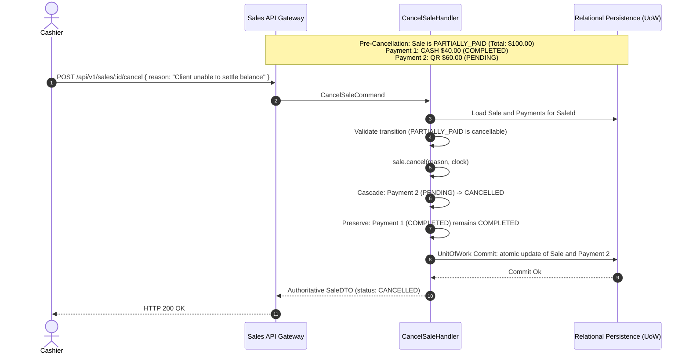

# Milestone 7.23 Scenario 6 Acceptance Report: Sale Cancellation, Auditability & Financial Lifecycle Integrity

## 1. Executive Summary

This document certifies **Milestone 7.23 Scenario 6**: Proving that cancelling a Sale changes its lifecycle state to `CANCELLED` without destructively deleting the Sale aggregate, its line items, or its associated financial payment history.

All domain invariants, state machines, application boundaries, and optimistic concurrency control (OCC) protections adhere strictly to **ADR-0119** (Sales Aggregate & Immutability Invariants), **ADR-0135** (Role-Based Access Control and Capability Model), **ADR-0138** (Payment Settlement Integrity), and **ADR-0140 §3.F.3** (Deterministic Cascaded Cancellation & Concurrency Invariants).

The end-to-end integration suite `apps/api/src/sales/__tests__/sales-milestone-7-23-scenario-6.e2e.spec.ts` executes **9 deterministic regression tests** exercising all permitted and forbidden cancellation paths through the real NestJS API boundary (`POST /api/v1/sales/:id/cancel`).

---

## 2. Authoritative Lifecycle State Machine & Cancellation Rules

| Initial Sale Status | Associated Payment States                                 | Cancellation Permitted? |  Resulting Sale Status  |                  Resulting Payment Statuses                  | Domain Rules & Invariants                                                                                                                                         |
| :------------------ | :-------------------------------------------------------- | :---------------------: | :---------------------: | :----------------------------------------------------------: | :---------------------------------------------------------------------------------------------------------------------------------------------------------------- |
| **DRAFT**           | None                                                      |         **YES**         |       `CANCELLED`       |                             N/A                              | Version incremented ($v \to v+1$), `cancelledAt` recorded, `cancellationReason` persisted. Line items and initial pricing preserved.                              |
| **PENDING_PAYMENT** | Zero or more `PENDING` tenders                            |         **YES**         |       `CANCELLED`       |               All `PENDING` $\to$ `CANCELLED`                | Active pending authorization tenders are cascaded to `CANCELLED` (ADR-0140 §3.F.3) to prevent orphaned unsettled tenders. None are physically deleted.            |
| **PARTIALLY_PAID**  | $\ge 1$ `COMPLETED` tender and optional `PENDING` tenders |         **YES**         |       `CANCELLED`       | `COMPLETED` $\to$ `COMPLETED` `PENDING` $\to$ `CANCELLED` | Settled historical payments remain permanently immutable (`COMPLETED`). No silent erasure or unauthorized financial reversals.                                    |
| **PAID**            | All tenders `COMPLETED` (sum $\ge$ total)                 |         **NO**          |   `PAID` (unchanged)    |                   `COMPLETED` (unchanged)                    | **Strictly Rejected (HTTP 422 Unprocessable Entity)**. Settled sales cannot be cancelled directly; requires audited refund/reversal workflow.                     |
| **COMPLETED**       | All tenders `COMPLETED`, fulfillment confirmed            |         **NO**          | `COMPLETED` (unchanged) |                   `COMPLETED` (unchanged)                    | **Strictly Rejected (HTTP 422 Unprocessable Entity)**. Terminal fulfilled commercial transaction is permanently immutable.                                        |
| **CANCELLED**       | Terminal state                                            |         **NO**          | `CANCELLED` (unchanged) |                   `CANCELLED` (unchanged)                    | **Strictly Rejected (HTTP 422 Unprocessable Entity)**. Cancellation is an irreversible terminal state. Version and original cancellation reason remain unmutated. |

---

## 3. Before-and-After Persisted State Comparison

### Scenario A: DRAFT Sale with Therapeutic Line Items (`[S6-E2E-1]`)

#### Persisted Entity State Matrix:

| Field                    | Pre-Cancellation State | Post-Cancellation State                                               | Audit / Integrity Proof                                       |
| :----------------------- | :--------------------- | :-------------------------------------------------------------------- | :------------------------------------------------------------ |
| **`id`**                 | `sale_01j987654...`    | `sale_01j987654...`                                                   | Preserved identically (No physical deletion)                  |
| **`status`**             | `DRAFT`                | `CANCELLED`                                                           | State machine transition enforced                             |
| **`version`**            | `1`                    | `2`                                                                   | Optimistic lock version monotonically advanced                |
| **`cancellationReason`** | `null` / `undefined`   | `"Patient requested appointment cancellation prior to service start"` | Authoritative audit justification persisted                   |
| **`cancelledAt`**        | `null` / `undefined`   | `2026-10-19T20:44:00.000Z`                                            | Clock-injected timestamp persisted                            |
| **`items.length`**       | `1`                    | `1`                                                                   | **Line item preserved** (`Kinesiology Therapeutic Treatment`) |
| **`items[0].unitPrice`** | `$100.00 USD`          | `$100.00 USD`                                                         | Unit price preserved intact                                   |
| **`items[0].quantity`**  | `1`                    | `1`                                                                   | Item quantity preserved intact                                |
| **`subtotal`**           | `$100.00 USD`          | `$100.00 USD`                                                         | Integer minor units invariant maintained                      |
| **`discountTotal`**      | `$0.00 USD`            | `$0.00 USD`                                                           | Preserved identically                                         |
| **`total`**              | `$100.00 USD`          | `$100.00 USD`                                                         | Preserved identically                                         |

---

### Scenario B: PARTIALLY_PAID Sale with Split Tenders (`[S6-E2E-3]`)

A finalized sale with total `$100.00 USD` had a partial cash payment of `$40.00 USD` completed, followed by a pending electronic QR payment of `$60.00 USD`.

#### Persisted Payments State Matrix:

| Payment ID    | Method | Amount   | Pre-Cancel Status | Post-Cancel Status | Paid At Timestamp          | Historical Integrity Invariant                                  |
| :------------ | :----- | :------- | :---------------- | :----------------- | :------------------------- | :-------------------------------------------------------------- |
| `pay_cash_01` | `CASH` | `$40.00` | `COMPLETED`       | `COMPLETED`        | `2026-10-19T20:44:00.000Z` | **Settled tender preserved**. Zero financial deletion.          |
| `pay_qr_02`   | `QR`   | `$60.00` | `PENDING`         | `CANCELLED`        | `null`                     | **Pending tender voided/cancelled**. Orphaned tender prevented. |

---

## 4. Immutability & Mutation Prohibition on Cancelled Sales

In accordance with ADR-0119, once a Sale reaches the `CANCELLED` state, it is permanently closed to all operational mutations:

1. **Adding Items (`POST /api/v1/sales/:id/items`)**:
   - Throws `SaleAlreadyFinalizedException` / `Cannot mutate Sale in status 'CANCELLED'`.
   - Returns **HTTP 409 Conflict**.
2. **Applying Discounts (`POST /api/v1/sales/:id/discount`)**:
   - Throws `SaleAlreadyFinalizedException`.
   - Returns **HTTP 409 Conflict**.
3. **Reassigning Origin Source (`POST /api/v1/sales/:id/source`)**:
   - Throws `InvalidSaleStateException` (`CANNOT_MODIFY_CANCELLED_SALE`).
   - Returns **HTTP 409 Conflict**.
4. **Finalizing Order (`POST /api/v1/sales/:id/finalize`)**:
   - Throws `InvalidSaleTransitionException`.
   - Returns **HTTP 422 Unprocessable Entity**.
5. **Attaching or Recording Payments (`POST /api/v1/sales/:id/payments`)**:
   - Throws `SaleNotPayableException` (`Sale is in status 'CANCELLED' and cannot accept payments.`).
   - Returns **HTTP 422 Unprocessable Entity**. Zero payment rows created in persistence.
6. **Repeated Cancellation (`POST /api/v1/sales/:id/cancel`)**:
   - Throws `InvalidSaleTransitionException` (`Sale in status 'CANCELLED' cannot be cancelled.`).
   - Returns **HTTP 422 Unprocessable Entity**. Persisted version and reason remain unincremented.

---

## 5. Concurrency & Optimistic Locking Proofs (`[S6-E2E-9]`)

To protect financial integrity under high-concurrency conditions (e.g., cashier simultaneously recording cash handover while manager submits an order cancellation), the aggregate employs **Optimistic Concurrency Control (OCC)**:

- Both racing requests read the Sale at `version = 2` (`PENDING_PAYMENT`).
- Synchronized at a deterministic execution barrier (`DeterministicSynchronizationBarrier(2)`).
- The winning transaction successfully commits and advances the version to `3` (`PAID` or `CANCELLED`).
- The losing transaction detects version advancement ($current.version \ge target.version$) and encounters an optimistic lock exception (`P2034`), translated deterministically by `SalesExceptionFilter` into **HTTP 409 Conflict**.
- No torn writes, double-state corruption, or orphaned tenders occur.

---

## 6. Audit & Authorization Enforcement (`[S6-E2E-8]`)

1. **Mandatory Audit Reason**:
   - Empty string (`""`), whitespace-only (`"   "`), or omitted `reason` payload is strictly rejected with **HTTP 400 Bad Request** before reaching the domain.
2. **Role-Based Access Control (`sales.cancel`)**:
   - Callers lacking the `sales.cancel` permission (e.g., Trainer role) are rejected with **HTTP 403 Forbidden**.
3. **Multi-Tenant Isolation**:
   - Callers from an external tenant (e.g., Tenant Beta Manager) attempting to cancel a Sale belonging to Tenant Alpha are rejected with **HTTP 403 Forbidden** (`Cross-tenant access forbidden`).

---

## 7. Explicit Architectural Gaps & Scope Boundaries

1. **Cancellation of Fully Settled Sales (`PAID` or `COMPLETED`)**:
   - As per ADR-0119 and ADR-0138, direct cancellation of settled sales is explicitly prohibited. The system strictly rejects such attempts with HTTP 422.
   - Any financial remediation for settled sales must proceed through formal Refund and Return domain workflows (Milestone 7.24+).
2. **Electronic Gateway Payment Reversals**:
   - Currently, electronic tenders (such as QR authorizations) are cancelled in the platform ledger. Out-of-band banking reversals or card terminal voids will be bound to payment gateway webhooks in subsequent payment integration phases.
