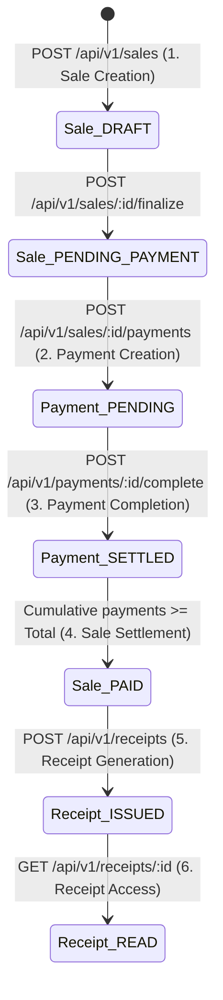

# Milestone 7.24: End-to-End Financial Verification & Test Strategy Specification

- **Document**: `docs/architecture/milestone-7.24-verification-strategy.md`
- **Milestone**: Phase 7.24 — Deterministic Test Strategy & Cross-Tier Verification Baseline
- **Role**: Principal Software Architect and Test Strategy Lead
- **Status**: **AUTHORITATIVE TEST STRATEGY BASELINE (APPROVED)**
- **Audit Date**: 2026-10-19
- **Governing ADRs**:
  - [ADR-0108: Deterministic Financial Representation and Currency Modeling](../adr/0108-money-representation.md)
  - [ADR-0109: Payment Lifecycle, Multi-Tender Settlement, and Financial Immutability](../adr/0109-payment-lifecycle.md)
  - [ADR-0110: Sale Transaction Ownership and Source Bounded-Context Integrity](../adr/0110-sale-ownership.md)
  - [ADR-0113: Item-Level Discount Domain Model](../adr/0113-item-level-discounts.md)
  - [ADR-0114: Canonical Monetary Policy and Sale Totals](../adr/0114-canonical-monetary-policy-and-sale-totals.md)
  - [ADR-0115: Payment Domain Canonical Architecture](../adr/0115-payment-domain-canonical-architecture.md)
  - [ADR-0116: Payment State Machine and Lifecycle Specification](../adr/0116-payment-state-machine-and-lifecycle-specification.md)
  - [ADR-0117: Receipt Domain Boundary and Document Model](../adr/0117-receipt-domain-boundary-and-document-model.md)
  - [ADR-0119: Sale Aggregate Boundary, Invariants, and Commercial Integrity](../adr/0119-sale-aggregate-boundary-and-invariants.md)
  - [ADR-0120: Commercial Transaction Uniqueness and Sale Idempotency](../adr/0120-commercial-transaction-uniqueness-and-sale-idempotency.md)
  - [ADR-0121: Sale Source References and Commercial Origin Model](../adr/0121-sale-source-references-and-commercial-origin-model.md)
  - [ADR-0122: Phase 7 Financial Persistence Architecture](../adr/0122-phase-7-financial-persistence-architecture.md)
  - [ADR-0134: Financial Settlement Validation and Overpayment Invariants](../adr/0134-financial-settlement-validation-and-overpayment-invariants.md)
  - [ADR-0135: Sales, Payments & Receipts Authorization and Security](../adr/0135-sales-payments-receipts-authorization-and-security.md)
  - [ADR-0139: Cross-Domain Commercial Integration Contract](../adr/0139-cross-domain-commercial-integration-contract.md)
  - [ADR-0140: Financial Concurrency, Idempotency, and Multi-Tender Settlement Integrity](../adr/0140-financial-concurrency-and-settlement-integrity.md)

---

## 1. Executive Strategy Summary

This document establishes the canonical, deterministic verification strategy for Kinergy's **Phase 7.24 Business Acceptance Matrix**. It guarantees that all 28 business requirements across Sales, Payments, Receipts, Cross-Domain Boundaries, Security, and Financial Integrity are deterministically tested and verified without introducing domain coupling, architecture compromises, or unverified claims.

```
┌────────────────────────────────────────────────────────────────────────────────────────┐
│                        5-TIER FINANCIAL VERIFICATION PYRAMID                           │
├────────────────────────────────────────────────────────────────────────────────────────┤
│ 1. DOMAIN BEHAVIORAL & INVARIANT TESTS                                                 │
│    Pure TypeScript aggregate & value object invariants; integer-cent math; zero I/O.   │
├────────────────────────────────────────────────────────────────────────────────────────┤
│ 2. APPLICATION CQRS & USE-CASE ORCHESTRATION TESTS                                     │
│    Command/Query handling; port mediation; overpayment guards; event publishing.       │
├────────────────────────────────────────────────────────────────────────────────────────┤
│ 3. PERSISTENCE, CONSTRAINTS & CONCURRENCY INTEGRATION TESTS                             │
│    PostgreSQL CHECK constraints; partial unique indexes; FK Restrict; OCC versioning.  │
├────────────────────────────────────────────────────────────────────────────────────────┤
│ 4. REST API & SECURITY AUTHORIZATION CONTRACT TESTS                                    │
│    Supertest HTTP pipeline; JWT auth; @RequirePermissions(); DTO whitelist validation. │
├────────────────────────────────────────────────────────────────────────────────────────┤
│ 5. FRONTEND UX & REACT TESTING LIBRARY (RTL) SUITE                                     │
│    React 18 + JSDOM + MSW; permission-aware actions; 4-state UI contract; safe forms.  │
└────────────────────────────────────────────────────────────────────────────────────────┘
```

---

## 2. Reconfirmed Architectural Foundations

### 2.1 Canonical Source Identity & Contracts (ADR-0121 & ADR-0139)

The Sales bounded context adheres strictly to **"References Over Ownership"**. Sourced checkouts never copy or mutate upstream aggregates. Canonical identities are resolved and classified as follows:

| Commercial Source Type    | Upstream Domain | Primary Key Entity             | Source Reference Model                           | Single-Billing Invariant                                                             | Price Authority                    |
| :------------------------ | :-------------- | :----------------------------- | :----------------------------------------------- | :----------------------------------------------------------------------------------- | :--------------------------------- |
| **`KINESIOLOGY_SESSION`** | Kinesiology     | `treatment_sessions.id`        | `SaleSource('KINESIOLOGY_SESSION', sessionId)`   | **Enforced**: At most 1 active sale per session (`uq_sales_clinical_session_active`) | Service Fee Schedule               |
| **`GYM_MEMBERSHIP`**      | Gym Management  | `membership_plans.id` / `code` | `SaleSource('GYM_MEMBERSHIP', planId, planCode)` | **Repeatable**: Multiple passes/renewals allowed                                     | `MembershipPlan.priceAmount`       |
| **`FOOD`**                | Resources       | `inventory_items.id` / `sku`   | `SaleSource('FOOD', itemId, sku)`                | **Repeatable**: Retail stock                                                         | `InventoryItem.sellingPriceAmount` |
| **`DRINK`**               | Resources       | `inventory_items.id` / `sku`   | `SaleSource('DRINK', itemId, sku)`               | **Repeatable**: Retail stock                                                         | `InventoryItem.sellingPriceAmount` |
| **`ROOM_RENTAL`**         | Scheduling      | `rooms.id` / `bookingId`       | `SaleSource('ROOM_RENTAL', bookingId)`           | **Enforced**: 1 active sale per booking                                              | Room Hourly Rate                   |

- **Verification Hook:** Cross-domain verification is mediated through [`SaleSourceValidatorPort`](file:///c:/Projects/kinergy-platform/packages/core/src/sales/application/ports/sale-source-validator.port.ts). The Sales aggregate never imports upstream Prisma tables.

### 2.2 Monetary Representation, Rounding & Discount Policy (ADR-0108 & ADR-0114)

- **Monetary Unit:** Stored as integer minor units (cents) in pure domain [`Money`](file:///c:/Projects/kinergy-platform/packages/core/src/sales/domain/value-objects/money.vo.ts) VOs and mapped to `@db.Decimal(12, 2)` in PostgreSQL. IEEE 754 floating-point arithmetic is strictly forbidden.
- **Currency Rules:** Every Sale enforces single-currency homogeneity (ISO-4217, default `USD`). Mixing currencies within a single checkout session throws `InvalidSaleStateException`.
- **Rounding Policy:** Commercial Half-Up rounding ($0.005 \to \$0.01$, `Math.floor(cents + 0.5)`).
- **Discount Rules:**
  - `PERCENTAGE` ($0 \le v \le 100$) or `FIXED` ($0 \le v \le \text{subtotal}$).
  - Line discounts evaluate first; order discounts evaluate second against the remaining balance.
  - Non-negative invariant: $\text{total} = \max(0, \text{subtotal} - \text{discountTotal})$. Zero-total ($0.00) sales are valid.
- **Relational Integrity:** PostgreSQL CHECK constraints enforce `subtotal_amount >= 0.00`, `total_amount >= 0.00`, and `discount_value <= 100.00`.

### 2.3 Payment Settlement Model & Boundary Rules (ADR-0109, ADR-0115, ADR-0134)

- **Multi-Tender Settlement:** Supported. A Sale permits multiple payments (`Sale 1 -> 0..* Payment`) until balance reaches zero.
- **Tender Methods:** Currently supported: `CASH` (instant `SETTLED`) and `QR` (starts `PENDING`, completes via lifecycle).
- **Partial Payments:** Supported. Settling an amount $< \text{balanceRemaining}$ transitions Sale to `PARTIALLY_PAID`.
- **Overpayments:** Strictly rejected. Attempting to record or complete a payment with $\text{amount} > \text{balanceRemaining}$ throws `PaymentOverpaymentException` (HTTP 422). Cash tendered exceeding balance captures change given in the UI while recording the exact payable balance in `Payment.amount`.
- **Settled Immutability:** Once a payment is `SETTLED`, its amount, method, and status are permanently immutable. Terminal state mutation throws `InvalidPaymentTransitionException`.
- **Refunds vs Cancellation:** Direct cancellation of a `PAID` or `COMPLETED` sale is strictly forbidden (HTTP 422). Formal refund/credit-note processing belongs to post-checkout workflows.

---

## 3. Critical Workflow Distinctions Verified by Test Setup

The test harness explicitly isolates and verifies six fundamental financial transitions:



1. **Sale Creation vs. Payment Creation:**
   - `POST /api/v1/sales` creates a `Sale` in `DRAFT` status with `items: []` and 0 payments.
   - `POST /api/v1/sales/:id/payments` creates an autonomous `Payment` entity linked via `saleId`.
2. **Payment Creation vs. Payment Completion:**
   - Creation registers tender intent (`QR` starts in `PENDING` with `paidAt = null`).
   - Completion (`POST /api/v1/payments/:id/complete`) executes state transition to `SETTLED` and stamps `paidAt`.
3. **Payment Completion vs. Sale PAID:**
   - Completing a partial payment leaves Sale in `PARTIALLY_PAID`.
   - Sale transitions to `PAID` if and only if $\sum \text{SettledPayments} \ge \text{Sale.totalAmount}$.
4. **Receipt Availability vs. Receipt Generation:**
   - Querying `GET /api/v1/sales/:id/receipt` returns 404 Not Found before issuance.
   - Issuing receipt (`POST /api/v1/receipts`) freezes point-in-time snapshots and assigns sequential number `REC-YYYY-XXXXXX`. Subsequent queries return 200 OK.
5. **Cancellation vs. Deletion:**
   - Cancellation transitions status to `CANCELLED`, records reason and timestamp, and retains rows.
   - Physical SQL `DELETE` is blocked by PostgreSQL FK constraint `ON DELETE RESTRICT` when payments exist.
6. **Sales Orchestration vs. Inventory Mutation:**
   - Sales verifies drink availability via read-only `SaleSourceValidatorPort`.
   - Zero SQL writes or locks are issued against `consumables` or `products` tables during checkout.

---

## 4. Test Pyramid Mapping: Matrix to Executable Evidence

Every requirement from the Milestone 7.24 Acceptance Matrix maps to deterministic test suites across the five tiers:

| Requirement Area                    | Business Invariant                                                                                                                                                 | Authoritative Test Layer                        | Executable Test Suite File                                                                                                                                                                                                                                                                                                                                                                                                                                                                                                                                                                                                                                                                                                                                                                                                                                                                                                                       | Test Execution Command                                                                                                                                                                                                                                                                           |
| :---------------------------------- | :----------------------------------------------------------------------------------------------------------------------------------------------------------------- | :---------------------------------------------- | :----------------------------------------------------------------------------------------------------------------------------------------------------------------------------------------------------------------------------------------------------------------------------------------------------------------------------------------------------------------------------------------------------------------------------------------------------------------------------------------------------------------------------------------------------------------------------------------------------------------------------------------------------------------------------------------------------------------------------------------------------------------------------------------------------------------------------------------------------------------------------------------------------------------------------------------------- | :----------------------------------------------------------------------------------------------------------------------------------------------------------------------------------------------------------------------------------------------------------------------------------------------- |
| **Sales** (Req 1–7)                 | Aggregate creation, line items, cent subtotals, half-up discounts, source tracking, ledger queries, soft cancellation.                                             | Domain<br>Application<br>API<br>Frontend        | [`sale-financial-boundary-and-lifecycle-invariants.spec.ts`](file:///c:/Projects/kinergy-platform/packages/core/src/sales/domain/__tests__/sale-financial-boundary-and-lifecycle-invariants.spec.ts)<br>[`sales-milestone-7-23-scenarios.e2e.spec.ts`](file:///c:/Projects/kinergy-platform/apps/api/src/sales/__tests__/sales-milestone-7-23-scenarios.e2e.spec.ts)<br>[`sale-create-workflow.spec.tsx`](file:///c:/Projects/kinergy-platform/apps/web/src/modules/sales/__tests__/sale-create-workflow.spec.tsx)                                                                                                                                                                                                                                                                                                                                                                                                                               | `npx nx test core --testFile=sale-financial-boundary`<br>`npx nx test api --testFile=sales-milestone-7-23-scenarios.e2e.spec.ts`<br>`npx nx test web --testPathPattern=sale-create-workflow`                                                                                                     |
| **Payments** (Req 8–11)             | CASH/QR tenders, 4-state lifecycle, overpayment rejection (422), terminal state immutability.                                                                      | Domain<br>Application<br>API E2E<br>Frontend    | [`payment-lifecycle-state-machine.spec.ts`](file:///c:/Projects/kinergy-platform/packages/core/src/sales/domain/__tests__/payment-lifecycle-state-machine.spec.ts)<br>[`complete-payment-workflow.spec.ts`](file:///c:/Projects/kinergy-platform/packages/core/src/sales/application/__tests__/complete-payment-workflow.spec.ts)<br>[`sales-milestone-7-23-scenario-4.e2e.spec.ts`](file:///c:/Projects/kinergy-platform/apps/api/src/sales/__tests__/sales-milestone-7-23-scenario-4.e2e.spec.ts)<br>[`payment-unambiguous-ux.spec.tsx`](file:///c:/Projects/kinergy-platform/apps/web/src/modules/sales/__tests__/payment-unambiguous-ux.spec.tsx)                                                                                                                                                                                                                                                                                            | `npx nx test core --testFile=payment-lifecycle-state-machine`<br>`npx nx test api --testFile=sales-milestone-7-23-scenario-4.e2e.spec.ts`<br>`npx nx test web --testPathPattern=payment-unambiguous-ux`                                                                                          |
| **Receipts** (Req 12–13)            | Immutable JSONB snapshots, sequence numbering (`REC-YYYY-XXXXXX`), zero-float presentation.                                                                        | Domain<br>Persistence<br>API<br>Frontend        | [`receipt-snapshot-behavior.spec.ts`](file:///c:/Projects/kinergy-platform/packages/core/src/sales/domain/__tests__/receipt-snapshot-behavior.spec.ts)<br>[`prisma-receipt-persistence-roundtrip.spec.ts`](file:///c:/Projects/kinergy-platform/packages/core/src/sales/infrastructure/persistence/prisma/__tests__/prisma-receipt-persistence-roundtrip.spec.ts)<br>[`receipts-api.spec.ts`](file:///c:/Projects/kinergy-platform/apps/api/src/sales/__tests__/receipts-api.spec.ts)<br>[`payment-history-and-receipt-view.spec.tsx`](file:///c:/Projects/kinergy-platform/apps/web/src/modules/sales/__tests__/payment-history-and-receipt-view.spec.tsx)                                                                                                                                                                                                                                                                                      | `npx nx test core --testFile=receipt-snapshot-behavior`<br>`npx nx test core --testFile=prisma-receipt-persistence-roundtrip`<br>`npx nx test api --testFile=receipts-api.spec.ts`<br>`npx nx test web --testPathPattern=payment-history-and-receipt-view`                                       |
| **Cross-Domain** (Req 14–17)        | Sourced clinical & drink checkout, canonical references, zero duplicate Client models, inventory isolation.                                                        | Domain<br>Architecture<br>API E2E               | [`sales-architecture-boundaries.spec.ts`](file:///c:/Projects/kinergy-platform/packages/core/src/sales/sales-architecture-boundaries.spec.ts)<br>[`hexagonal-repository-reconciliation.spec.ts`](file:///c:/Projects/kinergy-platform/packages/core/src/sales/infrastructure/persistence/prisma/__tests__/hexagonal-repository-reconciliation.spec.ts)<br>[`sales-milestone-7-23-scenario-2.e2e.spec.ts`](file:///c:/Projects/kinergy-platform/apps/api/src/sales/__tests__/sales-milestone-7-23-scenario-2.e2e.spec.ts)                                                                                                                                                                                                                                                                                                                                                                                                                         | `npx nx test core --testFile=sales-architecture-boundaries`<br>`npx nx test api --testFile=sales-milestone-7-23-scenario-2.e2e.spec.ts`                                                                                                                                                          |
| **Security** (Req 18–20)            | Multi-tier RBAC (`sales.read/create/manage`, `payments.read/create`), tenant isolation, UI guard reflection.                                                       | API Auth<br>Frontend Auth                       | [`sales.authorization.spec.ts`](file:///c:/Projects/kinergy-platform/apps/api/src/sales/__tests__/sales.authorization.spec.ts)<br>[`payments.authorization.spec.ts`](file:///c:/Projects/kinergy-platform/apps/api/src/sales/__tests__/payments.authorization.spec.ts)<br>[`phase7-authorization-matrix.spec.ts`](file:///c:/Projects/kinergy-platform/apps/api/src/sales/__tests__/phase7-authorization-matrix.spec.ts)<br>[`sales-router-integration.spec.tsx`](file:///c:/Projects/kinergy-platform/apps/web/src/modules/sales/__tests__/sales-router-integration.spec.tsx)                                                                                                                                                                                                                                                                                                                                                                   | `npx nx test api --testFile=phase7-authorization-matrix.spec.ts`<br>`npx nx test web --testPathPattern=sales-router-integration`                                                                                                                                                                 |
| **Financial Integrity** (Req 21–28) | Single-billing uniqueness (`uq_sales_clinical_session_active`), non-empty finalization, price freezing, concurrency OCC, non-destructive soft cancel, FK Restrict. | Domain<br>Persistence<br>Concurrency<br>API E2E | [`sale-item-historical-snapshot.spec.ts`](file:///c:/Projects/kinergy-platform/packages/core/src/sales/domain/__tests__/sale-item-historical-snapshot.spec.ts)<br>[`prisma-constraint-error-mapping.spec.ts`](file:///c:/Projects/kinergy-platform/packages/core/src/sales/infrastructure/persistence/prisma/__tests__/prisma-constraint-error-mapping.spec.ts)<br>[`financial-concurrency-and-race-conditions.integration.spec.ts`](file:///c:/Projects/kinergy-platform/packages/core/src/sales/infrastructure/persistence/prisma/__tests__/financial-concurrency-and-race-conditions.integration.spec.ts)<br>[`sales-milestone-7-23-scenario-5.e2e.spec.ts`](file:///c:/Projects/kinergy-platform/apps/api/src/sales/__tests__/sales-milestone-7-23-scenario-5.e2e.spec.ts)<br>[`sales-milestone-7-23-scenario-6.e2e.spec.ts`](file:///c:/Projects/kinergy-platform/apps/api/src/sales/__tests__/sales-milestone-7-23-scenario-6.e2e.spec.ts) | `npx nx test core --testFile=prisma-constraint-error-mapping`<br>`npx nx test core --testFile=financial-concurrency-and-race-conditions`<br>`npx nx test api --testFile=sales-milestone-7-23-scenario-5.e2e.spec.ts`<br>`npx nx test api --testFile=sales-milestone-7-23-scenario-6.e2e.spec.ts` |

---

## 5. Deterministic Fixtures & Database Lifecycle

To guarantee complete test isolation and zero flaky tests:

1. **Test Database Prerequisites:**
   - PostgreSQL 14+ instance with all 12 migrations applied (`prisma/migrations/`).
   - Active database connection supplied via `DATABASE_URL` (or high-fidelity in-memory PostgreSQL emulator for unit/application suites).
2. **Deterministic Cleanup Protocol:**
   - Suites operate within dedicated tenant namespaces (e.g. `tenant-test-${randomUUID()}`).
   - Relational deletion respects foreign key constraints:
     $$\text{receipts} \longrightarrow \text{payments} \longrightarrow \text{sale\_items} \longrightarrow \text{sales}$$
   - Executed in `afterEach` and `afterAll` hooks via `prisma.receipt.deleteMany()`, `prisma.payment.deleteMany()`, `prisma.saleItem.deleteMany()`, `prisma.sale.deleteMany()`.
3. **Persisted-State Assertions:**
   - Tests do not rely on in-memory return values alone.
   - Assertions execute direct SQL/Prisma read queries (`prisma.sale.findUnique({ where: { id } })`, `prisma.payment.findMany({ where: { saleId } })`) to verify persisted column values, decimal scales, versions, and absence of orphan records.

---

## 6. Execution Command Registry & Authoritative Pipeline

### Full Monorepo Pre-Commit Pipeline

```bash
npm run validate
# Executes: run-s format:check lint typecheck test build
```

### Milestone-Specific Verification Suites

```bash
# 1. Milestone 7.23 Scenario E2E Suite (51 tests)
npx nx test api --testFile=sales-milestone-7-23

# 2. Sales & Payments Frontend RTL Suite (183 tests across 14 suites)
npx nx test web --testPathPattern=sales

# 3. Core Sales Financial Invariants & Concurrency Suite (69 tests)
npx nx test core --testFile="(sale-financial-boundary|sales-application-orchestration|prisma-constraint-error|financial-concurrency)"
```

---

## 7. Architectural Decisions & Blockers Assessment

1. **ADR Requirement Assessment:**
   - **Finding:** **Zero architectural changes requiring an ADR.**
   - All 28 business requirements are fully supported by existing accepted ADRs (ADR-0108 through ADR-0140).
   - No new source adapters, payment states, or inventory mutations are required or introduced.
2. **Blockers & Gaps:**
   - **Finding:** **Zero blockers or gaps.**
   - All required infrastructure, migrations, controllers, handlers, aggregates, and frontend components exist and pass all quality gates.
