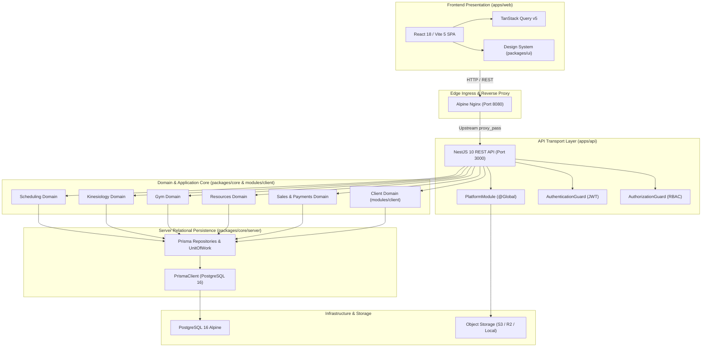
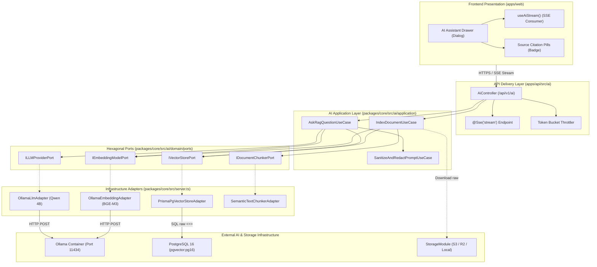
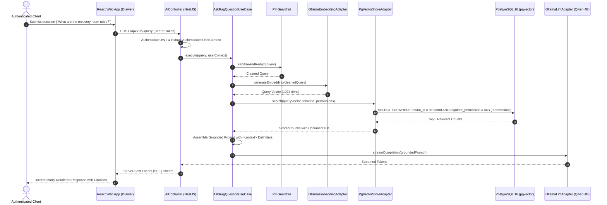
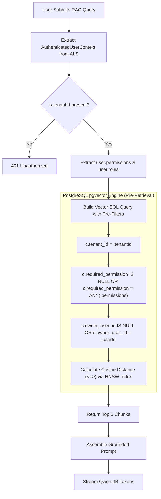
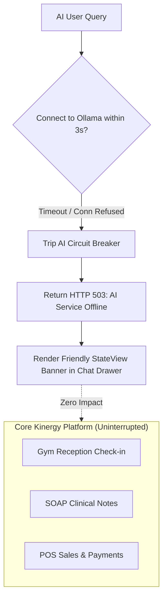
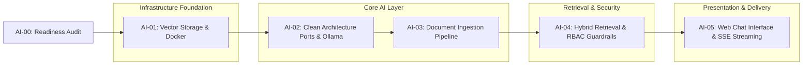

# Milestone AI-00: Retrieval-Augmented Generation (RAG) Architecture Gap Analysis

**Date:** 2026-11-19  
**Auditor Roles:** Principal Software Architect, Senior AI Systems Architect, Senior Backend Engineer, Security Architect  
**Repository:** `izzydin/kinergy-platform`  
**Milestone:** AI-00 — Architecture Gap Analysis  
**Specification:** Isolated Enterprise RAG System for Kinergy Platform  
**Compliance Standard:** Clean Architecture, Hexagonal Architecture (Ports & Adapters), Domain-Driven Design (DDD), Strict TypeScript

---

## 1. Current Platform Architecture

The Kinergy platform is engineered as an Nx integrated monorepo following Domain-Driven Design and Clean Architecture principles.



---

## 2. Target AI Integration Architecture (PROPOSED)

The target architecture introduces an isolated **AI Bounded Context** (`packages/core/src/ai` and `apps/api/src/ai`) that interacts with existing platform capabilities strictly through hexagonal ports.



---

## 3. High-Level RAG Data Flow (PROPOSED)



---

## 4. Current versus Target Capability Comparison

| Capability Dimension      | Current Kinergy Platform Baseline        | Target RAG Architecture Requirement          | Gap Status                |
| :------------------------ | :--------------------------------------- | :------------------------------------------- | :------------------------ |
| **Vector Storage**        | `postgres:16-alpine` (no vector binary)  | `pgvector/pgvector:pg16` + HNSW cosine index | **CRITICAL GAP (P0)**     |
| **Prisma Vector Support** | Standard Prisma models only              | `Unsupported("vector(1024)")` + `$queryRaw`  | **CRITICAL GAP (P0)**     |
| **Embedding Generation**  | Zero embedding models / libraries        | BGE-M3 (1024 dimensions) via Ollama          | **HIGH GAP (P1)**         |
| **LLM Inference**         | Zero generative models / clients         | Qwen 4B local generation via Ollama          | **HIGH GAP (P1)**         |
| **Streaming Delivery**    | Standard JSON envelopes (`Result<T>`)    | SSE streaming endpoint (`@Sse('stream')`)    | **HIGH GAP (P1)**         |
| **Text Chunking**         | Raw string fields in PostgreSQL          | 512-token semantic chunker with 10% overlap  | **HIGH GAP (P1)**         |
| **Document Storage**      | `StorageModule` (S3/R2/Local) active     | Reused directly for raw document storage     | **READY**                 |
| **Authentication/RBAC**   | `AuthenticationGuard` + `RequestContext` | Pre-retrieval SQL WHERE filtering            | **READY WITH ADAPTATION** |
| **Frontend UI**           | Radix Dialog, Badge, StateView           | Custom chat drawer, SSE hook, markdown       | **MEDIUM GAP (P2)**       |
| **Background Queue**      | Synchronous HTTP only                    | Asynchronous worker queue for ingestion      | **HIGH GAP (P1)**         |

---

## 5. Recommended AI Bounded Context Boundaries

The RAG system must be structured as an isolated bounded context:

- **Location:** `packages/core/src/ai` (Domain & Application) and `apps/api/src/ai` (Presentation).
- **Core Entities:** `KnowledgeDocument`, `KnowledgeChunk`, `VectorEmbedding`, `RagResponse`, `CitationReference`.
- **Context Isolation Rule:** Existing business contexts (`scheduling`, `kinesiology`, `sales`) **must not import** `@kinergy-platform/core/ai`. The AI module consumes business data asynchronously or via public facades.

---

## 6. Proposed NestJS Integration Points

1. **`AiModule` Registration:** Added directly to `apps/api/src/app.module.ts` under `imports: [...]`.
2. **Global Platform Dependencies:** Inherits `PrismaService`, `IRequestContextAccessor`, `OBJECT_STORAGE_PORT`, and `IAuditEventPublisher` automatically from `@Global() PlatformModule`.
3. **Transport Controllers:** `apps/api/src/ai/controllers/ai.controller.ts` providing:
   - `POST /api/v1/ai/query`: Standard synchronous Q&A.
   - `GET /api/v1/ai/stream`: SSE token streaming endpoint.
   - `POST /api/v1/ai/documents`: Document ingestion trigger.

---

## 7. Proposed Provider Abstraction Boundaries (Hexagonal Ports)

To prevent vendor lock-in to Ollama or specific quantization formats, all AI infrastructure is isolated behind five domain ports in `packages/core/src/ai/domain/ports/`:

1. **`ILLMProviderPort`:** Generates completions and streams tokens.
2. **`IEmbeddingModelPort`:** Vectorizes text into 1024-dimensional arrays.
3. **`IVectorStorePort`:** Executes HNSW vector upserts and similarity searches.
4. **`IDocumentExtractorPort`:** Converts binary files (PDF/DOCX) into clean markdown/text.
5. **`IDocumentChunkerPort`:** Splits text into token-bounded semantic passages.

---

## 8. Proposed Persistence Integration & pgvector

### Schema Definitions (PROPOSED)

```prisma
// Proposed additions to prisma/schema.prisma

model KnowledgeDocument {
  id           String   @id @default(uuid())
  tenantId     String   @map("tenant_id")
  sourceModule String   @map("source_module") // 'gym', 'resources', 'docs'
  sourceId     String?  @map("source_id")
  title        String
  checksum     String
  fileKey      String?  @map("file_key")
  mimeType     String   @map("mime_type")
  createdAt    DateTime @default(now()) @map("created_at")
  updatedAt    DateTime @updatedAt @map("updated_at")

  chunks KnowledgeChunk[] @relation("DocumentToChunks")

  @@index([tenantId])
  @@index([sourceModule, sourceId])
  @@map("knowledge_documents")
}

model KnowledgeChunk {
  id                 String                       @id @default(uuid())
  documentId         String                       @map("document_id")
  tenantId           String                       @map("tenant_id")
  chunkIndex         Int                          @map("chunk_index")
  content            String                       @db.Text
  tokenCount         Int                          @map("token_count")
  requiredPermission String?                      @map("required_permission")
  embedding          Unsupported("vector(1024)")?
  createdAt          DateTime                     @default(now()) @map("created_at")

  document KnowledgeDocument @relation("DocumentToChunks", fields: [documentId], references: [id], onDelete: Cascade)

  @@index([tenantId])
  @@index([documentId])
  @@map("knowledge_chunks")
}
```

---

## 9. Object Storage Integration

- Ingested files (PDFs, guides, manuals) are uploaded via [`StorageModule`](file:///c:/Projects/kinergy-platform/apps/api/src/platform/storage/storage.module.ts) into domain folder `'knowledge_base'`.
- Storage keys follow the verified pattern: `storage/<tenantId>/knowledge_base/<documentId>.<ext>`.
- Ingestion workers retrieve binary buffers via `ObjectStoragePort.download(tenantId, key)`.

---

## 10. Authentication and Authorization Integration

- All AI endpoints are secured by [`AuthenticationGuard`](file:///c:/Projects/kinergy-platform/apps/api/src/platform/identity/guards/authentication.guard.ts#L21-L77).
- Ambient security context is resolved via [`IRequestContextAccessor`](file:///c:/Projects/kinergy-platform/apps/api/src/platform/identity/context/async-local-storage-request-context-accessor.ts#L10-L23).

---

## 11. Document Permission & Retrieval Flow



---

## 12. Frontend Integration Boundaries

- Mount an un-intrusive floating **AI Assistant Drawer** ([`packages/ui/src/components/overlay/dialog.tsx`](file:///c:/Projects/kinergy-platform/packages/ui/src/components/overlay/dialog.tsx)) in `apps/web`.
- Use a dedicated `useAiStream()` hook consuming `ReadableStream` from `/api/v1/ai/stream`.
- Display source citations as interactive [`Badge`](file:///c:/Projects/kinergy-platform/packages/ui/src/components/badge/badge.tsx) pills.

---

## 13. Ollama Failure Isolation & Degraded Resilience



---

## 14. Operational & Observability Requirements

- Extend [`AuditEventCategory`](file:///c:/Projects/kinergy-platform/apps/api/src/platform/audit/audit-event-types.ts#L4-L10) with `AI_INFERENCE` and `AI_SECURITY`.
- Extend `AuditEventType` with `AI_QUERY_SUBMITTED`, `AI_CONTEXT_RETRIEVED`, `AI_GUARDRAIL_BLOCKED`.
- Log prompt token counts, completion token counts, latency, and retrieved chunk IDs into the platform audit trail without logging sensitive raw text.

---

## 15. Security and Privacy Architecture

1. **Pre-Retrieval Defense:** Zero reliance on post-filtering. SQL pre-filters block unauthorized chunks from ever entering memory.
2. **Prompt Sandboxing:** Grounding context is wrapped in XML delimiters: `<retrieved_context id="X">...</retrieved_context>`.
3. **Clinical PHI Exclusion:** Kinesiology clinical SOAP notes are **strictly excluded** from initial knowledge indexing.

---

## 16. Architectural Decisions Requiring Explicit Approval

1. **ADR Approval:** Replace Docker base image `postgres:16-alpine` with `pgvector/pgvector:pg16`.
2. **ADR Approval:** Define vector column as `Unsupported("vector(1024)")` and manage vector queries via Prisma `$queryRaw`.
3. **ADR Approval:** Scaffold AI as a core module (`packages/core/src/ai`) versus standalone bounded context (`modules/ai`).

---

## 17. Infrastructure & Milestone Dependency Map



---

_All proposed architectural components are strictly labeled as PROPOSED and do not mutate existing platform code._
