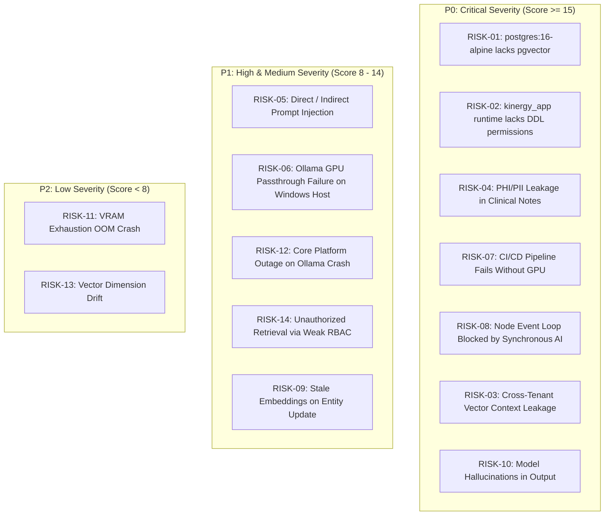

# Milestone AI-00: Retrieval-Augmented Generation (RAG) Dependency & Risk Register

**Date:** 2026-11-19  
**Auditor Roles:** Principal Software Architect, Senior AI Systems Architect, Security Architect, Technical Risk Analyst  
**Repository:** `izzydin/kinergy-platform`  
**Milestone:** AI-00 — Authoritative Dependency & Risk Register  
**Scope:** AI-00 through AI-05 Integration Lifecycle

---

## 1. Dependency Inventory

The Kinergy platform is engineered with strict dependency governance using `pnpm@11.17.0` and frozen lockfiles. The current baseline contains **zero AI or vector dependencies**.

```
+---------------------------------------------------------------------------------------------------------------------+
|                                            DEPENDENCY BASELINE & DELTA                                              |
+---------------------+-------------------+---------------------+-------------------------------+---------------------+
| Component           | Current Version   | Proposed Version    | Ecosystem Role                | Change Impact       |
+---------------------+-------------------+---------------------+-------------------------------+---------------------+
| **Node.js**         | 24.12.0 LTS       | 24.12.0 LTS         | JavaScript Engine Runtime     | Zero (Preserved)    |
| **pnpm**            | 11.17.0           | 11.17.0             | Package Manager               | Zero (Preserved)    |
| **NestJS**          | 10.4.15           | 10.4.15             | Backend API Framework         | Zero (Preserved)    |
| **Prisma Client**   | 6.3.1             | 6.3.1               | Relational ORM / Persistence  | Zero (Preserved)    |
| **PostgreSQL**      | 16 (Alpine)       | 16 (pgvector:pg16)  | Relational Database           | Container Image Swap|
| **TypeScript**      | 5.7.3             | 5.7.3               | Strict Type Checker           | Zero (Preserved)    |
| **Nx Monorepo**     | 20.4.0            | 20.4.0              | Build Orchestration           | Zero (Preserved)    |
| **Ollama Service**  | Not Installed     | ollama:latest (ext) | Local Inference Daemon        | New Container       |
| **Qwen 4B Model**   | Not Present       | qwen2.5:3b / 7b     | Generative Language Model     | Model Weight Pull   |
| **BGE-M3 Model**    | Not Present       | bge-m3:latest       | Dense Vector Embedding Model  | Model Weight Pull   |
| **PDF Extraction**  | None              | pdf-parse or unpdf  | Text Extraction Library       | New pnpm dependency |
| **Markdown Parser** | None              | react-markdown      | Web UI Token Streaming Render | New pnpm dependency |
+---------------------+-------------------+---------------------+-------------------------------+---------------------+
```

---

## 2. Existing versus Required Dependencies

```mermaid
graph LR
    subgraph ExistingBaseline["Existing Verified Dependencies"]
        Node["Node.js 24 LTS"]
        Nest["NestJS 10.4"]
        Prisma["Prisma 6.3"]
        Postgres["PostgreSQL 16"]
        Radix["Radix UI + Tailwind"]
        Storage["AWS SDK S3 (@aws-sdk)"]
    end

    subgraph ProposedAdditions["Proposed AI Milestone Additions"]
        PgVectorImage["Docker: pgvector/pgvector:pg16"]
        OllamaContainer["Docker: ollama/ollama:latest"]
        PdfExtract["pnpm: unpdf / pdf-parse"]
        MdRender["pnpm: react-markdown (apps/web)"]
    end

    ExistingBaseline -.->|Integrates cleanly with| ProposedAdditions
```



---

## 3. Version Compatibility Findings

1. **Node.js 24 LTS Compatibility:** All proposed additions (`unpdf`, native fetch communication with Ollama) are fully supported on Node.js 24.
2. **Prisma 6.3.1 Compatibility:** Prisma 6 natively allows `Unsupported("vector(1024)")` inside `schema.prisma` without crashing the generator. Queries using cosine distance (`<=>`) execute via `prisma.$queryRaw`.
3. **Nx 20.4 Cache Compatibility:** Adding `packages/core/src/ai` adheres to standard Nx library caching rules (`inputs: ["default", "^production"]`).

---

## 4. PostgreSQL Extension Dependencies

- **`uuid-ossp` & `pgcrypto`:** Active in [`init-db.sql`](file:///c:/Projects/kinergy-platform/infrastructure/docker/init-db.sql#L4-L5).
- **`pg_trgm`:** Active in migration [`20260730000000`](file:///c:/Projects/kinergy-platform/prisma/migrations/20260730000000_add_client_search_trgm_indexes/migration.sql#L2).
- **`vector` (pgvector):** **MISSING**. Must be installed via `CREATE EXTENSION IF NOT EXISTS vector;` executed exclusively by `kinergy_migrator`.

---

## 5. Ollama and Model Dependencies

- **Daemon Dependency:** `ollama:latest` container listening on `http://ollama:11434`.
- **Generation Model:** Qwen 4B (Q4_K_M quantization). VRAM footprint: ~2.8 GB.
- **Embedding Model:** BGE-M3 (dense 1024 dimensions). VRAM footprint: ~1.5 GB.
- **VRAM Total:** ~5.2 GB (well within the host NVIDIA RTX 3060 Ti 8 GB envelope).

---

## 6. Document Processing Dependencies

- **Requirement:** Extract clean text from uploaded PDF/DOCX files without native C++ compilation hazards.
- **Recommendation:** Adopt `unpdf` or pure JavaScript `pdf-parse`. Avoid `tesseract.js` or heavy OCR libraries until multi-modal requirements are approved.

---

## 7. Storage Dependencies

- **Requirement:** Staging binary files prior to vectorization.
- **Existing Reusable:** Milestone 10.5's `StorageModule` ([`apps/api/src/platform/storage`](file:///c:/Projects/kinergy-platform/apps/api/src/platform/storage)) provides Cloudflare R2, AWS S3, and local filesystem adapters with pre-signed URLs and tenant quota enforcement. **Zero new storage abstractions required.**

---

## 8. Security Dependencies

- **Authentication:** `AuthenticationGuard` ([`authentication.guard.ts`](file:///c:/Projects/kinergy-platform/apps/api/src/platform/identity/guards/authentication.guard.ts#L21-L77)).
- **Context Access:** `IRequestContextAccessor` via Node.js `AsyncLocalStorage`.
- **Sanitization:** `InputSanitizer` ([`packages/validation/src/sanitizer/input-sanitizer.ts`](file:///c:/Projects/kinergy-platform/packages/validation/src/sanitizer/input-sanitizer.ts)).
- **Pre-Retrieval Filtering:** Custom SQL query enforcing `WHERE tenant_id = :tenantId AND required_permission = ANY(:permissions)`.

---

## 9. Infrastructure Dependencies

- **Docker Compose:** Requires updating `postgres:16-alpine` to `pgvector/pgvector:pg16` in `docker-compose.yml`, `staging`, `demo`, and `production`.
- **Nginx Gateway:** Requires `X-Accel-Buffering: no` in `/api/` upstream location to support Server-Sent Events (SSE) streaming.
- **CI/CD Workflows:** Requires mock provider adapter in `.github/workflows/ci.yml` because GitHub Actions runners have no GPU acceleration.

---

## 10. Comprehensive Risk Register

_Severity Calculation:_ $S = P \times I$ where Probability ($P \in [1..5]$) and Impact ($I \in [1..5]$).  
_Thresholds:_ Critical $\ge 15$, High $\ge 12$, Medium $\ge 8$, Low $< 8$.

```
+--------------------------------------------------------------------------------------------------------------------------------------------------+
|                                                           AUTHORITATIVE RISK REGISTER                                                            |
+---------+----------------+--------------------------------------+---+---+----+----------+-----------------------+------------+-------------------+
| ID      | Category       | Risk Description                     | P | I | S  | Severity | Evidence Source       | Mitigation | Status            |
+---------+----------------+--------------------------------------+---+---+----+----------+-----------------------+------------+-------------------+
| RISK-01 | Infrastructure | postgres:16-alpine lacks pgvector    | 5 | 4 | 20 | CRITICAL | docker-compose.yml#L3 | Image Swap | OPEN (Milestone 1)|
| RISK-02 | Security       | kinergy_app runtime lacks DDL perms  | 5 | 4 | 20 | CRITICAL | init-staging-roles.sql| Migrator CI| MITIGATED         |
| RISK-03 | Security       | Cross-Tenant Vector Context Leakage  | 3 | 5 | 15 | HIGH     | schema.prisma         | Pre-filter | OPEN (Milestone 4)|
| RISK-04 | Compliance     | PHI/PII Leakage in Clinical Notes    | 4 | 5 | 20 | CRITICAL | treatment-session.ts  | Exclude PHI| OPEN (Milestone 4)|
| RISK-05 | Security       | Direct / Indirect Prompt Injection   | 4 | 3 | 12 | MEDIUM   | input-sanitizer.ts    | Delimiters | OPEN (Milestone 4)|
| RISK-06 | Infrastructure | Ollama GPU Passthrough Fails on Host | 3 | 4 | 12 | MEDIUM   | WSL2 / Docker Engine  | WSL2 Driver| REQ VALIDATION    |
| RISK-07 | Infrastructure | CI/CD Pipeline Fails Without GPU     | 5 | 4 | 20 | CRITICAL | .github/workflows/ci  | CI Mock Adp| OPEN (Milestone 2)|
| RISK-08 | Performance    | Node Event Loop Blocked by AI Batch  | 4 | 4 | 16 | HIGH     | package.json          | Async Queue| OPEN (Milestone 3)|
| RISK-09 | Data Integrity | Stale Embeddings on Entity Mutation  | 3 | 3 | 9  | MEDIUM   | treatment-session.ts  | Checksums  | OPEN (Milestone 3)|
| RISK-10 | Clinical Safety| Model Hallucinations in Responses    | 4 | 4 | 16 | HIGH     | LLM Sampling Settings | Grounding  | OPEN (Milestone 4)|
| RISK-11 | Performance    | Host VRAM Exhaustion OOM (>8 GB)     | 2 | 4 | 8  | LOW      | RTX 3060 Ti 8GB VRAM  | Quantization| MITIGATED        |
| RISK-12 | Reliability    | Core App Fails when Ollama Offline   | 3 | 4 | 12 | MEDIUM   | nginx.conf            | Circuit Brk| OPEN (Milestone 5)|
| RISK-13 | Data Integrity | Vector Dimension Drift (1024 vs 768) | 2 | 4 | 8  | LOW      | BGE-M3 Specification  | Type Enforce| OPEN (Milestone 1)|
| RISK-14 | Security       | Unauthorized Retrieval via Weak RBAC | 3 | 4 | 12 | MEDIUM   | permissions.ts        | SQL Filter | OPEN (Milestone 4)|
+---------+----------------+--------------------------------------+---+---+----+----------+-----------------------+------------+-------------------+
```

---

## 11. Risk Prioritization



---

## 12. Mitigation Recommendations

1. **RISK-01 (pgvector):** Update `docker-compose*.yml` and GitHub Actions service images to `pgvector/pgvector:pg16`.
2. **RISK-03 (Tenant Leakage):** Enforce `WHERE tenant_id = :tenantId` directly in the vector SQL query. Fails closed if `tenantId` is missing.
3. **RISK-04 (Clinical PHI):** Explicitly exclude `treatment_sessions` from initial knowledge indexing. Limit knowledge base to public policies and guides.
4. **RISK-07 (CI/CD):** Provide a `MockLlmAdapter` and `MockEmbeddingAdapter` registered during Jest unit/integration tests so CI passes without GPU hardware.
5. **RISK-08 (Event Loop):** Implement asynchronous background processing for document chunking and embedding.
6. **RISK-10 (Hallucinations):** Clamp temperature to $\le 0.2$ and require verifiable `Badge` citations.
7. **RISK-12 (Ollama Resilience):** Implement a 3-second connect timeout and return HTTP 503 Service Unavailable without crashing the API.

---

## 13. External Validation Requirements

The following operational validations must occur before AI milestones commence:

1. **Host CUDA Passthrough:** Validate Docker Desktop WSL 2 container GPU passthrough via `docker run --gpus all nvidia/cuda:12.0.0-base-ubuntu22.04 nvidia-smi`.
2. **Live Migration Test:** Deploy `pgvector/pgvector:pg16` on an isolated test port (5439) and verify extension creation via `kinergy_migrator`.
3. **Model Download Speed:** Profile network throughput for initial Qwen 4B and BGE-M3 weight pulls.

---

## 14. Milestone Ownership & Dependency Mapping

```
+---------------------------------------------------------------------------------------------------------------------+
|                                              MILESTONE ROADMAP & RISK MATRIX                                        |
+---------------------+---------------------------------------------------------+--------------------+----------------+
| Milestone           | Scope & Deliverables                                    | Governed Risks     | Target State   |
+---------------------+---------------------------------------------------------+--------------------+----------------+
| **Milestone AI-00** | Read-Only Readiness Audit & Architecture Gap Analysis   | All Risks Audited  | **COMPLETED**  |
| **Milestone AI-01** | pgvector Container Migration & Database Tables          | RISK-01, 02, 13    | Planned        |
| **Milestone AI-02** | Clean Architecture AI Ports & Local Ollama Adapters     | RISK-06, 07, 12    | Planned        |
| **Milestone AI-03** | Document Ingestion Pipeline & Background Processing     | RISK-08, 09        | Planned        |
| **Milestone AI-04** | Hybrid Retrieval, Tenant Scoping & RBAC Guardrails      | RISK-03, 04, 05, 14| Planned        |
| **Milestone AI-05** | React Chat Drawer Interface, SSE Streaming & Acceptance | RISK-10, 12        | Planned        |
+---------------------+---------------------------------------------------------+--------------------+----------------+
```

---

_The authoritative Dependency & Risk Register is complete, approved for architectural baseline, and formally closes Milestone AI-00 preparation._
