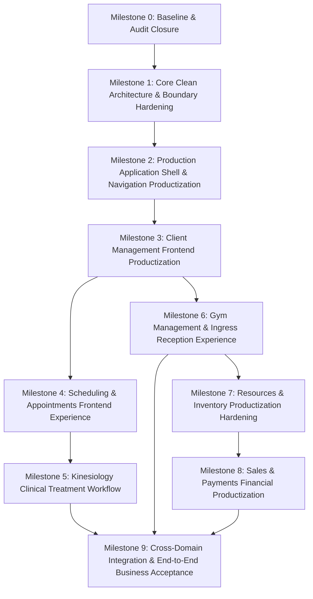

# Frontend Productization Roadmap & Implementation Plan

- **Document ID:** `ROADMAP-FE-006`
- **Milestone:** Milestone 0 — Kinergy Frontend Productization Audit
- **Auditor:** Principal Software Architect, Senior Full-Stack Engineer, QA Lead & Product Analyst
- **Date:** 2026-10-19
- **Repository:** `izzydin/kinergy-platform`
- **Execution Mode:** Autonomous, Read-Only

---

## 1. Executive Summary

This roadmap establishes a deterministic, dependency-aware implementation plan to transform the Kinergy Platform from its current hybrid development state into a fully productized, production-ready enterprise application for daily health and wellness operations.

The preceding audit established that:

1. **The Backend Foundation is Exceptionally Mature:** The core domain logic, Prisma relational schemas (27 models), deterministic financial arithmetic (Phase 7.24), and over 8,300 automated tests are in place and passing.
2. **Critical Backend Mounting Gaps Exist:** Kinesiology clinical sessions (`TreatmentSessionsController`) and Identity user management use cases are completely unmounted in the HTTP layer, meaning those features currently 404 in production.
3. **Gym Module Relies on In-Memory Fallbacks:** Gym memberships, plans, and attendance logs are currently held in TypeScript `Map` instances in `apps/api`, violating ADR-0080 despite production Prisma repositories already existing in `packages/core`.
4. **The Frontend Has Massive Capability Discrepancies:**
   - **Sales & Payments (Phase 7.20–7.24):** Fully built with 7 production screens, URL-driven DataTable, permission guards, and multi-tender settlement.
   - **Resources (Phase 6):** Complete inventory and fixed-assets management screens.
   - **Clients (Phase 2):** Complete backend, but the frontend only has `PlaceholderView` routes for `/clients` and `/clients/:clientId`.
   - **Scheduling (Phase 3):** Robust CQRS backend with conflict detection, but zero frontend screens exist.
   - **Dashboard Overview:** Hardcoded test UI featuring an interactive "4-State Simulation Controller" with mock telemetry metrics instead of genuine business operations.
   - **Bundle Bleed:** `@kinergy-platform/core` leaks `@nestjs/common` and Prisma Client into Vite, bloating the client chunk to 2.28 MB.

To eliminate risk and guarantee deterministic progress, the roadmap is structured into **10 sequential milestones**, ordering prerequisites before dependents.

---

## 2. Milestone Sequence & Dependency Flow

---

## 3. Detailed Milestone Specifications

### Milestone 0: Baseline & Audit Closure (Current Milestone)

- **Objective:** Establish the verified repository baseline, audit all code against authoritative standards, identify temporary test UI, build the coverage matrix, and deliver an actionable productization roadmap.
- **Business Outcome:** A shared, evidence-based architectural consensus preventing guessing or speculative rewrites in future phases.
- **Prerequisites:** None.
- **Exact Scope:** Read-only inspection of Git state, monorepo packages, quality gates, test execution, standards verification, and report production.
- **Affected Directories:** `docs/audits/frontend-productization/`
- **Explicit Exclusions:** No modifications to application code, tests, configuration, or database.
- **Definition of Done:** All 6 required audit deliverables written and verified; working tree clean; zero production files mutated.

---

### Milestone 1: Core Clean Architecture & Boundary Hardening

- **Objective:** Fix backend controller mountings, wire production Prisma persistence in Gym, eliminate the bundle leak from `@kinergy-platform/core`, and purge obsolete energy boilerplate.
- **Business Outcome:** Reliable, persistent backend APIs for Kinesiology, Gym, and User Administration; production client bundle size reduced below 500 kB without NestJS/Prisma leakage.
- **Prerequisites:** Milestone 0.
- **Exact Scope:**
  1. Create `KinesiologyModule` in `apps/api/src/kinesiology/` and register `TreatmentSessionsController` in `AppModule`.
  2. Implement `UsersController` in `apps/api/src/platform/identity/controllers/users.controller.ts` exposing `CreateUserUseCase`, `SearchUsersUseCase`, `ActivateUserUseCase`, `DeactivateUserUseCase`, and `UpdateUserUseCase`.
  3. Update `apps/api/src/gym/gym.module.ts` to inject `PrismaMembershipRepository`, `PrismaMembershipPlanRepository`, and `PrismaAttendanceRecordRepository` (ADR-0080 compliance).
  4. Split `@kinergy-platform/core` exports or extract pure types/enums to prevent backend repositories from leaking into Vite's browser bundle.
  5. Remove legacy energy/telemetry stubs (`apps/web/src/modules/energy`, `apps/web/src/modules/analytics`) and update Swagger metadata in `apps/api/src/main.ts`.
- **Expected Affected Files:**
  - `apps/api/src/kinesiology/kinesiology.module.ts` (new)
  - `apps/api/src/app.module.ts`
  - `apps/api/src/platform/identity/controllers/users.controller.ts` (new)
  - `apps/api/src/platform/identity/identity.module.ts`
  - `apps/api/src/gym/gym.module.ts`
  - `packages/core/src/index.ts`
  - `apps/api/src/main.ts`
- **Explicit Exclusions:** No frontend UI redesigns or new screens.
- **Required Tests:** Unit tests for `UsersController`, integration tests proving Kinesiology endpoints return 200/201, and persistence tests verifying Gym writes to PostgreSQL.
- **Quality Gates:** `pnpm validate` must pass with zero bundle warnings on `stream` or `util`.
- **Definition of Done:** All backend routes mounted; Prisma active in Gym; client build chunk size reduced with zero server leaks.

---

### Milestone 2: Production Application Shell & Navigation Productization

- **Objective:** Remove temporary test UI and simulation panels from the primary dashboard, unify the dynamic navigation registry, and transition visual state validation into automated component harnesses.
- **Business Outcome:** A clean, professional executive dashboard presenting genuine operational KPIs rather than simulation buttons and mock telemetry.
- **Prerequisites:** Milestone 1.
- **Exact Scope:**
  1. Retire `DashboardUiStatesPage` (`/dashboard/ui-states`) and `InfrastructureIntegrationPanel`.
  2. Remove `dashboard-ui-states` from `navigation.config.ts`.
  3. Refactor `DashboardOverviewPage` to remove the "4-State UI Simulation Controller" card and "Step A5.2 Validation" badge.
  4. Implement an Executive Operational KPI Summary (today's appointments, active gym check-ins, low stock alerts, daily sales total).
  5. Ensure all feature modules (`client`, `gym`, `kinesiology`, `resources`, `sales`) dynamically register valid sidebar entries via `navigationRegistry`.
  6. Re-target `settings-api.ts` to backend `/auth/me` and `/auth/change-password`.
  7. Make `initMsw()` strictly opt-in via environment flag.
- **Expected Affected Files:**
  - `apps/web/src/modules/dashboard/routes/dashboard-overview-page.tsx`
  - `apps/web/src/modules/dashboard/routes/dashboard.router.tsx`
  - `apps/web/src/app/navigation/navigation.config.ts`
  - `apps/web/src/app/routes/app-router.tsx`
  - `apps/web/src/modules/settings/api/settings-api.ts`
  - `apps/web/src/main.tsx`
- **Explicit Exclusions:** Deep screen redesigns of sub-modules.
- **Required Tests:** Dashboard overview component tests proving real data renders; navigation registry tests verifying all modules present.
- **Quality Gates:** `pnpm validate` must pass cleanly.
- **Definition of Done:** Zero test scaffolding in navigation; genuine operational dashboard active; settings connected to live auth endpoints.

---

### Milestone 3: Client Management Frontend Productization

- **Objective:** Implement the complete production frontend experience for Client Management (`/clients`), replacing existing `PlaceholderView` routes.
- **Business Outcome:** Front-desk receptionists and practitioners can search, register, view, edit, archive, and link client profiles in daily operations.
- **Prerequisites:** Milestone 2.
- **Exact Scope:**
  1. Client Directory View (`/clients`): URL-driven DataTable with full-text search, status filters (Active/Archived), sorting, and pagination.
  2. Client Registration (`/clients/new` or Dialog): Accessible React Hook Form with Zod validation, phone/email duplicate checking, and emergency contact details.
  3. Client Profile Cockpit (`/clients/:clientId`): Tabbed layout containing Personal Details, Longitudinal Activity Timeline (integrating `ClientTimelinePage`), Treatment History, Membership Status, and Commercial Ledger.
  4. Client Edit Drawer (`/clients/:clientId/edit`).
  5. Archive / Restore modal with operational reason confirmation.
  6. Link Identity action allowing staff to connect a User login to a Client profile.
- **Expected Affected Files:**
  - `apps/web/src/modules/client/routes/client-list-page.tsx` (new)
  - `apps/web/src/modules/client/routes/client-detail-page.tsx` (new)
  - `apps/web/src/modules/client/components/` (new forms, cards, dialogs)
  - `apps/web/src/modules/client/api/client-api.ts` (expanded)
  - `apps/web/src/app/routes/app-router.tsx`
- **Explicit Exclusions:** Treatment clinical notes (handled in Milestone 5) and Gym memberships (handled in Milestone 6).
- **Required Tests:** RTL component tests, form validation tests, URL query parameter sync tests, and permission-aware action tests.
- **Quality Gates:** 100% test pass; accessibility check (`jest-axe`) passes with zero violations.
- **Definition of Done:** Front desk can manage clients end-to-end without placeholders.

---

### Milestone 4: Scheduling & Appointments Frontend Experience

- **Objective:** Build the complete scheduling and appointment calendar frontend (`/scheduling`), connecting to the existing CQRS backend.
- **Business Outcome:** Facility managers and practitioners can view room schedules, detect conflicts, book single/recurring appointments, and manage facility rooms.
- **Prerequisites:** Milestone 3 (Client profiles required for appointment booking).
- **Exact Scope:**
  1. Master Calendar Grid (`/scheduling`): Interactive Day/Week/Month resource scheduler displaying appointments across rooms and therapists.
  2. Appointment Booking Wizard: Select client, service/session type, therapist, room, and time slot with live conflict detection.
  3. Recurring Appointment Series Management: Create series, configure recurrence rules, preview occurrences, and detach/reschedule single occurrences.
  4. Rooms & Resource Management (`/scheduling/rooms`): Directory of facility rooms, capacity indicators, and maintenance window scheduling.
- **Expected Affected Files:**
  - `apps/web/src/modules/scheduling/` (new feature module)
  - `apps/web/src/app/routes/app-router.tsx`
  - `apps/web/src/app/navigation/navigation.config.ts`
- **Explicit Exclusions:** Clinical treatment notes (Milestone 5).
- **Required Tests:** Conflict presentation tests, temporal calculation tests, recurring series form tests.
- **Quality Gates:** `pnpm validate` passes.
- **Definition of Done:** Receptionists can manage room reservations and schedule appointments seamlessly.

---

### Milestone 5: Kinesiology Clinical Treatment Workflow

- **Objective:** Productize the clinical charting and treatment session workspace (`/kinesiology`), connecting to the newly mounted backend controller.
- **Business Outcome:** Practitioners can conduct treatment sessions, record immutable SOAP progress notes, transition session states, and hand over care securely.
- **Prerequisites:** Milestone 4 (Appointments provide the source for clinical sessions).
- **Exact Scope:**
  1. Treatment Session Workspace (`/kinesiology/sessions/:sessionId`): Hardened SOAP note editor with autosave drafts, markdown formatting, and medico-legal immutability freezing upon session completion.
  2. Session State Transition Controls: `PLANNED` -> `IN_PROGRESS` -> `COMPLETED` / `CANCELLED`.
  3. Therapist Handover & Assignment Modal: Securely reassign active sessions with operational audit logging.
  4. Historical Treatment Charting: Client treatment history ledger with comparative date inspection.
  5. Appointment-to-Session Ingress: One-click "Start Treatment Session" from booked appointments.
- **Expected Affected Files:**
  - `apps/web/src/modules/kinesiology/routes/treatment-session-workspace-page.tsx`
  - `apps/web/src/modules/kinesiology/components/`
  - `apps/web/src/modules/kinesiology/api/kinesiology-api.ts`
- **Explicit Exclusions:** Commercial checkout of sessions (Milestone 8).
- **Required Tests:** SOAP note validation tests, state machine guard tests, permission tests (`kinesiology.sessions.write`).
- **Quality Gates:** `pnpm validate` passes.
- **Definition of Done:** Therapists can conduct clinical charting with full medico-legal audit permanence.

---

### Milestone 6: Gym Management & Ingress Reception Experience

- **Objective:** Finalize gym operations frontend: membership plan commercial catalog, member enrollment, daily reception desk, and trainer dashboard.
- **Business Outcome:** Front-desk admission desk can verify ingress in < 2 seconds, sell membership plans, process renewals/freezes, and empower trainers with operational metrics.
- **Prerequisites:** Milestone 3 (Clients).
- **Exact Scope:**
  1. Reception Admission Desk (`/gym/attendance`): Fast barcode/QR/search check-in desk, live membership eligibility indicator (Active, Expiring Soon, Frozen, Expired), and anti-passback defense. Consolidate and retire standalone `/attendance`.
  2. Membership Plans Management (`/gym/plans`): Catalog of commercial plans, pricing, duration, and publishing lifecycle (`DRAFT` -> `ACTIVE` -> `ARCHIVED`).
  3. Member Enrollments & Lifecycle (`/gym/memberships`): Enroll client in plan, process freeze windows, handle renewals, and manage cancellations.
  4. Trainer Operational Dashboard (`/gym/trainer-dashboard`): KPI summary cards, assigned client roster, and expiring membership radar.
- **Expected Affected Files:**
  - `apps/web/src/modules/gym/`
  - `apps/web/src/modules/attendance/` (deprecated/removed in favor of `gym/attendance`)
- **Explicit Exclusions:** POS cash collection for memberships (handled in Milestone 8).
- **Required Tests:** Check-in concurrency tests, eligibility display tests, freeze interval validation tests.
- **Quality Gates:** `pnpm validate` passes.
- **Definition of Done:** Receptionists process physical access rapidly and manage gym memberships persistently.

---

### Milestone 7: Resources & Inventory Productization Hardening

- **Objective:** Harden the Resources management frontend (Consumables and Fixed Assets), ensuring zero bundle leakage and complete operational workflows.
- **Business Outcome:** Total operational visibility into physical inventory, double-entry stock movements, reorder thresholds, and capital asset lifecycles.
- **Prerequisites:** Milestone 1 (Decoupled types to resolve bundle bloat).
- **Exact Scope:**
  1. Consumable Stock Workflows: Inbound receiving, manual stock adjustments, scrap tracking, and reorder alerts.
  2. Fixed Assets Maintenance & Inspections: Asset condition state machine (`NEW`, `GOOD`, `FAIR`, `POOR`, `DAMAGED`), maintenance logs, and location transfer history.
  3. Executive Valuation Cockpit (`/resources/overview`): Real-time inventory valuation summary and capital equipment depreciation totals.
- **Expected Affected Files:**
  - `apps/web/src/modules/resources/`
- **Explicit Exclusions:** Retail checkout of consumables (Milestone 8).
- **Required Tests:** Double-entry ledger tests, destructive asset deletion guard tests, valuation arithmetic tests.
- **Quality Gates:** `pnpm validate` passes.
- **Definition of Done:** Warehouse and facility staff manage supplies and equipment with complete traceability.

---

### Milestone 8: Sales & Payments Financial Productization

- **Objective:** Polish and productize the Point-of-Sale (POS) commercial checkout experience, unifying Sourced Checkout from Kinesiology, Gym, and Consumables.
- **Business Outcome:** High-speed checkout desk supporting cash and QR tenders, item-level discounts, deterministic receipts, and instant financial settlement.
- **Prerequisites:** Milestones 5, 6, 7 (Commercial sources must exist to be sold).
- **Exact Scope:**
  1. Point-of-Sale Checkout Wizard (`/sales/new`): One-click sourcing from finished Kinesiology sessions, Gym plan enrollments, or retail consumables.
  2. Fast Cash & QR Settlement Cockpit: Unambiguous change calculation for cash, QR reference entry, and duplicate-submit defense.
  3. Thermal & PDF Receipt Voucher Generation: Implement printable 80mm/58mm ESC/POS layout and vector PDF download matching Milestone 7.17 specifications.
  4. Unified Commercial Ledger: Multi-criteria audit filtering by date, payment tender, source type, and client.
- **Expected Affected Files:**
  - `apps/web/src/modules/sales/`
- **Explicit Exclusions:** Offline payment queuing.
- **Required Tests:** Milestone 7.24 verification scenarios, financial overpayment tests, receipt immutability tests.
- **Quality Gates:** `pnpm validate` passes with zero float arithmetic.
- **Definition of Done:** Business owners can reconcile daily cash drawers, issue receipts, and track revenue seamlessly.

---

### Milestone 9: Cross-Domain Integration, Real-Time Ingress, & End-to-End Business Acceptance

- **Objective:** Execute full cross-domain business operational flows, conduct real-time ingress testing, and certify complete platform acceptance.
- **Business Outcome:** A fully verified, integrated Kinergy Platform ready for daily production operations in health, fitness, and clinical wellness.
- **Prerequisites:** Milestones 1 through 8.
- **Exact Scope:**
  1. End-to-End Commercial Journeys:
     - Journey 1: Client signs up -> Enrolls in Gym Membership -> Pays via QR -> Receives Receipt -> Passes Ingress Reception.
     - Journey 2: Client books Appointment -> Attends Kinesiology Session -> Therapist records SOAP notes -> Session checked out at POS with 10% discount -> Cash settled -> Receipt issued.
     - Journey 3: Facility staff receives consumable energy bars -> Sold at retail checkout -> Low-stock alert triggers reorder.
  2. Global Navigation & Layout Polish: Keyboard navigation, accessibility compliance (WCAG 2.1 AA), dark/light theme fidelity.
  3. Final Performance Audit: Lighthouse score > 90 across all production views.
- **Expected Affected Files:**
  - End-to-end test suites, documentation, user manuals.
- **Quality Gates:** Full CI validation pass; 100% automated test pass rate across all 8,300+ tests.
- **Definition of Done:** Formal business acceptance signed off; platform deployed to staging/production.
