# Milestone 10.1: Production Architecture and Deployment Audit Report

**Date:** 2026-11-03  
**Reviewer:** Principal Software Architect, Senior Platform Engineer & DevSecOps Lead  
**Repository:** `@kinergy-platform/source`  
**Milestone:** Milestone 10.1 — Production Architecture and Deployment Audit  
**Evaluation Status:** **AUDIT COMPLETE — SYSTEM NOT PRODUCTION-READY (CORE DOMAINS FUNCTIONAL; DEPLOYMENT, CONTAINERIZATION & PRODUCTION HARDENING REQUIRED)**

---

## 1. Executive Summary

This architecture and deployment audit assesses the Kinergy Platform codebase prior to production hardening. Over Milestones 9.1 through 9.5.7, the platform achieved verified functional completion for its three core Minimum Viable Product (MVP) business journeys: Gym Management, Kinesiology Clinical Practice, and Consumable Inventory/Retail Sales. All unit, integration, and domain acceptance test suites pass deterministically across all 10 monorepo projects.

However, an audit of the current deployment infrastructure, process boundaries, network configurations, database lifecycle, and operational tooling reveals that **the platform cannot currently be deployed to or operated in a production environment**. The repository possesses no container packaging definitions (`Dockerfile`), no reverse proxy configuration, no production database migration execution strategy, no database readiness probes, and no automated CI/CD deployment pipelines.

### Primary Audit Findings:

1. **Domain Maturity vs. Operational Immaturity:** The business domain logic, Clean Architecture layering, Hexagonal Ports & Adapters, and strict integer-cent monetary policies are enterprise-grade and test-verified. Conversely, platform operations, containerization, ingress routing, and observability remain at local development maturity.
2. **Missing Deployment Assets:** Neither `apps/api` nor `apps/web` contains a `Dockerfile`. The directories `infrastructure/deployment/` and `infrastructure/scripts/` contain only placeholder README files.
3. **Frontend Runtime Coupling to Build Time:** The Vite frontend bakes `VITE_API_BASE_URL` statically into the JavaScript bundles at build time. There is no runtime environment injection mechanism, meaning separate staging and production artifacts would need to be built independently unless reverse proxy routing (`/api/v1`) is established.
4. **Health Check Defect (False Positives):** `AppController.getHealth()` returns `{ status: 'ok', uptime: ... }` based purely on Node.js process uptime without querying PostgreSQL. If the database crashes or disconnects, the health endpoint continues reporting HTTP 200 OK, causing container orchestrators or load balancers to route traffic to failed pods.
5. **Reverse Proxy Trust Defect:** The NestJS bootstrap in `apps/api/src/main.ts` does not configure `trust proxy`. When deployed behind an ingress controller, reverse proxy, or CDN (Nginx, Traefik, Cloudflare, AWS ALB), all client traffic appears to originate from the proxy's IP, which breaks IP-based rate limiting across all clients.
6. **Unconditional Swagger Exposure:** `apps/api/src/main.ts` mounts Swagger documentation unconditionally at `/api/docs`, ignoring the `SWAGGER_ENABLED` environment variable and exposing internal API schema contracts in production.
7. **Database Connection Default Risk:** `apps/api/src/config/env.validation.ts` provides a localhost fallback for `DATABASE_URL` even when `NODE_ENV === 'production'`. If the production database environment variable fails to inject, the application fails silently or attempts to reach localhost.
8. **External Integrations Status:** External cloud object storage (S3/GCS), third-party payment gateways (Stripe/PayPal), and transactional email/SMS services are **not implemented**. Sales and payments operate purely on internal cash/QR records, which matches the MVP specification.

---

## 2. Verified Repository Baseline

### 2.1 Git Status & Monorepo State

- **Current Branch:** `main` (synchronized with `origin/main` at commit `edfd5e9`).
- **Working Tree:** Clean (`nothing to commit, working tree clean`).
- **Package Manager:** `pnpm@11.17.0` (frozen lockfile enforced in CI).
- **Monorepo Engine:** `Nx@20.4.0` (integrated workspace with task caching and inputs).
- **TypeScript:** `~5.7.3` targeting ES2022.
- **Node.js Target:** `>= 20.x` (defined via `.nvmrc`).

### 2.2 Project Portfolio (10 Projects)

| Project Name    | Path                  | Project Type | Build Executor   | Test Framework                  | Production Artifact Output |
| :-------------- | :-------------------- | :----------- | :--------------- | :------------------------------ | :------------------------- |
| `validation`    | `packages/validation` | Library      | `@nx/js:tsc`     | Jest                            | `dist/packages/validation` |
| `testing`       | `packages/testing`    | Library      | `@nx/js:tsc`     | Jest                            | `dist/packages/testing`    |
| `config`        | `packages/config`     | Library      | `@nx/js:tsc`     | Jest                            | `dist/packages/config`     |
| `client-domain` | `modules/client`      | Library      | `@nx/js:tsc`     | Jest                            | `dist/modules/client`      |
| `types`         | `packages/types`      | Library      | `@nx/js:tsc`     | Jest                            | `dist/packages/types`      |
| `utils`         | `packages/utils`      | Library      | `@nx/js:tsc`     | Jest                            | `dist/packages/utils`      |
| `core`          | `packages/core`       | Library      | `@nx/js:tsc`     | Jest                            | `dist/packages/core`       |
| `ui`            | `packages/ui`         | Library      | `@nx/js:tsc`     | Jest                            | `dist/packages/ui`         |
| `api`           | `apps/api`            | Application  | `@nx/js:tsc`     | Jest / Supertest                | `dist/apps/api`            |
| `web`           | `apps/web`            | Application  | `@nx/vite:build` | Vitest / Jest / Testing Library | `dist/apps/web`            |

### 2.3 Quality Gates Verification

- **Code Formatting:** `pnpm format:check` — 100% compliant with Prettier.
- **Static Analysis:** `pnpm lint` — 0 errors, 0 warnings across all 10 projects.
- **Type Checking:** `pnpm typecheck` (`tsc --noEmit -p tsconfig.base.json`) — 0 type errors.
- **Test Suite:** `pnpm test` — 154 test suites passed, 2,251 tests passing deterministically.
- **Workspace Build:** `pnpm build` — All 10 projects compile cleanly to `dist/`.

---

## 3. Architecture Component Map

```mermaid
flowchart TD
    subgraph Client Tier
        Browser["User Browser (Desktop / Tablet)"]
    end

    subgraph Edge & Ingress Tier (MISSING IN REPO)
        ReverseProxy["Reverse Proxy / CDN\n(TLS Termination, SPA Fallback, /api/v1 Proxy)"]
    end

    subgraph Application Tier
        subgraph Frontend ["apps/web (React 18 + Vite)"]
            SPA["SPA Router & Views\n(TanStack Query, Tailwind)"]
            AuthStore["Auth Context & Token Storage"]
        end

        subgraph Backend ["apps/api (NestJS 10)"]
            PipesAndGuards["Global Security Filters, Pipes & Guards\n(Helmet, CORS, Throttler, Argon2id, JWT)"]

            subgraph Bounded Contexts
                IdentityCtx["IAM & User Administration"]
                ClientCtx["Client Management & Timeline"]
                GymCtx["Gym Memberships & Reception Attendance"]
                KinesiologyCtx["Appointments & Clinical SOAP Sessions"]
                ResourcesCtx["Consumable Inventory & Fixed Assets"]
                SalesCtx["Commercial Sales, Payments & Receipts"]
            end

            PrismaService["Prisma ORM Service\n(UnitOfWork & AsyncLocalStorage)"]
        end
    end

    subgraph Data Tier
        Postgres[(PostgreSQL 16\nTrigram Search, JSONB Snapshots, Checks)]
    end

    Browser -->|HTTPS| ReverseProxy
    ReverseProxy -->|Static Assets / index.html| SPA
    ReverseProxy -->|Proxy /api/v1/*| PipesAndGuards

    SPA -->|REST HTTP Requests| PipesAndGuards
    PipesAndGuards --> IdentityCtx
    PipesAndGuards --> ClientCtx
    PipesAndGuards --> GymCtx
    PipesAndGuards --> KinesiologyCtx
    PipesAndGuards --> ResourcesCtx
    PipesAndGuards --> SalesCtx

    IdentityCtx --> PrismaService
    ClientCtx --> PrismaService
    GymCtx --> PrismaService
    KinesiologyCtx --> PrismaService
    ResourcesCtx --> PrismaService
    SalesCtx --> PrismaService

    PrismaService -->|TCP Connection Pool| Postgres
```

---

## 4. Backend and Frontend Deployment Assessment

### 4.1 Backend (`apps/api`)

- **Framework & Runtime:** NestJS 10.4.15 running on Node.js 22.
- **Compilation:** Compiled via `@nx/js:tsc` to `dist/apps/api`.
- **Dependency Packaging Gap:** The generated `dist/apps/api/package.json` contains no dependency declarations. The application cannot run standalone without workspace `node_modules` or a pruned production bundle.
- **Native C++ Bindings:** Argon2 (`argon2@^0.45.1`) requires node-gyp compilation against the host architecture. A Linux production container must compile or install prebuilt native bindings for the container target (glibc or musl).
- **Prisma Engine Binary:** `@prisma/client` requires native query engine binaries matching the container OS (e.g. `linux-musl-openssl-3.0.x` or `debian-openssl-3.0.x`).
- **Process Management:** Supports `app.enableShutdownHooks()` for SIGTERM/SIGINT. Does not specify bind host `'0.0.0.0'` in `app.listen(port)`.
- **Health Probes:** Only `GET /api/v1/health` exists; it does not check PostgreSQL connectivity.

### 4.2 Frontend (`apps/web`)

- **Framework & Tooling:** React 18.3.1 with Vite 5.4.11 and Tailwind CSS.
- **Production Output:** Static files compiled to `dist/apps/web` (`index.html`, hashed JS/CSS assets in `assets/`).
- **Environment Ingestion:** Vite statically injects `VITE_*` variables at compile time. In production mode, `env.schema.ts` prohibits localhost URLs for `VITE_API_BASE_URL`.
- **SPA Routing Requirement:** The frontend uses React Router 6. Deep routes (e.g. `/gym/memberships`, `/sales/123`) require an HTTP server configured with HTML5 history API fallback (rewriting unhandled GET requests to `index.html`).
- **Static Artifact Hygiene:** `apps/web/public/mockServiceWorker.js` is copied to `dist/apps/web/mockServiceWorker.js` during build. While MSW is disabled in production code via dead-code elimination, the script remains publicly fetchable if not excluded.

---

## 5. Database and Migration Assessment

### 5.1 Prisma Schema & Models

- **Database Engine:** PostgreSQL 16.
- **Models (17 Entities):** `User`, `RefreshToken`, `Role`, `Permission`, `RolePermission`, `Client`, `ClientTimelineEntry`, `RecurrenceSeries`, `RecurrenceException`, `Appointment`, `AppointmentNote`, `Room`, `MaintenanceWindow`, `TreatmentSession`, `MembershipPlan`, `Membership`, `AttendanceRecord`, `InventoryItem`, `StockMovement`, `FixedAsset`, `AssetHistoryEvent`, `AssetMaintenanceRecord`, `Sale`, `SaleItem`, `Payment`, `ReceiptSequence`, `Receipt`.
- **PostgreSQL-Specific Extensions & Features:**
  - `uuid-ossp` and `pgcrypto` for cryptographically secure UUID and hashing functions.
  - `pg_trgm` extension for GIN trigram text search on client names, emails, and phone numbers.
  - Composite unique constraints and atomic check constraints for monetary values, non-negative amounts, and sequence tracking.
  - JSONB columns for audit logs, client snapshots, item snapshots, and payment tender history.

### 5.2 Migration History (12 Sequential Migrations)

1. `20260730000000_add_client_search_trgm_indexes`
2. `20260730000001_add_client_timeline_entries`
3. `20260815000000_add_room_and_maintenance_windows`
4. `20260826000000_add_resources_management`
5. `20260918000000_add_sales_and_payments_monetary_persistence`
6. `20260921000000_add_payments_domain_persistence`
7. `20260924000000_add_receipts_and_sequence_persistence`
8. `20260930000000_add_sale_source_correlation_indexes`
9. `20261001000000_add_phase_7_monetary_check_constraints`
10. `20261001010000_add_discount_structural_check_constraints`
11. `20261002000000_optimize_phase_7_financial_indexes`
12. `20261016000000_add_phase_7_concurrency_and_single_billing_indexes`

### 5.3 Database Operational Risks

- **Migration Execution Strategy:** No automated `prisma migrate deploy` step exists in any CI/CD pipeline. Running `prisma migrate dev` in production is destructive and prohibited.
- **Connection Pooling:** `PrismaClient` initializes default connection pooling based on CPU count. In a containerized or serverless deployment, concurrent instances can rapidly exhaust PostgreSQL connection limits (`max_connections`) unless a connection pooler (e.g. PgBouncer or Supabase/AWS RDS Proxy) is placed in front.
- **Backup & Point-In-Time-Recovery (PITR):** The repository provides no automated backup scripts, dump utilities, or WAL archiving configurations.

---

## 6. External Dependency Inventory

| Capability                     | Current State                              | Repository Evidence                                                              | Production Requirement                                                                               |
| :----------------------------- | :----------------------------------------- | :------------------------------------------------------------------------------- | :--------------------------------------------------------------------------------------------------- |
| **Object / Media Storage**     | **NOT IMPLEMENTED**                        | Zero references to S3, GCS, MinIO, or Multer in backend codebase.                | S3-compatible bucket (AWS S3, Cloudflare R2, MinIO) for client documents, attachments, and receipts. |
| **Transactional Email / SMS**  | **NOT IMPLEMENTED**                        | Zero email or SMS provider SDKs in `package.json`.                               | SMTP, SendGrid, Postmark, or AWS SES for client notifications and receipts.                          |
| **Payment Gateway**            | **NOT IMPLEMENTED** (Internal Tender Only) | Payments model supports `CASH` and `QR` internal records. No Stripe/PayPal SDKs. | Can remain internal cash/QR for Phase 1 production or integrate payment processor in Phase 11.       |
| **Authentication Service**     | **IMPLEMENTED (Internal)**                 | Pure internal Argon2id + PostgreSQL Refresh Tokens + JWT Access Tokens.          | No third-party auth dependency required. Dedicated cryptographic secrets mandatory.                  |
| **Database Engine**            | **IMPLEMENTED**                            | PostgreSQL 16 via Prisma ORM.                                                    | Managed PostgreSQL 16 with automated backups and connection pooling.                                 |
| **Background Queue / Workers** | **NOT IMPLEMENTED**                        | All operations run synchronously within HTTP request lifecycles.                 | Redis + BullMQ recommended when asynchronous reporting or notifications are introduced.              |

---

## 7. Environment Configuration Audit

### 7.1 Backend Environment Inventory (`apps/api`)

| Variable Name            | Classification      | Default Value                       | Production Validation Rule                                 | Risk / Action                                                                     |
| :----------------------- | :------------------ | :---------------------------------- | :--------------------------------------------------------- | :-------------------------------------------------------------------------------- |
| `NODE_ENV`               | Required (Runtime)  | `development`                       | Must be `'production'`.                                    | Controls secret rejection and Swagger visibility.                                 |
| `PORT`                   | Required (Runtime)  | `3000`                              | Coerced number (1000–65535).                               | Listening port for Express HTTP server.                                           |
| `API_PREFIX`             | Required (Runtime)  | `api/v1`                            | String prefix.                                             | Routes prefixed as `/api/v1/*`.                                                   |
| `DATABASE_URL`           | **CRITICAL SECRET** | `postgresql://...localhost:5432...` | **DEFECT:** Does not reject default in production!         | **P1 Security Risk:** Must enforce non-empty, non-localhost string in production. |
| `JWT_ACCESS_SECRET`      | **CRITICAL SECRET** | `kinergy-platform-dev-...`          | Must be $\ge 32$ chars, rejects dev default in production. | Enforced by Zod `superRefine`.                                                    |
| `JWT_REFRESH_SECRET`     | **CRITICAL SECRET** | `kinergy-platform-dev-...`          | Must be $\ge 32$ chars, rejects dev default in production. | Enforced by Zod `superRefine`.                                                    |
| `JWT_ACCESS_EXPIRES_IN`  | Optional (Runtime)  | `15m`                               | String duration format.                                    | Access token lifespan.                                                            |
| `JWT_REFRESH_EXPIRES_IN` | Optional (Runtime)  | `7d`                                | String duration format.                                    | Refresh token lifespan.                                                           |
| `JWT_ISSUER`             | Optional (Runtime)  | `kinergy-platform`                  | String identifier.                                         | Standard JWT `iss` claim.                                                         |
| `JWT_AUDIENCE`           | Optional (Runtime)  | `kinergy-api`                       | String identifier.                                         | Standard JWT `aud` claim.                                                         |
| `CORS_ORIGINS`           | Required (Runtime)  | `http://localhost:4200`             | Comma-separated list. Prohibits `*` in production.         | Enforced by Zod `superRefine`.                                                    |
| `CORS_ALLOW_CREDENTIALS` | Optional (Runtime)  | `true`                              | Boolean.                                                   | Enables cookie / auth header transport.                                           |
| `SWAGGER_ENABLED`        | Optional (Runtime)  | `true`                              | Boolean.                                                   | **DEFECT:** Ignored in `main.ts`! Must guard Swagger setup.                       |
| `ARGON2_MEMORY_COST`     | Optional (Runtime)  | `65536` (64 MB)                     | Number $\ge 15360$.                                        | Argon2id memory cost. High memory under concurrent traffic.                       |
| `ARGON2_TIME_COST`       | Optional (Runtime)  | `3`                                 | Number $\ge 1$.                                            | Iteration count.                                                                  |
| `ARGON2_PARALLELISM`     | Optional (Runtime)  | `4`                                 | Number $\ge 1$.                                            | Thread count.                                                                     |

### 7.2 Frontend Environment Inventory (`apps/web`)

| Variable Name           | Classification            | Default Value                  | Production Validation Rule                                   | Risk / Action                                                             |
| :---------------------- | :------------------------ | :----------------------------- | :----------------------------------------------------------- | :------------------------------------------------------------------------ |
| `MODE`                  | Required (Build time)     | `development`                  | `'production' \| 'development'`                              | Controls Vite compilation mode.                                           |
| `VITE_API_BASE_URL`     | **Public Browser Config** | `http://localhost:3000/api/v1` | Must be valid URL or `/api/v1`. Rejects `localhost` in prod. | **P1 Build Risk:** Baked at build time. Use `/api/v1` with reverse proxy. |
| `VITE_APP_TITLE`        | Public Browser Config     | `Kinergy Platform`             | Non-empty string.                                            | Browser document title.                                                   |
| `VITE_ENABLE_MSW`       | Dev-Only Toggle           | `false`                        | Must be `false` in production.                               | Dead-code eliminated via `import.meta.env.DEV`.                           |
| `VITE_ENABLE_TELEMETRY` | Public Browser Config     | `true`                         | Boolean.                                                     | Telemetry toggle.                                                         |

---

## 8. Security Risk Register

| Risk ID    |   Severity   | Category                  | Description                                                               | Business & Technical Impact                                                                                                                           | Remediation Required                                                                                                   |
| :--------- | :----------: | :------------------------ | :------------------------------------------------------------------------ | :---------------------------------------------------------------------------------------------------------------------------------------------------- | :--------------------------------------------------------------------------------------------------------------------- |
| **SEC-01** | **CRITICAL** | Network / Rate Limiting   | `trust proxy` not configured in NestJS Express application.               | Behind Nginx, Cloudflare, or AWS ALB, `req.ip` resolves to proxy IP. Rate limiter throttles all users together or fails to block brute force attacks. | Add `app.getHttpAdapter().getInstance().set('trust proxy', 1)` in `apps/api/src/main.ts`.                              |
| **SEC-02** |   **HIGH**   | Information Disclosure    | Swagger API documentation unconditionally enabled in `main.ts`.           | Attackers can discover all endpoints, schemas, parameters, and roles at `/api/docs`.                                                                  | Wrap `SwaggerModule.setup` with `if (configService.get('SWAGGER_ENABLED') === true && nodeEnv !== 'production')`.      |
| **SEC-03** |   **HIGH**   | Configuration Safety      | `DATABASE_URL` defaults to localhost even in `NODE_ENV === 'production'`. | If production secret fails to inject, app may crash unexpectedly or attempt local connection.                                                         | Add validation in `env.validation.ts` requiring explicit, non-default `DATABASE_URL` when `NODE_ENV === 'production'`. |
| **SEC-04** |  **MEDIUM**  | Resource Exhaustion (DoS) | Argon2id configured with 64MB memory cost with in-memory throttling.      | Rapid concurrent login requests could exhaust container memory (OOM crash) if rate limits are bypassed or set too high.                               | Benchmark Argon2 memory under container limits; configure memory limit $\ge 1$ GB per API container.                   |
| **SEC-05** |  **MEDIUM**  | Web Security              | No CSP headers served for SPA static assets.                              | Nginx or static host does not currently inject Content-Security-Policy for `index.html`.                                                              | Configure OWASP-compliant CSP headers in reverse proxy (Nginx/Caddy/Cloudflare).                                       |

---

## 9. Operational Risk Register

| Risk ID    |   Severity   | Category              | Description                                                           | Operational Impact                                                                                                         | Remediation Required                                                                                        |
| :--------- | :----------: | :-------------------- | :-------------------------------------------------------------------- | :------------------------------------------------------------------------------------------------------------------------- | :---------------------------------------------------------------------------------------------------------- |
| **OPS-01** | **CRITICAL** | Availability / Probes | Health endpoint does not check database connectivity.                 | Load balancer will route traffic to containers with dead database connections; orchestrator will not restart failing pods. | Implement `/api/v1/health/liveness` (process) and `/api/v1/health/readiness` (PostgreSQL query `SELECT 1`). |
| **OPS-02** | **CRITICAL** | Packaging             | No container packaging (`Dockerfile`) exists in the repository.       | Application cannot be built into standardized OCI container images for staging or production deployment.                   | Create multi-stage, non-root `Dockerfile.api` and `Dockerfile.web`.                                         |
| **OPS-03** |   **HIGH**   | Routing               | No reverse proxy configuration exists for SPA deep-link routing.      | Direct page loads or browser refreshes on routes like `/gym/memberships` return HTTP 404 in production.                    | Provide Nginx/Caddy configuration with `try_files $uri $uri/ /index.html`.                                  |
| **OPS-04** |   **HIGH**   | Build Reproducibility | Frontend API URL statically baked into bundle at build time.          | Separate frontend builds required for staging and production unless relative `/api/v1` routing is used.                    | Standardize on root-relative `VITE_API_BASE_URL=/api/v1` with reverse proxy routing to API backend.         |
| **OPS-05** |   **HIGH**   | Database Management   | No automated migration execution in CD pipeline.                      | Database schema drift between application code and database; manual migrations cause downtime or human error.              | Automate `prisma migrate deploy` as a pre-start or migration job in CI/CD before rolling updates.           |
| **OPS-06** |  **MEDIUM**  | Observability         | Console-only logging without structured JSON or correlation tracking. | Difficulty debugging production incidents or tracing requests across distributed tiers.                                    | Implement structured JSON logger with request correlation IDs and log aggregation adapter.                  |
| **OPS-07** |  **MEDIUM**  | Disaster Recovery     | Zero backup, dump, or PITR automation.                                | Data loss in the event of database failure or corrupted records.                                                           | Establish automated daily pg_dump to object storage with 30-day retention and WAL archiving.                |

---

## 10. Deployment Architecture Recommendation

### 10.1 Minimum Viable Production Architecture (Single-Region Managed Container Model)

To avoid excessive operational complexity (e.g. Kubernetes, service meshes, or multi-cloud setups) while ensuring high reliability, isolation, and security, the recommended architecture consists of:

1. **Ingress / Edge Tier:**
   - **Cloudflare (DNS, TLS, WAF, Edge Caching):** Provides DDoS protection, automated SSL/TLS certificates, and caching for static web assets.
2. **Web Hosting Tier:**
   - **Static Host / Reverse Proxy (Nginx / Cloudflare Pages / Containerized Nginx):** Serves `dist/apps/web` static assets with SPA fallback (`try_files $uri /index.html`) and proxies `/api/v1/*` requests to the API backend container.
3. **API Application Tier:**
   - **Containerized API Service (Docker, Linux Alpine/Debian, Node.js 22 LTS):** Runs `dist/apps/api` with non-root user (`node`). Health checks on `/api/v1/health/liveness` and `/api/v1/health/readiness`.
4. **Database Tier:**
   - **Managed PostgreSQL 16 (e.g. AWS RDS, Supabase, Neon, or Railway Managed Postgres):** Automated daily snapshots, point-in-time recovery, connection pooling enabled, and private network VPC/peering isolation.
5. **Secret Management:**
   - Cloud platform secret manager or encrypted GitHub Actions Secrets injected at runtime as environment variables.

---

## 11. Hosting Provider Decision Matrix

| Provider Archetype                        | Candidate Options                                 | Pros                                                                                           | Cons                                                                              | Recommended Use Case                                | Approval Required? |
| :---------------------------------------- | :------------------------------------------------ | :--------------------------------------------------------------------------------------------- | :-------------------------------------------------------------------------------- | :-------------------------------------------------- | :----------------: |
| **Option A: Managed PaaS / Modern Cloud** | Railway / Render / Fly.io + Managed PostgreSQL    | Fastest time-to-market; built-in zero-downtime deploys; automatic TLS; low operational burden. | Higher resource cost at high scale; vendor lock-in on networking.                 | **RECOMMENDED FOR STAGING & EARLY PRODUCTION**      |  **YES (Owner)**   |
| **Option B: Hyperscaler (AWS / GCP)**     | AWS ECS Fargate + RDS PostgreSQL + S3/CloudFront  | Maximum compliance, fine-grained IAM, enterprise VPC networking, infinite scalability.         | High configuration complexity, higher fixed overhead, slower iteration speed.     | Enterprise production scale (Phase 11+)             |  **YES (Owner)**   |
| **Option C: Dedicated VPS / IaaS**        | Hetzner / DigitalOcean + Docker Compose + Coolify | Lowest monthly infrastructure cost; total hardware control.                                    | Full operational burden for backups, OS patching, failover, and network security. | Cost-constrained staging or self-hosted deployments |  **YES (Owner)**   |

### Pending Decisions Requiring Business / Owner Sign-Off:

1. **Target Cloud Platform Selection:** Formal approval of Option A (e.g. Railway / Render) vs. Option B (AWS) for initial production rollout.
2. **Domain & DNS Delegation:** Acquisition or delegation of production domain (e.g. `app.kinergy.com`) and Cloudflare management.
3. **Backup Retention & SLA Policy:** Formal approval of RPO (Recovery Point Objective: $\le 1$ hour) and RTO (Recovery Time Objective: $\le 4$ hours).

---

## 12. Ordered Implementation Plan (Milestones 10.2 – 10.10)

```mermaid
flowchart LR
    M10_1["10.1 Audit\n(Complete)"] --> M10_2["10.2 Containerization\n(Dockerfiles)"]
    M10_2 --> M10_3["10.3 Ingress & Proxy\n(Nginx SPA Routing)"]
    M10_3 --> M10_4["10.4 DB Hardening\n(Pools, Migrations)"]
    M10_4 --> M10_5["10.5 Health & Observability\n(Readiness Probes)"]
    M10_5 --> M10_6["10.6 Env & Secrets\n(Zod Hardening)"]
    M10_6 --> M10_7["10.7 CI/CD Automation\n(Build & Deploy Pipelines)"]
    M10_7 --> M10_8["10.8 Staging Acceptance\n(Live Postgres E2E)"]
    M10_8 --> M10_9["10.9 Disaster Recovery\n(Drill & Rollback)"]
    M10_9 --> M10_10["10.10 Production Sign-Off\n(Go-Live Approval)"]
```



### Milestone Breakdown:

- **Milestone 10.2 — Production Containerization:**
  - Create multi-stage, non-root `Dockerfile.api` (Linux target with native Argon2 compilation and Prisma engines).
  - Create multi-stage `Dockerfile.web` (Vite build + lightweight Nginx static server).
  - Add `.dockerignore` files excluding local `node_modules`, test coverage, and documentation.
- **Milestone 10.3 — Ingress & Reverse Proxy Architecture:**
  - Author Nginx/Caddy configuration with SPA HTML5 fallback (`try_files $uri /index.html`).
  - Configure reverse proxy pass for `/api/v1/*` to backend service.
  - Implement OWASP security headers (CSP, HSTS, X-Content-Type-Options, X-Frame-Options).
- **Milestone 10.4 — Database Staging & Production Hardening:**
  - Create database migration runner script (`prisma migrate deploy`).
  - Configure connection pool sizing parameters in Prisma service and connection strings.
  - Establish automated backup script (`pg_dump` with encryption) and restore validation.
- **Milestone 10.5 — Observability, Health & Readiness Probes:**
  - Implement `/api/v1/health/liveness` (process responsiveness) and `/api/v1/health/readiness` (PostgreSQL query test).
  - Add `trust proxy` configuration in NestJS bootstrap.
  - Conditionally disable Swagger in production via `SWAGGER_ENABLED`.
  - Add structured JSON request logging with correlation IDs (`x-request-id`).
- **Milestone 10.6 — Environment Configuration & Secret Hardening:**
  - Update `env.validation.ts` to strictly prohibit localhost `DATABASE_URL` in production.
  - Align frontend `VITE_API_BASE_URL` to default to root-relative `/api/v1` for reverse proxy portability.
  - Document all secrets and environment variables in deployment runbook.
- **Milestone 10.7 — CI/CD Pipeline Modernization:**
  - Author GitHub Actions workflow for automated container building and tagging.
  - Implement automated migration execution and deployment to Staging environment.
- **Milestone 10.8 — Staging Deployment & Acceptance Run:**
  - Deploy platform to live Staging environment with dedicated PostgreSQL database.
  - Execute full end-to-end business journey verification against staging.
- **Milestone 10.9 — Disaster Recovery, Rollback & Operational Rehearsal:**
  - Execute simulated database restore from backup.
  - Rehearse container rollback procedure to previous image tag.
- **Milestone 10.10 — Production Release Readiness & Final Sign-Off:**
  - Final operational readiness review and production deployment checklist sign-off.

---

## 13. Explicit Production Blockers

The following items strictly prohibit production deployment and must be resolved before go-live:

1. **BLOCKER-01: No Container Packaging (Dockerfiles):** Neither backend nor frontend has a container definition.
2. **BLOCKER-02: Missing Database Readiness Check:** Load balancers cannot detect database disconnections, risking black-hole traffic routing.
3. **BLOCKER-03: Missing Reverse Proxy & SPA Fallback:** Browser refreshes on internal routes will fail with HTTP 404.
4. **BLOCKER-04: Trust Proxy Disabled:** Ingress rate limiting cannot function properly, breaking IP tracking.
5. **BLOCKER-05: Unconditional Swagger Exposure:** Production API schemas are publicly accessible.
6. **BLOCKER-06: Database URL Defaulting in Production:** Missing production environment variables do not fail fast.
7. **BLOCKER-07: No Automated Database Migration Strategy:** Risk of running dev migrations or manual schema divergence.
8. **BLOCKER-08: No Verified Staging Environment:** System has never been executed against an independent, network-isolated PostgreSQL staging instance.

---

## 14. Risks That Can Safely Be Deferred

The following items can be deferred beyond initial production launch without compromising security or core reliability:

1. **Third-Party Payment Gateway Integration (Stripe/PayPal):** MVP commercial workflows operate on internal cash/QR records with official receipts. Direct payment gateway API integration can be scheduled for post-launch enhancement (Milestone 11).
2. **External Cloud Object Storage (S3/GCS):** The current MVP does not support binary document uploads or avatars; clinical SOAP notes and receipts are stored as structured JSONB in PostgreSQL. Object storage can be introduced when binary attachments are supported.
3. **Transactional Email / SMS Delivery:** Receipts can be downloaded or printed locally from the UI. Automated email delivery can be deferred to a subsequent milestone.
4. **Redis-Backed Distributed Rate Limiting:** Single-instance API deployments can safely use the existing in-memory throttler until horizontal auto-scaling is introduced.
5. **Distributed Tracing & APM (Datadog / OpenTelemetry):** Structured JSON stdout logging is sufficient for single-region initial operations.

---

## 15. Acceptance Criteria for Production Readiness

Production readiness sign-off will be granted only when all of the following criteria are verified:

- [ ] **AC-01:** Multi-stage `Dockerfile.api` and `Dockerfile.web` build successfully, pass container vulnerability scans, and run as non-root users.
- [ ] **AC-02:** Nginx/Caddy reverse proxy successfully serves static assets, provides HTML5 SPA routing fallback, and proxies `/api/v1/*` to the API.
- [ ] **AC-03:** `GET /api/v1/health/readiness` verifies active PostgreSQL connectivity and returns HTTP 503 Service Unavailable when the database is offline.
- [ ] **AC-04:** `apps/api` configures `trust proxy`, and rate limiting accurately tracks distinct client IP addresses behind the reverse proxy.
- [ ] **AC-05:** Swagger UI is completely inaccessible in production when `SWAGGER_ENABLED=false` or `NODE_ENV=production`.
- [ ] **AC-06:** Backend fails to bootstrap immediately if `DATABASE_URL` is missing, invalid, or set to a localhost default in production.
- [ ] **AC-07:** `prisma migrate deploy` executes cleanly in CI/CD without data loss or downtime.
- [ ] **AC-08:** Staging environment successfully hosts all three business journeys against a dedicated cloud PostgreSQL instance.
- [ ] **AC-09:** Database backup and point-in-time recovery procedure has been executed and verified in a recovery drill.
- [ ] **AC-10:** Operational runbook documents backup, rollback, and incident recovery procedures.

---

## 16. Audit Conclusion & Summary of Status

- **What is Verified:** Monorepo integrity, Clean Architecture compliance, strict monetary rules, test suite (2,251 tests passing), and business domain maturity across Gym, Kinesiology, and Inventory workflows.
- **What is Missing:** Container definitions (`Dockerfile`), reverse proxy routing (Nginx), database readiness probes, automated migration execution pipelines, and automated backup/restore scripts.
- **What Requires Business / Infrastructure Decisions:** Selection of cloud hosting provider (PaaS like Railway vs. Hyperscaler like AWS), production domain delegation, and backup retention SLA sign-off.
- **What Blocks Staging:** Creation of Dockerfiles, Nginx SPA fallback configuration, and automated staging CI/CD pipeline.
- **What Blocks Production:** Staging blockers plus database readiness probe, `trust proxy` configuration, Swagger production suppression, Zod production database validation hardening, automated backup verification, and rollback rehearsal.

**Recommended Next Step:**
Execute **Milestone 10.2 — Production Containerization** to author multi-stage, hardened Dockerfiles for both `apps/api` and `apps/web`.
