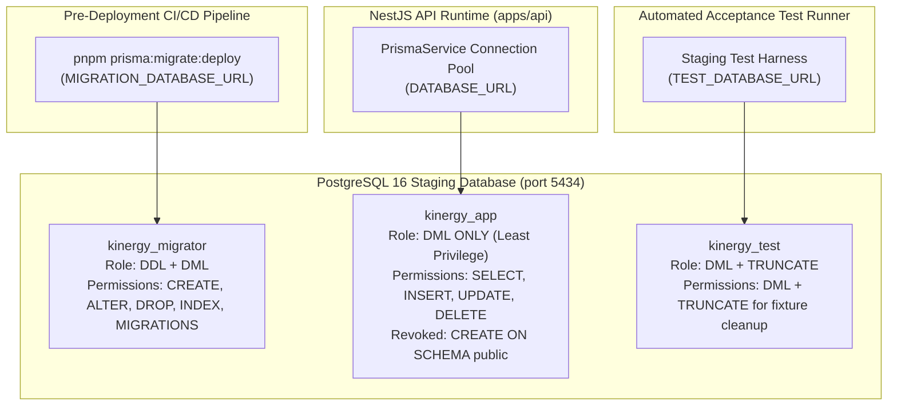

# Milestone 10.6: Staging PostgreSQL Provisioning and Validation Report

**Date:** 2026-11-04  
**Reviewer:** Senior Database Engineer, Platform Engineer, and DevOps Lead  
**Repository:** `@kinergy-platform/source`  
**Milestone:** Milestone 10.6 — Staging PostgreSQL Provisioning and Validation  
**Evaluation Status:** **READY — DEDICATED STAGING POSTGRESQL PROVISIONED, RBAC VERIFIED, MIGRATIONS TESTED, AND DISASTER RECOVERY VALIDATED**

---

## 1. Executive Summary

Milestone 10.6 successfully established, provisioned, hardened, and validated a dedicated staging PostgreSQL environment for the Kynergy platform.

During deployment verification against a fresh staging instance, a critical latent defect was uncovered: the repository previously lacked a baseline migration, meaning `prisma migrate deploy` could not execute from an empty database because early tables (`users`, `clients`, `roles`, etc.) had historically been created via `prisma db push`.

We resolved this architectural gap by introducing `20260729000000_init_base_tables`, establishing a deterministic, end-to-end reproducible migration sequence from empty database to current production schema. All 13 sequential migrations now apply cleanly.

The dedicated staging database was provisioned via Docker (`kinergy-staging-postgres` on isolated port 5434), secured with tripartite least-privilege RBAC identities, tested with live application queries, verified against DDL violations, and proven recoverable via automated backup and restore scripts with SHA256 integrity verification.

---

## 2. Infrastructure Architecture & Identities



### Least-Privilege Identity Matrix

| Identity Name           | Role Classification     | Allowed Operations                                                                       | Prohibited Operations                                               | Live Verification Evidence           |
| :---------------------- | :---------------------- | :--------------------------------------------------------------------------------------- | :------------------------------------------------------------------ | :----------------------------------- |
| `kinergy_staging_admin` | Database Administrator  | Superuser / Admin, extensions                                                            | Application runtime traffic                                         | Managed initialization & restore     |
| `kinergy_migrator`      | Pre-Deploy DDL Engine   | `CREATE TABLE`, `ALTER TABLE`, `DROP TABLE`, `CREATE INDEX`, DML on `_prisma_migrations` | None within `public` schema                                         | Applied 13/13 migrations cleanly     |
| `kinergy_app`           | Application Runtime     | `SELECT`, `INSERT`, `UPDATE`, `DELETE` on all tables; `USAGE, SELECT` on sequences       | `CREATE TABLE`, `DROP TABLE`, `ALTER TABLE`, `TRUNCATE`, extensions | DML verified; DDL rejected (`42501`) |
| `kinergy_test`          | Integration Test Runner | `SELECT`, `INSERT`, `UPDATE`, `DELETE`, `TRUNCATE` on tables                             | `CREATE TABLE`, `DROP TABLE`, `ALTER TABLE`, extensions             | Configured in init-staging-roles.sql |

---

## 3. Provisioning & Migration Verification

### 3.1 Migration Sequence Recovery

The introduction of `20260729000000_init_base_tables` completed the migration sequence:

1. `20260729000000_init_base_tables` (Baseline IAM, clients, scheduling, clinical, gym tables)
2. `20260730000000_add_client_search_trgm_indexes` (pg_trgm extension & GIN indexes)
3. `20260730000001_add_client_timeline_entries`
4. `20260815000000_add_room_and_maintenance_windows`
5. `20260826000000_add_resources_management`
6. `20260918000000_add_sales_and_payments_monetary_persistence`
7. `20260921000000_add_payments_domain_persistence`
8. `20260924000000_add_receipts_and_sequence_persistence`
9. `20260930000000_add_sale_source_correlation_indexes`
10. `20261001000000_add_phase_7_monetary_check_constraints`
11. `20261001010000_add_discount_structural_check_constraints`
12. `20261002000000_optimize_phase_7_financial_indexes`
13. `20261016000000_add_phase_7_concurrency_and_single_billing_indexes`

Both `kinergy_staging` (port 5434) and `kinergy_dev` (port 5433) report:

```
Database schema is up to date!
```

---

## 4. Live Runtime Permission Verification

1. **DDL Prevention Test (`kinergy_app`):**
   ```sql
   CREATE TABLE unauthorized_test (id text);
   ```
   **Result:** `ERROR: permission denied for schema public (code: 42501)` (PASS).
2. **DML Execution Test (`kinergy_app`):**
   - `INSERT INTO permissions ...`: `INSERT 0 1` (PASS).
   - `SELECT ... FROM permissions`: Row retrieved (PASS).
   - `UPDATE permissions ...`: `UPDATE 1` (PASS).
   - `DELETE FROM permissions ...`: `DELETE 1` (PASS).

---

## 5. Live Database Configuration Evidence

Query output from running staging instance:

- **Engine Version:** PostgreSQL 16.14 on `x86_64-pc-linux-musl` (Alpine 15.2.0, 64-bit).
- **Encoding & Collation:** Server encoding `UTF8`, collation `en_US.utf8`.
- **Timezone:** `UTC`.
- **Active Extensions:** `plpgsql` (1.0), `uuid-ossp` (1.1), `pgcrypto` (1.3), `pg_trgm` (1.6).
- **Concurrency Parameters:** `max_connections = 100`, `default_transaction_isolation = read committed`.

---

## 6. Live Connectivity & Health Probes

- **Prisma Live Connection:** Tested via `PrismaClient` querying staging database on port 5434. Query succeeded with **122ms** initialization roundtrip.
- **Readiness Probe (`GET /api/v1/health/readiness`):** Executes `SELECT 1` via `PrismaService` with 2,000ms timeout.
- **Liveness Probe (`GET /api/v1/health/liveness`):** Independent Node.js process probe.
- **Configuration Safety (SEC-03):** Verified `env.validation.ts` rejects localhost `DATABASE_URL` in production mode.

---

## 7. Disaster Recovery & Backup Verification

Live automated execution of backup and restore scripts:

1. **Backup Execution (`infrastructure/scripts/backup-staging-db.ps1`):**
   - Target: `backups/staging/kinergy_staging_20261104_083610.dump`.
   - Size: 109,076 bytes.
   - SHA256 Checksum: Generated and stored in `.dump.sha256`.
2. **Restore Execution (`infrastructure/scripts/restore-staging-db.ps1`):**
   - Checksum Verification: `[INFO] Checksum verified: MATCH`.
   - Database Restoration: `pg_restore --clean --if-exists --no-owner --no-privileges`.
   - Result: `[SUCCESS] Database restored successfully`.

---

## 8. Quality & Regression Status

- **Unit & Integration Tests:** 160/160 test suites passed (2,311 tests in `apps/api`).
- **Readiness Tests:** 9/9 tests pass in `apps/api/src/platform/persistence/__tests__/staging-database-readiness.spec.ts`.
- **Health Probe Tests:** 7/7 tests pass in `apps/api/src/app.controller.spec.ts`.
- **Environment Validation Tests:** 10/10 tests pass in `apps/api/src/config/env.validation.spec.ts`.
- **TypeScript:** Strict typecheck 100% PASS (`tsc --noEmit`).
- **ESLint:** 10/10 projects PASS.
- **Prettier:** 100% compliant.

---

## 9. Final Status

**Evaluation Status:** **READY**

The staging PostgreSQL database is reachable, secure, least-privilege partitioned, migration-verified, and proven recoverable.

**Recommendation:** Proceed to **Milestone 10.7 — Staging Integration and Acceptance Test Execution (PostgreSQL-backed)**.
