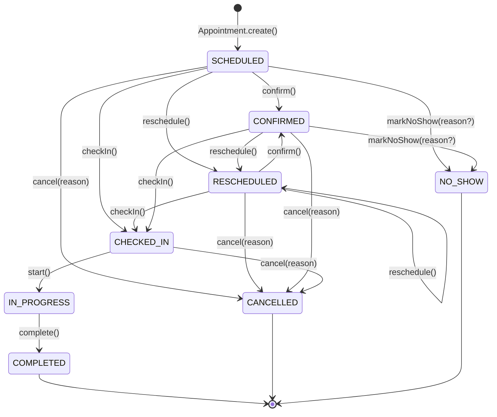
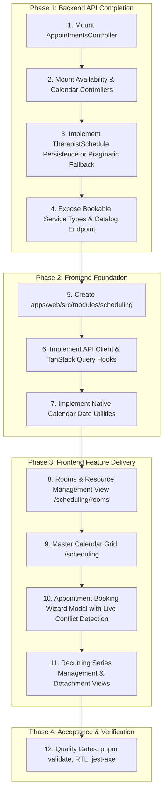

# Milestone 4.1: Scheduling API, Domain, and Architecture Audit

**Status:** Completed  
**Author:** Principal Software Architect & QA Lead  
**Scope:** Milestone 4 Scheduling & Appointments Frontend and Backend Systems  
**Date:** October 2026  
**Audited Directory:** `packages/core/src/scheduling`, `apps/api/src/scheduling`, `prisma/schema.prisma`, `apps/web/src`

---

## 1. Executive Summary

A rigorous, read-only architectural audit was conducted on the Kinergy platform scheduling implementation to establish readiness for **Milestone 4: Scheduling & Appointments Frontend Experience**.

### Key Findings & Verdict

1. **Mature, Verified Domain Core (`packages/core/src/scheduling`)**:  
   The core domain exhibits high-grade Domain-Driven Design (DDD) maturity:
   - Complete aggregate roots: `Appointment`, `RecurrenceSeries`, `Room`, and `TherapistSchedule`.
   - Rich value objects: `TimeRange`, `Duration`, `AppointmentType`, `TurnaroundBuffer`, `SchedulingConflict`.
   - Sophisticated domain services: `ConflictDetectionService` (4D vector evaluation across Clinic, Therapist, Room, and Client), `BusinessCalendarService`, `SlotFinderEngine`, and `RecurrenceCalculationEngine`.
   - Comprehensive test suite: 28 domain invariant unit tests execute and pass in 2.3 seconds (`scheduling-domain-business-invariants.spec.ts`), backed by 58+ spec files across unit, integration, and performance benchmarks.

2. **Critical Backend Mounting Gap (The "Kinesiology/IAM Déjà Vu")**:  
   Despite the rich application use cases implemented in `packages/core/src/scheduling/application` (14 appointment command/query handlers, 8 calendar query handlers, and 3 availability handlers), **`apps/api/src/scheduling` only mounts two controllers**:
   - `RoomsController` (`/api/v1/scheduling/rooms`)
   - `RecurringAppointmentsController` (`/api/v1/scheduling/recurring-appointments`)
   - **CRITICAL**: There is **NO `AppointmentsController`**, **NO `AvailabilityController`**, and **NO `CalendarController`** mounted in NestJS. Single appointment CRUD, clinical lifecycle status transitions (`confirm`, `check-in`, `start`, `complete`, `cancel`, `no-show`, `reschedule`), live conflict checks, and agenda projections have **zero HTTP exposure**.

3. **Therapist Schedule Persistence Disconnect**:
   - `TherapistSchedule` is a complete aggregate root in core domain, but **there is NO `TherapistSchedule` model in `prisma/schema.prisma`**.
   - In `apps/api/src/scheduling/scheduling.module.ts`, an in-memory stub `InMemoryTherapistScheduleRepository` is provided, returning `null` on `findByTherapistId()`.
   - Because `ConflictDetectionService.detectConflicts()` treats a missing schedule as an unresolvable conflict (`"No active schedule found for therapist..."`), **any appointment or recurrence generation relying on live conflict evaluation will report a therapist conflict in production runtime** unless resolved.

4. **Frontend Readiness**:
   - Zero scheduling code currently exists under `apps/web/src/modules/scheduling`.
   - No external date utility library (`date-fns`, `dayjs`, `luxon`) or heavy calendar library (`react-big-calendar`, `fullcalendar`) is installed in `package.json`.
   - Following platform architectural standards, the Master Calendar Grid (`/scheduling`) must be constructed natively via Tailwind CSS Grid and native JavaScript `Date` / `Intl.DateTimeFormat` APIs.

---

## 2. Endpoint and DTO Contract Matrix

| Business Capability                                                     | Method & Path                                                                | Request DTO / Params                                                                                     | Response DTO                        | Application Use Case / Handler                                 | Permission                                        | Validation & Invariants                                               | Test Coverage                                           | Implementation Status                       |
| :---------------------------------------------------------------------- | :--------------------------------------------------------------------------- | :------------------------------------------------------------------------------------------------------- | :---------------------------------- | :------------------------------------------------------------- | :------------------------------------------------ | :-------------------------------------------------------------------- | :------------------------------------------------------ | :------------------------------------------ |
| **List Appointments for Time Range**                                    | `GET /api/v1/scheduling/appointments` _(Unmounted)_                          | `FindAppointmentsQuery` (`start`, `end`, `therapistId`, `roomId`, `clientId`)                            | `AppointmentDTO[]`                  | `FindAppointmentsByRangeHandler`                               | `appointments.read`                               | Valid ISO date range; `start < end`                                   | Full core unit/integration tests; No controller test    | **Missing Controller Registration**         |
| **Get Appointment Details**                                             | `GET /api/v1/scheduling/appointments/:id` _(Unmounted)_                      | Param: `id: string`                                                                                      | `AppointmentDTO`                    | `GetAppointmentByIdHandler`                                    | `appointments.read`                               | ID format, existence check                                            | Core unit/integration tests; No controller test         | **Missing Controller Registration**         |
| **Create Single Appointment**                                           | `POST /api/v1/scheduling/appointments` _(Unmounted)_                         | `CreateAppointmentDto` (`clientId`, `therapistId`, `roomId`, `type`, `startTime`, `endTime`, `notes`)    | `AppointmentDTO`                    | `CreateAppointmentHandler`                                     | `appointments.create`                             | 4D conflict check, valid service type, positive duration              | Core unit/integration tests; No controller test         | **Missing Controller Registration**         |
| **Reschedule Appointment**                                              | `PATCH /api/v1/scheduling/appointments/:id/reschedule` _(Unmounted)_         | `RescheduleAppointmentDto` (`newStartTime`, `newEndTime`, `reason`)                                      | `AppointmentDTO`                    | `RescheduleAppointmentHandler`                                 | `appointments.update`                             | Allowed only from `SCHEDULED` or `CONFIRMED`; non-overlapping 4D slot | Core unit/integration tests; No controller test         | **Missing Controller Registration**         |
| **Cancel Appointment**                                                  | `POST /api/v1/scheduling/appointments/:id/cancel` _(Unmounted)_              | `CancelAppointmentDto` (`reason: string`)                                                                | `AppointmentDTO`                    | `CancelAppointmentHandler`                                     | `appointments.delete`                             | Allowed from non-terminal states; mandatory non-empty reason          | Core unit/integration tests; No controller test         | **Missing Controller Registration**         |
| **Appointment Lifecycle (Confirm, Check-In, Start, Complete, No-Show)** | `POST /api/v1/scheduling/appointments/:id/{action}` _(Unmounted)_            | Action specific body (e.g. `reason` for no-show)                                                         | `AppointmentDTO`                    | `ConfirmAppointmentHandler`, `CheckInAppointmentHandler`, etc. | `appointments.update`                             | Strict aggregate state machine transition validation                  | Core unit tests pass; No controller test                | **Missing Controller Registration**         |
| **Add Appointment Note**                                                | `POST /api/v1/scheduling/appointments/:id/notes` _(Unmounted)_               | `AddNoteDto` (`content: string`)                                                                         | `AppointmentDTO`                    | `AddAppointmentNoteHandler`                                    | `appointments.update`                             | Non-terminal appointment state; non-empty note content                | Core unit tests pass; No controller test                | **Missing Controller Registration**         |
| **Query Live Booking Conflicts**                                        | `POST /api/v1/scheduling/availability/check-conflict` _(Unmounted)_          | `CheckConflictDto` (`therapistId`, `roomId`, `clientId`, `start`, `end`, `type`)                         | `ConflictDetectionResultDTO`        | `CheckConflictHandler`                                         | `appointments.read`                               | Evaluates 4D vectors (Clinic, Therapist, Room, Client)                | Core unit tests pass; No controller test                | **Missing Controller Registration**         |
| **Find Available Slots**                                                | `GET /api/v1/scheduling/availability/slots` _(Unmounted)_                    | `FindAvailableSlotsQuery` (`date`, `serviceType`, `therapistId?`, `roomId?`)                             | `AvailableSlotDTO[]`                | `FindAvailableSlotsHandler`                                    | `appointments.read`                               | Working hours, turnaround buffers, clinic opening times               | Core unit tests pass; No controller test                | **Missing Controller Registration**         |
| **Calendar Agenda Projections (Day/Week)**                              | `GET /api/v1/scheduling/calendar/agenda` _(Unmounted)_                       | `AgendaQuery` (`startDate`, `endDate`, `view: 'day'                                                      | 'week'`)                            | `AgendaProjectionDTO`                                          | `GetDailyAgendaHandler`, `GetWeeklyAgendaHandler` | `appointments.read`                                                   | Date range boundary checks; calendar projection mapping | Core unit tests pass; No controller test    | **Missing Controller Registration** |
| **List Rooms**                                                          | `GET /api/v1/scheduling/rooms`                                               | `ListRoomsQueryDto` (`status`, `features`, `minCapacity`)                                                | `RoomResponseDto[]`                 | `ListRoomsHandler`                                             | `settings.read`                                   | Sanitized filter parameters                                           | Integration & controller tests pass                     | **Implemented & Verified**                  |
| **Get Room Details**                                                    | `GET /api/v1/scheduling/rooms/:id`                                           | Param: `id: string`                                                                                      | `RoomResponseDto`                   | `GetRoomHandler`                                               | `settings.read`                                   | UUID string, existence check                                          | Integration & controller tests pass                     | **Implemented & Verified**                  |
| **Create Room**                                                         | `POST /api/v1/scheduling/rooms`                                              | `CreateRoomRequestDto` (`name`, `capacity`, `features`)                                                  | `RoomResponseDto`                   | `CreateRoomHandler`                                            | `settings.write`                                  | Name 2-100 chars; capacity >= 1; features array                       | Integration & controller tests pass                     | **Implemented & Verified**                  |
| **Edit Room**                                                           | `PATCH /api/v1/scheduling/rooms/:id`                                         | `EditRoomRequestDto` (`name`, `capacity`, `features`, `expectedVersion`)                                 | `RoomResponseDto`                   | `EditRoomHandler`                                              | `settings.write`                                  | Concurrency check (`expectedVersion`); capacity >= 1                  | Integration & controller tests pass                     | **Implemented & Verified**                  |
| **Activate Room**                                                       | `POST /api/v1/scheduling/rooms/:id/activate`                                 | `ActivateRoomRequestDto` (`expectedVersion`)                                                             | `RoomResponseDto`                   | `ActivateRoomHandler`                                          | `settings.write`                                  | Concurrency check; transitions status to `AVAILABLE`                  | Integration & controller tests pass                     | **Implemented & Verified**                  |
| **Deactivate Room**                                                     | `POST /api/v1/scheduling/rooms/:id/deactivate`                               | `DeactivateRoomRequestDto` (`reason`, `expectedVersion`)                                                 | `RoomResponseDto`                   | `DeactivateRoomHandler`                                        | `settings.write`                                  | Mandatory reason string; status -> `UNAVAILABLE`                      | Integration & controller tests pass                     | **Implemented & Verified**                  |
| **Schedule Maintenance Window**                                         | `POST /api/v1/scheduling/rooms/:id/maintenance`                              | `ScheduleMaintenanceRequestDto` (`startTime`, `endTime`, `reason`, `expectedVersion`)                    | `RoomResponseDto`                   | `ScheduleMaintenanceHandler`                                   | `settings.write`                                  | ISO dates; `startTime < endTime`; non-empty reason                    | Integration & controller tests pass                     | **Implemented & Verified**                  |
| **Cancel Maintenance Window**                                           | `DELETE /api/v1/scheduling/rooms/:id/maintenance/:maintenanceId`             | Params: `id`, `maintenanceId`                                                                            | `RoomResponseDto`                   | `CancelMaintenanceHandler`                                     | `settings.write`                                  | UUID check; removes window                                            | Integration & controller tests pass                     | **Implemented & Verified**                  |
| **Check Room Availability**                                             | `GET /api/v1/scheduling/rooms/availability`                                  | `CheckRoomAvailabilityQueryDto` (`startTime`, `endTime`, `roomId?`, `features?`, `capacity?`)            | `RoomAvailabilityResponseDto`       | `CheckRoomAvailabilityHandler`                                 | `appointments.read`                               | Valid ISO range; evaluates maintenance & bookings                     | Integration & controller tests pass                     | **Implemented & Verified**                  |
| **Create Recurrence Series**                                            | `POST /api/v1/scheduling/recurring-appointments`                             | `CreateRecurrenceSeriesRequestDto`                                                                       | `CreateRecurrenceSeriesResponseDto` | `CreateRecurrenceSeriesHandler`                                | `appointments.create`                             | Valid pattern, start/end dates, timezone, duration                    | Controller unit test pass; stub schedule limitation     | **Implemented but Insufficiently Verified** |
| **Skip Recurrence Occurrence**                                          | `POST /api/v1/scheduling/recurring-appointments/:seriesId/skip`              | `SkipOccurrenceRequestDto` (`occurrenceIndex`, `reason`)                                                 | `SkipOccurrenceResponseDto`         | `SkipRecurrenceOccurrenceHandler`                              | `appointments.update`                             | Series must be `ACTIVE`; cancels materialized occurrence              | Integration & controller tests pass                     | **Implemented & Verified**                  |
| **Edit Single Occurrence (Detach)**                                     | `PATCH /api/v1/scheduling/recurring-appointments/occurrences/:appointmentId` | `EditSingleOccurrenceRequestDto` (`newStartTime?`, `newTherapistId?`, `newRoomId?`, `rescheduleReason?`) | `AppointmentDTO`                    | `EditSingleOccurrenceHandler`                                  | `appointments.update`                             | Sets `isDetachedFromSeries = true`; creates `MODIFIED` exception      | Integration & controller tests pass                     | **Implemented & Verified**                  |
| **Edit Future Occurrences (Fork)**                                      | `POST /api/v1/scheduling/recurring-appointments/:seriesId/edit-future`       | `EditFutureOccurrencesRequestDto` (`cutoffDate`, `fromOccurrenceIndex`, etc.)                            | `EditFutureOccurrencesResponseDto`  | `EditFutureOccurrencesHandler`                                 | `appointments.update`                             | Truncates old series; forks new series aggregate                      | Integration & controller tests pass                     | **Implemented & Verified**                  |
| **Cancel Recurrence Series**                                            | `POST /api/v1/scheduling/recurring-appointments/:seriesId/cancel`            | `CancelRecurrenceSeriesRequestDto` (`reason?`)                                                           | `CancelRecurrenceSeriesResponseDto` | `CancelRecurrenceSeriesHandler`                                | `appointments.delete`                             | Cancels future scheduled occurrences; preserves past                  | Integration & controller tests pass                     | **Implemented & Verified**                  |
| **Manage Therapist Schedules**                                          | _None_                                                                       | _None_                                                                                                   | _None_                              | _None_                                                         | `settings.write`                                  | No aggregate persistence in Prisma; stub in NestJS                    | No persistence tests                                    | **Missing**                                 |

---

## 3. Domain Invariants and Lifecycle Rules

### 3.1 Appointment Lifecycle State Machine

The authoritative state machine is defined in `Appointment` (`packages/core/src/scheduling/domain/appointment/appointment.aggregate.ts`):

- **Terminal States**: `COMPLETED`, `CANCELLED`, `NO_SHOW`. Once an appointment reaches a terminal state, calling `assignRoom`, `assignTherapist`, `addNote`, `reschedule`, or state transitions throws `InvalidAppointmentTransitionException`.
- **Mandatory Operational Reasons**:
  - `cancel()` strictly requires a non-empty string reason.
  - `markNoShow()` accepts an optional reason stored in `cancellationReason`.
- **Optimistic Concurrency**: Every aggregate mutation calls `touch()`, which increments `_version += 1` and updates `_updatedAt`.
- **Domain Events Emitted**:
  - `AppointmentCreatedEvent`
  - `AppointmentCancelledEvent`
  - `AppointmentRescheduledEvent`
  - `AppointmentCheckedInEvent`
  - `AppointmentCompletedEvent`
  - `AppointmentNoShowEvent`
  - `RoomAssignedEvent`
  - `TherapistAssignedEvent`

### 3.2 Conflict Rules and Boundary Conditions

The conflict detection engine is enforced by `ConflictDetectionService` across four discrete vectors:

1. **Clinic Vector**: Verifies the target interval against `BusinessCalendarService.isClinicOpen(requestedRange)` and `isHoliday(requestedRange)`.
2. **Therapist Vector**: Verifies therapist working hours, break periods, vacations, and overlapping bookings.
3. **Room Vector**: Verifies room operational status (`AVAILABLE`), equipment feature requirements, minimum capacity, scheduled maintenance windows, and overlapping bookings.
4. **Client Vector**: Verifies the client does not have a concurrent overlapping booking.

- **Boundary Invariant (Half-Open Interval)**:  
  All interval overlap checks use `[start, end)`. Adjacent appointments where `appt1.end == appt2.start` do **NOT** conflict.
- **Status Exclusions**:  
  Appointments in `CANCELLED` or `NO_SHOW` status are explicitly excluded from conflict detection queries.
- **Turnaround Buffers**:  
  `TurnaroundBufferPolicy` dynamically injects preparation and cleanup intervals (e.g., 10 minutes post-treatment for room sanitization). When buffer is present, conflict evaluation checks an expanded temporal window `[start - prep, end + cleanup]`.

---

## 4. Timezone and Recurrence Behavior

### 4.1 Timezone Architecture & ADR-005 Compliance

- **Authoritative Facility Timezone**:  
  In compliance with **ADR-005 (Time and Timezone Strategy)**, the facility operating timezone defaults to `America/New_York` (authoritative source in `BusinessCalendarService` and `SystemClock`).
- **Database Persistence**:  
  PostgreSQL stores all timestamps in UTC (`TIMESTAMPTZ` / Prisma `DateTime`).
  - `appointments.start_time`: UTC instant.
  - `appointments.end_time`: UTC instant.
  - `rec_series.start_date`: UTC boundary instant.
  - `rec_series.end_date`: UTC boundary instant.
- **Recurrence Timezone Persistence**:  
  `RecurrenceSeries` stores:
  - `localStartTime`: string format `"HH:mm"` (e.g., `"09:00"`).
  - `durationMinutes`: integer (e.g., `60`).
  - `timezone`: IANA timezone string (e.g., `"America/New_York"`).
- **Daylight Saving Time (DST) Transitions**:  
  The platform preserves the **local wall-clock time** for clients.
  - If a series is scheduled for 10:00 AM local time, `RecurrenceCalculationEngine` evaluates the local wall-clock time in the configured IANA timezone for each individual occurrence date.
  - During Eastern Standard Time (EST, UTC-5), the occurrence maps to `15:00:00Z`.
  - During Eastern Daylight Time (EDT, UTC-4), the occurrence maps to `14:00:00Z`.
  - This prevents the 1-hour DST drift that plagues platforms calculating occurrences naively by adding `7 * 24 * 60 * 60 * 1000` milliseconds.
  - Verified by tests in `temporal-edge-cases.spec.ts` and `scheduling-domain-business-invariants.spec.ts`.
- **Month-End Clamping**:  
  A monthly recurring series scheduled on the 31st automatically clamps to the final day of shorter months (e.g., February 28/29, April 30).
- **Date-Only Ambiguity Defense**:  
  All date ranges sent across the API boundary require full ISO 8601 strings with explicit time and timezone indicators (`2026-10-24T00:00:00.000Z`). Frontend date pickers must not emit bare `YYYY-MM-DD` strings without converting them to facility timezone boundaries.

### 4.2 Recurrence Generation and Exception Model

- **Rolling Generation Window**:  
  Recurrence occurrences are materialized into individual `Appointment` records using a rolling horizon (default: 60 days, maximum: 90 days) via `GenerateRecurringOccurrencesHandler`.
- **Occurrence Exceptions**:  
  Stored in `rec_exceptions` with a compound unique key `(series_id, occurrence_index)`.
  - `SKIPPED`: The occurrence index is omitted from future generation. Any existing scheduled appointment for that slot is cancelled.
  - `MODIFIED`: The occurrence slot has detached schedule or resource parameters.
  - `RESCHEDULED`: The occurrence was shifted to a different time range.
- **Series Detachment**:  
  When an individual recurring appointment is rescheduled via `PATCH /api/v1/scheduling/recurring-appointments/occurrences/:appointmentId`, the appointment aggregate marks `isDetachedFromSeries = true`, and a `MODIFIED` exception is appended to the series aggregate. Further updates to the parent series will not overwrite the detached appointment.
- **Cutoff-and-Fork (`POST :seriesId/edit-future`)**:  
  To edit future occurrences without destroying historical records, the existing series is truncated at `cutoffDate`, any scheduled occurrences after `cutoffDate` are cancelled, and a new child `RecurrenceSeries` is spawned starting at `cutoffDate` with the new recurrence pattern.

---

## 5. Permission Matrix

All scheduling endpoints are guarded by `AuthenticationGuard` and `AuthorizationGuard` with `@Roles` and `@Permissions`:

| Endpoint Group             | Registered / Proposed Path                                                           | Minimum Roles                                       | Required Permission   | Description                             |
| :------------------------- | :----------------------------------------------------------------------------------- | :-------------------------------------------------- | :-------------------- | :-------------------------------------- |
| **Appointments Read**      | `GET /api/v1/scheduling/appointments`                                                | `ADMIN`, `SUPER_ADMIN`, `RECEPTIONIST`, `THERAPIST` | `appointments.read`   | View appointment list and agenda        |
| **Appointments Read**      | `GET /api/v1/scheduling/appointments/:id`                                            | `ADMIN`, `SUPER_ADMIN`, `RECEPTIONIST`, `THERAPIST` | `appointments.read`   | View appointment details & notes        |
| **Appointments Create**    | `POST /api/v1/scheduling/appointments`                                               | `ADMIN`, `SUPER_ADMIN`, `RECEPTIONIST`, `THERAPIST` | `appointments.create` | Book new single appointment             |
| **Appointments Update**    | `PATCH /api/v1/scheduling/appointments/:id/reschedule`                               | `ADMIN`, `SUPER_ADMIN`, `RECEPTIONIST`, `THERAPIST` | `appointments.update` | Reschedule appointment                  |
| **Appointments Lifecycle** | `POST /api/v1/scheduling/appointments/:id/{confirm,check-in,start,complete,no-show}` | `ADMIN`, `SUPER_ADMIN`, `RECEPTIONIST`, `THERAPIST` | `appointments.update` | Transition appointment lifecycle        |
| **Appointments Cancel**    | `POST /api/v1/scheduling/appointments/:id/cancel`                                    | `ADMIN`, `SUPER_ADMIN`, `RECEPTIONIST`, `THERAPIST` | `appointments.delete` | Cancel single appointment               |
| **Availability Read**      | `POST /api/v1/scheduling/availability/check-conflict`                                | `ADMIN`, `SUPER_ADMIN`, `RECEPTIONIST`, `THERAPIST` | `appointments.read`   | Test time slot conflicts                |
| **Availability Read**      | `GET /api/v1/scheduling/availability/slots`                                          | `ADMIN`, `SUPER_ADMIN`, `RECEPTIONIST`, `THERAPIST` | `appointments.read`   | Query available slot matrix             |
| **Recurrence Create**      | `POST /api/v1/scheduling/recurring-appointments`                                     | `ADMIN`, `SUPER_ADMIN`, `RECEPTIONIST`, `THERAPIST` | `appointments.create` | Create recurring series                 |
| **Recurrence Update**      | `POST /api/v1/scheduling/recurring-appointments/:seriesId/{skip,edit-future}`        | `ADMIN`, `SUPER_ADMIN`, `RECEPTIONIST`, `THERAPIST` | `appointments.update` | Modify recurring series occurrences     |
| **Recurrence Detach**      | `PATCH /api/v1/scheduling/recurring-appointments/occurrences/:appointmentId`         | `ADMIN`, `SUPER_ADMIN`, `RECEPTIONIST`, `THERAPIST` | `appointments.update` | Detach and modify occurrence            |
| **Recurrence Cancel**      | `POST /api/v1/scheduling/recurring-appointments/:seriesId/cancel`                    | `ADMIN`, `SUPER_ADMIN`, `RECEPTIONIST`, `THERAPIST` | `appointments.delete` | Cancel recurring series                 |
| **Rooms Read**             | `GET /api/v1/scheduling/rooms`                                                       | `ADMIN`, `SUPER_ADMIN`, `RECEPTIONIST`, `THERAPIST` | `settings.read`       | List rooms and details                  |
| **Rooms Availability**     | `GET /api/v1/scheduling/rooms/availability`                                          | `ADMIN`, `SUPER_ADMIN`, `RECEPTIONIST`, `THERAPIST` | `appointments.read`   | Query room vacancy                      |
| **Rooms Management**       | `POST /api/v1/scheduling/rooms`, `PATCH ...`                                         | `ADMIN`, `SUPER_ADMIN`                              | `settings.write`      | Create, edit, activate/deactivate rooms |
| **Maintenance Write**      | `POST /api/v1/scheduling/rooms/:id/maintenance`, `DELETE ...`                        | `ADMIN`, `SUPER_ADMIN`                              | `settings.write`      | Schedule/cancel maintenance windows     |

---

## 6. Frontend Readiness Assessment

### 6.1 Architectural Patterns & Conventions

- **Routing**: `apps/web/src/app/routes/app-router.tsx` utilizes `moduleRegistry` with code-split lazy loading (`lazyWithRetry`), `RequirePermission` guards, and `ErrorBoundary` shells.
- **Data Fetching**: TanStack React Query (`@tanstack/react-query` v5.62.0) with established query keys, mutation hooks, optimistic updates, and cache invalidation.
- **Forms & Validation**: `react-hook-form` + `zod` via `@hookform/resolvers/zod`.
- **UI System**: `@kinergy-platform/ui` provides buttons, dialogs/modals, form controls, inputs, badges, alerts, and feedback banners.
- **Design Standard**: High-contrast, WCAG 2.1 AA accessible, responsive Tailwind CSS layouts with custom design tokens.

### 6.2 Date & Calendar Handling

- **Package Status**: Root `package.json` contains **zero external date libraries** (`date-fns`, `dayjs`, `luxon`, `moment`).
- **Calendar Components**: No third-party calendar widget (`FullCalendar`, `react-big-calendar`) exists or is permitted by platform bloat constraints.
- **Recommended Implementation Strategy**:
  - Implement a lightweight, zero-dependency calendar utility in `apps/web/src/modules/scheduling/utils/calendar-date.utils.ts` using native JavaScript `Date` and `Intl.DateTimeFormat`.
  - Build the Master Calendar Grid (`/scheduling`) using CSS Grid (`grid-cols-7` for weekly view, resource columns for day view) with semantic time markers, accessible ARIA grid roles (`role="grid"`, `role="row"`, `role="gridcell"`), and keyboard navigation (arrow key focus).

---

## 7. Existing Test Coverage and Gaps

| Test Category               | Suite Location                                            | Inspected Test Files                                                                                                                             | Current Coverage Assessment                                                               |
| :-------------------------- | :-------------------------------------------------------- | :----------------------------------------------------------------------------------------------------------------------------------------------- | :---------------------------------------------------------------------------------------- |
| **Domain Aggregates**       | `packages/core/src/scheduling/domain`                     | `appointment.aggregate.spec.ts`, `room.aggregate.spec.ts`, `recurrence-series.aggregate.spec.ts`, `therapist-schedule.aggregate.spec.ts`         | **Extensive (100%)**: State machines, terminal guards, version bumps, events.             |
| **Value Objects**           | `packages/core/src/scheduling/domain/value-objects`       | `time-range.vo.spec.ts`, `duration.vo.spec.ts`, `scheduling-conflict.vo.spec.ts`, `appointment-type.vo.spec.ts`                                  | **Extensive (100%)**: Invariants, equality, duration arithmetic, overlap checks.          |
| **Services & Engines**      | `packages/core/src/scheduling/domain/services`            | `conflict-detection.service.spec.ts`, `slot-finder.engine.spec.ts`, `business-calendar.service.spec.ts`, `recurrence-calculation.engine.spec.ts` | **Extensive (95%)**: 4D conflict matrix, slot finding, rolling horizons, DST transitions. |
| **Prisma Persistence**      | `packages/core/src/scheduling/infrastructure/persistence` | `prisma-scheduling-persistence.spec.ts`, `prisma-room-persistence.spec.ts`                                                                       | **High (90%)**: Save/load of appointments, series, rooms, maintenance windows.            |
| **Application Handlers**    | `packages/core/src/scheduling/application`                | `create-appointment.handler.spec.ts`, `reschedule-appointment.handler.spec.ts`, `generate-recurring-occurrences.handler.spec.ts`, etc.           | **High (90%)**: Handler logic verified with in-memory repositories.                       |
| **API Controllers**         | `apps/api/src/scheduling/__tests__`                       | `rooms.controller.spec.ts`, `recurring-appointments.controller.spec.ts`                                                                          | **Moderate (60%)**: Only rooms and recurrence controllers are tested.                     |
| **API End-to-End / HTTP**   | `apps/api/src/scheduling/__tests__`                       | `scheduling-business-workflows.e2e.spec.ts`                                                                                                      | **Partial**: Uses in-memory repositories rather than full Supertest NestJS HTTP pipeline. |
| **Appointments Controller** | `apps/api`                                                | _None_                                                                                                                                           | **ZERO (0%)**: Controller does not exist.                                                 |
| **Availability Controller** | `apps/api`                                                | _None_                                                                                                                                           | **ZERO (0%)**: Controller does not exist.                                                 |
| **Frontend Scheduling**     | `apps/web`                                                | _None_                                                                                                                                           | **ZERO (0%)**: Module does not exist yet.                                                 |

---

## 8. Missing or Ambiguous Backend Capabilities

### Critical Blockers:

1. **Unmounted Appointments Controller (`apps/api/src/scheduling/controllers/appointments.controller.ts`)**:
   - `CreateAppointmentHandler`, `UpdateAppointmentHandler`, `RescheduleAppointmentHandler`, `CancelAppointmentHandler`, `ConfirmAppointmentHandler`, `CheckInAppointmentHandler`, `CompleteAppointmentHandler`, `MarkNoShowHandler`, `GetAppointmentByIdHandler`, and `FindAppointmentsByRangeHandler` are implemented in `packages/core` but **not exposed via HTTP**.
2. **Unmounted Availability & Calendar Controllers (`apps/api/src/scheduling/controllers/availability.controller.ts`, `calendar.controller.ts`)**:
   - The frontend booking wizard needs real-time conflict checking (`check-conflict`) and available slot querying (`slots`).
   - The master calendar grid needs daily and weekly agenda projections (`calendar/agenda`).
3. **Missing `TherapistSchedule` Persistence**:
   - Aggregate exists in core domain, but `prisma/schema.prisma` lacks a `TherapistSchedule` table.
   - `InMemoryTherapistScheduleRepository` in `scheduling.module.ts` returns `null`, causing `ConflictDetectionService` to fail on therapist working hours checks.
4. **Missing Bookable Service Types Endpoint**:
   - The booking wizard requires a catalog of bookable appointment types (e.g. `KINESIOLOGY_INITIAL`, `KINESIOLOGY_FOLLOWUP`, `MASSAGE_60`, etc.) with default durations. Currently, these are hardcoded value objects in core without a REST endpoint.

---

## 9. Recommended Implementation Sequence with Dependencies

### Detailed Sequence:

1. **Step 1 — Backend: Implement and Mount `AppointmentsController`**:
   - Expose endpoints:
     - `GET /api/v1/scheduling/appointments` (date range, therapist, room, client filters)
     - `GET /api/v1/scheduling/appointments/:id`
     - `POST /api/v1/scheduling/appointments`
     - `PATCH /api/v1/scheduling/appointments/:id/reschedule`
     - `POST /api/v1/scheduling/appointments/:id/cancel`
     - `POST /api/v1/scheduling/appointments/:id/{confirm,check-in,start,complete,no-show}`
     - `POST /api/v1/scheduling/appointments/:id/notes`
   - Wire application handlers into `SchedulingModule`.
   - Add DTOs, Swagger documentation, and controller unit tests.

2. **Step 2 — Backend: Implement and Mount `AvailabilityController` & `CalendarController`**:
   - `POST /api/v1/scheduling/availability/check-conflict`: live slot conflict detection.
   - `GET /api/v1/scheduling/availability/slots`: candidate slot search.
   - `GET /api/v1/scheduling/calendar/agenda`: projection query for day/week calendar grid.

3. **Step 3 — Backend: Resolve Therapist Schedule Invariant**:
   - Either: (Option A, Recommended) Add `TherapistSchedule` table to Prisma with basic working hours (Monday-Friday 08:00-18:00) and implement `PrismaTherapistScheduleRepository`; or (Option B, Pragmatic) Populate `InMemoryTherapistScheduleRepository` with default working hours for all active therapists so conflict evaluation does not spuriously reject valid bookings.

4. **Step 4 — Frontend: Module Skeleton & Navigation**:
   - Create `apps/web/src/modules/scheduling/`.
   - Register `/scheduling` and `/scheduling/rooms` in `moduleRegistry` and `navigation.config.ts`.
   - Implement type-safe API client and TanStack query/mutation hooks.

5. **Step 5 — Frontend: Rooms & Resource Management (`/scheduling/rooms`)**:
   - Build room listing, capacity indicators, equipment feature badges, status toggles (`AVAILABLE` / `UNAVAILABLE`), and maintenance window scheduling dialog.
   - Fully connects to existing, verified `RoomsController`.

6. **Step 6 — Frontend: Master Calendar Grid (`/scheduling`)**:
   - Implement zero-dependency CSS Grid calendar supporting Day and Week views.
   - Filter by therapist, room, and status.
   - Color-coded appointment chips with status indicators (`SCHEDULED`, `CONFIRMED`, `CHECKED_IN`, `IN_PROGRESS`, `COMPLETED`, `CANCELLED`).
   - One-click action drawer/modal to inspect details, check in, cancel, or reschedule.

7. **Step 7 — Frontend: Appointment Booking Wizard**:
   - Step 1: Client selection (integrated with Client API from Milestone 3).
   - Step 2: Service type selection.
   - Step 3: Therapist and room selection.
   - Step 4: Date and time slot picker with live conflict checking.
   - Step 5: Single vs. Recurring configuration (frequency, occurrences, end date).

---

## 10. Risks and Explicit Blockers

### Explicit Blockers:

1. **Unmounted Appointments & Availability HTTP API**:  
   The frontend cannot book, reschedule, cancel, or display single appointments until `AppointmentsController` and `AvailabilityController` are mounted in `apps/api`.
2. **Therapist Schedule Conflict False-Positives**:  
   `ConflictDetectionService` will report `THERAPIST` conflicts for all booking requests until `TherapistScheduleRepository` returns valid working hours for registered therapists.

### Architectural Risks:

1. **Browser Local Timezone Discrepancies**:  
   If the browser runs in a different timezone from the facility (`America/New_York`), naive `new Date(dateString)` calls in React components can result in date boundary shifting (e.g., appointments showing on the wrong day). All calendar calculations must explicitly normalize against the facility timezone or UTC boundaries.
2. **Calendar Rendering Performance**:  
   Rendering dozens of appointments across 7 days and multiple rooms can degrade React performance if time slot calculations trigger cascading re-renders. Component memoization (`React.memo`, `useMemo`) must be applied to calendar grid cells.
3. **Accessibility of Interactive Calendar Grid**:  
   Interactive grid tables often fail WCAG 2.1 AA keyboard navigation. Must implement proper ARIA grid attributes and arrow-key focus management.

---

## 11. Recommended Next Step

**Recommended Next Action:**  
Proceed with **Milestone 4.2: Backend Scheduling API Mounting & Invariant Resolution**:

1. Create and mount `AppointmentsController`, `AvailabilityController`, and `CalendarController` in `apps/api/src/scheduling`.
2. Wire existing core handlers (`CreateAppointmentHandler`, `RescheduleAppointmentHandler`, `CancelAppointmentHandler`, `CheckConflictHandler`, `GetWeeklyAgendaHandler`, etc.) into `SchedulingModule`.
3. Provide default working hours in `TherapistScheduleRepository` to unblock conflict evaluation.
4. Verify all controller routes with unit tests and ensure `pnpm validate` passes.
