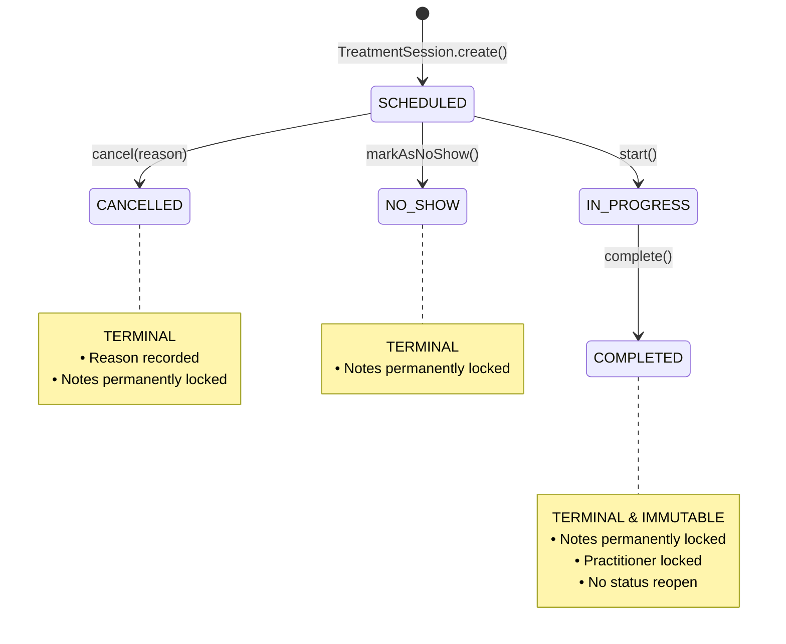
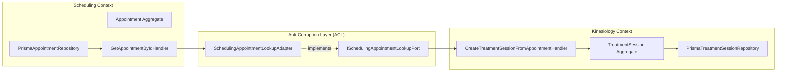
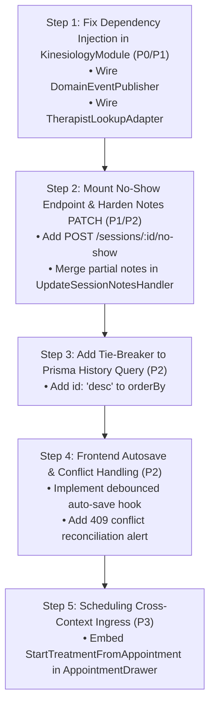

# Milestone 5.1: Kinesiology Clinical Domain and API Audit

**Status:** Completed  
**Author:** Senior Software Architect & Clinical-Workflow Engineer  
**Scope:** Milestone 5.1 Kinesiology Clinical Domain, Application Use Cases, API Contracts, Persistence, and Frontend Readiness  
**Date:** October 2026  
**Audited Directories:** `packages/core/src/kinesiology`, `apps/api/src/kinesiology`, `apps/web/src/modules/kinesiology`, `prisma/schema.prisma`  
**Governing ADRs:** ADR-0045, ADR-0046, ADR-0047, ADR-0048, ADR-0049, ADR-0050, ADR-0051, ADR-0052, ADR-0053

---

## 1. Executive Summary

A comprehensive, read-only architectural and clinical-workflow audit was conducted on the **Kinesiology Bounded Context** across domain models, application use cases, NestJS controllers, Prisma persistence, and React frontend modules.

### Key Audit Findings & Verdict

1. **High-Grade Domain-Driven Design (DDD) Core (`packages/core/src/kinesiology`)**:
   - The core domain exhibits strict DDD purity: `TreatmentSession` is an autonomous aggregate root encapsulated with private properties, behavioral state transitions, defensive date copies, domain events, and optimistic concurrency versioning.
   - Clinical notes are governed by an immutable Value Object (`SessionNotes`) enforcing section length boundaries ($10,000$ characters) and total length limits ($50,000$ characters), with CRLF normalization, whitespace trimming, and `Object.freeze()`.
   - The test suite in core is mature: **18 test suites and 211 unit/integration tests pass deterministically** (`packages/core/src/kinesiology/**/*.spec.ts`).

2. **Mounted Controller with Solid Security, but Critical DI & Event Gaps (`apps/api/src/kinesiology`)**:
   - Unlike the early Scheduling milestone where controllers were unmounted, `TreatmentSessionsController` is registered in `apps/api/src/kinesiology/kinesiology.module.ts`, which is imported in `AppModule`.
   - **Critical Dependency Injection Gap 1 (Eligibility Bypass)**: In `kinesiology.module.ts`, `AssignTherapistToSessionHandler` is instantiated with `undefined` for `ITherapistLookupPort`. In production runtime, therapist existence and clinical eligibility validation (`status === 'ACTIVE'`, `kinesiology.sessions.treat`) are completely bypassed.
   - **Critical Dependency Injection Gap 2 (Event Dispatch Dead End)**: In `kinesiology.module.ts`, `CompleteTreatmentSessionHandler`, `StartTreatmentSessionHandler`, and `CancelTreatmentSessionHandler` are instantiated with `undefined` for `DomainEventPublisher`. Consequently, domain events (such as `TreatmentSessionCompletedEvent`) are pulled into memory and discarded. The downstream `ClientTimelineProjectionHandler` in `modules/client` **never receives completion events in live runtime**, breaking longitudinal activity timeline projections.
   - **Missing Controller Route**: `MarkTreatmentSessionNoShowHandler` is fully implemented and tested in the application layer, but has **zero HTTP exposure** in `TreatmentSessionsController`.

3. **Persistence Semantics & Silent Concurrency Overwrites (`prisma/schema.prisma`)**:
   - `TreatmentSession` is modeled in Prisma with a mandatory unique foreign constraint: `appointmentId String @unique @map("appointment_id")`. A standalone session without an appointment cannot be persisted.
   - **Optimistic Concurrency Control (OCC) Blindspot**: While `TreatmentSession.version` increments in domain memory, `PrismaTreatmentSessionRepository.save()` executes an `upsert` matching solely on `id` without checking `where: { id, version: expectedVersion }`. Furthermore, `UpdateSessionNotesDto` does not accept `expectedVersion`. Concurrent writes overwrite each other without throwing HTTP 409.
   - **Whole-Value Replacement Danger**: `SessionNotes` operates on whole-value replacement. Calling `PUT` or `PATCH /api/v1/kinesiology/sessions/:id/notes` with a partial payload (e.g., only updating `plan`) silently replaces unpassed sections with `null` in the database.
   - **History Query Tie-Breaker Omission**: `PrismaTreatmentSessionRepository.findHistoryByClientId()` orders records by `{ createdAt: 'desc' }` only, omitting the stable tie-breaker `{ id: 'desc' }` mandated by ADR-0051.

4. **Frontend Architecture & Productization Readiness (`apps/web/src/modules/kinesiology`)**:
   - The frontend module is substantially built: `TreatmentSessionWorkspacePage`, `ClientTreatmentHistoryPage`, `SoapNotesForm`, `SessionStatusBadge`, and transition modals are implemented and backed by **8 test suites with 28 passing unit/integration tests**.
   - **Missing Operational Features**:
     - **No Autosave / Local Draft Cache**: Notes are persisted only upon manual click of "Save Notes". There is no debounce timer or draft persistence.
     - **No Cross-Context Ingress in Scheduling UI**: While `StartTreatmentFromAppointment` exists as an isolated component, the master scheduling calendar drawer/modal does not render it. Practitioners cannot yet launch clinical sessions directly from the calendar UI.
     - **No Concurrency Conflict Reconciliation**: HTTP 409 responses from the server are notified via toast, but do not prompt the practitioner to merge or inspect server-side note revisions.

---

## 2. API and DTO Contract Matrix

| Capability                                | Method & Path                                                                                          | Request DTO / Params                                                                                                                                                                                  | Response DTO                   | Application Handler                            | Permissions                              | Validation & Invariants                                                                                                                                                                                                         | Test Coverage                                                     | Status                                                                                               |
| :---------------------------------------- | :----------------------------------------------------------------------------------------------------- | :---------------------------------------------------------------------------------------------------------------------------------------------------------------------------------------------------- | :----------------------------- | :--------------------------------------------- | :--------------------------------------- | :------------------------------------------------------------------------------------------------------------------------------------------------------------------------------------------------------------------------------ | :---------------------------------------------------------------- | :--------------------------------------------------------------------------------------------------- |
| **Create Session from Appointment**       | `POST /api/v1/kinesiology/sessions`                                                                    | `CreateTreatmentSessionDto`<br>• `appointmentId: string`<br>• `initialNotes?: string`<br>• `autoStart?: boolean`                                                                                      | `TreatmentSessionDTO`          | `CreateTreatmentSessionFromAppointmentHandler` | `kinesiology.sessions.treat`             | Non-empty `appointmentId`; upstream clinical appointment lookup; service type in `[ASSESSMENT, TREATMENT, FOLLOW_UP, EVALUATION]`; status in `[SCHEDULED, CONFIRMED, CHECKED_IN, IN_PROGRESS]`; unique appointment correlation. | Unit, integration & controller tests pass                         | **Implemented & Verified**                                                                           |
| **Get Treatment Session by ID**           | `GET /api/v1/kinesiology/sessions/:id`                                                                 | Param: `id: string`                                                                                                                                                                                   | `TreatmentSessionDTO`          | `GetTreatmentSessionByIdHandler`               | `kinesiology.sessions.read`              | Non-empty UUID/CUID; aggregate existence check.                                                                                                                                                                                 | Unit, integration & controller tests pass                         | **Implemented & Verified**                                                                           |
| **Start Treatment Session**               | `POST /api/v1/kinesiology/sessions/:id/start`                                                          | Param: `id: string`                                                                                                                                                                                   | `TreatmentSessionDTO`          | `StartTreatmentSessionHandler`                 | `kinesiology.sessions.treat`             | Requires current status `SCHEDULED`; advances to `IN_PROGRESS`; version increments; records `TreatmentSessionStartedEvent`.                                                                                                     | Unit, integration & controller tests pass                         | **Implemented & Verified** _(Domain event un-dispatched in prod)_                                    |
| **Assign / Reassign Therapist**           | `POST /api/v1/kinesiology/sessions/:id/assign-therapist`<br>_(Alias: `PATCH /sessions/:id/therapist`)_ | Param: `id: string`<br>`AssignTherapistDto`<br>• `newTherapistId: string`                                                                                                                             | `TreatmentSessionDTO`          | `AssignTherapistToSessionHandler`              | `kinesiology.sessions.assign`            | Non-empty IDs; session must be `SCHEDULED` or `IN_PROGRESS`; terminal states throw domain error; idempotent if identical therapist.                                                                                             | Unit & controller tests pass                                      | **Implemented but Insufficiently Verified** _(Identity lookup port is `undefined` in NestJS module)_ |
| **Update Clinical SOAP Notes**            | `PUT /api/v1/kinesiology/sessions/:id/notes`<br>_(Alias: `PATCH /sessions/:id/notes`)_                 | Param: `id: string`<br>`UpdateSessionNotesDto`<br>• `subjective?: string`<br>• `objective?: string`<br>• `assessment?: string`<br>• `plan?: string`<br>• `rawText?: string`                           | `TreatmentSessionDTO`          | `UpdateSessionNotesHandler`                    | `kinesiology.sessions.treat`             | Session status must be `SCHEDULED` or `IN_PROGRESS`; terminal sessions (`COMPLETED`, `CANCELLED`, `NO_SHOW`) reject with 422; sections $\le 10,000$ chars; total $\le 50,000$ chars; whole-value replacement.                   | Unit, integration & controller tests pass                         | **Implemented & Verified** _(Note: Whole-value overwrite hazard for partial PATCH)_                  |
| **Complete Treatment Session**            | `POST /api/v1/kinesiology/sessions/:id/complete`                                                       | Param: `id: string`                                                                                                                                                                                   | `TreatmentSessionDTO`          | `CompleteTreatmentSessionHandler`              | `kinesiology.sessions.treat`             | Current status must be `IN_PROGRESS`; terminal transition to `COMPLETED`; locks SOAP notes; records `TreatmentSessionCompletedEvent`.                                                                                           | Unit, integration & controller tests pass                         | **Implemented & Verified** _(Domain event un-dispatched in prod)_                                    |
| **Cancel Treatment Session**              | `POST /api/v1/kinesiology/sessions/:id/cancel`                                                         | Param: `id: string`<br>`CancelTreatmentSessionDto`<br>• `reason: string`                                                                                                                              | `TreatmentSessionDTO`          | `CancelTreatmentSessionHandler`                | `kinesiology.sessions.treat`             | Current status must be `SCHEDULED`; mandatory non-empty reason; terminal transition to `CANCELLED`.                                                                                                                             | Unit, integration & controller tests pass                         | **Implemented & Verified** _(Domain event un-dispatched in prod)_                                    |
| **Mark Session as No-Show**               | _None (Unmounted)_                                                                                     | Param: `id: string`                                                                                                                                                                                   | `TreatmentSessionDTO`          | `MarkTreatmentSessionNoShowHandler`            | _Expected:_ `kinesiology.sessions.treat` | Current status must be `SCHEDULED`; terminal transition to `NO_SHOW`; records `TreatmentSessionNoShowEvent`.                                                                                                                    | Core handler & aggregate tests pass; No controller endpoint       | **Missing Controller Registration**                                                                  |
| **Client Treatment History Query**        | `GET /api/v1/kinesiology/clients/:clientId/treatment-history`                                          | Param: `clientId: string`<br>`TreatmentHistoryQueryDto`<br>• `page?: number`<br>• `limit?: number`<br>• `status?: string`<br>• `therapistId?: string`<br>• `dateFrom?: string`<br>• `dateTo?: string` | `PaginatedTreatmentHistoryDTO` | `GetClientTreatmentHistoryHandler`             | `kinesiology.sessions.read`              | Valid ISO dates; `dateFrom <= dateTo`; page $\ge 1$; limit clamped to $[1, 50]$ in handler; status matches `SessionStatus` enum; lightweight projection.                                                                        | Unit, integration & controller tests pass                         | **Implemented & Verified** _(Secondary tie-breaker `id: 'desc'` missing in Prisma)_                  |
| **Create Standalone Session**             | _Not Supported_                                                                                        | —                                                                                                                                                                                                     | —                              | —                                              | —                                        | System invariant: All clinical sessions require upstream scheduling appointment reference.                                                                                                                                      | Schema & aggregate enforce non-null `appointmentId`               | **Excluded by Domain Decision** (ADR-0045, ADR-0047)                                                 |
| **Amend Completed Clinical Record**       | _Not Supported_                                                                                        | —                                                                                                                                                                                                     | —                              | —                                              | —                                        | Medico-legal immutability: Completed sessions cannot be modified. Addenda models deferred to post-MVP.                                                                                                                          | Domain throws on completed session edits                          | **Excluded by Domain Decision** (ADR-0046, ADR-0051)                                                 |
| **Bill / Commercial Checkout of Session** | _Unmounted in Controller_                                                                              | `BillTreatmentSessionCommand`                                                                                                                                                                         | `TreatmentSessionDTO`          | `BillTreatmentSessionHandler`                  | _Internal / Sales_                       | Correlates session with Sales context via `IKinesiologySalesGateway`.                                                                                                                                                           | Integration tests pass in `kinesiology-sales-integration.spec.ts` | **Excluded from Milestone 5** _(Explicitly deferred to Milestone 8)_                                 |

---

## 3. Clinical Domain Model and State-Transition Matrix

### 3.1 Domain Aggregate: `TreatmentSession`

Located in [`packages/core/src/kinesiology/domain/treatment-session/treatment-session.aggregate.ts`](file:///c:/Projects/kinergy-platform/packages/core/src/kinesiology/domain/treatment-session/treatment-session.aggregate.ts):

- **Encapsulation**: Private fields (`_id`, `_version`, `_status`, `_clientId`, `_therapistId`, `_appointmentId`, `_notes`, `_cancellationReason`, `_createdAt`, `_updatedAt`).
- **Defensive Copying**: `createdAt` and `updatedAt` getters return cloned `new Date(timestamp.getTime())` instances to prevent external mutation.
- **Optimistic Concurrency**: Every domain state transition (`start`, `complete`, `cancel`, `markAsNoShow`, `updateNotes`, `assignTherapist`) increments `_version++` and calls `this.touch(clock)`.
- **Event Recording**: Aggregates accumulate uncommitted domain events accessible via `pullEvents()`.

### 3.2 Finite State Machine Diagram



### 3.3 State Transition Invariants Matrix

| Current State | Transition Method         | Target State  | Permitted? | Domain Invariant / Error Behavior                                                                               |
| :------------ | :------------------------ | :------------ | :--------: | :-------------------------------------------------------------------------------------------------------------- |
| `SCHEDULED`   | `start(clock?)`           | `IN_PROGRESS` |  **YES**   | Valid start of clinical encounter. Version advances $v \to v + 1$. Records `TreatmentSessionStartedEvent`.      |
| `SCHEDULED`   | `cancel(reason?, clock?)` | `CANCELLED`   |  **YES**   | Pre-start cancellation. Sets `_cancellationReason`. Version advances. Records `TreatmentSessionCancelledEvent`. |
| `SCHEDULED`   | `markAsNoShow(clock?)`    | `NO_SHOW`     |  **YES**   | Pre-start client non-attendance. Version advances. Records `TreatmentSessionNoShowEvent`.                       |
| `SCHEDULED`   | `complete(...)`           | `COMPLETED`   |   **NO**   | Direct completion prohibited. Throws `InvalidSessionTransitionException`.                                       |
| `IN_PROGRESS` | `complete(clock?)`        | `COMPLETED`   |  **YES**   | Normal clinical sign-off. Version advances. Records `TreatmentSessionCompletedEvent`. Locks notes permanently.  |
| `IN_PROGRESS` | `start(...)`              | —             |   **NO**   | Already started. Throws `InvalidSessionTransitionException`.                                                    |
| `IN_PROGRESS` | `cancel(...)`             | —             |   **NO**   | Cannot cancel an active in-progress encounter. Throws `InvalidSessionTransitionException`.                      |
| `IN_PROGRESS` | `markAsNoShow(...)`       | —             |   **NO**   | Cannot mark an active session as no-show. Throws `InvalidSessionTransitionException`.                           |
| `COMPLETED`   | _Any Transition_          | —             |   **NO**   | **Permanently Terminal.** Throws `InvalidSessionTransitionException`.                                           |
| `CANCELLED`   | _Any Transition_          | —             |   **NO**   | **Permanently Terminal.** Throws `InvalidSessionTransitionException`.                                           |
| `NO_SHOW`     | _Any Transition_          | —             |   **NO**   | **Permanently Terminal.** Throws `InvalidSessionTransitionException`.                                           |

### 3.4 Appointment Status vs. Treatment Session Lifecycle

Per ADR-0045 and ADR-0049, **Scheduling and Kinesiology maintain completely decoupled, autonomous lifecycles**:

- **Appointment Lifecycles** (`packages/core/src/scheduling`): `SCHEDULED` $\to$ `CONFIRMED` $\to$ `CHECKED_IN` $\to$ `IN_PROGRESS` $\to$ `COMPLETED` / `CANCELLED` / `NO_SHOW` / `RESCHEDULED`.
- **Treatment Session Lifecycles** (`packages/core/src/kinesiology`): `SCHEDULED` $\to$ `IN_PROGRESS` $\to$ `COMPLETED` / `CANCELLED` / `NO_SHOW`.
- **Independence Principle**: Starting or completing a `TreatmentSession` **does not** mutate the `Appointment` aggregate in Scheduling. Calendar booking status and clinical encounter documentation remain strictly decoupled.

---

## 4. Clinical Record and SOAP Semantics

### 4.1 Schema and Field Specifications

Modeled by `SessionNotes` ([`packages/core/src/kinesiology/domain/treatment-session/session-notes.vo.ts`](file:///c:/Projects/kinergy-platform/packages/core/src/kinesiology/domain/treatment-session/session-notes.vo.ts)):

```typescript
export interface SessionNotesProps {
  subjective?: string; // Client history, symptoms, pain scales, subjective reports
  objective?: string; // Range of motion, muscle testing, palpation, kinetic findings
  assessment?: string; // Clinical diagnosis, kinetic chain imbalance analysis
  plan?: string; // Therapeutic exercises, home care prescription, follow-up cadence
  rawText?: string; // Unstructured plain-text clinical notes
}
```

### 4.2 Invariant Constraints & Normalization

1. **Per-Section Character Limit**: Exactly **10,000 characters** (`MAX_NOTE_SECTION_LENGTH`). Exceeding throws `Error('${fieldName} note section cannot exceed 10000 characters.')`.
2. **Total Note Character Limit**: Exactly **50,000 characters** (`MAX_TOTAL_NOTE_LENGTH`) across all 5 fields. Exceeding throws `Error('Total session notes length cannot exceed 50000 characters.')`.
3. **CRLF Normalization**: Windows newlines (`\r\n`) are systematically converted to UNIX standard (`\n`) via `.replace(/\r\n/g, '\n')`.
4. **Whitespace & Empty String Coercion**: All strings are trimmed. Empty strings (`""`) or whitespace-only strings are converted to `undefined` (and stored as `null` in PostgreSQL).
5. **Immutability Guarantee**: `SessionNotes` invokes `Object.freeze(this)` upon construction, preventing runtime property tampering.

### 4.3 Persistence Architecture & Whole-Value Overwrite Hazard

In `prisma/schema.prisma` lines 354–358, SOAP notes are flattened into 5 nullable columns on the `treatment_sessions` table (`notes_subjective`, `notes_objective`, `notes_assessment`, `notes_plan`, `notes_raw_text`).

> [!WARNING]
> **Whole-Value Replacement Semantic Hazard**:  
> In `UpdateSessionNotesHandler`, incoming DTO fields are passed to `SessionNotes.create(notes)`. If a client sends a partial update (e.g. `{ plan: "Revised prescription" }` via `PATCH /sessions/:id/notes`), `SessionNotes` constructs with `subjective: undefined`, `objective: undefined`, and `assessment: undefined`. When `PrismaTreatmentSessionRepository.save()` executes, it writes:
>
> ```typescript
> notesSubjective: notes.getSubjective() ?? null,
> notesObjective: notes.getObjective() ?? null,
> ```
>
> This causes **all unpassed note sections to be wiped to `null` in the database**.  
> The React frontend (`SoapNotesForm`) avoids this by always submitting the complete form state, but any direct API consumer using `PATCH` risks accidental clinical data erasure.

### 4.4 Autosave and Draft Persistence

- **Autosave Engine**: **Does not exist.** The frontend has no background debounced mutation hook or interval timer. Notes are persisted only when the user manually submits the form.
- **Draft Status / Local Cache**: There is no `DRAFT` status in the database schema or domain enum. Browser `localStorage` or `sessionStorage` caching is not used (consistent with zero-PHI browser storage standards).
- **Concurrency & Conflict Detection**: The aggregate has a `version` integer, but `UpdateSessionNotesDto` has no `expectedVersion` field. `PrismaTreatmentSessionRepository.save()` does not perform conditional version matching. Concurrent edits silently overwrite each other.

---

## 5. Completed-Record Immutability and Correction Rules

### 5.1 Terminal Immutability Enforcement

In compliance with medico-legal healthcare standards and ADR-0046/ADR-0051:

```typescript
// packages/core/src/kinesiology/domain/treatment-session/treatment-session.aggregate.ts
public updateNotes(notes: SessionNotes, clock?: Clock): void {
  if (
    this._status === SessionStatus.COMPLETED ||
    this._status === SessionStatus.CANCELLED ||
    this._status === SessionStatus.NO_SHOW
  ) {
    throw new Error(`Cannot update clinical notes for a session in '${this._status}' status.`);
  }
  // ...
}
```

- When an HTTP client attempts `PUT /api/v1/kinesiology/sessions/:id/notes` on a completed session, the domain error is caught by `TreatmentSessionsController` and transformed into:
  ```json
  {
    "statusCode": 422,
    "error": "Unprocessable Entity",
    "message": "Cannot update clinical notes for a session in 'COMPLETED' status."
  }
  ```
- In the frontend workspace (`TreatmentSessionWorkspacePage`), the `SoapNotesForm` detects `session.status === 'COMPLETED'` and immediately transitions all form textareas to `disabled`, displays a `Locked (Read-Only)` badge, and hides the "Save Notes" button.

### 5.2 Clinical Record Corrections & Addenda

- **Post-Completion Modifications**: **Strictly prohibited.** No in-place editing is allowed.
- **Addenda / Amendments / Version History**: **Not supported in current implementation.** ADR-0051 explicitly deferred multi-signature addenda and differential versioning to post-MVP milestones.

---

## 6. Therapist Assignment and Audit Behavior

### 6.1 Assignment Lifecycle Rules

Located in `TreatmentSession.assignTherapist(newTherapistId)`:

- **Permitted States**: `SCHEDULED` (pre-session shift cover) and `IN_PROGRESS` (mid-care clinical handover).
- **Prohibited States**: `COMPLETED`, `CANCELLED`, `NO_SHOW` (throws domain error, maps to 422).
- **Idempotency**: If `newTherapistId === session.therapistId`, `AssignTherapistToSessionHandler` returns the existing session immediately without incrementing version or emitting events.
- **Reason Requirement**: `AssignTherapistDto` only requires `newTherapistId: string`. No reason string is required by the DTO or domain aggregate.

### 6.2 The Unconnected Identity ACL Port (Critical Architectural Gap)

ADR-0050 specified a 3-tier verification architecture:

1. Identity Existence (404)
2. Clinical Eligibility (422)
3. Actor Authorization (403)

In `packages/core/src/kinesiology/application/handlers/assign-therapist-to-session.handler.ts`:

```typescript
if (this.therapistLookupPort) {
  const therapistRef = await this.therapistLookupPort.findTherapist(newTherapistId.trim());
  if (!therapistRef) return ApplicationResult.fail(`Practitioner with ID '${newTherapistId}' not found in Identity system.`);
  if (!therapistRef.isEligible) return ApplicationResult.fail(...);
}
```

However, in `apps/api/src/kinesiology/kinesiology.module.ts`:

```typescript
{
  provide: AssignTherapistToSessionHandler,
  useFactory: (sessionRepo: ITreatmentSessionRepository, clock: Clock) =>
    new AssignTherapistToSessionHandler(sessionRepo, undefined, clock),
  inject: [TREATMENT_SESSION_REPOSITORY_TOKEN, KINESIOLOGY_CLOCK_TOKEN],
}
```

> [!CAUTION]
> **Production Eligibility Bypass**:  
> Because `therapistLookupPort` is passed as `undefined`, `if (this.therapistLookupPort)` evaluates to `false`. Any non-empty string can be assigned as the clinical practitioner of record, even if the user does not exist or lacks clinical licensing.

### 6.3 Audit Logging & Domain Event Publishing

- When reassigned, the aggregate records `TherapistAssignedToSessionEvent(sessionId, clientId, previousTherapistId, newTherapistId, version, timestamp)`.
- However, `AssignTherapistToSessionHandler` does not accept or call an event publisher, and no dedicated audit log table exists for staff reassignments.

---

## 7. Permissions and Security Matrix

### 7.1 RBAC Permission Map

All endpoints in `TreatmentSessionsController` are protected by `AuthorizationGuard` and evaluated via `IAuthorizationEvaluator`:

| Endpoint              | HTTP Method & Path                                       | Required Permission           | Allowed Platform Roles                                           | Forbidden Roles (403)              |
| :-------------------- | :------------------------------------------------------- | :---------------------------- | :--------------------------------------------------------------- | :--------------------------------- |
| **Create Session**    | `POST /api/v1/kinesiology/sessions`                      | `kinesiology.sessions.treat`  | `THERAPIST`, `ADMIN`, `OWNER`                                    | `RECEPTIONIST`, `CLIENT`, `MEMBER` |
| **Get Session**       | `GET /api/v1/kinesiology/sessions/:id`                   | `kinesiology.sessions.read`   | `THERAPIST`, `ADMIN`, `OWNER`, `RECEPTIONIST`                    | `MEMBER`, Unauthenticated          |
| **Start Session**     | `POST /api/v1/kinesiology/sessions/:id/start`            | `kinesiology.sessions.treat`  | `THERAPIST`, `ADMIN`, `OWNER`                                    | `RECEPTIONIST`, `CLIENT`, `MEMBER` |
| **Update Notes**      | `PUT/PATCH /api/v1/kinesiology/sessions/:id/notes`       | `kinesiology.sessions.treat`  | `THERAPIST`, `ADMIN`, `OWNER`                                    | `RECEPTIONIST`, `CLIENT`, `MEMBER` |
| **Assign Therapist**  | `POST /api/v1/kinesiology/sessions/:id/assign-therapist` | `kinesiology.sessions.assign` | `ADMIN`, `OWNER`, `THERAPIST`                                    | `RECEPTIONIST`, `CLIENT`, `MEMBER` |
| **Complete Session**  | `POST /api/v1/kinesiology/sessions/:id/complete`         | `kinesiology.sessions.treat`  | `THERAPIST`, `ADMIN`, `OWNER`                                    | `RECEPTIONIST`, `CLIENT`, `MEMBER` |
| **Cancel Session**    | `POST /api/v1/kinesiology/sessions/:id/cancel`           | `kinesiology.sessions.treat`  | `THERAPIST`, `ADMIN`, `OWNER`                                    | `RECEPTIONIST`, `CLIENT`, `MEMBER` |
| **Treatment History** | `GET /api/v1/kinesiology/clients/:id/treatment-history`  | `kinesiology.sessions.read`   | `THERAPIST`, `ADMIN`, `OWNER`, `RECEPTIONIST`, `CLIENT` _(Self)_ | `MEMBER`, Unrelated `CLIENT`       |

### 7.2 PHI Privacy & Data Leakage Protection

- **URL Protection**: Clinical notes, diagnoses, and SOAP observations are strictly transferred via HTTP request bodies. No clinical text is ever passed in URL query strings.
- **Log Masking**: NestJS `GlobalExceptionFilter` intercepts exceptions and logs only HTTP status, method, and URL path. Request bodies containing SOAP notes are not written to platform loggers.
- **Client Timeline Isolation**: The asynchronous client timeline projection (`ClientTimelineProjectionHandler`) records only metadata (`"Kinesiology treatment session completed"`). No SOAP progress notes or diagnostic text leak into general client timelines.
- **Browser Storage Cleanliness**: No clinical notes or session snapshots are stored in `localStorage` or `sessionStorage`. All server state resides in memory managed by TanStack Query.

---

## 8. Appointment-to-Session Integration Map

### 8.1 Integration Topology



### 8.2 Service Eligibility Rules

In `SchedulingAppointmentLookupAdapter` ([`packages/core/src/kinesiology/infrastructure/adapters/scheduling-appointment-lookup.adapter.ts`](file:///c:/Projects/kinergy-platform/packages/core/src/kinesiology/infrastructure/adapters/scheduling-appointment-lookup.adapter.ts)):

1. **Eligible Appointment Types**:
   - `ASSESSMENT`
   - `TREATMENT`
   - `FOLLOW_UP`
   - `EVALUATION`
     _(Non-clinical types such as gym orientations or facility rentals are rejected with 422 Unprocessable Entity)_.
2. **Eligible Appointment Statuses**:
   - `SCHEDULED`
   - `CONFIRMED`
   - `CHECKED_IN`
   - `IN_PROGRESS`
     _(Appointments in `COMPLETED`, `CANCELLED`, or `NO_SHOW` are rejected)_.
3. **Cardinality & Uniqueness**:
   - `appointmentId` has a `@unique` constraint in `prisma/schema.prisma`.
   - `CreateTreatmentSessionFromAppointmentHandler` queries `sessionRepository.findByAppointmentId(appointmentId)` prior to creation. If a session already exists, it aborts with HTTP 409 Conflict (`A TreatmentSession already exists for appointment '...'`).

---

## 9. Treatment-History Data Source and Access Rules

### 9.1 Query Model vs. Aggregate Boundary

In strict accordance with CQRS principles (ADR-0051), client treatment history queries bypass domain aggregate hydration to optimize database throughput and memory consumption:

- **Use Case**: `GetClientTreatmentHistoryHandler` $\to$ `ITreatmentSessionRepository.findHistoryByClientId()`.
- **Database Index**: Backed by compound B-tree index `@@index([clientId, createdAt(sort: Desc)])` on `treatment_sessions`.
- **Payload Truncation**: List views do not return full 50,000-character SOAP payloads. The repository generates a compact `notesSummary` truncated to $150$ characters with priority: $\text{Assessment} \to \text{Subjective} \to \text{RawText}$, accompanied by `hasFullNotes: boolean`. Full notes are fetched only via `GET /sessions/:id`.

### 9.2 Pagination & Clamping Rules

- `page`: Minimum $1$, defaults to $1$.
- `limit`: Handler clamps to $[1, 50]$, defaults to $20$.
- **Database Query**:
  ```typescript
  skip: (page - 1) * limit,
  take: limit,
  orderBy: { createdAt: 'desc' }
  ```

> [!NOTE]
> **Missing Stable Tie-Breaker**:  
> ADR-0051 specified:
>
> ```sql
> ORDER BY created_at DESC, id DESC
> ```
>
> `PrismaTreatmentSessionRepository` currently sorts solely by `{ createdAt: 'desc' }`. If two sessions have identical millisecond timestamps, records could shift across page boundaries.

---

## 10. Test Coverage and Automation Inventory

Comprehensive testing was verified across all three monorepo projects using `nx test`:

### 10.1 Core Domain & Application Tests (`packages/core`)

**Result: 18 Suites Passed, 211 Tests Passed (100% Pass Rate)**

- `packages/core/src/kinesiology/domain/treatment-session/treatment-session.aggregate.spec.ts` (State transitions, clock mocking, defensive copies, invariants)
- `packages/core/src/kinesiology/domain/treatment-session/session-notes.vo.spec.ts` (Length limits, CRLF normalization, whitespace trimming)
- `packages/core/src/kinesiology/domain/treatment-session/session-id.vo.spec.ts` (ID validation and formatting)
- `packages/core/src/kinesiology/domain/exceptions/exceptions.spec.ts` (Exception typing and error inheritance)
- `packages/core/src/kinesiology/kinesiology-architecture-boundaries.spec.ts` (Zero unauthorized cross-context imports)
- `packages/core/src/kinesiology/application/handlers/create-treatment-session-from-appointment.handler.spec.ts` (ACL correlation, validation, duplicates)
- `packages/core/src/kinesiology/application/handlers/start-treatment-session.handler.spec.ts` (Lifecycle start, clock touch)
- `packages/core/src/kinesiology/application/handlers/assign-therapist-to-session.handler.spec.ts` (Handover, idempotency, lifecycle gating)
- `packages/core/src/kinesiology/application/handlers/update-session-notes.handler.spec.ts` (Notes update, terminal rejection)
- `packages/core/src/kinesiology/application/handlers/complete-treatment-session.handler.spec.ts` (Completion, locking)
- `packages/core/src/kinesiology/application/handlers/cancel-treatment-session.handler.spec.ts` (Cancellation reason enforcement)
- `packages/core/src/kinesiology/application/handlers/mark-treatment-session-no-show.handler.spec.ts` (No-show transitions)
- `packages/core/src/kinesiology/application/handlers/get-treatment-session-by-id.handler.spec.ts` (Retrieval)
- `packages/core/src/kinesiology/application/handlers/get-client-treatment-history.handler.spec.ts` (History filtering, pagination clamping)
- `packages/core/src/kinesiology/application/handlers/appointment-integration.integration.spec.ts` (Cross-context appointment integration)
- `packages/core/src/kinesiology/infrastructure/adapters/scheduling-appointment-lookup.adapter.spec.ts` (Type and status filtering)
- `packages/core/src/kinesiology/application/handlers/phase4-business-process-master.integration.spec.ts` (End-to-end clinical workflow)
- `packages/core/src/kinesiology/application/handlers/kinesiology-sales-integration.spec.ts` (Sales gateway and billing)

### 10.2 NestJS API & HTTP Security Tests (`apps/api`)

**Result: 5 Suites Passed, 64 Tests Passed (100% Pass Rate)**

- `apps/api/src/kinesiology/__tests__/treatment-sessions-http-api.integration.spec.ts` (Supertest HTTP integration, routes, DTO pipes, filters)
- `apps/api/src/kinesiology/__tests__/treatment-session.authorization.spec.ts` (Permission guard evaluation: `treat`, `assign`, `read`)
- `apps/api/src/kinesiology/__tests__/treatment-session.security.spec.ts` (Authentication guards, invalid tokens, injection defense)
- `apps/api/src/kinesiology/__tests__/treatment-sessions.controller.spec.ts` (Controller method unit tests)
- `apps/api/src/kinesiology/__tests__/kinesiology.module.spec.ts` (NestJS dependency injection container wiring)

### 10.3 Web Frontend Workflow Tests (`apps/web`)

**Result: 8 Suites Passed, 28 Tests Passed (100% Pass Rate)**

- `apps/web/src/modules/kinesiology/__tests__/treatment-session-workspace-page.spec.tsx` (Workspace render, status badges, action toolbar)
- `apps/web/src/modules/kinesiology/__tests__/treatment-session-active-workflow.spec.tsx` (Start, complete, notes submission workflows)
- `apps/web/src/modules/kinesiology/__tests__/soap-notes-form.spec.tsx` (Form validation, character counts, read-only freezing)
- `apps/web/src/modules/kinesiology/__tests__/start-treatment-from-appointment.spec.tsx` (Modal initiation, status disabling)
- `apps/web/src/modules/kinesiology/__tests__/treatment-history-list.spec.tsx` (History rendering, pagination, status filtering)
- `apps/web/src/modules/kinesiology/__tests__/kinesiology-api.spec.ts` (HttpClient request mapping and URL paths)
- `apps/web/src/modules/kinesiology/__tests__/kinesiology-ux-security-audit.spec.tsx` (Progressive authorization UI gating)
- `apps/web/src/modules/kinesiology/__tests__/kinesiology-fullstack-integration.spec.tsx` (Route integration with React Router)

---

## 11. Frontend Readiness and Implementation Inventory

### 11.1 Component & Hook Registry

| Module Asset                    | File Location                                                  | Purpose & Capability                                                                                                                        | Quality State                                         |
| :------------------------------ | :------------------------------------------------------------- | :------------------------------------------------------------------------------------------------------------------------------------------ | :---------------------------------------------------- |
| `TreatmentSessionWorkspacePage` | `apps/web/.../routes/treatment-session-workspace-page.tsx`     | Master clinical workspace (`/kinesiology/sessions/:sessionId`). Integrates status badge, action buttons, client breadcrumbs, and SOAP form. | **Production-Grade**                                  |
| `ClientTreatmentHistoryPage`    | `apps/web/.../routes/client-treatment-history-page.tsx`        | Client history tab (`/clients/:clientId/treatments`). Renders paginated encounters with status filters.                                     | **Production-Grade**                                  |
| `SoapNotesForm`                 | `apps/web/.../components/soap-notes-form.tsx`                  | 4-section SOAP form + raw text with character counters ($/10,000$), Zod validation, and read-only lockdown on terminal sessions.            | **Production-Grade**                                  |
| `SessionStatusBadge`            | `apps/web/.../components/session-status-badge.tsx`             | Semantic color-coded pill for all 5 statuses.                                                                                               | **Production-Grade**                                  |
| `StartTreatmentFromAppointment` | `apps/web/.../components/start-treatment-from-appointment.tsx` | Action button + modal to initialize session from appointment data.                                                                          | **Production-Grade** _(Needs mounting in Scheduling)_ |
| `AssignTherapistModal`          | `apps/web/.../components/assign-therapist-modal.tsx`           | Modal dialog to reassign clinician.                                                                                                         | **Production-Grade**                                  |
| `CompleteSessionModal`          | `apps/web/.../components/complete-session-modal.tsx`           | Confirmation dialog explaining permanent sign-off and note freezing.                                                                        | **Production-Grade**                                  |
| `CancelSessionModal`            | `apps/web/.../components/cancel-session-modal.tsx`             | Modal enforcing non-empty cancellation reason.                                                                                              | **Production-Grade**                                  |
| `useTreatmentSession`           | `apps/web/.../hooks/use-treatment-session.ts`                  | TanStack Query hook fetching session detail with query keys.                                                                                | **Production-Grade**                                  |
| `useTreatmentMutations`         | `apps/web/.../hooks/use-treatment-mutations.ts`                | Centralized mutation hooks (`create`, `start`, `assign`, `notes`, `complete`, `cancel`) with targeted cache invalidation.                   | **Production-Grade**                                  |
| `useClientTreatmentHistory`     | `apps/web/.../hooks/use-client-treatment-history.ts`           | TanStack Query hook fetching paginated history.                                                                                             | **Production-Grade**                                  |

### 11.2 Routing Registry

Registered in [`apps/web/src/app/routes/app-router.tsx`](file:///c:/Projects/kinergy-platform/apps/web/src/app/routes/app-router.tsx):

- `/kinesiology/sessions/:sessionId` $\to$ `TreatmentSessionWorkspacePage` (Guarded by `kinesiology.sessions.read`)
- `/kinesiology/clients/:clientId/history` $\to$ `ClientTreatmentHistoryPage`
- `/clients/:clientId/treatments` $\to$ `ClientTreatmentHistoryPage` (Nested under Client profile)

---

## 12. Risks, Blockers, and Recommended Implementation Sequence

### 12.1 Prioritized Risk & Defect Log

| Issue ID   | Severity | Category                  | Description                                                                                                                                  | Impact                                                                                                                                           |
| :--------- | :------: | :------------------------ | :------------------------------------------------------------------------------------------------------------------------------------------- | :----------------------------------------------------------------------------------------------------------------------------------------------- |
| **DEF-01** |  **P0**  | **Backend Wiring**        | `KinesiologyModule` passes `undefined` for `DomainEventPublisher` to CQRS completion and transition handlers.                                | `TreatmentSessionCompletedEvent` is never published. Asynchronous client timeline projection pipeline in `modules/client` is dead in production. |
| **DEF-02** |  **P1**  | **Backend Wiring**        | `KinesiologyModule` passes `undefined` for `ITherapistLookupPort` in `AssignTherapistToSessionHandler`.                                      | Therapist existence and clinical eligibility validation are skipped. Any arbitrary string can be assigned as clinician of record.                |
| **DEF-03** |  **P1**  | **API Route**             | `MarkTreatmentSessionNoShowHandler` is fully implemented in domain and application layers, but not mounted in `TreatmentSessionsController`. | Therapists and receptionists cannot mark clinical sessions as no-shows via REST API.                                                             |
| **DEF-04** |  **P2**  | **Persistence**           | `PrismaTreatmentSessionRepository.save()` does not perform optimistic concurrency checks (`version: expectedVersion`).                       | Concurrent clinical note edits silently overwrite each other rather than rejecting with HTTP 409 Conflict.                                       |
| **DEF-05** |  **P2**  | **Domain / API**          | `UpdateSessionNotesHandler` performs whole-value replacement on partial notes updates.                                                       | Calling `PATCH /sessions/:id/notes` with only one field erases all other fields to `null` in the database.                                       |
| **DEF-06** |  **P2**  | **Persistence**           | `findHistoryByClientId` in Prisma repository lacks the secondary `id: 'desc'` tie-breaker.                                                   | Potential unstable pagination across identical timestamps.                                                                                       |
| **DEF-07** |  **P2**  | **Frontend UX**           | No autosave or draft saving in `SoapNotesForm`.                                                                                              | Risk of practitioner work loss if the browser tab closes or session times out before clicking "Save Notes".                                      |
| **DEF-08** |  **P3**  | **Frontend Cross-Module** | `StartTreatmentFromAppointment` is not embedded in the Scheduling calendar view/modal.                                                       | Practitioners must manually navigate or know session IDs rather than clicking "Start Treatment" from their agenda.                               |

### 12.2 Recommended Implementation Sequence for Milestone 5

To achieve production productization without regression, execute the following staged sequence:



1. **Phase 1: Backend Wiring Hardening (Milestone 5.2)**:
   - Wire `DomainEventPublisher` in `KinesiologyModule` so `TreatmentSessionCompletedEvent` triggers `ClientTimelineProjectionHandler`.
   - Provide an implementation of `ITherapistLookupPort` in `KinesiologyModule` delegating to platform Identity repository.
   - Mount `@Post('sessions/:id/no-show')` in `TreatmentSessionsController`.
2. **Phase 2: Note Persistence & Concurrency Hardening (Milestone 5.3)**:
   - In `UpdateSessionNotesHandler`, merge existing notes with incoming partial fields so PATCH operations do not erase unmentioned sections.
   - Add `{ createdAt: 'desc', id: 'desc' }` to `PrismaTreatmentSessionRepository.findHistoryByClientId`.
3. **Phase 3: Frontend Autosave & Conflict Resolution (Milestone 5.4)**:
   - Introduce debounced auto-saving in `SoapNotesForm` (e.g. 2.5-second debounce) with a subtle "Draft Saved" indicator.
   - Handle HTTP 409 Conflict gracefully by offering to reload latest server notes.
4. **Phase 4: Cross-Module Ingress Integration (Milestone 5.5)**:
   - Render `StartTreatmentFromAppointment` inside the Scheduling Appointment Drawer/Modal, providing 1-click clinical handover from the calendar view.
