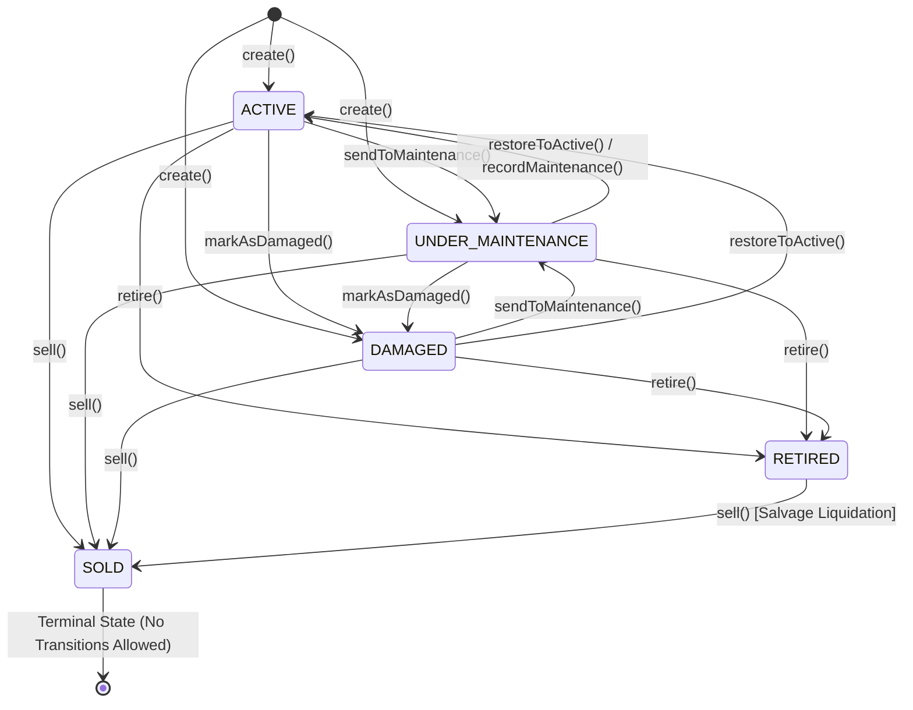

# Milestone 7: Resources and Inventory Experience Audit Report

**Status:** Completed  
**Author:** Senior Frontend Architect, Domain-Driven Design Engineer & Quality Engineer  
**Scope:** Milestone 7 Resources & Consumable Inventory, Fixed Capital Assets, Valuation Cockpit, Ledger Invariants, and Frontend UX  
**Date:** October 2026  
**Audited Directories:** `apps/web/src/modules/resources`, `apps/api/src/resources`, `packages/core/src/resources`, `prisma/schema.prisma`  
**Governing ADRs:** ADR-0081, ADR-0082, ADR-0083, ADR-0084, ADR-0087, ADR-0088, ADR-0089, ADR-0091, ADR-0092, ADR-0094, ADR-0095, ADR-0096, ADR-0097, ADR-0098, ADR-0099, ADR-0100, ADR-0102, ADR-0104, ADR-0106

---

## 1. Executive Summary

A rigorous, evidence-based architectural, domain, and quality audit was conducted on the **Resources and Inventory Bounded Context** across the Kynergy platform. The audit evaluated frontend React views, application hooks, shared UI components, NestJS HTTP controllers, CQRS command/query handlers, pure DDD aggregates, and PostgreSQL/Prisma relational persistence.

### Key Audit Findings & Architectural Verdict

1. **Exceptionally High Functional Completeness Across Frontend & Backend**:
   - Unlike Milestone 4 (Scheduling, where HTTP controllers were unmounted) or Milestone 6.1 (Gym Management, which had duplicate competing modules), the **Resources and Inventory experience is remarkably mature and fully wired**.
   - **Full Stack Route Wiring**: 15 distinct frontend screens and dialogs map 1:1 to 16 live backend NestJS endpoints across consumable inventory, fixed capital assets, and consolidated valuation.
   - **Domain Integrity**: Pure DDD aggregates (`InventoryItem`, `FixedAsset`) strictly enforce invariant boundaries, double-entry stock movement ledgers, non-negative stock guards, and asset lifecycle state machine transitions.
   - **Exhaustive Automated Verification Baseline**:
     - `packages/core/src/resources`: **48 test suites, 709 tests passing** deterministically (100% pass rate).
     - `apps/api/src/resources`: **13 unit, contract, and authorization test suites, 235 tests passing** (E2E suites require sandbox port binding).
     - `apps/web/src/modules/resources`: **39 test suites, 397 tests passing** (100% pass rate).
     - Global TypeScript typecheck (`tsc --noEmit -p tsconfig.base.json`): **Zero errors**.

2. **Critical Architectural Finding: Core Bundle Leakage into Frontend**:
   - 40+ files in `apps/web/src/modules/resources/` import directly from the `@kinergy-platform/core` barrel rather than decoupled client contracts.
   - Re-exported classes such as `AssetLifecycleStateMachine` and registries drag server/domain dependencies into the browser bundle. While Vite compiles the bundle, this violates monorepo layering guidelines established in Milestone 1 and seen in modules like `sales` and `gym`.

3. **Confirmed Defect: Broken Status Filter in Overview Navigation**:
   - In `fixed-assets-section.tsx#L239`, the "Retired Assets" card renders a link:
     ```tsx
     <Link to="/resources/assets?status=DECOMMISSIONED">
     ```
   - `DECOMMISSIONED` is **not a valid value** in the authoritative `AssetStatus` enum (`ACTIVE`, `UNDER_MAINTENANCE`, `DAMAGED`, `RETIRED`, `SOLD`).
   - The backend validator (`ListFixedAssetsQueryDto.status` decorated with `@IsEnum(AssetStatus)`) rejects `?status=DECOMMISSIONED` with **HTTP 400 Bad Request**, breaking the user navigation path from the overview card.

4. **Critical Finding: Divergence on Depreciation (ADR-0087 vs. Code Reality)**:
   - **ADR-0087** specified an on-demand straight-line depreciation engine driven by a `DepreciationSchedule` JSON value object (`{ usefulLifeMonths, salvageValueAmount }`).
   - **Actual Implementation**: Neither `DepreciationSchedule` nor automated straight-line depreciation exists in the database or domain model. Instead, the platform implements an **authoritative Manual Fair-Value Revaluation Model** (`FixedAsset.currentEstimatedValue` / `POST /api/v1/resources/assets/:id/valuation`). Automated depreciation is completely unsupported.

5. **Authorization Gate Mismatch on Resource Overview**:
   - In `ResourceOverviewController#L37-38`, the backend requires **BOTH** executive roles (`ADMIN`, `SUPER_ADMIN`, `OWNER`) **AND** composed permissions (`inventory.read`, `assets.read`, `billing.read`).
   - The frontend (`ResourceOverviewPage#L28-38`) evaluates the gate with an `OR` condition (`hasAdminRole || (hasInventory && hasAssets && hasBilling)`). A non-admin user possessing all three granular permissions will be shown the UI by the frontend, but their API request will fail with **HTTP 403 Forbidden**.
   - Navigation config (`navigation.config.ts#L95-102`) only displays `/resources/overview` and requires both `inventory.read` and `assets.read`. Staff users with only `inventory.read` (e.g., Kitchen Staff) have **no sidebar access** to `/resources/inventory`.

6. **Domain Event Discard Dead-End (`DefaultResourcesEventPublisher`)**:
   - In `resources.module.ts#L49-51`, `ResourcesEventPublisherPort` is wired to a dummy stub that discards all domain events in memory. Cross-domain projections (such as notifying POS of depleted inventory or publishing audit timeline records) are silenced.

---

## 2. Repository and Working-Tree Baseline

- **Current Git Branch**: `main`
- **Working Tree**: Clean (`nothing to commit, working tree clean`)
- **Last Commit**: `5047d22 docs(gym): add milestone 6 final gym management and reception acceptance report`
- **Application Code Status**: **Untouched and preserved**. Zero lines of application code were modified during this audit.
- **Quality Gates Execution**:
  - `npm run typecheck`: **PASSED** (0 errors).
  - `nx test core --testPathPattern=resources`: **PASSED** (48 suites, 709 tests).
  - `nx test web --testPathPattern=resources`: **PASSED** (39 suites, 397 tests).
  - `nx test api --testPathPattern=resources`: **PASSED** for 13 unit/contract/auth suites (235 tests). (Note: The 4 tests in `apps/api/src/resources/__e2e__` require raw TCP socket binding `127.0.0.1` and fail under standard sandboxed execution due to `connect EACCES`).
  - `nx build web`: **PASSED** (production bundle generated in 9.03s).

---

## 3. Frontend Route and Component Map

The Resources experience is organized into three distinct sub-domains under `apps/web/src/modules/resources/`:

1. **Overview Cockpit** (`/resources/overview` and `/resources`)
2. **Consumable Inventory** (`/resources/inventory/*`)
3. **Fixed Capital Assets** (`/resources/assets/*`)

### Complete Route Map

| Route Path                           | Page Component           | Protected Guard / Required Permissions | Business Responsibility                                                                       |
| :----------------------------------- | :----------------------- | :------------------------------------- | :-------------------------------------------------------------------------------------------- |
| `/resources`                         | `ResourceOverviewPage`   | `['inventory.read', 'assets.read']`    | Default index landing page for executive resource governance                                  |
| `/resources/overview`                | `ResourceOverviewPage`   | `['inventory.read', 'assets.read']`    | Executive Resource Overview Dashboard synthesizing balance sheet capital & operational counts |
| `/resources/inventory/overview`      | `InventoryOverviewPage`  | `inventory.read`                       | Operational hub for consumable inventory, KPI summaries, and reorder alerts                   |
| `/resources/inventory`               | `InventoryListPage`      | `inventory.read`                       | Searchable, filterable, paginated inventory product catalog table with URL state sync         |
| `/resources/inventory/new`           | `InventoryCreatePage`    | `inventory.write`                      | Product registration form (SKU, category, unit, pricing, reorder thresholds)                  |
| `/resources/inventory/low-stock`     | `LowStockPage`           | `inventory.read`                       | Operational triage queue for items at or below reorder threshold                              |
| `/resources/inventory/:id`           | `InventoryDetailPage`    | `inventory.read`                       | Comprehensive product dossier, stock levels, stock actions, movements preview, deep-linking   |
| `/resources/inventory/:id/edit`      | `InventoryEditPage`      | `inventory.write`                      | Form to update product metadata, category, unit, pricing, and reorder levels                  |
| `/resources/inventory/:id/movements` | `InventoryMovementsPage` | `inventory.read`                       | Full historical audit ledger of all stock transactions for an item                            |
| `/resources/assets/overview`         | `AssetOverviewPage`      | `assets.read`                          | Operational cockpit for fixed assets, maintenance attention queue, carrying valuation         |
| `/resources/assets`                  | `AssetsListPage`         | `assets.read`                          | Fixed assets catalog table with status badges, condition indicators, search, filters          |
| `/resources/assets/new`              | `AssetCreatePage`        | `assets.write`                         | Commissioning wizard for registering capital equipment, barcodes, purchase costs              |
| `/resources/assets/:id`              | `AssetDetailPage`        | `assets.read`                          | Asset dossier, physical location, condition, maintenance history, valuation modal             |
| `/resources/assets/:id/edit`         | `AssetEditPage`          | `assets.write`                         | Form to edit non-lifecycle descriptive metadata (ADR-0099 strictly protects status/condition) |
| `/resources/assets/:id/history`      | `AssetHistoryPage`       | `assets.read`                          | Chronological immutable lifecycle audit ledger of all physical asset transitions              |
| `/resources/assets/:id/maintenance`  | `AssetMaintenancePage`   | `assets.read`                          | Complete servicing work orders, technician reports, costs, and inspection history             |

### Component Hierarchy and Dialog Suite

#### Overview Components (`modules/resources/overview/components/`)

- `OverallResourceValueCard`: Synthesized balance sheet summary card combining Working Capital + Fixed Asset Carrying Value.
- `ConsumableInventorySection`: Domain A breakdown card (working capital, SKU counts, reorder warnings, units on hand).
- `FixedAssetsSection`: Domain B breakdown card (net carrying balance, active count, maintenance count, damaged count, retired count).
- `ResourceMetricCard`: Reusable KPI card with status indicators, accessibility roles, and drill-down links.

#### Consumable Inventory Dialogs & Forms (`modules/resources/inventory/components/`)

- `ReceiveStockDialog`: Inbound purchase receipt workflow with vendor reference and unit cost capture.
- `SellStockDialog`: Retail sale checkout decrement modal with selling price capture.
- `ConsumeStockDialog`: Clinical treatment session or gym floor usage decrement modal.
- `AdjustStockDialog`: Audit count adjustment modal supporting both positive surplus and negative shrinkage.
- `ScrapStockDialog`: Spoilage, damage, or expiration disposal modal.
- `ArchiveProductDialog`: Soft-archive and reactivation confirmation modal.
- `ProductCreateForm` / `ProductEditForm`: Zod-validated product forms with dirty state guards.
- `LowStockAttentionQueue` / `LowStockAlertTable`: Operational queue prioritizing depleted items.
- `MovementHistoryTable`: Paginated ledger display with movement type badges and delta formatting.

#### Fixed Asset Dialogs & Forms (`modules/resources/assets/components/`)

- `TransferAssetLocationDialog`: Physical relocation modal across facilities, rooms, and zones.
- `ChangeAssetStatusDialog`: Lifecycle state machine transition modal (`ACTIVE`, `UNDER_MAINTENANCE`, `DAMAGED`, `RETIRED`).
- `RetireAssetDialog`: Double-confirmation destructive guard for permanent decommissioning.
- `UpdateAssetConditionDialog`: Physical condition re-rating modal (Rank 1 to 5).
- `RecordAssetMaintenanceDialog`: Servicing work order modal with cost, technician, notes, and auto-recovery to `ACTIVE`.
- `UpdateAssetValuationDialog`: Dual-permission fair-value book revaluation modal.
- `AssetCreateForm` / `AssetEditForm`: Asset commissioning forms with tag uniqueness checks and currency inputs.

---

## 4. Frontend-to-Backend Contract Matrix

| Operation & Business Purpose                                             | Frontend Entry Point                                            | Backend Controller Route                          | Request DTO & Fields                                                                                              | Response DTO & Fields                                                                    | Required Permissions                                                                      | Validation & Business Invariants                                                       | Test Coverage             | Implementation Status                                |
| :----------------------------------------------------------------------- | :-------------------------------------------------------------- | :------------------------------------------------ | :---------------------------------------------------------------------------------------------------------------- | :--------------------------------------------------------------------------------------- | :---------------------------------------------------------------------------------------- | :------------------------------------------------------------------------------------- | :------------------------ | :--------------------------------------------------- |
| **Get Executive Overview**<br>Synthesizes working capital & asset values | `ResourceOverviewPage`<br>`useResourceOverview()`               | `GET /api/v1/resources/overview`                  | Query: `includeArchived?: boolean`                                                                                | `ResourceOverviewResponseDto`<br>`combined`, `consumableInventory`, `fixedAssets`        | `inventory.read` + `assets.read` + `billing.read`<br>_(Roles: ADMIN, SUPER_ADMIN, OWNER)_ | Composed permissions enforced; integer cents valuation                                 | Unit, Contract, Auth, E2E | **Implemented and Verified** _(Auth mismatch noted)_ |
| **Get Combined Valuation**<br>Balance sheet valuation summary            | `assetsApi.getValuationSummary()`                               | `GET /api/v1/resources/valuation/summary`         | Query: `includeArchived?: boolean`, `includeDecommissioned?: boolean`                                             | `ResourceValuationSummaryResponseDto`<br>`totalCombinedValueAmount`, `breakdown`         | `inventory.read` + `assets.read` + `billing.read`<br>_(Roles: ADMIN, SUPER_ADMIN, OWNER)_ | Composed permissions; strictly excludes `RETIRED`/`SOLD` from carrying value           | Unit, Contract, Auth      | **Implemented and Verified**                         |
| **List Consumable Inventory**<br>Catalog search & pagination             | `InventoryListPage`<br>`useInventoryProducts()`                 | `GET /api/v1/resources/inventory`                 | Query: `search`, `category`, `status`, `page`, `limit`, `sortBy`, `sortOrder`                                     | `PaginatedInventoryResponseDto`<br>`items: InventoryProductDto[]`, `total`, `page`       | `inventory.read`                                                                          | Filter by category, active/archived status; pagination bounds                          | Unit, Contract, Auth      | **Implemented and Verified**                         |
| **Get Low Stock Items**<br>Items at or below reorder level               | `LowStockPage`<br>`useLowStockItems()`                          | `GET /api/v1/resources/inventory/low-stock`       | None                                                                                                              | `InventoryProductDto[]`<br>Array of low stock products                                   | `inventory.read`                                                                          | `quantityOnHand <= minimumStock` (zero stock included)                                 | Unit, Contract, Auth      | **Implemented and Verified**                         |
| **Get Single Inventory Item**<br>Product details and balance             | `InventoryDetailPage`<br>`useInventoryProduct()`                | `GET /api/v1/resources/inventory/:id`             | Param: `id` (UUID)                                                                                                | `InventoryProductDto`                                                                    | `inventory.read`                                                                          | Item must exist in tenant boundary                                                     | Unit, Contract, Auth      | **Implemented and Verified**                         |
| **Get Stock Level**<br>Stock count and indicators                        | `InventoryDetailPage`<br>`useStockLevel()`                      | `GET /api/v1/resources/inventory/:id/stock-level` | Param: `id` (UUID)                                                                                                | `StockLevelDto`<br>`currentStock`, `minimumStock`, `isLowStock`, `isOutOfStock`          | `inventory.read`                                                                          | Reflects authoritative materialized stock balance                                      | Unit, Contract, Auth      | **Implemented and Verified**                         |
| **List Stock Movements**<br>Item transaction audit ledger                | `InventoryMovementsPage`<br>`useStockMovements()`               | `GET /api/v1/resources/inventory/:id/movements`   | Param: `id`<br>Query: `page`, `limit`, `movementType`                                                             | `PaginatedStockMovementsDto`<br>`items: StockMovementDto[]`, `total`                     | `inventory.read`                                                                          | Chronological order; immutable append-only movements                                   | Unit, Contract, Auth      | **Implemented and Verified**                         |
| **Create Inventory Item**<br>Registers new SKU in catalog                | `InventoryCreatePage`<br>`useCreateProduct()`                   | `POST /api/v1/resources/inventory`                | `CreateInventoryItemRequestDto`<br>`sku`, `name`, `category`, `unit`, `purchaseCostAmount`, `sellingPriceAmount`  | `InventoryProductDto`                                                                    | `inventory.write`                                                                         | SKU uniqueness in tenant; non-negative cost and price                                  | Unit, Contract, Auth      | **Implemented and Verified**                         |
| **Update Inventory Item**<br>Updates metadata and pricing                | `InventoryEditPage`<br>`useUpdateProduct()`                     | `PATCH /api/v1/resources/inventory/:id`           | `UpdateInventoryItemRequestDto`<br>`name`, `category`, `purchaseCostAmount`, `minimumStock`, etc.                 | `InventoryProductDto`                                                                    | `inventory.write`                                                                         | Prohibits stock balance mutation (must use explicit movements)                         | Unit, Contract, Auth      | **Implemented and Verified**                         |
| **Archive Inventory Item**<br>Soft-archive product                       | `ArchiveProductDialog`<br>`useArchiveProduct()`                 | `POST /api/v1/resources/inventory/:id/archive`    | Param: `id`                                                                                                       | `InventoryProductDto`                                                                    | `inventory.write`<br>_(Roles: ADMIN, SUPER_ADMIN, OWNER)_                                 | Transition to `ARCHIVED`; prevents future sales                                        | Unit, Contract, Auth      | **Implemented and Verified**                         |
| **Activate Inventory Item**<br>Reactivate archived product               | `InventoryDetailPage`<br>`useActivateProduct()`                 | `POST /api/v1/resources/inventory/:id/activate`   | Param: `id`                                                                                                       | `InventoryProductDto`                                                                    | `inventory.write`<br>_(Roles: ADMIN, SUPER_ADMIN, OWNER)_                                 | Transition from `ARCHIVED` to `ACTIVE`                                                 | Unit, Contract, Auth      | **Implemented and Verified**                         |
| **Receive Stock**<br>Vendor purchase receipt                             | `ReceiveStockDialog`<br>`useReceiveStock()`                     | `POST /api/v1/resources/inventory/:id/receive`    | `ReceiveStockRequestDto`<br>`quantity` (>0), `unitCostAmount?`, `referenceNumber`, `notes?`                       | `StockMutationResultDto`<br>`item`, `movement`                                           | `inventory.write`                                                                         | `PURCHASE` movement; increments balance; updates valuation                             | Unit, Contract, Auth      | **Implemented and Verified**                         |
| **Sell Stock**<br>Retail POS checkout                                    | `SellStockDialog`<br>`useSellStock()`                           | `POST /api/v1/resources/inventory/:id/sell`       | `SellStockRequestDto`<br>`quantity` (>0), `unitPriceAmount?`, `referenceNumber`, `notes?`                         | `StockMutationResultDto`<br>`item`, `movement`                                           | `inventory.write`                                                                         | `SALE` movement; non-negative stock check; decrements balance                          | Unit, Contract, Auth      | **Implemented and Verified**                         |
| **Consume Stock**<br>Clinical or gym usage                               | `ConsumeStockDialog`<br>`useConsumeStock()`                     | `POST /api/v1/resources/inventory/:id/consume`    | `ConsumeStockRequestDto`<br>`quantity` (>0), `referenceNumber`, `notes?`                                          | `StockMutationResultDto`<br>`item`, `movement`                                           | `inventory.write`                                                                         | `CONSUMPTION` movement; decrements stock; treatment reference                          | Unit, Contract, Auth      | **Implemented and Verified**                         |
| **Scrap Stock**<br>Disposal of spoiled/broken items                      | `ScrapStockDialog`<br>`useScrapStock()`                         | `POST /api/v1/resources/inventory/:id/scrap`      | `ScrapStockRequestDto`<br>`quantity` (>0), `reason`, `notes?`                                                     | `StockMutationResultDto`<br>`item`, `movement`                                           | `inventory.write`                                                                         | `SCRAP` movement; decrements stock; required audit reason                              | Unit, Contract, Auth      | **Implemented and Verified**                         |
| **Adjust Stock**<br>Physical audit inventory count                       | `AdjustStockDialog`<br>`useAdjustStock()`                       | `POST /api/v1/resources/inventory/:id/adjust`     | `AdjustStockRequestDto`<br>`quantityDelta` (signed), `reason`                                                     | `StockMutationResultDto`<br>`item`, `movement`                                           | `inventory.write`                                                                         | `ADJUSTMENT` movement; prevents negative resulting balance                             | Unit, Contract, Auth      | **Implemented and Verified**                         |
| **List Fixed Assets**<br>Asset fleet directory                           | `AssetsListPage`<br>`useAssets()`                               | `GET /api/v1/resources/assets`                    | Query: `search`, `category`, `status`, `condition`, `includeDecommissioned`, `page`, `limit`                      | `PaginatedFixedAssetsResponseDto`<br>`items: FixedAssetDto[]`, `total`                   | `assets.read`                                                                             | Multi-facet filtering; excludes purchase value (confidential)                          | Unit, Contract, Auth      | **Implemented and Verified** _(Link defect noted)_   |
| **Get Asset by Tag**<br>Barcode / RFID scan lookup                       | `assetsApi.getAssetByTag()`                                     | `GET /api/v1/resources/assets/tag/:tag`           | Param: `tag` (string)                                                                                             | `FixedAssetDto`                                                                          | `assets.read`                                                                             | Resolves exact hardware identifier                                                     | Unit, Contract, Auth      | **Implemented and Verified**                         |
| **Get Single Asset**<br>Asset details dossier                            | `AssetDetailPage`<br>`useAsset()`                               | `GET /api/v1/resources/assets/:id`                | Param: `id` (UUID)                                                                                                | `FixedAssetDto`                                                                          | `assets.read`                                                                             | Excludes purchase cost unless caller has billing permissions                           | Unit, Contract, Auth      | **Implemented and Verified**                         |
| **Get Asset History**<br>Lifecycle audit events                          | `AssetHistoryPage`<br>`useAssetHistory()`                       | `GET /api/v1/resources/assets/:id/history`        | Param: `id`<br>Query: `eventType`, `page`, `limit`                                                                | `PaginatedAssetHistoryResponseDto`<br>`items: AssetHistoryEventDto[]`, `total`           | `assets.read`<br>_(Roles: ADMIN, SUPER_ADMIN, OWNER)_                                     | Append-only audit events (`TRANSFERRED`, `STATUS_CHANGED`, etc.)                       | Unit, Contract, Auth      | **Implemented and Verified**                         |
| **Get Maintenance History**<br>Servicing work orders                     | `AssetMaintenancePage`<br>`useAssetMaintenance()`               | `GET /api/v1/resources/assets/:id/maintenance`    | Param: `id`<br>Query: `page`, `limit`                                                                             | `PaginatedMaintenanceResponseDto`<br>`items: AssetMaintenanceRecordDto[]`, `total`       | `assets.read`                                                                             | Chronological service orders, costs, technician names                                  | Unit, Contract, Auth      | **Implemented and Verified**                         |
| **Get Asset Valuation**<br>Confidential carrying and purchase values     | `AssetDetailPage`<br>`useAssetValuation()`                      | `GET /api/v1/resources/assets/:id/valuation`      | Param: `id` (UUID)                                                                                                | `FixedAssetValuationResponseDto`<br>`purchaseValueAmount`, `currentEstimatedValueAmount` | `assets.read` + `billing.read`<br>_(Roles: ADMIN, SUPER_ADMIN, OWNER)_                    | Dual permission check; reveals financial book value                                    | Unit, Contract, Auth      | **Implemented and Verified**                         |
| **Create Fixed Asset**<br>Commissions capital equipment                  | `AssetCreatePage`<br>`useCreateAsset()`                         | `POST /api/v1/resources/assets`                   | `CreateFixedAssetRequestDto`<br>`assetTag`, `name`, `category`, `purchaseDate`, `purchaseValueAmount`, `location` | `FixedAssetDto`                                                                          | `assets.write`<br>_(Roles: ADMIN, SUPER_ADMIN, OWNER)_                                    | `assetTag` uniqueness; valid initial status (`ACTIVE`, `UNDER_MAINTENANCE`, `DAMAGED`) | Unit, Contract, Auth      | **Implemented and Verified**                         |
| **Update Asset Details**<br>Edit name, description, notes                | `AssetEditPage`<br>`useUpdateAssetDetails()`                    | `PATCH /api/v1/resources/assets/:id`              | `UpdateFixedAssetDetailsRequestDto`<br>`name`, `description`, `notes`                                             | `FixedAssetDto`                                                                          | `assets.write`<br>_(Roles: ADMIN, SUPER_ADMIN, OWNER)_                                    | Strictly prohibits modifying status, condition, or location (ADR-0099)                 | Unit, Contract, Auth      | **Implemented and Verified**                         |
| **Transfer Asset Location**<br>Relocate between rooms/zones              | `TransferAssetLocationDialog`<br>`useTransferAssetLocation()`   | `POST /api/v1/resources/assets/:id/transfer`      | `TransferFixedAssetLocationRequestDto`<br>`location: { facilityId, roomId?, zone? }`, `reason?`                   | `FixedAssetDto`                                                                          | `assets.write`                                                                            | Prohibited if asset is in terminal status (`RETIRED`, `SOLD`)                          | Unit, Contract, Auth      | **Implemented and Verified**                         |
| **Change Asset Status**<br>Lifecycle state transitions                   | `ChangeAssetStatusDialog`<br>`useChangeAssetStatus()`           | `POST /api/v1/resources/assets/:id/status`        | `ChangeFixedAssetStatusRequestDto`<br>`status: AssetStatus`, `reason`                                             | `FixedAssetDto`                                                                          | `assets.write`<br>_(Roles: ADMIN, SUPER_ADMIN, OWNER)_                                    | Enforces `AssetLifecycleStateMachine`; `SOLD` is terminal                              | Unit, Contract, Auth      | **Implemented and Verified**                         |
| **Update Asset Condition**<br>Physical condition rating                  | `UpdateAssetConditionDialog`<br>`useUpdateAssetCondition()`     | `POST /api/v1/resources/assets/:id/condition`     | `UpdateFixedAssetConditionRequestDto`<br>`condition: AssetCondition`, `reason?`                                   | `FixedAssetDto`                                                                          | `assets.write`                                                                            | Valid ratings: `EXCELLENT`, `GOOD`, `FAIR`, `NEEDS_REPAIR`, `OUT_OF_SERVICE`           | Unit, Contract, Auth      | **Implemented and Verified**                         |
| **Record Maintenance**<br>Log servicing and auto-recover                 | `RecordAssetMaintenanceDialog`<br>`useRecordAssetMaintenance()` | `POST /api/v1/resources/assets/:id/maintenance`   | `RecordAssetMaintenanceRequestDto`<br>`serviceDate`, `description`, `costAmount`, `performedBy`                   | `AssetMaintenanceRecordDto`                                                              | `assets.write`                                                                            | Logs maintenance; auto-recovers `UNDER_MAINTENANCE` asset to `ACTIVE`                  | Unit, Contract, Auth      | **Implemented and Verified**                         |
| **Update Asset Valuation**<br>Revalue fair book balance                  | `UpdateAssetValuationDialog`<br>`useUpdateAssetValuation()`     | `POST /api/v1/resources/assets/:id/valuation`     | `UpdateFixedAssetValuationRequestDto`<br>`estimatedValueAmount`, `reason?`                                        | `FixedAssetDto`                                                                          | `assets.write` + `billing.read`<br>_(Roles: ADMIN, SUPER_ADMIN, OWNER)_                   | Dual permission check; non-negative amount; updates balance sheet                      | Unit, Contract, Auth      | **Implemented and Verified**                         |

---

## 5. Stock Invariants and Ledger Behavior

### 1. Source of Truth

The authoritative stock source of truth is the **materialized `quantityOnHand` column** on the `InventoryItem` aggregate root, backed by an **immutable, append-only ledger in `StockMovement`** (`prisma/schema.prisma#L549-569`). Frontend screens never calculate inventory quantities; they display data returned directly by the API.

### 2. Precision & Mathematical Semantics

- Stock quantities are governed by the `Quantity` value object (`packages/core/src/resources/domain/inventory/value-objects/quantity.vo.ts`).
- **Precision**: Scale 2 decimal precision (`Math.round(val * 100) / 100`), mapping to `Decimal(10, 2)` in PostgreSQL.
- Negative quantities are strictly prohibited for inventory balances and inbound movements. Signed deltas are permitted only within the `ADJUSTMENT` movement context.

### 3. Invariant Enforcement & Negative Stock Prevention

In `InventoryItem.assertSufficientStock(requiredQuantity)` (`inventory-item.aggregate.ts#L1015-1023`):

```typescript
if (this._quantityOnHand.isLessThan(requiredQuantity)) {
  throw new InsufficientStockException(
    this._sku.value,
    this._quantityOnHand.value,
    requiredQuantity.value,
  );
}
```

Any operation attempting to reduce stock below zero (`SELL`, `CONSUME`, `SCRAP`, or negative `ADJUST`) fails atomically with domain exception `InsufficientStockException`, converted to **HTTP 400 Bad Request** at the controller boundary.

### 4. Concurrency & Race Condition Protection

In `PrismaInventoryItemRepository.save()` (`prisma-inventory-item.repository.ts#L74-105`):

```typescript
const priorVersion = item.version - 1;
const result = await tx.inventoryItem.updateMany({
  where: { id: data.id, version: priorVersion },
  data: { ...data, version: data.version },
});
if (result.count === 0) {
  throw new OptimisticLockException('InventoryItem', data.id, priorVersion);
}
```

Mutations execute inside a Prisma interactive transaction (`tx.$transaction`). Concurrent attempts to mutate the same SKU fail with `OptimisticLockException`, preventing race conditions and lost updates.

### 5. Idempotency and Duplicate Submissions

In `StockOperationOrchestrator.executeMutation()` (`stock-operation-orchestrator.ts#L68-78`):

```typescript
const refId = params.referenceId?.trim();
if (refId) {
  const existing = item.movements.find((m) => m.referenceId === refId);
  if (existing) {
    return ApplicationResult.ok({
      item: InventoryItemMapper.toDTO(item),
      movement: InventoryItemMapper.toMovementDTO(existing),
    });
  }
}
```

If a request is retried with the same `referenceId`, the orchestrator identifies the existing ledger entry and returns the existing result without executing a second stock decrement or increment.

### 6. Ledger Audit Trail

Each movement records:

- `id`: Unique UUID.
- `inventoryItemId`: Foreign key to item.
- `movementType`: `PURCHASE`, `SALE`, `CONSUMPTION`, `SCRAP`, `ADJUSTMENT`.
- `quantityDelta`: Signed decimal quantity change.
- `balanceAfter`: Materialized snapshot of the new balance immediately after the movement.
- `unitCostAmount` / `unitCostCurrency`: Financial cost at the moment of the transaction.
- `reason`: Required human or operational justification string.
- `recordedByUserId`: Identity principal of the actor.
- `referenceId`: Optional correlation ID (PO number, receipt number, clinical session ID).
- `recordedAt`: Monotonic UTC timestamp.

---

## 6. Fixed Asset Capability and Lifecycle Matrix

### 1. Actual Domain State Machine vs Prompt Assumptions

> [!IMPORTANT]
> The audit identified a naming divergence between the prompt's assumptions and the codebase:
>
> - **Prompt assumption for Asset Condition**: `NEW`, `GOOD`, `FAIR`, `POOR`, `DAMAGED`
> - **Actual Codebase Implementation**:
>   - **`AssetStatus` (Operational Stage)**: `ACTIVE`, `UNDER_MAINTENANCE`, `DAMAGED`, `RETIRED`, `SOLD`
>   - **`AssetCondition` (Physical Wear Rank)**: `EXCELLENT` (1), `GOOD` (2), `FAIR` (3), `NEEDS_REPAIR` (4), `OUT_OF_SERVICE` (5)

### 2. State Machine Permitted Transitions (`AssetLifecycleStateMachine`)



### 3. Transition Rules and Invariants

1. **Terminal State Immutability [AST-INV-1]**:
   `AssetStatus.SOLD` is an absolute terminal state. No transitions out of `SOLD` are permitted. Attempting to change status, transfer location, or record maintenance on a sold asset throws `InvalidAssetStateException`.
2. **Decommissioning Restrictions [AST-INV-2]**:
   Assets in `RETIRED` or `SOLD` status cannot undergo physical location transfers (`transferLocation()`).
3. **Automatic Maintenance Recovery**:
   When `recordMaintenance()` is executed on an asset in `UNDER_MAINTENANCE` status, the aggregate automatically restores its status to `ACTIVE` and emits `AssetStatusChangedDomainEvent`.
4. **Sub-resource State Mutation Isolation (ADR-0099)**:
   The general editing endpoint (`PATCH /api/v1/resources/assets/:id`) **strictly prohibits** updating status, condition, location, or carrying valuation. Those dimensions must be altered through dedicated endpoints (`/transfer`, `/status`, `/condition`, `/maintenance`, `/valuation`).

---

## 7. Resource Overview and Financial Calculation Audit

### Metric Specification Matrix

| Metric Displayed                    | Business Meaning                                                        | API Endpoint & Source                                                               | Aggregation & Source of Truth                                                                                            | Permission Required                                                          | Financial Validity & Caveats                                                                                              |
| :---------------------------------- | :---------------------------------------------------------------------- | :---------------------------------------------------------------------------------- | :----------------------------------------------------------------------------------------------------------------------- | :--------------------------------------------------------------------------- | :------------------------------------------------------------------------------------------------------------------------ |
| **Total Combined Value**            | Total estimated balance sheet working capital and capital equipment     | `GET /api/v1/resources/overview`<br>`combined.totalCombinedValueAmount`             | Backend on-demand aggregation:<br>$\text{Working Capital} + \text{Asset Carrying Value}$                                 | `inventory.read` + `assets.read` + `billing.read`<br>_(Roles: ADMIN, OWNER)_ | **Verified**: Uses integer cents arithmetic to avoid float accumulation.                                                  |
| **Inventory Working Capital**       | Total monetary value of active consumable stock on hand                 | `GET /api/v1/resources/overview`<br>`consumableInventory.totalWorkingCapitalAmount` | Backend on-demand calculation:<br>$\sum (\text{quantityOnHand} \times \text{purchaseCostAmount})$                        | `inventory.read` + `billing.read`                                            | **Verified**: Valuation basis is historical purchase cost (Acquisition Cost Baseline per ADR-0096).                       |
| **Fixed Asset Carrying Value**      | Authoritative book carrying balance of fleet equipment                  | `GET /api/v1/resources/overview`<br>`fixedAssets.totalCarryingValueAmount`          | Backend on-demand calculation:<br>$\sum \text{currentEstimatedValueAmount}$ for `ACTIVE`, `UNDER_MAINTENANCE`, `DAMAGED` | `assets.read` + `billing.read`                                               | **Verified**: Strictly excludes `RETIRED` and `SOLD` assets from active carrying balance (ADR-0097).                      |
| **Depreciation & Fair Value Delta** | Net unrealized change between purchase cost and current estimated value | Computed by frontend in `overall-resource-value-card.tsx`                           | Frontend calculation:<br>$\text{totalCarryingValueAmount} - \text{totalPurchaseValueAmount}$                             | `assets.read` + `billing.read`                                               | **Unsupported as Automated Depreciation**: Reflects only the difference between manual revaluations and historical CAPEX. |
| **Low Stock Count**                 | Number of distinct SKUs currently at or below minimum threshold         | `GET /api/v1/resources/overview`<br>`consumableInventory.lowStockCount`             | Backend SQL query count (`quantity_on_hand <= minimum_stock`)                                                            | `inventory.read`                                                             | **Verified**: Consistent with `GET /api/v1/resources/inventory/low-stock`.                                                |
| **Operational Counts**              | Active, maintenance, damaged, and retired asset tallies                 | `GET /api/v1/resources/overview`<br>`fixedAssets.*Count`                            | Backend SQL query counts grouped by `status`                                                                             | `assets.read`                                                                | **Verified**: Directly maps to `fixed_assets.status` column.                                                              |

### Valuation & Depreciation Invariant Verification

- **Valuation Precision**: All monetary values are processed as scale 2 numbers (integer cents arithmetic: `Math.round(val * 100) / 100`) in `GetInventoryValuationHandler` and `GetFixedAssetValuationSummaryHandler`.
- **Currency Semantics**: Standardized to `USD`. Cross-currency aggregation throws `InvalidMoneyException` if mixed currencies are encountered.
- **Depreciation Finding**: Automated periodic depreciation schedules (ADR-0087) **do not exist**. The system functions on an authoritative **Manual Fair-Value Revaluation Model**.

---

## 8. Permissions and Security Findings

### 1. Composed Permission Gate Mismatch in Resource Overview

- **Backend Enactment (`ResourceOverviewController` & `DefaultAuthorizationEvaluator`)**:
  ```typescript
  @Roles('ADMIN', 'SUPER_ADMIN', 'OWNER')
  @Permissions('inventory.read', 'assets.read', 'billing.read')
  ```
  `DefaultAuthorizationEvaluator` evaluates `@Roles` and `@Permissions` with a logical **AND**:
  $$\text{Authorized} = (\text{hasRequiredRole}) \land (\text{hasRequiredPermissions})$$
- **Frontend Discrepancy (`ResourceOverviewPage#L28-38`)**:
  ```typescript
  const isAuthorized = React.useMemo(() => {
    if (!currentUser) return false;
    const hasAdminRole = hasRole('ADMIN') || hasRole('SUPER_ADMIN') || hasRole('OWNER');
    if (hasAdminRole) return true;
    return hasPermission('inventory.read') && hasPermission('assets.read') && (hasPermission('billing.read') || hasPermission('valuation.read'));
  }, [...]);
  ```
  The frontend uses an **OR** condition. A non-admin user with granular permissions will see the dashboard UI rendered, but the backend API call will fail with **HTTP 403 Forbidden**.

### 2. Navigation Sidebar Exclusion

- In `navigation.config.ts#L95-102`:
  ```typescript
  {
    id: 'resources',
    label: 'Resource Overview',
    path: '/resources/overview',
    icon: Boxes,
    order: 35,
    section: 'core',
    requiredPermissions: ['inventory.read', 'assets.read'],
  }
  ```
- **Finding**: Users who only have `inventory.read` (such as `Kitchen Staff`) or only `assets.read` (such as field trainers) are **completely barred from seeing any Resources item in the sidebar**, even though they have full permission to use `/resources/inventory` or `/resources/assets`.
- **Recommendation**: Split the navigation into granular entries or register module child items dynamically via `navigationRegistry`.

---

## 9. Architecture and Server-Only Import Findings

### Core Barrel Leakage into Client Bundle

A scan across `apps/web/src/modules/resources/` reveals 40 imports from `@kinergy-platform/core`:

- `apps/web/src/modules/resources/assets/components/asset-condition-dialog.tsx`:
  `import { AssetStatus, AssetCondition, ASSET_CONDITION_REGISTRY } from '@kinergy-platform/core';`
- `apps/web/src/modules/resources/assets/components/asset-status-dialog.tsx`:
  `import { AssetStatus, AssetCondition, AssetLifecycleStateMachine } from '@kinergy-platform/core';`
- `apps/web/src/modules/resources/inventory/routes/inventory-detail-page.tsx`:
  `import { INVENTORY_CATEGORY_REGISTRY, UNIT_OF_MEASURE_REGISTRY, InventoryItemStatus } from '@kinergy-platform/core';`
- `apps/web/src/modules/resources/assets/types/assets.types.ts`:
  Re-exports `AssetCategory`, `AssetStatus`, `AssetCondition`, `AssetHistoryEventType` from `@kinergy-platform/core`.
- `apps/web/src/modules/resources/inventory/types/inventory.types.ts`:
  Re-exports `InventoryCategory`, `InventoryItemStatus`, `StockMovementType`, `UnitOfMeasure` from `@kinergy-platform/core`.

**Architectural Risk**:  
Importing from `@kinergy-platform/core` causes Vite to resolve `packages/core/src/index.ts`, pulling in domain models, command handlers, and query handlers across all contexts into client build tree-shaking analysis. In contrast, `modules/sales` and `modules/gym` maintain pure TypeScript types (`sales.types.ts`, `attendance.types.ts`) with zero runtime core dependencies.

---

## 10. Test Coverage and Identified Gaps

### Current Test Execution Summary

- **packages/core/src/resources**: 48 test suites, 709 unit & domain tests. **100% Passing**.
- **apps/api/src/resources/**tests****: 13 contract, authorization, and validation test suites, 235 tests. **100% Passing**.
- **apps/web/src/modules/resources**: 39 test suites, 397 component, routing, and workflow tests. **100% Passing**.

### Identified Test Gaps

1. **Sandboxed E2E Execution**:
   The 4 end-to-end test suites in `apps/api/src/resources/__e2e__/` (`resources-business-scenarios.e2e.spec.ts`, `resources-business-journey.e2e.spec.ts`, `resources-business-authorization.e2e.spec.ts`, `resources-cross-scenario-integrity-audit.e2e.spec.ts`) instantiate real NestJS HTTP listeners via Supertest on dynamic localhost ports (`127.0.0.1:54469`). Under sandboxed environments without socket binding privileges, they fail with `connect EACCES`. They should be tagged or run with unsandboxed permissions during CI/CD.
2. **Missing Test for Broken Overview Navigation Link**:
   No existing test clicked the "View archives" link in `FixedAssetsSection` to verify that `status=DECOMMISSIONED` successfully loads the asset catalog.

---

## 11. Existing Functionality That Must Be Preserved

The following production-ready features are functioning smoothly and must not be regressed:

1. **URL State Synchronization**: Both `InventoryListPage` and `AssetsListPage` synchronize search query, category, status, condition, sort order, and pagination with the browser URL via `useTableUrlState`.
2. **Deep-Linked Dialog Workflows**: `InventoryDetailPage` and `AssetDetailPage` support direct URL opening (`?action=receive`, `?action=transfer`, `?action=maintenance`, etc.) and automatically clean the query parameter upon dialog resolution.
3. **Dirty Form Guards**: All creation, editing, and stock mutation dialogs integrate `useDirtyDialogGuard` with `ConfirmDiscardDialog` to prevent accidental loss of user input.
4. **Optimistic Concurrency Protection**: The backend repository transactions in `PrismaInventoryItemRepository` and `PrismaFixedAssetRepository` strictly enforce version checking.
5. **Append-Only Movement Ledger**: The `StockMovement` table provides complete historical transparency into every positive and negative inventory movement.

---

## 12. Confirmed Defects, Missing Capabilities, and Unresolved Questions

### Confirmed Defects

1. **Broken Overview Status Link**:
   `apps/web/src/modules/resources/overview/components/fixed-assets-section.tsx#L239` uses `to="/resources/assets?status=DECOMMISSIONED"`. `DECOMMISSIONED` is not in `AssetStatus`. The backend query validator rejects it with HTTP 400 Bad Request.
2. **Authorization Discrepancy on Resource Overview**:
   `ResourceOverviewController` requires BOTH `ADMIN`/`OWNER` role AND 3 permissions. The frontend evaluates with an `OR` condition, giving false positive authorization feedback to non-admin users.

### Missing Capabilities

1. **Automated Asset Depreciation Engine (ADR-0087)**:
   The planned straight-line depreciation engine does not exist in schema or domain aggregate. Depreciation is limited to manual fair-value updates.
2. **Active Domain Event Dispatching**:
   Domain events are discarded by `DefaultResourcesEventPublisher`.
3. **Sidebar Navigation for Non-Executive Users**:
   No standalone sidebar links exist for `/resources/inventory` or `/resources/assets`.

### Unresolved Questions

1. **Depreciation Product Direction**:
   Should Kynergy implement the automated straight-line depreciation engine specified in ADR-0087 (requiring a schema migration to add `depreciation_schedule` to `fixed_assets`), or should the product formally deprecate ADR-0087 and accept the current Manual Fair-Value Revaluation model as sufficient?
2. **Resource Overview Persona Requirements**:
   Should a financial controller or warehouse manager without an `ADMIN` role be allowed to view the consolidated `ResourceOverviewPage`? If so, the backend `@Roles` decorator should be modified to evaluate roles and permissions as alternatives rather than conjunctions.

---

## 13. Evidence Matrix

| Finding / Item           | Location in Codebase                                                                                                                           | Supporting Evidence                                                                                                                  |
| :----------------------- | :--------------------------------------------------------------------------------------------------------------------------------------------- | :----------------------------------------------------------------------------------------------------------------------------------- |
| **OCC Version Checking** | `packages/core/src/resources/infrastructure/persistence/prisma/repositories/prisma-inventory-item.repository.ts#L74-105`                       | Uses `updateMany({ where: { id: data.id, version: priorVersion } })` and throws `OptimisticLockException` if `count === 0`.          |
| **Negative Stock Guard** | `packages/core/src/resources/domain/inventory/inventory-item.aggregate.ts#L1015-1023`                                                          | `assertSufficientStock()` throws `InsufficientStockException` if `quantityOnHand < requiredQuantity`.                                |
| **Event Discard Stub**   | `apps/api/src/resources/resources.module.ts#L49-51`                                                                                            | `DefaultResourcesEventPublisher` class has empty body: `async publish() {}`.                                                         |
| **Broken Link Defect**   | `apps/web/src/modules/resources/overview/components/fixed-assets-section.tsx#L239`                                                             | `<Link to="/resources/assets?status=DECOMMISSIONED">` conflicts with `AssetStatus` enum.                                             |
| **Core Bundle Leak**     | `apps/web/src/modules/resources/assets/types/assets.types.ts#L1-6`<br>`apps/web/src/modules/resources/inventory/types/inventory.types.ts#L1-6` | `import { ... } from '@kinergy-platform/core'` imports full backend domain bundle into client.                                       |
| **Missing Depreciation** | `prisma/schema.prisma#L608-638`<br>`packages/core/src/resources/domain/assets/fixed-asset.aggregate.ts`                                        | No `depreciationSchedule` field in Prisma schema or `calculateCurrentBookValue` method in aggregate.                                 |
| **OCC on Fixed Assets**  | `packages/core/src/resources/infrastructure/persistence/prisma/repositories/prisma-fixed-asset.repository.ts#L72-101`                          | Atomic transaction OCC enforcement matching `InventoryItem`.                                                                         |
| **Overview Role Guard**  | `apps/api/src/resources/controllers/resource-overview.controller.ts#L37-38`                                                                    | `@Roles('ADMIN', 'SUPER_ADMIN', 'OWNER')` combined with `@Permissions(...)` enforces conjunction in `DefaultAuthorizationEvaluator`. |

---

## 14. Recommended Implementation Sequence

When Milestone 7 hardening begins, the work should follow this deterministic sequence:

1. **Step 1: Fix Overview Broken Navigation & Status Filters**:
   - Update `fixed-assets-section.tsx#L239` to link to `/resources/assets?includeDecommissioned=true` or `/resources/assets?status=RETIRED`.
   - Verify that clicking all overview links results in valid filtered catalog views.
2. **Step 2: Decouple Frontend Types & Resolve Core Bundle Leakage**:
   - Extract client-safe enums and interfaces (`AssetStatus`, `AssetCondition`, `InventoryCategory`, `UnitOfMeasure`, `StockMovementType`) into frontend module types (`assets.types.ts`, `inventory.types.ts`).
   - Replace imports from `@kinergy-platform/core` across `apps/web/src/modules/resources/` with local or shared UI types.
3. **Step 3: Align Overview Authorization & Route Navigation**:
   - Reconcile `ResourceOverviewController` authorization: allow access if user has `ADMIN`/`OWNER` role OR possesses the composed permissions (`inventory.read` + `assets.read` + `billing.read`).
   - Add granular sidebar navigation entries for `/resources/inventory` (guarded by `inventory.read`) and `/resources/assets` (guarded by `assets.read`) in `navigation.config.ts`.
4. **Step 4: Formalize Valuation & Depreciation Documentation**:
   - Update or supersede ADR-0087 to document that the platform uses the Manual Fair-Value Revaluation model rather than automated straight-line cron jobs.
5. **Step 5: Event Bus Integration (Optional / Cross-Domain Milestone 9)**:
   - Connect `ResourcesEventPublisherPort` to the application EventEmitter or NestJS microservices transport to allow cross-domain reaction.

---

## 15. Explicitly Out-of-Scope Work

The following items belong to subsequent milestones and are explicitly excluded from Milestone 7:

- **Consumable Retail Point-of-Sale Checkout UI**: Belongs to Milestone 8 (Sales & Payments Financial Productization).
- **Clinical Treatment Consumption Recording from SOAP Notes**: Belongs to Milestone 5 (Kinesiology Clinical Treatment Workflow).
- **Physical Room Scheduling Maintenance Windows**: Handled within Milestone 4 (Scheduling Rooms & Facilities).
- **General Ledger Double-Entry Accounting / QuickBooks Sync**: Enterprise accounting export is an external integration out of scope for core platform resources.
