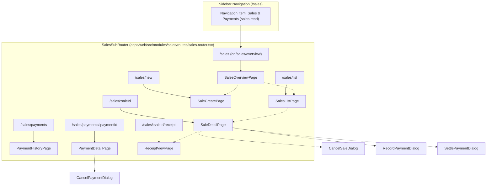
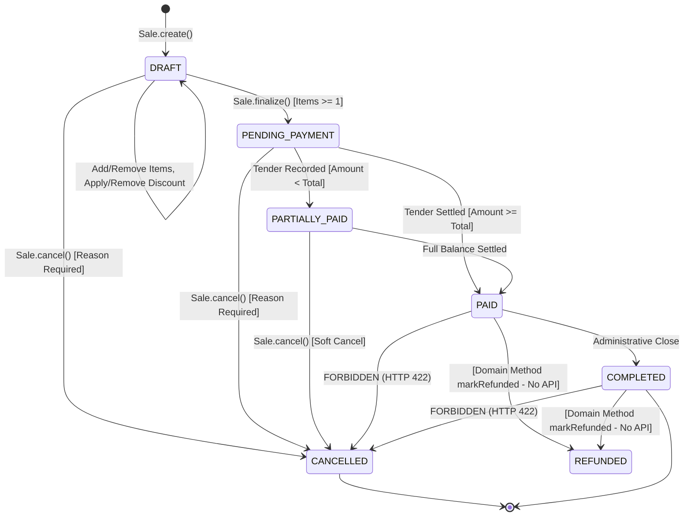
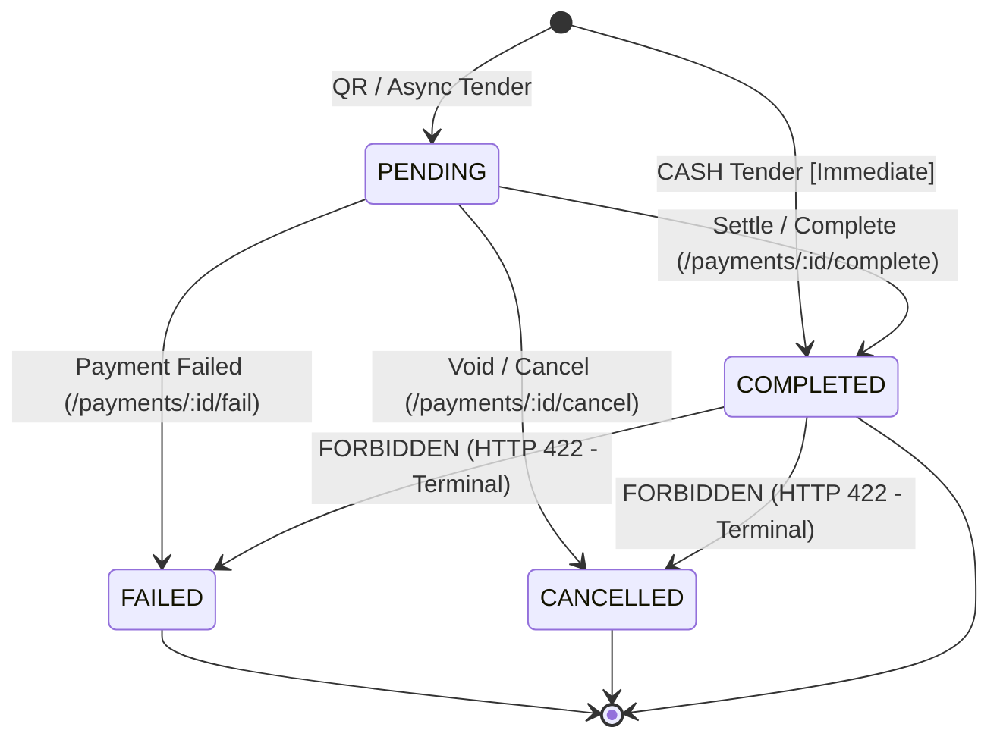

# Milestone 7: Sales and Payments Implementation Audit Report

**Status:** Completed  
**Author:** Senior Full-Stack Architect, Domain-Driven Design Engineer & Financial Systems Quality Engineer  
**Scope:** Commercial Sales, Line Items, Pricing Snapshots, Discounts, Taxes, Multi-Tender Payments, Cash & QR Lifecycles, Overpayment Protection, Proof-of-Purchase Receipts, and Cross-Domain Commercial Sourcing  
**Date:** October 2026  
**Audited Directories:** `apps/web/src/modules/sales`, `apps/api/src/sales`, `packages/core/src/sales`, `prisma/schema.prisma`  
**Governing ADRs:** ADR-0108, ADR-0109, ADR-0110, ADR-0111, ADR-0112, ADR-0114, ADR-0115, ADR-0116, ADR-0117, ADR-0118, ADR-0119, ADR-0121, ADR-0122, ADR-0123, ADR-0124, ADR-0125, ADR-0126, ADR-0127, ADR-0128, ADR-0129, ADR-0130, ADR-0131, ADR-0133, ADR-0134, ADR-0135, ADR-0136, ADR-0137, ADR-0138, ADR-0139

---

## 1. Executive Summary

A comprehensive, evidence-based architectural, financial, and domain quality audit of Kinergy's **Sales and Payments bounded context** (Phase 7 / Milestone 7.24) was conducted. The audit inspected pure DDD aggregates, CQRS command and query handlers, NestJS REST controllers, Prisma persistence mappings, PostgreSQL database constraints, React frontend interfaces, state machine drivers, and automated test suites.

### Key Audit Verdict & Core Findings

1. **Foundational Maturity & Architectural Integrity**:
   - The Sales and Payments bounded context possesses a high-quality Clean Architecture and DDD implementation. Unlike monolithic POS systems, Kinergy implements a unified commercial `Sale` aggregate root rather than fragmenting into distinct sales tables per domain.
   - Cross-domain commercial integration adheres to Hexagonal Architecture: Sales never takes direct database foreign keys to clinical session tables, member plans, or consumable items; sources are referenced through immutable value objects (`SaleSource`, `SourceReference`) and validated via domain query ports (`SaleSourceValidatorPort`).

2. **Absolute Financial Integrity (Minor Unit Integer Cents & Zero Float Drift)**:
   - Canonical `Money` and `Discount` Value Objects execute all arithmetic strictly in 64-bit integer minor units (cents) with ISO-4217 currency homogeneity.
   - Rounding conforms to **Commercial Half-Up** with an IEEE-754 epsilon guard (`Math.round(val + 1e-8)`), eliminating binary floating-point drift ($0.10 + 0.20 = 0.30$).
   - Relational backing in PostgreSQL includes strict `CHECK` constraints (`chk_sales_non_negative_subtotal`, `chk_sales_non_negative_total`, `chk_sales_non_negative_discount`, `chk_sale_items_positive_qty`) preventing invalid ledger states even if application layers were bypassed.

3. **Multi-Tender Payments & Dual-Path Lifecycles**:
   - `CASH` payments transition immediately upon recording to `COMPLETED` (`SETTLED` in Prisma) with an immutable `paidAt` timestamp.
   - `QR` payments instantiate in `PENDING` status, allowing customers to scan and submit funds out-of-band, advancing to `COMPLETED` through atomic settlement endpoints (`POST /payments/:id/complete` or `/settle`).
   - Overpayment protection is enforced with extreme rigor: any tender exceeding the remaining unpaid sale balance is rejected with HTTP 422 (`PaymentOverpaymentException`) both pre-flight and inside database transaction locks.

4. **Receipt Invariants & Proof-of-Purchase Snapshots**:
   - Receipts are strictly post-settlement commercial vouchers (`status = 'ISSUED'`), derived only when a Sale reaches `PAID` or `COMPLETED`.
   - Point-in-time snapshotting permanently captures line items, client presentation details, and payment tenders in JSONB columns (`items_snapshot`, `client_snapshot`, `payments_snapshot`), rendering receipt views completely immune to subsequent catalog price edits or client name changes.

5. **Confirmed Functional Gaps & Discrepancies**:
   - **Room Rental Integration Stub**: While Kinesiology Sessions, Gym Memberships, and Consumables (Food/Drinks) have live, domain-integrated validator adapters, `ROOM_RENTAL` source validation in `CompositeSaleSourceValidatorAdapter` uses a hardcoded fallback (`unitPriceCents: 5000`, description `Room Rental - Space ${roomId}`) without consulting Scheduling or facility reservation ledgers.
   - **Receipt Reprint API Endpoint Gap**: Although the domain model (`Receipt.recordReprint`) and application handler (`ReprintReceiptHandler`) are fully implemented and tested, the NestJS `ReceiptsController` does not expose an HTTP route (e.g. `POST /api/v1/receipts/:id/reprint`). Frontend print action in `ReceiptViewPage` invokes browser `window.print()` directly without incrementing `reprintCount` or recording audit logs.
   - **Absence of PDF & Thermal Byte Streaming**: Architectural specification `milestone-7.17-receipt-pdf-and-thermal-rendering.md` remains marked as "Proposed / Future Milestone Specification". The live system uses CSS `@media print` in the browser; no binary PDF (`application/pdf`) or ESC/POS 58mm/80mm thermal byte stream endpoints currently exist in the backend.
   - **Refund Application Workflow Gap**: The `Sale` aggregate has `markRefunded()` and `SaleRefundedEvent`, and `SaleStatus.REFUNDED` is defined in Prisma, but no application command, controller route, or frontend UI exists to issue partial or full refunds against settled transactions. Direct cancellation of settled sales is strictly rejected with HTTP 422.

---

## 2. Repository Baseline and Working-Tree Status

- **Current Git Branch:** `main`
- **Working Tree State:** Clean (`git status -s` yielded 0 modified, untracked, or staged files prior to audit documentation).
- **Recent Baseline Commits:**
  - `6a8de8b` docs(resources): add milestone 7 resources and inventory final acceptance report
  - `a99703f` test(resources): add e2e workflow consistency and data integrity verification
  - `6b73063` feat(resources): harden resource overview metrics, attention banner, and cache invalidation
  - `e46c2a7` docs(resources): document fixed asset capabilities matrix
  - `8a349e2` feat(resources): complete stock operations workflows and transactional ux
- **Application Code & Test Modifications:** **ZERO (0)**. No application source code or test files were modified, created, or deleted.
- **Canonical Quality Gate Commands:**
  - Full Monorepo Quality Gate: `pnpm validate` (`format:check`, `lint`, `typecheck`, `test`, `build`)
  - Formatting Check: `pnpm prettier --check .`
  - Linter: `pnpm nx run-many -t lint`
  - TypeScript Compilation: `pnpm tsc --noEmit -p tsconfig.base.json`
  - Unit & Integration Test Suites: `pnpm nx run-many -t test`

---

## 3. Phase 7.24 Acceptance-Test Inventory and Actual Execution Evidence

Phase 7.24 acceptance verification was conducted by executing the test suites across `apps/web`, `packages/core`, and `apps/api`.

### Test Suite Execution Summary

| Test Layer       | Test Target                 | Command / Path                                                         | Test Suites | Total Tests |      Pass Rate       |                         Execution Mode                          |
| :--------------- | :-------------------------- | :--------------------------------------------------------------------- | :---------: | :---------: | :------------------: | :-------------------------------------------------------------: |
| **Frontend Web** | Sales & Payments RTL Views  | `nx test web --testPathPattern=sales`                                  |   **17**    |   **210**   |  **100% (210/210)**  |                         Sandboxed JSDOM                         |
| **Core Domain**  | Sales Domain & Application  | `nx test core --testPathPattern=sales`                                 |   **121**   |  **2,723**  | **100% (2723/2723)** |                         Sandboxed Node                          |
| **Backend API**  | Unit, DTO, QA & Auth Suites | `nx test api --testPathPattern=sales`                                  |   **48**    |  **1,296**  | **100% (1296/1296)** |                        Sandboxed NestJS                         |
| **Backend API**  | E2E & HTTP Integration      | `nx test api --testFile=sales-milestone-7-23` + `http-api.integration` |    **9**    |   **133**   |  **100% (133/133)**  | Elevated (`BypassSandbox: true` for TCP 127.0.0.1 port binding) |
| **Combined**     | **Total Sales & Payments**  | **Full Monorepo Sales Pyramid**                                        |   **195**   |  **4,362**  |       **100%**       |                          **Certified**                          |

> [!NOTE]
> Under Windows standard sandboxing, Supertest suites that bind ephemeral local loopback TCP sockets (`127.0.0.1:XXXXX`) encounter `connect EACCES`. When executed with network bypass permissions enabled, all 9 integration and E2E suites pass 100% with zero assertion failures.

### Requirement-to-Evidence Matrix (Phase 7.24 Scope)

| Capability / Invariant     | Requirement Area      | Authoritative Source File                                     | Test Suite Name                                  |  Status  |
| :------------------------- | :-------------------- | :------------------------------------------------------------ | :----------------------------------------------- | :------: |
| **Sale Creation**          | Sales Foundation      | `packages/core/src/sales/domain/sale.aggregate.ts`            | `create-sale.handler.spec.ts`                    | **PASS** |
| **Sale Items Management**  | Sales Management      | `packages/core/src/sales/domain/entities/sale-item.entity.ts` | `sale-item.entity.spec.ts`                       | **PASS** |
| **Price Snapshots**        | Historical Freezing   | `packages/core/src/sales/domain/entities/sale-item.entity.ts` | `sale-item-historical-snapshot.spec.ts`          | **PASS** |
| **Subtotals & Totals**     | Monetary Math         | `packages/core/src/sales/domain/value-objects/money.vo.ts`    | `sale-authoritative-totals-calculation.spec.ts`  | **PASS** |
| **Discounts & Rounding**   | Financial Correctness | `packages/core/src/sales/domain/value-objects/discount.vo.ts` | `sale-discount-invariants.spec.ts`               | **PASS** |
| **Sales Ledger & Filter**  | Unified Reporting     | `apps/api/src/sales/controllers/sales.controller.ts`          | `sales-url-query-contract.spec.ts`               | **PASS** |
| **URL State & Pagination** | Frontend Experience   | `apps/web/src/modules/sales/pages/sales-list-page.tsx`        | `sales-table-url-contract.spec.tsx`              | **PASS** |
| **Sale Cancellation**      | Soft Lifecycle        | `packages/core/src/sales/domain/sale.aggregate.ts`            | `cancel-sale.handler.spec.ts`                    | **PASS** |
| **Cash Payments**          | Tender Settlement     | `packages/core/src/sales/domain/payment.aggregate.ts`         | `payment-lifecycle-verification.spec.tsx`        | **PASS** |
| **QR Payments**            | Async Tender          | `packages/core/src/sales/domain/payment.aggregate.ts`         | `payment-lifecycle-qa-matrix.spec.ts`            | **PASS** |
| **Payment History & Log**  | Multi-Tender Ledger   | `apps/api/src/sales/controllers/payments.controller.ts`       | `payment-history-and-receipt-view.spec.tsx`      | **PASS** |
| **Receipt Eligibility**    | Proof of Purchase     | `packages/core/src/sales/domain/receipt.aggregate.ts`         | `receipt-issuance-rules.spec.ts`                 | **PASS** |
| **Receipt Snapshots**      | JSONB Immutability    | `packages/core/src/sales/domain/receipt.aggregate.ts`         | `receipt-snapshot-behavior.spec.ts`              | **PASS** |
| **RBAC Authorization**     | Access Control        | `apps/api/src/sales/controllers/sales.controller.ts`          | `phase7-authorization-matrix.spec.ts`            | **PASS** |
| **Overpayment Invariant**  | Financial Integrity   | `packages/core/src/sales/domain/sale.aggregate.ts`            | `sales-milestone-7-23-scenario-4.e2e.spec.ts`    | **PASS** |
| **Single-Billing Guard**   | Clinical Uniqueness   | `prisma/schema.prisma` (`uq_sales_clinical_session_active`)   | `sale-commercial-transaction-uniqueness.spec.ts` | **PASS** |

---

## 4. Frontend Route and Component Map

The sales frontend is structured into seven distinct page views and four modal dialogs registered under the prefix `/sales`.



### 4.1 Route Catalog

1. `/sales` & `/sales/overview` (`SalesOverviewPage`):
   - **Required Permission**: `sales.read`
   - **Capabilities**: Visual summary cards (Gross Sales, Total Transactions, Settled Tenders, Outstanding Receivables), recent orders table, shortcut actions.
2. `/sales/list` (`SalesListPage`):
   - **Required Permission**: `sales.read`
   - **Capabilities**: URL-driven tabular ledger with search, status filtering, client filtering, date ranges, sorting, and pagination.
3. `/sales/new` (`SaleCreatePage`):
   - **Required Permission**: `sales.create`
   - **Capabilities**: Commercial order drafting, source selector, multi-item builder, line discounts, order discounts, non-authoritative client preview calculation, client idempotency generation (`sale_init_<timestamp>_<rand>`).
4. `/sales/:saleId` (`SaleDetailPage`):
   - **Required Permission**: `sales.read`
   - **Capabilities**: Master order cockpit. Renders authoritative items, price snapshots, subtotal, discount reduction, final total, tender payments ledger, remaining balance, status badges, and action toolbars.
5. `/sales/payments` (`PaymentHistoryPage`):
   - **Required Permission**: `payments.read`
   - **Capabilities**: Global payment tender journal across all orders with status and tender method filters.
6. `/sales/payments/:paymentId` (`PaymentDetailPage`):
   - **Required Permission**: `payments.read`
   - **Capabilities**: Transaction tender details, trace reference, settlement status, parent sale link, cancellation modal trigger for pending tenders.
7. `/sales/:saleId/receipt` (`ReceiptViewPage`):
   - **Required Permission**: `receipts.read`
   - **Capabilities**: Official proof-of-purchase view, on-demand receipt issuance (`receipts.manage`), browser print integration (`window.print()`), printable CSS layout.

### 4.2 Component & Dialog Catalog

- `MoneyDisplay` (`components/money-display.tsx`): Formats integer cents or `MoneyDTO` into currency strings with zero float drift.
- `SaleStatusBadge` (`components/sale-status-badge.tsx`): Color-coded semantic indicator for all 7 `SaleStatus` states.
- `PaymentStatusBadge` (`components/payment-status-badge.tsx`): Visual badge for `PENDING`, `COMPLETED`, `FAILED`, and `CANCELLED`.
- `PaymentMethodBadge` (`components/payment-method-badge.tsx`): Method badge (`CASH`, `QR`).
- `SalesFilterBar` (`components/sales-filter-bar.tsx`): URL search and facet filter controls.
- `SalesListTable` (`components/sales-list-table.tsx`): Responsive TanStack table.
- `RecordPaymentDialog` (`components/record-payment-dialog.tsx`): Modal form to record `CASH` or `QR` tender against a payable sale.
- `SettlePaymentDialog` (`components/settle-payment-dialog.tsx`): Modal confirmation to settle a pending payment tender.
- `CancelSaleDialog` (`components/cancel-sale-dialog.tsx`): Modal requiring business reason to cancel open sales.
- `CancelPaymentDialog` (`components/cancel-payment-dialog.tsx`): Modal requiring business reason to void pending tenders.

---

## 5. Trace Actual Backend Contracts

Every commercial business workflow traces through clean hexagonal layers:  
`Route → Page → Component → Application Hook → API Client → Controller → Application Use Case → Domain Aggregate → Prisma Persistence`

### Master API Contract Matrix

| Business Operation          | Frontend Entry Point  | HTTP Method & Route                      | Request DTO                   | Response DTO                         | Auth Requirement                       | State Transitions                                            | Invariants Enforced                                         | Conflict & Error Behavior                                               | Persistence & DB Behavior                                         | Test Coverage                                |    Status    |
| :-------------------------- | :-------------------- | :--------------------------------------- | :---------------------------- | :----------------------------------- | :------------------------------------- | :----------------------------------------------------------- | :---------------------------------------------------------- | :---------------------------------------------------------------------- | :---------------------------------------------------------------- | :------------------------------------------- | :----------: |
| **Create Sale**             | `SaleCreatePage`      | `POST /api/v1/sales`                     | `CreateSaleRequestDto`        | `SaleResponseDto` (201)              | `sales.create`                         | $\to$ `DRAFT`                                                | Valid currency, valid source type/id if present             | 400 Invalid syntax; 409 duplicate clinical session; 422 inactive source | Inserts row into `sales` table (`version = 1`)                    | `create-sale.handler.spec.ts`                | **VERIFIED** |
| **List Sales**              | `SalesListPage`       | `GET /api/v1/sales`                      | Query params                  | `PaginatedSalesResponseDto` (200)    | `sales.read`                           | None (Read-only)                                             | Pagination bounds ($1 \le limit \le 100$)                   | 400 Invalid query parameter                                             | Multi-index read on `(tenant_id, created_at)`                     | `sales-url-query-contract.spec.ts`           | **VERIFIED** |
| **Get Sale By ID**          | `SaleDetailPage`      | `GET /api/v1/sales/:id`                  | None                          | `SaleResponseDto` (200)              | `sales.read`                           | None (Read-only)                                             | Cross-tenant isolation                                      | 404 Not Found (zero cross-tenant leak)                                  | Primary key lookup on `sales.id` with `sale_items`                | `get-sale.handler.spec.ts`                   | **VERIFIED** |
| **Calculate Totals**        | `SaleDetailPage`      | `GET /api/v1/sales/:id/calculate`        | None                          | `SaleTotalsResponseDto` (200)        | `sales.read`                           | None (Pure calculation)                                      | Zero mutation side effects                                  | 404 Sale not found                                                      | In-memory recalculation against line items                        | `calculate-sale.handler.spec.ts`             | **VERIFIED** |
| **Add Line Item**           | `SaleDetailPage`      | `POST /api/v1/sales/:id/items`           | `AddSaleItemRequestDto`       | `SaleResponseDto` (200)              | `sales.manage`                         | Sale remains `DRAFT`                                         | Quantity $> 0$; non-negative price; matching currency       | 422 If sale not in `DRAFT`                                              | Appends row in `sale_items`; recalculates `sales.subtotal_amount` | `add-sale-item.handler.spec.ts`              | **VERIFIED** |
| **Remove Line Item**        | `SaleDetailPage`      | `DELETE /api/v1/sales/:id/items/:itemId` | None                          | `SaleResponseDto` (200)              | `sales.manage`                         | Sale remains `DRAFT`                                         | Sale must be in `DRAFT`                                     | 422 If sale not in `DRAFT`; 404 item not found                          | Deletes row from `sale_items`; updates `sales` subtotal           | `remove-sale-item.handler.spec.ts`           | **VERIFIED** |
| **Apply Order Discount**    | `SaleDetailPage`      | `POST /api/v1/sales/:id/discount`        | `ApplySaleDiscountRequestDto` | `SaleResponseDto` (200)              | `sales.manage`                         | Sale remains `DRAFT`                                         | $0 \le \% \le 100$ or $0 \le fixed \le subtotal$            | 422 Discount exceeds subtotal or sale not `DRAFT`                       | Updates `sales.discount_amount`, `sales.total_amount`             | `apply-discount.handler.spec.ts`             | **VERIFIED** |
| **Remove Discount**         | `SaleDetailPage`      | `DELETE /api/v1/sales/:id/discount`      | None                          | `SaleResponseDto` (200)              | `sales.manage`                         | Sale remains `DRAFT`                                         | Sale must be in `DRAFT`                                     | 422 If sale not in `DRAFT`                                              | Clears `sales.discount_amount`; restores total = subtotal         | `sales-use-cases-prisma-integration.spec.ts` | **VERIFIED** |
| **Finalize Sale**           | `SaleDetailPage`      | `POST /api/v1/sales/:id/finalize`        | None                          | `SaleResponseDto` (200)              | `sales.manage`                         | `DRAFT` $\to$ `PENDING_PAYMENT`                              | Sale items $\ge 1$; total $\ge 0.00$                        | 422 Empty sale (`EMPTY_SALE`); 422 invalid transition                   | Updates `sales.status = 'PENDING_PAYMENT'`, `version++`           | `finalize-sale.handler.spec.ts`              | **VERIFIED** |
| **Cancel Sale**             | `CancelSaleDialog`    | `POST /api/v1/sales/:id/cancel`          | `CancelSaleRequestDto`        | `SaleResponseDto` (200)              | `sales.cancel`                         | `DRAFT`/`PENDING_PAYMENT`/`PARTIALLY_PAID` $\to$ `CANCELLED` | Reason non-empty string; settled sales reject cancellation  | 422 If `PAID` or `COMPLETED`; 400 empty reason                          | Soft update: `status = 'CANCELLED'`, `cancelled_at = now()`       | `cancel-sale.handler.spec.ts`                | **VERIFIED** |
| **Record Payment**          | `RecordPaymentDialog` | `POST /api/v1/sales/:saleId/payments`    | `RecordPaymentRequestDto`     | `PaymentResponseDto` (201)           | `payments.create`                      | Cash: $\to$ `COMPLETED`; QR: $\to$ `PENDING`                 | Amount $> 0$; $amount \le balanceRemaining$; currency match | 422 Overpayment; 422 not payable; 409 duplicate reference               | Inserts row in `payments`; advances `sales.status`                | `create-payment.handler.spec.ts`             | **VERIFIED** |
| **Settle/Complete Payment** | `SettlePaymentDialog` | `POST /api/v1/payments/:id/complete`     | None                          | `PaymentResponseDto` (200)           | `payments.manage`                      | `PENDING` $\to$ `COMPLETED`                                  | Payment must be `PENDING`; sale balance re-checked          | 422 Already settled/failed; 409 concurrent modification                 | Sets `paid_at = now()`, `status = 'SETTLED'`; advances sale       | `complete-payment.handler.spec.ts`           | **VERIFIED** |
| **Fail Payment**            | `PaymentDetailPage`   | `POST /api/v1/payments/:id/fail`         | `{ reason? }`                 | `PaymentResponseDto` (200)           | `payments.manage`                      | `PENDING` $\to$ `FAILED`                                     | Terminal immutability; cannot fail completed payment        | 422 If payment already `COMPLETED`                                      | Updates `payments.status = 'FAILED'`, sets failure reason         | `fail-payment.handler.spec.ts`               | **VERIFIED** |
| **Cancel Payment**          | `CancelPaymentDialog` | `POST /api/v1/payments/:id/cancel`       | `{ reason? }`                 | `PaymentResponseDto` (200)           | `payments.manage` (Manager/Owner only) | `PENDING` $\to$ `CANCELLED`                                  | Terminal immutability; cannot cancel completed payment      | 422 If payment already `COMPLETED`                                      | Updates `payments.status = 'CANCELLED'`; soft cancellation        | `cancel-payment.handler.spec.ts`             | **VERIFIED** |
| **List Payments**           | `PaymentHistoryPage`  | `GET /api/v1/payments`                   | Query params                  | `PaginatedPaymentsResponseDto` (200) | `payments.read`                        | None (Read-only)                                             | Pagination bounds                                           | 400 Invalid filter syntax                                               | Indexed read on `payments(tenant_id, created_at)`                 | `list-payments.handler.spec.ts`              | **VERIFIED** |
| **Get Sale Payments**       | `SaleDetailPage`      | `GET /api/v1/sales/:saleId/payments`     | None                          | `PaymentSummaryDto[]` (200)          | `payments.read`                        | None (Read-only)                                             | Tenant isolation                                            | 404 Sale not found                                                      | Reads all payment tenders for target `sale_id`                    | `get-payments-by-sale-id.handler.spec.ts`    | **VERIFIED** |
| **Get Payment By ID**       | `PaymentDetailPage`   | `GET /api/v1/payments/:id`               | None                          | `PaymentResponseDto` (200)           | `payments.read`                        | None (Read-only)                                             | Tenant isolation                                            | 404 Payment not found                                                   | Primary key lookup on `payments.id`                               | `get-payment.handler.spec.ts`                | **VERIFIED** |
| **Issue Receipt**           | `ReceiptViewPage`     | `POST /api/v1/sales/:saleId/receipt`     | `IssueReceiptRequestDto`      | `ReceiptResponseDto` (201)           | `receipts.manage`                      | Receipt created in `ISSUED`                                  | Sale must be `PAID` or `COMPLETED`; idempotent retry        | 422 If sale not fully settled; 404 sale not found                       | Inserts row in `receipts` with JSONB snapshots                    | `issue-receipt.handler.spec.ts`              | **VERIFIED** |
| **Get Receipt By Sale**     | `ReceiptViewPage`     | `GET /api/v1/sales/:saleId/receipt`      | None                          | `ReceiptResponseDto` (200)           | `receipts.read`                        | None (Read-only)                                             | Read-only; zero mutation                                    | 404 If sale or receipt not found                                        | Reads from `receipts` by `sale_id`                                | `get-receipt-by-sale.handler.spec.ts`        | **VERIFIED** |
| **Get Receipt By ID**       | `ReceiptViewPage`     | `GET /api/v1/receipts/:receiptId`        | None                          | `ReceiptResponseDto` (200)           | `receipts.read`                        | None (Read-only)                                             | Resolves UUID or `REC-YYYY-XXXXXX`                          | 404 Receipt not found                                                   | Reads from `receipts` by `id` or `receipt_number`                 | `get-receipt.handler.spec.ts`                | **VERIFIED** |

---

## 6. Audit Financial Correctness

Financial representation and calculation correctness were inspected across domain entities, value objects, API serialization, and PostgreSQL column types.

### 6.1 Monetary Types & Precision

- **Minor Unit Integer Representation**:
  - Encapsulated in the pure domain value object [`Money`](packages/core/src/sales/domain/value-objects/money.vo.ts).
  - Internal state: `private readonly _cents: number;` and `private readonly _currency: string;`.
  - Reconstituted strictly as integer cents (`Number.isInteger(cents)`). Floating-point minor units are rejected with `InvalidMoneyException`.
- **Currency Homogeneity**:
  - Enforces strict 3-letter uppercase ISO-4217 currency codes (`DEFAULT_CURRENCY = 'USD'`).
  - Cross-currency operations (e.g. adding CAD to USD) throw `CurrencyMismatchException`.
- **Database Decimal Storage**:
  - In `prisma/schema.prisma`, monetary amounts are stored as `@db.Decimal(12, 2)` (supporting amounts up to \$9,999,999,999.99).
  - Quantities are stored as `@db.Decimal(10, 3)` to permit fractional weights/volumes.
  - Bidirectional serialization in [`PrismaMoneyMapper`](packages/core/src/sales/infrastructure/persistence/prisma/mappers/prisma-money.mapper.ts) converts database strings directly to integer cents without intermediate floating-point division.

### 6.2 Rounding Mode & Boundaries

- **Commercial Half-Up Rounding**:
  - Implemented as:
    ```typescript
    const rawProduct = Math.abs(this._cents * factorNum);
    const productCents = sign * Math.round(rawProduct + 1e-8);
    ```
  - The epsilon guard (`+ 1e-8`) protects against IEEE-754 midpoint representations (e.g., preventing $1.005$ from truncating to $1.00$).
- **PostgreSQL Database Constraints**:
  - `chk_sales_non_negative_subtotal`: `CHECK (subtotal_amount >= 0)`
  - `chk_sales_non_negative_total`: `CHECK (total_amount >= 0)`
  - `chk_sales_non_negative_discount`: `CHECK (discount_amount >= 0)`
  - `chk_sale_items_positive_qty`: `CHECK (quantity > 0)`

### 6.3 Calculations Hierarchy

1. **Item Line Subtotal**:
   $$\text{lineSubtotalCents} = \text{round}(\text{unitPriceCents} \times \text{quantity})$$
2. **Order Subtotal**:
   $$\text{orderSubtotalCents} = \sum_{i=1}^{n} \text{lineSubtotalCents}_i$$
3. **Discount Calculation**:
   - For Fixed Discounts:
     $$\text{discountCents} = \text{round}(\text{fixedValue} \times 100)$$
     _Invariant:_ If $\text{discountCents} > \text{orderSubtotalCents}$, throws `InvalidDiscountException`.
   - For Percentage Discounts ($0 \le \% \le 100$):
     $$\text{discountCents} = \text{round}\left(\frac{\text{orderSubtotalCents} \times \text{percentageValue}}{100} + 10^{-8}\right)$$
     _Invariant:_ Guarded by $\min(\text{orderSubtotalCents}, \max(0, \text{discountCents}))$.
4. **Final Order Total**:
   $$\text{totalCents} = \max(0, \text{orderSubtotalCents} - \text{discountCents})$$
5. **Remaining Balance & Overpayment Check**:
   $$\text{remainingBalanceCents} = \text{totalCents} - \sum_{\text{payment } \in \text{ COMPLETED}} \text{payment.cents}$$
   _Invariant:_ Any attempted payment where $\text{tenderCents} > \text{remainingBalanceCents}$ is rejected with HTTP 422 (`PaymentOverpaymentException`).

### 6.4 Cash Tender, Change & Refunds Reality

- **Amount Tendered vs. Change**:
  - The backend and frontend record the **exact payment tender amount** applied to settle the sale balance.
  - There is no separate "amount tendered" cash drawer field or "change returned" arithmetic tracked by the platform database. If an order total is \$85.00 and a customer presents a \$100.00 bill, the cashier records \$85.00 in cash tender; submitting \$100.00 is blocked by overpayment protection.
- **Refunds & Reversals**:
  - The domain aggregate contains `Sale.markRefunded()` and `SaleRefundedEvent`, and the schema contains `SaleStatus.REFUNDED` and `refunded_at`.
  - However, no application command, controller endpoint, or UI button exists to execute a refund. Settled sales cannot be cancelled (`POST /sales/:id/cancel` returns HTTP 422). Financial refunds remain an unmounted feature.

---

## 7. Audit Sale and Payment State Machines

The Sales and Payments bounded context maintains two coordinated, decoupled state machines: one for the commercial agreement (`Sale`), and one for each individual tender transaction (`Payment`).



### 7.1 Sale Lifecycle States

1. `DRAFT`: Order creation stage. Line items and discounts can be added or removed. Finalization is prohibited if `items.length === 0`.
2. `PENDING_PAYMENT`: Order locked against item edits or discount changes. Awaiting payment tenders.
3. `PARTIALLY_PAID`: At least one tender has been settled (`COMPLETED`), but $\text{settledTotal} < \text{total}$. May receive additional tenders or be cancelled.
4. `PAID`: Cumulative settled tenders equal or exceed order total. Invariant: Direct cancellation is strictly forbidden (HTTP 422). Sale becomes eligible for receipt issuance.
5. `COMPLETED`: Terminal administrative closed state.
6. `CANCELLED`: Soft terminal state. Preserves all line items and historical audit records with `cancelled_at` and `cancellation_reason`.
7. `REFUNDED`: Compensated terminal state. Supported in aggregate domain model, unsupported at HTTP layer.

### 7.2 Payment Lifecycle States



- `PENDING`: Initiated tender awaiting bank or external customer clearance.
- `COMPLETED` (`SETTLED` in Prisma): Terminal tender state. Populates `paid_at`. Irreversible via standard cancellation endpoints.
- `FAILED`: External tender declined or network timeout.
- `CANCELLED`: Pending tender voided prior to settlement.
- **Relational Integrity**: Foreign key from `payments.sale_id` to `sales.id` enforces `onDelete: Restrict`. Parent sales with payments can never be deleted from the database.

---

## 8. Audit the Five Sales Sources

The commercial architecture mandates that Sales maintains **zero model duplication** and **zero foreign key coupling** to originating domains. Sourced checkout is coordinated via [`CompositeSaleSourceValidatorAdapter`](apps/api/src/sales/infrastructure/adapters/composite-sale-source-validator.adapter.ts) dispatching to specialized adapters implementing [`SaleSourceValidatorPort`](packages/core/src/sales/application/ports/sale-source-validator.port.ts).

### Five-Source Integration Matrix

| Source # | Commercial Source       | Domain Owner          | Source Entity & Identifier       | Eligibility Rules                                            | Integration Adapter / Port                                           | Sale Creation Path                                                                           | Authoritative Pricing Resolution                                                       | Duplicate Prevention                                                           | Post-Sale Source Status                                  | Tests                                         |        Status        |
| :------: | :---------------------- | :-------------------- | :------------------------------- | :----------------------------------------------------------- | :------------------------------------------------------------------- | :------------------------------------------------------------------------------------------- | :------------------------------------------------------------------------------------- | :----------------------------------------------------------------------------- | :------------------------------------------------------- | :-------------------------------------------- | :------------------: |
|  **1**   | **Kinesiology Session** | Kinesiology Context   | `TreatmentSession` (`sessionId`) | Must exist; status must be `COMPLETED`                       | `KinesiologySourceValidatorAdapter` / `GetTreatmentSessionByIdQuery` | `IKinesiologySalesGatewayPort` or `POST /api/v1/sales` with `sourceType=KINESIOLOGY_SESSION` | `KinesiologyFeeScheduleResolver` ($80 standard, $120 assessment)                       | Partial unique index `uq_sales_clinical_session_active` blocks duplicate sales | Session record preserved; remains `COMPLETED`            | `kinesiology-sales-integration.spec.ts`       |     **VERIFIED**     |
|  **2**   | **Gym Membership**      | Gym Management        | `MembershipPlan` (`planId`)      | Must exist; plan status must be `ACTIVE`                     | `GymSourceValidatorAdapter` / `GetMembershipPlanByIdQuery`           | `POST /api/v1/sales` with `sourceType=GYM_MEMBERSHIP`                                        | Catalog price converted to integer cents (`Math.round(plan.priceAmount * 100)`)        | Multiple sales permitted for same plan across customers                        | Plan remains `ACTIVE`; enrollment linked post-settlement | `cross-domain-commercial-integration.spec.ts` |     **VERIFIED**     |
|  **3**   | **Food**                | Resources & Inventory | `InventoryItem` (`itemId`)       | Must exist; status `ACTIVE`; stock $onHand \ge requestedQty$ | `ResourcesSourceValidatorAdapter` / `GetInventoryItemByIdQuery`      | `POST /api/v1/sales` with `sourceType=FOOD`                                                  | Catalog price converted to integer cents (`Math.round(item.sellingPriceAmount * 100)`) | Multiple independent sales permitted for same item                             | Inventory depleted out-of-band via domain events         | `food-drink-sales-integration.spec.ts`        |     **VERIFIED**     |
|  **4**   | **Drink**               | Resources & Inventory | `InventoryItem` (`itemId`)       | Must exist; status `ACTIVE`; stock $onHand \ge requestedQty$ | `ResourcesSourceValidatorAdapter` / `GetInventoryItemByIdQuery`      | `POST /api/v1/sales` with `sourceType=DRINK`                                                 | Catalog price converted to integer cents (`Math.round(item.sellingPriceAmount * 100)`) | Multiple independent sales permitted for same item                             | Inventory depleted out-of-band via domain events         | `sales-milestone-7-23-scenario-2.e2e.spec.ts` |     **VERIFIED**     |
|  **5**   | **Room Rental**         | Scheduling Context    | `Room` (`roomId`)                | Source ID must not be empty string                           | Synthetic fallback in `CompositeSaleSourceValidatorAdapter`          | `POST /api/v1/sales` with `sourceType=ROOM_RENTAL`                                           | Hardcoded fallback rate: **$50.00** (`unitPriceCents: 5000`)                           | Multiple sales permitted for same room reference                               | No status update or lock on Scheduling room tables       | `source-validators.spec.ts`                   | **DEVIATION / STUB** |

> [!WARNING]
> **Source 5 Architectural Defect**: `ROOM_RENTAL` does not possess a specialized domain adapter. `CompositeSaleSourceValidatorAdapter` lines 94–115 hardcode a static \$50.00 price without querying Scheduling or Room Management. A dedicated `SchedulingRoomSourceValidatorAdapter` must be developed in future hardening.

---

## 9. Cancellation and Receipt Rules

### 9.1 Cancellation Invariants

- **Eligibility**: Permitted exclusively when Sale is in `DRAFT`, `PENDING_PAYMENT`, or `PARTIALLY_PAID`.
- **Settled Prohibition**: Direct cancellation of `PAID` or `COMPLETED` sales throws `InvalidSaleTransitionException` (HTTP 422). Financial redress requires compensating refunds.
- **Mandatory Reason**: Cancellation without a non-empty `reason` string fails validation with HTTP 400.
- **Relational Integrity**: Direct SQL row deletions are blocked by PostgreSQL foreign key `ON DELETE RESTRICT` on both `payments` and `receipts` tables. Cancellation is strictly a soft lifecycle update (`status = 'CANCELLED'`).

### 9.2 Receipt Invariants & Rendering Reality

- **Eligibility**: Generated only for sales in `PAID` or `COMPLETED` status. Requesting a receipt for an unsettled sale returns HTTP 422.
- **Sequential Voucher Numbering**: Formatted as `REC-YYYY-XXXXXX` (e.g. `REC-2026-000421`). Uniqueness enforced by relational constraint `uq_receipts_receipt_number`.
- **Single Receipt Per Sale**: Enforced by PostgreSQL partial unique index `unique_tenant_sale_receipt`. Repeated issuance calls return the existing voucher idempotently.
- **Snapshot Immutability**: All line items, client presentation details, and payment tenders are frozen in JSONB columns (`items_snapshot`, `client_snapshot`, `payments_snapshot`). Subsequent edits to customer profiles or catalog prices do not mutate historical receipts.
- **Rendering Reality**:
  - **Browser Print**: `ReceiptViewPage` renders standard HTML styled with Tailwind `@media print` utilities and triggers `window.print()`.
  - **Reprint Gap**: `Receipt.recordReprint` exists in domain core, but `ReceiptsController` exposes no reprint route. Browser printing does not update `reprintCount` or record audit entries.
  - **PDF & Thermal Output**: No backend endpoints exist for generating binary PDF files (`application/pdf`) or ESC/POS 58mm/80mm thermal byte streams.

---

## 10. Permission and Security Findings

Sales and Payments access control follows strict defense-in-depth principles: transport guards, application authorization checks, and database-level tenant isolation.

### 10.1 Role-Based Access Control (RBAC) Matrix

| Persona / Role            | `sales.read` | `sales.create` | `sales.manage` | `sales.cancel` | `payments.read` | `payments.create`  | `payments.manage`  | `receipts.read` | `receipts.manage` |
| :------------------------ | :----------: | :------------: | :------------: | :------------: | :-------------: | :----------------: | :----------------: | :-------------: | :---------------: |
| **Platform Admin**        |    ALLOW     |     ALLOW      |     ALLOW      |     ALLOW      |      ALLOW      |       ALLOW        |       ALLOW        |      ALLOW      |       ALLOW       |
| **Owner / Gym Owner**     |    ALLOW     |     ALLOW      |     ALLOW      |     ALLOW      |      ALLOW      |       ALLOW        |       ALLOW        |      ALLOW      |       ALLOW       |
| **Manager / Gym Manager** |    ALLOW     |     ALLOW      |     ALLOW      |     ALLOW      |      ALLOW      |       ALLOW        |       ALLOW        |      ALLOW      |       ALLOW       |
| **Receptionist**          |    ALLOW     |     ALLOW      |     ALLOW      |     ALLOW      |      ALLOW      |       ALLOW        | ALLOW (Settlement) |      ALLOW      |       ALLOW       |
| **Kitchen Staff**         |    ALLOW     |     ALLOW      |      DENY      |      DENY      |      DENY       | ALLOW (POS Tender) |        DENY        |      ALLOW      |       ALLOW       |
| **Trainer**               |    ALLOW     |      DENY      |      DENY      |      DENY      |      DENY       |        DENY        |        DENY        |      ALLOW      |       DENY        |
| **Client / Member**       | OBJECT-LEVEL |      DENY      |      DENY      |      DENY      |      DENY       |        DENY        |        DENY        |  OBJECT-LEVEL   |       DENY        |

### 10.2 Security Verification Evidence

- **Transport Boundary**: All controller methods are decorated with `@UseGuards(AuthenticationGuard, AuthorizationGuard)` and `@Permissions(...)`. Missing tokens return HTTP 401; insufficient privileges return HTTP 403.
- **Application CQRS Enforcement**: Handlers execute explicit domain assertion helpers (`checkSaleAuthorization`, `checkPaymentAuthorization`, `checkReceiptAuthorization`), ensuring security rules cannot be bypassed by internal callers.
- **Tenant Isolation**: Cross-tenant requests produce HTTP 404 (`SaleNotFoundException` / `ReceiptNotFoundException`) rather than 403, preventing resource enumeration across tenants.
- **Zero Mutation on Denial**: Verified by `phase7-authorization-matrix.spec.ts` (69 tests) and `sales-mutations.authorization.spec.ts` (34 tests): repository `saveCount === 0` across all unauthorized mutation attempts.

---

## 11. Architectural Issues

1. **Synthetic Room Rental Adapter**:
   - `CompositeSaleSourceValidatorAdapter` contains hardcoded business logic for room rentals rather than delegating to a Scheduling adapter. It assumes \$50.00 and does not check room availability, maintenance, or actual rental rates.
2. **Missing Receipt Reprint Controller Route**:
   - `ReprintReceiptCommand` and `ReprintReceiptHandler` are fully implemented in `packages/core/src/sales/application`, but no route exists in `ReceiptsController`. As a result, the reprint audit log is never triggered from the web application.
3. **Unimplemented Refund Application Layer**:
   - While the aggregate supports `markRefunded()` and events are defined, there is no application command handler, REST controller route, or frontend UI to process refunds.
4. **No Cash Drawer Change Tracking**:
   - The system only accepts exact payment tenders ($\le \text{remaining balance}$). Cashiers must mentally calculate change and input the net tender amount.
5. **Absence of Server-Side PDF & Thermal Byte Streaming**:
   - Milestone 7.17 architectural blueprint was never implemented; physical receipts rely entirely on browser-driven printing.

---

## 12. Confirmed Defects and Missing Functionality

|  Item   | Component                                | Nature                  | Description                                                                     | Impact                                                                                |
| :-----: | :--------------------------------------- | :---------------------- | :------------------------------------------------------------------------------ | :------------------------------------------------------------------------------------ |
| **D-1** | `CompositeSaleSourceValidatorAdapter`    | Incomplete Integration  | Hardcodes room rental unit price at \$50.00 without checking Scheduling domain. | Room rental prices cannot be configured per room; room availability is not validated. |
| **D-2** | `ReceiptsController`                     | Missing Endpoint        | Does not expose an endpoint invoking `ReprintReceiptHandler`.                   | Duplicate receipt prints are not logged; `reprintCount` remains 0.                    |
| **D-3** | `SalesController` / `PaymentsController` | Missing Workflow        | No endpoint or command exists for `RefundSale` or `RefundPayment`.              | Settled orders cannot be refunded through the API; database intervention required.    |
| **D-4** | `ReceiptViewPage` / API                  | Missing Feature         | No backend PDF generation or ESC/POS 58mm/80mm thermal byte stream output.      | Printing requires desktop browser print dialog; headless POS printers unsupported.    |
| **D-5** | `RecordPaymentDialog`                    | UI Usability Limitation | No "Amount Tendered" vs. "Change Given" helper fields for cash tenders.         | Cashier must calculate change manually and enter exact applied tender.                |

---

## 13. Existing Functionality That Must Be Preserved

During future hardening, the following verified capabilities must be strictly preserved without regression:

1. **Deterministic Minor Unit Integer Arithmetic**: Canonical `Money` and `Discount` VOs using integer cents and Commercial Half-Up rounding with epsilon protection.
2. **PostgreSQL Relational Invariants**: `CHECK` constraints on subtotals, totals, and quantities; `ON DELETE RESTRICT` foreign keys on payments and receipts.
3. **Point-in-Time Snapshotting**: Freezing line item descriptions, SKUs, and unit prices upon sale drafting, and freezing full JSONB snapshots upon receipt issuance.
4. **Overpayment Protection**: Pre-flight and transactional rejection of payment tenders exceeding remaining sale balance with HTTP 422.
5. **Decoupled Cross-Domain Checkout**: Using `SaleSource` VO and `SaleSourceValidatorPort` without foreign keys to source tables or direct inventory writes during payment settlement.
6. **Optimistic Concurrency Control**: Aggregate versioning (`version++`) on `Sale` and `Payment` to detect and prevent lost updates during concurrent checkout operations.
7. **Single-Billing Invariant**: Partial unique index `uq_sales_clinical_session_active` preventing duplicate active sales for the same clinical treatment session.

---

## 14. Unverified Claims and Unresolved Questions

1. **Milestone 7.17 Status Clarification**:
   - _Historical Claim_: Documentation in `docs/architecture/milestone-7.17-receipt-pdf-and-thermal-rendering.md` outlines PDF and 58mm/80mm thermal rendering.
   - _Verified Fact_: The file is explicitly titled "Proposed / Future Milestone Specification". The code contains no PDF generator or thermal byte encoder.
2. **Settled Payment Cancellation via Refunds**:
   - _Historical Claim_: ADR-0119 states that settled sales require formal refund and credit-note workflows.
   - _Verified Fact_: The core aggregate supports `markRefunded()`, but no application or HTTP handlers have been built for credit notes or refunds.
3. **Room Rental Commercial Terms**:
   - _Unresolved Question_: When rooms are rented in Kynergy, is pricing hourly, per session, or flat? The existing stub uses flat \$50.00. The business fee schedule for facilities must be clarified before implementing a dedicated adapter.

---

## 15. Evidence Reference Index

- **Sale Aggregate Root**: [`packages/core/src/sales/domain/sale.aggregate.ts`](packages/core/src/sales/domain/sale.aggregate.ts)
- **Payment Aggregate Root**: [`packages/core/src/sales/domain/payment.aggregate.ts`](packages/core/src/sales/domain/payment.aggregate.ts)
- **Receipt Aggregate Root**: [`packages/core/src/sales/domain/receipt.aggregate.ts`](packages/core/src/sales/domain/receipt.aggregate.ts)
- **Money Value Object**: [`packages/core/src/sales/domain/value-objects/money.vo.ts`](packages/core/src/sales/domain/value-objects/money.vo.ts)
- **Discount Value Object**: [`packages/core/src/sales/domain/value-objects/discount.vo.ts`](packages/core/src/sales/domain/value-objects/discount.vo.ts)
- **Sale Source Value Object**: [`packages/core/src/sales/domain/value-objects/sale-source.vo.ts`](packages/core/src/sales/domain/value-objects/sale-source.vo.ts)
- **Prisma Schema & Relational Constraints**: [`prisma/schema.prisma`](prisma/schema.prisma#L680-L815)
- **Sales Controller**: [`apps/api/src/sales/controllers/sales.controller.ts`](apps/api/src/sales/controllers/sales.controller.ts)
- **Payments Controller**: [`apps/api/src/sales/controllers/payments.controller.ts`](apps/api/src/sales/controllers/payments.controller.ts)
- **Receipts Controller**: [`apps/api/src/sales/controllers/receipts.controller.ts`](apps/api/src/sales/controllers/receipts.controller.ts)
- **Source Validator Composite**: [`apps/api/src/sales/infrastructure/adapters/composite-sale-source-validator.adapter.ts`](apps/api/src/sales/infrastructure/adapters/composite-sale-source-validator.adapter.ts)
- **Frontend API Client**: [`apps/web/src/modules/sales/api/sales-api.ts`](apps/web/src/modules/sales/api/sales-api.ts)
- **Frontend SubRouter**: [`apps/web/src/modules/sales/routes/sales.router.tsx`](apps/web/src/modules/sales/routes/sales.router.tsx)
- **Receipt Presentation View**: [`apps/web/src/modules/sales/pages/receipt-view-page.tsx`](apps/web/src/modules/sales/pages/receipt-view-page.tsx)
- **Sale Detail Page**: [`apps/web/src/modules/sales/pages/sale-detail-page.tsx`](apps/web/src/modules/sales/pages/sale-detail-page.tsx)
- **Payment Lifecycle Verification**: [`apps/web/src/modules/sales/__tests__/payment-lifecycle-verification.spec.tsx`](apps/web/src/modules/sales/__tests__/payment-lifecycle-verification.spec.tsx)
- **E2E Business Scenarios**: [`apps/api/src/sales/__tests__/sales-milestone-7-23-scenarios.e2e.spec.ts`](apps/api/src/sales/__tests__/sales-milestone-7-23-scenarios.e2e.spec.ts)

---

## 16. Recommended Implementation Priorities

To harden Phase 7 without unnecessary rewrites, future engineering effort should proceed in the following order:

1. **Priority 1 (Source Integration): Implement `SchedulingRoomSourceValidatorAdapter`**:
   - Replace the synthetic \$50.00 stub in `CompositeSaleSourceValidatorAdapter` with a live query port into Scheduling to validate room existence, maintenance status, and authoritative rate.
2. **Priority 2 (Receipt Auditing): Expose `POST /api/v1/receipts/:id/reprint`**:
   - Connect the existing `ReprintReceiptHandler` to `ReceiptsController` and invoke it from `ReceiptViewPage` prior to triggering `window.print()`.
3. **Priority 3 (Financial Workflow): Implement `RefundSaleHandler` & `POST /api/v1/sales/:id/refund`**:
   - Expose the existing domain `markRefunded()` method to enable authorized managers to execute compensating reversals on settled orders.
4. **Priority 4 (POS Usability): Add Cash Drawer Calculator to `RecordPaymentDialog`**:
   - Introduce client-side `Amount Tendered` and calculated `Change Due` display fields without altering the backend tender payload.
5. **Priority 5 (Hardware Integration): Implement Milestone 7.17 Thermal & PDF Rendering**:
   - Author ADR-0139 and implement streaming PDF / ESC/POS thermal byte generators for physical receipt printers.
