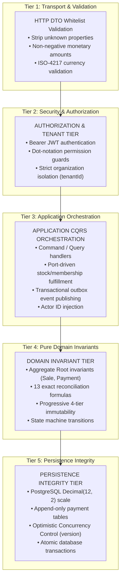

# Sales & Payments — Executable Business Rules & Invariants Specification

- **Status**: Authoritative Behavioral Contract Baseline (APPROVED & EXECUTABLE)
- **Bounded Context**: Sales & Payments (`packages/core/src/sales/`, `apps/api/src/sales/`)
- **Author**: Principal Business Domain Engineer & Lead Financial Domain Architect
- **Governing ADRs**:
  - [ADR-0108: Deterministic Financial Representation and Currency Modeling](../adr/0108-money-representation.md)
  - [ADR-0109: Payment Lifecycle, Multi-Tender Settlement, and Financial Immutability](../adr/0109-payment-lifecycle.md)
  - [ADR-0110: Sale Transaction Ownership and Source Bounded-Context Integrity](../adr/0110-sale-ownership.md)
  - [ADR-0111: Sales & Payments Authorization, Organization Isolation, and Audit Boundaries](../adr/0111-sales-payments-authorization-and-audit.md)
  - [ADR-0112: Sales & Payments Bounded Context Establishment](../adr/0112-sales-bounded-context.md)
  - [ADR-0113: Item-Level Discount Domain Model, Deterministic Calculation, and Invariant Enforcement](../adr/0113-item-level-discounts.md)
  - [ADR-0114: Canonical Monetary Policy, Deterministic Arithmetic, and Sale Totals Invariant Enforcement](../adr/0114-canonical-monetary-policy-and-sale-totals.md)
  - [ADR-0115: Payment Domain Canonical Architecture, Aggregate Boundaries, and Tender Decoupling](../adr/0115-payment-domain-canonical-architecture.md)
  - [ADR-0116: Payment State Machine, Lifecycle Specification, and Financial Transition Determinism](../adr/0116-payment-state-machine-and-lifecycle-specification.md)
  - [ADR-0117: Receipt Domain Boundary, Document Model, and Legal Proof-of-Purchase Invariants](../adr/0117-receipt-domain-boundary-and-document-model.md)
  - [ADR-0118: Sale Reference and Receipt Identification Strategy](../adr/0118-sale-reference-and-receipt-identification-strategy.md)
  - [ADR-0119: Sale Aggregate Boundary, Invariants, and Commercial Transaction Integrity](../adr/0119-sale-aggregate-boundary-and-invariants.md)
  - [ADR-0120: Commercial Transaction Uniqueness and Sale Idempotency](../adr/0120-commercial-transaction-uniqueness-and-sale-idempotency.md)
  - [ADR-0121: Sale Source References and Commercial Origin Model](../adr/0121-sale-source-references-and-commercial-origin-model.md)
  - [ADR-0140: Financial Concurrency and Settlement Integrity](../adr/0140-financial-concurrency-and-settlement-integrity.md)
- **Authoritative Invariant Catalog (Milestone 7.8)**: [Sale Invariant Catalog (SALE-001 through SALE-022)](sale-invariants-catalog.md)

---

## 1. Architectural Responsibility & Invariant Tiers

To maintain strict Clean Architecture boundaries and eliminate misplaced business logic, all business rules within Sales & Payments are classified into five explicit architectural tiers:



---

## 2. Master Financial Business Rules Specification (Phase 6 Traceability Format)

This section establishes the authoritative specification for the 8 core financial business rules of the Kinergy platform, conforming to the Phase 6 traceability standard.

```
┌──────────────────────────────────────────────────────────────────────────────┐
│                    MASTER BUSINESS RULES INDEX & TAXONOMY                    │
│                                                                              │
│  BR-SALES       Exactly One Sale Per Commercial Transaction                  │
│  BR-ITEM        Sale Item Snapshot & Historical Immutability                 │
│  BR-DISCOUNT    Discount Rules, Boundaries, and Calculation Order            │
│  BR-TOTAL       Deterministic Sale Totals & Cent-Exact Reconciliation        │
│  BR-PAYMENT     Payment Lifecycle, Tender Separation, and Settlement         │
│  BR-CANCEL      Cancellation Invariants, Permitted States, and Concurrency   │
│  BR-RECEIPT     Receipt Voucher Generation, Snapshots, and Idempotency       │
│  BR-DUPLICATE   Duplicate Prevention, Idempotency, and Concurrency Safety    │
└──────────────────────────────────────────────────────────────────────────────┘
```

---

### BR-SALES: Exactly One Sale Per Commercial Transaction

- **Stable Rule Identifier**: `BR-SALES` (Sub-rules: `BR-SALES-01`, `BR-SALES-02`)
- **Rule Statement**:
  1. For clinical therapy encounters (`KINESIOLOGY_SESSION` / `TREATMENT_SESSION`), a commercial checkout transaction MUST correspond to exactly one completed clinical encounter. The platform MUST NOT permit more than one active (non-cancelled) `Sale` to reference the same clinical encounter instance (`BR-SALES-01`).
  2. If an existing `Sale` for a clinical encounter was `CANCELLED`, creating a new `Sale` for that encounter MAY proceed (`BR-SALES-02`).
  3. For retail consumables (`FOOD`, `DRINK`), gym membership plans (`GYM_MEMBERSHIP`), and space rentals (`ROOM_RENTAL`), repeat purchases and legitimate renewals MUST be assigned distinct commercial `SaleId`s; multiple independent `Sale` aggregates MAY legitimately reference the same catalog source entity.
  4. An application-level preflight lookup MUST NOT be considered an atomic uniqueness guarantee under concurrency; atomic uniqueness MUST be guaranteed by database-level partial unique constraints.
- **Rationale & Business Impact**: Prevents double-billing patients for clinical care while preserving normal retail POS checkouts and recurring gym membership subscription workflows. Eliminates lost revenues and customer disputes caused by race conditions.
- **Preconditions & Expected Outcome**:
  - _Preconditions_: Valid `tenantId`, valid `SaleSource` VO with recognized `SaleSourceType` and non-empty `referenceId`.
  - _Expected Outcome_: If an active sale already exists for the clinical encounter, the request is rejected with `409 Conflict` (`DuplicateSaleException` with code `'DUPLICATE_SALE_DETECTED'`). Otherwise, a new `Sale` in `DRAFT` status with a unique UUID `SaleId` is created.
- **Enforcement Location**:
  - _Application Tier_: `CreateSaleHandler` preflight query `saleRepository.findBySourceReference()`.
  - _Persistence Tier_: PostgreSQL partial unique index `uq_sales_clinical_session_active` on `sales(tenant_id, source_id) WHERE source_type IN ('TREATMENT_SESSION', 'KINESIOLOGY_SESSION') AND status != 'CANCELLED'`.
  - _Domain Tier_: `SaleSource` value object immutability (`SALE-022`).
- **Relevant Use Case & API Operation**:
  - _Use Case_: `CreateSaleUseCase` (`CreateSaleHandler`).
  - _API Operation_: `POST /api/v1/sales`.
- **Test References**:
  - [`sale-commercial-transaction-uniqueness.spec.ts`](file:///c:/Projects/kinergy-platform/packages/core/src/sales/domain/__tests__/sale-commercial-transaction-uniqueness.spec.ts)
  - [`financial-concurrency-and-race-conditions.integration.spec.ts`](file:///c:/Projects/kinergy-platform/packages/core/src/sales/infrastructure/persistence/prisma/__tests__/financial-concurrency-and-race-conditions.integration.spec.ts)
  - [`prisma-sale-source-concurrency.spec.ts`](file:///c:/Projects/kinergy-platform/packages/core/src/sales/infrastructure/persistence/prisma/__tests__/prisma-sale-source-concurrency.spec.ts)
  - [`sale-creation-concurrency-and-uniqueness.integration.spec.ts`](file:///c:/Projects/kinergy-platform/packages/core/src/sales/infrastructure/persistence/prisma/__tests__/sale-creation-concurrency-and-uniqueness.integration.spec.ts)
- **Status**: `IMPLEMENTED`

---

### BR-ITEM: Sale Item Snapshot & Historical Immutability

- **Stable Rule Identifier**: `BR-ITEM` (Sub-rules: `BR-ITEM-01` to `BR-ITEM-04`)
- **Rule Statement**:
  1. Every `SaleItem` MUST permanently capture and freeze commercial snapshot attributes at checkout: `description`, `skuOrCode`, `unitPrice` (`Money`), and `source` (`SourceReference | SaleSource`) (`BR-ITEM-01`).
  2. Subsequent upstream catalog modifications (renaming, price increases, archival, or deletion of products, services, or membership plans) MUST NOT alter past `SaleItem` records (`BR-ITEM-02`).
  3. Domain queries MUST NOT dynamically query or join upstream source tables (`inventory_items`, `membership_plans`, `treatment_sessions`) to resolve line item details at read time (`BR-ITEM-03`).
  4. `description`, `skuOrCode`, `unitPrice`, and `source` MUST NEVER change after item creation. Only `quantity` and `discount` MAY be modified, and ONLY while the parent `Sale` is in `DRAFT` status. Once the parent `Sale` departs `DRAFT`, ALL line item attributes, quantities, and discounts MUST be permanently locked (`BR-ITEM-04`).
- **Rationale & Business Impact**: Protects legal and commercial auditability. Prevents retroactive price drift on historical orders, guaranteeing that customer receipts remain accurate and legally defensible.
- **Preconditions & Expected Outcome**:
  - _Preconditions_: Parent `Sale` in `DRAFT`, strictly positive quantity ($0.001 \le q \le 999,999$), non-negative unit price ($\ge \$0.00$), matching currency.
  - _Expected Outcome_: An immutable `SaleItem` instance (`Object.freeze(this)`) attached to the `Sale` and persisted in standalone columns in `sale_items`.
- **Enforcement Location**:
  - _Domain Tier_: [`SaleItem.create()`](file:///c:/Projects/kinergy-platform/packages/core/src/sales/domain/entities/sale-item.entity.ts#L106), `Object.freeze(this)`, [`Sale.assertDraftState()`](file:///c:/Projects/kinergy-platform/packages/core/src/sales/domain/sale.aggregate.ts#L1233).
  - _Persistence Tier_: Standalone snapshot columns `description`, `sku_or_code`, `unit_price`, `quantity`, `subtotal`, `discount_total`, `total` in `sale_items`.
- **Relevant Use Case & API Operation**:
  - _Use Cases_: `AddSaleItemUseCase`, `UpdateSaleItemUseCase`, `RemoveSaleItemUseCase`.
  - _API Operations_: `POST /api/v1/sales/:id/items`, `PATCH /api/v1/sales/:id/items/:itemId`, `DELETE /api/v1/sales/:id/items/:itemId`.
- **Test References**:
  - [`sale-item.entity.spec.ts`](file:///c:/Projects/kinergy-platform/packages/core/src/sales/domain/__tests__/sale-item.entity.spec.ts)
  - [`sale-item-historical-snapshot.spec.ts`](file:///c:/Projects/kinergy-platform/packages/core/src/sales/domain/__tests__/sale-item-historical-snapshot.spec.ts) (Scenarios 1–8: Price change, description change, status change, deletion/archival, finalized freeze, encapsulation, reconciliation, failure atomicity)
  - [`sale-item-integration.spec.ts`](file:///c:/Projects/kinergy-platform/packages/core/src/sales/domain/__tests__/sale-item-integration.spec.ts)
- **Status**: `IMPLEMENTED`

---

### BR-DISCOUNT: Discount Rules, Boundaries, and Calculation Order

- **Stable Rule Identifier**: `BR-DISCOUNT` (Sub-rules: `BR-DISCOUNT-01` to `BR-DISCOUNT-05`)
- **Rule Statement**:
  1. Discounts MUST belong to one of two canonical types: `PERCENTAGE` or `FIXED` (with `FIXED_AMOUNT` alias) (`BR-DISCOUNT-01`).
  2. Discount values MUST be non-negative. Percentage values MUST NOT exceed 100%. Fixed discount amounts MUST NOT exceed the item subtotal (`calculate()` throws `InvalidDiscountException` without silent clamping) (`BR-DISCOUNT-02`).
  3. An optional business reason MAY be provided ($\le 255$ characters). If provided, it MUST NOT be empty or pure whitespace (`BR-DISCOUNT-03`).
  4. Calculation Order: Line-item discounts MUST apply first against gross line subtotal. Order-level discounts MUST apply second against the remaining net pre-order-discount balance ($\text{subtotal} - \sum \text{lineDiscounts}$) (`BR-DISCOUNT-04`).
  5. Rounding & Post-Payment Immutability: All discount calculations MUST execute using Commercial Half-Up rounding in integer minor units (cents). Discounts MUST NOT be added, modified, or removed after a `Sale` leaves `DRAFT` status (`SaleAlreadyFinalizedException`) (`BR-DISCOUNT-05`).
- **Rationale & Business Impact**: Guarantees cashier discount accountability, eliminates penny drift, and strictly prevents negative order totals.
- **Preconditions & Expected Outcome**:
  - _Preconditions_: Parent `Sale` in `DRAFT`, valid percentage ($0 \le v \le 100$) or fixed amount ($v \ge 0$).
  - _Expected Outcome_: Deterministic cent-exact discount deduction, line/order total recalculation, and audit justification captured.
- **Enforcement Location**:
  - _Domain Tier_: [`Discount.create()`](file:///c:/Projects/kinergy-platform/packages/core/src/sales/domain/value-objects/discount.vo.ts#L73), [`Discount.calculate()`](file:///c:/Projects/kinergy-platform/packages/core/src/sales/domain/value-objects/discount.vo.ts#L131), [`Discount.calculateReduction()`](file:///c:/Projects/kinergy-platform/packages/core/src/sales/domain/value-objects/discount.vo.ts#L190), [`Sale.applyOrderDiscount()`](file:///c:/Projects/kinergy-platform/packages/core/src/sales/domain/sale.aggregate.ts#L902).
  - _Application Tier_: `ApplyDiscountHandler`.
  - _API Tier_: DTO validation pipes `@Min(0) @Max(100)` for percentage, `@Min(0)` for fixed.
- **Relevant Use Case & API Operation**:
  - _Use Cases_: `ApplyDiscountUseCase`, `RemoveDiscountUseCase`.
  - _API Operations_: `POST /api/v1/sales/:id/discount`, `DELETE /api/v1/sales/:id/discount`, `POST /api/v1/sales/:id/items/:itemId/discount`.
- **Test References**:
  - [`discount.vo.spec.ts`](file:///c:/Projects/kinergy-platform/packages/core/src/sales/domain/__tests__/discount.vo.spec.ts)
  - [`discount.calculate.spec.ts`](file:///c:/Projects/kinergy-platform/packages/core/src/sales/domain/__tests__/discount.calculate.spec.ts)
  - [`sale-discount-invariants.spec.ts`](file:///c:/Projects/kinergy-platform/packages/core/src/sales/domain/__tests__/sale-discount-invariants.spec.ts)
  - [`sale-totals-deterministic.spec.ts`](file:///c:/Projects/kinergy-platform/packages/core/src/sales/domain/__tests__/sale-totals-deterministic.spec.ts)
- **Status**: `IMPLEMENTED`

---

### BR-TOTAL: Deterministic Sale Totals & Cent-Exact Reconciliation

- **Stable Rule Identifier**: `BR-TOTAL` (Sub-rules: `BR-TOTAL-01` to `BR-TOTAL-04`)
- **Rule Statement**:
  1. Financial totals across every `Sale` MUST strictly obey the 13 canonical reconciliation formulas (ADR-0114) operating in integer minor units (cents):
     $$\text{subtotal} = \sum \text{SaleItem.subtotal}$$
     $$\text{discountTotal} = \sum \text{SaleItem.discountTotal} + \text{orderDiscount.calculateReduction(subtotal} - \sum \text{SaleItem.discountTotal)}$$
     $$\text{total} = \text{subtotal} - \text{discountTotal} \quad (\text{guaranteed } \ge \$0.00) \quad (\text{BR-TOTAL-01})$$
  2. Single Currency Homogeneity: Every line item, discount, subtotal, and total within a `Sale` MUST share the identical ISO-4217 currency (`BR-TOTAL-02`).
  3. Precision & Non-Negativity: Binary floating-point arithmetic is strictly prohibited. Intermediate math operates on integer cents with Commercial Half-Up rounding. Financial totals, prices, and discounts MUST NEVER be negative under any circumstance. If a calculation results in $< 0$, `recalculateTotals()` MUST throw `InvalidSaleStateException` (`NEGATIVE_SALE_TOTAL`), and `Money.create()` MUST throw `InvalidMoneyException` (`BR-TOTAL-03`).
  4. Zero-Total & Reconstitution: A net total of exactly $\$0.00$ MUST be treated as valid and fully payable (e.g. 100% discount, promotional gifts). Reconstituting a `Sale` from persistence MUST re-verify all line subtotals and discounts from scratch; any mismatch against stored totals MUST throw `InvalidSaleStateException` (`BR-TOTAL-04`).
- **Rationale & Business Impact**: Eliminates financial rounding drift, penny discrepancies between order and receipts, database tampering, and accounting reconciliation mismatches.
- **Preconditions & Expected Outcome**:
  - _Preconditions_: Homogeneous currency, valid non-negative items.
  - _Expected Outcome_: Cent-exact mathematical balance, verifiable by customers, payment gateways, and accountants.
- **Enforcement Location**:
  - _Domain Tier_: [`Sale.recalculateTotals()`](file:///c:/Projects/kinergy-platform/packages/core/src/sales/domain/sale.aggregate.ts#L1250), [`Sale.reconstitute()`](file:///c:/Projects/kinergy-platform/packages/core/src/sales/domain/sale.aggregate.ts#L380), [`Money`](file:///c:/Projects/kinergy-platform/packages/core/src/sales/domain/value-objects/money.vo.ts).
  - _Persistence Tier_: Column `@db.Decimal(12, 2)` and DB `CHECK (total >= 0)`.
- **Relevant Use Case & API Operation**:
  - _Use Cases_: `CalculateSaleTotalsUseCase`, `GetSaleUseCase`.
  - _API Operations_: `POST /api/v1/sales/:id/calculate`, `GET /api/v1/sales/:id`.
- **Test References**:
  - [`sale-totals-deterministic.spec.ts`](file:///c:/Projects/kinergy-platform/packages/core/src/sales/domain/__tests__/sale-totals-deterministic.spec.ts)
  - [`sale-authoritative-totals-calculation.spec.ts`](file:///c:/Projects/kinergy-platform/packages/core/src/sales/domain/__tests__/sale-authoritative-totals-calculation.spec.ts)
  - [`sale-application-totals.spec.ts`](file:///c:/Projects/kinergy-platform/packages/core/src/sales/application/__tests__/sale-application-totals.spec.ts)
  - [`monetary-precision-safety-net.spec.ts`](file:///c:/Projects/kinergy-platform/packages/core/src/sales/domain/__tests__/monetary-precision-safety-net.spec.ts)
- **Status**: `IMPLEMENTED`

---

### BR-PAYMENT: Payment Lifecycle, Tender Separation, and Settlement

- **Stable Rule Identifier**: `BR-PAYMENT` (Sub-rules: `BR-PAYMENT-01` to `BR-PAYMENT-05`)
- **Rule Statement**:
  1. `Payment` MUST follow an exact 4-state lifecycle machine: `PENDING`, `COMPLETED` (mapped to `SETTLED` in DB), `FAILED`, `CANCELLED`. All other transitions MUST be strictly rejected as illegal (`InvalidPaymentTransitionException`) (`BR-PAYMENT-01`).
  2. Creation vs Completion: Physical `CASH` tenders MUST be instantiated directly in `COMPLETED` status with immediate `paidAt` timestamp. Asynchronous `QR` tenders MUST be instantiated in `PENDING` status (`paidAt = null`), awaiting customer scan (`BR-PAYMENT-02`).
  3. Duplicate Completion: Calling `complete()` or `settle()` on an already `COMPLETED` payment MUST be rejected deterministically (`InvalidPaymentTransitionException`). Settled payment records are permanently immutable (`BR-PAYMENT-03`).
  4. Sale Paid Precondition: A `Sale` MUST be transitioned to `PAID` if and only if the cumulative sum of all settled payments satisfies the order total:
     $$\sum_{p \in \text{SettledPayments}} p.\text{amount} \ge \text{Sale.total} \quad (\text{BR-PAYMENT-04})$$
  5. Overpayment Guards: For `QR` tenders, attempting to charge $\text{amount} > \text{Sale.balanceRemaining}$ MUST be rejected with HTTP 422 (`PaymentOverpaymentException`). Cash tendered exceeding balance records the exact balance-settling amount in `Payment.amount`; UI/POS captures `tenderedAmount` and `changeGiven` (`BR-PAYMENT-05`).
- **Rationale & Business Impact**: Separates commercial purchase agreements from payment rail execution. Protects against duplicate charging and payment rail drift.
- **Preconditions & Expected Outcome**:
  - _Preconditions_: Valid parent `SaleId`, strictly positive amount ($> 0$), matching currency.
  - _Expected Outcome_: Immutable tender record created, settled balance updated, and parent `Sale` advanced to `PARTIALLY_PAID` or `PAID`.
- **Enforcement Location**:
  - _Domain Tier_: [`Payment.createCompleted()`](file:///c:/Projects/kinergy-platform/packages/core/src/sales/domain/payment.aggregate.ts#L143), [`Payment.createPending()`](file:///c:/Projects/kinergy-platform/packages/core/src/sales/domain/payment.aggregate.ts#L173), [`PaymentLifecycleStateMachine`](file:///c:/Projects/kinergy-platform/packages/core/src/sales/domain/services/payment-lifecycle.state-machine.ts).
  - _Application Tier_: `RecordPaymentHandler`, `CompletePaymentHandler`.
  - _Persistence Tier_: Table `payments`, DB FK `ON DELETE RESTRICT`.
- **Relevant Use Case & API Operation**:
  - _Use Cases_: `RecordPaymentUseCase`, `CompletePaymentUseCase`.
  - _API Operations_: `POST /api/v1/sales/:id/payments`, `POST /api/v1/sales/payments/:paymentId/complete`.
- **Test References**:
  - [`payment.aggregate.spec.ts`](file:///c:/Projects/kinergy-platform/packages/core/src/sales/domain/__tests__/payment.aggregate.spec.ts)
  - [`payment-lifecycle-qa-matrix.spec.ts`](file:///c:/Projects/kinergy-platform/packages/core/src/sales/domain/__tests__/payment-lifecycle-qa-matrix.spec.ts)
  - [`payments-lifecycle-api-qa.spec.ts`](file:///c:/Projects/kinergy-platform/apps/api/src/sales/__tests__/payments-lifecycle-api-qa.spec.ts)
  - [`complete-payment-workflow.spec.ts`](file:///c:/Projects/kinergy-platform/packages/core/src/sales/application/__tests__/complete-payment-workflow.spec.ts)
  - [`concurrent-payment-completion.integration.spec.ts`](file:///c:/Projects/kinergy-platform/packages/core/src/sales/infrastructure/persistence/prisma/__tests__/concurrent-payment-completion.integration.spec.ts)
- **Status**: `IMPLEMENTED`

---

### BR-CANCEL: Cancellation Invariants, Permitted States, and Concurrency

- **Stable Rule Identifier**: `BR-CANCEL` (Sub-rules: `BR-CANCEL-01` to `BR-CANCEL-05`)
- **Rule Statement**:
  1. `Sale` Cancellation: A `Sale` MAY be cancelled ONLY from `DRAFT`, `PENDING_PAYMENT`, or `PARTIALLY_PAID` status. Cancelling requires a non-empty, trimmed `cancellationReason` string. Once cancelled, it is in a terminal state (`BR-CANCEL-01`).
  2. `Sale` Cancellation Restrictions: A `Sale` in `PAID`, `COMPLETED`, or `REFUNDED` status MUST NOT be cancelled (`InvalidSaleTransitionException`). Paid sales require compensating refunds, not cancellations (`BR-CANCEL-02`).
  3. `Payment` Cancellation: A `Payment` MAY be cancelled ONLY while in `PENDING` status (`payment.cancel(reason)`). A `COMPLETED` payment MUST NOT be cancelled (`BR-CANCEL-03`).
  4. Consequences for Payments & Receipts: Cancelling a `Sale` in `PARTIALLY_PAID` does NOT delete or alter existing settled payments (`ON DELETE RESTRICT`). Application layer coordinates compensating refund of settled tenders. A cancelled sale has zero issued receipts (`BR-CANCEL-04`).
  5. Concurrency & Reversal Distinction: Under concurrent race conditions between cancellation and payment settlement, Optimistic Concurrency Control (`version`) and interactive database transactions MUST ensure exactly one operation commits and the loser is rolled back with an OCC conflict (`409 Conflict`). Cancellation voids an unfulfilled commercial purchase agreement before full payment; refund is an append-only compensating reversal of an already paid or completed sale, preserving historical rows and generating distinct refund records (`BR-CANCEL-05`).
- **Rationale & Business Impact**: Prevents rogue cancellation of paid transactions, mandates cashier audit justification, and guarantees concurrency safety during checkout voids.
- **Preconditions & Expected Outcome**:
  - _Preconditions_: Sale in un-settled state, non-empty cancellation reason.
  - _Expected Outcome_: `status = CANCELLED`, `cancelledAt` set, `cancellationReason` recorded, commercial terms sealed forever.
- **Enforcement Location**:
  - _Domain Tier_: [`Sale.cancel(reason)`](file:///c:/Projects/kinergy-platform/packages/core/src/sales/domain/sale.aggregate.ts#L1140), [`Sale.canTransitionTo()`](file:///c:/Projects/kinergy-platform/packages/core/src/sales/domain/sale.aggregate.ts#L1207).
  - _Application Tier_: `CancelSaleHandler`, `CancelPaymentHandler`.
  - _Persistence Tier_: OCC version validation in `PrismaSaleRepository.save()`.
- **Relevant Use Case & API Operation**:
  - _Use Cases_: `CancelSaleUseCase`, `CancelPaymentUseCase`.
  - _API Operations_: `POST /api/v1/sales/:id/cancel`, `POST /api/v1/sales/payments/:paymentId/cancel`.
- **Test References**:
  - [`sale-cancelled-immutability.spec.ts`](file:///c:/Projects/kinergy-platform/packages/core/src/sales/domain/__tests__/sale-cancelled-immutability.spec.ts)
  - [`sale-lifecycle.spec.ts`](file:///c:/Projects/kinergy-platform/packages/core/src/sales/domain/__tests__/sale-lifecycle.spec.ts)
  - [`cancel-sale.handler.spec.ts`](file:///c:/Projects/kinergy-platform/packages/core/src/sales/application/__tests__/cancel-sale.handler.spec.ts)
  - [`cancel-payment.handler.spec.ts`](file:///c:/Projects/kinergy-platform/packages/core/src/sales/application/__tests__/cancel-payment.handler.spec.ts)
  - [`financial-concurrency-and-race-conditions.integration.spec.ts`](file:///c:/Projects/kinergy-platform/packages/core/src/sales/infrastructure/persistence/prisma/__tests__/financial-concurrency-and-race-conditions.integration.spec.ts)
- **Status**: `IMPLEMENTED`

---

### BR-RECEIPT: Receipt Voucher Generation, Snapshots, and Idempotency

- **Stable Rule Identifier**: `BR-RECEIPT` (Sub-rules: `BR-RECEIPT-01` to `BR-RECEIPT-05`)
- **Rule Statement**:
  1. Availability Preconditions: A `Receipt` voucher MUST be generated exclusively after a `Sale` reaches `PAID` or `COMPLETED` status and has at least one settled payment snapshot covering the total payable amount ($\sum \text{payments} \ge \text{total}$). Receipt issuance MUST be rejected for `DRAFT`, `PENDING_PAYMENT`, and `CANCELLED` sales (`BR-RECEIPT-01`).
  2. Source of Values: Receipt values MUST be sourced directly from the settled `Sale` and `Payment` aggregates at issuance time (`BR-RECEIPT-02`).
  3. Historical Snapshot Semantics: Sourced values MUST be embedded into frozen value objects: `ReceiptClientSnapshot` (`null` for walk-ins), `ReceiptItemSnapshot` (descriptions, SKUs, quantities, prices, discounts, totals), and `ReceiptPaymentSnapshot` (tender methods, amounts, references, `paidAt`). The receipt view MUST render purely from the embedded snapshots without performing SQL joins to `clients` or catalog tables (`BR-RECEIPT-03`).
  4. Retrieval & Idempotency: Valid receipts are retrieved via `GetReceiptByIdQuery` or `GetReceiptBySaleIdQuery`. If no receipt has been issued, queries return 404 Not Found. Attempting to issue a receipt for an unpaid sale returns HTTP 422 (`SaleNotPaidException`). A settled sale MUST have at most one primary receipt (`unique_tenant_sale_receipt`). Repeated issuance requests return the existing receipt voucher idempotently (`BR-RECEIPT-04`).
  5. Duplicate Reprinting & Exclusions: Reprint requests MUST NOT generate a new receipt. The system re-renders the existing snapshot stamped with a `DUPLICATE / REPRINT` watermark, increments `reprintCount`, updates `lastReprintedAt`, and emits `ReceiptReprintedEvent`. A `Receipt` is strictly a proof-of-purchase voucher; it does NOT represent a fiscal tax clearance invoice, double-entry ledger entry, or fiscal printer memory log (`BR-RECEIPT-05`).
- **Rationale & Business Impact**: Provides customers with unalterable legal proof of purchase while protecting the business from invoice tampering or duplicate receipt issuance.
- **Preconditions & Expected Outcome**:
  - _Preconditions_: Settled `PAID` or `COMPLETED` sale, $\ge 1$ settled payment.
  - _Expected Outcome_: Idempotent receipt voucher created with gap-free monotonic sequence `REC-YYYY-XXXXXX`.
- **Enforcement Location**:
  - _Domain Tier_: [`Receipt.fromSettledSale()`](file:///c:/Projects/kinergy-platform/packages/core/src/sales/domain/receipt.aggregate.ts#L227), [`Receipt.validateProps()`](file:///c:/Projects/kinergy-platform/packages/core/src/sales/domain/receipt.aggregate.ts#L298), `Object.seal(this)`.
  - _Application Tier_: `IssueReceiptHandler`, `GetReceiptByIdQuery`.
  - _Persistence Tier_: Composite unique index `unique_tenant_sale_receipt`, sequence table `receipt_sequences`.
- **Relevant Use Case & API Operation**:
  - _Use Cases_: `IssueReceiptUseCase`, `GetReceiptByIdQuery`, `GetReceiptBySaleIdQuery`.
  - _API Operations_: `POST /api/v1/sales/:id/receipt`, `GET /api/v1/sales/receipts/:id`, `GET /api/v1/sales/:id/receipt`.
- **Test References**:
  - [`receipt.aggregate.spec.ts`](file:///c:/Projects/kinergy-platform/packages/core/src/sales/domain/__tests__/receipt.aggregate.spec.ts)
  - [`issue-receipt.handler.spec.ts`](file:///c:/Projects/kinergy-platform/packages/core/src/sales/application/__tests__/issue-receipt.handler.spec.ts)
  - [`receipt-concurrency-idempotency.spec.ts`](file:///c:/Projects/kinergy-platform/packages/core/src/sales/domain/__tests__/receipt-concurrency-idempotency.spec.ts)
  - [`receipt-snapshot-model.md`](file:///c:/Projects/kinergy-platform/docs/domain/receipt-snapshot-model.md)
- **Status**: `IMPLEMENTED` (Thermal ESC/POS hardware printing driver and vector PDF generation deferred to Milestone 7.17; HTTP dedicated reprint endpoint deferred to Milestone 7.18).

---

### BR-DUPLICATE: Duplicate Prevention, Idempotency, and Concurrency Safety

- **Stable Rule Identifier**: `BR-DUPLICATE` (Sub-rules: `BR-DUPLICATE-01` to `BR-DUPLICATE-03`)
- **Rule Statement**:
  1. Uniqueness Scope & Constraints:
     - Primary Receipts: Exactly one primary receipt per sale (`unique_tenant_sale_receipt` on `receipts(tenant_id, sale_id)`).
     - Clinical Treatment Encounters: Exactly one active (non-cancelled) sale per clinical session (`uq_sales_clinical_session_active` on `sales(tenant_id, source_id) WHERE source_type IN ('TREATMENT_SESSION', 'KINESIOLOGY_SESSION') AND status != 'CANCELLED'`).
     - Tender References: Electronic payment references MUST be unique per sale (`uq_payments_sale_reference`) (`BR-DUPLICATE-01`).
  2. Retry & Idempotency Semantics: Repeating a clinical checkout with the same `sourceReference` returns the existing active sale (or HTTP 409 if executed in parallel). Concurrent or repeated receipt issuance calls catch unique constraint collisions and safely return the existing receipt. Concurrent duplicate completion attempts on the same payment are blocked by OCC `version` check; only one commits, the loser receives OCC conflict (`BR-DUPLICATE-02`).
  3. Limitations: Retail items (`FOOD`, `DRINK`) and general gym memberships do not enforce source uniqueness; they allow multiple distinct commercial checkout transactions by design (`BR-DUPLICATE-03`).
- **Rationale & Business Impact**: Eliminates double-charging, double-billing of patients, race conditions under high concurrency, and duplicate receipt sequence numbers.
- **Preconditions & Expected Outcome**:
  - _Preconditions_: Incoming request with identical correlation identifiers.
  - _Expected Outcome_: Deterministic rejection of concurrent duplicates (HTTP 409) or idempotent return of existing record.
- **Enforcement Location**:
  - _Database Tier_: Unique indexes `unique_tenant_sale_receipt`, `uq_sales_clinical_session_active`, `uq_payments_sale_reference`.
  - _Application Tier_: `CreateSaleHandler` idempotency check, `IssueReceiptHandler` duplicate catch.
  - _Domain Tier_: OCC `version` assertions on all mutating aggregates.
- **Relevant Use Case & API Operation**:
  - _Use Cases_: `CreateSaleUseCase`, `CompletePaymentUseCase`, `IssueReceiptUseCase`.
  - _API Operations_: `POST /api/v1/sales`, `POST /api/v1/sales/:id/payments/:paymentId/complete`, `POST /api/v1/sales/:id/receipt`.
- **Test References**:
  - [`sale-commercial-transaction-uniqueness.spec.ts`](file:///c:/Projects/kinergy-platform/packages/core/src/sales/domain/__tests__/sale-commercial-transaction-uniqueness.spec.ts)
  - [`financial-concurrency-and-race-conditions.integration.spec.ts`](file:///c:/Projects/kinergy-platform/packages/core/src/sales/infrastructure/persistence/prisma/__tests__/financial-concurrency-and-race-conditions.integration.spec.ts)
  - [`receipt-concurrency-idempotency.spec.ts`](file:///c:/Projects/kinergy-platform/packages/core/src/sales/domain/__tests__/receipt-concurrency-idempotency.spec.ts)
  - [`concurrent-payment-completion.integration.spec.ts`](file:///c:/Projects/kinergy-platform/packages/core/src/sales/infrastructure/persistence/prisma/__tests__/concurrent-payment-completion.integration.spec.ts)
  - [`prisma-constraint-error-mapping.spec.ts`](file:///c:/Projects/kinergy-platform/packages/core/src/sales/infrastructure/persistence/prisma/__tests__/prisma-constraint-error-mapping.spec.ts)
- **Status**: `IMPLEMENTED`

---

## 3. Sale Invariant Catalog (`SALE-01` to `SALE-13`)

| Rule ID       | Rule Statement                                                                                                                                                                                                             | Architectural Tier | Enforcement Mechanism                                                                                                        |
| :------------ | :------------------------------------------------------------------------------------------------------------------------------------------------------------------------------------------------------------------------- | :----------------- | :--------------------------------------------------------------------------------------------------------------------------- |
| **`SALE-01`** | **Tenant Identity Invariant**: Every `Sale` must be explicitly associated with a non-empty `tenantId` at creation. Cross-tenant mutation or query is strictly impossible.                                                  | `DOMAIN INVARIANT` | `Sale.create({ tenantId, source, ... })` asserts non-empty `tenantId`                                                        |
| **`SALE-02`** | **Cashier Attribution**: Every `Sale` must record the authenticated user ID (`cashierId`) of the staff member who initiated checkout. Request bodies cannot supply `cashierId`.                                            | `SECURITY & APP`   | Extracted from `@CurrentUser().userId`, published in `SaleCreatedEvent`                                                      |
| **`SALE-03`** | **Optional Client Association**: `clientId` is optional (`clientId?: string`). Omitting `clientId` denotes an anonymous walk-in retail purchase. If provided, `clientId` must be non-empty and reference an active client. | `DOMAIN INVARIANT` | `Sale.create()` asserts `clientId !== ''`                                                                                    |
| **`SALE-04`** | **Initial Lifecycle State**: A newly instantiated `Sale` starts strictly in `DRAFT` status.                                                                                                                                | `DOMAIN INVARIANT` | `Sale.create()` initializes `_status = SaleStatus.DRAFT`                                                                     |
| **`SALE-05`** | **Empty Order Finalization Prohibition**: A `Sale` cannot transition out of `DRAFT` to `PENDING_PAYMENT` with zero line items.                                                                                             | `DOMAIN INVARIANT` | `Sale.finalize()` throws `EmptySaleException` (`EMPTY_SALE`)                                                                 |
| **`SALE-06`** | **Single Currency Homogeneity**: Every line item, discount, subtotal, and total within a `Sale` must use the identical ISO-4217 currency. Mixed currencies within a checkout session are rejected.                         | `DOMAIN INVARIANT` | `Sale.addItem()` throws `InvalidSaleStateException` on currency mismatch                                                     |
| **`SALE-07`** | **Non-Negative Total Guard**: The final payable order total (`total`) must always be $\ge 0.00$. Under no circumstance may discounts reduce the total below zero.                                                          | `DOMAIN INVARIANT` | Formula: $\text{total} = \max(0, \text{subtotal} - \text{discountTotal})$                                                    |
| **`SALE-08`** | **Finalization Immutability Milestone**: Once a `Sale` departs `DRAFT`, commercial terms are locked. Items cannot be added, modified, or deleted. Order discounts cannot be altered.                                       | `DOMAIN INVARIANT` | `Sale.assertDraftState()` throws `SaleAlreadyFinalizedException` (`SALE_ALREADY_FINALIZED`)                                  |
| **`SALE-09`** | **Cancellation Permissibility**: A `Sale` may transition to `CANCELLED` from `DRAFT`, `PENDING_PAYMENT`, or `PARTIALLY_PAID`. Requires a non-empty `cancellationReason`.                                                   | `DOMAIN INVARIANT` | `Sale.cancel(reason)` throws `InvalidSaleStateException` (`INVALID_CANCELLATION_REASON`) or `InvalidSaleTransitionException` |
| **`SALE-10`** | **Full Settlement Transition**: A `Sale` transitions to `PAID` upon full settlement confirmation. Permitted from `PENDING_PAYMENT` or `PARTIALLY_PAID`.                                                                    | `DOMAIN INVARIANT` | `Sale.markPaid()` throws `InvalidSaleTransitionException` from invalid states                                                |
| **`SALE-11`** | **Partial Settlement Transition**: A `Sale` transitions to `PARTIALLY_PAID` upon recording a partial payment tender. Permitted only from `PENDING_PAYMENT`.                                                                | `DOMAIN INVARIANT` | `Sale.markPartiallyPaid()` throws `InvalidSaleTransitionException` from invalid states                                       |
| **`SALE-12`** | **Order Completion Prerequisite**: A `Sale` transitions to `COMPLETED` from `PAID` upon outbound fulfillment confirmation.                                                                                                 | `DOMAIN & APP`     | `Sale.markCompleted()` sets `completedAt`, throws `InvalidSaleTransitionException` if not `PAID`                             |
| **`SALE-13`** | **Compensating Refund Transition**: A `Sale` transitions to `REFUNDED` upon execution of a full compensating refund. Permitted from `PAID` or `COMPLETED`.                                                                 | `DOMAIN INVARIANT` | `Sale.markRefunded(reason?)` sets `refundedAt`, throws `InvalidSaleTransitionException` if not `PAID`/`COMPLETED`            |

---

## 4. SaleItem Invariant Catalog (`ITEM-01` to `ITEM-09`)

| Rule ID       | Rule Statement                                                                                                                                                                                                                                                                                                                                                                                                                                                                                                                                    | Architectural Tier     | Enforcement Mechanism                                                                       |
| :------------ | :------------------------------------------------------------------------------------------------------------------------------------------------------------------------------------------------------------------------------------------------------------------------------------------------------------------------------------------------------------------------------------------------------------------------------------------------------------------------------------------------------------------------------------------------ | :--------------------- | :------------------------------------------------------------------------------------------ |
| **`ITEM-01`** | **Exclusive Parent Ownership**: `SaleItem` has no global identity or standalone repository. It is an internal child entity exclusively created, updated, and persisted through the `Sale` aggregate root (`addItem`, `updateItemQuantity`, `applyItemDiscount`, `removeItemDiscount`, `removeItem`).                                                                                                                                                                                                                                              | `DOMAIN INVARIANT`     | `Sale.addItem()`, `Sale.removeItem()`                                                       |
| **`ITEM-02`** | **Strict Positive Quantity**: Quantity must be a finite, strictly positive number: $$0.001 \le \text{quantity} \le 999,999$$ Normalized to 3 decimal places (`Math.round((q + EPS) * 1000) / 1000`). Values $< 0.0005$ round down to 0 and throw `InvalidSaleItemException`. Values $> 999,999$ are rejected.                                                                                                                                                                                                                                     | `DOMAIN INVARIANT`     | `SaleItem.assertValidQuantity()` throws `InvalidSaleItemException`                          |
| **`ITEM-03`** | **Non-Negative Unit Price Snapshot**: Gross unit price snapshot must be non-negative: $$\text{unitPrice} \ge 0.00$$ Stored as canonical `Money`. Zero-price items represent authorized promotional complimentary gifts. Negative values rejected. Once established, unit price is never dynamically recalculated.                                                                                                                                                                                                                                 | `DOMAIN INVARIANT`     | `Money.create()`, `SaleItem.assertValidUnitPrice()`                                         |
| **`ITEM-04`** | **Permanent Commercial Snapshotting**: `SaleItem` must permanently freeze `description`, `skuOrCode`, and `unitPrice` at checkout. Dynamic SQL joins to source catalog tables at query time are strictly prohibited.                                                                                                                                                                                                                                                                                                                              | `DOMAIN & PERSISTENCE` | Stored as immutable entity fields and standalone columns in `sale_items`                    |
| **`ITEM-05`** | **Unconstrained Source Reference**: `SourceReference` must be recorded as an immutable Value Object (`sourceType`, `sourceId`, `sourceCode`). No relational foreign keys to upstream tables may exist in `schema.prisma`.                                                                                                                                                                                                                                                                                                                         | `DOMAIN INVARIANT`     | `SourceReference` Value Object (`Object.freeze(this)`)                                      |
| **`ITEM-06`** | **Source Existence & Tenant Verification**: When an item is added, Sales queries the owning domain's query port to verify that the entity exists, is `ACTIVE`, and belongs to the identical `tenantId`.                                                                                                                                                                                                                                                                                                                                           | `APPLICATION`          | `AddSaleItemUseCase`                                                                        |
| **`ITEM-07`** | **Item Discount Determinism & Non-Exceeding Guard**: Line-item discounts apply strictly to the item gross subtotal ($\text{eligibleAmount} = \text{lineSubtotal}$). Fixed discounts cannot exceed subtotal; $\text{fixedDiscount} > \text{subtotal}$ is strictly rejected with `InvalidDiscountException` (no silent clamping). Percentage discounts are bounded: $0 \le \text{percentage} \le 100$. Commercial Half-Up cent rounding in integer minor units. Total line discount cannot exceed subtotal, ensuring $\text{lineTotal} \ge \$0.00$. | `DOMAIN INVARIANT`     | `Discount.calculate()`, `SaleItem.discountTotal`                                            |
| **`ITEM-08`** | **Line Net & Total Determinism**: Item financial amounts are calculated deterministically: $$\text{subtotal} = \text{unitPrice} \times \text{quantity}$$ $$\text{total} = \text{subtotal} - \text{discountTotal}$$ Pre-tax line net total is guaranteed $\ge 0.00$. (Tax calculation deferred to Phase 7.3+).                                                                                                                                                                                                                                     | `DOMAIN INVARIANT`     | `SaleItem.subtotal`, `SaleItem.total`, `Money.multiply()`                                   |
| **`ITEM-09`** | **Post-Finalization Freeze**: `SaleItem` attributes, quantities, discounts, and parent collection cannot be updated, adjusted, or deleted once the parent `Sale` departs `DRAFT` status.                                                                                                                                                                                                                                                                                                                                                          | `DOMAIN INVARIANT`     | `Sale.assertDraftState()` throws `SaleAlreadyFinalizedException` (`SALE_ALREADY_FINALIZED`) |

---

## 5. Payment Invariant Catalog (`PAY-01` to `PAY-13`)

| Rule ID      | Rule Statement                                                                                                                                                                                                                                   | Architectural Tier     | Enforcement Mechanism                                     |
| :----------- | :----------------------------------------------------------------------------------------------------------------------------------------------------------------------------------------------------------------------------------------------- | :--------------------- | :-------------------------------------------------------- |
| **`PAY-01`** | **Autonomous Aggregate Root**: `Payment` is an autonomous aggregate root linked to `Sale` via scalar `saleId`. Multiple payments may settle one sale (`Sale 1 -> 0..* Payment`).                                                                 | `DOMAIN INVARIANT`     | `Payment` aggregate boundary                              |
| **`PAY-02`** | **Strict Positive Tender Amount**: The amount of a charge payment must be strictly positive: $$\text{amount} > 0.00$$ Zero-amount or negative payments are rejected.                                                                             | `DOMAIN INVARIANT`     | `Payment.create()` throws `InvalidPaymentAmountException` |
| **`PAY-03`** | **Tender Method Taxonomy**: Currently supported payment methods are strictly: `CASH`, `QR`. The architecture intentionally leaves room for `CARD`, `TRANSFER`, `ONLINE` without implementing them yet (`InvalidPaymentMethodException`).         | `DOMAIN INVARIANT`     | `PaymentMethod` enum & domain guard                       |
| **`PAY-04`** | **Implemented Payment State Taxonomy**: Exact implemented payment states are strictly: `PENDING`, `SETTLED`, `FAILED`, `CANCELLED` (no `AUTHORIZED` or intermediate hold state exists in Phase 7.5).                                             | `DOMAIN INVARIANT`     | `PaymentStatus` enum                                      |
| **`PAY-05`** | **Tender Initiation**: Cash tenders create directly settled records (`createSettled()`) with immediate `paidAt` timestamp. Asynchronous tenders (`QR`) create pending records (`createPending()`) with `paidAt = null`.                          | `DOMAIN INVARIANT`     | `Payment.createSettled()`, `Payment.createPending()`      |
| **`PAY-06`** | **Settlement Transition**: A payment transitions `PENDING` $\rightarrow$ `SETTLED` via `payment.settle(clock?)`. Funds collection is confirmed, immutable `paidAt` timestamp is recorded, and parent `Sale` balance is updated.                  | `DOMAIN INVARIANT`     | `Payment.settle()`, `SettlePaymentHandler`                |
| **`PAY-07`** | **Settlement Immutability Invariant**: A `Payment` in `SETTLED` status is **permanently immutable**. Zero in-place mutations or deletions are permitted. State transitions out of `SETTLED` are strictly prohibited.                             | `DOMAIN & PERSISTENCE` | `Payment.settle()`, DB FK `RESTRICT`                      |
| **`PAY-08`** | **Electronic Overpayment Prohibition**: An electronic payment (`QR`) cannot exceed the outstanding balance: $$\text{Payment.amount} \le \text{Sale.balanceRemaining}$$ Attempts to charge an amount exceeding the balance are rejected with 422. | `APPLICATION`          | `RecordPaymentHandler`                                    |
| **`PAY-09`** | **Cash Overpayment & Change Handling**: When physical cash tendered exceeds the balance: `Payment.amount` is recorded as the exact balance-settling amount; the POS captures `tenderedAmount` and `changeGiven` for drawer balancing.            | `APPLICATION & UI`     | `RecordPaymentHandler`                                    |
| **`PAY-10`** | **Partial Payment Acceptance**: Partial payments are permitted. Settling a partial payment decrements `Sale.balanceRemaining` and places the sale in `PARTIALLY_PAID`.                                                                           | `DOMAIN INVARIANT`     | `Sale.markPartiallyPaid()`, `RecordPaymentHandler`        |
| **`PAY-11`** | **Tender Cancellation**: A payment may transition to `CANCELLED` only from `PENDING` via `payment.cancel(reason?, clock?)`. Settled payments cannot be cancelled. Once cancelled, it is terminal.                                                | `DOMAIN INVARIANT`     | `Payment.cancel()`, `CancelPaymentHandler`                |
| **`PAY-12`** | **Append-Only Compensating Refunds**: Refunds are never in-place mutations of original payments. Refunds are autonomous compensating records (`PaymentRefund` or direction `REFUND`) referencing `originalPaymentId` and `saleId`.               | `DOMAIN INVARIANT`     | `RefundPaymentUseCase` (Phase 7.x extension)              |
| **`PAY-13`** | **Refund Ceiling**: The cumulative refunded amount for a payment cannot exceed the original settled tender amount: $$\sum \text{Refunds} \le \text{originalPayment.amount}$$                                                                     | `DOMAIN INVARIANT`     | `Payment.assertRefundWithinLimit()`                       |

---

## 6. Receipt Invariant Catalog (`REC-01` to `REC-09`)

| Rule ID      | Rule Statement                                                                                                                                                                                                                                                                                            | Architectural Tier | Enforcement Mechanism                         |
| :----------- | :-------------------------------------------------------------------------------------------------------------------------------------------------------------------------------------------------------------------------------------------------------------------------------------------------------- | :----------------- | :-------------------------------------------- |
| **`REC-01`** | **Voucher Nature (Not Financial Truth)**: A `Receipt` is an immutable, customer-facing legal proof-of-purchase voucher. Financial source of truth resides strictly in `Sale` and settled `Payment` aggregates. Formally defined in [ADR-0117](../adr/0117-receipt-domain-boundary-and-document-model.md). | `DOMAIN LAW`       | Architectural documentation & model           |
| **`REC-02`** | **Automatic Issuance Trigger**: A `Receipt` is generated automatically when a `Sale` transitions to `PAID` (full settlement). Receipt issuance is strictly prohibited for `DRAFT`, `PENDING_PAYMENT`, and `CANCELLED` sales.                                                                              | `APPLICATION`      | `IssueReceiptUseCase`                         |
| **`REC-03`** | **Sequential Monotonic Numbering**: Every receipt receives a gap-free, monotonically increasing alphanumeric receipt number per tenant (e.g. `REC-2026-000421`). Counter is tenant-partitioned.                                                                                                           | `PERSISTENCE`      | Database sequence / counter table             |
| **`REC-04`** | **Permanent Data Immutability**: Once created, a `Receipt` record can never be updated or deleted. Database foreign key constraints enforce `RESTRICT` on parent sales.                                                                                                                                   | `PERSISTENCE`      | DB triggers / Prisma middleware               |
| **`REC-05`** | **No Receipt Regeneration / Idempotency**: A settled transaction cannot generate a second primary receipt. Exactly one primary receipt exists per `(tenantId, saleId)`. Duplicate customer requests must re-render the existing receipt snapshot.                                                         | `APPLICATION`      | `IssueReceiptUseCase` & `GetReceiptByIdQuery` |
| **`REC-06`** | **Mandatory Duplicate Watermark**: Any reprint of an existing receipt must visibly render a `DUPLICATE / REPRINT` watermark, display the reprint timestamp, and log cashier attribution.                                                                                                                  | `APPLICATION & UI` | `RenderReceiptView`                           |
| **`REC-07`** | **Refund Voucher Separation**: Refunding a sale does not mutate or void the original receipt. A separate `RefundReceipt` or `CreditNote` (e.g. `CN-2026-000012`) is generated.                                                                                                                            | `DOMAIN INVARIANT` | `IssueCreditNoteUseCase`                      |
| **`REC-08`** | **Zero Runtime Database Joins**: Point-in-time customer and item attributes are permanently snapshotted in the `Receipt`. Relational joins to live catalog or client profile records on read are prohibited.                                                                                              | `DOMAIN INVARIANT` | `Receipt` Snapshot Value Objects              |
| **`REC-09`** | **Accounting & Fiscal Exclusion**: General ledger accounting, double-entry bookkeeping, tax accounting/VAT declarations, and fiscal printer hardware drivers are strictly out of scope for the Receipt domain.                                                                                            | `ARCHITECTURE`     | Context Boundary Enforcement                  |

---

## 7. Deterministic Money & Precision Rules (`MNY-01` to `MNY-10`)

> **There is exactly one canonical monetary policy for Sales.**
>
> In accordance with [ADR-0108](../adr/0108-money-representation.md) and [ADR-0114](../adr/0114-canonical-monetary-policy-and-sale-totals.md), all monetary calculations, conversions, persistence mappings, and API serializations in Phase 7 must strictly execute through this unified policy. Binary floating-point arithmetic (IEEE 754), `parseFloat()`, `Number()`, and `toFixed()` are strictly prohibited as calculation mechanisms.

The domain enforces the following **canonical reconciliation formulas**, executing in integer cents (`Math.round((amount + Number.EPSILON) * 100)`):

```text
1. Line Subtotal:
   lineSubtotal = round(round(unitPrice.amount * 100 + Number.EPSILON) * quantity + Number.EPSILON) / 100

2. Line Discount (Phase 7.3 Item-Level Discount):
   eligibleAmount = lineSubtotal
   lineDiscount = discount ? discount.calculate(eligibleAmount) : Money.zero(currency)
   (Fixed discount > eligibleAmount is strictly rejected; percentage 0 <= p <= 100)
   (Guaranteeing lineDiscount <= lineSubtotal and lineNet >= 0.00)

3. Line Net Amount (Pre-Tax):
   lineNet = lineSubtotal - lineDiscount

4. Line Tax:
   lineTax = round(lineNet * taxRate * 100) / 100  (Deferred to Tax Milestone)

5. Line Total:
   lineTotal = lineNet + lineTax

6. Sale Gross Subtotal:
   saleSubtotal = Sum(lineSubtotal[i])

7. Sale Total Line Discounts:
   saleDiscountTotal = Sum(lineDiscount[i])

8. Sale Net (Pre-Tax, Pre-Order Discount):
   saleNet = saleSubtotal - saleDiscountTotal

9. Order-Level Discount:
   orderDiscountAmount = orderDiscount ? orderDiscount.calculateReduction(saleNet) : Money.zero(currency)

10. Total Discounts:
    totalDiscounts = saleDiscountTotal + orderDiscountAmount

11. Total Sale Tax:
    saleTaxTotal = Sum(lineTax[i])

12. Sale Total (Final Net Payable):
    saleTotal = saleSubtotal - saleDiscountTotal + saleTaxTotal
    (Guaranteed >= 0.00 since each lineDiscount <= lineSubtotal)

13. Balance Remaining:
    balanceRemaining = max(0, saleTotal - Sum(SettledPayments.amount))
```

### Money Representation & Precision Rules

| Rule ID      | Rule Statement                                                                                                                                                                                                                                                                                     | Architectural Tier | Enforcement Mechanism                               |
| :----------- | :------------------------------------------------------------------------------------------------------------------------------------------------------------------------------------------------------------------------------------------------------------------------------------------------- | :----------------- | :-------------------------------------------------- |
| **`MNY-01`** | **Integer Minor-Unit Math**: All intermediate addition, subtraction, and multiplications must operate on 64-bit safe integer minor units (cents) via `Math.round((amount + Number.EPSILON) * 100)`. Float arithmetic is banned.                                                                    | `DOMAIN INVARIANT` | `Money` Value Object                                |
| **`MNY-02`** | **Commercial Half-Up Cent Rounding**: Fractional cent calculations must round half-up at the 2nd decimal place: $$\text{cents} = \text{round}((\text{rawUnits} + \text{Number.EPSILON}) \times 100)$$ Half-way values ($0.005$) round away from zero.                                              | `DOMAIN INVARIANT` | `Money.round()`, `Discount.calculate()`             |
| **`MNY-03`** | **Database Scale & Precision**: Persisted in PostgreSQL as fixed-point decimal `@db.Decimal(12, 2)` (supporting amounts up to $\$9,999,999,999.99$).                                                                                                                                               | `PERSISTENCE`      | `schema.prisma`                                     |
| **`MNY-04`** | **Structured API Serialization**: Emitted over REST JSON as structured `MoneyResponseDto` (`{ "amount": 49.99, "currency": "USD", "formatted": "49.99", "cents": 4999 }`) and flat summaries (`subtotalAmount`, `discountTotalAmount`, `totalAmount`). Never serialized as unformatted raw floats. | `TRANSPORT`        | `MoneyResponseDto` serializer                       |
| **`MNY-05`** | **Non-Negative Guard**: Prices, subtotals, totals, payments, and discounts must be $\ge 0.00$. Negative values are rejected by constructor assertion.                                                                                                                                              | `DOMAIN INVARIANT` | `Money.create()` throws `InvalidMoneyException`     |
| **`MNY-06`** | **Prohibited Calculation Mechanism**: Using `0.1 + 0.2`, `parseFloat()`, `Number()`, or `toFixed()` as domain calculation mechanisms is strictly prohibited.                                                                                                                                       | `DOMAIN & CI`      | Lint rules & domain invariant tests                 |
| **`MNY-07`** | **Discrete Rounding Timing**: Rounding occurs immediately at discrete commercial snapshot boundaries (`SaleItem.create`, `discount.calculate`). Line items are already cent-exact; summing items introduces zero drift.                                                                            | `DOMAIN INVARIANT` | `SaleItem.create()`, `Sale.recalculateTotals()`     |
| **`MNY-08`** | **Quantity Precision**: Quantity supports up to 3 decimal places ($0.001$), normalized via `Math.round((q + Number.EPSILON) * 1000) / 1000`. Range: $0.001 \le q \le 999,999$.                                                                                                                     | `DOMAIN INVARIANT` | `SaleItem.assertValidQuantity()`                    |
| **`MNY-09`** | **Currency Homogeneity**: Every line item, discount, subtotal, and total within a `Sale` must match the parent Sale's 3-letter ISO-4217 currency code.                                                                                                                                             | `DOMAIN INVARIANT` | `Sale.addItem()` throws `InvalidSaleStateException` |
| **`MNY-10`** | **Reconstitution Verification**: Aggregate reconstitution must recalculate all line subtotals and discounts from scratch. Any mismatch against persisted totals strictly throws `InvalidSaleStateException`.                                                                                       | `DOMAIN INVARIANT` | `Sale.reconstitute()`, `SaleItem.reconstitute()`    |

---

## 8. Organization & Multi-Tenant Isolation Rules (`ORG-01` to `ORG-04`)

| Rule ID      | Rule Statement                                                                                                                                                                                                                                                                                          | Architectural Tier | Enforcement Mechanism                                  |
| :----------- | :------------------------------------------------------------------------------------------------------------------------------------------------------------------------------------------------------------------------------------------------------------------------------------------------------ | :----------------- | :----------------------------------------------------- |
| **`ORG-01`** | **Cross-Tenant Sale Isolation**: Every sale query and command requires verified `tenantId`. A user cannot view or mutate a `Sale` belonging to another organization.                                                                                                                                    | `SECURITY & APP`   | `where: { id, tenantId }`; throws `404 / 403`          |
| **`ORG-02`** | **Cross-Tenant Payment Isolation**: A `Payment` can only settle a `Sale` where `payment.tenantId === sale.tenantId === context.tenantId`.                                                                                                                                                               | `DOMAIN & APP`     | Handler assertion                                      |
| **`ORG-03`** | **Cross-Tenant Receipt Isolation**: Receipts are partitioned by `tenantId`. Numbering sequences advance independently per tenant.                                                                                                                                                                       | `PERSISTENCE`      | Multi-column sequence key `(tenant_id, sequence_name)` |
| **`ORG-04`** | **Cross-Tenant SourceReference Guard**: Capability query ports resolving catalog items (`INVENTORY_ITEM`, `MEMBERSHIP_PLAN`, `TREATMENT_SESSION`) assert `sourceItem.tenantId === context.tenantId`. Attempting to sell an item belonging to another tenant is rejected with `TenantMismatchException`. | `APPLICATION`      | `SourceVerificationPort`                               |

---

## 9. Authorization & Access Control Rules (`AUTH-01` to `AUTH-09`)

In accordance with Phase 1 IAM architecture, permissions follow canonical dot notation:

| Rule ID       | Operation                                                    | Required Permission | Allowed Roles                                                  | Classification            |
| :------------ | :----------------------------------------------------------- | :------------------ | :------------------------------------------------------------- | :------------------------ |
| **`AUTH-01`** | View sales orders and order summaries                        | `sales.read`        | `Owner`, `Manager`, `Receptionist`, `Trainer`, `Kitchen Staff` | **Read-Only**             |
| **`AUTH-02`** | Create new checkout sessions & add draft items               | `sales.create`      | `Owner`, `Manager`, `Receptionist`, `Kitchen Staff`            | **Transactional**         |
| **`AUTH-03`** | Apply discretionary discounts above cashier limit ($> 15\%$) | `sales.manage`      | `Owner`, `Manager`                                             | **Financially Sensitive** |
| **`AUTH-04`** | Cancel or void a draft or finalized sale                     | `sales.cancel`      | `Receptionist` (drafts), `Owner`/`Manager` (finalized)         | **Destructive**           |
| **`AUTH-05`** | View payment transaction histories & gateway logs            | `payments.read`     | `Owner`, `Manager`, `Receptionist`                             | **Read-Only**             |
| **`AUTH-06`** | Record cash tender or trigger terminal payment               | `payments.create`   | `Owner`, `Manager`, `Receptionist`, `Kitchen Staff`            | **Transactional**         |
| **`AUTH-07`** | Authorize compensating refunds or manual exceptions          | `payments.manage`   | `Owner`, `Manager`                                             | **Financially Sensitive** |
| **`AUTH-08`** | View and download customer receipts                          | `receipts.read`     | `Owner`, `Manager`, `Receptionist`, `Trainer`, `Client` (own)  | **Read-Only**             |
| **`AUTH-09`** | Authorize duplicate receipt reprints or credit notes         | `receipts.manage`   | `Owner`, `Manager`, `Receptionist` (reprints)                  | **Financially Sensitive** |

### Backward Compatibility

- Tokens with `billing.read` grant `sales.read`, `payments.read`, and `receipts.read`.
- Tokens with `billing.write` grant `sales.create` and `payments.create`.

---

## 10. Audit & Security Rules (`AUD-01` to `AUD-08`, `SEC-01` to `SEC-04`)

### 10.1 Business Audit Logging (Durable Compliance Events)

| Rule ID      | Event Trigger                           | Audited Event Name        | Payload Captured                                                                                |
| :----------- | :-------------------------------------- | :------------------------ | :---------------------------------------------------------------------------------------------- |
| **`AUD-01`** | `Sale` enters `PENDING_PAYMENT`         | `SaleFinalized`           | `saleId`, `tenantId`, `cashierId`, `totalAmount`, `itemCount`, timestamp                        |
| **`AUD-02`** | `Sale` enters `CANCELLED`               | `SaleCancelled`           | `saleId`, `tenantId`, `actorId`, `cancellationReason`, timestamp                                |
| **`AUD-03`** | Discretionary discount override applied | `DiscountOverrideApplied` | `saleId`, `tenantId`, `actorId`, `authorizedByUserId`, `discountValue`, `reason`                |
| **`AUD-04`** | `Payment` enters `SETTLED`              | `PaymentSettled`          | `paymentId`, `saleId`, `tenantId`, `cashierId`, `method`, `amount`, timestamp                   |
| **`AUD-05`** | Payment terminal/gateway failure        | `PaymentFailed`           | `paymentId`, `saleId`, `tenantId`, `method`, `errorCode`, `reason` (Security Log)               |
| **`AUD-06`** | Compensating refund executed            | `PaymentRefunded`         | `refundId`, `originalPaymentId`, `saleId`, `tenantId`, `authorizedByUserId`, `amount`, `reason` |
| **`AUD-07`** | Customer receipt generated              | `ReceiptIssued`           | `receiptId`, `receiptNumber`, `saleId`, `tenantId`, `totalAmount`, timestamp                    |
| **`AUD-08`** | Duplicate receipt reprint performed     | `ReceiptReprinted`        | `receiptId`, `receiptNumber`, `saleId`, `tenantId`, `actorId`, timestamp (Security Log)         |

### 10.2 Excluded Ephemeral Cart Churn

- Draft cart modifications (`SaleItemAddedToDraft`, `SaleItemQuantityChangedInDraft`) are **NOT** business audit events. They are captured exclusively in transient application debug logs to prevent audit database pollution.

### 10.3 Sensitive Payment Data Redaction (PCI-DSS)

| Rule ID      | Rule Statement                                                                                                                                          | Architectural Tier | Enforcement Mechanism                     |
| :----------- | :------------------------------------------------------------------------------------------------------------------------------------------------------ | :----------------- | :---------------------------------------- |
| **`SEC-01`** | **Primary Account Number (PAN) Prohibition**: Full 16-digit card numbers must never be logged, cached, or persisted in application databases.           | `INFRASTRUCTURE`   | Zero PAN storage policy; PCI tokenization |
| **`SEC-02`** | **Sensitive Authentication Data (SAD) Prohibition**: Card CVV/CVC, expiration dates, terminal PINs, and PIN blocks must never enter the backend API.    | `TRANSPORT`        | Client-side PSP iframe tokenization       |
| **`SEC-03`** | **Provider Secret Protection**: Gateway secret keys, terminal HMAC secrets, and webhook signing secrets must never appear in log payloads.              | `INFRASTRUCTURE`   | Environment secrets manager               |
| **`SEC-04`** | **Permitted Cardholder Data**: Only card brand (`VISA`), masked PAN (`**** **** **** 4242`), and external reference (`ch_123`) may be logged or stored. | `APPLICATION`      | Payload sanitization interceptor          |

---

## 11. End-to-End Business Rules Traceability Matrix

| Business Rule      | Domain Concept       | Enforcing Mechanism                                                              | Governing Test Suite                                                                                                 | Implementation Status |
| :----------------- | :------------------- | :------------------------------------------------------------------------------- | :------------------------------------------------------------------------------------------------------------------- | :-------------------- |
| **`BR-SALES`**     | `Sale`, `SaleSource` | `CreateSaleHandler`, partial unique index `uq_sales_clinical_session_active`     | `sale-commercial-transaction-uniqueness.spec.ts`, `financial-concurrency-and-race-conditions.integration.spec.ts`    | `IMPLEMENTED`         |
| **`BR-ITEM`**      | `SaleItem`           | `SaleItem.create()`, `Object.freeze(this)`, standalone snapshot columns          | `sale-item.entity.spec.ts`, `sale-item-historical-snapshot.spec.ts`                                                  | `IMPLEMENTED`         |
| **`BR-DISCOUNT`**  | `Discount`           | `Discount.calculate()`, `Discount.calculateReduction()`, non-exceeding guard     | `discount.vo.spec.ts`, `discount.calculate.spec.ts`, `sale-discount-invariants.spec.ts`                              | `IMPLEMENTED`         |
| **`BR-TOTAL`**     | `Money`, `Sale`      | 13 formulas, minor unit integer math, `@db.Decimal(12, 2)`, negative check       | `sale-totals-deterministic.spec.ts`, `monetary-precision-safety-net.spec.ts`                                         | `IMPLEMENTED`         |
| **`BR-PAYMENT`**   | `Payment`            | `PaymentLifecycleStateMachine`, `RecordPaymentHandler`, `CompletePaymentHandler` | `payment.aggregate.spec.ts`, `payment-lifecycle-qa-matrix.spec.ts`, `complete-payment-workflow.spec.ts`              | `IMPLEMENTED`         |
| **`BR-CANCEL`**    | `Sale`, `Payment`    | `Sale.cancel(reason)`, `CancelPaymentHandler`, OCC versioning, atomic rollback   | `sale-cancelled-immutability.spec.ts`, `cancel-sale.handler.spec.ts`, `sale-lifecycle.spec.ts`                       | `IMPLEMENTED`         |
| **`BR-RECEIPT`**   | `Receipt`            | `Receipt.fromSettledSale()`, snapshots, `unique_tenant_sale_receipt`, sequence   | `receipt.aggregate.spec.ts`, `issue-receipt.handler.spec.ts`, `receipt-concurrency-idempotency.spec.ts`              | `IMPLEMENTED`         |
| **`BR-DUPLICATE`** | Multi-Aggregate      | Indexes `uq_sales_clinical_session_active`, `unique_tenant_sale_receipt`, OCC    | `financial-concurrency-and-race-conditions.integration.spec.ts`, `concurrent-payment-completion.integration.spec.ts` | `IMPLEMENTED`         |
