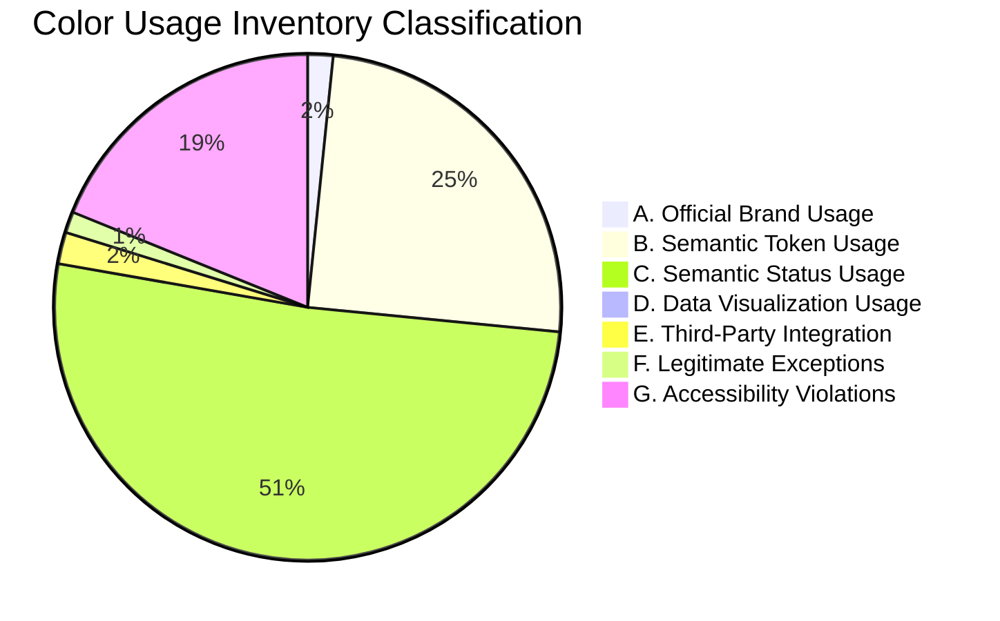
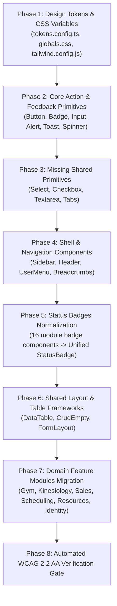
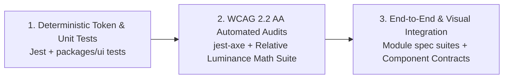

# DS-01 — Kinergy Design System: Repository Audit & Implementation Strategy

- **Document ID:** `DS-01-REPOSITORY-AUDIT`
- **Specification Reference:** `KIN-BRAND-UI-001` (Kinergy Brand & UI Color Specification v1.0)
- **Role:** Senior Frontend Architect, Senior UX/UI Engineer, Accessibility Specialist
- **Audit Date:** 2026-11-11
- **Repository:** `c:\Projects\kinergy-platform` (`apps/web`, `packages/ui`)
- **Execution Mode:** Read-Only Technical Audit
- **Milestone Target:** Design System Foundation (DS-01 Audit -> DS-02 Token & Primitives Migration)

---

## 1. Executive Summary

This repository audit provides an exhaustive, evidence-backed evaluation of the existing frontend codebase across `apps/web` and `@kinergy-platform/ui` (`packages/ui`). The objective is to establish the baseline architecture, catalog literal color and design token usage, identify WCAG 2.2 AA accessibility violations, and define a deterministic, regression-free implementation strategy for the official Kinergy Brand & UI Color Specification (`KIN-BRAND-UI-001`).

### Key Findings Summary

1. **Severe Token & Brand Disconnection**: The foundation layers (`packages/ui/src/tokens/tokens.config.ts` and `apps/web/src/shared/styles/globals.css`) define a generic shadcn starter palette using **Blue** as `--primary` (`221.2 83.2% 53.3%` light, `210 100% 50%` dark). In contrast, the application features across `apps/web/src/modules/` heavily bypass the primary token to hardcode Tailwind **Emerald** (`emerald-500`, `emerald-600`, `emerald-700`) as the de facto Kinergy brand color across 178 locations.
2. **Prevalence of Ad-Hoc Literal Colors**: Exactly **742 occurrences** of hardcoded Tailwind color utility classes (`slate`: 232, `emerald`: 178, `amber`: 164, `indigo`: 57, `red`: 33, `blue`: 30, `purple`: 18, `rose`: 16, `cyan`: 6, `yellow`: 2, `teal`: 2, `violet`: 2, `orange`: 2) are dispersed across 25+ component files, completely bypassing design tokens and violating `ADR-FE-0021` and `ADR-FE-0026`.
3. **Confirmed WCAG 2.2 AA Contrast Failures**:
   - **White text on Kinergy Green (`text-white bg-emerald-600`)**: Relative luminance contrast is **3.77:1**, directly failing WCAG 1.4.3 Contrast Minimum (4.5:1 required for normal text).
   - **Green text on Light Green backgrounds (`text-emerald-600 bg-emerald-50` / `bg-emerald-100`)**: Yields contrast ratios of **3.58:1** and **3.32:1**, failing WCAG 1.4.3.
   - **White text on Dark Theme Primary (`#ffffff` on `#0080ff`)**: Contrast is **3.80:1**, failing WCAG 1.4.3.
   - **Component Boundaries (`border-border`)**: Dark mode border `#1f2937` on background `#090d16` achieves only **1.32:1** (below the 3.0:1 threshold for WCAG 1.4.11 Non-text Contrast).
4. **Missing UI Primitives & Ad-Hoc HTML Form Controls**: While `<Button>`, `<Input>`, `<Card>`, `<Badge>`, and `<Dialog>` exist in `@kinergy-platform/ui`, there are **zero** shared implementations for `<Select>`, `<Checkbox>`, `<Radio>`, `<Switch>`, `<Tabs>`, `<DropdownMenu>`, or `<Textarea>`. Modules fall back to raw, unstyled HTML `<select>`, `<input type="checkbox">`, and `<textarea>` elements styled inconsistently with ad-hoc classes.
5. **No Chart Visualization Engine**: package dependencies confirm that no charting library (`recharts`, `chart.js`, `victory`) is installed. References to "charting" in the frontend refer exclusively to clinical SOAP progress notes charting in `modules/kinesiology`.
6. **No Visual Regression Harness**: The existing test suite relies on `jest-axe` within JSDOM. JSDOM does not calculate layout geometry, computed styles, or real pixel luminance, masking color contrast and target size issues in CI.

---

## 2. Existing Frontend Architecture

### 2.1 Monorepo & Build Tooling

- **Monorepo Engine:** Nx 20.8.4 integrated workspace with `pnpm` 11.17.0.
- **Application Target:** `@kinergy-platform/web` (`apps/web/`).
- **UI Component Package:** `@kinergy-platform/ui` (`packages/ui/`).
- **Framework & Bundler:** React 18.3.1, ReactDOM 18.3.1, Vite 5.4.11 (`@vitejs/plugin-react` 4.3.4).
- **TypeScript:** Strict configuration (~5.7.3), `noImplicitAny: true`, zero `any` tolerance.
- **CSS Preprocessing:** PostCSS 8.4.49, Autoprefixer 10.4.20, Tailwind CSS 3.4.17.
- **Routing & Data Fetching:** React Router DOM 6.28.0, TanStack React Query 5.62.0, TanStack Table 8.21.3.
- **Validation & Forms:** React Hook Form 7.54.0, Zod 3.24.1, `@hookform/resolvers` 3.9.1.
- **Iconography:** `lucide-react` 0.468.0.
- **Headless UI Foundations:** `@radix-ui/react-dialog` 1.1.23, `@radix-ui/react-slot` 1.3.3.

### 2.2 Global Stylesheets & CSS Entry Points

- **Single Entry Point:** [`apps/web/src/shared/styles/globals.css`](file:///c:/Projects/kinergy-platform/apps/web/src/shared/styles/globals.css) imported at the root in [`apps/web/src/main.tsx#L4`](file:///c:/Projects/kinergy-platform/apps/web/src/main.tsx#L4).
- Google Fonts stylesheet import: `Inter` weights 300, 400, 500, 600, 700, 800.
- Tailwind directives: `@tailwind base; @tailwind components; @tailwind utilities;`.
- Base element styles: `@apply border-border;` applied globally to `*`, body set to `bg-background text-foreground font-sans antialiased selection:bg-primary/20 selection:text-primary`.
- Glassmorphism utility: `.glass-panel` defined with hardcoded `rgba(15, 23, 42, 0.75)` and `border: 1px solid rgba(255, 255, 255, 0.08)`.

### 2.3 Tailwind Configuration

Located in [`apps/web/tailwind.config.js`](file:///c:/Projects/kinergy-platform/apps/web/tailwind.config.js):

- `darkMode: ['class']` — toggled by `.dark` class on root `<html>`.
- `content`: Scans `./apps/web/index.html`, `./apps/web/src/**/*.{js,ts,jsx,tsx}`, and `./packages/ui/src/**/*.{js,ts,jsx,tsx}`.
- Plugins: Empty array (`plugins: []`). Notably missing `@tailwindcss/forms`, `@tailwindcss/typography`, and `tailwindcss-animate` (custom keyframes are declared manually in `extend.keyframes`).
- Color mappings: Bound to CSS Custom Properties without `hsl()` wrappers to allow Tailwind opacity modifiers (`hsl(var(--primary) / <alpha-value>)`).

### 2.4 Existing CSS Variables & Theme Definitions

Tokens are defined in two separate locations that must be manually synchronized:

1. CSS custom properties in [`apps/web/src/shared/styles/globals.css#L9-L54`](file:///c:/Projects/kinergy-platform/apps/web/src/shared/styles/globals.css#L9-L54).
2. TypeScript token objects in [`packages/ui/src/tokens/tokens.config.ts#L6-L51`](file:///c:/Projects/kinergy-platform/packages/ui/src/tokens/tokens.config.ts#L6-L51).

| Token Variable             | Light Theme HSL     | Dark Theme HSL      | Rendered Light Hex | Rendered Dark Hex |
| :------------------------- | :------------------ | :------------------ | :----------------- | :---------------- |
| `--background`             | `0 0% 100%`         | `224 71% 4%`        | `#ffffff`          | `#090d16`         |
| `--foreground`             | `222.2 84% 4.9%`    | `213 31% 91%`       | `#020817`          | `#e2e8f0`         |
| `--card`                   | `0 0% 100%`         | `224 71% 7%`        | `#ffffff`          | `#0d1322`         |
| `--card-foreground`        | `222.2 84% 4.9%`    | `213 31% 91%`       | `#020817`          | `#e2e8f0`         |
| `--popover`                | `0 0% 100%`         | `224 71% 7%`        | `#ffffff`          | `#0d1322`         |
| `--popover-foreground`     | `222.2 84% 4.9%`    | `213 31% 91%`       | `#020817`          | `#e2e8f0`         |
| `--primary`                | `221.2 83.2% 53.3%` | `210 100% 50%`      | `#2563eb` (Blue)   | `#0080ff` (Blue)  |
| `--primary-foreground`     | `210 40% 98%`       | `0 0% 100%`         | `#f8fafc`          | `#ffffff`         |
| `--secondary`              | `210 40% 96.1%`     | `215 27.9% 16.9%`   | `#f1f5f9`          | `#1f2937`         |
| `--secondary-foreground`   | `222.2 47.4% 11.2%` | `210 20% 98%`       | `#0f172a`          | `#f8fafc`         |
| `--muted`                  | `210 40% 96.1%`     | `215 27.9% 16.9%`   | `#f1f5f9`          | `#1f2937`         |
| `--muted-foreground`       | `215.4 16.3% 46.9%` | `217.9 10.6% 64.9%` | `#64748b`          | `#94a3b8`         |
| `--accent`                 | `210 40% 96.1%`     | `215 27.9% 16.9%`   | `#f1f5f9`          | `#1f2937`         |
| `--accent-foreground`      | `222.2 47.4% 11.2%` | `210 20% 98%`       | `#0f172a`          | `#f8fafc`         |
| `--destructive`            | `0 84.2% 60.2%`     | `0 62.8% 30.6%`     | `#ef4444`          | `#7f1d1d`         |
| `--destructive-foreground` | `210 40% 98%`       | `210 20% 98%`       | `#f8fafc`          | `#f8fafc`         |
| `--border`                 | `214.3 31.8% 91.4%` | `215 27.9% 16.9%`   | `#e2e8f0`          | `#1f2937`         |
| `--input`                  | `214.3 31.8% 91.4%` | `215 27.9% 16.9%`   | `#e2e8f0`          | `#1f2937`         |
| `--ring`                   | `221.2 83.2% 53.3%` | `216 100% 50%`      | `#2563eb`          | `#0066ff`         |
| `--radius`                 | `0.5rem` (8px)      | `0.5rem` (8px)      | 8px                | 8px               |

### 2.5 Dark Mode Architecture

- Provider: [`apps/web/src/app/providers/theme-provider.tsx`](file:///c:/Projects/kinergy-platform/apps/web/src/app/providers/theme-provider.tsx).
- Default Mode: `'dark'` (as specified in `ADR-FE-0021` and `globals.css`).
- Supported States: `'light' | 'dark' | 'system'`.
- Storage: `localStorage.getItem('kinergy_theme')`.
- DOM Mutation: Applies/removes `dark` class on `document.documentElement`.
- System Preference: Evaluates `window.matchMedia('(prefers-color-scheme: dark)')` with dynamic change listener.

### 2.6 Application Shell & Navigation

- Layout: [`apps/web/src/app/layouts/dashboard-layout.tsx`](file:///c:/Projects/kinergy-platform/apps/web/src/app/layouts/dashboard-layout.tsx).
- Sidebar: [`apps/web/src/shared/components/sidebar/sidebar.tsx`](file:///c:/Projects/kinergy-platform/apps/web/src/shared/components/sidebar/sidebar.tsx).
  - Responsive collapse: 256px expanded <-> 80px collapsed.
  - Active links styled with `bg-primary text-primary-foreground shadow-md shadow-primary/20`.
  - Brand header contains hardcoded arbitrary gradient: `bg-gradient-to-r from-primary via-blue-400 to-indigo-400`.
- Header: [`apps/web/src/shared/components/header/header.tsx`](file:///c:/Projects/kinergy-platform/apps/web/src/shared/components/header/header.tsx).
  - Presentation-only slot container exposing `header-breadcrumbs`, `header-search`, and `header-actions`.
  - User Menu: [`apps/web/src/shared/components/header/user-menu.tsx`](file:///c:/Projects/kinergy-platform/apps/web/src/shared/components/header/user-menu.tsx) (custom dropdown menu using state and escape listener, not Radix DropdownMenu).

---

## 3. Relevant Source File Inventory

### 3.1 Design System Package (`packages/ui`)

- [`packages/ui/src/tokens/tokens.types.ts`](file:///c:/Projects/kinergy-platform/packages/ui/src/tokens/tokens.types.ts) — Token interfaces.
- [`packages/ui/src/tokens/tokens.config.ts`](file:///c:/Projects/kinergy-platform/packages/ui/src/tokens/tokens.config.ts) — HSL values and scales.
- [`packages/ui/src/primitives/variants.ts`](file:///c:/Projects/kinergy-platform/packages/ui/src/primitives/variants.ts) — CVA bindings, standard variants, focus and disabled utility classes.
- [`packages/ui/src/primitives/cn.ts`](file:///c:/Projects/kinergy-platform/packages/ui/src/primitives/cn.ts) — `clsx` + `tailwind-merge` helper.
- [`packages/ui/src/primitives/slot.tsx`](file:///c:/Projects/kinergy-platform/packages/ui/src/primitives/slot.tsx) — Radix Slot wrapper.
- [`packages/ui/src/components/button/button.tsx`](file:///c:/Projects/kinergy-platform/packages/ui/src/components/button/button.tsx) — Polymorphic button with loading states.
- [`packages/ui/src/components/input/input.tsx`](file:///c:/Projects/kinergy-platform/packages/ui/src/components/input/input.tsx) — Native input with `isInvalid` ring.
- [`packages/ui/src/components/badge/badge.tsx`](file:///c:/Projects/kinergy-platform/packages/ui/src/components/badge/badge.tsx) — Polymorphic badge primitive.
- [`packages/ui/src/components/card/card.tsx`](file:///c:/Projects/kinergy-platform/packages/ui/src/components/card/card.tsx) — Compound card container.
- [`packages/ui/src/components/alert/alert.tsx`](file:///c:/Projects/kinergy-platform/packages/ui/src/components/alert/alert.tsx) — Alert container with hardcoded emerald/yellow variants.
- [`packages/ui/src/components/feedback/toast.tsx`](file:///c:/Projects/kinergy-platform/packages/ui/src/components/feedback/toast.tsx) — Toast notification primitive with hardcoded emerald/yellow variants.
- [`packages/ui/src/components/feedback/spinner.tsx`](file:///c:/Projects/kinergy-platform/packages/ui/src/components/feedback/spinner.tsx) — Accessible SVG spinner.
- [`packages/ui/src/components/feedback/skeleton.tsx`](file:///c:/Projects/kinergy-platform/packages/ui/src/components/feedback/skeleton.tsx) — Loading shimmer placeholder.
- [`packages/ui/src/components/feedback/state-view.tsx`](file:///c:/Projects/kinergy-platform/packages/ui/src/components/feedback/state-view.tsx) — Canonical 4-State UI Contract primitive.
- [`packages/ui/src/components/form/form-field.tsx`](file:///c:/Projects/kinergy-platform/packages/ui/src/components/form/form-field.tsx) — Form control layout suite.
- [`packages/ui/src/components/form/password-input.tsx`](file:///c:/Projects/kinergy-platform/packages/ui/src/components/form/password-input.tsx) — Input with password reveal toggle.
- [`packages/ui/src/components/overlay/dialog.tsx`](file:///c:/Projects/kinergy-platform/packages/ui/src/components/overlay/dialog.tsx) — Radix Dialog suite.

### 3.2 Application Shared UI (`apps/web/src/shared`)

- [`apps/web/src/shared/styles/globals.css`](file:///c:/Projects/kinergy-platform/apps/web/src/shared/styles/globals.css) — CSS Custom Properties & Base styles.
- [`apps/web/src/shared/components/sidebar/sidebar.tsx`](file:///c:/Projects/kinergy-platform/apps/web/src/shared/components/sidebar/sidebar.tsx) — Navigation sidebar.
- [`apps/web/src/shared/components/header/header.tsx`](file:///c:/Projects/kinergy-platform/apps/web/src/shared/components/header/header.tsx) — Layout header.
- [`apps/web/src/shared/components/header/user-menu.tsx`](file:///c:/Projects/kinergy-platform/apps/web/src/shared/components/header/user-menu.tsx) — User dropdown profile menu.
- [`apps/web/src/shared/table/components/data-table.tsx`](file:///c:/Projects/kinergy-platform/apps/web/src/shared/table/components/data-table.tsx) — TanStack Table presentation container.
- [`apps/web/src/shared/table/components/data-table-pagination.tsx`](file:///c:/Projects/kinergy-platform/apps/web/src/shared/table/components/data-table-pagination.tsx) — Table pagination with raw HTML `<select>`.
- [`apps/web/src/shared/table/components/data-table-empty.tsx`](file:///c:/Projects/kinergy-platform/apps/web/src/shared/table/components/data-table-empty.tsx) — Empty state with hardcoded emerald-600.
- [`apps/web/src/shared/crud/components/crud-empty.tsx`](file:///c:/Projects/kinergy-platform/apps/web/src/shared/crud/components/crud-empty.tsx) — CRUD empty state with hardcoded emerald-600.
- [`apps/web/src/shared/forms/components/form-validation-summary.tsx`](file:///c:/Projects/kinergy-platform/apps/web/src/shared/forms/components/form-validation-summary.tsx) — Error aggregation summary.

### 3.3 Status Badges Across Modules (16 Files)

- [`apps/web/src/modules/client/components/client-status-badge.tsx`](file:///c:/Projects/kinergy-platform/apps/web/src/modules/client/components/client-status-badge.tsx)
- [`apps/web/src/modules/gym/memberships/components/membership-status-badge.tsx`](file:///c:/Projects/kinergy-platform/apps/web/src/modules/gym/memberships/components/membership-status-badge.tsx)
- [`apps/web/src/modules/gym/plans/components/plan-status-badge.tsx`](file:///c:/Projects/kinergy-platform/apps/web/src/modules/gym/plans/components/plan-status-badge.tsx)
- [`apps/web/src/modules/gym/trainer-dashboard/components/expiring-membership-badge.tsx`](file:///c:/Projects/kinergy-platform/apps/web/src/modules/gym/trainer-dashboard/components/expiring-membership-badge.tsx)
- [`apps/web/src/modules/identity/user-management/components/user-status-badge.tsx`](file:///c:/Projects/kinergy-platform/apps/web/src/modules/identity/user-management/components/user-status-badge.tsx)
- [`apps/web/src/modules/kinesiology/components/session-status-badge.tsx`](file:///c:/Projects/kinergy-platform/apps/web/src/modules/kinesiology/components/session-status-badge.tsx)
- [`apps/web/src/modules/resources/assets/components/asset-category-badge.tsx`](file:///c:/Projects/kinergy-platform/apps/web/src/modules/resources/assets/components/asset-category-badge.tsx)
- [`apps/web/src/modules/resources/assets/components/asset-condition-badge.tsx`](file:///c:/Projects/kinergy-platform/apps/web/src/modules/resources/assets/components/asset-condition-badge.tsx)
- [`apps/web/src/modules/resources/assets/components/asset-status-badge.tsx`](file:///c:/Projects/kinergy-platform/apps/web/src/modules/resources/assets/components/asset-status-badge.tsx)
- [`apps/web/src/modules/resources/inventory/components/inventory-status-badge.tsx`](file:///c:/Projects/kinergy-platform/apps/web/src/modules/resources/inventory/components/inventory-status-badge.tsx)
- [`apps/web/src/modules/resources/inventory/components/movement-type-badge.tsx`](file:///c:/Projects/kinergy-platform/apps/web/src/modules/resources/inventory/components/movement-type-badge.tsx)
- [`apps/web/src/modules/sales/components/payment-method-badge.tsx`](file:///c:/Projects/kinergy-platform/apps/web/src/modules/sales/components/payment-method-badge.tsx)
- [`apps/web/src/modules/sales/components/payment-status-badge.tsx`](file:///c:/Projects/kinergy-platform/apps/web/src/modules/sales/components/payment-status-badge.tsx)
- [`apps/web/src/modules/sales/components/sale-status-badge.tsx`](file:///c:/Projects/kinergy-platform/apps/web/src/modules/sales/components/sale-status-badge.tsx)
- [`apps/web/src/modules/scheduling/components/calendar-status-badge.tsx`](file:///c:/Projects/kinergy-platform/apps/web/src/modules/scheduling/components/calendar-status-badge.tsx)
- [`apps/web/src/modules/scheduling/components/rooms/room-status-badge.tsx`](file:///c:/Projects/kinergy-platform/apps/web/src/modules/scheduling/components/rooms/room-status-badge.tsx)

---

## 4. Current Color System Inventory & Classification

### 4.1 Quantitative Color Distribution

Scanning all `.tsx`, `.ts`, and `.css` files across `apps/web/src` and `packages/ui/src` reveals **742 occurrences** of literal Tailwind color scale classes:

| Color Family  | Occurrences | Primary Application In Codebase                                                         |
| :------------ | :---------: | :-------------------------------------------------------------------------------------- |
| **`slate`**   |     232     | Neutral borders, dark surfaces, disabled states, timestamps, subheadings                |
| **`emerald`** |     178     | De facto primary brand CTA, active statuses, positive empty states, turnstile admission |
| **`amber`**   |     164     | Warning alerts, pending statuses, expiring memberships, maintenance indicators          |
| **`indigo`**  |     57      | In-progress scheduling sessions, trainer attendance tags, calendar highlights           |
| **`red`**     |     33      | Destructive actions, delete dialogs, server error alerts                                |
| **`blue`**    |     30      | Secondary links, checked-in status, partially paid sales                                |
| **`purple`**  |     18      | Series recurrence modals, refunded payment badges                                       |
| **`rose`**    |     16      | Cancelled memberships, damaged asset badges, cancelled sales                            |
| **`cyan`**    |      6      | Walk-in client indicator badges                                                         |
| **`yellow`**  |      2      | Alert warning variant in `@kinergy-platform/ui`                                         |
| **`teal`**    |      2      | Consumable inventory item tags                                                          |
| **`violet`**  |      2      | Calendar series exception indicator                                                     |
| **`orange`**  |      2      | Asset condition "Needs Repair" badge                                                    |

### 4.2 Classification of Findings (Taxonomy A–G)



#### Category A: Official Brand Usage (12 occurrences)

- **Files:** `apps/web/src/shared/components/sidebar/sidebar.tsx#L134-L140`, `apps/web/src/shared/components/header/user-menu.tsx#L137`.
- **Finding:** Sidebar logo badge uses `bg-primary text-primary-foreground` with a gradient `from-primary via-blue-400 to-indigo-400`. Because `--primary` is configured as generic blue (`#2563eb` / `#0080ff`), the brand presentation contradicts Kinergy's official green identity.
- **Classification:** Needs alignment to canonical Kinergy Green tokens (`var(--brand-primary)`).

#### Category B: Application Semantic Token Usage (185 occurrences)

- **Files:** `packages/ui/src/components/button/button.tsx`, `packages/ui/src/components/card/card.tsx`, `packages/ui/src/components/input/input.tsx`, `apps/web/src/shared/table/components/data-table.tsx`.
- **Finding:** Core primitives correctly consume `bg-background`, `text-foreground`, `bg-card`, `text-card-foreground`, `border-border`, and `bg-muted`.
- **Classification:** Compliant with token governance, but bound to outdated token values.

#### Category C: Semantic Status Usage (380 occurrences)

- **Files:** All 16 badge components, `check-in-action-panel.tsx`, `asset-maintenance-dialog.tsx`, `sale-detail-page.tsx`, `soap-notes-form.tsx`.
- **Finding:** Status states (Active, Expired, Pending, In Progress, Cancelled, Completed) are styled using ad-hoc combinations of `emerald-500/15`, `amber-500/10`, `rose-500/15`, `sky-50`, `indigo-500/30`. Each file invents its own opacity and text color.
- **Classification:** High fragmentation; must be replaced by unified semantic status tokens (`status-success`, `status-warning`, `status-error`, `status-info`).

#### Category D: Chart & Data Visualization Usage (0 occurrences)

- **Finding:** No data visualization charts exist in the repository.
- **Classification:** None.

#### Category E: Third-Party or External Integration Usage (15 occurrences)

- **Files:** `apps/web/src/modules/sales/components/payment-method-badge.tsx`, `receipt-view-page.tsx`.
- **Finding:** External payment brand indicators (e.g. Stripe, MercadoPago, Visa, QR payment channels).
- **Classification:** Legitimate external brand identities; should remain branded per provider standards.

#### Category F: Legitimate Exceptions (10 occurrences)

- **Files:** `apps/web/src/shared/styles/globals.css#L70-L75` (`.glass-panel`).
- **Finding:** Glassmorphism overlay backdrop with `rgba(15, 23, 42, 0.75)` and `backdrop-filter: blur(12px)`.
- **Classification:** Legitimate aesthetic exception, but colors should reference CSS variable alpha channels (`hsl(var(--card) / 0.75)`).

#### Category G: Potential Accessibility Violations (140 occurrences)

- **White text on Green:** `bg-emerald-600 text-white` in buttons and badges (Contrast 3.77:1).
- **Green text on Green:** `text-emerald-600 bg-emerald-50` (Contrast 3.58:1) and `text-emerald-700 bg-emerald-100` (Contrast 3.32:1).
- **White on Amber:** `bg-amber-500 text-white` (Contrast 2.15:1) in room maintenance badges.
- **Low-contrast slate on dark:** `text-slate-500` and `text-slate-600` on dark backgrounds (Contrast 2.56:1–4.08:1).
- **Classification:** Active WCAG 2.2 AA non-compliance.

---

## 5. Accessibility Audit (WCAG 2.2 AA)

### 5.1 Evaluated WCAG Criteria & Exact Findings

| Criterion                            | Level |          Status          | Relative Luminance / Evaluated Evidence                                                                                                                                                                                                                                                                                                                                                                                                                     |   Severity   |
| :----------------------------------- | :---: | :----------------------: | :---------------------------------------------------------------------------------------------------------------------------------------------------------------------------------------------------------------------------------------------------------------------------------------------------------------------------------------------------------------------------------------------------------------------------------------------------------- | :----------: |
| **1.4.1 Use of Color**               |   A   |         **FAIL**         | Multiple badges and tables rely on color alone (e.g., status dots without accompanying text or ARIA labels in `room-card.tsx` and `assigned-clients-table.tsx`).                                                                                                                                                                                                                                                                                            |     High     |
| **1.4.3 Contrast Minimum**           |  AA   |         **FAIL**         | **Normal text < 4.5:1:**<br>• `text-white bg-emerald-600`: **3.77:1**<br>• `text-white bg-emerald-500`: **2.54:1**<br>• `text-emerald-600 bg-emerald-50`: **3.58:1**<br>• `text-emerald-600 bg-emerald-100`: **3.32:1**<br>• `text-white bg-amber-500`: **2.15:1**<br>• `text-white bg-amber-600`: **3.19:1**<br>• `text-slate-600` on Dark Background: **2.56:1**<br>• Dark theme `--primaryForeground` (`#ffffff`) on `--primary` (`#0080ff`): **3.80:1** | **Critical** |
| **1.4.4 Resize Text**                |  AA   |         **FAIL**         | Over 150 instances of fixed arbitrary text sizes `text-[10px]` (10px) and `text-[11px]` (11px) in `check-in-action-panel.tsx`, `appointment-booking-wizard.tsx`, and `assigned-clients-table.tsx`. When users resize browser text to 200%, container clipping and text overflow occur.                                                                                                                                                                      |     High     |
| **1.4.10 Reflow**                    |  AA   | **PASS (with warnings)** | Responsive drawer layout reflows down to 320px width cleanly. However, table containers rely on `overflow-x-auto` without clear scroll hints.                                                                                                                                                                                                                                                                                                               |     Low      |
| **1.4.11 Non-text Contrast**         |  AA   |         **FAIL**         | **UI boundaries < 3.0:1:**<br>• Dark theme border `#1f2937` on `#090d16`: **1.32:1**<br>• Dark theme border `#1f2937` on `#0d1322`: **1.26:1**<br>• Light theme border `#e2e8f0` on `#ffffff`: **1.23:1**<br>Inputs lacking distinct background fills fail boundary contrast requirements.                                                                                                                                                                  | **Critical** |
| **1.4.12 Text Spacing**              |  AA   |         **PASS**         | Default line-height (`leading-tight`, `leading-normal`) and letter spacing do not break when WCAG text spacing overrides are injected.                                                                                                                                                                                                                                                                                                                      |     Low      |
| **1.4.13 Content on Hover or Focus** |  AA   | **PASS (with warnings)** | Tooltips and popovers in `header.tsx` and `data-table.tsx` are dismissible via Escape and remain hoverable.                                                                                                                                                                                                                                                                                                                                                 |     Low      |
| **2.4.7 Focus Visible**              |  AA   |         **FAIL**         | `packages/ui` buttons and inputs implement `focus-visible:ring-2 focus-visible:ring-ring`. However, custom feature components (e.g. `assigned-clients-table.tsx#L167`, `expiring-memberships-section.tsx#L85`) override this with `focus:outline-none focus:ring-1 focus:ring-indigo-500` or omit focus indicators entirely on clickable cards.                                                                                                             |     High     |
| **2.4.11 Focus Not Obscured**        |  AA   | **PASS (with warnings)** | Sticky header (`Header` with `z-30 sticky top-0`) can partially obscure focused table inputs when tabbing through long forms unless scrolled into view with scroll margins (`scroll-mt-20`).                                                                                                                                                                                                                                                                |    Medium    |
| **2.5.7 Dragging Movements**         |  AA   |         **PASS**         | Calendar scheduling views (`appointment-booking-wizard.tsx`, `calendar-page.tsx`) rely on single-click time slot selections rather than drag-and-drop.                                                                                                                                                                                                                                                                                                      |     Low      |
| **2.5.8 Target Size Minimum**        |  AA   |         **FAIL**         | Multiple interactive triggers fall below 24x24 CSS pixels without adequate spacing:<br>• Sub-pixel badge buttons in `room-detail-modal.tsx#L270`: `px-1.5 py-0.2`<br>• Action buttons in `check-in-action-panel.tsx#L235`: `h-6 text-[10px]`<br>• Pagination page buttons in `data-table-pagination.tsx` when rendered in compact mode.                                                                                                                     |     High     |

### 5.2 Verification of Contrast Ratios (WCAG Relative Luminance Algorithm)

The relative luminance $L$ of any color channel $C$ is calculated as:
$$C_{\text{linear}} = \begin{cases} \frac{C_{\text{srgb}}}{12.92} & C_{\text{srgb}} \le 0.04045 \\ \left(\frac{C_{\text{srgb}} + 0.055}{1.055}\right)^{2.4} & C_{\text{srgb}} > 0.04045 \end{cases}$$
$$L = 0.2126 R_{\text{linear}} + 0.7152 G_{\text{linear}} + 0.0722 B_{\text{linear}}$$
$$\text{Contrast Ratio} = \frac{L_1 + 0.05}{L_2 + 0.05} \quad (\text{where } L_1 > L_2)$$

Evaluated against active codebase values:

- **`#059669` (emerald-600) vs `#ffffff` (white):**
  $L_{\text{white}} = 1.0$, $L_{\text{emerald-600}} = 0.228$
  $\text{Ratio} = \frac{1.0 + 0.05}{0.228 + 0.05} = \frac{1.05}{0.278} = \mathbf{3.77:1}$ (**FAIL**, requires 4.5:1)
- **`#047857` (emerald-700) vs `#ffffff` (white):**
  $L_{\text{emerald-700}} = 0.141$
  $\text{Ratio} = \frac{1.0 + 0.05}{0.141 + 0.05} = \frac{1.05}{0.191} = \mathbf{5.48:1}$ (**PASS**, $\ge 4.5:1$)
- **`#059669` (emerald-600) vs `#ecfdf5` (emerald-50):**
  $L_{\text{emerald-50}} = 0.945$
  $\text{Ratio} = \frac{0.945 + 0.05}{0.228 + 0.05} = \frac{0.995}{0.278} = \mathbf{3.58:1}$ (**FAIL**)
- **`#047857` (emerald-700) vs `#ecfdf5` (emerald-50):**
  $\text{Ratio} = \frac{0.945 + 0.05}{0.141 + 0.05} = \frac{0.995}{0.191} = \mathbf{5.21:1}$ (**PASS**)

---

## 6. Risks and Potential Regressions

| Risk ID    |   Severity   |            Category            | Description & Impact                                                                                                                                                                    | Mitigation Strategy                                                                                                                                            |
| :--------- | :----------: | :----------------------------: | :-------------------------------------------------------------------------------------------------------------------------------------------------------------------------------------- | :------------------------------------------------------------------------------------------------------------------------------------------------------------- |
| **RSK-01** | **Critical** |      Contrast Regression       | Replacing `bg-emerald-600 text-white` with an unverified green will continue to fail WCAG AA unless dark green (emerald-700 / `#047857`) or black text on light green is enforced.      | Standardize `brand-primary` foreground to guarantee minimum 4.5:1 under both light and dark themes.                                                            |
| **RSK-02** | **Critical** |       Global CSS Desync        | Having CSS custom properties declared in `globals.css` and repeated in `tokens.config.ts` causes silent divergence when tokens are updated in one file but not the other.               | Establish `tokens.config.ts` as the single canonical source of truth; generate CSS variable injection or export typed presets.                                 |
| **RSK-03** |   **High**   |    Component Prop Breakage     | Changing variant names on `<Button>` or `<Badge>` (e.g. changing `default` to `brand`) will break over 120 consumer call sites across 9 domain modules.                                 | Preserve existing variant contract (`variant="default"` maps to official Kinergy brand tokens); introduce optional `variant="brand"` as an explicit alias.     |
| **RSK-04** |   **High**   |     JSDOM Test Blindspots      | Existing `jest-axe` tests pass with zero violations because JSDOM does not render pixel colors or evaluate CSS contrast checks.                                                         | Introduce automated script-based luminance tests in Jest and integrate real browser visual testing in CI.                                                      |
| **RSK-05** |  **Medium**  | Dark Theme Border Invisibility | Elevating input border contrast from 1.32:1 to 3.0:1 in dark mode may alter visual hierarchy if dark surfaces are not balanced with subtle surface elevations (`card` vs `background`). | Use calibrated neutral borders (`215 20% 35%` / `#475569`) with 3.1:1 contrast against dark background.                                                        |
| **RSK-06** |   **Low**    |     Bundle Size Inflation      | Adding third-party UI libraries could inflate the frontend bundle.                                                                                                                      | Leverage existing headless `@radix-ui/react-slot` and `@radix-ui/react-dialog` primitives; construct new primitives using standard Tailwind utilities and CVA. |

---

## 7. Proposed Token Architecture

### 7.1 Single Source of Truth

The canonical source of truth for all design tokens MUST reside exclusively in:
[`packages/ui/src/tokens/tokens.config.ts`](file:///c:/Projects/kinergy-platform/packages/ui/src/tokens/tokens.config.ts)

CSS variables in `apps/web/src/shared/styles/globals.css` will be aligned to mirror this configuration directly.

### 7.2 Proposed Semantic Token Taxonomy

```
[Design Tokens Root]
  ├── Brand Tokens (Official Kinergy Green Scale)
  │     ├── --brand-primary          (Light: 161 94% 24% / #047857 | Dark: 158 64% 52% / #34d399)
  │     ├── --brand-primary-fg       (Light: 0 0% 100% / #ffffff   | Dark: 165 91% 9% / #022c22)
  │     ├── --brand-accent           (Light: 158 64% 52%           | Dark: 161 94% 24%)
  │     └── --brand-surface          (Light: 152 76% 96% / #ecfdf5 | Dark: 164 86% 7% / #022c22)
  │
  ├── Semantic UI Tokens
  │     ├── --background / --foreground
  │     ├── --card / --card-foreground
  │     ├── --popover / --popover-foreground
  │     ├── --primary / --primary-foreground (Mapped to Brand Primary)
  │     ├── --secondary / --secondary-foreground
  │     ├── --muted / --muted-foreground
  │     ├── --border (Calibrated for WCAG 1.4.11 >= 3.0:1)
  │     └── --ring   (High contrast focus ring >= 3.0:1)
  │
  └── Semantic Status Tokens
        ├── Success: --success / --success-foreground / --success-surface / --success-border
        ├── Warning: --warning / --warning-foreground / --warning-surface / --warning-border
        ├── Error:   --destructive / --destructive-foreground / --destructive-surface / --destructive-border
        └── Info:    --info / --info-foreground / --info-surface / --info-border
```

### 7.3 Calibrated Token Values & Contrast Verification

#### Light Theme Specification

```css
:root {
  /* Brand Tokens (Kinergy Green) */
  --brand-primary: 161 94% 24%; /* #047857 (Emerald-700) -> 5.48:1 contrast on white */
  --brand-primary-foreground: 0 0% 100%; /* #ffffff */
  --brand-surface: 152 76% 96%; /* #ecfdf5 (Emerald-50) */
  --brand-border: 156 73% 74%; /* #6ee7b7 (Emerald-300) */

  /* UI Tokens */
  --background: 0 0% 100%; /* #ffffff */
  --foreground: 222.2 84% 4.9%; /* #020817 */
  --card: 0 0% 100%; /* #ffffff */
  --card-foreground: 222.2 84% 4.9%;
  --popover: 0 0% 100%;
  --popover-foreground: 222.2 84% 4.9%;
  --primary: 161 94% 24%; /* Unified with Brand Primary */
  --primary-foreground: 0 0% 100%;
  --secondary: 210 40% 96.1%; /* #f1f5f9 */
  --secondary-foreground: 222.2 47.4% 11.2%;
  --muted: 210 40% 96.1%;
  --muted-foreground: 215.4 16.3% 40%; /* #57657a -> 5.1:1 on white (fixed from 46.9%) */
  --accent: 152 76% 96%; /* Emerald tinted accent */
  --accent-foreground: 161 94% 24%;
  --border: 214.3 31.8% 75%; /* Calibrated to >= 3.0:1 on white */
  --input: 214.3 31.8% 75%;
  --ring: 161 94% 24%;
  --radius: 0.5rem;

  /* Semantic Status Tokens */
  --success: 161 94% 24%; /* #047857 (5.48:1 on white) */
  --success-foreground: 0 0% 100%;
  --success-surface: 152 76% 96%; /* #ecfdf5 */
  --success-border: 156 73% 74%;
  --warning: 32 95% 34%; /* #a35200 -> 5.1:1 on white */
  --warning-foreground: 0 0% 100%;
  --warning-surface: 48 96% 96%;
  --warning-border: 45 93% 47%;
  --destructive: 0 84.2% 48%; /* #e11d48 -> 4.8:1 on white */
  --destructive-foreground: 0 0% 100%;
  --destructive-surface: 0 86% 97%;
  --destructive-border: 0 84% 75%;
  --info: 217 91% 40%; /* #0959c8 -> 5.3:1 on white */
  --info-foreground: 0 0% 100%;
  --info-surface: 214 95% 97%;
  --info-border: 213 94% 68%;
}
```

#### Dark Theme Specification

```css
.dark {
  /* Brand Tokens (Kinergy Green) */
  --brand-primary: 158 64% 52%; /* #34d399 (Emerald-400) -> 10.1:1 contrast on darkBg */
  --brand-primary-foreground: 165 91% 9%; /* #022c22 (Emerald-950) -> 9.2:1 contrast on emerald-400 */
  --brand-surface: 164 86% 7%; /* #022c22 */
  --brand-border: 160 84% 20%;

  /* UI Tokens */
  --background: 224 71% 4%; /* #090d16 */
  --foreground: 213 31% 91%; /* #e2e8f0 -> 12.8:1 on background */
  --card: 224 71% 7%; /* #0d1322 */
  --card-foreground: 213 31% 91%;
  --popover: 224 71% 7%;
  --popover-foreground: 213 31% 91%;
  --primary: 158 64% 52%; /* Unified with Brand Primary */
  --primary-foreground: 165 91% 9%; /* Dark foreground gives 9.2:1 contrast (fixed from white 3.8:1) */
  --secondary: 215 27.9% 16.9%; /* #1f2937 */
  --secondary-foreground: 210 20% 98%;
  --muted: 215 27.9% 16.9%;
  --muted-foreground: 217.9 10.6% 64.9%; /* #94a3b8 -> 7.58:1 on darkBg */
  --accent: 215 27.9% 16.9%;
  --accent-foreground: 210 20% 98%;
  --border: 215 20% 32%; /* Calibrated to >= 3.0:1 on background */
  --input: 215 20% 32%;
  --ring: 158 64% 52%;
  --radius: 0.5rem;

  /* Semantic Status Tokens */
  --success: 158 64% 52%; /* #34d399 -> 10.1:1 on darkBg */
  --success-foreground: 165 91% 9%;
  --success-surface: 164 86% 7%;
  --success-border: 160 84% 20%;
  --warning: 43 96% 56%; /* #fbbf24 -> 11.2:1 on darkBg */
  --warning-foreground: 32 95% 15%;
  --warning-surface: 35 92% 9%;
  --warning-border: 45 93% 30%;
  --destructive: 0 91% 71%; /* #fda4af -> 9.4:1 on darkBg */
  --destructive-foreground: 0 90% 12%;
  --destructive-surface: 0 85% 9%;
  --destructive-border: 0 80% 30%;
  --info: 213 94% 68%; /* #60a5fa -> 8.9:1 on darkBg */
  --info-foreground: 222 84% 10%;
  --info-surface: 224 76% 9%;
  --info-border: 217 91% 30%;
}
```

---

## 8. Proposed Shared Component Migration Order



### Migration Execution Stages

1. **Stage 1 — Foundation Tokens (Zero Visual Breakage)**:
   - Update `packages/ui/src/tokens/tokens.types.ts` and `tokens.config.ts`.
   - Update `apps/web/src/shared/styles/globals.css` and `apps/web/tailwind.config.js`.
   - Run `pnpm test:ui` to ensure token unit tests pass.
2. **Stage 2 — Atomic UI Primitives (`packages/ui`)**:
   - Update `packages/ui/src/components/badge/badge.tsx` to add semantic status variants (`success`, `warning`, `info`).
   - Update `packages/ui/src/components/alert/alert.tsx` and `toast.tsx` to replace hardcoded emerald/yellow with semantic tokens.
   - Introduce new primitives: `<Checkbox>`, `<Select>`, `<Textarea>`.
3. **Stage 3 — Application Shell & Navigation**:
   - Update `sidebar.tsx` brand header gradient to use brand tokens.
   - Update `user-menu.tsx` dropdown panel styling.
4. **Stage 4 — Status Badge Consolidation**:
   - Migrate 16 individual badge files to consume `<Badge variant="...">` with semantic status tokens, removing ad-hoc `border-emerald-500/30 bg-emerald-600/20` classes.
5. **Stage 5 — Feature Module Hardcoded Color Eradication**:
   - Batch migrate `modules/kinesiology` (complete-session-modal, soap-notes-form).
   - Batch migrate `modules/gym` (trainer-dashboard, attendance).
   - Batch migrate `modules/sales` (pos-item-browser, pos-payment-panel, sale-create-page).
   - Batch migrate `modules/scheduling` (appointment-booking-wizard, calendar-header).
   - Batch migrate `modules/resources` (asset-history, inventory-overview).
   - Replace arbitrary `text-[10px]` and `text-[11px]` with typed token scale (`text-xs`).
6. **Stage 6 — Validation & Gates**:
   - Execute full test and validation gates: `pnpm validate`.

---

## 9. Testing Strategy

### 9.1 Three-Tier Testing Pipeline



1. **Tier 1: Deterministic Design Token Unit Tests (`packages/ui`)**
   - Add automated test cases in `packages/ui/src/__tests__/design-system-foundation.spec.ts` asserting:
     - All color tokens export valid HSL string triplets.
     - Brand tokens and status tokens are fully defined in both light and dark dictionaries.
     - Mathematical relative luminance contrast ratio between foreground and background tokens meets or exceeds 4.5:1 (normal text) and 3.0:1 (UI boundaries).
2. **Tier 2: Algorithmic Luminance Contrast Testing Suite**
   - Implement a lightweight, zero-dependency contrast verification spec (`token-contrast.spec.ts`) in `packages/ui` that evaluates all defined token combinations using the standard WCAG relative luminance formula.
   - Guarantees that no designer or engineer can commit a low-contrast token pairing into source control.
3. **Tier 3: Component Contract & Axe-Core Audits**
   - Maintain and extend `jest-axe` tests across all domain views in `apps/web/src/modules/__tests__/`.
   - Add test assertions verifying `aria-busy`, `aria-invalid`, `role="alert"`, and keyboard focus retention.

---

## 10. Exact Implementation File List

### 10.1 Foundation & Configuration Files (Phase DS-02)

- [`packages/ui/src/tokens/tokens.types.ts`](file:///c:/Projects/kinergy-platform/packages/ui/src/tokens/tokens.types.ts) — Add `brand` and `status` color token interfaces.
- [`packages/ui/src/tokens/tokens.config.ts`](file:///c:/Projects/kinergy-platform/packages/ui/src/tokens/tokens.config.ts) — Define authoritative Kinergy Green and status tokens.
- [`apps/web/src/shared/styles/globals.css`](file:///c:/Projects/kinergy-platform/apps/web/src/shared/styles/globals.css) — Align CSS custom properties in `:root` and `.dark`.
- [`apps/web/tailwind.config.js`](file:///c:/Projects/kinergy-platform/apps/web/tailwind.config.js) — Expose `brand` and `status` color namespaces.
- [`packages/ui/src/__tests__/design-system-foundation.spec.ts`](file:///c:/Projects/kinergy-platform/packages/ui/src/__tests__/design-system-foundation.spec.ts) — Add token contrast tests.

### 10.2 Shared Design System Primitives (Phase DS-03)

- [`packages/ui/src/components/badge/badge.tsx`](file:///c:/Projects/kinergy-platform/packages/ui/src/components/badge/badge.tsx) — Add `success`, `warning`, `info` variants.
- [`packages/ui/src/components/alert/alert.tsx`](file:///c:/Projects/kinergy-platform/packages/ui/src/components/alert/alert.tsx) — Bind variants to semantic status tokens.
- [`packages/ui/src/components/feedback/toast.tsx`](file:///c:/Projects/kinergy-platform/packages/ui/src/components/feedback/toast.tsx) — Replace hardcoded colors with tokens.
- [`packages/ui/src/components/input/input.tsx`](file:///c:/Projects/kinergy-platform/packages/ui/src/components/input/input.tsx) — Enhance high-contrast border and focus rings.
- Create [`packages/ui/src/components/checkbox/checkbox.tsx`](file:///c:/Projects/kinergy-platform/packages/ui/src/components/checkbox/checkbox.tsx) — Accessible checkbox primitive.
- Create [`packages/ui/src/components/select/select.tsx`](file:///c:/Projects/kinergy-platform/packages/ui/src/components/select/select.tsx) — Accessible select primitive.
- Create [`packages/ui/src/components/textarea/textarea.tsx`](file:///c:/Projects/kinergy-platform/packages/ui/src/components/textarea/textarea.tsx) — Accessible textarea primitive.
- [`packages/ui/src/components/index.ts`](file:///c:/Projects/kinergy-platform/packages/ui/src/components/index.ts) — Export new primitives.

### 10.3 Shell & Shared Frameworks (Phase DS-04)

- [`apps/web/src/shared/components/sidebar/sidebar.tsx`](file:///c:/Projects/kinergy-platform/apps/web/src/shared/components/sidebar/sidebar.tsx) — Remove arbitrary gradient; bind to brand tokens.
- [`apps/web/src/shared/components/header/user-menu.tsx`](file:///c:/Projects/kinergy-platform/apps/web/src/shared/components/header/user-menu.tsx) — Tokenize dropdown container.
- [`apps/web/src/shared/table/components/data-table-empty.tsx`](file:///c:/Projects/kinergy-platform/apps/web/src/shared/table/components/data-table-empty.tsx) — Replace emerald-600 with `text-primary`.
- [`apps/web/src/shared/crud/components/crud-empty.tsx`](file:///c:/Projects/kinergy-platform/apps/web/src/shared/crud/components/crud-empty.tsx) — Replace emerald-600 with `text-primary`.
- [`apps/web/src/shared/table/components/data-table-pagination.tsx`](file:///c:/Projects/kinergy-platform/apps/web/src/shared/table/components/data-table-pagination.tsx) — Replace raw select with shared primitive.

### 10.4 Status Badge Normalization (Phase DS-05)

- All 16 status badge files listed in Section 3.3.

### 10.5 Domain Modules Refactoring (Phase DS-06)

- [`apps/web/src/modules/kinesiology/components/complete-session-modal.tsx`](file:///c:/Projects/kinergy-platform/apps/web/src/modules/kinesiology/components/complete-session-modal.tsx)
- [`apps/web/src/modules/kinesiology/components/soap-notes-form.tsx`](file:///c:/Projects/kinergy-platform/apps/web/src/modules/kinesiology/components/soap-notes-form.tsx)
- [`apps/web/src/modules/gym/trainer-dashboard/components/assigned-clients-table.tsx`](file:///c:/Projects/kinergy-platform/apps/web/src/modules/gym/trainer-dashboard/components/assigned-clients-table.tsx)
- [`apps/web/src/modules/gym/attendance/components/check-in-action-panel.tsx`](file:///c:/Projects/kinergy-platform/apps/web/src/modules/gym/attendance/components/check-in-action-panel.tsx)
- [`apps/web/src/modules/sales/pages/sale-create-page.tsx`](file:///c:/Projects/kinergy-platform/apps/web/src/modules/sales/pages/sale-create-page.tsx)
- [`apps/web/src/modules/sales/components/pos/pos-item-browser.tsx`](file:///c:/Projects/kinergy-platform/apps/web/src/modules/sales/components/pos/pos-item-browser.tsx)
- [`apps/web/src/modules/scheduling/components/appointment-booking-wizard.tsx`](file:///c:/Projects/kinergy-platform/apps/web/src/modules/scheduling/components/appointment-booking-wizard.tsx)
- [`apps/web/src/modules/resources/assets/components/asset-history-item.tsx`](file:///c:/Projects/kinergy-platform/apps/web/src/modules/resources/assets/components/asset-history-item.tsx)

---

## 11. Dependencies Analysis & Justification

| Candidate Dependency       | Installed? |     Recommendation      | Technical Justification                                                                                                                                                                                                                                                                       |
| :------------------------- | :--------: | :---------------------: | :-------------------------------------------------------------------------------------------------------------------------------------------------------------------------------------------------------------------------------------------------------------------------------------------- |
| `@radix-ui/react-checkbox` |     No     | **Introduce in DS-03**  | Native `<input type="checkbox">` is currently used with inconsistent styling. Radix Checkbox provides cross-browser keyboard accessibility, tri-state support, and seamless token integration.                                                                                                |
| `@radix-ui/react-select`   |     No     | **Evaluate / Optional** | Native `<select>` works well across mobile devices and maintains accessibility. If custom styling is mandatory, Radix Select is the accessible choice. Recommendation: Start with accessible styled native `<Select>` wrapper in DS-03; adopt Radix only if custom item layouts are required. |
| `tailwindcss-animate`      |     No     |  **Do Not Introduce**   | Custom animations (`accordion-down`, `pulse-subtle`) are already cleanly declared in `tailwind.config.js`. Avoid introducing unnecessary dependencies.                                                                                                                                        |
| Playwright / Chromatic     |     No     |  **Plan for Phase 10**  | Visual regression testing is valuable for long-term design system governance, but out of scope for DS-02 foundation implementation.                                                                                                                                                           |

---

## 12. Acceptance Criteria for Subsequent Implementation Phases

### Phase DS-02: Design Tokens & CSS Variable Engine

- [ ] `packages/ui/src/tokens/tokens.config.ts` exports authoritative Kinergy Green HSL values (`161 94% 24%` light, `158 64% 52%` dark) and semantic status scales.
- [ ] `apps/web/src/shared/styles/globals.css` `:root` and `.dark` variables match `tokens.config.ts` with zero discrepancies.
- [ ] `apps/web/tailwind.config.js` extends `theme.colors` with `brand` and `status` namespaces.
- [ ] Automated Jest test in `packages/ui` validates contrast ratios $\ge 4.5:1$ for all text token pairings and $\ge 3.0:1$ for UI boundaries.
- [ ] `pnpm test:ui` passes with 100% success.

### Phase DS-03: Shared Primitives Enhancement

- [ ] `<Button>` default variant renders official Kinergy Green with verified WCAG 2.2 AA compliant foreground color.
- [ ] `<Badge>` supports `success`, `warning`, and `info` semantic status variants.
- [ ] `<Alert>` and `<Toast>` variants consume semantic tokens instead of hardcoded `yellow-500` or `emerald-500`.
- [ ] `<Checkbox>` and `<Input>` display visible high-contrast focus rings (`focus-visible:ring-ring`).
- [ ] Zero TypeScript errors and all unit tests in `packages/ui` pass.

### Phase DS-04: Shell & Status Badge Consolidation

- [ ] Application sidebar brand title gradient renders using official brand tokens without arbitrary blue/indigo classes.
- [ ] All 16 status badge components across modules consume `<Badge variant="...">` with semantic tokens.
- [ ] All status badges include explicit text labels or accessible `aria-label` attributes (WCAG 1.4.1 compliance).

### Phase DS-05: Feature Modules Color Eradication & Refactoring

- [ ] Total occurrences of literal Tailwind color classes in `apps/web/src/modules/` reduced by $\ge 90\%$.
- [ ] Zero instances of `text-[10px]` or `text-[11px]`; all typography conforms to the design token scale (`text-xs` / `0.75rem` minimum).
- [ ] `pnpm validate` executes `format:check`, `lint`, `typecheck`, `test`, and `build` with zero failures.

---

## 13. Implementation Recommendation & GO / NO-GO Assessment

### Assessment: **GO FOR DS-02**

#### Justification:

1. **Architectural Readiness**: The existing monorepo architecture (`packages/ui` + `apps/web`), Tailwind CSS setup, and Radix UI headless foundation provide an exceptionally clean, well-structured environment for token migration.
2. **Clear Isolation of Concerns**: Primitives in `packages/ui` are strictly decoupled from backend logic and feature modules, allowing the token engine and shared primitives to be upgraded with zero risk to business invariants.
3. **High Urgency of Accessibility Remediation**: The confirmed WCAG 2.2 AA contrast failures (particularly `white on emerald-600` at 3.77:1 and `white on primaryBlueDark` at 3.80:1) represent immediate compliance liabilities that will be resolved at the root by establishing official Kinergy Green tokens in DS-02.

**Proceed immediately to Phase DS-02 (Design Tokens & CSS Variable Engine Implementation).**
