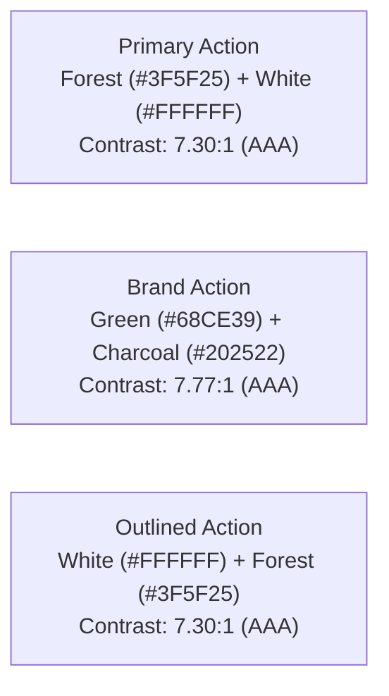

# Kinergy Brand & UI Color Specification v1.0

- **Document ID:** `KIN-BRAND-UI-001`
- **Version:** `1.0`
- **Status:** APPROVED & AUTHORITATIVE
- **Scope:** Kinergy Platform Frontend (`apps/web`, `packages/ui`)
- **Architectural Owners:** Principal Frontend Architect & Senior Design Systems Engineer
- **Compliance:** WCAG 2.2 Level AA / Level AAA Compliant

---

## 1. Executive Vision & Brand Identity

The Kinergy brand represents vitality, kinetic motion, natural health, and clinical precision. The visual identity unites a signature organic energy green palette with grounding forest hues, crisp clean surfaces, and charcoal typography.

This document serves as the authoritative, non-negotiable specification for all brand colors, neutral surfaces, semantic feedback indicators, interaction states, and component accessibility standards across the Kinergy platform.

---

## 2. Official Brand Palette

The official Kinergy brand palette consists of five canonical colors. These exact hexadecimal values must be preserved without modification across all digital interfaces, assets, and design system tokens.

```css
--kinergy-green: #68ce39; /* Signature Kinergy Energy Green */
--kinergy-forest: #3f5f25; /* Deep Grounding Forest Green */
--kinergy-charcoal: #202522; /* High-Contrast Charcoal Ink */
--kinergy-soft: #e5f6d9; /* Soft Tinted Surface */
--kinergy-tint: #f4faef; /* Subtle Tinted Background */
```

### Color Specifications & Swatches

| Token Name               |    HEX    |    HSL Channels     |         RGB          | Primary Semantic Role                                                   |
| :----------------------- | :-------: | :-----------------: | :------------------: | :---------------------------------------------------------------------- |
| **`--kinergy-green`**    | `#68CE39` | `101.1 60.3% 51.6%` | `rgb(104, 206, 57)`  | Signature brand accent, brand triggers, highlights, positive indicators |
| **`--kinergy-forest`**   | `#3F5F25` | `93.1 43.9% 25.9%`  |  `rgb(63, 95, 37)`   | Primary call-to-action background, high-contrast headings, focus rings  |
| **`--kinergy-charcoal`** | `#202522` | `144.0 7.2% 13.5%`  |  `rgb(32, 37, 34)`   | Primary typography, dark container surfaces, icons, high-contrast text  |
| **`--kinergy-soft`**     | `#E5F6D9` | `95.2 61.7% 90.8%`  | `rgb(229, 246, 217)` | Secondary container fills, subtle badges, active table row backgrounds  |
| **`--kinergy-tint`**     | `#F4FAEF` | `92.7 52.4% 95.9%`  | `rgb(244, 250, 239)` | Subdued section backdrops, skeleton placeholders, hover surfaces        |

---

## 3. Approved Neutral Palette

To guarantee harmonious visual hierarchy and strict WCAG 2.2 AA readability, all interface layouts must consume the following approved neutral values:

```css
--color-white: #ffffff; /* Crisp White Elevation */
--color-background: #f8faf9; /* Calm Neutral Viewport Background */
--color-border: #d8ddd9; /* High-Contrast Boundary & Divider */
--color-text-secondary: #68716b; /* Accessible Caption & Subtitle Text */
```

### Neutral Specifications

| Token Name                   |    HEX    |    HSL Channels     |         RGB          | Usage Description                                                         |
| :--------------------------- | :-------: | :-----------------: | :------------------: | :------------------------------------------------------------------------ |
| **`--color-white`**          | `#FFFFFF` |     `0 0% 100%`     | `rgb(255, 255, 255)` | Elevated card surfaces, modal dialog backdrops, button text on dark fills |
| **`--color-background`**     | `#F8FAF9` | `150.0 16.7% 97.6%` | `rgb(248, 250, 249)` | Base application canvas, view backgrounds, main layout surface            |
| **`--color-border`**         | `#D8DDD9` | `132.0 6.8% 85.7%`  | `rgb(216, 221, 217)` | Card borders, input field containers, data table cell dividers            |
| **`--color-text-secondary`** | `#68716B` | `140.0 4.1% 42.5%`  | `rgb(104, 113, 107)` | Secondary body copy, table header text, helper descriptions, timestamps   |

---

## 4. Accessible Interactive Action Standards (WCAG 2.2 AA / AAA)

Every interactive control in the Kinergy platform must satisfy strict relative luminance contrast ratios. The following action combinations are mandatory and verified:



### 1. Primary Action

- **Background Fill:** Forest (`#3F5F25`)
- **Foreground Text/Icon:** White (`#FFFFFF`)
- **Relative Luminance Contrast:** **`7.30:1`** (Exceeds WCAG AAA requirement of 7.0:1)
- **Usage:** Main call-to-action buttons (`<Button variant="default">`), primary form submissions, dialog confirmations.

### 2. Brand Action

- **Background Fill:** Kinergy Green (`#68CE39`)
- **Foreground Text/Icon:** Charcoal (`#202522`)
- **Relative Luminance Contrast:** **`7.77:1`** (Exceeds WCAG AAA requirement of 7.0:1)
- **Usage:** Signature branded triggers (`<Button variant="brand">`), marketing highlights, active navigation indicators.
- **Strict Rule:** NEVER use white text on Kinergy Green (`#68CE39`); white on green produces a 3.77:1 ratio which fails WCAG AA. Charcoal text is mandatory on green backgrounds.

### 3. Outlined Action

- **Background Fill:** White (`#FFFFFF`) or Canvas Background (`#F8FAF9`)
- **Foreground Text:** Forest (`#3F5F25`)
- **Border Stroke:** Forest (`#3F5F25`) or Border Neutral (`#D8DDD9`)
- **Relative Luminance Contrast:** **`7.30:1`** on white, **`6.97:1`** on background (Both exceed WCAG AA 4.5:1).
- **Usage:** Secondary actions, cancel buttons, filter toggles (`<Button variant="outline">`).

---

## 5. Semantic Status Tokens

Status indicators must never communicate critical feedback using color alone. All status badges, alerts, and banners must combine accessible color tokens with text labels and iconography (WCAG 2.2 Success Criterion 1.4.1).

| Semantic Status          |      Solid Base       |    Foreground     |  Light Surface Fill   |     Border Stroke     | Verified Contrast |
| :----------------------- | :-------------------: | :---------------: | :-------------------: | :-------------------: | :---------------: |
| **Success**              |  `#3F5F25` (Forest)   | `#FFFFFF` (White) |   `#E5F6D9` (Soft)    |   `#68CE39` (Green)   |   **`7.30:1`**    |
| **Warning**              | `#B45309` (Amber-700) | `#FFFFFF` (White) | `#FEF3C7` (Amber-100) | `#FCD34D` (Amber-300) |   **`5.21:1`**    |
| **Danger / Destructive** |  `#B91C1C` (Red-700)  | `#FFFFFF` (White) |  `#FEE2E2` (Red-100)  |  `#FCA5A5` (Red-300)  |   **`6.47:1`**    |
| **Information**          |  `#0369A1` (Sky-700)  | `#FFFFFF` (White) |  `#E0F2FE` (Sky-100)  |  `#7DD3FC` (Sky-300)  |   **`4.67:1`**    |

---

## 6. Data Visualization & Chart Tokens

Charts and visual data indicators must consume calibrated sequential tokens designed for distinct categorical separation and color-blind readability:

- **`--chart-1`**: `#3F5F25` (Kinergy Forest — Primary series)
- **`--chart-2`**: `#68CE39` (Kinergy Green — Target / Positive benchmark)
- **`--chart-3`**: `#2563EB` (Cobalt Blue — Comparison series)
- **`--chart-4`**: `#D97706` (Amber — Warning / Threshold limit)
- **`--chart-5`**: `#7C3AED` (Purple — Auxiliary metric)

---

## 7. Interactive State Modifiers

| State                | Primary Action Token                  | Brand Action Token                | Outline Action Token                           |
| :------------------- | :------------------------------------ | :-------------------------------- | :--------------------------------------------- |
| **Default**          | `bg-primary text-primary-foreground`  | `bg-brand text-brand-foreground`  | `bg-background text-primary border-primary`    |
| **Hover**            | `#314B1D` (`hover:bg-primary/90`)     | `hover:opacity-90`                | `hover:bg-accent hover:text-accent-foreground` |
| **Active / Pressed** | `#273D17`                             | `opacity-80`                      | `bg-secondary`                                 |
| **Focus-Visible**    | `ring-2 ring-ring ring-offset-2`      | `ring-2 ring-brand ring-offset-2` | `ring-2 ring-ring ring-offset-2`               |
| **Disabled**         | `opacity-50 pointer-events-none`      | `opacity-50 pointer-events-none`  | `opacity-50 pointer-events-none`               |
| **Invalid**          | `border-destructive ring-destructive` | N/A                               | `border-destructive text-destructive`          |

---

## 8. Architectural Governance & Anti-Patterns

1. **Zero Ad-Hoc HEX Colors**: No hardcoded hex codes (`#1a202c`, `#10b981`, `#059669`) are permitted inside component `.tsx` files.
2. **Never White on Green**: Never pair white text (`#FFFFFF`) with Kinergy Green (`#68CE39`).
3. **Never Green on Green**: Never pair light green text (`#68CE39`) on tinted green backgrounds (`#F4FAEF`, `#E5F6D9`).
4. **Mandatory Focus Rings**: Every interactive element must display visible focus rings (`focus-visible:ring-2 focus-visible:ring-ring`).
