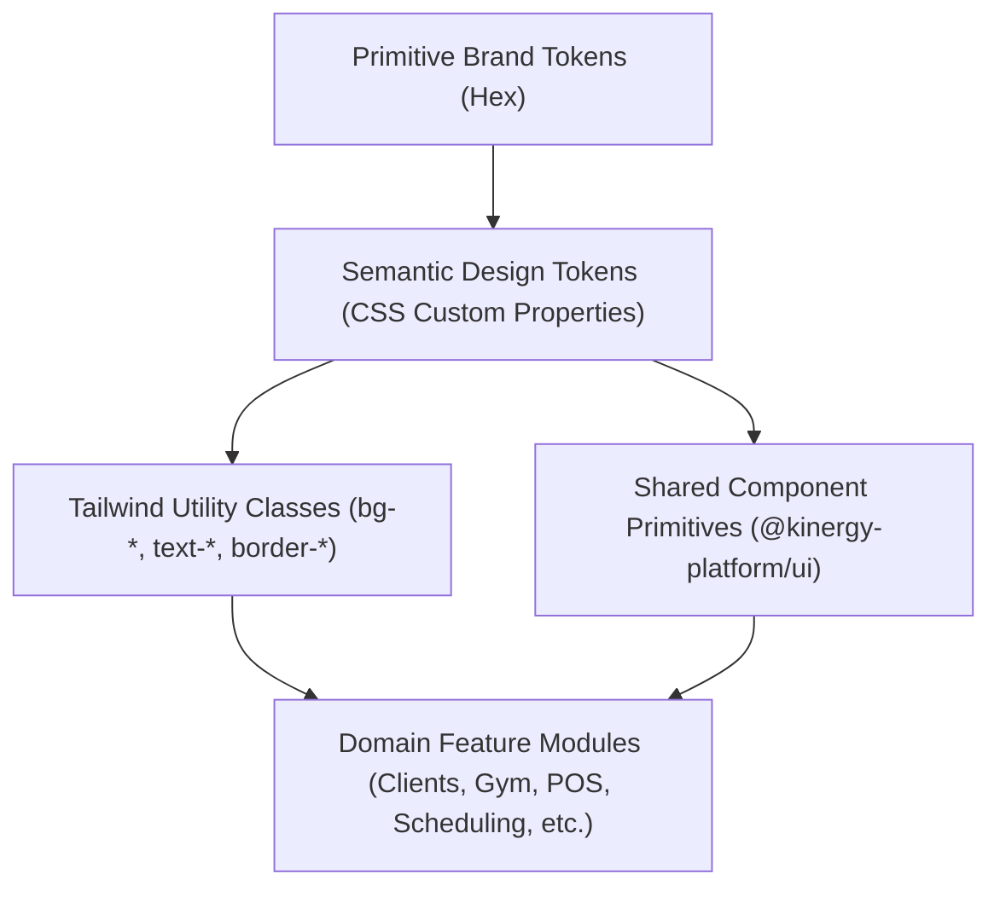

# Kinergy Design System

**Specification ID:** KIN-BRAND-UI-001  
**Version:** 1.0  
**Status:** Certified & Governed

The Kinergy Design System is the single authoritative source of truth for all brand styling, typography, design tokens, UI components, and accessibility standards across the Kinergy platform.

---

## 1. Documentation Index

The design system is documented across seven comprehensive engineering milestones:

| Document                                                                       | Title                                      | Purpose                                                                                                     |
| ------------------------------------------------------------------------------ | ------------------------------------------ | ----------------------------------------------------------------------------------------------------------- |
| [**`KIN-BRAND-UI-001.md`**](./KIN-BRAND-UI-001.md)                             | Official Brand & UI Color Specification    | The authoritative specification defining exact brand colors, semantic tokens, and contrast ratios.          |
| [**`DS-01-REPOSITORY-AUDIT.md`**](./DS-01-REPOSITORY-AUDIT.md)                 | Repository Architecture & Token Audit      | Discovery report cataloging legacy CSS variables, Tailwind configurations, and color usage.                 |
| [**`DS-02-TOKEN-ARCHITECTURE.md`**](./DS-02-TOKEN-ARCHITECTURE.md)             | Centralized Token Engine Architecture      | Implementation of canonical CSS variables, Tailwind mapping, and relative luminance math.                   |
| [**`DS-03-COMPONENT-STANDARDS.md`**](./DS-03-COMPONENT-STANDARDS.md)           | Shared UI Component Standardization        | Standardization of `@kinergy-platform/ui` interactive, layout, and feedback components.                     |
| [**`DS-04-APPLICATION-MIGRATION.md`**](./DS-04-APPLICATION-MIGRATION.md)       | Application-Wide Visual Migration          | Visual migration of application shell, navigation, and 14 domain modules.                                   |
| [**`DS-05-ACCESSIBILITY-VALIDATION.md`**](./DS-05-ACCESSIBILITY-VALIDATION.md) | WCAG 2.2 AA Accessibility Engineering      | Automated `jest-axe` test harnesses, contrast matrix verification, and manual checklists.                   |
| [**`DS-06-FINAL-ACCEPTANCE.md`**](./DS-06-FINAL-ACCEPTANCE.md)                 | Final Verification & Governance Report     | Final acceptance evaluation, residual inventory classification, and sign-off.                               |
| [**`DS-07-CI-ACCESSIBILITY-CLOSURE.md`**](./DS-07-CI-ACCESSIBILITY-CLOSURE.md) | Accessibility CI Integration & Gap Closure | GitHub Actions CI enforcement, 143-test inventory reconciliation, boundary hardening, and modal migrations. |

---

## 2. Token Architecture Overview

The Kinergy frontend employs a three-tier token hierarchy:



### 2.1 Canonical Brand Values

These values are immutable and defined in [`packages/ui/src/tokens/tokens.config.ts`](file:///c:/Projects/kinergy-platform/packages/ui/src/tokens/tokens.config.ts) and [`apps/web/src/shared/styles/globals.css`](file:///c:/Projects/kinergy-platform/apps/web/src/shared/styles/globals.css):

```css
--kinergy-green: #68ce39; /* Brand Energy Accent */
--kinergy-forest: #3f5f25; /* Primary Brand Surface & Text */
--kinergy-charcoal: #202522; /* High-Contrast Text & Sidebar Shell */
--kinergy-soft: #e5f6d9; /* Soft Success Surface & Selected Background */
--kinergy-tint: #f4faef; /* Subtle Muted Tint for Cards */

--color-white: #ffffff;
--color-background: #f8faf9;
--color-border: #d8ddd9;
--color-text-secondary: #68716b;
```

---

## 3. Engineering Governance Rules

All developers, designers, and contributors working on the Kinergy repository must abide by the following seven governance rules:

### Rule 1 — Centralized Design Tokens

New components and styles must strictly consume centralized CSS custom properties or Tailwind utility tokens mapped from `@kinergy-platform/ui`. Never hardcode literal HEX, RGB, or HSL strings in component markup or utility classes.

### Rule 2 — No Independent Module Palettes

Feature modules (`apps/web/src/modules/*`) must not define independent or competing color palettes. All visual feedback must derive from canonical semantic tokens:

- `status-success`
- `status-warning`
- `status-danger`
- `status-info`

### Rule 3 — Documented Justification for Semantic Extensions

Introducing a new semantic color or token variant requires:

1. Written UX/clinical justification submitted via RFC or pull request.
2. Verified contrast ratio meeting WCAG 2.2 Level AA ($\ge 4.5:1$ for normal text, $\ge 3.0:1$ for non-text UI elements).
3. Registration in `tokens.config.ts`, `globals.css`, and `tokens.types.ts`.

### Rule 4 — Mandatory Brand Identity Guardrails

Official brand colors (`#68CE39`, `#3F5F25`, `#202522`, `#E5F6D9`, `#F4FAEF`) cannot be altered or substituted without formal brand governance approval.  
**Critical Accessibility Invariant:** White text (`#FFFFFF`) must NEVER be paired with Kinergy Green (`#68CE39`) (contrast ratio 2.08:1). Text on Kinergy Green must always be Kinergy Charcoal (`#202522`) (contrast ratio 7.12:1).

### Rule 5 — Accessible Component States

Every interactive component variant must support:

- Standard visual states: `default`, `hover`, `active`, `focus-visible`, `disabled`.
- 2px high-contrast focus rings (`focus-visible:ring-2 focus-visible:ring-offset-2`).
- Accessible naming (`aria-label` on icon-only buttons).
- Multi-cue state communication (never color alone; pairing icons, text, and physical shape indicators).

### Rule 6 — Continuous Automated Accessibility Testing

Automated accessibility checks must remain part of the local development workflow and continuous integration pipeline:

```bash
# Run automated accessibility & contrast verification
pnpm test:a11y

# Run full project validation gate
pnpm validate
```

Pull requests introducing `jest-axe` violations or failing contrast checks are blocked automatically.

### Rule 7 — Synchronous Specification & Code Updates

Any change to design tokens or UI component contracts must update the authoritative specification (`KIN-BRAND-UI-001.md`), design system documentation, and implementation in the same atomic pull request.

---

## 4. Verification Workflow for Contributors

Before committing UI changes, contributors must execute the following quality gates:

```bash
# 1. Format code using Prettier
pnpm write

# 2. Verify strict TypeScript compilation
pnpm typecheck

# 3. Lint all UI and Web files
pnpm nx run-many -t lint --projects=ui,web

# 4. Run accessibility test suites
pnpm test:a11y

# 5. Run full workspace test suites
pnpm test:ui
pnpm test:web
```
