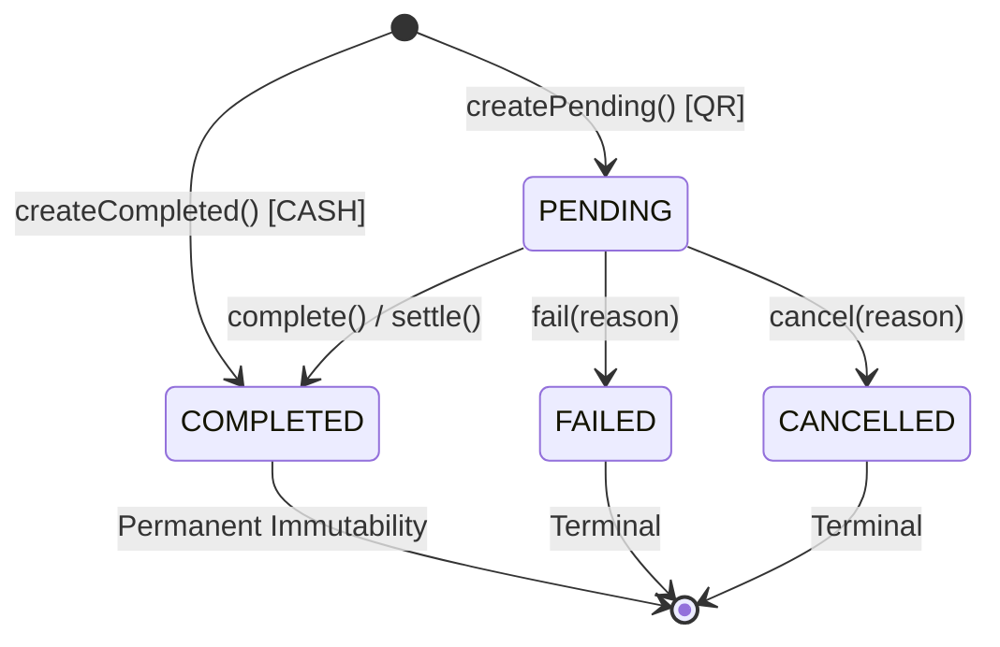

# Phase 7: Sales & Payments — Canonical Domain Model Specification

- **Document**: `docs/domain/sales-payments.md`
- **Status**: Authoritative Domain Source of Truth (APPROVED & EXECUTABLE)
- **Milestone**: Milestone 7.22 — Authoritative Domain Specification & Traceability Baseline
- **Role**: Principal Domain Designer / Lead Financial Domain Architect
- **Date**: 2026-10-19
- **Governing ADRs**:
  - [ADR-0108: Deterministic Financial Representation and Currency Modeling](../adr/0108-money-representation.md)
  - [ADR-0109: Payment Lifecycle, Multi-Tender Settlement, and Financial Immutability](../adr/0109-payment-lifecycle.md)
  - [ADR-0110: Sale Transaction Ownership and Source Bounded-Context Integrity](../adr/0110-sale-ownership.md)
  - [ADR-0111: Sales & Payments Authorization, Organization Isolation, and Audit Boundaries](../adr/0111-sales-payments-authorization-and-audit.md)
  - [ADR-0112: Sales & Payments Bounded Context Establishment](../adr/0112-sales-bounded-context.md)
  - [ADR-0113: Item-Level Discount Domain Model, Deterministic Calculation, and Invariant Enforcement](../adr/0113-item-level-discounts.md)
  - [ADR-0114: Canonical Monetary Policy, Deterministic Arithmetic, and Sale Totals Invariant Enforcement](../adr/0114-canonical-monetary-policy-and-sale-totals.md)
  - [ADR-0115: Payment Domain Canonical Architecture, Aggregate Boundaries, and Tender Decoupling](../adr/0115-payment-domain-canonical-architecture.md)
  - [ADR-0116: Payment State Machine, Lifecycle Specification, and Financial Transition Determinism](../adr/0116-payment-state-machine-and-lifecycle-specification.md)
  - [ADR-0117: Receipt Domain Boundary, Document Model, and Legal Proof-of-Purchase Invariants](../adr/0117-receipt-domain-boundary-and-document-model.md)
  - [ADR-0118: Sale Reference and Receipt Identification Strategy](../adr/0118-sale-reference-and-receipt-identification-strategy.md)
  - [ADR-0119: Sale Aggregate Boundary, Invariants, and Commercial Transaction Integrity](../adr/0119-sale-aggregate-boundary-and-invariants.md)
  - [ADR-0120: Commercial Transaction Uniqueness and Sale Idempotency](../adr/0120-commercial-transaction-uniqueness-and-sale-idempotency.md)
  - [ADR-0121: Sale Source References and Commercial Origin Model](../adr/0121-sale-source-references-and-commercial-origin-model.md)
  - [ADR-0140: Financial Concurrency and Settlement Integrity](../adr/0140-financial-concurrency-and-settlement-integrity.md)

---

## 1. Executive Summary & Context

This document establishes the canonical domain model for **Phase 7: Sales & Payments** of the Kinergy platform.

Following the core architectural law established in [`docs/architecture/sales-payments.md`](file:///c:/Projects/kinergy-platform/docs/architecture/sales-payments.md):

> **"References Over Ownership."**  
> The Sales & Payments bounded context models commercial agreements, customer checkout sessions, monetary tender collections, and receipt proof vouchers. It never takes ownership of the products, subscriptions, clinical encounters, or client CRM profiles that participate in those transactions.

This specification documents the ubiquitous domain language, aggregate boundaries, internal entities, value objects, lifecycles, precision-safe arithmetic, non-negotiable invariants, and multi-tier enforcement mechanisms as implemented in production code.

---

## 2. Ubiquitous Language & Core Concepts

```
┌──────────────────────────────────────────────────────────────────────────────┐
│                    SALES & PAYMENTS UBIQUITOUS VOCABULARY                    │
│                                                                              │
│  Sale             The commercial transaction aggregate root representing a    │
│                   purchase agreement between Kinergy and a customer.         │
│                                                                              │
│  SaleItem         An internal line-item child entity within a Sale capturing  │
│                   an immutable snapshot of what was purchased and its price. │
│                                                                              │
│  Payment          An autonomous aggregate root representing a financial       │
│                   monetary tender transaction settling part or all of a Sale.│
│                                                                              │
│  Receipt          An immutable proof-of-purchase document voucher issued to   │
│                   the customer upon financial settlement.                    │
│                                                                              │
│  Discount         An immutable Value Object representing a fixed-amount or   │
│                   percentage price reduction justified by a business reason. │
│                                                                              │
│  SaleSource       An immutable Value Object capturing the commercial origin   │
│                   category of a Sale (ADR-0121).                             │
│                                                                              │
│  SourceReference  An immutable Value Object identifying the underlying       │
│                   catalog entity of a line item.                             │
│                                                                              │
│  Money            A canonical Value Object representing a non-negative       │
│                   monetary amount with an explicit ISO-4217 currency.        │
│                                                                              │
│  PaymentMethod    An enumeration of accepted tender mechanisms (CASH, QR;    │
│                   CARD, TRANSFER, ONLINE reserved for future integration).   │
│                                                                              │
│  PaymentStatus    4-state canonical lifecycle (PENDING, COMPLETED, FAILED,    │
│                   CANCELLED); mapped to database SETTLED status.             │
│                                                                              │
│  ReceiptStatus    2-state document lifecycle (ISSUED, REPRINTED).            │
└──────────────────────────────────────────────────────────────────────────────┘
```

---

## 3. Canonical Domain Model Specifications

### 3.1 `Sale` (Aggregate Root)

#### Business Purpose

`Sale` is the consistency boundary and aggregate root governing commercial purchase agreements between the wellness facility and a customer. It encapsulates the line items purchased, applies line and order discounts, enforces single-currency homogeneity, calculates deterministic cent-exact totals, and guards commercial lifecycle state transitions.

#### Identity & Multi-Tenancy

- **`id: SaleId`**: Canonical Value Object wrapping an RFC 4122 UUID v4 (`SaleId.create()` or `SaleId.fromString()`).
- **`tenantId?: string`**: Organization boundary guaranteeing multi-tenant isolation. Optional during pure in-memory aggregate construction, mandatory at application and repository persistence boundaries. Cross-tenant mutation or query is strictly impossible.
- **`clientId?: string`**: Optional unconstrained scalar reference to a registered Client profile. Omitting `clientId` denotes an anonymous walk-in retail purchase without polluting the master CRM. When provided, it must be a non-empty, trimmed string referencing an active client.
- **`currency: string`**: Normalized 3-letter uppercase ISO-4217 currency code (e.g. `"USD"`, `"CAD"`). Default: `"USD"`.
- **`source: SaleSource | SourceReference`**: Value Object capturing the commercial origin (see Section 3.6).
- **`status: SaleStatus`**: 7 canonical lifecycle states (`DRAFT`, `PENDING_PAYMENT`, `PARTIALLY_PAID`, `PAID`, `COMPLETED`, `CANCELLED`, `REFUNDED`).
- **`version: number`**: Monotonically increasing integer ($\ge 1$) enforcing Optimistic Concurrency Control (OCC).
- **Actor Attribution**: Authenticated cashier attribution (`cashierId`) is captured via CQRS command handlers and published in domain events (`SaleCreatedEvent`, etc.) rather than persisted as internal aggregate state.

#### Items and Discounts

- **`items: ReadonlyArray<SaleItem>`**: Internal collection of line items, exposed via a defensive, frozen array (`Object.freeze([...this._items])`).
- **`orderDiscount: Discount | null`**: Optional order-level discount applied to the net pre-order-discount balance ($\text{subtotal} - \sum \text{lineDiscounts}$).

#### Financial Totals

All totals are represented by canonical `Money` value objects in integer cents:

- **`subtotal: Money`**: $\sum_{i} \text{item}[i].\text{subtotal}$
- **`discountTotal: Money`**: $(\sum_{i} \text{item}[i].\text{discountTotal}) + \text{orderDiscountReduction}$
- **`total: Money`**: $\text{subtotal} - \text{discountTotal}$, guaranteed $\ge \$0.00$.

#### State Transition Invariants

The `Sale` aggregate enforces the 22 master domain invariants (SALE-001 through SALE-022):

1. **Commercial Non-Emptiness (`SALE-001`)**: `Sale.finalize()` strictly requires $\ge 1$ item (`items.length > 0`), throwing `EmptySaleException` (`EMPTY_SALE`).
2. **Deterministic Totals Reconciliation (`SALE-002`)**: In-memory calculation and database reconstitution must strictly reconcile line sums to the exact cent without rounding drift; mismatches throw `InvalidSaleStateException`.
3. **Non-Negative Total Floor (`SALE-003`)**: Total payable amount cannot be negative ($\text{total} \ge \$0.00$).
4. **Single-Currency Homogeneity (`SALE-006`, `SALE-014`)**: Every item, discount, subtotal, and payment must share the identical ISO-4217 currency code. Mismatches throw `InvalidSaleStateException`.
5. **Commercial Lock After Draft (`SALE-008`, `SALE-018`)**: Once a `Sale` leaves `DRAFT`, commercial line items, quantities, prices, and discounts cannot be added, modified, or removed (`SaleAlreadyFinalizedException`).
6. **Cancellation Permissibility & Reason (`SALE-009`, `SALE-021`)**: Cancellation is allowed only from `DRAFT`, `PENDING_PAYMENT`, or `PARTIALLY_PAID`, requiring a non-empty, trimmed `cancellationReason` string (`InvalidSaleStateException`).
7. **Settlement Transitions (`SALE-010`, `SALE-011`, `SALE-019`)**:
   - `markPartiallyPaid()` is permitted only from `PENDING_PAYMENT` upon recording a partial tender.
   - `markPaid()` is permitted from `PENDING_PAYMENT` or `PARTIALLY_PAID` upon full financial settlement.
8. **Fulfillment Completion (`SALE-012`, `SALE-016`)**: `markCompleted()` is permitted only from `PAID`. Sets `completedAt`.
9. **Compensating Refund (`SALE-013`, `SALE-016`)**: `markRefunded(reason?)` is permitted only from `PAID` or `COMPLETED`. Sets `refundedAt`. Terminal state.
10. **Commercial Origin Immutability (`SALE-022`)**: `SaleSource` is strictly immutable once assigned at creation (`changeSource`, `removeSource` throw `InvalidSaleStateException` with code `SALE_SOURCE_IMMUTABLE`).

---

### 3.2 `SaleItem` (Internal Child Entity)

#### Exclusive Ownership by `Sale`

`SaleItem` is an internal child entity with **no global identity, no standalone repository, and no public CRUD controller**. It is created, updated, and removed strictly through methods on the `Sale` aggregate root:

- `sale.addItem(props, clock?)`
- `sale.updateItemQuantity(itemId, quantity, clock?)`
- `sale.applyItemDiscount(itemId, discount, clock?)`
- `sale.removeItemDiscount(itemId, clock?)`
- `sale.removeItem(itemId, clock?)`

`SaleItem` asserts parent ownership via `saleId: SaleId`. Attempting to attach an item belonging to another `Sale` is strictly rejected with `InvalidSaleStateException` (`CROSS_SALE_ITEM_ATTACHMENT_PROHIBITED`).

#### Historical Commercial Snapshot Semantics

A `SaleItem` represents what was commercially agreed upon and sold at the exact moment of checkout.

| Field                                          | Historical Snapshot Behavior                                                      | Can Change After Creation?                                      |
| :--------------------------------------------- | :-------------------------------------------------------------------------------- | :-------------------------------------------------------------- |
| **`id`** (`SaleItemId`)                        | Unique line item identifier within the sale.                                      | **Never**                                                       |
| **`saleId`** (`SaleId`)                        | Parent sale aggregate identifier.                                                 | **Never**                                                       |
| **`source`** (`SourceReference \| SaleSource`) | Unconstrained pointer to catalog origin (`sourceType`, `sourceId`, `sourceCode`). | **Never**                                                       |
| **`description`** (`string`)                   | Text snapshot of good/service at checkout.                                        | **Never** (Catalog renames do not alter past sales)             |
| **`skuOrCode`** (`string \| null`)             | SKU/code snapshot at checkout.                                                    | **Never**                                                       |
| **`unitPrice`** (`Money`)                      | Gross commercial unit price agreed at checkout.                                   | **Never** (Catalog price hikes do not alter past sales)         |
| **`quantity`** (`number`)                      | Normalized purchase quantity.                                                     | **Conditionally Mutable** (Only while parent `Sale` is `DRAFT`) |
| **`discount`** (`Discount \| null`)            | Line-item discount reduction.                                                     | **Conditionally Mutable** (Only while parent `Sale` is `DRAFT`) |
| **`subtotal`** (`Money`)                       | Deterministic $\text{unitPrice} \times \text{quantity}$.                          | Recalculated if quantity changes in `DRAFT`; frozen thereafter  |
| **`discountTotal`** (`Money`)                  | Deterministic reduction from `discount.calculate(subtotal)`.                      | Recalculated if discount changes in `DRAFT`; frozen thereafter  |
| **`total`** (`Money`)                          | $\text{subtotal} - \text{discountTotal}$.                                         | Recalculated if quantity/discount changes; frozen thereafter    |

> [!IMPORTANT]
> **No Dynamic Runtime Joins**:  
> Under no circumstance may a `SaleItem` dynamically query upstream source tables (`inventory_items`, `membership_plans`, `treatment_sessions`) to resolve description, SKU, or unit price at read time.

#### Quantity and Unit Price Boundaries

- **Quantity Bounds (`ITEM-02`)**:
  - $0.001 \le \text{quantity} \le 999,999$ (`SaleItem.MAX_QUANTITY`).
  - Normalized to 3 decimal places: $\text{Math.round}((\text{quantity} + \epsilon) \times 1000) / 1000$.
  - Values $< 0.0005$ round down to 0 and throw `InvalidSaleItemException` (`INVALID_QUANTITY`).
  - Values $> 999,999$, zero, negative, `NaN`, and non-finite values are deterministically rejected.
- **Unit Price Bounds (`ITEM-03`)**:
  - Canonical `Money` instance with non-negative amount ($\text{unitPrice} \ge \$0.00$).
  - Complimentary/promotional items are supported at `$0.00`.
  - Negative unit prices are rejected (`INVALID_UNIT_PRICE`).

#### Immutability Pattern

`SaleItem` instances are sealed via `Object.freeze(this)`. In-place mutations are physically impossible. Modifications (`withQuantity`, `withDiscount`) return replacement instances preserving entity identity (`id`) and parent `saleId`.

---

### 3.3 `Discount` (Value Object)

#### Supported Types & Value Interpretation

`Discount` is an immutable Value Object (`packages/core/src/sales/domain/value-objects/discount.vo.ts`) supporting:

- **`DiscountType.PERCENTAGE`**: Percentage reduction. Value must be $0 \le v \le 100$. A 100% discount reduces the item or balance to `$0.00` (complimentary item).
- **`DiscountType.FIXED`** (and canonical alias **`FIXED_AMOUNT`**): Fixed currency amount reduction. Value must be $v \ge 0.00$.

Negative values, `NaN`, non-finite values, and percentages $> 100\%$ throw `InvalidDiscountException`.

#### Business Reason Requirements

- Optional `reason?: string | null` captures audit justification (e.g. `"VIP Member"`, `"Packaging Blemish"`).
- Max length: 255 characters (`Discount.MAX_REASON_LENGTH`).
- If provided, it cannot be empty or pure whitespace. Stored trimmed.

#### Calculation Methods & Order

The domain provides two distinct deterministic calculation methods:

1. **`calculate(eligibleAmount: Money): Money`** (Used for Line Items):
   - Evaluates strictly against the gross item subtotal ($\text{eligibleAmount} = \text{lineSubtotal}$).
   - **Strict Non-Exceeding Guard**: For fixed discounts, if $\text{value} > \text{eligibleAmount}$, it **throws `InvalidDiscountException`**. The system **never** silently clamps fixed discounts to the line subtotal.
   - For percentage discounts, calculates reduction in integer cents with Commercial Half-Up rounding:
     $$\text{cents} = \text{round}\left(\frac{\text{eligibleCents} \times \text{value}}{100} + 10^{-8}\right)$$
     $$\text{discountAmount} = \text{Money.fromCents}(\min(\text{eligibleCents}, \max(0, \text{cents})), \text{currency})$$

2. **`calculateReduction(subtotal: Money): Money`** (Used for Order Discounts):
   - Evaluates against the net pre-order-discount balance ($\text{subtotal} - \sum \text{lineDiscounts}$).
   - Computes reduction in integer cents with Commercial Half-Up rounding.
   - **Ceiling Protection**: Order discount reduction is capped at the available subtotal:
     $$\text{reductionCents} = \min(\text{subtotalCents}, \max(0, \text{calculatedCents}))$$

#### Calculation Order & Totals Interaction

Discounts are applied in strict sequential order:

1. **Line-item discounts** are calculated first against each item's gross subtotal.
2. Item subtotals and item discounts are summed across all items:
   $$\text{GrossSubtotal} = \sum \text{SaleItem.subtotal}$$
   $$\text{LineDiscounts} = \sum \text{SaleItem.discountTotal}$$
3. Net pre-order-discount balance is computed:
   $$\text{NetPreOrder} = \text{GrossSubtotal} - \text{LineDiscounts}$$
4. **Order discount** is calculated against $\text{NetPreOrder}$.
5. Final discount total is reconciled:
   $$\text{DiscountTotal} = \text{LineDiscounts} + \text{OrderDiscount}$$
   $$\text{Total} = \text{GrossSubtotal} - \text{DiscountTotal}$$

#### Implemented vs. Planned Rules

- **Implemented in Code**: Item-level percentage and fixed discounts, order-level percentage and fixed discounts, Commercial Half-Up rounding in integer cents, strict non-exceeding guards.
- **Planned / Deferred Rules**: Automated multi-item promotional bundle rules, buy-one-get-one (BOGO) logic, tiered volume discount matrices, and promotional coupon code validation engines.

---

### 3.4 `Payment` (Autonomous Aggregate Root)

#### Relationship to `Sale`

`Payment` is an autonomous aggregate root governing financial tender collections. It is decoupled from `Sale` via scalar `saleId: SaleId`:

- `Payment` holds **no object reference** to `Sale`.
- Recording or settling a `Payment` **never mutates or recalculates** `Sale.subtotal`, `Sale.discountTotal`, or `Sale.total`.
- Multiple payments can settle a single `Sale` ($1 \text{ Sale} \to 0..\star \text{ Payments}$), enabling split cash and electronic tenders.

#### Tender Amount & Methods

- **`amount: Money`**: Canonical `Money` value object. Must be strictly positive ($\text{amount} > \$0.00$). Zero or negative values throw `InvalidPaymentAmountException`. Currency must match the parent `Sale` currency.
- **`method: PaymentMethod`**:
  - `CASH`: In-person counter payment. Instantiated directly in `COMPLETED` status (`paidAt` populated immediately).
  - `QR`: Dynamic/static QR code tender. Instantiated in `PENDING` status (`paidAt = null`), awaiting customer scan.
  - `CARD`, `TRANSFER`, `ONLINE`: Reserved future payment methods. Speculative usage throws `InvalidPaymentMethodException`.

#### Lifecycle State Machine & Immutability

`Payment` implements a deterministic 4-state lifecycle machine (`PaymentLifecycleStateMachine`):



- **`COMPLETED` (Settled)**: Funds verified. `paidAt` timestamp permanently set. **Permanently immutable**. In-place mutations, updates, or deletions are strictly prohibited.
- **`FAILED`**: Provider timeout, decline, or rail failure. Terminal state.
- **`CANCELLED`**: Cashier voids tender before settlement. Terminal state.
- **Hexagonal Persistence Mapping**: Domain enum `PaymentStatus.COMPLETED` maps bidirectionally to PostgreSQL/Prisma enum `SETTLED` in `PrismaPaymentMapper`.

#### Multi-Tender & Balance Constraints

1. **Electronic Overpayment Prohibition (`PAY-08`)**: Electronic tenders (`QR`) cannot exceed the outstanding balance ($\text{amount} \le \text{Sale.balanceRemaining}$). Attempting to charge excess balance is rejected with HTTP 422.
2. **Cash Overpayment & Change Handling (`PAY-09`)**: When cash tendered exceeds the balance, `Payment.amount` records the exact balance-settling amount; the POS/UI layer captures `tenderedAmount` and `changeGiven` for physical register drawer balancing.
3. **Compensating Refunds (`PAY-12`, `PAY-13`)**: Refunds are modeled as autonomous compensating records (`REFUND`), never in-place edits. Cumulative refunds cannot exceed original settled tender ($\sum \text{Refunds} \le \text{originalPayment.amount}$).

---

### 3.5 `Receipt` (Autonomous Document Voucher)

#### Voucher Nature vs. Financial Source of Truth

> [!NOTE]
> **Is a Receipt a Financial Source of Truth?**  
> **No.** A `Receipt` is **NOT** the financial source of truth.  
> The financial truth is authoritatively governed by the `Sale` and `Payment` aggregates.  
> A `Receipt` is an **immutable, customer-facing legal proof-of-purchase document voucher** that represents and evidences an already-settled financial transaction (ADR-0117).

#### Availability & Issuance Preconditions

A `Receipt` can be issued **exclusively** after the underlying `Sale` achieves full financial settlement:

- Status must be `SaleStatus.PAID` or `SaleStatus.COMPLETED`.
- At least one settled `Payment` snapshot must exist (`payments.length >= 1`).
- Total settled payments must fully cover the receipt payable total ($\sum \text{Payment.amount} \ge \text{total}$).
- Issuance for `DRAFT`, `PENDING_PAYMENT`, or `CANCELLED` sales is strictly prohibited (`INVALID_RECEIPT_SALE_STATUS`).

#### Snapshot Model & Permanent Immutability

`Receipt` embeds frozen, self-contained point-in-time value object snapshots:

- **`ReceiptClientSnapshot`**: Customer legal name, reference number, email, phone at issuance. `null` for walk-in retail sales. Zero runtime joins to `clients`.
- **`ReceiptItemSnapshot`**: Line item description, SKU/code, quantity, unit price, discount amount, line total. Zero runtime joins to catalog tables.
- **`ReceiptPaymentSnapshot`**: Tender method, settled amount, external reference, `paidAt`.

Once created, historical financial properties are sealed at runtime (`Object.seal(this)`, non-writable property descriptors).

#### Retrieval, Regeneration & Duplicate Reprinting

- **Idempotency & Cardinality (`REC-05`)**: Exactly one primary receipt exists per `(tenantId, saleId)`, guaranteed by composite database unique index `unique_tenant_sale_receipt`. Repeated issuance requests return the existing receipt.
- **No Regeneration (`REC-05`)**: A settled sale cannot generate a new primary receipt with recalculated figures.
- **Duplicate Reprinting (`REC-06`)**: Customer duplicate print requests do **not** create a new receipt. The system re-renders the existing receipt snapshot stamped with a mandatory `DUPLICATE / REPRINT` watermark, increments `reprintCount`, updates `lastReprintedAt`, and emits `ReceiptReprintedEvent`.
- **Sequential Numbering (`REC-03`)**: Monotonically increasing, gap-free alphanumeric receipt numbers (e.g. `REC-2026-000421`) generated per tenant via dedicated sequence table `receipt_sequences`.

#### Legal & Accounting Exclusions (`REC-09`)

A `Receipt` is strictly a customer proof-of-purchase voucher. It does **not** represent:

- General ledger double-entry bookkeeping.
- Government fiscal tax e-invoices (e.g. SII, AFIP, SAT).
- Fiscal memory printer hardware communication (deferred to Milestone 7.17).

---

### 3.6 Source References & Commercial Origins

#### The Two Reference Levels

The Sales & Payments bounded context defines two complementary reference value objects adhering to the **"References Over Ownership"** law:

1. **`SaleSource`** (`packages/core/src/sales/domain/value-objects/sale-source.vo.ts`, ADR-0121):  
   Captures the commercial origin category of the entire `Sale` aggregate:
   - `type: SaleSourceType`
   - `referenceId: string` (non-empty, trimmed, $\le 255$ chars, no control characters)
   - Immutable once assigned at sale creation.
2. **`SourceReference`** (`packages/core/src/sales/domain/value-objects/source-reference.vo.ts`):  
   Captures the underlying catalog item pointer for an individual `SaleItem`:
   - `sourceType: SourceType` (`INVENTORY_ITEM`, `MEMBERSHIP_PLAN`, `TREATMENT_SESSION`, `CUSTOM_SERVICE`)
   - `sourceId: string` (UUID or `"CUSTOM"`)
   - `sourceCode?: string | null` (Human-readable SKU or billing code)

#### Supported Commercial Origins (`SaleSourceType`)

The repository implements 5 canonical commercial origin types:

1. **`KINESIOLOGY_SESSION`**:
   - **Origin**: Clinical therapy encounter from Kinesiology (Phase 4).
   - **Identity Contract**: `referenceId` contains the unique `treatmentSessionId`.
   - **Transaction vs. Reusable Entity**: Identifies a specific completed clinical encounter instance, **not** a reusable product.
   - **Single-Billing Invariant**: Enforced by PostgreSQL partial unique index `uq_sales_clinical_session_active` (`WHERE source_type IN ('TREATMENT_SESSION', 'KINESIOLOGY_SESSION') AND status != 'CANCELLED'`). A clinical session can be billed at most once across active sales. If a prior sale was `CANCELLED`, re-billing is unlocked.
   - **Domain Ownership**: Kinesiology owns `TreatmentSession` and clinical SOAP notes. Sales owns billing and never receives medical diagnoses.
2. **`GYM_MEMBERSHIP`**:
   - **Origin**: Membership subscription or renewal from Gym Management (Phase 5).
   - **Identity Contract**: `referenceId` contains `membershipPlanId` or `clientMembershipId`.
   - **Transaction vs. Reusable Entity**: Links to the membership plan, but the `Sale` creates an independent commercial payment agreement.
   - **Domain Ownership**: Gym Management owns membership validity dates, turnstile access, and grace periods. Sales captures fees and invokes `GymMembershipActivationPort`.
3. **`FOOD`**:
   - **Origin**: Kitchen / meal consumable from Resources (Phase 6).
   - **Identity Contract**: `referenceId` contains `inventoryItemId`; `sourceCode` contains SKU.
   - **Transaction vs. Reusable Entity**: Reusable catalog product. `SaleItem` freezes unit price and description at checkout.
   - **Domain Ownership**: Resources owns stock on hand. Sales invokes `InventoryStockDecrementPort.sellStock()`. Sales never writes to `inventory_items.quantityOnHand`.
4. **`DRINK`**:
   - **Origin**: Bar / beverage consumable from Resources (Phase 6).
   - **Identity Contract**: `referenceId` contains `inventoryItemId`; `sourceCode` contains barcode/SKU.
   - **Transaction vs. Reusable Entity**: Reusable catalog product. `SaleItem` freezes price and description.
   - **Domain Ownership**: Resources owns stock levels and inventory movement ledger.
5. **`ROOM_RENTAL`**:
   - **Origin**: Facility amenity or room reservation from Scheduling.
   - **Identity Contract**: `referenceId` contains `reservationId` or `facilityRoomId`.
   - **Transaction vs. Reusable Entity**: Specific reserved booking window or rental amenity.
   - **Domain Ownership**: Scheduling owns room calendar availability. Sales collects rental fees.

---

## 4. Multi-Tier Invariant Enforcement & Evidence Matrix

Every business invariant in the Sales & Payments domain is enforced across multiple architectural tiers. Frontend validation provides immediate user feedback, but **domain validation and database constraints provide the authoritative financial protection**.

| Concept        | Invariant                                               | Tier 1: Domain Validation                                                 | Tier 2: Application Orchestration                           | Tier 3: Database / Transaction                   | Tier 4: API Validation                          | Tier 5: Frontend Validation                     | Automated Test Evidence                                                                 |
| :------------- | :------------------------------------------------------ | :------------------------------------------------------------------------ | :---------------------------------------------------------- | :----------------------------------------------- | :---------------------------------------------- | :---------------------------------------------- | :-------------------------------------------------------------------------------------- |
| **`Sale`**     | **Commercial Non-Emptiness (`SALE-001`)**               | `Sale.finalize()` asserts `items.length > 0`; throws `EmptySaleException` | `FinalizeSaleHandler` asserts draft state before transition | Atomic Prisma transaction                        | DTO rejects empty finalize request              | "Finalize" button disabled when cart is empty   | `sale-aggregate-invariants-catalog.spec.ts`, `sale.aggregate.spec.ts`                   |
| **`Sale`**     | **Deterministic Totals (`SALE-002`)**                   | `recalculateTotals()`, `reconstitute()` verify 13 integer-cent formulas   | Command handlers recalculate totals via domain              | Stored as `@db.Decimal(12, 2)`                   | Response serialized as `MoneyResponseDto`       | Formatted with 2 decimals in POS cart           | `sale-totals-deterministic.spec.ts`, `sale-application-totals.spec.ts`                  |
| **`Sale`**     | **Non-Negative Total Floor (`SALE-003`)**               | `Money.create()`, `recalculateTotals()` assert `total.cents >= 0`         | Rejects negative price overrides                            | DB `CHECK (total >= 0)`                          | DTO `@Min(0)` validator                         | Floor display at `$0.00`                        | `money.vo.spec.ts`, `monetary-precision-safety-net.spec.ts`                             |
| **`Sale`**     | **Currency Homogeneity (`SALE-006`, `SALE-014`)**       | `Sale.addItem()`, `Sale.create()` assert item/order currencies match      | Rejects mismatched currency in command                      | Column `currency VARCHAR(3)`                     | DTO `@IsISO4217()` validation                   | Currency locked by tenant setting               | `sale.aggregate.spec.ts`, `sale-hardening.spec.ts`                                      |
| **`Sale`**     | **Commercial Lock Post-Draft (`SALE-008`, `SALE-018`)** | `assertDraftState()` blocks cart edits if `status !== DRAFT`              | Command handlers verify draft status                        | OCC version check (`version`)                    | API returns 409 Conflict                        | Edit/delete cart controls hidden when finalized | `sale-hardening.spec.ts`, `sale-lifecycle.spec.ts`                                      |
| **`Sale`**     | **Cancellation Reason (`SALE-021`)**                    | `Sale.cancel(reason)` asserts non-empty trimmed reason string             | `CancelSaleHandler` passes mandatory reason                 | Stored in `cancellation_reason` column           | DTO `@IsNotEmpty()` reason validator            | Dialog prompts mandatory cancellation text      | `sale-lifecycle.spec.ts`, `sale-aggregate-complete-behavioral.spec.ts`                  |
| **`SaleItem`** | **Parent Ownership (`ITEM-01`, `SALE-009`)**            | `Sale.addItem()` asserts item ownership; rejects cross-sale items         | No standalone `SaleItemRepository`                          | FK `sale_items.sale_id` `ON DELETE CASCADE`      | Child items submitted via parent sale endpoints | UI adds items through active sale session       | `sale-hardening.spec.ts`, `sale-repository-aggregate-boundary.spec.ts`                  |
| **`SaleItem`** | **Quantity Bounds (`ITEM-02`, `SALE-011`)**             | `assertValidQuantity()` asserts $0.001 \le q \le 999,999$                 | Rejects invalid quantity in `AddSaleItemHandler`            | Column `quantity DECIMAL(12, 3)`                 | DTO `@Min(0.001) @Max(999999)`                  | Number input stepper bounds                     | `sale-item.entity.spec.ts`, `sale-item-historical-snapshot.spec.ts`                     |
| **`SaleItem`** | **Non-Negative Price (`ITEM-03`, `SALE-012`)**          | `assertValidUnitPrice()` asserts `unitPrice.amount >= 0.00`               | Rejects negative unit price                                 | Column `unit_price DECIMAL(12, 2)`               | DTO `@Min(0)` price validator                   | Price inputs validate $\ge 0.00$                | `sale-item.entity.spec.ts`, `sale-discount-invariants.spec.ts`                          |
| **`SaleItem`** | **Permanent Snapshot (`ITEM-04`)**                      | `Object.freeze(this)` seals description, SKU, unitPrice, source           | Handlers persist snapshots without SQL joins                | Standalone snapshot columns in `sale_items`      | Returns frozen snapshot in response             | Displays historical text in order history       | `sale-item-historical-snapshot.spec.ts` (Scenarios 1–8)                                 |
| **`Discount`** | **Discount Bounds & Cap (`SALE-005`, `SALE-013`)**      | `Discount.create()`, `calculate()`, `calculateReduction()`                | `ApplyDiscountHandler` verifies manager threshold           | Columns `discount_type`, `discount_value`        | DTO validates percentage $0-100$                | Slider/input capped at 100% or subtotal         | `discount.vo.spec.ts`, `discount.calculate.spec.ts`                                     |
| **`Payment`**  | **Autonomous Aggregate (`PAY-01`)**                     | `Payment` couples to `Sale` via scalar `SaleId`                           | `RecordPaymentHandler` loads `PaymentRepository`            | Standalone table `payments`                      | Dedicated `/sales/payments` endpoints           | Dedicated Settle Payment Dialog                 | `payment.aggregate.spec.ts`, `payment-application.spec.ts`                              |
| **`Payment`**  | **Strict Positive Tender (`PAY-02`)**                   | `Payment.create()` asserts `amount.cents > 0`                             | Rejects zero/negative payment commands                      | Column `amount DECIMAL(12, 2)`                   | DTO `@Min(0.01)` validator                      | Settle button disabled for $\$0.00$             | `payment.aggregate.spec.ts`, `invalid-payment-amount.exception.ts`                      |
| **`Payment`**  | **Payment Lifecycle (`PAY-04`, `PAY-06`)**              | `PaymentLifecycleStateMachine` guards transitions                         | State machine invoked before persistence                    | Stored as `SETTLED` in Prisma enum               | API returns 409 on invalid transition           | Buttons reflect current payment status          | `payment-lifecycle-qa-matrix.spec.ts`, `payments-lifecycle-api-qa.spec.ts`              |
| **`Payment`**  | **Electronic Overpayment (`PAY-08`)**                   | `Payment.amount` cannot exceed remaining balance for QR                   | `RecordPaymentHandler` asserts tender $\le$ balance         | Rollback on concurrent over-settlement           | API returns 422 Unprocessable                   | POS presets tender to remaining balance         | `payment-application.spec.ts`, `financial-concurrency-and-settlement-integrity.spec.ts` |
| **`Payment`**  | **Write-Once Immutability (`PAY-07`)**                  | `Payment.settle()` sets `paidAt`; state cannot change                     | DB foreign key `ON DELETE RESTRICT`                         | Updates blocked on completed payments            | Mutation endpoints forbidden                    | Void button hidden on settled payments          | `payment.aggregate.spec.ts`, `payment-domain-acceptance.md`                             |
| **`Receipt`**  | **Issuance Precondition (`REC-02`, `SALE-020`)**        | `Receipt.fromSettledSale()` asserts `PAID` or `COMPLETED`                 | `IssueReceiptHandler` checks sale status                    | Atomic issuance transaction                      | Returns 422 if sale is not paid                 | "Print Receipt" disabled until paid             | `receipt.aggregate.spec.ts`, `issue-receipt.handler.spec.ts`                            |
| **`Receipt`**  | **Idempotency & Numbering (`REC-03`, `REC-05`)**        | Domain returns existing receipt if already issued                         | Handler catches unique conflict and replays                 | Composite index `unique_tenant_sale_receipt`     | Endpoint returns idempotent 200/201             | Reprint does not create second receipt          | `receipt-concurrency-idempotency.spec.ts`, `receipt.aggregate.spec.ts`                  |
| **`Receipt`**  | **Historical Snapshot (`REC-04`, `REC-08`)**            | `Object.seal(this)`, non-writable property descriptors                    | Snapshots client, items, payments                           | Stored in JSON/snapshot columns                  | API returns self-contained voucher              | Receipt view renders snapshot without join      | `receipt-snapshot-model.md`, `receipt.aggregate.spec.ts`                                |
| **`Receipt`**  | **Reprint Watermark (`REC-06`)**                        | `recordReprint()` increments counter, sets timestamp                      | `RecordReprintHandler` logs audit attribution               | Increments `reprint_count` column                | API returns `isReprint: true`                   | View renders `DUPLICATE / REPRINT` banner       | `receipt.aggregate.spec.ts`, `receipt-traceability-matrix.md`                           |
| **`Source`**   | **Clinical Single-Billing (`SALE-022`)**                | `SaleSource` is strictly immutable once assigned                          | Handler checks active clinical billing                      | Partial index `uq_sales_clinical_session_active` | API returns 409 on duplicate session            | POS displays error if session billed            | `financial-concurrency-and-race-conditions.integration.spec.ts`                         |

---

## 5. Scope & Delivered Capabilities

### 5.1 Certified Delivered Scope (Milestones 7.1 through 7.22)

1. **Pure Domain Core**: Completely framework-free TypeScript domain layer in `packages/core/src/sales/domain/`.
2. **Aggregates & Child Entities**:
   - `Sale`: Aggregate root with 7-state lifecycle, cart management, single-currency enforcement, order discounts, and 22 master invariants.
   - `SaleItem`: Child entity with historical snapshotting, quantity bounds ($0.001 - 999,999$), and discount attachment.
   - `Payment`: Autonomous aggregate root with 4-state lifecycle machine, tender separation (`CASH`, `QR`), and overpayment guards.
   - `Receipt`: Document voucher aggregate root with frozen item/client/payment snapshots, gap-free sequence numbering (`REC-YYYY-XXXXXX`), and duplicate reprint watermarking.
3. **Value Objects**: `SaleId`, `SaleItemId`, `PaymentId`, `ReceiptId`, `ReceiptNumber`, `Money`, `Discount`, `SaleSource`, `SourceReference`.
4. **Deterministic Monetary Policy**: Canonical integer-cent arithmetic with Commercial Half-Up rounding, zero floating-point math, and `@db.Decimal(12, 2)` persistence.
5. **Database Concurrency & Safety**: Optimistic Concurrency Control (`version`), partial unique index `uq_sales_clinical_session_active`, and composite unique index `unique_tenant_sale_receipt`.

### 5.2 Explicit Non-Goals & Future Scope

1. **Fiscal E-Invoicing & Tax Agency Integration**: Electronic fiscal clearance (SII, AFIP, SAT) and fiscal hardware drivers are strictly out of scope.
2. **Double-Entry General Ledger**: Chart of accounts and balance sheet accounting belong to a separate accounting bounded context.
3. **Vector PDF Generation & Thermal Printer ESC/POS Drivers**: Deferred to Milestone 7.17.
4. **HTTP Dedicated Receipt Reprint Endpoint**: Deferred to Milestone 7.18.
