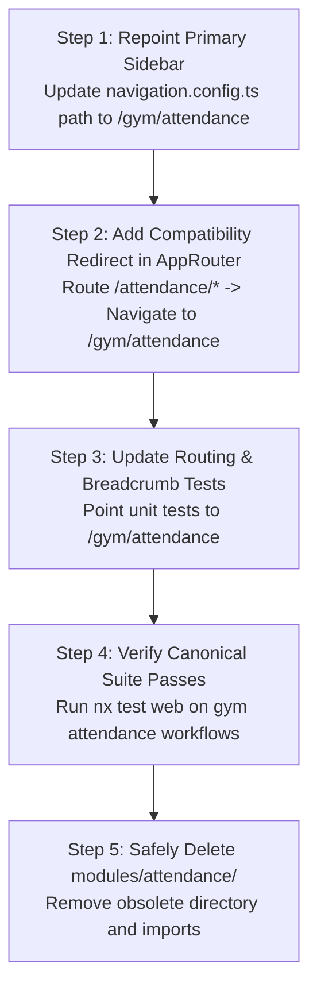

# Milestone 6: Gym Management Implementation Blueprint

**Status:** Approved & Frozen  
**Author:** Principal Software Architect & Full-Stack Lead  
**Scope:** Milestone 6 Gym Management, Ingress Reception Desk, Membership Lifecycle, Attendance Consolidation, and Trainer Operations  
**Date:** October 2026  
**Audited Baseline:** [`docs/audits/milestone-6-1-gym-attendance-audit.md`](file:///c:/Projects/kinergy-platform/docs/audits/milestone-6-1-gym-attendance-audit.md)  
**Authoritative References:**

- [`docs/audits/frontend-productization/frontend-productization-roadmap.md`](file:///c:/Projects/kinergy-platform/docs/audits/frontend-productization/frontend-productization-roadmap.md) (`ROADMAP-FE-006`)
- [`docs/audits/frontend-productization/temporary-ui-disposition.md`](file:///c:/Projects/kinergy-platform/docs/audits/frontend-productization/temporary-ui-disposition.md) (`Item D-1`)
- [`docs/adr/0054-gym-management-bounded-context-ownership-and-context-map.md`](file:///c:/Projects/kinergy-platform/docs/adr/0054-gym-management-bounded-context-ownership-and-context-map.md)
- [`docs/adr/0055-gym-management-canonical-domain-vocabulary-and-semantic-contracts.md`](file:///c:/Projects/kinergy-platform/docs/adr/0055-gym-management-canonical-domain-vocabulary-and-semantic-contracts.md)
- [`docs/adr/0056-gym-management-aggregate-discovery-and-boundary-decisions.md`](file:///c:/Projects/kinergy-platform/docs/adr/0056-gym-management-aggregate-discovery-and-boundary-decisions.md)
- [`docs/adr/0057-gym-management-domain-invariants-and-lifecycle-model.md`](file:///c:/Projects/kinergy-platform/docs/adr/0057-gym-management-domain-invariants-and-lifecycle-model.md)
- [`docs/adr/0058-gym-management-membership-plan-commercial-and-pricing-model.md`](file:///c:/Projects/kinergy-platform/docs/adr/0058-gym-management-membership-plan-commercial-and-pricing-model.md)
- [`docs/adr/0059-gym-management-membership-historical-integrity-and-plan-decoupling-strategy.md`](file:///c:/Projects/kinergy-platform/docs/adr/0059-gym-management-membership-historical-integrity-and-plan-decoupling-strategy.md)
- [`docs/adr/0060-gym-management-duplicate-and-overlapping-membership-policy.md`](file:///c:/Projects/kinergy-platform/docs/adr/0060-gym-management-duplicate-and-overlapping-membership-policy.md)
- [`docs/adr/0061-gym-management-membership-renewal-and-expiration-temporal-semantics.md`](file:///c:/Projects/kinergy-platform/docs/adr/0061-gym-management-membership-renewal-and-expiration-temporal-semantics.md)
- [`docs/adr/0062-gym-management-membership-expiration-temporal-semantics-and-canonical-eligibility-model.md`](file:///c:/Projects/kinergy-platform/docs/adr/0062-gym-management-membership-expiration-temporal-semantics-and-canonical-eligibility-model.md)
- [`docs/adr/0063-gym-management-operational-read-models-expiring-soon-semantics-and-notification-boundaries.md`](file:///c:/Projects/kinergy-platform/docs/adr/0063-gym-management-operational-read-models-expiring-soon-semantics-and-notification-boundaries.md)
- [`docs/adr/0064-gym-management-attendance-domain-boundary-identity-and-append-only-log-model.md`](file:///c:/Projects/kinergy-platform/docs/adr/0064-gym-management-attendance-domain-boundary-identity-and-append-only-log-model.md)
- [`docs/adr/0065-gym-management-membership-eligibility-contract-and-cross-context-integration.md`](file:///c:/Projects/kinergy-platform/docs/adr/0065-gym-management-membership-eligibility-contract-and-cross-context-integration.md)
- [`docs/adr/0066-gym-management-record-check-in-use-case-anti-passback-and-idempotency.md`](file:///c:/Projects/kinergy-platform/docs/adr/0066-gym-management-record-check-in-use-case-anti-passback-and-idempotency.md)
- [`docs/adr/0067-gym-management-duplicate-check-in-concurrency-and-idempotency-architecture.md`](file:///c:/Projects/kinergy-platform/docs/adr/0067-gym-management-duplicate-check-in-concurrency-and-idempotency-architecture.md)
- [`docs/adr/0068-gym-management-attendance-history-and-operational-read-models.md`](file:///c:/Projects/kinergy-platform/docs/adr/0068-gym-management-attendance-history-and-operational-read-models.md)
- [`docs/adr/0069-gym-management-daily-reception-workflow-frontend-architecture.md`](file:///c:/Projects/kinergy-platform/docs/adr/0069-gym-management-daily-reception-workflow-frontend-architecture.md)
- [`docs/adr/0070-gym-management-attendance-and-daily-operations-comprehensive-verification.md`](file:///c:/Projects/kinergy-platform/docs/adr/0070-gym-management-attendance-and-daily-operations-comprehensive-verification.md)
- [`docs/adr/0073-trainer-operational-dashboard-domain-boundaries-and-read-model-architecture.md`](file:///c:/Projects/kinergy-platform/docs/adr/0073-trainer-operational-dashboard-domain-boundaries-and-read-model-architecture.md)
- [`docs/adr/0074-trainer-operational-authorization-boundary-and-object-level-scoping-policy.md`](file:///c:/Projects/kinergy-platform/docs/adr/0074-trainer-operational-authorization-boundary-and-object-level-scoping-policy.md)
- [`docs/adr/0075-trainer-dashboard-cross-context-query-contracts-and-resilience-model.md`](file:///c:/Projects/kinergy-platform/docs/adr/0075-trainer-dashboard-cross-context-query-contracts-and-resilience-model.md)
- [`docs/adr/0076-trainer-operational-read-model-and-kpi-summary-projection.md`](file:///c:/Projects/kinergy-platform/docs/adr/0076-trainer-operational-read-model-and-kpi-summary-projection.md)
- [`docs/adr/0077-trainer-dashboard-application-api-endpoints-and-error-mapping.md`](file:///c:/Projects/kinergy-platform/docs/adr/0077-trainer-dashboard-application-api-endpoints-and-error-mapping.md)
- [`docs/adr/0078-trainer-dashboard-performance-pagination-and-resilience-strategy.md`](file:///c:/Projects/kinergy-platform/docs/adr/0078-trainer-dashboard-performance-pagination-and-resilience-strategy.md)
- [`docs/adr/0079-gym-management-application-use-case-inventory-and-architecture.md`](file:///c:/Projects/kinergy-platform/docs/adr/0079-gym-management-application-use-case-inventory-and-architecture.md)
- [`docs/adr/0080-gym-management-production-persistence-and-relational-mapping.md`](file:///c:/Projects/kinergy-platform/docs/adr/0080-gym-management-production-persistence-and-relational-mapping.md)
- [`docs/adr/0139-cross-domain-commercial-integration-contract.md`](file:///c:/Projects/kinergy-platform/docs/adr/0139-cross-domain-commercial-integration-contract.md)

---

## 1. Executive Summary & Architectural Scope

This blueprint establishes the **deterministic, dependency-ordered technical specification and implementation plan** for **Milestone 6: Gym Management & Ingress Reception Experience**.

### 1.1 Objective & Business Outcomes

Milestone 6 operationalizes physical access control, membership commercialization, lifecycle operations, and personal trainer supervision across Kinergy facilities. When delivered, operational staff will be empowered to:

1. **Verify Facility Ingress in $< 2\text{ seconds}$**: Rapid barcode, RFID, QR, and member lookup desk authoritatively evaluating backend admission eligibility and enforcing anti-passback defense ($300\text{s}$ cooldown).
2. **Consolidate Reception Routing**: Retire the obsolete, contract-broken standalone attendance route (`/attendance`) in favor of the production-grade `/gym/attendance` workspace with URL deep-linking and member history inspection.
3. **Govern Commercial Membership Plans**: Full plan catalog lifecycle (`DRAFT` $\to$ `ACTIVE` $\to$ `ARCHIVED`), price updating for future sales while preserving historical agreement terms, and duration immutability.
4. **Manage Agreement Lifecycles**: Enroll clients into active plans, execute seamless renewals, enforce calendar freeze windows with automatic expiration extensions, voluntary cancellations with reason audit, and automated batch expiration.
5. **Empower Personal Trainers**: Floor-ready Trainer Operational Dashboard (`/gym/trainer-dashboard`) with horizontal tenant/trainer isolation, assigned athlete rosters, urgent renewal lookahead radars ($7\text{ days}$), and scoped arrival feeds with least-privilege commercial masking.

### 1.2 Audit Baseline & Readiness Verdict

The [Milestone 6.1 Audit Report](file:///c:/Projects/kinergy-platform/docs/audits/milestone-6-1-gym-attendance-audit.md) established that the core domain logic, Prisma relational mapping, HTTP controllers, and web modules are **already substantially built and pass 64 test suites (618 tests)**.

However, **production operation is blocked by 4 specific architectural gaps**:

- **Blocker 1 (Navigation Misdirection):** The primary sidebar (`navigation.config.ts#L69`) routes staff to `/attendance` (the obsolete module with non-existent endpoints) instead of `/gym/attendance`.
- **Blocker 2 (Client Lookup Bypass):** `GymModule` injects `DefaultClientLookupPort` which unconditionally returns `true`, skipping client existence and active status verification in live production.
- **Blocker 3 (Domain Event Swallowing):** `GymModule` injects `DefaultGymEventPublisherPort` which discards all gym domain events in an empty async method, breaking timeline projections in `modules/client`.
- **Blocker 4 (Optimistic Concurrency Blindspot):** `PrismaMembershipRepository.save()` increments `version` on upsert without conditional `where: { id, version: expectedVersion }` verification.

---

## 2. Attendance Consolidation Plan

### 2.1 Canonical Module Selection & Justification

The module located at [`apps/web/src/modules/gym/attendance/`](file:///c:/Projects/kinergy-platform/apps/web/src/modules/gym/attendance/) is officially designated as the **sole canonical attendance implementation**.

#### Architectural Evidence:

1. **API Contract Fidelity**:
   - `modules/gym/attendance/api/attendance-api.ts` maps 100% accurately to backend controllers:
     - `GET /api/v1/gym/memberships/eligibility/check?clientId=:id&asOf=:iso` $\to$ Matched.
     - `GET /api/v1/gym/attendance/client/:clientId` $\to$ Matched.
     - `GET /api/v1/gym/attendance/search` $\to$ Matched.
   - The retiring `apps/web/src/modules/attendance/api/attendance-api.ts` targets **non-existent endpoints** that fail with HTTP 404 in live runtime:
     - `/api/v1/gym/memberships/eligibility/:clientId` (404)
     - `/api/v1/gym/attendance/clients/:clientId/history` (404)
2. **Feature Superset**:
   - `modules/gym/attendance/` incorporates [`ClientAttendanceHistoryDialog`](file:///c:/Projects/kinergy-platform/apps/web/src/modules/gym/attendance/components/client-attendance-history-dialog.tsx), enabling front-desk receptionists to click "History" on any table row to inspect lifetime visit stats without leaving the admission desk.
   - `modules/gym/attendance/` integrates [`useAttendanceFilters`](file:///c:/Projects/kinergy-platform/apps/web/src/modules/gym/attendance/hooks/use-attendance-filters.ts) backed by `useTableUrlState`, synchronizing `clientId`, `historyClientId`, `result`, `method`, `page`, and `limit` into URL query parameters for bookmarking and page reloads.
3. **Cache Key Partitioning**:
   - Canonical module uses hierarchical keys `['gym', 'attendance', ...]`, isolating gym cache from other contexts.
4. **Roadmap Governance**:
   - `ROADMAP-FE-006` line 199 and `temporary-ui-disposition.md` item D-1 explicitly order the consolidation and retirement of `apps/web/src/modules/attendance/`.

### 2.2 Features and Components to Preserve

| Feature / Capability              | Preserved In Canonical Location                                          | Notes                                                                                                                                       |
| :-------------------------------- | :----------------------------------------------------------------------- | :------------------------------------------------------------------------------------------------------------------------------------------ |
| **Member Quick Search**           | `modules/gym/attendance/components/client-search-bar.tsx`                | Autocomplete search via `/api/v1/clients/search?q=...` with auto-focus for barcode wedge scanners.                                          |
| **Eligibility Verification Card** | `modules/gym/attendance/components/membership-eligibility-card.tsx`      | Visual outcome pill (`GRANTED`, `DENIED_EXPIRED`, `DENIED_FROZEN`), date intervals, and denial explanation.                                 |
| **Ingress Action Panel**          | `modules/gym/attendance/components/check-in-action-panel.tsx`            | Admission button with mutation lockdown (`isPending`), method selector (`QR_CODE`, `BARCODE`, `RFID`, etc.), and idempotency key injection. |
| **Today's Operational Feed**      | `modules/gym/attendance/components/today-attendance-table.tsx`           | Real-time arrival stream, KPI banner (`totalCheckIns`, `grantedCount`, `deniedCount`), outcome filtering, and 15s polling.                  |
| **Member Visit History Modal**    | `modules/gym/attendance/components/client-attendance-history-dialog.tsx` | **Unique to canonical**: Chronological visit table, visit counter, first/last visit timestamps.                                             |
| **URL State Synchronization**     | `modules/gym/attendance/hooks/use-attendance-filters.ts`                 | **Unique to canonical**: Full deep-linking for receptionists.                                                                               |

### 2.3 Route Mapping and Compatibility Redirect

```text
OLD ROUTE (Retiring):           /attendance
NEW CANONICAL ROUTE:             /gym/attendance
```

To guarantee that bookmarks, browser histories, and external links do not break:

1. In `apps/web/src/app/routes/app-router.tsx`:
   - Replace the `AttendanceSubRouter` mounting at `/attendance/*` with an immediate HTTP 301 client redirect:
     ```tsx
     <Route path="attendance" element={<Navigate to="/gym/attendance" replace />} />
     <Route path="attendance/*" element={<Navigate to="/gym/attendance" replace />} />
     ```
2. In `apps/web/src/app/navigation/navigation.config.ts`:
   - Update navigation item `id: 'attendance'` from `path: '/attendance'` to `path: '/gym/attendance'`.

### 2.4 Consumer Migration Sequence



### 2.5 Tests Required Prior to Deletion

Before removing `apps/web/src/modules/attendance/`, the following verification gates must pass:

1. `apps/web/src/modules/gym/__tests__/attendance-workflows.spec.tsx` (9 tests passing).
2. `apps/web/src/modules/gym/__tests__/url-driven-state-hardening.spec.tsx` (URL state tests passing).
3. `apps/web/src/app/routes/__tests__/routing-architecture-integration.spec.tsx` (Updated to verify `/gym/attendance` renders canonical page and `/attendance` redirects).
4. `apps/web/src/app/navigation/__tests__/navigation-builder.spec.ts` (Updated to verify sidebar points to `/gym/attendance`).

---

## 3. Verified API Contract Matrix

### 3.1 Turnstile Admission & Attendance API (`AttendanceController`)

| Operation                     | Route & Method                                | Request Payload / Query                                                                                                                                                                                  | Authoritative Response                                                                                                                                                                                                                                                                                  | Permissions                                                      | Invariants & Error Codes                                                                                                                                                                                                               |
| :---------------------------- | :-------------------------------------------- | :------------------------------------------------------------------------------------------------------------------------------------------------------------------------------------------------------- | :------------------------------------------------------------------------------------------------------------------------------------------------------------------------------------------------------------------------------------------------------------------------------------------------------ | :--------------------------------------------------------------- | :------------------------------------------------------------------------------------------------------------------------------------------------------------------------------------------------------------------------------------- |
| **Record Check-In Admission** | `POST /api/v1/gym/attendance/check-in`        | `RecordCheckInRequestDto`<br>• `clientId: string` (UUID)<br>• `method?: CheckInMethod` (default `QR_CODE`)<br>• `gateId?: string`<br>• `notes?: string`<br>• `idempotencyKey?: string`                   | `RecordCheckInResponseDto`<br>• `isGranted: boolean`<br>• `outcome: AccessResult`<br>• `attendanceId: string`<br>• `clientId: string`<br>• `membershipId: string \| null`<br>• `checkInTime: string`<br>• `isDuplicate: boolean`<br>• `isIdempotentReplay: boolean`<br>• `denialReason: string \| null` | `attendance.create`<br>Admin, Owner, Receptionist                | • In-memory client lock serializes turnstile entry.<br>• Rejects rapid scan within 5 minutes as `DENIED_DUPLICATE_CHECKIN`.<br>• Cached idempotency key replayed if within 10 min.<br>• HTTP 400 if client ID empty or method invalid. |
| **Today's Arrival Feed**      | `GET /api/v1/gym/attendance/today`            | `DailyAttendanceQueryDto`<br>• `date?: string` (YYYY-MM-DD)<br>• `facilityId?: string`<br>• `result?: string`<br>• `method?: string`<br>• `page?: number` (default 1)<br>• `limit?: number` (default 20) | `PaginatedAttendanceResponseDto`<br>• `items: AttendanceItemDto[]`<br>• `pagination: PaginationMetadataDto`<br>• `dailySummary: AttendanceDailyKPIsDto`<br> (`totalCheckIns`, `grantedCount`, `deniedCount`)                                                                                            | `attendance.read`<br>Admin, Owner, Receptionist                  | • Groups records by facility-local `GymDay` partition.<br>• Paginated; stable sort by `checkInTime` desc.<br>• HTTP 200 on success.                                                                                                    |
| **Client Visit History**      | `GET /api/v1/gym/attendance/client/:clientId` | Param: `clientId: string`<br>`ClientAttendanceHistoryQueryDto`<br>• `dateFrom?: string`<br>• `dateTo?: string`<br>• `page?: number`, `limit?: number`                                                    | `PaginatedAttendanceResponseDto`<br>• `items: AttendanceItemDto[]`<br>• `pagination: PaginationMetadataDto`<br>• `clientStats: ClientAttendanceStatsDto`<br> (`totalVisits`, `firstVisitAt`, `lastVisitAt`)                                                                                             | `attendance.read`<br>Admin, Owner, Receptionist, Trainer, Client | • Returns historical visit records for single client.<br>• Calculates total lifetime visits.<br>• HTTP 200 on success.                                                                                                                 |
| **Multi-Criteria Search**     | `GET /api/v1/gym/attendance/search`           | `SearchAttendanceQueryDto`<br>• `clientId?`, `gymDay?`, `dateFrom?`, `dateTo?`<br>• `result?`, `method?`, `page?`, `limit?`                                                                              | `PaginatedAttendanceResponseDto`                                                                                                                                                                                                                                                                        | `attendance.read`<br>Admin, Owner, Receptionist                  | • Multi-criteria audit filter across historical logs.<br>• HTTP 200 on success.                                                                                                                                                        |
| **Attendance KPI Summary**    | `GET /api/v1/gym/attendance/summary`          | `AttendanceSummaryQueryDto`<br>• `startDate: string`<br>• `endDate: string`<br>• `facilityId?: string`                                                                                                   | `AttendanceRangeSummaryDTO`<br>• `totalCheckIns: number`<br>• `grantedCount: number`<br>• `hourlyDistribution: Record<number, number>`                                                                                                                                                                  | `attendance.read`<br>Admin, Owner, Receptionist                  | • Evaluates aggregate facility utilization across date interval.<br>• HTTP 200 on success.                                                                                                                                             |

### 3.2 Membership Agreement Lifecycle API (`MembershipsController`)

| Operation                    | Route & Method                                  | Request Payload / Query                                                                                                               | Authoritative Response                                                                                                                                                                                                                                                            | Permissions                                               | Invariants & Error Codes                                                                                                                                                                                                        |
| :--------------------------- | :---------------------------------------------- | :------------------------------------------------------------------------------------------------------------------------------------ | :-------------------------------------------------------------------------------------------------------------------------------------------------------------------------------------------------------------------------------------------------------------------------------- | :-------------------------------------------------------- | :------------------------------------------------------------------------------------------------------------------------------------------------------------------------------------------------------------------------------ |
| **Check Client Eligibility** | `GET /api/v1/gym/memberships/eligibility/check` | `CheckEligibilityQueryDto`<br>• `clientId: string`<br>• `asOf?: string` (ISO 8601)                                                    | `MembershipEligibilityResponseDto`<br>• `clientId: string`<br>• `isEligible: boolean`<br>• `outcome: string`<br>• `membershipId?: string \| null`<br>• `planId?: string \| null`<br>• `period?: { startDate, endDate }`<br>• `evaluatedAt: string`<br>• `reason?: string \| null` | `memberships.read`<br>Admin, Owner, Receptionist, Trainer | • Validates client active standing in Client Management.<br>• Evaluates active non-frozen membership for `asOf` date.<br>• Deterministic multi-membership resolution.<br>• Returns HTTP 200 with structured diagnostic outcome. |
| **Enroll Member (Create)**   | `POST /api/v1/gym/memberships`                  | `CreateMembershipRequestDto`<br>• `clientId: string`<br>• `planId: string`<br>• `startDate: string`<br>• `assignedTrainerId?: string` | `MembershipResponseDto`<br>• `id: string`<br>• `clientId: string`<br>• `planId: string`<br>• `status: MembershipStatus`<br>• `startDate: string`<br>• `endDate: string`<br>• `version: number`                                                                                    | `memberships.create`<br>Admin, Owner, Receptionist        | • Target plan must exist and have `ACTIVE` status.<br>• `MembershipOverlapPolicy` rejects conflicting active periods.<br>• Status is `PENDING` if `startDate > now`, else `ACTIVE`.<br>• Emits `MembershipCreatedEvent`.        |
| **Get Membership by ID**     | `GET /api/v1/gym/memberships/:id`               | Param: `id: string`                                                                                                                   | `MembershipResponseDto`                                                                                                                                                                                                                                                           | `memberships.read`<br>Authenticated                       | • Returns agreement details and freeze history.<br>• HTTP 404 if not found.                                                                                                                                                     |
| **List Memberships**         | `GET /api/v1/gym/memberships`                   | `ListMembershipsQueryDto`<br>• `clientId?`, `planId?`, `status?`<br>• Date range filters, `page?`, `limit?`                           | `PaginatedMembershipsResponseDto`                                                                                                                                                                                                                                                 | `memberships.read`<br>Admin, Owner, Receptionist          | • Server-side paginated agreement directory.<br>• HTTP 200 on success.                                                                                                                                                          |
| **Renew Membership**         | `POST /api/v1/gym/memberships/:id/renew`        | Param: `id: string`<br>`RenewMembershipRequestDto`<br>• `newPlanId?: string`<br>• `effectiveDate?: string`                            | `MembershipResponseDto`                                                                                                                                                                                                                                                           | `memberships.update`<br>Admin, Owner, Receptionist        | • Gapless extension if `ACTIVE`: `endDate = endDate + duration`.<br>• Lapsed renewal: re-activates agreement from `effectiveDate`.<br>• Emits `MembershipRenewedEvent`.                                                         |
| **Freeze Agreement**         | `POST /api/v1/gym/memberships/:id/freeze`       | Param: `id: string`<br>`FreezeMembershipRequestDto`<br>• `startDate: string`<br>• `endDate: string`<br>• `reason: string`             | `MembershipResponseDto`                                                                                                                                                                                                                                                           | `memberships.update`<br>Admin, Owner, Receptionist        | • Only `ACTIVE` memberships can be frozen.<br>• Date interval must be valid (`startDate < endDate`).<br>• Immediately revokes check-in eligibility.<br>• Emits `MembershipFrozenEvent`.                                         |
| **Unfreeze Agreement**       | `POST /api/v1/gym/memberships/:id/unfreeze`     | Param: `id: string`                                                                                                                   | `MembershipResponseDto`                                                                                                                                                                                                                                                           | `memberships.update`<br>Admin, Owner, Receptionist        | • Only `FROZEN` memberships can be unfrozen.<br>• **Automatically extends `endDate` by freeze duration.**<br>• Restores admission eligibility immediately.<br>• Emits `MembershipUnfrozenEvent`.                                |
| **Cancel Agreement**         | `POST /api/v1/gym/memberships/:id/cancel`       | Param: `id: string`<br>`CancelMembershipRequestDto`<br>• `reason: string`                                                             | `MembershipResponseDto`                                                                                                                                                                                                                                                           | `memberships.update`<br>Admin, Owner, Receptionist        | • Transitions `PENDING`/`ACTIVE`/`FROZEN` $\to$ `CANCELLED`.<br>• Mandatory non-empty reason string.<br>• Emits `MembershipCancelledEvent`.                                                                                     |
| **Expiring Soon Radar**      | `GET /api/v1/gym/memberships/expiring`          | Query: `horizonDays?: number` (default 7)                                                                                             | `ExpiringMembershipsResponseDto`<br>• `items: ExpiringMembershipItemDto[]`<br>• `total: number`<br>• `horizonDays: number`                                                                                                                                                        | `memberships.read`<br>Admin, Owner, Receptionist, Trainer | • Queries agreements expiring within $[1, \text{horizonDays}]$.<br>• Sorted by `daysRemaining` ascending.                                                                                                                       |
| **Batch Expiration Job**     | `POST /api/v1/gym/memberships/expire-batch`     | `ExpireMembershipsBatchRequestDto`<br>• `asOfDate?: string`<br>• `batchSize?: number`<br>• `dryRun?: boolean`                         | `ExpireMembershipsBatchResponseDto`<br>• `processedCount: number`<br>• `expiredIds: string[]`                                                                                                                                                                                     | `memberships.update`<br>Admin, Owner                      | • Deterministic batch maintenance expiring overdue agreements.<br>• Emits `MembershipExpiredEvent` per record.                                                                                                                  |

### 3.3 Commercial Membership Plan API (`MembershipPlansController`)

| Operation          | Route & Method                                   | Request Payload / Query                                                                                                                                                                                                                                                   | Authoritative Response                                                                                                                                                                                                    | Permissions                    | Invariants & Error Codes                                                                                                                         |
| :----------------- | :----------------------------------------------- | :------------------------------------------------------------------------------------------------------------------------------------------------------------------------------------------------------------------------------------------------------------------------ | :------------------------------------------------------------------------------------------------------------------------------------------------------------------------------------------------------------------------ | :----------------------------- | :----------------------------------------------------------------------------------------------------------------------------------------------- |
| **Create Plan**    | `POST /api/v1/gym/membership-plans`              | `CreateMembershipPlanRequestDto`<br>• `code: string` (e.g. `PLAN_GOLD`)<br>• `name: string`<br>• `description?: string`<br>• `durationInDays: number` ($\ge 1$)<br>• `priceAmount: number` ($\ge 0$)<br>• `priceCurrency: string` (e.g. `USD`)<br>• `visitQuota?: number` | `MembershipPlanResponseDto`<br>• `id: string`<br>• `code: string`<br>• `name: string`<br>• `status: 'DRAFT'`<br>• `durationInDays: number`<br>• `priceAmount: number`<br>• `priceCurrency: string`<br>• `version: number` | `plans.create`<br>Admin, Owner | • Unique uppercase plan code.<br>• Starts strictly in `DRAFT` status.<br>• HTTP 400 on duplicate code or invalid price/duration.                 |
| **List Plans**     | `GET /api/v1/gym/membership-plans`               | `ListMembershipPlansQueryDto`<br>• `activeOnly?: boolean`<br>• `status?: PlanStatus`<br>• `search?: string`, `page?`, `limit?`                                                                                                                                            | `PaginatedMembershipPlansResponseDto`                                                                                                                                                                                     | Authenticated                  | • Paginated catalog listing.<br>• HTTP 200 on success.                                                                                           |
| **Get Plan by ID** | `GET /api/v1/gym/membership-plans/:id`           | Param: `id: string`                                                                                                                                                                                                                                                       | `MembershipPlanResponseDto`                                                                                                                                                                                               | Authenticated                  | • HTTP 404 if not found.                                                                                                                         |
| **Update Pricing** | `PATCH /api/v1/gym/membership-plans/:id/pricing` | Param: `id: string`<br>`UpdateMembershipPlanPricingRequestDto`<br>• `priceAmount: number`<br>• `currency: string`                                                                                                                                                         | `MembershipPlanResponseDto`                                                                                                                                                                                               | `plans.update`<br>Admin, Owner | • Updates price for future sales only (ADR-0059).<br>• Historical memberships remain decoupled.<br>• Rejected with HTTP 400 on `ARCHIVED` plans. |
| **Publish Plan**   | `POST /api/v1/gym/membership-plans/:id/publish`  | Param: `id: string`                                                                                                                                                                                                                                                       | `MembershipPlanResponseDto`                                                                                                                                                                                               | `plans.update`<br>Admin, Owner | • Transitions `DRAFT` $\to$ `ACTIVE`.<br>• Idempotent if already `ACTIVE`.<br>• Rejected with HTTP 400 on `ARCHIVED` plans.                      |
| **Archive Plan**   | `POST /api/v1/gym/membership-plans/:id/archive`  | Param: `id: string`                                                                                                                                                                                                                                                       | `MembershipPlanResponseDto`                                                                                                                                                                                               | `plans.update`<br>Admin, Owner | • Transitions `ACTIVE` $\to$ `ARCHIVED`.<br>• Permanently removes plan from future sales.<br>• Existing memberships remain intact.               |

### 3.4 Trainer Operational Dashboard API (`TrainerDashboardController`)

| Operation                   | Route & Method                                           | Request Payload / Query                                                                                  | Authoritative Response                                                                                                                                               | Permissions                             | Invariants & Error Codes                                                                                                           |
| :-------------------------- | :------------------------------------------------------- | :------------------------------------------------------------------------------------------------------- | :------------------------------------------------------------------------------------------------------------------------------------------------------------------- | :-------------------------------------- | :--------------------------------------------------------------------------------------------------------------------------------- |
| **Trainer Summary KPIs**    | `GET /api/v1/gym/trainer-dashboard/summary`              | Query: `trainerId?`, `asOfDate?`, `horizonDays?`                                                         | `TrainerDashboardSummaryResponseDto`<br>• `activeClientsCount: number`<br>• `expiringSoonCount: number`<br>• `todayCheckInsCount: number`<br>• `projectedAt: string` | `clients.read`<br>Trainer, Admin, Owner | • Scoped to authenticated trainer (`currentUser.id`).<br>• Cross-trainer parameter rejected unless Admin/Owner (ADR-0074).         |
| **Assigned Clients Roster** | `GET /api/v1/gym/trainer-dashboard/clients`              | `AssignedClientsQueryDto`<br>• `page?`, `limit?`, `statuses?`<br>• `sortBy?`, `sortOrder?`, `trainerId?` | `PaginatedAssignedClientsResponseDto`<br>• `items: AssignedClientItemDto[]`<br>• `totalItems: number`                                                                | `clients.read`<br>Trainer, Admin, Owner | • Scoped to trainer's assigned athletes.<br>• **Commercial plan price is masked/omitted** (least privilege).                       |
| **Expiring Memberships**    | `GET /api/v1/gym/trainer-dashboard/expiring-memberships` | Query: `horizonDays?` (default 7), `trainerId?`                                                          | `ExpiringMembershipsResponseDto`                                                                                                                                     | `clients.read`<br>Trainer, Admin, Owner | • Scoped strictly to trainer's assigned athletes.<br>• Sorted by urgency (`daysRemaining` ascending).                              |
| **Assigned Arrivals Feed**  | `GET /api/v1/gym/trainer-dashboard/attendance`           | `TrainerAttendanceQueryDto`<br>• `date?`, `facilityId?`, `trainerId?`                                    | `TrainerAttendanceResponseDto`<br>• `items: AttendanceItemDto[]`<br>• `total: number`<br>• `grantedCount: number`                                                    | `clients.read`<br>Trainer, Admin, Owner | • Filters daily facility check-ins strictly to trainer's assigned client whitelist.<br>• Floor trainers have read-only visibility. |

---

## 4. Critical Domain Invariants & Business Logic

### 4.1 Admission Eligibility Permutations (ADR-0062, ADR-0065)

`CheckMembershipEligibilityHandler` executes a deterministic 8-step decision tree:

```mermaid
graph TD
    Start[Check Ingress Request] --> CheckClient{Client Active in Client Context?}
    CheckClient -->|NO| DenyClient[DENIED_INACTIVE_CLIENT]
    CheckClient -->|YES| CheckMems{Has Memberships on Record?}
    CheckMems -->|NO| DenyNoMem[DENIED_NO_MEMBERSHIP]
    CheckMems -->|YES| CheckActive{Any Membership ACTIVE and within [start, end) and not Frozen?}
    CheckActive -->|YES| Grant[GRANTED: Return membershipId & planId]
    CheckActive -->|NO| Diagnose[Diagnose Ineligibility Reason]
    Diagnose --> CheckFrozen{Is Agreement FROZEN?}
    CheckFrozen -->|YES| DenyFrozen[DENIED_FROZEN]
    CheckFrozen -->|NO| CheckFuture{Is Agreement PENDING / Future Start?}
    CheckFuture -->|YES| DenyFuture[DENIED_NO_MEMBERSHIP: Not yet active]
    CheckFuture -->|NO| CheckExpired{Is Agreement EXPIRED / Past End Date?}
    CheckExpired -->|YES| DenyExpired[DENIED_EXPIRED]
    CheckExpired -->|NO| CheckTerminal{Is CANCELLED or TERMINATED?}
    CheckTerminal -->|YES| DenyTerminal[DENIED_NO_MEMBERSHIP: Agreement terminated]
```

### 4.2 Temporal Boundary Precision

- Half-open interval: $[ \text{startDate}, \text{endDate} )$.
- `instant == endDate - 1ms` $\to$ **`GRANTED`** (Valid up to final millisecond).
- `instant == endDate` $\to$ **`DENIED_EXPIRED`** (Expired on the exact boundary).
- `instant == endDate + 1ms` $\to$ **`DENIED_EXPIRED`**.

### 4.3 Facility Timezone & GymDay Boundaries (ADR-0064)

- Daily facility operations operate on local time, not raw UTC.
- Evaluated via `GymDay.fromUtc(timestamp, timezone, facilityId)`:
  - `23:59:59.999` Guayaquil time (UTC-5) $\to$ current facility GymDay.
  - `00:00:00.000` Guayaquil time (UTC-5) $\to$ next facility GymDay.
- All admission counters, daily feeds, and KPIs group strictly by `gymDay`.

### 4.4 Anti-Passback & Idempotency Rules (ADR-0066, ADR-0067)

1. **5-Minute Anti-Passback Cooldown**:
   - `antiPassbackCooldownMs = 300,000ms`.
   - Any second check-in attempt for the same client within 5 minutes of a prior `GRANTED` entry is rejected as `DENIED_DUPLICATE_CHECKIN`.
   - A subsequent scan after 5 minutes on the same calendar day is **`GRANTED`** (re-entry allowed).
2. **Turnstile Concurrency Mutex**:
   - In-memory Promise mutex serialized per `clientId`.
   - 10 parallel scans for the same member result in exactly 1 `GRANTED` and 9 `DENIED_DUPLICATE_CHECKIN`.
3. **Idempotency Replay**:
   - Supplying `idempotencyKey` caches the admission result for 10 minutes (`600,000ms`).
   - Network retries return the cached response with `isIdempotentReplay: true` without creating duplicate records.
4. **Zero Exception Policy**:
   - `RecordCheckInCommand` has no override parameter. Expired or frozen members cannot be admitted without formally unfreezing or renewing the agreement.

### 4.5 Membership Agreement Dates, Freeze & Renewal Invariants

1. **Freeze Window Semantics**:
   - Freezing transitions agreement: `ACTIVE` $\to$ `FROZEN`.
   - Appends an immutable `FreezeWindow` (`startDate`, `endDate`, `reason`).
   - Suspends admission immediately.
2. **Unfreeze Duration Extension**:
   - Resuming transitions agreement: `FROZEN` $\to$ `ACTIVE`.
   - **The aggregate automatically extends `endDate` by the exact duration of the freeze**:
     $$\text{endDate}_{\text{new}} = \text{endDate}_{\text{old}} + \text{durationDays}$$
   - Restores check-in eligibility immediately.
3. **Renewal Semantics**:
   - Early renewal (while `ACTIVE`): Extends `endDate` gaplessly from the current expiration date.
   - Lapsed renewal (after `EXPIRED`): Re-activates agreement starting from the new `effectiveDate`.
4. **Voluntary Cancellation**:
   - Transitions `PENDING`/`ACTIVE`/`FROZEN` $\to$ `CANCELLED`.
   - Requires mandatory non-empty reason string.
   - Irrevocably terminates access rights.
5. **Overlapping Commitments (ADR-0060)**:
   - A client cannot possess two concurrent active, pending, or frozen agreements whose validity intervals overlap.
   - Adjacent agreements (`next.startDate >= current.endDate`) are allowed.

### 4.6 Commercial Plan Invariants (ADR-0058, ADR-0059)

1. **Decoupled Pricing**:
   - `updatePricing()` updates price for future sales only.
   - Existing enrolled memberships retain their original pricing and terms.
2. **Catalog Immutability**:
   - `durationInDays` and `code` cannot be modified after plan creation.
   - Plans with enrolled memberships cannot be deleted (`onDelete: Restrict`).
   - Archiving permanently terminates new sales while preserving historical agreements.

### 4.7 Trainer Authorization & Object-Level Scoping (ADR-0074)

1. **Horizontal Isolation**:
   - Floor trainers calling `/gym/trainer-dashboard/*` can only view their own assigned clients (`currentUser.id == targetTrainerId`).
   - Any cross-trainer query returns HTTP 403 Forbidden unless caller holds `Admin` or `Owner` roles.
2. **Least Privilege / Commercial Masking**:
   - Floor trainers are restricted from viewing commercial pricing (`priceAmount`) on client memberships unless they possess the `billing.read` permission.
3. **Turnstile Mutation Lockdown**:
   - Floor trainers have zero write authority on turnstile admissions.

---

## 5. Required Backend Work and Blockers

To promote Gym Management to production grade without runtime stubs, execute the following 4 backend remediations:

### Blocker 1: Production Client Lookup Adapter (`DEF-GYM-01`)

- **Current State:** `GymModule#L68-72` binds `DefaultClientLookupPort` which unconditionally returns `true`.
- **Remediation:** Create `PrismaClientLookupAdapter` implementing `ClientLookupPort` in `apps/api/src/gym/infrastructure/`. Query `prisma.client.findUnique({ where: { id: clientId } })` and verify `client.status === 'ACTIVE'`. Inject into `GymModule`.

### Blocker 2: Platform Event Bus Dispatcher (`DEF-GYM-02`)

- **Current State:** `GymModule#L74-76` binds `DefaultGymEventPublisherPort` which drops all domain events.
- **Remediation:** Create `NestGymEventPublisherAdapter` implementing `GymEventPublisherPort` using NestJS `EventEmitter2` or the platform `AuditEventPublisher`. Dispatched events (`MembershipCreatedEvent`, `AttendanceCheckedInEvent`) will trigger the client longitudinal activity timeline projection (`ClientTimelineProjectionHandler`).

### Blocker 3: Optimistic Concurrency Control in Prisma (`DEF-GYM-05`)

- **Current State:** `PrismaMembershipRepository.save()` executes `upsert` incrementing `version` without conditional matching on `expectedVersion`.
- **Remediation:** In `PrismaMembershipRepository.save()`, update the query to match `where: { id: data.id, version: membership.version }`. Throw `ConcurrencyConflictException` (mapping to HTTP 409) if no record is updated.

### Blocker 4: Persistent Commercial Fulfillment Store (`DEF-GYM-08`)

- **Current State:** `GymModule#L340-342` binds `InMemoryGymFulfillmentStore`.
- **Remediation:** Create a Prisma-backed fulfillment store mapping sales checkout records to gym membership activations in PostgreSQL.

---

## 6. Implementation Sequence & Dependency Roadmap

```mermaid
gantt
    title Milestone 6 Implementation Roadmap
    dateFormat  YYYY-MM-DD
    section Implementation Stages
    Stage 1: Backend Wiring & DI Hardening           :s1, 2026-10-27, 1d
    Stage 2: Frontend Attendance Consolidation       :s2, after s1, 1d
    Stage 3: Reception Admission Desk Polish         :s3, after s2, 1d
    Stage 4: Membership Plan Catalog Lifecycle       :s4, after s3, 1d
    Stage 5: Membership Enrollment & Lifecycle Ops   :s5, after s4, 1d
    Stage 6: Trainer Operational Dashboard Polish    :s6, after s5, 1d
    Stage 7: Concurrency, OCC & E2E Acceptance       :s7, after s6, 1d
```

### Stage 1: API Integration Foundation & Backend Hardening

- **Objective:** Eliminate backend DI stubs and wire production adapters.
- **Dependencies:** Milestone 1, Milestone 3.
- **Tasks:**
  1. Implement `PrismaClientLookupAdapter` in `apps/api/src/gym/infrastructure/` and bind in `GymModule`.
  2. Implement `NestGymEventPublisherAdapter` in `apps/api/src/gym/infrastructure/` and bind in `GymModule`.
  3. Verify `apps/api/src/gym/__tests__/gym.module.spec.ts` passes with genuine adapters.
- **Exit Criteria:** Enrolling an inactive client ID is rejected with HTTP 422; completing an enrollment dispatches `MembershipCreatedEvent`.

### Stage 2: Attendance Consolidation & Navigation Migration

- **Objective:** Repoint navigation and safely retire `apps/web/src/modules/attendance/`.
- **Dependencies:** Stage 1.
- **Tasks:**
  1. Update `apps/web/src/app/navigation/navigation.config.ts`: change `attendance` path from `/attendance` to `/gym/attendance`.
  2. Update `apps/web/src/app/routes/app-router.tsx`: add redirect from `/attendance` to `/gym/attendance`. Remove import of `modules/attendance/routes/attendance.router`.
  3. Update routing unit tests (`routing-architecture-integration.spec.tsx`, `navigation-builder.spec.ts`, `breadcrumb-generator.spec.ts`).
  4. Delete obsolete directory `apps/web/src/modules/attendance/`.
- **Exit Criteria:** Navigating to `/attendance` redirects cleanly to `/gym/attendance`; zero imports remain referencing `modules/attendance`.

### Stage 3: Reception Admission Desk Experience

- **Objective:** Polish turnstile admission desk at `/gym/attendance`.
- **Dependencies:** Stage 2.
- **Tasks:**
  1. Verify barcode/QR wedge scanner auto-focus and keyboard capture in `ClientSearchBar`.
  2. Ensure eligibility outcome card clearly differentiates all 8 backend outcomes.
  3. Verify turnstile admission button locks immediately during mutation (`isPending`) to prevent physical double-taps.
  4. Ensure `ClientAttendanceHistoryDialog` opens smoothly on table row click.
- **Exit Criteria:** Admission workflow completes in $< 2\text{ seconds}$; duplicate scans trigger warning toast with cooldown details.

### Stage 4: Membership Plan Catalog & Lifecycle

- **Objective:** Finalize commercial plan management at `/gym/plans`.
- **Dependencies:** Stage 1.
- **Tasks:**
  1. Plan Catalog view (`/gym/plans`): Data table with status pills (`DRAFT`, `ACTIVE`, `ARCHIVED`), search, and duration filters.
  2. Plan Creation dialog: Form validating code uniqueness, duration ($\ge 1$), and pricing ($\ge 0$).
  3. Update Pricing dialog: Updates commercial price for future sales without touching historical memberships.
  4. Plan Publishing & Archiving actions with confirmation dialogs.
- **Exit Criteria:** Administrators can create a draft plan, publish it for sale, adjust pricing, and archive it with full audit preservation.

### Stage 5: Membership Enrollment & Lifecycle Operations

- **Objective:** Finalize member agreements management at `/gym/memberships`.
- **Dependencies:** Stage 1, Stage 4.
- **Tasks:**
  1. Enrollment view (`/gym/memberships/new`): Select client, select active plan, configure start date, and assign optional trainer.
  2. Agreement Directory (`/gym/memberships`): Table filtering by status (`ACTIVE`, `FROZEN`, `EXPIRED`, `PENDING`, `CANCELLED`), client, and expiration horizon.
  3. Agreement Details cockpit (`/gym/memberships/:membershipId`): Agreement overview, freeze history log, trainer assignment, and action toolbar.
  4. Renewal dialog: Gapless extension or effective date renewal.
  5. Freeze dialog: Date interval selection (`startDate` to `endDate`) and mandatory reason.
  6. Unfreeze action: Instant resumption with automatic expiration extension banner.
  7. Cancellation dialog: Mandatory termination reason.
- **Exit Criteria:** Receptionists can enroll a member, freeze their pass during travel, unfreeze with automatic date extension, and renew seamlessly.

### Stage 6: Trainer Operational Dashboard

- **Objective:** Finalize floor trainer experience at `/gym/trainer-dashboard`.
- **Dependencies:** Stage 5.
- **Tasks:**
  1. Top-line KPI summary banner (`activeClientsCount`, `expiringSoonCount`, `todayCheckInsCount`).
  2. Assigned clients table with search, status filters, and sorting. Verify commercial plan price is hidden.
  3. Expiring soon radar listing assigned clients up for renewal within 7 days.
  4. Scoped live arrival feed showing check-ins for the trainer's assigned athletes.
  5. Quick member search and real-time eligibility card.
- **Exit Criteria:** Trainers log in and see their assigned athlete roster, urgent renewals, and arrival feed with zero cross-trainer data leakage.

### Stage 7: Concurrency Hardening & Quality Gate Certification

- **Objective:** Verify end-to-end resilience and certify all repository quality gates.
- **Dependencies:** Stages 1 through 6.
- **Tasks:**
  1. Execute multi-turnstile concurrency test proving 10 simultaneous scans serialize to 1 admission and 9 anti-passback rejections.
  2. Run full accessibility audit (`jest-axe`) on all 4 gym views (zero WCAG 2.1 AA violations).
  3. Run complete verification gate: `pnpm validate` (format, lint, typecheck, test, build).
- **Exit Criteria:** Zero build warnings, 100% automated test pass rate across all packages, clean working tree.

---

## 7. Comprehensive Test Plan

### 7.1 Unit & Integration Test Matrix

| Layer           | Target Suite                                                                  | Key Assertions & Scenarios                                                                                                                             |
| :-------------- | :---------------------------------------------------------------------------- | :----------------------------------------------------------------------------------------------------------------------------------------------------- |
| **Domain**      | `packages/core/src/gym/domain/membership/membership.aggregate.spec.ts`        | State machine transitions (`create`, `freeze`, `unfreeze`, `renew`, `cancel`, `terminate`); date interval math; freeze extension calculation.          |
| **Domain**      | `packages/core/src/gym/domain/plan/membership-plan.aggregate.spec.ts`         | Plan publishing, archiving, pricing updates; immutability of code and duration.                                                                        |
| **Domain**      | `packages/core/src/gym/domain/policies/membership-overlap.policy.spec.ts`     | Enforces zero overlapping active/pending/frozen periods; permits adjacent renewals.                                                                    |
| **Domain**      | `packages/core/src/gym/domain/policies/trainer-access.policy.spec.ts`         | Horizontal trainer isolation; commercial price masking without `billing.read`.                                                                         |
| **Application** | `packages/core/src/gym/gym-attendance-comprehensive-verification.spec.ts`     | 8 eligibility permutations; 1ms boundary precision; facility local `GymDay` timezone math; 5-min anti-passback; concurrency mutex; idempotency replay. |
| **API**         | `apps/api/src/gym/controllers/gym-controllers-comprehensive.spec.ts`          | HTTP status codes, validation pipes, role guards on Attendance, Plans, Memberships controllers.                                                        |
| **API**         | `apps/api/src/gym/controllers/trainer-dashboard.controller.spec.ts`           | Object-level security on trainer dashboard routes; parameter scoping.                                                                                  |
| **API**         | `apps/api/src/gym/__tests__/gym.module.spec.ts`                               | Container wiring with genuine `ClientLookupPort` and `GymEventPublisherPort`.                                                                          |
| **Frontend**    | `apps/web/src/modules/gym/__tests__/attendance-workflows.spec.tsx`            | Member autocomplete search; eligibility card rendering; check-in mutation lockdown; today's feed polling; history modal dialog.                        |
| **Frontend**    | `apps/web/src/modules/gym/__tests__/url-driven-state-hardening.spec.tsx`      | URL query synchronization (`?clientId=...`, `?historyClientId=...`, `?result=...`, `?page=...`).                                                       |
| **Frontend**    | `apps/web/src/modules/gym/__tests__/plans-workflows.spec.tsx`                 | Plan catalog filtering, creation modal, pricing update dialog, publish/archive actions.                                                                |
| **Frontend**    | `apps/web/src/modules/gym/__tests__/memberships-workflows.spec.tsx`           | Enrollment form, renewal modal, freeze/unfreeze actions, cancellation reason modal.                                                                    |
| **Frontend**    | `apps/web/src/modules/gym/__tests__/trainer-dashboard-operational.spec.tsx`   | KPI banner rendering, assigned roster table, price masking, scoped arrival feed.                                                                       |
| **Routing**     | `apps/web/src/app/routes/__tests__/routing-architecture-integration.spec.tsx` | Verified `/attendance` redirects to `/gym/attendance`; `/gym/attendance` renders canonical page.                                                       |

---

## 8. Final Acceptance Checklist

Prior to closing Milestone 6, the engineering lead must verify:

- [ ] `apps/web/src/modules/attendance/` is completely removed; zero orphaned imports remain.
- [ ] Navigation sidebar routes `"Attendance & Check-In"` directly to `/gym/attendance`.
- [ ] Direct browser navigation to `/attendance` redirects cleanly to `/gym/attendance`.
- [ ] Ingress admission check-in responds in $< 2\text{ seconds}$ with authoritative eligibility badge.
- [ ] Rapid turnstile re-scans within 5 minutes are rejected as `DENIED_DUPLICATE_CHECKIN`.
- [ ] Turnstile scan retries with identical `idempotencyKey` replay cached result without duplicate records.
- [ ] Commercial plans catalog supports `DRAFT` $\to$ `ACTIVE` $\to$ `ARCHIVED` lifecycle.
- [ ] Plan pricing updates affect future sales only, leaving existing memberships decoupled.
- [ ] Enrolling a member creates agreement in PostgreSQL; overlapping periods are rejected.
- [ ] Freezing an agreement immediately revokes admission eligibility.
- [ ] Unfreezing an agreement automatically extends the expiration date by the freeze duration.
- [ ] Voluntary cancellation terminates access rights and records mandatory reason in audit log.
- [ ] Floor trainers on `/gym/trainer-dashboard` only see their assigned athletes and masked pricing.
- [ ] `GymModule` binds genuine `ClientLookupAdapter` and `GymEventPublisherAdapter`.
- [ ] `jest-axe` accessibility audit passes with 0 violations across all 4 gym views.
- [ ] Full quality gate `pnpm validate` passes cleanly with zero errors.
