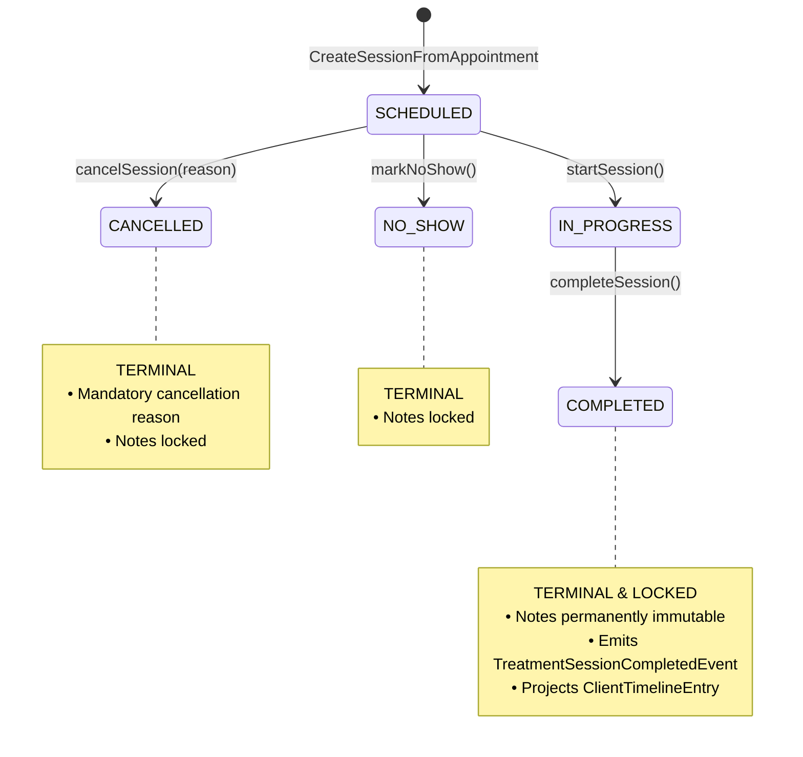
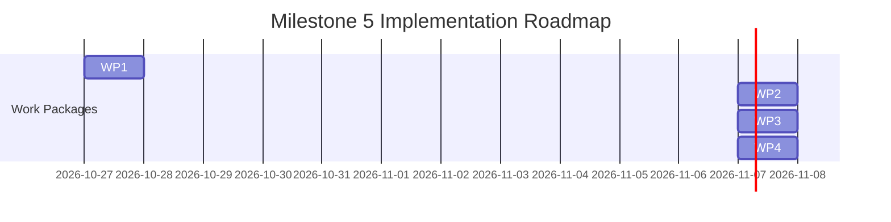

# Milestone 5: Kinesiology Clinical Workflow Contract and Implementation Blueprint

**Status:** Approved & Frozen  
**Author:** Principal Software Architect & Clinical-Workflow Lead  
**Scope:** Milestone 5 Kinesiology Clinical Treatment Workflow (Frontend & Backend Systems)  
**Date:** October 2026  
**Audited Baseline:** [`docs/audits/milestone-5-1-kinesiology-audit.md`](file:///c:/Projects/kinergy-platform/docs/audits/milestone-5-1-kinesiology-audit.md)  
**Authoritative References:**

- [`docs/audits/frontend-productization/frontend-productization-roadmap.md`](file:///c:/Projects/kinergy-platform/docs/audits/frontend-productization/frontend-productization-roadmap.md)
- [`docs/architecture/contexts/kinesiology.md`](file:///c:/Projects/kinergy-platform/docs/architecture/contexts/kinesiology.md)
- [ADR-0045: Kinesiology Bounded Context Ownership & Cross-Context Identifiers](file:///c:/Projects/kinergy-platform/docs/adr/0045-kinesiology-bounded-context-and-cross-context-identifiers.md)
- [ADR-0046: TreatmentSession Lifecycle State Machine & Transition Specification](file:///c:/Projects/kinergy-platform/docs/adr/0046-treatment-session-lifecycle-state-machine-and-transition-specification.md)
- [ADR-0047: Appointment Correlation, Uniqueness & Event Emission Architecture](file:///c:/Projects/kinergy-platform/docs/adr/0047-appointment-to-treatment-session-correlation-and-event-emission-architecture.md)
- [ADR-0048: Scheduling-to-Kinesiology Anti-Corruption Layer Port Architecture](file:///c:/Projects/kinergy-platform/docs/adr/0048-scheduling-to-kinesiology-anti-corruption-layer-port-architecture.md)
- [ADR-0049: Cross-Context Lifecycle Independence & Non-Corruption Invariants](file:///c:/Projects/kinergy-platform/docs/adr/0049-cross-context-lifecycle-independence-and-non-corruption-invariants.md)
- [ADR-0050: Clinical Therapist Assignment, Handover & Authorization Architecture](file:///c:/Projects/kinergy-platform/docs/adr/0050-clinical-therapist-assignment-handover-and-authorization-architecture.md)
- [ADR-0051: Clinical Progress Notes (SOAP) Schema, Medico-Legal Immutability & History Query](file:///c:/Projects/kinergy-platform/docs/adr/0051-clinical-progress-notes-soap-schema-medico-legal-immutability-and-treatment-history-query-architecture.md)
- [ADR-0052: Client Longitudinal Activity Timeline & Cross-Context Event Projection](file:///c:/Projects/kinergy-platform/docs/adr/0052-client-longitudinal-activity-timeline-and-cross-context-event-projection-architecture.md)
- [ADR-0053: Clinical Treatment Session Presentation Workflow, SOAP Workspace & API Contract](file:///c:/Projects/kinergy-platform/docs/adr/0053-clinical-treatment-session-presentation-workflow-soap-workspace-and-api-architecture.md)

---

## 1. Executive Summary & Architectural Scope

This blueprint establishes the **deterministic contract freeze, technical specifications, and implementation roadmap** for **Milestone 5: Kinesiology Clinical Treatment Workflow**.

### 1.1 Objective & Business Outcomes

Milestone 5 transitions clinical kinesiology and neuromuscular rehabilitation from an isolated domain core into a fully integrated, production-grade clinical charting workspace. Authorized clinicians and facility managers will be empowered to:

1. Conduct clinical encounters and record structured SOAP progress notes with validation and autosave protection.
2. Formally transition treatment lifecycles (`SCHEDULED` $\to$ `IN_PROGRESS` $\to$ `COMPLETED` / `CANCELLED` / `NO_SHOW`) while enforcing strict medico-legal immutability upon sign-off.
3. Perform clinical handovers and practitioner reassignments with full audit trail preservation and licensing eligibility checks.
4. Query longitudinal client treatment histories with bounded projections, preventing protected health information (PHI) exposure in list views.
5. Ingress seamlessly from booked appointments in the Scheduling calendar directly into active clinical treatment sessions.

### 1.2 Readiness Verdict & Implementation Strategy

Based on the [Milestone 5.1 Audit](file:///c:/Projects/kinergy-platform/docs/audits/milestone-5-1-kinesiology-audit.md), the Kinesiology subsystem is substantially mature, with 100% test pass rates across core (211 tests), API (64 tests), and web (28 tests). However, **full end-to-end productization is blocked by 3 critical backend dependency-injection and routing gaps**:

- **Blocker 1 (Timeline Projection Dead End):** `CompleteTreatmentSessionHandler` receives `undefined` for `DomainEventPublisher` in `KinesiologyModule`. Completion events are not published, breaking the asynchronous `ClientTimelineProjectionHandler`.
- **Blocker 2 (Therapist Eligibility Bypass):** `AssignTherapistToSessionHandler` receives `undefined` for `ITherapistLookupPort` in `KinesiologyModule`, allowing arbitrary strings to be assigned without Identity existence or clinical qualification checks.
- **Blocker 3 (Unmounted No-Show Route):** `MarkTreatmentSessionNoShowHandler` is unmounted in `TreatmentSessionsController`.

**Execution Strategy:** Implementation must follow a strict 4-phase sequence:

1. **Work Package 1 (Backend Core Hardening):** Unblock the backend by wiring event publishing, connecting the Identity lookup adapter, mounting the no-show route, hardening partial note merges, and adding deterministic query tie-breakers.
2. **Work Package 2 (SOAP Editor Autosave & Concurrency UX):** Implement debounced autosaving, visual sync status indicators, and HTTP 409 conflict detection in the frontend workspace.
3. **Work Package 3 (Cross-Context Appointment Ingress):** Embed the session initiation ingress directly into the Scheduling appointment modal/drawer.
4. **Work Package 4 (Acceptance, Security & Quality Gates):** Verify complete multi-context integration and execute full test quality gates.

---

## 2. Acceptance Criteria Mapping to Technical Capabilities

| Roadmap Acceptance Criterion                                               | Verified Backend Capability                                                                   | Required Backend Work                                                                                                                                             | Frontend Implementation Work                                                                                                                              | Quality Gate / Verification                                          |
| :------------------------------------------------------------------------- | :-------------------------------------------------------------------------------------------- | :---------------------------------------------------------------------------------------------------------------------------------------------------------------- | :-------------------------------------------------------------------------------------------------------------------------------------------------------- | :------------------------------------------------------------------- |
| **AC-1: Treatment Session Workspace (`/kinesiology/sessions/:sessionId`)** | `GET /api/v1/kinesiology/sessions/:id`<br>`GetTreatmentSessionByIdHandler`                    | None (Mounted & Verified)                                                                                                                                         | Connect `TreatmentSessionWorkspacePage` with breadcrumb navigation to Client Profile, responsive layout, and error boundaries.                            | Supertest API test + RTL workspace render test.                      |
| **AC-2: Hardened SOAP Note Editor with Autosave Drafts**                   | `PUT/PATCH /api/v1/kinesiology/sessions/:id/notes`<br>`UpdateSessionNotesHandler`             | **DEF-05 Fix:** Merge partial updates with existing notes in `UpdateSessionNotesHandler` to prevent field erasure on `PATCH`.                                     | Add debounced autosave hook (2.5s debounce), local dirty state tracking, and "Saving / All changes saved" indicator in `SoapNotesForm`.                   | Character count boundaries, debounce tests, and dirty state tests.   |
| **AC-3: Medico-Legal Immutability Freezing on Completion**                 | `TreatmentSession.updateNotes()` throws if `status === 'COMPLETED'`                           | None (Domain aggregate throws domain error; controller returns HTTP 422)                                                                                          | Detect `session.status === 'COMPLETED'`; disable all form fields; render `Locked (Read-Only)` badge; hide save button; show post-completion summary card. | Immutability unit test + RTL form disabling test.                    |
| **AC-4: Session State Transition Controls**                                | `POST /sessions/:id/start`<br>`POST /sessions/:id/complete`<br>`POST /sessions/:id/cancel`    | **DEF-01 Fix:** Wire `DomainEventPublisher` in `KinesiologyModule` so completion emits events.<br>**DEF-03 Fix:** Mount `POST /sessions/:id/no-show`.             | Action toolbar with progressive disclosure; confirmation dialogs for Complete, Cancel (with mandatory reason), and No-Show.                               | State machine transition matrix tests + API integration tests.       |
| **AC-5: Therapist Handover & Assignment Modal**                            | `POST /sessions/:id/assign-therapist`<br>`AssignTherapistToSessionHandler`                    | **DEF-02 Fix:** Wire `ITherapistLookupPort` to Identity repository in `KinesiologyModule` to enforce `ACTIVE` status and `kinesiology.sessions.treat` permission. | `AssignTherapistModal` with practitioner dropdown (fetching active therapists), form validation, and optimistic mutation feedback.                        | Handover authorization test + eligibility rejection test (HTTP 422). |
| **AC-6: Historical Treatment Charting Ledger**                             | `GET /api/v1/kinesiology/clients/:id/treatment-history`<br>`GetClientTreatmentHistoryHandler` | **DEF-06 Fix:** Add `{ id: 'desc' }` secondary tie-breaker to Prisma `orderBy`.                                                                                   | `ClientTreatmentHistoryPage` with status pills, truncated 150-char SOAP preview, pagination controls, and date filters.                                   | Query pagination clamping test + date range filter test.             |
| **AC-7: Appointment-to-Session Ingress**                                   | `POST /api/v1/kinesiology/sessions`<br>`CreateTreatmentSessionFromAppointmentHandler`         | None (ACL adapter and duplicate checking fully functional)                                                                                                        | Embed `StartTreatmentFromAppointment` button and initiation modal inside Scheduling `AppointmentDrawer` / `AppointmentDetailsModal`.                      | Cross-context initiation test + duplicate 409 prevention test.       |

---

## 3. Real Session Workspace Contract

### 3.1 Session Aggregate & Workspace Model

The workspace consumes the authoritative `TreatmentSessionDTO` returned from `GET /api/v1/kinesiology/sessions/:id`:

```typescript
export interface TreatmentSessionDTO {
  readonly id: string; // Opaque aggregate identifier (UUID)
  readonly clientId: string; // Reference to Client Management Client aggregate
  readonly therapistId: string; // Reference to Identity User (Practitioner of record)
  readonly appointmentId: string; // Reference to Scheduling Appointment aggregate
  readonly status: SessionStatus; // 'SCHEDULED' | 'IN_PROGRESS' | 'COMPLETED' | 'CANCELLED' | 'NO_SHOW'
  readonly notes: {
    readonly subjective?: string; // Patient complaints, pain scales, medical history
    readonly objective?: string; // Physical examination, muscle testing, palpation
    readonly assessment?: string; // Clinical diagnosis, kinetic chain imbalance analysis
    readonly plan?: string; // Therapeutic exercises, home care, follow-up cadence
    readonly rawText?: string; // Unstructured notes
  };
  readonly cancellationReason?: string; // Present only if status === 'CANCELLED'
  readonly version: number; // Optimistic concurrency sequence number (>= 1)
  readonly createdAt: string; // ISO 8601 UTC timestamp
  readonly updatedAt: string; // ISO 8601 UTC timestamp
}
```

### 3.2 Supported Workspace Actions & Progressive Disclosure

Action availability in `TreatmentSessionWorkspacePage` is strictly governed by session status and actor permissions:

```text
┌───────────────────────────────────────────────────────────────────────────────────────────────────┐
│ ACTION TOOLBAR PERMISSION & STATUS DISCLOSURE MATRIX                                             │
├────────────────────┬─────────────────────────────┬────────────────────────────────────────────────┤
│ Action Button      │ Required Permission         │ Visible & Enabled Statuses                     │
├────────────────────┼─────────────────────────────┼────────────────────────────────────────────────┤
│ "Start Session"    │ kinesiology.sessions.treat  │ SCHEDULED only                                 │
│ "Sign & Complete"  │ kinesiology.sessions.treat  │ IN_PROGRESS only                               │
│ "Cancel Session"   │ kinesiology.sessions.treat  │ SCHEDULED only                                 │
│ "Mark No-Show"     │ kinesiology.sessions.treat  │ SCHEDULED only                                 │
│ "Change Therapist" │ kinesiology.sessions.assign │ SCHEDULED and IN_PROGRESS (Hidden on Terminal) │
│ "Save Notes"       │ kinesiology.sessions.treat  │ SCHEDULED and IN_PROGRESS (Hidden on Terminal) │
└────────────────────┴─────────────────────────────┴────────────────────────────────────────────────┘
```

---

## 4. SOAP Editor Contract & Persistence Semantics

### 4.1 Request & Response Shapes

#### HTTP Mutation:

`PUT /api/v1/kinesiology/sessions/:id/notes`  
_(Alias: `PATCH /api/v1/kinesiology/sessions/:id/notes`)_

#### Request Body (`UpdateSessionNotesDto`):

```typescript
export class UpdateSessionNotesDto {
  @IsOptional() @IsString() subjective?: string;
  @IsOptional() @IsString() objective?: string;
  @IsOptional() @IsString() assessment?: string;
  @IsOptional() @IsString() plan?: string;
  @IsOptional() @IsString() rawText?: string;
  @IsOptional() @IsInt() expectedVersion?: number; // Added in Work Package 1 for OCC
}
```

#### Response Body:

`200 OK` with full updated `TreatmentSessionDTO`.

### 4.2 Invariant Boundaries & Normalization Rules

In accordance with `SessionNotes` domain rules:

1. **Section Bound:** Maximum **10,000 characters** per section. Exceeding throws validation error.
2. **Total Note Bound:** Maximum **50,000 characters** across all sections.
3. **CRLF Normalization:** Carriage returns (`\r\n`) are systematically converted to standard line feeds (`\n`).
4. **Whitespace Cleaning:** Text is trimmed; empty strings are coerced to `undefined` (persisted as `null`).
5. **Sanitization:** HTML tags are stripped at the DTO validation boundary; pure Markdown and plain text formatting (bullet points, lists) are permitted.

### 4.3 Save, Autosave, and Draft Semantics

```mermaid
sequenceDiagram
    autonumber
    actor Clinician as Therapist
    participant Form as SoapNotesForm (React Hook Form)
    participant Hook as useTreatmentAutosave Hook
    participant API as Kinesiology API
    participant DB as PostgreSQL (treatment_sessions)

    Clinician->>Form: Types clinical assessment in textarea
    Form->>Hook: Triggers debounced change (2.5 seconds)
    Note over Hook: Debounce timer running; user continues typing
    Clinician->>Form: Pauses typing (> 2.5 seconds)
    Hook->>API: PUT /api/v1/kinesiology/sessions/:id/notes
    API->>DB: Atomic write (merged sections + version increment)
    DB-->>API: Persisted session record
    API-->>Hook: 200 OK (TreatmentSessionDTO)
    Hook->>Form: Display "All changes saved at HH:mm:ss"
```

1. **Autosave Policy:** Debounced mutation triggers $2,500\text{ms}$ after the last keystroke when the form is dirty.
2. **Explicit Save Button:** A manual "Save Notes" button remains available for immediate, on-demand synchronization.
3. **Zero Browser PHI Storage:** In compliance with health privacy policies, clinical progress notes are **never** written to `localStorage` or `sessionStorage`. All draft state resides in React component memory until synced to the server.
4. **Visual Sync Indicator:**
   - _Dirty / Typing:_ `Unsaved changes...` (amber indicator).
   - _Syncing:_ `Saving notes...` (blue spinner).
   - _Clean / Persisted:_ `All notes saved at 14:32` (green checkmark).

### 4.4 Partial Update Merge Hardening (Work Package 1 Deliverable)

To eliminate the whole-value overwrite hazard identified in the audit:

- In `UpdateSessionNotesHandler`, when constructing `SessionNotes.create()`, the handler will **merge** incoming non-undefined fields with the aggregate's existing notes:
  ```typescript
  const existingNotes = session.notes.getValue();
  const mergedProps: SessionNotesProps = {
    subjective: notes.subjective !== undefined ? notes.subjective : existingNotes.subjective,
    objective: notes.objective !== undefined ? notes.objective : existingNotes.objective,
    assessment: notes.assessment !== undefined ? notes.assessment : existingNotes.assessment,
    plan: notes.plan !== undefined ? notes.plan : existingNotes.plan,
    rawText: notes.rawText !== undefined ? notes.rawText : existingNotes.rawText,
  };
  const sessionNotes = SessionNotes.create(mergedProps);
  session.updateNotes(sessionNotes, this.clock);
  ```

### 4.5 Concurrent Editing & Conflict Recovery

- **Detection:** If `expectedVersion` is supplied in `UpdateSessionNotesDto` and does not match `session.version`, or if concurrent database updates collide, the API returns `409 Conflict`.
- **Frontend Recovery Modal:** When a 409 is caught by TanStack Query, the UI pauses autosave and displays a `Concurrent Modification Conflict` modal:
  - Informs the clinician: _"Another user or session updated this record while you were editing."_
  - Provides a side-by-side diff preview comparing server notes with local dirty notes.
  - Gives two explicit recovery choices:
    1. **Overwrite Server:** Force save local notes with the new version.
    2. **Reload Server Notes:** Discard local uncommitted changes and reload the latest server snapshot.

---

## 5. Authoritative State-Transition Matrix



| Source State  | Requested Operation     | Target State  | Preconditions & Validation                            | Required Permission          | Success Status | Recoverable Error Behavior                                               |
| :------------ | :---------------------- | :------------ | :---------------------------------------------------- | :--------------------------- | :------------: | :----------------------------------------------------------------------- |
| `SCHEDULED`   | `startSession()`        | `IN_PROGRESS` | Session exists; status is `SCHEDULED`.                | `kinesiology.sessions.treat` |    `200 OK`    | `404` (Not found); `422` (If already started or terminal).               |
| `SCHEDULED`   | `cancelSession(reason)` | `CANCELLED`   | Session exists; non-empty `reason` string.            | `kinesiology.sessions.treat` |    `200 OK`    | `400` (Empty reason); `422` (If in-progress or terminal).                |
| `SCHEDULED`   | `markNoShow()`          | `NO_SHOW`     | Session exists; status is `SCHEDULED`.                | `kinesiology.sessions.treat` |    `200 OK`    | `422` (If in-progress or terminal).                                      |
| `IN_PROGRESS` | `completeSession()`     | `COMPLETED`   | Session exists; status is `IN_PROGRESS`.              | `kinesiology.sessions.treat` |    `200 OK`    | `422` (If not in-progress); `500` (Uncaught event dispatch).             |
| `SCHEDULED`   | `completeSession()`     | —             | **Prohibited:** Cannot complete un-started session.   | `kinesiology.sessions.treat` |     `422`      | Domain error: `Session must be in 'IN_PROGRESS' status to be completed.` |
| `IN_PROGRESS` | `cancelSession()`       | —             | **Prohibited:** Active treatment cannot be cancelled. | `kinesiology.sessions.treat` |     `422`      | Domain error: `Session must be in 'SCHEDULED' status to be cancelled.`   |
| `COMPLETED`   | _Any Transition_        | —             | **Prohibited:** Terminal state is immutable.          | —                            |     `422`      | Domain error: `Cannot transition completed session.`                     |
| `CANCELLED`   | _Any Transition_        | —             | **Prohibited:** Terminal state is immutable.          | —                            |     `422`      | Domain error: `Cannot transition cancelled session.`                     |
| `NO_SHOW`     | _Any Transition_        | —             | **Prohibited:** Terminal state is immutable.          | —                            |     `422`      | Domain error: `Cannot transition no-show session.`                       |

---

## 6. Therapist Handover & Assignment Architecture

### 6.1 Handover Execution Contract

- **Endpoint:** `POST /api/v1/kinesiology/sessions/:id/assign-therapist`
- **Request DTO:** `{ newTherapistId: string }`
- **Permitted Lifecycles:** `SCHEDULED` (pre-care shift reassignment) and `IN_PROGRESS` (mid-care clinical handover).
- **Prohibited Lifecycles:** `COMPLETED`, `CANCELLED`, `NO_SHOW` (returns HTTP 422).
- **Idempotency Guarantee:** If `newTherapistId === session.therapistId`, the use case returns HTTP 200 without incrementing version or publishing redundant events.

### 6.2 Three-Tier Verification & Dependency Injection Fix

```text
┌──────────────────────────────────────────────────────────────────────────────┐
│ 1. ACTOR AUTHORIZATION (NestJS Guard)                                        │
│    • Checked via AuthorizationGuard with kinesiology.sessions.assign.        │
│    • Rejects unauthorized staff with 403 Forbidden.                         │
└──────────────────────────────────────┬───────────────────────────────────────┘
                                       │
                                       ▼
┌──────────────────────────────────────────────────────────────────────────────┐
│ 2. IDENTITY EXISTENCE & ELIGIBILITY (ITherapistLookupPort ACL)               │
│    • Work Package 1 connects TherapistLookupAdapter to Prisma UserRepository.│
│    • Verifies target user exists (404 Not Found if missing).                 │
│    • Verifies status === 'ACTIVE' and has clinical role/permission           │
│      (422 Unprocessable Entity if inactive or non-clinical).                 │
└──────────────────────────────────────┬───────────────────────────────────────┘
                                       │
                                       ▼
┌──────────────────────────────────────────────────────────────────────────────┐
│ 3. AGGREGATE INVARIANT & AUDIT LOGGING                                       │
│    • TreatmentSession.assignTherapist(newTherapistId) advances version.      │
│    • Emits TherapistAssignedToSessionEvent(sessionId, clientId, old, new).   │
└──────────────────────────────────────────────────────────────────────────────┘
```

---

## 7. Client Treatment History Query Contract

### 7.1 Endpoint & Projection Specification

- **Endpoint:** `GET /api/v1/kinesiology/clients/:clientId/treatment-history`
- **Permission:** `kinesiology.sessions.read`
- **Query Parameters:**
  - `page?: number` (Default: $1$, Minimum: $1$)
  - `limit?: number` (Default: $20$, Clamped between $1$ and $50$)
  - `status?: string` (Validated against `SessionStatus` enum)
  - `therapistId?: string`
  - `dateFrom?: string` (ISO 8601 string)
  - `dateTo?: string` (ISO 8601 string; validation requires `dateFrom <= dateTo`)

### 7.2 Lightweight Summary DTO (Zero PHI Bulk Leakage)

To optimize database read performance and prevent sensitive medical details from leaking in paginated tables:

```typescript
export interface TreatmentHistorySummaryDTO {
  sessionId: string;
  clientId: string;
  appointmentId: string;
  therapistId: string;
  status: SessionStatus;
  notesSummary?: string; // Truncated to 150 chars: Assessment -> Subjective -> RawText
  hasFullNotes: boolean; // Indicates full SOAP note exists
  version: number;
  createdAt: string; // ISO UTC
  updatedAt: string; // ISO UTC
}
```

### 7.3 Database Sorting & Deterministic Tie-Breaker Standard

In `PrismaTreatmentSessionRepository.findHistoryByClientId`:

```typescript
orderBy: [
  { createdAt: 'desc' },
  { id: 'desc' }, // Work Package 1 Fix: Guarantees stable pagination tie-breaking
];
```

---

## 8. Appointment-to-Session Integration Map

### 8.1 Ingress Decision Tree in Scheduling UI

When a user clicks on an appointment in the Master Calendar Grid (`/scheduling`), the `AppointmentDrawer` evaluates session correlation:

```mermaid
graph TD
    A[User opens Appointment in Calendar] --> B{Does appointment have linked treatmentSessionId?}
    B -->|YES| C[Display 'Open Treatment Session' button]
    C --> D[Navigate to /kinesiology/sessions/:treatmentSessionId]
    B -->|NO| E{Is appointment eligible for clinical treatment?}
    E -->|Eligible: Type in [ASSESSMENT, TREATMENT, FOLLOW_UP, EVALUATION] and Status in [SCHEDULED, CONFIRMED, CHECKED_IN, IN_PROGRESS]| F[Display 'Start Treatment Session' button]
    F --> G[Click opens StartTreatmentFromAppointment Modal]
    G --> H[Submit POST /api/v1/kinesiology/sessions with autoStart=true]
    H --> I[Navigate to /kinesiology/sessions/:newSessionId]
    E -->|Ineligible: Non-clinical type or Terminal status| J[Hide button or display disabled tooltip]
```

### 8.2 Lifecycle Non-Corruption Guarantee

In compliance with ADR-0049:

- Starting, completing, or cancelling a `TreatmentSession` **never modifies the status of the related `Appointment`** in the Scheduling database.
- Conversely, rescheduling or cancelling an appointment in Scheduling does not delete or alter historical completed treatment records in Kinesiology.

---

## 9. Frontend Architecture, Cache Hierarchy & Query Keys

### 9.1 Query Key Namespace Hierarchy

Managed in [`apps/web/src/modules/kinesiology/hooks/use-treatment-session.ts`](file:///c:/Projects/kinergy-platform/apps/web/src/modules/kinesiology/hooks/use-treatment-session.ts):

```typescript
export const kinesiologyQueryKeys = {
  all: ['kinesiology'] as const,
  sessions: () => ['kinesiology', 'sessions'] as const,
  session: (sessionId: string) => ['kinesiology', 'sessions', sessionId] as const,
  history: (clientId: string, filters?: TreatmentHistoryFilterParams) =>
    ['kinesiology', 'history', clientId, filters] as const,
};
```

### 9.2 Targeted Cache Invalidation Matrix

To prevent global query cache flushes, mutations invalidate only precisely affected query keys:

| Mutation          | Direct Cache Update (`setQueryData`)      | Invalidation Targets (`invalidateQueries`)                                    | Downstream Context Invalidation                              |
| :---------------- | :---------------------------------------- | :---------------------------------------------------------------------------- | :----------------------------------------------------------- |
| `createSession`   | —                                         | `kinesiologyQueryKeys.sessions()`<br>`kinesiologyQueryKeys.history(clientId)` | `['scheduling', 'appointments']`<br>`['timeline', clientId]` |
| `startSession`    | `kinesiologyQueryKeys.session(sessionId)` | `kinesiologyQueryKeys.sessions()`                                             | `kinesiologyQueryKeys.history(clientId)`                     |
| `updateNotes`     | `kinesiologyQueryKeys.session(sessionId)` | —                                                                             | `kinesiologyQueryKeys.history(clientId)`                     |
| `assignTherapist` | `kinesiologyQueryKeys.session(sessionId)` | `kinesiologyQueryKeys.sessions()`                                             | `kinesiologyQueryKeys.history(clientId)`                     |
| `completeSession` | `kinesiologyQueryKeys.session(sessionId)` | `kinesiologyQueryKeys.sessions()`<br>`kinesiologyQueryKeys.history(clientId)` | `['timeline', clientId]`                                     |
| `cancelSession`   | `kinesiologyQueryKeys.session(sessionId)` | `kinesiologyQueryKeys.sessions()`<br>`kinesiologyQueryKeys.history(clientId)` | `['timeline', clientId]`                                     |

---

## 10. Implementation Work Packages & Dependency Roadmap



### Work Package 1 — Backend Hardening & Dependency Injection Fixes

- **Classification:** **CRITICAL BLOCKER (Backend Prerequisite)**
- **Target Files:**
  - `apps/api/src/kinesiology/kinesiology.module.ts`
  - `apps/api/src/kinesiology/controllers/treatment-sessions.controller.ts`
  - `packages/core/src/kinesiology/application/handlers/update-session-notes.handler.ts`
  - `apps/api/src/kinesiology/infrastructure/prisma-treatment-session.repository.ts`
- **Tasks:**
  1. Wire `DomainEventPublisher` in `KinesiologyModule` (injecting platform `AuditEventPublisher` or event bus) so `TreatmentSessionCompletedEvent` reaches `ClientTimelineProjectionHandler`.
  2. Implement and wire `PrismaTherapistLookupAdapter` implementing `ITherapistLookupPort` in `KinesiologyModule`.
  3. Mount `@Post('sessions/:id/no-show')` route in `TreatmentSessionsController` delegating to `MarkTreatmentSessionNoShowHandler`.
  4. Harden `UpdateSessionNotesHandler` to merge incoming note fields with existing note state instead of wiping unpassed sections to null.
  5. Add `{ id: 'desc' }` secondary tie-breaker to `PrismaTreatmentSessionRepository.findHistoryByClientId()`.
  6. Verify all 18 core tests and 5 API test suites pass.

### Work Package 2 — Frontend SOAP Autosave & Concurrency UX

- **Classification:** **READY FOR IMPLEMENTATION (Blocked by WP1 for full e2e)**
- **Target Files:**
  - `apps/web/src/modules/kinesiology/components/soap-notes-form.tsx`
  - `apps/web/src/modules/kinesiology/hooks/use-treatment-autosave.ts` (New hook)
  - `apps/web/src/modules/kinesiology/components/concurrent-conflict-dialog.tsx` (New component)
- **Tasks:**
  1. Implement `useTreatmentAutosave` hook with 2.5-second debounce on form changes.
  2. Add visual sync status pill in `SoapNotesForm` (`Unsaved changes`, `Saving...`, `All changes saved`).
  3. Implement `ConcurrentConflictDialog` catching HTTP 409 responses and offering side-by-side note diffs.
  4. Write RTL tests verifying debounce timing, form state preservation, and conflict dialog triggering.

### Work Package 3 — Cross-Context Appointment Ingress Integration

- **Classification:** **READY FOR IMPLEMENTATION (Dependent on WP1)**
- **Target Files:**
  - `apps/web/src/modules/scheduling/components/appointment-details-modal.tsx` (or drawer)
  - `apps/web/src/modules/kinesiology/components/start-treatment-from-appointment.tsx`
- **Tasks:**
  1. Import `StartTreatmentFromAppointment` into the Scheduling appointment inspection drawer.
  2. Conditionally render "Open Treatment Session" if `treatmentSessionId` exists, or "Start Treatment Session" if appointment is clinical and active.
  3. Verify navigation from calendar click to active session workspace works smoothly.
  4. Write cross-module integration test verifying appointment-to-session ingress.

### Work Package 4 — Acceptance Testing & Enterprise Quality Gates

- **Classification:** **FINAL CERTIFICATION**
- **Tasks:**
  1. Write end-to-end integration test spanning appointment booking $\to$ treatment session initiation $\to$ clinical charting with autosave $\to$ practitioner handover $\to$ session completion $\to$ timeline projection verification.
  2. Execute `jest-axe` accessibility audit on `TreatmentSessionWorkspacePage` and `ClientTreatmentHistoryPage` (zero WCAG 2.1 AA violations).
  3. Run complete verification gate: `pnpm validate`.

---

## 11. Required Quality Gates

Every work package must satisfy all 6 repository quality gates prior to merging:

1. **Code Formatting:** `pnpm format:check` completes with 0 warnings.
2. **Type Safety:** `pnpm typecheck` completes with 0 errors.
3. **ESLint:** `nx run-many -t lint` completes with 0 errors.
4. **Unit & Integration Tests:** 100% pass across `packages/core`, `apps/api`, and `apps/web`.
5. **Accessibility Standards:** Zero WCAG 2.1 AA violations on all clinical views verified via `jest-axe`.
6. **Workspace Build:** `nx run-many -t build` completes successfully.
