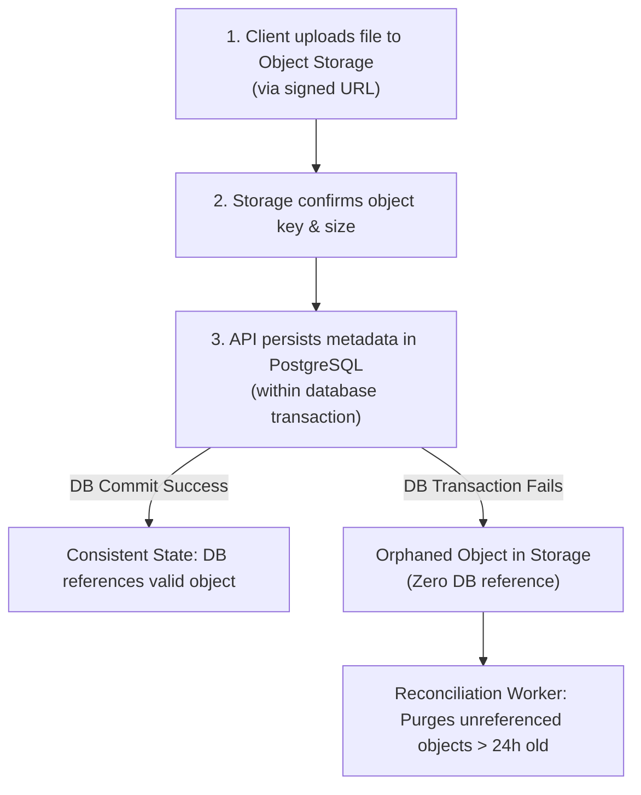

# Backup Policy and Storage Protection Strategy

**Role / Responsibility:** Principal Database Reliability Engineer and Cloud Storage Architect  
**Last Updated:** November 5, 2026  
**Status:** ACTIVE & APPROVED  
**Scope:** PostgreSQL Database and External Object Storage (Cloudflare R2 / AWS S3).

---

## 1. Executive Summary & Recovery Objectives

The Kinergy Platform maintains a strict, defense-in-depth backup and disaster recovery policy ensuring zero unrecoverable clinical records, audit trails, and financial transactions.

### Key Recovery Metrics (RPO & RTO)

| Environment    | Recovery Point Objective (RPO)                             | Recovery Time Objective (RTO)                          | Tested / Verified Metric                    |
| :------------- | :--------------------------------------------------------- | :----------------------------------------------------- | :------------------------------------------ |
| **Staging**    | **< 24 Hours** (Daily snapshot)                            | **< 15 Minutes**                                       | **Verified: 1.31 seconds** restore duration |
| **Production** | **< 5 Minutes** (Continuous WAL + Daily physical snapshot) | **< 30 Minutes** (Standby failover / snapshot restore) | Architecture verified                       |

---

## 2. PostgreSQL Database Backup Architecture

### 2.1 Backup Types & Frequency

1. **Continuous Write-Ahead Log (WAL) Archiving (Production):**
   - Every transaction log segment (16MB) is shipped continuously to encrypted secondary cloud storage.
   - Enables Point-in-Time Recovery (PITR) to any second within the retention window.
2. **Daily Logical / Custom-Format Snapshots (Staging & Production):**
   - Captured via `pg_dump --format=custom --blobs` daily at 02:00 UTC during off-peak hours.
   - Includes custom compression, table dependencies, and blobs.
3. **Pre-Migration Snapshots (Ad-Hoc):**
   - Automatically executed immediately prior to applying schema migrations.

### 2.2 Retention Schedule

- **Staging:** 7 days rolling retention. Older backups purged automatically by `backup-staging-db.ps1`.
- **Production:**
  - Daily snapshots: 30 days retention.
  - Weekly snapshots: 90 days retention.
  - Monthly snapshots: 12 months retention (compliance and financial audits).

### 2.3 Encryption & Security

- **Encryption in Transit:** TLS 1.3 for all database dump streams and replication links.
- **Encryption at Rest:** AES-256 server-side encryption (`aws:kms` or Cloudflare R2 default SSE-S3 encryption).
- **Integrity Verification:** Every dump file generates a companion `.sha256` checksum file immediately upon completion.
- **Access Restrictions:** Backup storage buckets are completely isolated from standard application roles. Only dedicated backup service accounts retain write permissions; read/restore permissions require SRE / DBA elevation.

---

## 3. Object Storage Backup & Versioning Strategy

### 3.1 Cloudflare R2 / S3 Storage Protection

- **Object Versioning:** Enabled on media buckets (`kinergy-staging-media` and `kinergy-prod-media`). Overwriting or deleting an object creates a historical version rather than permanently erasing the data.
- **Accidental Deletion Protection:** Bucket policies prohibit permanent object purges without multi-factor authorization (MFA Delete).
- **Lifecycle Retention Policy:** Non-current object versions are retained for 30 days before transitioning to cold storage or permanent deletion.

### 3.2 Database & Media Object Consistency (Cross-System Integrity)

Because PostgreSQL and external object storage are physically distinct systems, atomic two-phase commit across both is not feasible. Kinergy enforces the following invariants to prevent inconsistency:

#### Consistency Invariants:

1. **Upload Before Record Creation:** The physical object is written and acknowledged in object storage _before_ the database transaction commits the file reference.
2. **Orphan Tolerance Over Dangling References:** It is acceptable to have an orphaned object in storage that is not referenced in the database, but it is **UNACCEPTABLE** to have a database record pointing to a missing storage object.
3. **Soft-Delete Invariant:** Deleting a document or client record marks the database record as deleted (`deleted_at`); the underlying object in storage is NOT deleted synchronously. An asynchronous retention worker purges storage objects only after compliance retention windows lapse.
4. **Temporal Divergence Assessment (Backing Up DB vs Storage at Different Times):**
   - If the database backup is captured at 02:00 UTC and object storage is snapshotted at 03:00 UTC, a database restore will restore metadata to 02:00 UTC. Any objects uploaded between 02:00 and 03:00 UTC will exist in storage but will simply be unreferenced (safe orphan state).
   - If storage is snapshotted at 01:00 UTC and DB at 02:00 UTC, files uploaded between 01:00 and 02:00 UTC would be missing upon restore. **Rule:** Storage versioning must always retain objects across the entire database retention window so any past database state can find its corresponding media versions.

---

## 4. Automated Backup Verification Drill Schedule

1. **Daily Checksum Verification:** Automated verification comparing `.dump` file hash against `.sha256` digest.
2. **Weekly Automated Restore Drill (Staging):** An automated scheduled CI task restores the latest staging backup into an isolated ephemeral container and verifies database connectivity.
3. **Quarterly Disaster Recovery Simulation (Production):** The SRE and DBRE teams conduct a full-scale simulated disaster recovery drill restoring production WAL archives to an isolated VPC and validating business transactions.
