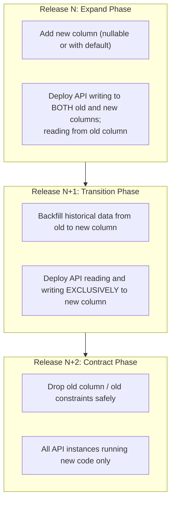

# Database Migration and Recovery Procedures

**Role / Responsibility:** Principal Database Reliability Engineer (DBRE) and Technical Documentation Lead  
**Last Updated:** November 5, 2026  
**Status:** ACTIVE & VERIFIED  
**Scope:** PostgreSQL Schema Lifecycle, Migrations, Failure Handling, and Disaster Recovery.

---

## 1. Principles of Database Evolution

1. **Role Least-Privilege Separation:**  
   Schema changes must be applied exclusively by `kinergy_migrator`. The runtime application role (`kinergy_app`) has DDL revoked (`CREATE TABLE`, `ALTER TABLE`, `DROP TABLE` trigger PostgreSQL error `42501`).
2. **Expand-and-Contract Pattern (Zero-Downtime):**  
   Destructive schema changes (renaming columns, dropping columns, changing types) are prohibited in single-step releases. They must be phased across multiple releases using the Expand-and-Contract model.
3. **Mandatory Pre-Migration Snapshot:**  
   Before running `prisma migrate deploy`, a physical or custom-format logical backup with checksum verification must be created.
4. **Prisma Rollback Reality:**  
   Prisma does not support automatic down migrations. A failed migration or incompatible schema cannot simply be "undone" by a script. Recovery requires either an additive corrective forward migration or restoring the pre-migration database snapshot.

---

## 2. Expand-and-Contract Migration Workflow

When modifying an existing schema attribute used by active production traffic:



### Expand-and-Contract Rules:

- **Adding a Not-Null Column:** Must provide a `DEFAULT` value or be introduced as nullable first, populated, and then altered to `NOT NULL` in a subsequent release.
- **Renaming a Column:** Add the new column, dual-write in the API layer, backfill data, switch reads to the new column, and finally drop the old column.
- **Never Drop in the Same Release:** Never drop columns or tables in the same release where application code stops referencing them, as rolling deployments maintain overlapping versions.

---

## 3. Migration Execution Procedure

### Step 1: Pre-Migration Backup

Verify and execute backup using the staging or production backup automation:

```powershell
# PowerShell (Windows / Staging)
powershell -ExecutionPolicy Bypass -File ./infrastructure/scripts/backup-staging-db.ps1

# Bash (Linux / Production)
./infrastructure/scripts/backup-staging-db.sh
```

Verify exit code is 0 and checksum file is generated.

### Step 2: Validate Migration Delta

Inspect pending migrations against the target database:

```bash
# Review migration status
DATABASE_URL="postgresql://kinergy_migrator:${MIGRATOR_PASSWORD}@${DB_HOST}:${DB_PORT}/${DB_NAME}?schema=public" \
  pnpm prisma migrate status
```

Verify that:

- Database schema is up to date with past migrations.
- Only the intended new migration directories are marked pending.

### Step 3: Execute `prisma migrate deploy`

Execute migration deploy using the `kinergy_migrator` identity:

```bash
DATABASE_URL="postgresql://kinergy_migrator:${MIGRATOR_PASSWORD}@${DB_HOST}:${DB_PORT}/${DB_NAME}?schema=public" \
  pnpm prisma migrate deploy
```

_Expected output:_ `14 migrations have been successfully applied.`

### Step 4: Post-Migration Verification

Execute smoke query verifying `_prisma_migrations` records the applied migration:

```sql
SELECT migration_name, finished_at, rolled_back_at, logs
FROM _prisma_migrations
ORDER BY started_at DESC
LIMIT 3;
```

Verify `rolled_back_at` is `NULL` and `finished_at` is populated.

---

## 4. Failure Scenarios & Recovery Runbook

### Scenario A: Migration Fails During Execution (Syntax / Lock Timeout)

**Symptoms:** `prisma migrate deploy` exits with code 1. `_prisma_migrations` marks migration with `rolled_back_at IS NOT NULL` or incomplete state.

**Action Plan:**

1. **DO NOT DEPLOY NEW API CODE.** The existing API running current code is still operating.
2. Inspect failure logs:
   ```bash
   pnpm prisma migrate status
   ```
3. If the failure was a lock timeout (e.g. concurrent heavy table access), wait for off-peak hours and retry.
4. If the failure was a SQL syntax or constraint violation error:
   - Resolve the underlying SQL error in migration file.
   - If the migration partially executed statements before failing:
     - Mark migration as rolled back in Prisma: `pnpm prisma migrate resolve --rolled-back "<migration_name>"`.
     - Correct the SQL migration.
     - Re-apply using `pnpm prisma migrate deploy`.

### Scenario B: Incompatible Schema Applied / Data Corruption Detected

**Symptoms:** Migration completed successfully, but newly deployed API reports data corruption, or business queries fail with schema conflicts.

**Decision Gate: Forward-Fix vs Database Restore:**

- **When to Apply Forward-Fix:**  
  If the schema change did not destroy or overwrite existing columns (pure additive change), write a corrective additive migration (`prisma migrate deploy`) and hotfix the API.
- **When to Execute Full Database Restore:**  
  If a destructive query ran (e.g. `DROP TABLE`, un-backed-up `TRUNCATE`, bad `UPDATE ... SET` without WHERE clause), **IMMEDIATELY STOP WRITES** and initiate database restoration from the pre-migration snapshot.

---

## 5. Emergency Database Restoration Procedure

If a database restore is required:

1. **Stop Application Ingress:** Put Nginx or Cloudflare in maintenance mode (`503 Maintenance in Progress`).
2. **Terminate Active Database Connections:**
   ```sql
   SELECT pg_terminate_backend(pid)
   FROM pg_stat_activity
   WHERE datname = 'kinergy_staging' AND pid <> pg_backend_pid();
   ```
3. **Execute Restore Script:**
   ```powershell
   powershell -ExecutionPolicy Bypass -File ./infrastructure/scripts/restore-staging-db.ps1 -BackupFile ./backups/staging/kinergy_staging_<timestamp>.dump
   ```
4. **Verify Restored Schema and Row Counts:**
   ```sql
   SELECT count(*) FROM _prisma_migrations WHERE rolled_back_at IS NULL;
   SELECT count(*) FROM users;
   SELECT count(*) FROM clients;
   ```
5. **Re-point API to Restored Database and Remove Maintenance Mode.**
