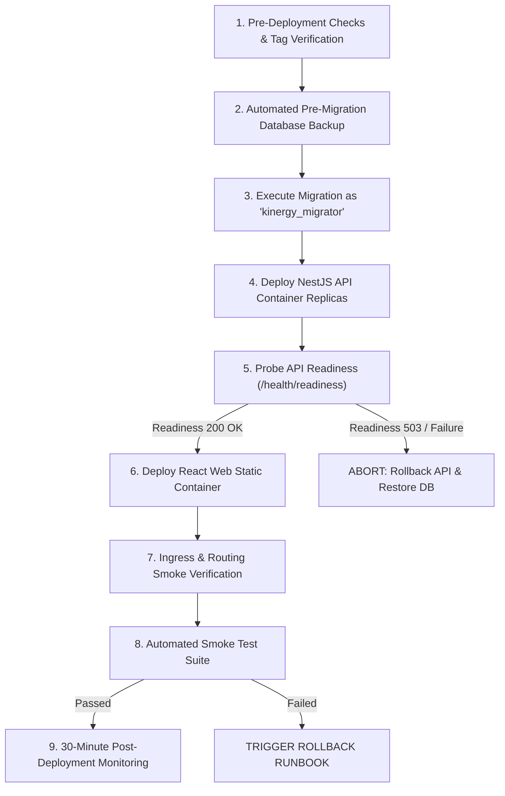

# Production Deployment Runbook

**Role / Responsibility:** Principal Site Reliability Engineer and Platform / DevOps Lead  
**Last Updated:** November 5, 2026  
**Status:** ACTIVE & VERIFIED  
**Scope:** Staging and Production Application Deployments for Kinergy Platform.

---

## 1. Overview & Golden Rules

This runbook provides an executable, ordered, step-by-step procedure for deploying releases to Kinergy staging and production environments.

### Golden Rules of Deployment

1. **Never run database migrations from application container startup:**  
   Migrations must be executed as a dedicated, isolated pre-deployment job by the authorized role (`kinergy_migrator`). API replicas running as `kinergy_app` do not have DDL privileges.
2. **Backward-Compatible Schema Changes Only (Expand and Contract):**  
   Every schema change must be backward-compatible with the currently running application code before the new code is deployed.
3. **Automated Backup Before Migration:**  
   A full database backup must be captured and verified immediately prior to executing any database migration.
4. **Zero-Downtime Deployment Order:**  
   Deploy database migrations first (Expand) ➔ Deploy API replicas ➔ Deploy Web replicas ➔ Verify Ingress ➔ Contract old database fields in a later release.
5. **Strict Stop Conditions:**  
   If any health probe fails or error rate exceeds 1% during canary or rolling update, halt immediately and trigger rollback.

---

## 2. Deployment Workflow Diagram



---

## 3. Step-by-Step Deployment Procedure

### Phase A: Pre-Deployment Preparation

#### Step 1: Pre-Deployment Health & Source Checks

1. Verify CI pipeline status for the release commit:
   ```bash
   git status
   git log -1 --format="Commit: %H | Author: %an | Date: %ad"
   ```
2. Verify production monitoring dashboards report all green with 0 active alerts.
3. Confirm scheduled maintenance window (if downtime or high-volume migration is expected).

#### Step 2: Build & Image Tagging Verification

Images must be built in CI, scanned for CVEs, and tagged with both semantic version and Git commit hash:

- API Image: `kinergy-api:${VERSION}` and `kinergy-api:git-${COMMIT_SHA}`
- Web Image: `kinergy-web:${VERSION}` and `kinergy-web:git-${COMMIT_SHA}`

Verify digest integrity:

```bash
docker inspect --format='{{index .RepoDigests 0}}' kinergy-api:${VERSION}
docker inspect --format='{{index .RepoDigests 0}}' kinergy-web:${VERSION}
```

#### Step 3: Environment Configuration Check

Ensure target environment secrets and environment variables are provisioned in the secret manager:

- `NODE_ENV=production`
- `DATABASE_URL` (must NOT point to localhost; verified by `SEC-03`)
- `JWT_ACCESS_SECRET` & `JWT_REFRESH_SECRET` (minimum 32 characters)
- `SWAGGER_ENABLED=false`
- `STORAGE_PROVIDER=s3`

---

### Phase B: Database Migration Phase

#### Step 4: Pre-Migration Backup (MANDATORY)

Execute a pre-migration backup before applying any schema change:

```powershell
# PowerShell (Windows / Staging)
powershell -ExecutionPolicy Bypass -File ./infrastructure/scripts/backup-staging-db.ps1

# Bash (Linux / Production)
./infrastructure/scripts/backup-staging-db.sh
```

Verify the generated `.dump` file exists and SHA256 checksum matches:

```bash
ls -lh backups/staging/kinergy_staging_*.dump
```

#### Step 5: Execute Migration as `kinergy_migrator`

Execute Prisma migration deployment as a single, isolated execution task using the `kinergy_migrator` identity:

```bash
# Run migration deploy against target database
DATABASE_URL="postgresql://kinergy_migrator:${MIGRATOR_PASSWORD}@${DB_HOST}:${DB_PORT}/${DB_NAME}?schema=public" \
  pnpm prisma migrate deploy
```

Verify exit code is 0:

```bash
pnpm prisma migrate status
```

_If migration fails, DO NOT proceed to API deployment. Refer to Phase 4 (Database Migration Failure)._

---

### Phase C: Application Workload Deployment

#### Step 6: Deploy NestJS API Container

Deploy new API image version using rolling update or container recreate:

```bash
# Example for Docker Compose staging
docker compose -f docker-compose.staging.yml up -d --no-deps staging-api

# Example for Kubernetes
kubectl set image deployment/kinergy-api api=kinergy-api:${VERSION}
```

#### Step 7: Probe API Health & Readiness

Wait for the API container to pass its readiness probe:

```bash
# Probe liveness (in-memory)
curl -f http://127.0.0.1:3001/api/v1/health/liveness

# Probe readiness (database ping)
curl -f http://127.0.0.1:3001/api/v1/health/readiness
```

_Expected response:_ HTTP 200 `{"status":"ok","database":"ready", ...}`.  
_If readiness returns 503 or times out after 60 seconds, abort deployment._

#### Step 8: Deploy Web Application Container

Deploy the static web application container:

```bash
# Example for Docker Compose staging
docker compose -f docker-compose.staging.yml up -d --no-deps staging-web

# Example for Kubernetes
kubectl set image deployment/kinergy-web web=kinergy-web:${VERSION}
```

#### Step 9: Ingress & Reverse Proxy Verification

Verify the public reverse proxy routes traffic correctly:

```bash
# Verify Web SPA index
curl -sI http://localhost:8081/ | grep "HTTP/1.1 200 OK"

# Verify API reverse proxy path routing
curl -sI http://localhost:8081/api/v1/health/readiness | grep "HTTP/1.1 200 OK"

# Verify Ingress liveness probe
curl -s http://localhost:8081/healthz | grep "healthy"
```

---

### Phase D: Post-Deployment Smoke Tests & Monitoring

#### Step 10: Execute Synthetic Smoke Tests

Execute smoke tests against the deployed environment:

1. **Health Check:** `GET /api/v1/health/readiness` ➔ 200 OK.
2. **Authentication Flow:** Authenticate using synthetic test credentials (`reception@kinergy.test`) ➔ 200 OK + JWT access token received.
3. **Core Read Flow:** Retrieve client list (`GET /api/v1/clients`) with bearer token ➔ 200 OK + JSON array.
4. **Static Assets:** Request `/assets/index-*.js` ➔ 200 OK with `Content-Type: application/javascript`.
5. **Security Headers:** Inspect response headers for `X-Frame-Options: DENY`, `Strict-Transport-Security`, and CSP.

#### Step 11: 30-Minute Soak & Monitoring Window

Monitor operational metrics for 30 minutes following deployment:

- **Error Rate:** HTTP 5xx error rate must remain < 0.1%.
- **Response Latency:** p95 latency must remain < 300ms.
- **Database Connections:** Connection pool utilization must remain < 50%.
- **Log Errors:** Check container logs for unhandled exceptions:
  ```bash
  docker logs --tail 200 -f kinergy-staging-api | grep "ERROR"
  ```

---

## 4. Rollback Decision Matrix

| Trigger / Condition            | Threshold                               | Immediate Action                                      |
| :----------------------------- | :-------------------------------------- | :---------------------------------------------------- |
| **Readiness probe failure**    | Fails for > 60 seconds after deployment | Revert API container to previous image tag.           |
| **5xx Error Rate Spike**       | > 1% of total requests over 3 minutes   | Revert Web and API images; investigate logs.          |
| **Database Migration Failure** | Prisma exit code != 0 or syntax error   | Halt deployment immediately; investigate DB state.    |
| **Latency Degradation**        | p95 latency > 1,500ms over 5 minutes    | Scale API or rollback to previous image tag.          |
| **Critical Business Bug**      | Payments or scheduling flow broken      | Authorize emergency rollback with Incident Commander. |
