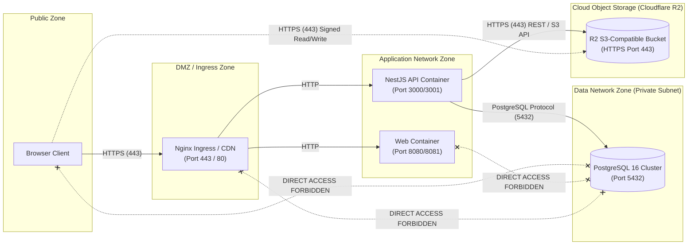

# Environment Architecture & Network Topologies

**Role / Responsibility:** Principal Site Reliability Engineer and Platform Architect  
**Last Updated:** November 5, 2026  
**Status:** ACTIVE & APPROVED  
**Scope:** Kinergy Platform Architecture (Staging and Production Environments).

---

## 1. High-Level Architecture Overview

Kinergy employs a decoupled, multi-tier containerized architecture separating the browser-facing Single Page Application (SPA), the NestJS API gateway, the PostgreSQL database engine, and external S3-compatible object storage.

```
[ Browser / Untrusted Client ]
              │ (HTTPS / TLS 1.3)
              ▼
    [ Reverse Proxy / Ingress ]
       ├── (/*)     ──► [ Static Web SPA (Vite / Nginx) ]
       └── (/api/*) ──► [ NestJS API Gateway ]
                             │
            ┌────────────────┴────────────────┐
            ▼ (TCP / Port 5432)               ▼ (HTTPS / Signed URLs)
    [ PostgreSQL 16 ]               [ Cloudflare R2 / S3 Storage ]
```

---

## 2. Component Specifications

### 2.1 Web Application Tier

- **Technology:** React 18, Vite, TypeScript, Tailwind CSS, Lucide icons.
- **Serving:** Static assets pre-compiled into `dist/apps/web` and served via Nginx with HTML5 push-state SPA routing fallback (`try_files $uri $uri/ /index.html`).
- **Security:** Zero client-side source maps emitted in production (`sourcemap: false`); zero server-side environment secrets embedded (validated via `checkForbiddenSecrets`).
- **Port:** Staging: `8081`, Production: `8080`.

### 2.2 API Application Tier

- **Technology:** NestJS 10, Node.js 20 LTS (Alpine Linux).
- **Architecture:** Clean Hexagonal Architecture, CQRS handlers, Prisma ORM.
- **Global Path Prefix:** `api/v1` (enforced via `app.setGlobalPrefix('api/v1')`).
- **Security Middleware:** OWASP Helmet (strict CSP, HSTS, X-Frame-Options: `DENY`), CORS guard, `ThrottlerGuard` rate limiter, `GlobalSanitizationValidationPipe`, `GlobalExceptionFilter`.
- **Port:** Staging: `3001` (host) / `3000` (container), Production: `3000`.

### 2.3 Reverse Proxy & Ingress Tier

- **Technology:** Nginx 1.25+ Alpine.
- **Routing Rules:**
  - `/api/*` proxies upstream to NestJS API (`http://api:3000`). Preserves path prefix without rewrite.
  - `/*` serves static web assets with SPA fallback.
  - `/healthz` responds directly with `200 "healthy\n"` for container orchestrator liveness checks.
- **Traffic Controls:** `client_max_body_size 10M`, connection keepalive 65s, strict buffer limits (`client_body_buffer_size 128k`).

### 2.4 PostgreSQL Database Tier

- **Version:** PostgreSQL 16 Alpine.
- **Isolation:** Staging and production reside in entirely independent database clusters and networks.
- **Least-Privilege Roles:**
  - `kinergy_admin` / `kinergy_staging_admin`: Cluster provisioning superuser.
  - `kinergy_migrator`: Dedicated role with DDL permissions (`CREATE`, `ALTER`, `DROP`) used exclusively during migration steps.
  - `kinergy_app`: Runtime application role granted only DML (`SELECT`, `INSERT`, `UPDATE`, `DELETE`). Schema `CREATE` revoked (DDL attempts yield error `42501`).
  - `kinergy_test`: Isolated automated acceptance test role.

### 2.5 Object Storage Tier

- **Provider:** Cloudflare R2 (S3-compatible API).
- **Access Model:** Private buckets by default. No public read ACLs.
- **Integration:** Hexagonal `ObjectStoragePort` with `S3StorageAdapter` using `@aws-sdk/client-s3`.
- **Tenant Isolation:** Hierarchical object key naming: `tenants/{tenantId}/{domain}/{uuid}-{filename}`.
- **Access Mechanism:** Short-lived presigned URLs (900 seconds TTL default; 300 seconds for sensitive clinical records).
- **Offline Fallback:** `LocalStorageAdapter` available for offline testing and air-gapped development.

### 2.6 Secret Management

- **Staging:** Injected via repository-isolated GitHub Actions secrets and environment files (`.env.staging`). Never committed to Git.
- **Production:** Injected at container runtime from managed secret store (AWS Secrets Manager, GCP Secret Manager, or HashiCorp Vault).
- **SEC-03 Production Invariant:** Production API validation strictly rejects any `DATABASE_URL` pointing to `localhost` or `127.0.0.1`.

### 2.7 Logging & Observability Tier

- **Format:** Structured single-line JSON logs emitted to standard output (`stdout`/`stderr`).
- **Data Protection:** Automatic redaction of JWT tokens, credit card numbers, and database connection strings in `GlobalExceptionFilter`.
- **Operational Probes:**
  - Liveness: `/health/liveness` (in-memory, zero DB queries).
  - Readiness: `/health/readiness` (PostgreSQL `SELECT 1` with 2000ms timeout).

### 2.8 CI/CD Pipeline

- **Orchestration:** GitHub Actions workflow (`.github/workflows/ci.yml`).
- **Quality Gates:** Prettier format check, ESLint across 10 packages, TypeScript typecheck (`tsc --noEmit`), unit/integration/acceptance test suites, Docker image container builds.

---

## 3. Environment Separation Matrix

| Attribute               | Staging Environment                                           | Production Environment                                                                 |
| :---------------------- | :------------------------------------------------------------ | :------------------------------------------------------------------------------------- |
| **Compute Context**     | Dedicated Docker Compose stack (`docker-compose.staging.yml`) | Managed Container Orchestration / Production Compose (`docker-compose.production.yml`) |
| **Host Ports**          | API: `3001`, Web: `8081`, DB: `5434`                          | API: `3000` (internal), Web: `8080`, DB: `5435` / Private VPC                          |
| **Database Host**       | `staging-postgres:5432` / host port `5434`                    | Dedicated PostgreSQL 16 cluster on private subnet                                      |
| **Database Name**       | `kinergy_staging`                                             | `kinergy_prod`                                                                         |
| **Database Encryption** | Volume encryption at rest                                     | Cloud KMS volume encryption + TLS 1.3 `sslmode=verify-full`                            |
| **Storage Bucket**      | `kinergy-staging-media` (Cloudflare R2)                       | `kinergy-prod-media` (Cloudflare R2 / AWS S3)                                          |
| **Storage Provider**    | Cloudflare R2 / Local fallback                                | Cloudflare R2 (Versioning & Object Lock enabled)                                       |
| **Swagger UI**          | Controlled via `SWAGGER_ENABLED` (Default: `false`)           | Permanently disabled (`SWAGGER_ENABLED=false`)                                         |
| **Public Ingress**      | Restricted VPN / Staging domain                               | Public CDN / Cloudflare WAF + TLS Termination                                          |
| **Data Retention**      | 7-day backup retention, synthetic data only                   | 30-day daily backups, 12-month monthly archives, continuous WAL                        |

---

## 4. Network Traffic Direction & Firewall Rules



### Ingress Firewall Policies:

1. **Public to Data Zone:** Port 5432 must NEVER be accessible from the public internet. Only the application container network may communicate with PostgreSQL.
2. **Web to Database:** The static web container has no database drivers or credentials and cannot access the database network.
3. **Database Egress:** The database engine has zero outbound internet access.
